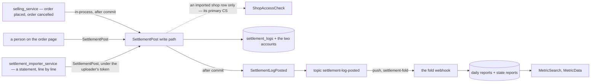
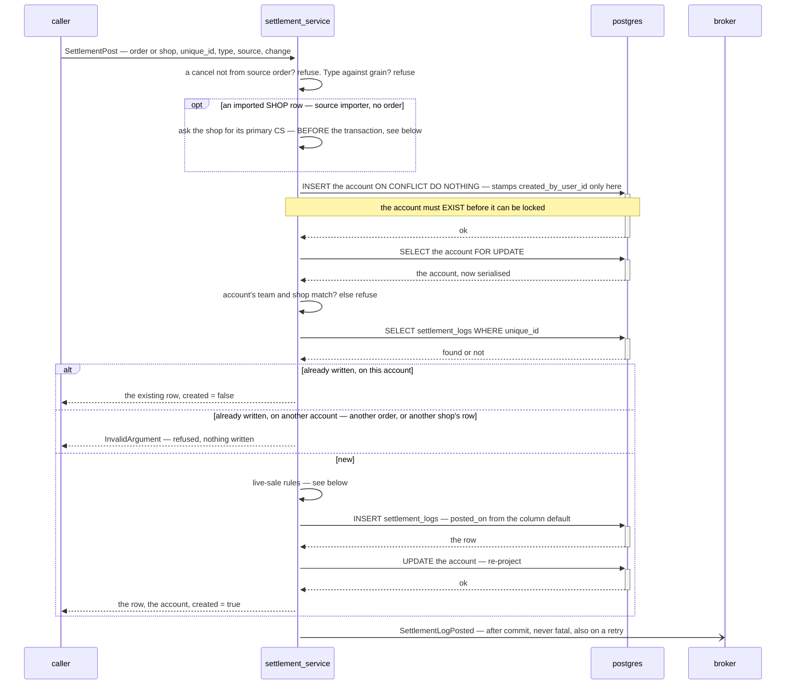
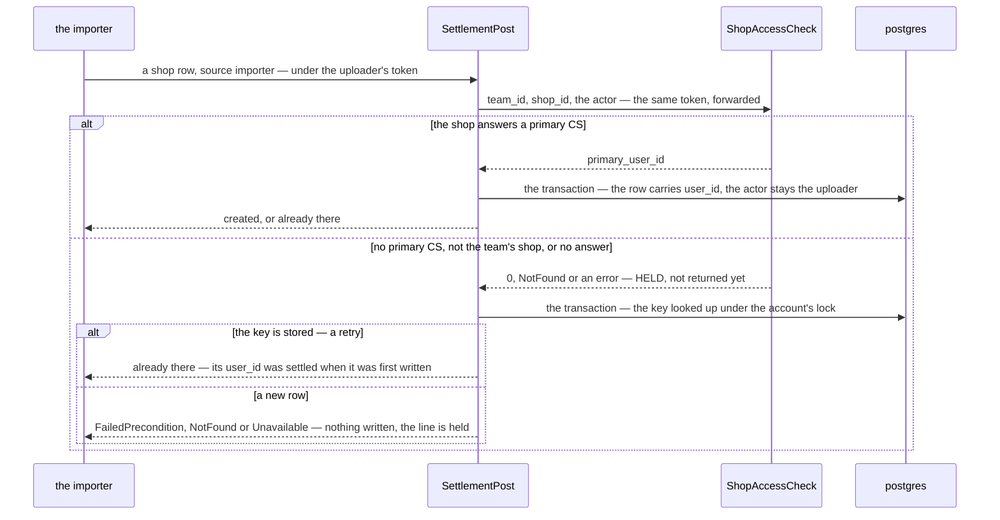
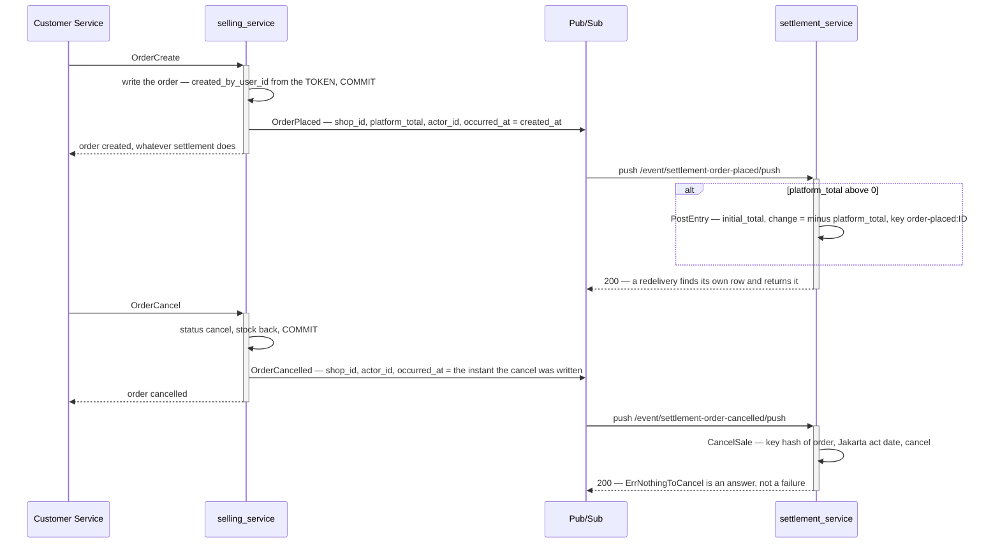
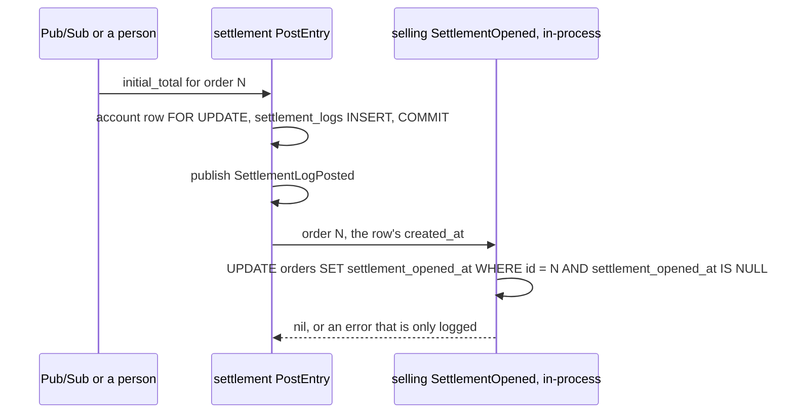
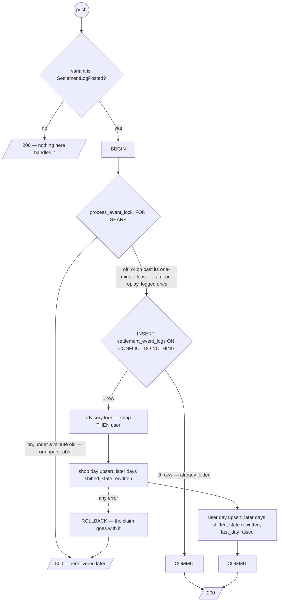
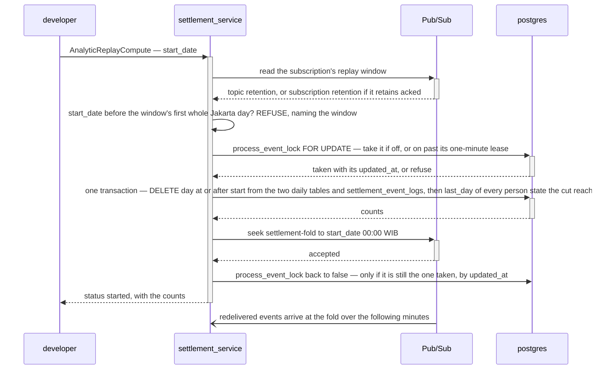
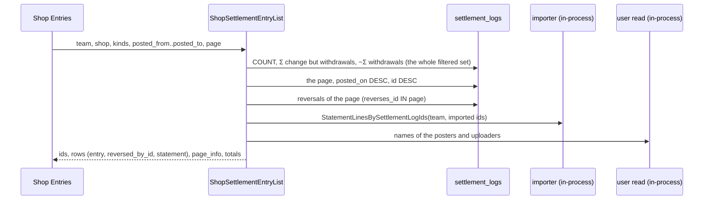
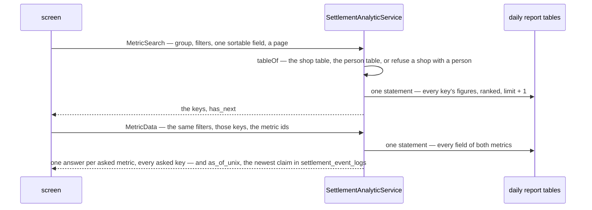
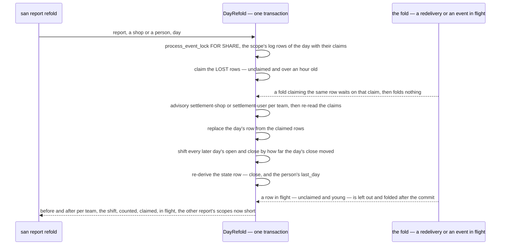

# settlement_service — RPC flows

The ledger of **what the marketplace pays us** for an order, and the reports folded from it.

> ⚠ **Not [liability_service](../liability_service/rpc.md)**, which is what TEAMS OWE EACH OTHER. That
> service held this name until 2026-08-28. Both are order-aware ledgers with a state projection; only
> this one is **allowed to never balance**.

| service | RPC | what it is |
| --- | --- | --- |
| `SettlementService` | `OrderSettlementList` | the list screen — one row per order, ranked by loss |
| `SettlementService` | `OrderSettlementDetail` | the ledger tab on the order page — one account plus its whole log |
| `SettlementWriteService` | `SettlementPost` | append one row. **Idempotent** on `unique_id`, global |
| `SettlementAnalyticService` | `MetricSearch` | rank a page of keys — teams, shops, people or periods — by one field of one settlement metric |
| `SettlementAnalyticService` | `MetricData` | fill those keys with both metrics' figures — or, grouped by `SUMMARY`, the headline |
| `SettlementAnalyticMaintenanceService` | `AnalyticReplayCompute` | rebuild the reports from a date by seeking the broker |
| `SettlementAnalyticMaintenanceService` | `AnalyticMaintenanceRun` | prune the dedup table |
| *(push route)* | `/event/settlement-fold/push` | the fold — `SettlementLogPosted` into the report tables |

**Why four proto services.** A service is mounted whole, so reads, the write, the reports and the
maintenance each got their own: the maintenance pair is `[ROOT, ADMIN]` only, and splitting it keeps
that policy from sitting beside team-scoped reads.

---

## SettlementPost — the only write

**One write path for three writers**, differing only in `source_type` — `importer`, `manual`, `order`
([the-source-is-named-importer](../../business/settlement/settlement_importer_decision.md#the-source-is-named-importer)).
All three retry: the importer re-imports an overlapping statement, a person double-submits, and
Pub/Sub redelivers an order's event. `PostEntry` and `CancelSale` are the same path, called in-process by the order events' push handler.

### The money is a double, stored exact as it posts (settlement 00010)

Every rupiah this service holds — `settlement_logs.change`/`balance`, both accounts, both daily reports and both state
reports — is `double precision` in the database and `double` on the wire since 2026-11-06
([every-ledger-moves-to-double-rounded-when-frozen](../../business/order/context_decision.md#every-ledger-moves-to-double-rounded-when-frozen)).
**Posting is the freeze point**: `postEntry` refuses NaN and the infinities (`double.finite` on the wire, `errChangeNotFinite`
for an in-process caller) and stores `change` **exact** — never rounded ([the-backend-never-rounds-money](../../business/order/context_decision.md#the-backend-never-rounds-money), 2026-11-06; it rounded to whole
rupiah before) — so every balance, report and metric below is a sum of exact doubles, equal to the log within the
tolerance. Nothing downstream rounds: the fold adds the posted change as it is, and `MetricData` / `MetricSearch` serve
the folded sums. `OrderSettlementList` tells an unrecorded sale by `abs(initial_total) < 0.00005` (`san_money.ZeroBelow`),
never `= 0`. Comparisons on these doubles use
`san_money.Equal` / `IsZero` (4 places), never `==` — the over-cancel check, the re-fold's *same figures* and its carry.
`SettlementLogPosted.change`/`balance` are doubles too; an event published while they were int64 still reads (protojson
quoted the number, which a double accepts).

### An imported shop row asks the shop — before the transaction

[settlement-asks-the-shop-for-its-primary-cs](../../business/settlement/settlement_importer_decision.md#settlement-asks-the-shop-for-its-primary-cs):
a row the importer posts to a SHOP counts, in the per-user report, for the shop's primary CS. Settlement asks
the shop itself and writes the person on the row as `user_id`; the importer passes no person. **Its one call
into another service.**

| | |
| --- | --- |
| which rows ask | an imported shop row only — an order row counts for its stamped creator, and a shop row posted by hand for its actor |
| when | ⚠ **before** the transaction — never while the shop's account row is locked `FOR UPDATE`, or every post on the shop waits on the network |
| how | `ShopPrimary`, an interface settlement owns; the composition root answers it with a Connect client to `ShopAccessCheck` that forwards the caller's token (`san_auth.ForwardBearer`). A client, not the handler in-process: the shop lives in `selling_service`, which calls settlement on every placed order, so holding it would be a cycle — and the shop moving to its own service (the-shop-gets-its-own-service) changes only the adapter |
| a failed ask | a NEW row is **refused**, with the ask's reason — never a quiet fallback to the actor, which would count the row for the wrong person for good. ⚠ The failure is **held** until the transaction's idempotency check, so a RETRY of a stored row is answered from the ledger whatever the shop says: the retry this RPC absorbs, and the re-post that republishes a lost event, never depend on the shop being up |
| carried | `user_id` is on `SettlementLogPosted`, and the fold counts a shop row for it when set — a replay folds the person the row was written with, never asking again |
| the cost | one call per imported shop row — a whole Shopee file when no order is found, and a retry asks too. [The performance audit](../../../audits/services/settlement_service/performances/SettlementPost.md) finds it heavy by the N+1 rule. A cache per `(team, shop)` is its open question |

### The live-sale rules — read under the account's lock

| rule | why |
| --- | --- |
| a second `initial_total` is **refused** while one is live — unless it carries `reverses_id` | a second sale ADDS rather than replaces, and manual posting is the repair path ([a-missing-account-is-fixed-by-hand](../../business/settlement/context_decision.md#a-missing-account-is-fixed-by-hand)). Reverse first, then repost |
| an `initial_total_cancel` may never exceed the live sale | the live sale would go negative and every screen would read a sale of less than nothing |
| `CancelSale` takes its amount FROM the live sale | a person may have corrected the sale since placement — cancelling the order's original figure would cancel the wrong number |
| the idempotency check runs BEFORE these rules | a retried cancel finds its own row, instead of being refused because the sale is now zero |

### A reversal — the opposite, once (2026-11-07)

A row with `reverses_id` must name a row of the **same account** (an order's, or — `order_id IS NULL AND shop_id = ?` —
the shop's), carry **its type and the opposite amount** (`san_money.Equal(change, −reversed.change)`,
[a-correction-is-a-new-row](../../business/settlement/context_decision.md#a-correction-is-a-new-row)), and the row must
not be reversed already ([a-shop-entry-reverses-inline](../../technical/frontend/settlement_report_decision.md#a-shop-entry-reverses-inline):
*"a row already reversed shows so and offers no second Reverse"*). The last is read by `reverses_id`
(`settlement_logs_reverses_idx`, 00011) **under the account's lock**, so two reversals of one row under different keys
serialise and the second is refused (`TestRace_SettlementPost_AShopEntryIsReversedOnce`); the same key twice is the
first one's retry, answered by the idempotency lookup before any of this. Both ledgers' Reverse use the key
`reverse-<id>` — the order's ledger and Shop Entries.

### The event

`SettlementLogPosted` carries the **whole row** plus `order_created_by_user_id`. `event_id` is
`settlement-log:<log_id>`, so a retried publish collides in every consumer's dedup. A publish failure is
logged and never fails the post; re-posting the same `unique_id` republishes it.

### Errors

| code | when |
| --- | --- |
| `PermissionDenied` | a cancel from a non-`order` source · the account belongs to another team |
| `FailedPrecondition` | a second live sale · a cancel exceeding the live sale · `CancelSale` with nothing live (`ErrNothingToCancel`) · a reversal of a row already reversed |
| `InvalidArgument` | a `change` that is NaN or infinite · unknown type or source · a bad date · a shop that disagrees with the account · `reverses_id` naming nothing on this account · a reversal that is not the reversed row's type and opposite amount · a sale with no order · a `system_adjustment` on an order · a `unique_id` already used on another account |
| `Internal` | the database |

---

## order_service → settlement_service (cross-service, by event)

`selling_service` **never calls** settlement. It publishes the order's events, and settlement opens and cancels the
order's account from them on its OWN two push subscriptions
([settlement-opens-the-sale-from-the-order-event](../../business/settlement/context_decision.md#settlement-opens-the-sale-from-the-order-event)):
`settlement-order-placed` and `settlement-order-cancelled`, beside liability's on the same topics. Neither service
imports the other, and a settlement outage loses nothing — Pub/Sub delivers again.

| | |
| --- | --- |
| **the order never waits on settlement** | [the-order-commits-without-settlement](../../business/settlement/context_decision.md#the-order-commits-without-settlement) — by construction now: it only publishes |
| **a settlement failure** | NACKs, so Pub/Sub redelivers, then the dead-letter topic. A lost publish is the accepted cost, repaired by hand ([a-missing-account-is-fixed-by-hand](../../business/settlement/context_decision.md#a-missing-account-is-fixed-by-hand)) |
| **twice** | the keys are derived from the order, so a redelivery collides with its own row (`Created: false`) and is ACKed |
| **`platform_total = 0` opens nothing** | 0 means NOT RECORDED. Placement refuses a 0 on both doors since selling `00022` ([platform-total-is-required-at-finalize](../../business/order/context_decision.md#platform-total-is-required-at-finalize)), so a new order never arrives with one — the skip stays as the guard for orders placed before that |
| **the cancel's key is the ACT's date** | [the-cancel-key-is-order-plus-act-date](../../business/settlement/context_decision.md#the-cancel-key-is-order-plus-act-date) — the event's `occurred_at`, the instant the cancel was written, so a redelivery after midnight produces the same key |
| **the creator** | the event's `actor_id` — `orders.created_by_user_id`, from `san_auth.GetIdentity` at placement — copied onto the account by the opening post and never again |
| **the handler** | `OrderSaleHandler` in [order_sale.go](../../../backend/services/settlement_service/settlement_v1/order_sale.go), one handler behind both routes, switching on the variant |
| **the order learns it opened** | after any committed `initial_total` on an order — this event, an opening by hand, an imported statement — `markOpened` tells the order service in-process (`OrderOpenedMarker` → `cmd/app_development/settlement_opened_marker.go` → `selling_v1.SettlementOpened`), which stamps `orders.settlement_opened_at` once with the row's `created_at` ([a-missing-account-is-found-by-its-opened-at](../../business/settlement/context_decision.md#a-missing-account-is-found-by-its-opened-at)). After the commit and never fatal, like the publish: a failed stamp leaves the order reading *not opened* — the safe side — and a re-post of the same unique_id (a redelivery does it) stamps it. OrderList's `settlement_not_opened` lists the orders still NULL |

---

## The fold — `/event/settlement-fold/push`

One HTTP push route, mounted directly (not a Connect RPC). ⚠ It authenticates nobody, by decision
([the-event-webhook-is-open](../../business/settlement/context_decision.md#the-event-webhook-is-open)) — a
forged event can only corrupt a projection the replay rebuilds. Restrict the path at the ingress.

| | |
| --- | --- |
| **the day** | the event's `posted_on`, as stored — never re-derived from an instant |
| **the user** | the order's creator for an order row, the actor for a shop row |
| **the lock order** | shop then user, always — one event touches both tables and a mixed order deadlocks under load |
| **an unknown settlement_type** | returns an error, so it dead-letters where a person sees it, rather than being dropped |

---

## AnalyticReplayCompute — `[ROOT, ADMIN]`

| refused when | |
| --- | --- |
| the window cannot be read | a guard that guesses deletes days nothing can rebuild — [the-replay-is-bounded-by-the-subscription-retention](../../business/settlement/context_decision.md#the-replay-is-bounded-by-the-subscription-retention) |
| the window is zero | a seek would deliver nothing, and the replay would only delete |
| `start_date` is older than the window | older damage is repaired with a `system_adjustment` |
| the lock is already held | another replay, under a minute old — past that it is a dead replay's and is taken over ([a-dead-replays-lock-expires-after-a-minute](../../business/settlement/meta_context_decision.md#a-dead-replays-lock-expires-after-a-minute)) |

⚠ **"started", never "done"** — the seek is asynchronous. ⚠ The state tables are not in the delete: they
are derived from the newest daily row on every fold, so each redelivered event re-derives them. The one exception is
`user_settlement_reports.last_day`: the fold only RAISES it, so the replay's transaction recomputes it as `MAX(day)` of
the daily rows it left, for every person state at or after `start_date` — NULL for a person cut to no day, until the
redelivery raises it ([the-person-list-reads-the-last-day-from-the-user-report](../../business/settlement/context_decision.md#the-person-list-reads-the-last-day-from-the-user-report)).

## AnalyticMaintenanceRun — `[ROOT, ADMIN]`

Deletes dedup rows **received** more than 45 days ago. It does **not** take the lock: it deletes old rows
while a live fold inserts a new one, and the two cannot conflict.

---

## The reads

`OrderSettlementList` follows the guideline's list shape — `ids` carries the ranking, map-slices carry
the data. **Sorted worst-loss-first by default**, and the totals are the **whole filtered set**, not the
page.

| sort | SQL (`DESC` shown — the default) |
| --- | --- |
| `LOSS` | `(initial_total = 0), last_balance ASC, order_id DESC` — loss is `−last_balance`, so its DESC is the balance's ASC |
| `INITIAL_TOTAL` | `(initial_total = 0), initial_total DESC, order_id DESC` |
| `RECEIVED` | `(initial_total = 0), (last_balance + initial_total) DESC, order_id DESC` |
| `ORDER_ID` | `order_id DESC` — an id is real whether or not the sale was recorded |

- The direction is the **named measure's**; `UNSPECIFIED` is `DESC`.
- An **unrecorded sale** (`initial_total = 0`) sorts **last** under every money measure, either way, and is
  **left out of both sums** — its balance is payout with nothing to measure against. `total_unrecorded`
  counts it.
- `order_id` breaks ties, so equal rows keep one order across pages. `OrderSettlementDetail` returns the log **oldest first and unpaginated** — it grows with one order's
activity — and an order with no account is **`NotFound`**, never a zeroed row.

### A shop's own rows — `ShopSettlementEntryList` (2026-11-07)

Shop Entries ([the-shop-entries-page-is-accepted](../../technical/frontend/settlement_report_decision.md#the-shop-entries-page-is-accepted)):
the rows addressed to a shop and no order ([an-entry-names-an-order-or-a-shop](../../business/settlement/context_decision.md#an-entry-names-an-order-or-a-shop)).
The settlement read set, `use_scope` on `team_id`; the root team reads every team's, as `scopeOf`.

| | |
| --- | --- |
| rows | `order_id IS NULL`, the team's (`settlement_logs_shop_rows_idx (team_id, posted_on DESC, id DESC) WHERE order_id IS NULL`, 00011) |
| filters | `shop_id` (0 = every shop), `settlement_types` (empty = all eleven; the sale and its cancel are refused — never a shop row), `posted_from` / `posted_to` — the LEARNED day, a Jakarta `DATE`, inclusive ([posted-on-buckets-the-report](../../business/settlement/context_decision.md#posted-on-buckets-the-report)) |
| totals | `page_info.total_items` = Entries; `total_received` = Σ change of every row but withdrawals; `total_withdrawn` = −Σ withdrawals — over the filtered set, never the page ([the-report-headline-is-position-to-date](../../technical/frontend/settlement_report_decision.md#the-report-headline-is-position-to-date)) |
| a row | the `SettlementEntry` (`actor_name` resolved), `reversed_by_id` (0 = not reversed), and `statement` — the importer's line that POSTED it (file id, platform, period, sheet, description, ref, reason `SHOP_LINE` / `NO_ORDER` / `SEVERAL_ORDERS`, found orders, uploader + name); unset for a hand row |
| seams | `StatementSources` → the importer's `StatementLinesBySettlementLogIds`, `UserNames` → `UserByIDs` — both in-process (`cmd/app_development/settlement_shop_entries.go`); settlement reads neither service's tables |

Five queries a page (count+sums, page, reversals, the importer's lines, the names): 1.7 ms at 200 000 log rows a team
(5 000 shop rows), 68 ms without the partial index — `shop_settlement_entry_list_perf_test.go` reads both plans. Not
heavy; no write-up. **Reverse** is SettlementPost of the opposite row (above).

### Who a USER filter offers — `SettlementPersonList`

The Analytic screen's *created by* field over a settlement metric
([a-who-filter-lists-the-people-on-its-rows](../../business/user/context_decision.md#a-who-filter-lists-the-people-on-its-rows)):
one row per person of `user_settlement_reports` in the team (`user_id <> 0`, `last_day IS NOT NULL`), ordered by its
`last_day` — the newest day the person has a daily row on, kept by the fold and the replay
([the-person-list-reads-the-last-day-from-the-user-report](../../business/settlement/context_decision.md#the-person-list-reads-the-last-day-from-the-user-report))
— newest first, the id breaking a tie, paged like `OrderCreatorList`. The root team reads every team's, as `scopeOf`:
a person once, at `MAX(last_day)` over their teams.
MetricData's roles exactly ([whoever-reads-a-list-may-filter-it](../../business/user/context_decision.md#whoever-reads-a-list-may-filter-it)).
Former and suspended people stay. Two queries over one row per (person, team), never the daily rows —
[audit](../../../audits/services/settlement_service/performances/SettlementPersonList.md). The screen unions it by id with
selling's `OrderCreatorList` when order and settlement metrics share the table (`features/analytic/people.ts`).

### The reports — `MetricSearch` / `MetricData`

Two metrics through the analytic pattern ([rpc_provide.md](../../business/analytic/rpc_provide.md)), in
[settlement_analytic.proto](../../../proto/warehouse/settlement/v1/settlement_analytic.proto): `metrics/settlement` —
sales, received, withdrawn, gap, take rate, position to date — and `metrics/settlement/types`, the ten types that make
up received ([settlement-serves-its-headline-and-its-breakdown](../../business/settlement/context_decision.md#settlement-serves-its-headline-and-its-breakdown)).

| | an id — `SHOP`, `TEAM`, `USER` | a period — `DAILY` … `YEARLY` | `SUMMARY` |
| --- | --- | --- | --- |
| table | the shop table; the person table for `USER` or a `USER` filter ([one-settlement-metric-reads-both-tables](../../business/settlement/context_decision.md#one-settlement-metric-reads-both-tables)) | the same | the same |
| keys | every id with a row up to the window's end — a quiet one still ranks. Id 0 (no one recorded) left out | every period of the window, quiet ones included | none |
| movement | Σ over the window | Σ over the period clipped to the window | Σ over the window |
| `position_to_date` | −Σ change over every row of the key up to the window's end — the running sum, `close(D)` by its definition ([the-carry-materialises-the-day-boundary-position](../../business/settlement/context_decision.md#the-carry-materialises-the-day-boundary-position)) | the same, at the clipped period's end: Σ change before the page's first day read once, then each day's change in date order — a period outside the window is zero | at the window's end |
| `take_rate` | gap ÷ sales of the key's own sums; unset with no sale. Sorts, ranking only the keys that sold at least Rp 1.000.000 in the window; the rest follow in key order ([a-take-rate-ranks-above-one-million-of-sales](../../business/settlement/context_decision.md#a-take-rate-ranks-above-one-million-of-sales)) | the same, each period its own sales | the same |
| the range | at most 366 days on every group, both ends counted ([a-metric-reads-at-most-a-year](../../business/analytic/rpc_provide_decision.md#a-metric-reads-at-most-a-year)) | the same — so the 260 weeks · 60 months · 20 years span caps below it no longer bind | the same |
| scope | the team, or every team from the ROOT team — so `TEAM` crosses teams only for ROOT and ADMIN | the same | the same |

`measureSQL` (`metric_shared.go`) is THE definition of every field: the fill selects it and the search orders by it,
so the ranking and the numbers beside it cannot disagree, and `received` is Σ the by-type fields by construction.

| error | when |
| --- | --- |
| `InvalidArgument` | a shop and a person in one request · a metric or field this service does not serve, or a field that cannot sort · a filter or group a metric does not list · a missing date range · a period key that is not its period's first day · a time-group search over the span cap |

✅ **Not heavy since 2026-11-05** — the position is ONE running sum (`timeBase`: `carried` once, `days` once,
`SUM(change) OVER (ORDER BY day)`; `idBase`: one hash aggregate per key), the shape financial_account's series took
([the-balance-series-is-a-running-sum](../../business/analytic/rpc_provide_decision.md#the-balance-series-is-a-running-sum)).
A page of 20 days 273 → 12.5 ms, 200 days 1 596 → 41 ms, 200 shops 233 → 32 ms, the shop ranking 143 → 14 ms — see
[MetricData](../../../audits/services/settlement_service/performances/MetricData.md) and
[MetricSearch](../../../audits/services/settlement_service/performances/MetricSearch.md), both resolved. The reads take the
position from `change`, not from the stored `close_balance`; the two differ only where a carry has drifted.

### The day re-fold — `DayRefold` (not an RPC)

The operator's repair, `san report refold` ([docs/tools/san.md](../../tools/san.md#report-refold),
[a-wrong-day-is-refolded-from-the-log](../../business/settlement/context_decision.md#a-wrong-day-is-refolded-from-the-log)):
one scope's day of a report rebuilt from that day's `settlement_logs` — `settlement-shop-daily` by shop, or
`settlement-user-daily` by person ([the-person-report-refolds-too](../../business/settlement/context_decision.md#the-person-report-refolds-too)).
An in-process method of the service (`settlement_v1/day_refold.go`), like supplier's backfill fold — no wire contract, no
policy.

| | |
| --- | --- |
| the scope's rows | shop: `l.shop_id`. Person: the one the fold counts the row for — the order's creator (`order_settlements.created_by_user_id`) on an order row, `user_id` (an imported row's primary CS) on a shop row, else `actor_id` |
| what counts | every claimed row (the fold's claim, or another re-fold's) + every unclaimed row over an hour old, which it claims; a younger unclaimed row is in flight |
| the later days | **shifted** by the day's new close − the close they carried from (the stored close, or the open when the day had no row) — `shiftLaterDays`, the fold's own statement for a late event ([a-refold-shifts-the-later-days](../../business/settlement/context_decision.md#a-refold-shifts-the-later-days)). Their movement is untouched |
| the state row | `deriveState`, the fold's statement, after the shift; the person's `last_day` is recomputed (a re-fold can remove the newest day). A scope left with no row reads close 0 and `last_day` NULL |
| one claim, two reports | a claimed lost row is in THIS report only — the claim stops its redelivery, so the result's `Short` names the other report's scopes and `san` prints their re-fold commands |
| a carry already off | `NextGap`: the next row's open minus this day's close after the shift — non-zero only where that row was already broken; re-folding it closes the gap |
| idempotent | a row equal to the log is not written; a second run shifts nothing (0 difference) |

The reads take the position from the running sum of `change` regardless (above); the shift keeps the stored carry — what
a later fold opens a new day from — true as well.
