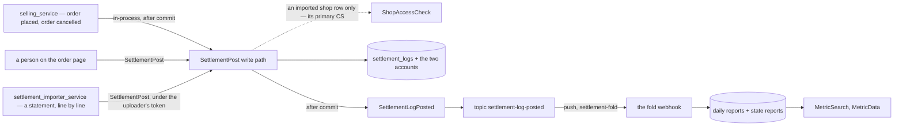
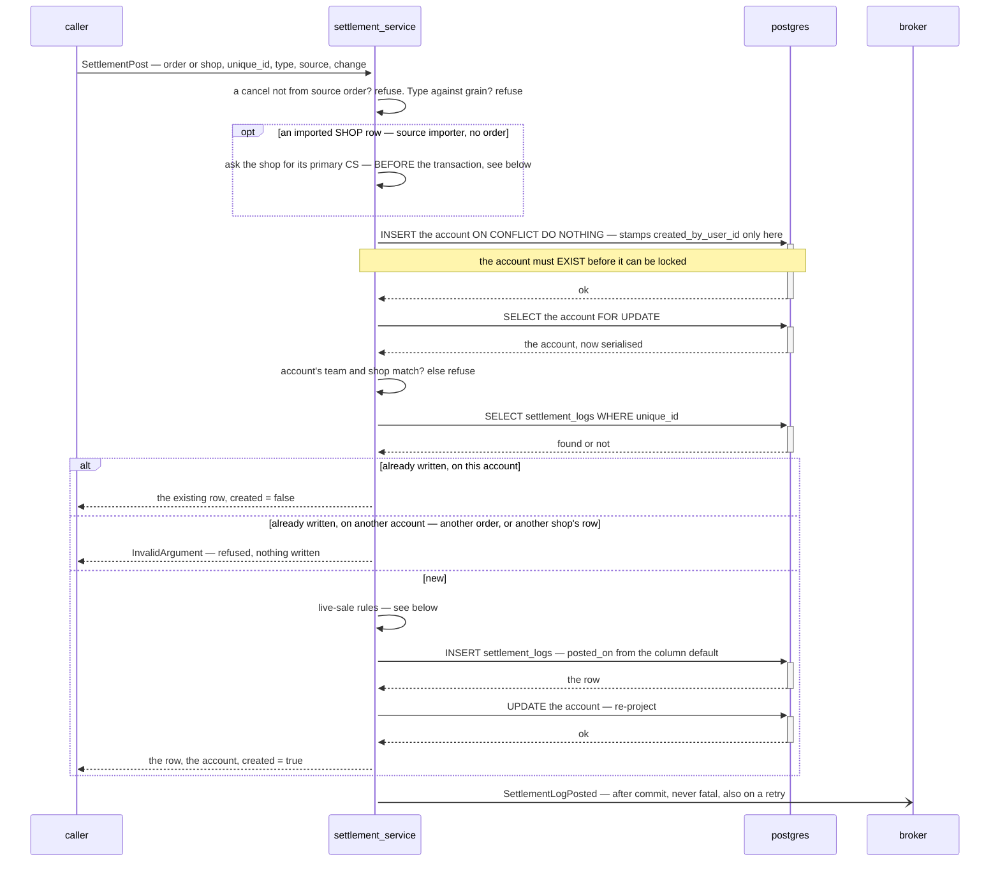
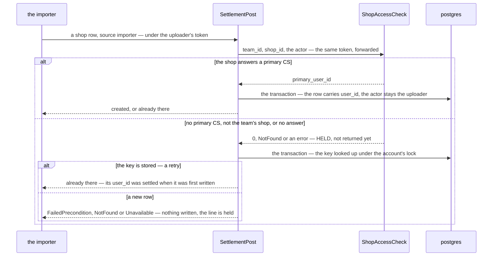
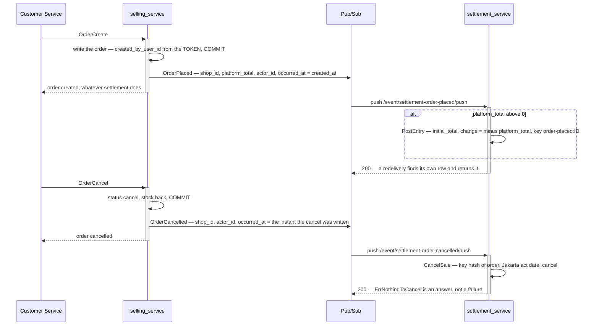
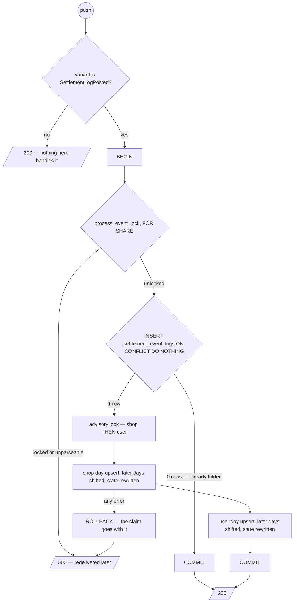
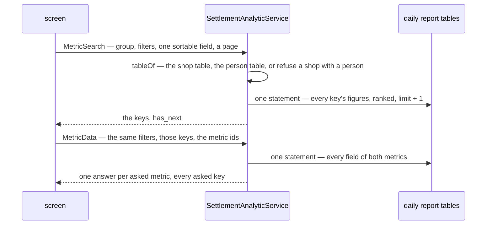

# settlement_service — RPC flows

The ledger of **what the marketplace pays us** for an order, and the reports folded from it.

> ⚠ **Not [liability_service](../liability_service/rpc.md)**, which is what TEAMS OWE EACH OTHER. That
> service held this name until 2026-08-28. Both are order-aware ledgers with a state projection; only
> this one is **allowed to never balance**.

| service | RPC | what it is |
| --- | --- | --- |
| `SettlementService` | `OrderSettlementList` | the list screen — one row per order, ranked by loss |
| `SettlementService` | `OrderSettlementDetail` | the ledger tab on the order page — one account plus its whole log |
| `SettlementWriteService` | `SettlementPost` | append one row. **Idempotent** on `unique_id`, global |
| `SettlementAnalyticService` | `MetricSearch` | rank a page of keys — teams, shops, people or periods — by one field of one settlement metric |
| `SettlementAnalyticService` | `MetricData` | fill those keys with both metrics' figures — or, grouped by `SUMMARY`, the headline |
| `SettlementAnalyticMaintenanceService` | `AnalyticReplayCompute` | rebuild the reports from a date by seeking the broker |
| `SettlementAnalyticMaintenanceService` | `AnalyticMaintenanceRun` | prune the dedup table |
| *(push route)* | `/event/settlement-fold/push` | the fold — `SettlementLogPosted` into the report tables |

**Why four proto services.** A service is mounted whole, so reads, the write, the reports and the
maintenance each got their own: the maintenance pair is `[ROOT, ADMIN]` only, and splitting it keeps
that policy from sitting beside team-scoped reads.

---

## SettlementPost — the only write

**One write path for three writers**, differing only in `source_type` — `importer`, `manual`, `order`
([the-source-is-named-importer](../../business/settlement/settlement_importer_decision.md#the-source-is-named-importer)).
All three retry: the importer re-imports an overlapping statement, a person double-submits, and
Pub/Sub redelivers an order's event. `PostEntry` and `CancelSale` are the same path, called in-process by the order events' push handler.

### An imported shop row asks the shop — before the transaction

[settlement-asks-the-shop-for-its-primary-cs](../../business/settlement/settlement_importer_decision.md#settlement-asks-the-shop-for-its-primary-cs):
a row the importer posts to a SHOP counts, in the per-user report, for the shop's primary CS. Settlement asks
the shop itself and writes the person on the row as `user_id`; the importer passes no person. **Its one call
into another service.**

| | |
| --- | --- |
| which rows ask | an imported shop row only — an order row counts for its stamped creator, and a shop row posted by hand for its actor |
| when | ⚠ **before** the transaction — never while the shop's account row is locked `FOR UPDATE`, or every post on the shop waits on the network |
| how | `ShopPrimary`, an interface settlement owns; the composition root answers it with a Connect client to `ShopAccessCheck` that forwards the caller's token (`san_auth.ForwardBearer`). A client, not the handler in-process: the shop lives in `selling_service`, which calls settlement on every placed order, so holding it would be a cycle — and the shop moving to its own service (the-shop-gets-its-own-service) changes only the adapter |
| a failed ask | a NEW row is **refused**, with the ask's reason — never a quiet fallback to the actor, which would count the row for the wrong person for good. ⚠ The failure is **held** until the transaction's idempotency check, so a RETRY of a stored row is answered from the ledger whatever the shop says: the retry this RPC absorbs, and the re-post that republishes a lost event, never depend on the shop being up |
| carried | `user_id` is on `SettlementLogPosted`, and the fold counts a shop row for it when set — a replay folds the person the row was written with, never asking again |
| the cost | one call per imported shop row — a whole Shopee file when no order is found, and a retry asks too. [The performance audit](../../../audits/services/settlement_service/performances/SettlementPost.md) finds it heavy by the N+1 rule. A cache per `(team, shop)` is its open question |

### The live-sale rules — read under the account's lock

| rule | why |
| --- | --- |
| a second `initial_total` is **refused** while one is live — unless it carries `reverses_id` | a second sale ADDS rather than replaces, and manual posting is the repair path ([a-missing-account-is-fixed-by-hand](../../business/settlement/context_decision.md#a-missing-account-is-fixed-by-hand)). Reverse first, then repost |
| an `initial_total_cancel` may never exceed the live sale | the live sale would go negative and every screen would read a sale of less than nothing |
| `CancelSale` takes its amount FROM the live sale | a person may have corrected the sale since placement — cancelling the order's original figure would cancel the wrong number |
| the idempotency check runs BEFORE these rules | a retried cancel finds its own row, instead of being refused because the sale is now zero |

### The event

`SettlementLogPosted` carries the **whole row** plus `order_created_by_user_id`. `event_id` is
`settlement-log:<log_id>`, so a retried publish collides in every consumer's dedup. A publish failure is
logged and never fails the post; re-posting the same `unique_id` republishes it.

### Errors

| code | when |
| --- | --- |
| `PermissionDenied` | a cancel from a non-`order` source · the account belongs to another team |
| `FailedPrecondition` | a second live sale · a cancel exceeding the live sale · `CancelSale` with nothing live (`ErrNothingToCancel`) |
| `InvalidArgument` | unknown type or source · a bad date · a shop that disagrees with the account · `reverses_id` naming nothing on this account · a sale with no order · a `system_adjustment` on an order · a `unique_id` already used on another account |
| `Internal` | the database |

---

## order_service → settlement_service (cross-service, by event)

`selling_service` **never calls** settlement. It publishes the order's events, and settlement opens and cancels the
order's account from them on its OWN two push subscriptions
([settlement-opens-the-sale-from-the-order-event](../../business/settlement/context_decision.md#settlement-opens-the-sale-from-the-order-event)):
`settlement-order-placed` and `settlement-order-cancelled`, beside liability's on the same topics. Neither service
imports the other, and a settlement outage loses nothing — Pub/Sub delivers again.

| | |
| --- | --- |
| **the order never waits on settlement** | [the-order-commits-without-settlement](../../business/settlement/context_decision.md#the-order-commits-without-settlement) — by construction now: it only publishes |
| **a settlement failure** | NACKs, so Pub/Sub redelivers, then the dead-letter topic. A lost publish is the accepted cost, repaired by hand ([a-missing-account-is-fixed-by-hand](../../business/settlement/context_decision.md#a-missing-account-is-fixed-by-hand)) |
| **twice** | the keys are derived from the order, so a redelivery collides with its own row (`Created: false`) and is ACKed |
| **`platform_total = 0` opens nothing** | 0 means NOT RECORDED. Placement refuses a 0 on both doors since selling `00022` ([platform-total-is-required-at-finalize](../../business/order/context_decision.md#platform-total-is-required-at-finalize)), so a new order never arrives with one — the skip stays as the guard for orders placed before that |
| **the cancel's key is the ACT's date** | [the-cancel-key-is-order-plus-act-date](../../business/settlement/context_decision.md#the-cancel-key-is-order-plus-act-date) — the event's `occurred_at`, the instant the cancel was written, so a redelivery after midnight produces the same key |
| **the creator** | the event's `actor_id` — `orders.created_by_user_id`, from `san_auth.GetIdentity` at placement — copied onto the account by the opening post and never again |
| **the handler** | `OrderSaleHandler` in [order_sale.go](../../../backend/services/settlement_service/settlement_v1/order_sale.go), one handler behind both routes, switching on the variant |

---

## The fold — `/event/settlement-fold/push`

One HTTP push route, mounted directly (not a Connect RPC). ⚠ It authenticates nobody, by decision
([the-event-webhook-is-open](../../business/settlement/context_decision.md#the-event-webhook-is-open)) — a
forged event can only corrupt a projection the replay rebuilds. Restrict the path at the ingress.

| | |
| --- | --- |
| **the day** | the event's `posted_on`, as stored — never re-derived from an instant |
| **the user** | the order's creator for an order row, the actor for a shop row |
| **the lock order** | shop then user, always — one event touches both tables and a mixed order deadlocks under load |
| **an unknown settlement_type** | returns an error, so it dead-letters where a person sees it, rather than being dropped |

---

## AnalyticReplayCompute — `[ROOT, ADMIN]`

```mermaid
sequenceDiagram
  participant D as developer
  participant S as settlement_service
  participant G as Pub/Sub
  participant DB as postgres

  D->>+S: AnalyticReplayCompute — start_date
  S->>+G: read the subscription's replay window
  G-->>-S: topic retention, or subscription retention if it retains acked
  S->>S: start_date before the window's first whole Jakarta day? REFUSE, naming the window
  S->>+DB: process_event_lock false to true — compare and set
  DB-->>-S: taken, or refuse
  S->>+DB: one transaction — DELETE day at or after start from the two daily tables and settlement_event_logs
  DB-->>-S: counts
  S->>+G: seek settlement-fold to start_date 00:00 WIB
  G-->>-S: accepted
  S->>DB: process_event_lock back to false
  S-->>-D: status started, with the counts
  G-)S: redelivered events arrive at the fold over the following minutes
```

| refused when | |
| --- | --- |
| the window cannot be read | a guard that guesses deletes days nothing can rebuild — [the-replay-is-bounded-by-the-subscription-retention](../../business/settlement/context_decision.md#the-replay-is-bounded-by-the-subscription-retention) |
| the window is zero | a seek would deliver nothing, and the replay would only delete |
| `start_date` is older than the window | older damage is repaired with a `system_adjustment` |
| the lock is already held | another replay, or a developer's maintenance |

⚠ **"started", never "done"** — the seek is asynchronous. ⚠ The state tables are not in the delete: they
are derived from the newest daily row on every fold, so each redelivered event re-derives them.

## AnalyticMaintenanceRun — `[ROOT, ADMIN]`

Deletes dedup rows **received** more than 45 days ago. It does **not** take the lock: it deletes old rows
while a live fold inserts a new one, and the two cannot conflict.

---

## The reads

`OrderSettlementList` follows the guideline's list shape — `ids` carries the ranking, map-slices carry
the data. **Sorted worst-loss-first by default**, and the totals are the **whole filtered set**, not the
page.

| sort | SQL (`DESC` shown — the default) |
| --- | --- |
| `LOSS` | `(initial_total = 0), last_balance ASC, order_id DESC` — loss is `−last_balance`, so its DESC is the balance's ASC |
| `INITIAL_TOTAL` | `(initial_total = 0), initial_total DESC, order_id DESC` |
| `RECEIVED` | `(initial_total = 0), (last_balance + initial_total) DESC, order_id DESC` |
| `ORDER_ID` | `order_id DESC` — an id is real whether or not the sale was recorded |

- The direction is the **named measure's**; `UNSPECIFIED` is `DESC`.
- An **unrecorded sale** (`initial_total = 0`) sorts **last** under every money measure, either way, and is
  **left out of both sums** — its balance is payout with nothing to measure against. `total_unrecorded`
  counts it.
- `order_id` breaks ties, so equal rows keep one order across pages. `OrderSettlementDetail` returns the log **oldest first and unpaginated** — it grows with one order's
activity — and an order with no account is **`NotFound`**, never a zeroed row.

### The reports — `MetricSearch` / `MetricData`

Two metrics through the analytic pattern ([rpc_provide.md](../../business/analytic/rpc_provide.md)), in
[settlement_analytic.proto](../../../proto/warehouse/settlement/v1/settlement_analytic.proto): `metrics/settlement` —
sales, received, withdrawn, gap, take rate, position to date — and `metrics/settlement/types`, the ten types that make
up received ([settlement-serves-its-headline-and-its-breakdown](../../business/settlement/context_decision.md#settlement-serves-its-headline-and-its-breakdown)).

| | an id — `SHOP`, `TEAM`, `USER` | a period — `DAILY` … `YEARLY` | `SUMMARY` |
| --- | --- | --- | --- |
| table | the shop table; the person table for `USER` or a `USER` filter ([one-settlement-metric-reads-both-tables](../../business/settlement/context_decision.md#one-settlement-metric-reads-both-tables)) | the same | the same |
| keys | every id with a row up to the window's end — a quiet one still ranks. Id 0 (no one recorded) left out | every period of the window, quiet ones included | none |
| movement | Σ over the window | Σ over the period clipped to the window | Σ over the window |
| `position_to_date` | −Σ over the key's positions of each one's latest close, at the window's end | the same, at the clipped period's end — a period outside the window is zero | at the window's end |
| `take_rate` | gap ÷ sales of the key's own sums; unset with no sale; not sortable yet | the same | the same |
| search span | — | 366 days · 260 weeks · 60 months · 20 years | never searched |
| scope | the team, or every team from the ROOT team — so `TEAM` crosses teams only for ROOT and ADMIN | the same | the same |

`measureSQL` (`metric_shared.go`) is THE definition of every field: the fill selects it and the search orders by it,
so the ranking and the numbers beside it cannot disagree, and `received` is Σ the by-type fields by construction.

| error | when |
| --- | --- |
| `InvalidArgument` | a shop and a person in one request · a metric or field this service does not serve, or a field that cannot sort · a filter or group a metric does not list · a missing date range · a period key that is not its period's first day · a time-group search over the span cap |

⚠ **Heavy** — [MetricData](../../../audits/services/settlement_service/performances/MetricData.md) and
[MetricSearch](../../../audits/services/settlement_service/performances/MetricSearch.md): a period's position is read over the
whole history, per period. The fix is an open question.
