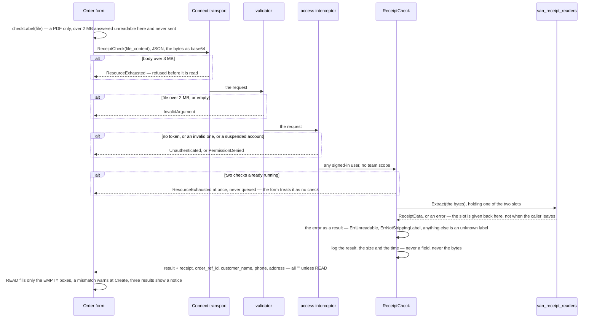

# shipment_service — complex RPC flows

The channel catalogue's RPCs are single-table CRUD and need no entry. `ReceiptCheck` does: it touches no table, but
its request passes three gates before the handler runs, and every answer about the file comes back as a RESULT.

## ReceiptCheck — read an uploaded shipping label

Called by the order form the moment a label PDF is picked, BESIDE its upload to document_service
([receipt-check-takes-the-file-bytes](../../business/shipment/context_decision.md#receipt-check-takes-the-file-bytes)) —
never on the stored document, and never by another service.

| result | when | the fields | the order form |
| --- | --- | --- | --- |
| `READ` | `Extract` returned no error | its `ReceiptData`, field for field (`OrderID` → `order_ref_id`) | fills the empty boxes, warns on a mismatch at Create |
| `UNKNOWN_LABEL` | any error but the two exported ones | all `""` | nothing |
| `MULTIPLE_LABELS` | ⚠ never, yet — see below | all `""` | "this file holds several labels" |
| `NOT_SHIPPING_LABEL` | `ErrNotShippingLabel` | all `""` | "this is not a shipping label" |
| `UNREADABLE` | `ErrUnreadable` | all `""` | "this file can't be opened" |

**Why these choices:**

- **A result, not an error** ([a-label-outcome-is-a-result-not-an-error](../../business/shipment/context_decision.md#a-label-outcome-is-a-result-not-an-error)).
  A label the reader has not learned yet is normal. The handler's one error of its own is about the server, never the
  file — two checks already running (below). Every other Connect error the caller can see comes from the transport, the
  validator or the access interceptor.
- **Two at once, and no queue** ([an-attached-file-is-up-to-15-mb-and-two-checks-run-at-once](../../business/shipment/context_decision.md#an-attached-file-is-up-to-15-mb-and-two-checks-run-at-once)).
  A buffered channel of 2 on the `Service`, taken without waiting: a third call is `ResourceExhausted` before `Extract`
  sees a byte. The form's `checkLabel` answers any failed call `null` — no notice, no toast — so the person types the
  numbers, as for a label the check cannot read. The slot is given back when `Extract` returns (deferred, so a panic
  cannot keep it); `Extract` takes no context, so a cancelled request keeps its slot until the reader finishes. ⚠ Per
  process: each API instance has its own two. The body is already decoded when the handler runs, so the limit bounds the
  reader's CPU, not the 3 MB read.
- **It reads, it never verifies** ([receipt-check-returns-what-the-library-reads](../../business/shipment/context_decision.md#receipt-check-returns-what-the-library-reads)).
  No match verdict is returned, so nothing can refuse an order on it.
- **Any signed-in user, no scope** ([receipt-check-needs-a-login](../../business/shipment/context_decision.md#receipt-check-needs-a-login)).
  `allow_only_authenticated` on the request message, and no `use_scope` field: the check reads no team's data. The
  interceptor still resolves the caller once, so a suspended account is refused.
- **Two caps, in that order** ([receipt-check-caps-the-body-before-reading](../../business/shipment/context_decision.md#receipt-check-caps-the-body-before-reading)).
  `connect.WithReadMaxBytes(3 << 20)` on this handler only (`register.go`) stops an oversize body before it is buffered;
  `max_len` 2 MB on the field is the reader's own cap, and leaves room for 2 MB as base64 JSON.
- **The log carries the result only** ([receipt-check-logs-only-the-result](../../business/shipment/context_decision.md#receipt-check-logs-only-the-result)).
  `Extract`'s error is left out too: its text can carry the PDF library's message about the file.
- ⚠ **`MULTIPLE_LABELS` is unreachable today.** The reader refuses a bulk print but its error for it is unexported
  ([receipt_readers critique 4](../../technical/packages/receipt_readers/context_clarify.md#critique)), so a bulk print
  answers `UNKNOWN_LABEL`. Safe — nothing is filled either way — and the handler maps it the day the reader exports it.
- ⚠ **The cost grows with the square of the page count.** A real label reads in ~5 ms; the worst 2 MB file the
  contract admits takes over a minute of CPU. The owner declined a page cap: the two-at-once limit keeps that to two
  cores, and one call's worst case is unchanged —
  [audits/services/shipment_service/performances/ReceiptCheck.md](../../../audits/services/shipment_service/performances/ReceiptCheck.md).

Code: `backend/services/shipment_service/shipment_v1/receipt_check.go` (the slots: `receiptChecksAtOnce`,
`tryHoldCheck`, `readLabel`), `backend/services/shipment_service/register.go`,
`frontend/src/features/shipment/receiptCheck.ts`.
