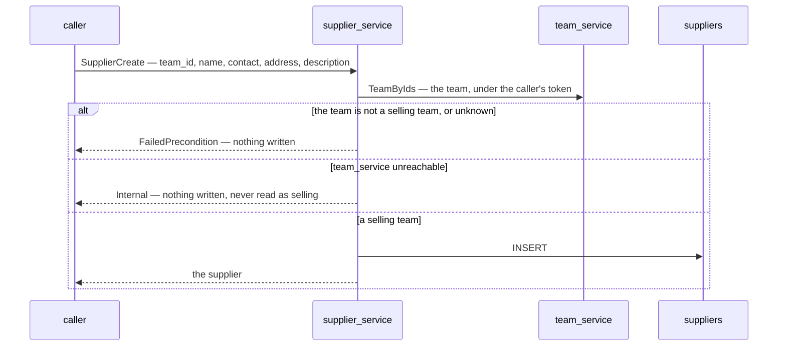
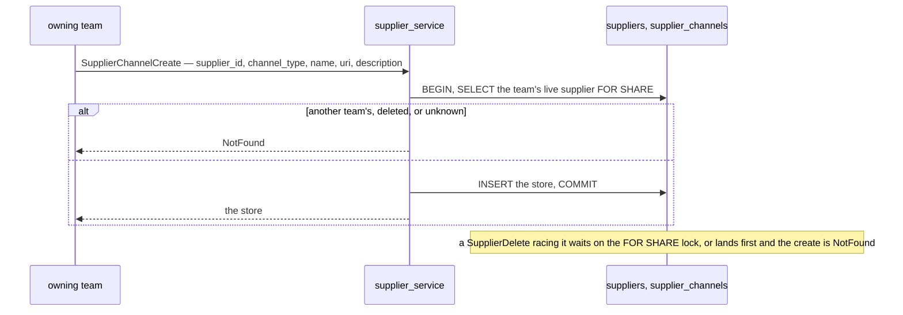
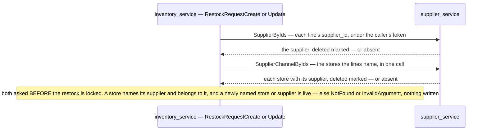
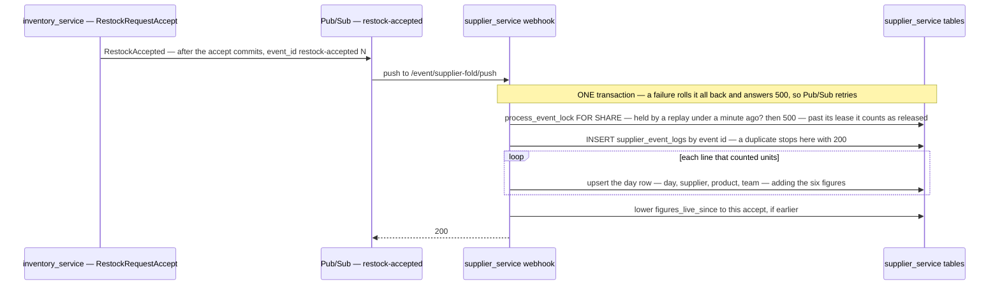
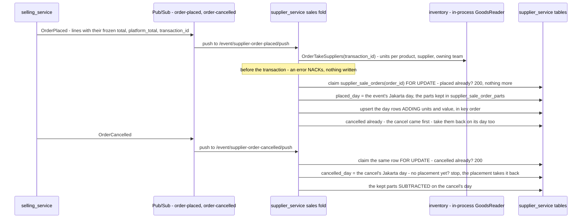
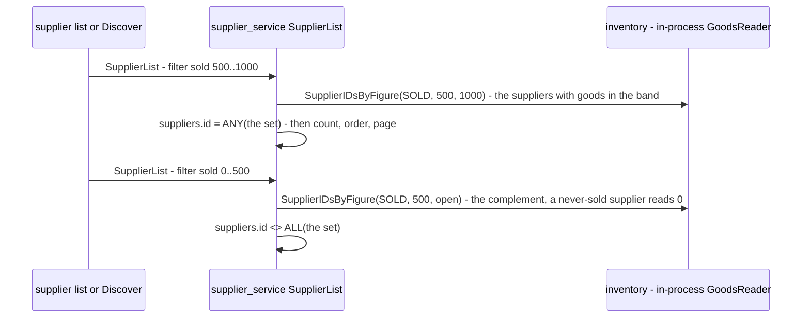
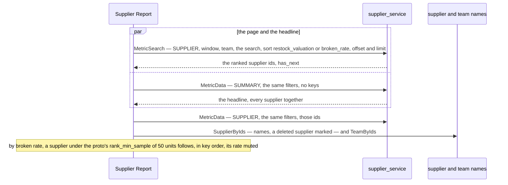
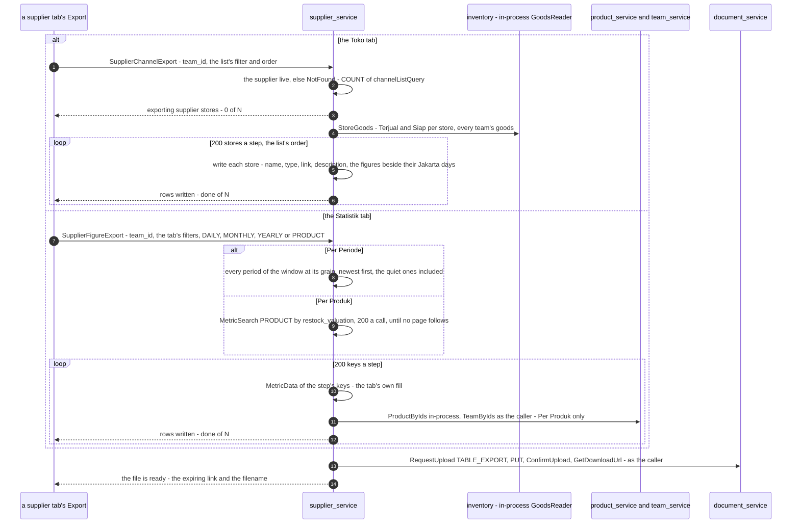
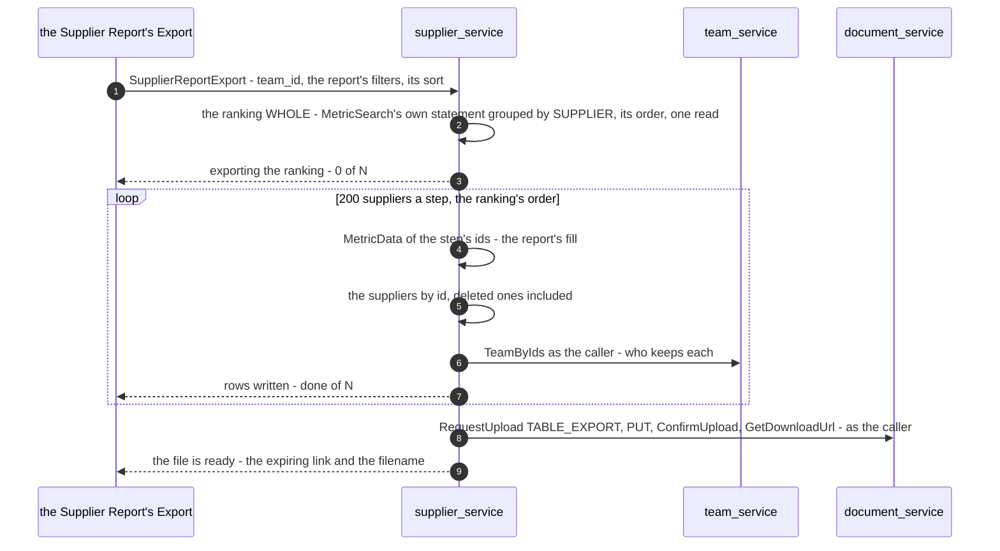
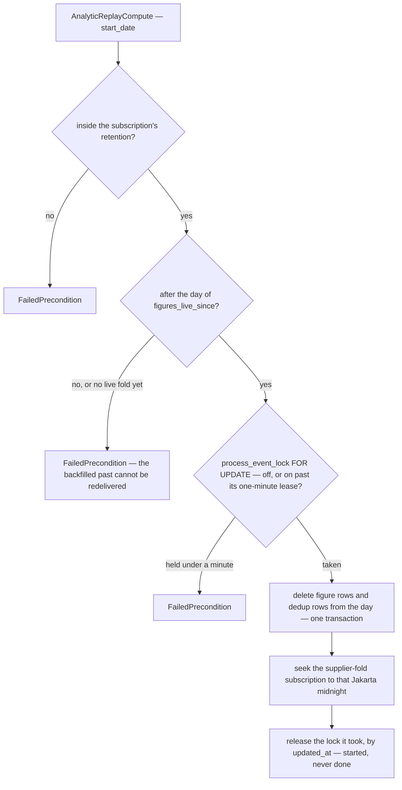

# supplier_service — RPC flows

The suppliers a selling team buys stock from, and the online stores each one sells through
([context_decision.md](../../business/supplier/context_decision.md)). Moved out of
[inventory_service](../inventory_service/rpc.md) by
[the-supplier-gets-its-own-service](../../business/supplier/context_decision.md#the-supplier-gets-its-own-service).

| service | RPC | what it is |
| --- | --- | --- |
| `SupplierService` | `SupplierCreate` | a supplier in the scoped team — **refused unless it is a SELLING team** (asks team_service) |
| | `SupplierUpdate` · `SupplierDelete` | the owning team's own; delete is **soft** |
| | `SupplierList` | `OWN` (My Supplier) or `EVERY_TEAM` (Discover Supplier), searched, filtered by store type, by the team that keeps it (`owner_team_id`, 0 = any) and by the **range pills** `sold` / `ready` (asked of inventory before the page — [§ The range pills](#the-range-pills--supplierlists-sold-and-ready)), paged · the `CHANNELS` slice brings each supplier's stores |
| | `SupplierDetail` | **any** team's live supplier |
| | `SupplierByIds` | ids a caller holds — any team's, **deleted ones included, marked** |
| `SupplierChannelService` | `SupplierChannelList` | any team's live supplier's live stores, searched, filtered by type, paged |
| | `SupplierChannelExport` | the Toko tab as a file — the list's rows, every page, with Terjual and Siap ([§ The tabs as files](#the-tabs-as-files--supplierchannelexport-and-supplierfigureexport)) |
| | `SupplierChannelCreate` · `Update` · `Delete` | the owning team's own; delete is **soft** |
| | `SupplierChannelByIds` | stores by id — any team's, **deleted ones included, marked**; what a restock line shows beside its supplier |
| `SupplierAnalyticService` | `MetricSearch` · `MetricData` | `metrics/suppliers`, the analytic pattern ([rpc_provide.md](../../business/analytic/rpc_provide.md)) — rank a page of suppliers, products or periods by one field, then fill those keys; grouped by SUMMARY, the headline |
| | `SupplierFigureExport` | the Statistik tab's view as a file — Per Periode or Per Produk, every page ([§ The tabs as files](#the-tabs-as-files--supplierchannelexport-and-supplierfigureexport)) |
| | `SupplierReportExport` | the Supplier Report as a file — the whole ranking as narrowed, every page, each supplier with its figures ([§ The report as a file](#the-report-as-a-file--supplierreportexport)) |
| `SupplierAnalyticMaintenanceService` | `AnalyticReplayCompute` · `AnalyticMaintenanceRun` | Root and the Administrator — rebuild the figures from a day; prune the dedup table |
| *(webhook)* | `/event/supplier-fold/push` | the fold — *Restock Accepted* into `supplier_product_daily_reports` |
| *(webhook)* | `/event/supplier-order-placed/push` · `/event/supplier-order-cancelled/push` | the sales fold — *Order Placed* / *Order Cancelled* into `supplier_sale_daily_reports` ([§ Penjualan](#penjualan--a-fold-of-order-placed-and-order-cancelled)) |

**Reads cross teams, writes do not**
([another-team-sees-everything-of-a-supplier](../../business/supplier/context_decision.md#another-team-sees-everything-of-a-supplier)) —
`team_id` is always the caller's scope, so a write puts `team_id = ?` in its `WHERE` and a read does not.
**Delete is soft** on both tables
([a-deleted-supplier-is-kept-for-its-figures](../../business/supplier/context_decision.md#a-deleted-supplier-is-kept-for-its-figures),
[a-store-delete-is-soft-too](../../business/supplier/context_decision.md#a-store-delete-is-soft-too)).

## SupplierCreate — asks team_service first

Only a selling team keeps suppliers
([only-a-selling-team-has-suppliers](../../business/supplier/context_decision.md#only-a-selling-team-has-suppliers)).
The request policy keeps a warehouse's own people out, but Root and the Administrator bypass the scope — so the
handler asks.

`supplier_deps.go` in the composition root answers the question; with nothing wired, every create is refused.

## SupplierChannelCreate — a store never lands on a deleted supplier

## Who asks the supplier

Each restock LINE's `supplier_id` and `supplier_channel_id` (inventory's `00024`; the restock-level column is gone) are
opaque ids into this service — any selling team's live supplier and store are accepted
([a-team-restocks-from-another-teams-supplier](../../business/supplier/context_decision.md#a-team-restocks-from-another-teams-supplier)).
The frontend's restock and batch screens read a supplier's name with `SupplierByIds` and a store's with
`SupplierChannelByIds` too, so a deleted supplier or store still names a past delivery, with its deleted badge
([a-deleted-supplier-still-shows-with-a-badge](../../business/inventory/restock_decision.md#a-deleted-supplier-still-shows-with-a-badge)).

## The move — not an RPC

`san supplier move` copies inventory_service's legacy rows in, ids kept
([existing-suppliers-move-with-their-ids](../../business/supplier/context_decision.md#existing-suppliers-move-with-their-ids)).
See [san.md](../../tools/san.md#supplier-move).

## The figures — a fold of Restock Accepted

A supplier's six figures are folded from the restock's accept, the way settlement's reports are folded from its ledger
([the-report-is-processed-like-settlement](../../business/supplier/context_decision.md#the-report-is-processed-like-settlement),
[the-figures-screens-are-accepted](../../business/supplier/context_decision.md#the-figures-screens-are-accepted)).
inventory_service publishes after the accept commits ([its doc](../inventory_service/rpc.md)); this service's webhook
folds.

| | |
| --- | --- |
| the supplier | the RESTOCK's — every line counts for it until lines name a store ([the-supplier-comes-from-the-restock-until-lines-name-a-store](../../business/supplier/context_decision.md#the-supplier-comes-from-the-restock-until-lines-name-a-store)). A restock with none folds nothing and is acked |
| a figure's value | units × the line's total ÷ ordered — never a rounded unit price, so a line adds back to what it cost. Exact — never rounded (the-backend-never-rounds-money, 2026-11-06; it rounded to whole rupiah before); the three valuations are `double precision` since `00003` (2026-11-06, [every-ledger-moves-to-double-rounded-when-frozen](../../business/order/context_decision.md#every-ledger-moves-to-double-rounded-when-frozen)) and `double` on `SupplierMetric` |
| the day | the event's `accepted_on`, the accept's Jakarta day — read, never re-derived |
| ⚠ lag | a figure lags the accept by the broker's delivery. In dev and e2e the subscriptions are PULL and nothing pulls, so the live fold does not run there unless `pubsub ensure` is given a `--push-base-url` — the backfill and the tests call the fold directly |

## Penjualan — a fold of Order Placed and Order Cancelled

What a supplier's goods SOLD for ([penjualan-is-the-selling-value-on-the-order-day](../../technical/frontend/suppliers_decision.md#penjualan-is-the-selling-value-on-the-order-day)),
beside Direstok on the Statistik tab and the Supplier Report — the shape of the order metrics and the warehouse fee: the
order's Jakarta day adds, a cancel takes back on its own day
([a-warehouse-fee-counts-on-its-day-and-a-cancel-takes-it-back-on-its-day](../../business/analytic/rpc_provide_decision.md#a-warehouse-fee-counts-on-its-day-and-a-cancel-takes-it-back-on-its-day)).
`SalesFoldHandler` (`supplier_v1/sales_fold.go`), two push routes, one handler.

| | |
| --- | --- |
| the goods | the units the order's take drew from batches carrying a supplier — inventory's `batch_logs` `order` rows of the event's `transaction_id`, gross (a release's rollback rows never subtracted), joined to `batches` for supplier, product and the batch's team. The same goods Terjual counts (`SupplierGoods`) |
| the value | each line's share of the order's `platform_total` by its frozen `total` (by quantity when no line has one), spread over the line's units; a supplier's part = its units × that price. Exact, never rounded. A platform total of 0 values the units at 0 and still counts them |
| the team | the batch's team — the team that restocked the goods, as Direstok's rows are keyed; the `TeamFilter` narrows it |
| the days | the events' `occurred_at` in Asia/Jakarta (`saleDay`) — an order at 00:30 WIB is that day, on any host clock |
| order of events | either: a cancel first leaves `cancelled_day` on the row and the late placement folds both days in one transaction |
| idempotent | the order's row is the claim — a redelivery of either event writes nothing |
| replay | NOT replayed by `AnalyticReplayCompute`, which deletes and re-seeks the restock subscription only — Penjualan is its own table for that reason |
| tests | `sales_fold_test.go` (00:30 WIB on a UTC clock, the split by line total and by quantity, a cancel on its own day + redeliveries, a cancel first, another team's sale for every reader + the sort, an unread take NACKed, a warehouse role refused) · `sales_fold_race_test.go` (`-tags raceaudit`) · `register_test.go` (both routes mounted) |

## The range pills — SupplierList's `sold` and `ready`

The fixed bands ([the-range-pills-are-a-fixed-set](../../technical/frontend/suppliers_decision.md#the-range-pills-are-a-fixed-set)):
Terjual and Siap as `SupplierGoods` reads them, over every team's goods. `SupplierFigureBand{min, max}` — `min`
inclusive, `max` exclusive, `max` 0 open-ended (protovalidate: `max` 0 or above `min`, neither negative). Narrowed
BEFORE the count and the page, so a supplier on page 2 is found and the pager counts only the band.

Inventory can list only suppliers WITH goods, so a band from 0 is asked as its complement. An empty set from above 0 is no
supplier. Inventory not answering is `Internal`, never an empty list. Tests: `supplier_list_test.go`
(`ABandFindsASupplierBeyondTheFirstPage`, `BandsAreLowerInclusiveUpperExclusive`, `ABandIsValidated`).

## The reads

ONE metric, `metrics/suppliers` — `SupplierMetric`, the six figures, the broken rate and Penjualan's `sales_count` /
`sales_value` (fields 8–9, sortable) — read through the analytic
pattern every service's figures share ([rpc_provide.md](../../business/analytic/rpc_provide.md),
[the-pattern-replaces-the-shipped-analytics](../../business/analytic/rpc_provide_decision.md#the-pattern-replaces-the-shipped-analytics));
it replaced `AnalyticTimeSearch`, `AnalyticProductSearch`, `AnalyticGroupSearch` and `AnalyticGroupMetric` on
2026-10-27. Every read is `listQuery` on the screen and reads the folded table only. **Every selling team reads every
team's figures** ([every-selling-team-sees-every-teams-figures](../../business/supplier/context_decision.md#every-selling-team-sees-every-teams-figures)) —
a `TeamFilter` narrows to one restocking team
([the-team-filter-picks-any-selling-team](../../business/supplier/context_decision.md#the-team-filter-picks-any-selling-team)).

| read | groups | queries | note |
| --- | --- | --- | --- |
| `MetricSearch` | SUPPLIER, PRODUCT, DAILY … YEARLY — never SUMMARY | 1 — the scope grouped by the key, ordered, `limit + 1` | the sort is one `can_sort` field by its proto name; the key DESC breaks a tie; by `broken_rate`, units ≥ 50 ranked first ([rate-ranking-needs-50-units](../../business/supplier/context_decision.md#rate-ranking-needs-50-units)); no total, only `has_next` |
| `MetricData` | the same, and SUMMARY | 2 — the restock table's, Penjualan's | every asked key comes back, zero when quiet; a period keyed by its first day — a Monday, the 1st, 1 January; SUMMARY takes no keys |

| filter | narrows | screen |
| --- | --- | --- |
| `DateRangeFilter` — required | the accept's (or the sale's) Jakarta day, both ends inclusive, as literals in SQL (`window()`) | both |
| `TeamFilter` | whose restocks are counted — for Penjualan, whose goods were sold | both |
| `SupplierFilter` | one supplier | the Statistics tab |

Each read narrows BOTH tables — `supplier_product_daily_reports` and `supplier_sale_daily_reports`, keyed alike — by the
same filters and sums them per key: `MetricData` as two grouped statements added in Go, `MetricSearch` as one UNION ALL
of the two GROUPED reads. Never a UNION ALL of the raw rows under one aggregate: Postgres plans that as a Parallel Append,
and the workers' start-up alone took the 30-day headline from 9 to ≈ 40 ms. A supplier with sales and no restock in the
window is a key of the ranking too.

The Statistics tab lists its periods itself — a time group needs no search — so a quiet period is a row too, and
reads `MetricData` by DAILY / MONTHLY / YEARLY for the page's periods. Performance:
[MetricSearch.md](../../../audits/services/supplier_service/performances/MetricSearch.md),
[MetricData.md](../../../audits/services/supplier_service/performances/MetricData.md).

## The tabs as files — `SupplierChannelExport` and `SupplierFigureExport`

[each-supplier-tab-exports-its-own-table](../../technical/frontend/suppliers_decision.md#each-supplier-tab-exports-its-own-table),
on the order list's pattern ([one-export-is-the-list-as-a-file](../../technical/frontend/warehouse_order_list_decision.md#one-export-is-the-list-as-a-file)):
each tab's Export writes ITS table as narrowed — the tab's own filter, every page, its columns — as .xlsx, a server
stream of progress ending with an expiring link. One RPC per table: the Toko tab's on `SupplierChannelService`, the
Statistik tab's (the view on screen) on `SupplierAnalyticService`. The Produk tab's rows are still invented, so its
Export stays marked and nothing builds its file. A `SUPPLIER` group is refused: the Supplier Report's file is its own
RPC ([§ below](#the-report-as-a-file--supplierreportexport)).

| | |
| --- | --- |
| the rows | **Toko**: `channelListQuery` — the very set `SupplierChannelList` pages, its order, every page. **Statistik**: Per Periode, the tab's own spine of periods (`periodSpine` = the screen's `bucketSpine`, newest first), each filled by `MetricData`; Per Produk, every key `MetricSearch` ranks with the tab's sort |
| the columns | **Toko** (sheet *Toko*): Toko pemasok · Jenis toko · Tautan · Deskripsi · Terjual · Pesanan terakhir · Siap · Restok terakhir — the store's name and its badge in two cells, each figure beside the date under it on screen; the row's actions left out. **Statistik** (sheet *Per Periode* / *Per Produk*): Periode (`2026-10-07`, *Oktober 2026*, `2026` — [a-period-reads-as-its-grain](../../technical/frontend/suppliers_decision.md#a-period-reads-as-its-grain)) or Produk · SKU · Tim (only while no team is picked, as on screen), then Direstok, Penjualan, Hilang di pengiriman, Rusak di pengiriman — each its units and its Rp — and each loss's rate after it |
| the figures | money is the metric's exact double ([the-backend-never-rounds-money](../../business/order/context_decision.md#the-backend-never-rounds-money)); a rate is the exact share under a `0.0%` cell format, empty when nothing arrived; a store none of whose goods arrived has empty figure cells (the tab's dash); dates are Jakarta days |
| the scope | every selling team reads every supplier's stores and figures, as the tabs do; the policy is `SupplierGoods`' / `MetricData`'s readers — Root, the Administrator and the selling roles, never a warehouse role. Not `NO_SIDE_EFFECTS`: it stores a file, so a monitor and an agent are refused ([the-admin-team-monitors-read-only](../../business/user/context_decision.md#the-admin-team-monitors-read-only)); the screens hide Export from a monitored team |
| the Gudang terkait chip | narrows no tab yet (⚠ `dropped`), so it narrows no file either — the file is the tab |
| the store | `ExportStore` (`export_store.go`), adapted at the composition root (`cmd/app_development/supplier_exports.go`): the file through document_service's upload as the caller — a private `table_export` (document `00010`) named `toko-pemasok-…` / `statistik-pemasok-per-periode-…` / `…-per-produk-…`; the products named in-process from product_service, the teams through TeamByIds as the caller. The xlsx writer and the progress stream are `backend/pkgs/san_export` |
| measured (`-tags perfaudit`) | **Toko**: 300 stores 13.6 ms / 4 queries, typical 3 stores 4.1 ms / 3. **Statistik**: the top supplier (11 661 rows) daily over a year 35 ms / 4 queries (two steps), monthly 32 ms / 2, Per Produk over a year 82 ms / 6 (max 147 ms), over 30 days 22 ms; the median supplier ≤ 18 ms — none heavy |

Tests: `supplier_channel_export_test.go` (the file equals the list's rows across five pages and two steps; the columns
and the figures with their Jakarta days; a deleted supplier NotFound, the policy), `supplier_figure_export_test.go`
(Per Periode = every day of a year, newest first, each row the tab's `MetricData`, money exact to its fraction; a month by
its name; Per Produk = the tab's ranking across pages, named; a team picked holds only its restocks; refusals),
`cmd/app_development/supplier_goods_reader_test.go` (`StoreGoods`), `document_v1` `TestUploadFlow_TableExportIsPrivate`.

## The report as a file — `SupplierReportExport`

Built 2026-11-07 ([a-report-export-is-the-whole-view-as-a-file](../../technical/frontend/context_decision.md#a-report-export-is-the-whole-view-as-a-file),
closing what [the-report-export-is-marked](../../technical/frontend/suppliers_decision.md#the-report-export-is-marked)
left open): the Supplier Report's Ekspor writes **the whole ranking as narrowed** — the report's window, whose
restocks, the settled search and its *Urutkan* — every page, each supplier with its figures, as .xlsx; the same stream
and store as the tabs' files.

| | |
| --- | --- |
| the rows | every supplier the report ranks with these filters, in its order — by restocked value, or by broken rate with the 50-unit minimum ranking as on screen — read in ONE statement: `ranking()` in metric_search.go, the statement `MetricSearch` cuts its pages from. Each step of 200 filled by `MetricData` |
| the columns | sheet *Peringkat*: Peringkat (1-based across every page, as the screen counts) · Pemasok (`Pemasok #<id>` when unnamed) · Status (*Dihapus* for a deleted supplier, its figures kept — the badge) · Dikelola oleh (`Tim #<id>` when unnamed) · then the tabs' figure columns — Direstok, Penjualan, Hilang di pengiriman, Rusak di pengiriman, each units and Rp, each loss's rate after it |
| the figures | the metric's exact doubles; a rate the exact share under `0.0%`, empty when nothing arrived; Jakarta days |
| refused | a supplier filter (one supplier's figures are its Statistik tab's file), a sort of another metric or an unsortable field, no window — InvalidArgument; no store — Unimplemented |
| the scope | the ranking's readers — Root, the Administrator, the selling roles; every selling team reads every team's figures, as the report does. Not `NO_SIDE_EFFECTS`: a monitor and an agent are refused; the screen hides Export from a monitored team |
| the store | the tabs' `ExportStore` — file `laporan-pemasok-<yyyy-mm-dd-hhmmss>.xlsx`, a private `table_export` |
| measured (`-tags perfaudit`, 2 000 suppliers) | 30 days 187 ms / 31 queries; a year 1.1 s (by broken rate 1.3 s, one team 478 ms, a search 1.7 s) — 🔴 heavy: the fill re-reads the window per 200 suppliers ([SupplierReportExport.md](../../../audits/services/supplier_service/performances/SupplierReportExport.md), its open question: fill from the ranking statement's own sums) |

Tests: `supplier_report_export_test.go` — the file is the whole ranking across 214 suppliers (more than a step of 200,
eleven screen pages), each row the report's own `MetricSearch` + `MetricData`, Penjualan included, the deleted supplier
marked; narrowed by broken rate, a search and a team exactly as the report; refusals and the policy.

## AnalyticReplayCompute — never into the backfilled past

Settlement's replay, with one more refusal: figures folded by the backfill were never on the broker, so a replay must
start AFTER the live fold's first day.

`AnalyticMaintenanceRun` prunes `supplier_event_logs` received more than 45 days ago — longer than the broker's 31-day
retention, so a redeliverable message always finds its claim. It takes no lock.

## The backfill — not an RPC

`san supplier backfill-figures` folds the restocks accepted before the event existed, once
([past-accepts-are-backfilled-once](../../business/supplier/context_decision.md#past-accepts-are-backfilled-once)).
See [san.md](../../tools/san.md#supplier-backfill-figures).

## The day re-folds — `DayRefold`, not an RPC

`san report refold --report supplier-restock-daily|supplier-sale-daily --supplier <id> --date <day>`
([docs/tools/san.md](../../tools/san.md#a-suppliers-figures--supplier-restock-daily--supplier-sale-daily), [a-wrong-day-is-refolded-from-the-log](../../business/settlement/context_decision.md#a-wrong-day-is-refolded-from-the-log)) — one
supplier's day of either report rebuilt from the fold's claims, plus the events nobody claimed, read through
`RefoldSource` from the services that own them: inventory's accepts (`inventory_v1.RestockAcceptedEventsOn`), selling's
orders (`selling_v1.OrderSaleEventsOn`) and, for a lost sale, inventory's take (`GoodsReader.OrderTakeSuppliers`). A lost
event over an hour old is claimed the fold's way, so its redelivery folds nothing; the report is then taken in SHARE ROW
EXCLUSIVE — the lock the fold's upsert waits on. The restock re-fold reads `process_event_lock` as the fold does. A Penjualan
claim names the other suppliers' days (and a cancel's day) it leaves short. In-process (`supplier_v1/day_refold.go`,
`day_refold_sales.go`), no wire contract; sequence in san.md, locks in
[lock-order.md](../../../audits/services/supplier_service/concurrency/lock-order.md).
