# supplier_service — RPC flows

The suppliers a selling team buys stock from, and the online stores each one sells through
([context_decision.md](../../business/supplier/context_decision.md)). Moved out of
[inventory_service](../inventory_service/rpc.md) by
[the-supplier-gets-its-own-service](../../business/supplier/context_decision.md#the-supplier-gets-its-own-service).

| service | RPC | what it is |
| --- | --- | --- |
| `SupplierService` | `SupplierCreate` | a supplier in the scoped team — **refused unless it is a SELLING team** (asks team_service) |
| | `SupplierUpdate` · `SupplierDelete` | the owning team's own; delete is **soft** |
| | `SupplierList` | `OWN` (My Supplier) or `EVERY_TEAM` (Discover Supplier), searched, filtered by store type, by the team that keeps it (`owner_team_id`, 0 = any), by the **range pills** `sold` / `ready` (asked of inventory before the page — [§ The range pills](#the-range-pills--supplierlists-sold-and-ready)) and by the **Gudang filter** `warehouse_id` (the same way — [§ The Gudang filter](#the-gudang-filter--supplierlists-warehouse_id)), paged · the `CHANNELS` slice brings each supplier's stores |
| | `SupplierDetail` | **any** team's live supplier |
| | `SupplierByIds` | ids a caller holds — any team's, **deleted ones included, marked** |
| `SupplierChannelService` | `SupplierChannelList` | any team's live supplier's live stores, searched, filtered by type and by the page's **Gudang terkait chip** (`warehouse_id` — [§ The chip](#the-gudang-terkait-chip--the-toko-and-produk-tabs-under-a-warehouse)), paged |
| | `SupplierChannelExport` | the Toko tab as a file — the list's rows, every page, with Terjual and Siap ([§ The tabs as files](#the-tabs-as-files--supplierchannelexport-and-supplierfigureexport)) |
| | `SupplierProductList` | the Produk tab — any team's live supplier's products, one row per product per store (or none), searched by product or store, narrowed by team, by store or no store and by the Gudang terkait chip, paged newest restock first, each named and with its Terjual and Siap ([§ The Produk tab](#the-produk-tab--supplierproductlist)) |
| | `SupplierProductExport` | the Produk tab as a file — the list's rows, every page ([§ The tabs as files](#the-tabs-as-files--supplierchannelexport-and-supplierfigureexport)) |
| | `SupplierChannelCreate` · `Update` · `Delete` | the owning team's own; delete is **soft** |
| | `SupplierChannelByIds` | stores by id — any team's, **deleted ones included, marked**; what a restock line shows beside its supplier |
| `SupplierAnalyticService` | `MetricSearch` · `MetricData` | `metrics/suppliers`, the analytic pattern ([rpc_provide.md](../../business/analytic/rpc_provide.md)) — rank a page of suppliers, products or periods by one field, then fill those keys; grouped by SUMMARY, the headline |
| | `SupplierFigureExport` | the Statistik tab's view as a file — Per Periode or Per Produk, every page ([§ The tabs as files](#the-tabs-as-files--supplierchannelexport-and-supplierfigureexport)) |
| | `SupplierReportExport` | the Supplier Report as a file — the whole ranking as narrowed, every page, each supplier with its figures ([§ The report as a file](#the-report-as-a-file--supplierreportexport)) |
| `SupplierAnalyticMaintenanceService` | `AnalyticReplayCompute` · `AnalyticMaintenanceRun` | Root and the Administrator — rebuild the figures from a day; prune the dedup table |
| *(webhook)* | `/event/supplier-fold/push` | the fold — *Restock Accepted* into `supplier_product_daily_reports`, and each line's product link into `supplier_channel_products` ([§ The links](#the-links--every-accepted-line-links-its-product)) |
| *(webhook)* | `/event/supplier-count-corrected/push` | the same fold — *Restock Received Count Corrected* (KOREKSI JUMLAH TERIMA) on its own day, signed ([§ The figures](#the-figures--a-fold-of-restock-accepted)) |
| *(webhook)* | `/event/supplier-order-placed/push` · `/event/supplier-order-cancelled/push` | the sales fold — *Order Placed* / *Order Cancelled* into `supplier_sale_daily_reports` ([§ Penjualan](#penjualan--a-fold-of-order-placed-and-order-cancelled)) |

**Reads cross teams, writes do not**
([another-team-sees-everything-of-a-supplier](../../business/supplier/context_decision.md#another-team-sees-everything-of-a-supplier)) —
`team_id` is always the caller's scope, so a write puts `team_id = ?` in its `WHERE` and a read does not.
**Delete is soft** on both tables
([a-deleted-supplier-is-kept-for-its-figures](../../business/supplier/context_decision.md#a-deleted-supplier-is-kept-for-its-figures),
[a-store-delete-is-soft-too](../../business/supplier/context_decision.md#a-store-delete-is-soft-too)).

## SupplierCreate — asks team_service first

Only a selling team keeps suppliers
([only-a-selling-team-has-suppliers](../../business/supplier/context_decision.md#only-a-selling-team-has-suppliers)).
The request policy keeps a warehouse's own people out, but Root and the Administrator bypass the scope — so the
handler asks.

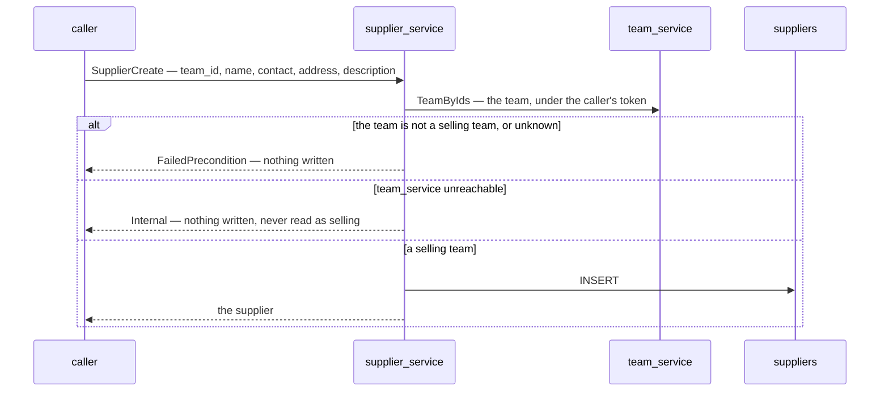

`supplier_deps.go` in the composition root answers the question; with nothing wired, every create is refused.

## SupplierChannelCreate — a store never lands on a deleted supplier

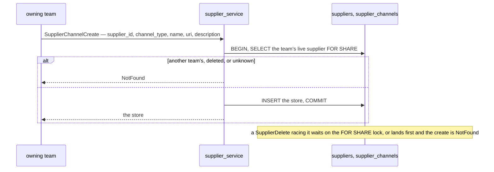

## Who asks the supplier

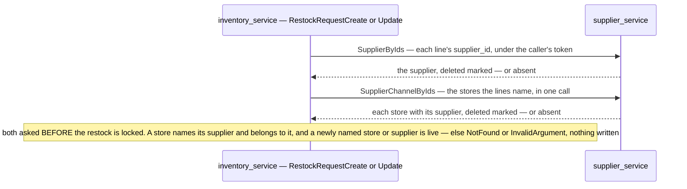

Each restock LINE's `supplier_id` and `supplier_channel_id` (inventory's `00024`; the restock-level column is gone) are
opaque ids into this service — any selling team's live supplier and store are accepted
([a-team-restocks-from-another-teams-supplier](../../business/supplier/context_decision.md#a-team-restocks-from-another-teams-supplier)).
The frontend's restock and batch screens read a supplier's name with `SupplierByIds` and a store's with
`SupplierChannelByIds` too, so a deleted supplier or store still names a past delivery, with its deleted badge
([a-deleted-supplier-still-shows-with-a-badge](../../business/inventory/restock_decision.md#a-deleted-supplier-still-shows-with-a-badge)).

## The move — not an RPC

`san supplier move` copies inventory_service's legacy rows in, ids kept
([existing-suppliers-move-with-their-ids](../../business/supplier/context_decision.md#existing-suppliers-move-with-their-ids)).
See [san.md](../../tools/san.md#supplier-move).

## The figures — a fold of Restock Accepted

A supplier's six figures are folded from the restock's accept, the way settlement's reports are folded from its ledger
([the-report-is-processed-like-settlement](../../business/supplier/context_decision.md#the-report-is-processed-like-settlement),
[the-figures-screens-are-accepted](../../business/supplier/context_decision.md#the-figures-screens-are-accepted)).
inventory_service publishes after the accept commits ([its doc](../inventory_service/rpc.md)); this service's webhook
folds.

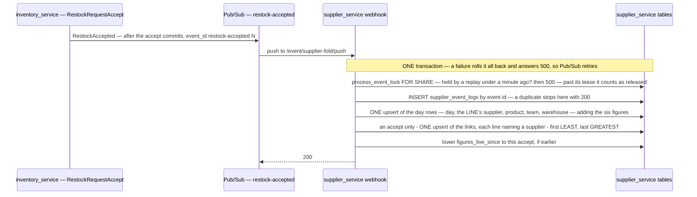

| | |
| --- | --- |
| the supplier | each LINE's own (since 2026-11-14 — lines name their supplier and store, so [the-supplier-comes-from-the-restock-until-lines-name-a-store](../../business/supplier/context_decision.md#the-supplier-comes-from-the-restock-until-lines-name-a-store) switched): a restock mixing suppliers credits each line's (before, the restock-level id was 0 for it and NOBODY was credited); a line naming none credits none; an event whose every line names none folds nothing, is not claimed, and is acked. A line reading 0 beside a non-zero restock-level id is an event from before lines carried theirs, and counts for the restock's (`creditedLines`) — inventory sends the restock-level id as 0 whenever a line names none, so this never credits such a line today. `foldLines` groups and locks by (supplier, product) |
| a figure's value | units × the line's total ÷ ordered — never a rounded unit price, so a line adds back to what it cost. Exact — never rounded (the-backend-never-rounds-money, 2026-11-06; it rounded to whole rupiah before); the three valuations are `double precision` since `00003` (2026-11-06, [every-ledger-moves-to-double-rounded-when-frozen](../../business/order/context_decision.md#every-ledger-moves-to-double-rounded-when-frozen)) and `double` on `SupplierMetric` |
| the day | the event's `accepted_on`, the accept's Jakarta day — read, never re-derived |
| the warehouse | the one the restock was received at — `RestockAccepted.warehouse_id`; a received-count correction its own `warehouse_id` (the receiving warehouse) — last in the key since `00006` ([§ The warehouse](#the-warehouse--both-reports-under-a-chip)) |
| a received-count correction | `RestockReceivedCountCorrected` (topic `restock-received-count-corrected`, subscription `supplier-count-corrected`, the SAME handler — `restockFiguresOf` reads either variant) moves the figures on its `corrected_on`, signed: too many typed → restock −N, lost on the way +N; too few → the reverse; the accept's day never changes ([a-received-count-correction-counts-on-its-own-day](../../business/inventory/adjustment_decision.md#a-received-count-correction-counts-on-its-own-day)). Claimed by `restock-count-corrected:<transaction>`; it never lowers `figures_live_since` (only a live accept does). The replay seeks both subscriptions; the day re-fold reads inventory's `RestockCountCorrectionEventsOn` beside the accepts. Built 2026-11-13 |
| the links | the same transaction, behind the same claim — [§ The links](#the-links--every-accepted-line-links-its-product) |
| performance | 5 statements for any parcel (lock read, claim, the day rows, the links, live-since) — over 40 000 stored links: 4.3–5.0 ms for 20 lines, 12–16 ms for 100 (the links' upsert 0.4 / 1.6 ms in Postgres; the day rows dominate) — `TestPerf_LinkFold`, History in [FoldHandler.md](../../../audits/services/supplier_service/performances/FoldHandler.md). Nil cost, no finding |
| ⚠ lag | a figure lags the accept by the broker's delivery. In dev and e2e the subscriptions are PULL and nothing pulls, so the live fold does not run there unless `pubsub ensure` is given a `--push-base-url` — the backfill and the tests call the fold directly |

## The links — every accepted line links its product

`supplier_channel_products` (00005, [schema](../../database-schema.md#the-links--00005_supplier_channel_products)): a
supplier's products, per store they were bought from
([products-hang-off-a-channel](../../business/supplier/context_decision.md#products-hang-off-a-channel)), and under the
supplier with no store for a line naming the supplier alone
([a-line-with-no-store-links-under-the-supplier](../../business/supplier/context_decision.md#a-line-with-no-store-links-under-the-supplier)).
`SupplierProductList` reads them ([§ The Produk tab](#the-produk-tab--supplierproductlist)); no RPC ever writes one.

| | |
| --- | --- |
| who writes | the fold of a `RestockAccepted`, in its transaction, after the claim — so a redelivery, a republish and a replay write nothing ([restock-accepted-links-the-product-to-its-channel](../../business/supplier/context_decision.md#restock-accepted-links-the-product-to-its-channel)); the day re-fold for each lost accept it claims; `san supplier backfill-links` for the past. A received-count correction links nothing |
| which lines | every line naming a supplier — broken and short ones included, a line whose units all broke too; its own product, keyed by the restocking team ([every-accepted-line-links-its-own-product](../../business/supplier/context_decision.md#every-accepted-line-links-its-own-product)); a line naming no supplier links nothing |
| the write | `upsertLinks` (`supplier_v1/analytic_links.go`) — ONE statement per accept, rows deduped and sorted by (supplier, store, product, team), the one lock order; `ON CONFLICT … DO UPDATE` keeps the EARLIER `first_restocked_at` and the LATER `last_restocked_at` with its `last_restock_id` ([a-link-remembers-its-last-restock](../../business/supplier/context_decision.md#a-link-remembers-its-last-restock)); the UPDATE runs only when a date moves, so a write that changes nothing leaves the row untouched |
| the instant | the event's `occurred_at` — the accept's, identical on a republish |
| concurrency | two accepts naming one link: the second waits on the first's row (or uncommitted insert) and keeps the later — proved; opposite line orders never deadlock (sorted writes); a re-fold links its claimed accepts only AFTER taking the report's lock, the fold's order — [lock-order.md](../../../audits/services/supplier_service/concurrency/lock-order.md), `analytic_links_race_test.go`. SAFE, no finding file |

## The Produk tab — `SupplierProductList`

The supplier detail's Produk tab, on My Supplier and on Discover alike
([supplier-detail-has-channels-and-products-tabs](../../business/supplier/context_decision.md#supplier-detail-has-channels-and-products-tabs)):
one row per link ([§ The links](#the-links--every-accepted-line-links-its-product)) — the product, whose it is, the store
it was bought at (none: the cell reads —), the first and the last restock, and its Terjual and Siap
([a-supplier-product-row-says-whose-where-and-when](../../technical/frontend/suppliers_decision.md#a-supplier-product-row-says-whose-where-and-when),
[the-detail-tabs-show-sold-and-ready](../../technical/frontend/suppliers_decision.md#the-detail-tabs-show-sold-and-ready)).
supplier_service owns the rows; the product's name, SKU and picture are product_service's and the figures inventory's,
both asked IN-PROCESS for the page's rows only (HARD RULE 3 — the seams `ProductCatalog` and `ProductGoods`, answered at
the composition root, `cmd/app_development/supplier_products.go` and `supplier_goods_reader.go`).

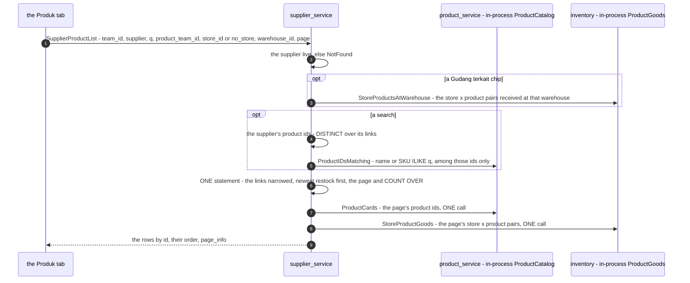

| | |
| --- | --- |
| the rows | `productSet` — the supplier's links, a link of a deleted store hidden with it ([a-store-delete-is-soft-too](../../business/supplier/context_decision.md#a-store-delete-is-soft-too)); a store-less link has none to hide with |
| the order | `last_restocked_at DESC, id DESC` — a store that stopped selling a product sinks ([a-link-remembers-its-last-restock](../../business/supplier/context_decision.md#a-link-remembers-its-last-restock)); read by `supplier_channel_products_newest_idx` |
| the filters | `product_team_id` (whose product, 0 = every team), `store_id` (one store) or `no_store` (the links of lines naming the supplier alone) — never both, a CEL rule ([the-products-tab-filters-by-team-and-store](../../technical/frontend/suppliers_decision.md#the-products-tab-filters-by-team-and-store)) |
| the search | the product's name or SKU — product_service's `IDsMatchingAmong` over the supplier's OWN product ids, one bound array, LIKE wildcards escaped — or the store's name ([the-products-tab-searches-and-pages](../../business/supplier/context_decision.md#the-products-tab-searches-and-pages)) |
| the names | ONE `ProductCards` (product_service `ProductByIds`) per page; an unresolved product keeps its id; archived and locked products are named too — a link is history |
| the figures | ONE `StoreProductGoods` (inventory `SupplierStoreProductGoods`) per page, keyed by (store, product): Terjual = the units out on orders net of their returns, with the orders and the last order's day; Siap = the units on a shelf; every team's goods of that product at that store. None of its goods arrived → no figures (the tab's dash). No restock date — the row's *Terakhir dibeli* is that date |
| the scope | **every selling team reads the same rows and figures** — the supplier's own and any other on Discover ([another-team-sees-everything-of-a-supplier](../../business/supplier/context_decision.md#another-team-sees-everything-of-a-supplier), [every-selling-team-sees-every-teams-figures](../../business/supplier/context_decision.md#every-selling-team-sees-every-teams-figures)): `team_id` authorises, never narrows. Root, the Administrator and the selling roles; `NO_SIDE_EFFECTS`, so a monitor and an agent read it. **No price, no cost** — the link holds none, the figures are counts and dates |
| missing seams | a GoodsReader without `ProductGoods` is an `Internal` error naming it — never dashes passed off as figures |
| the chip | `warehouse_id` — only the rows with goods received at that warehouse, each with that warehouse's figures ([§ The Gudang terkait chip](#the-gudang-terkait-chip--the-toko-and-produk-tabs-under-a-warehouse)) |

Measured (`-tags perfaudit`, `cmd/app_development/supplier_product_list_perf_test.go`: 2 000 suppliers, 10 selling
teams, 30 000 products, **40 000 links** — the big supplier 4 000 over 10 stores, 1 in 5 store-less — **100 000
batches** over 8 warehouses, 300 000 order logs). Every page is **4 statements** (the supplier, the page with its count,
the names, the figures), 6 with a search:

| case | rows | wall median |
| --- | --- | --- |
| typical supplier (≈ 18 links) · page 1 × 20 | 18 of 18 | **2.9 ms** |
| typical supplier · a search | 3 of 3 | 2.6 ms |
| big supplier (4 000 links) · page 1 × 20 · × 50 · page 100 × 20 | 20 · 50 · 20 of 4 000 | **12.5** · 18.4 · 14.2 ms |
| big supplier · one store · no store · one team | 20 of 400 · 800 · 400 | 5.9 · 10.2 · 10.9 ms |
| big supplier · a search (a quarter · one SKU · none) | 999 · 2 · 0 | 77 · 59 · 51 ms |

The big supplier's search is ≈ 50 ms of **transport**, not of query: its 4 000 product ids go to Postgres as one 28 KB
array, and a control statement binding the same array (`SELECT length($1)`) costs the same 51 ms on Docker Desktop's
loopback; the statements themselves execute in ≈ 3.5 ms. The figures read is the page's: its batches looked up pair by
pair through `batches_supplier_idx` (a LATERAL per pair) and read once (MATERIALIZED), then their order logs; ready and
sold meet in ONE aggregate over a UNION ALL — a join of the two aggregates planned a nested loop re-reading the sold side
per row, 200 pairs 78 ms → 48 ms. A `(product_id, supplier_id, supplier_channel_id)` index on batches was probed and
**not added**: no case moved (page 1 × 20 12.5 → 11.7 ms), and a cached generic plan scores it a tie with
`batches_supplier_idx`. No problem, so no audit file.

Tests: `supplier_product_list_test.go` (a row says whose, where and when; newest restock first and paged; the team, one
store and no store; the search through the catalogue among the supplier's own products, or by store; ONE catalogue and
ONE goods call per page; every team reads the same rows and figures, never a cost; refusals and an unanswered seam; the
policy), inventory `supplier_store_product_goods_test.go` (the asked pairs with their own goods; the last order skips a
cancelled one; nothing asked, nothing read), product `product_ids_matching_among_test.go`,
`cmd/app_development/supplier_products_test.go` (the real wiring end to end).

## Penjualan — a fold of Order Placed and Order Cancelled

What a supplier's goods SOLD for ([penjualan-is-the-selling-value-on-the-order-day](../../technical/frontend/suppliers_decision.md#penjualan-is-the-selling-value-on-the-order-day)),
beside Direstok on the Statistik tab and the Supplier Report — the shape of the order metrics and the warehouse fee: the
order's Jakarta day adds, a cancel takes back on its own day
([a-warehouse-fee-counts-on-its-day-and-a-cancel-takes-it-back-on-its-day](../../business/analytic/rpc_provide_decision.md#a-warehouse-fee-counts-on-its-day-and-a-cancel-takes-it-back-on-its-day)).
`SalesFoldHandler` (`supplier_v1/sales_fold.go`), two push routes, one handler.

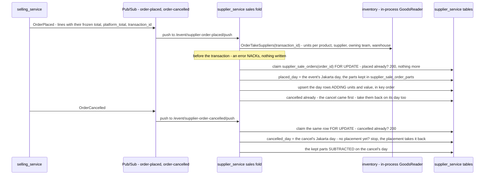

| | |
| --- | --- |
| the goods | the units the order's take drew from batches carrying a supplier — inventory's `batch_logs` `order` rows of the event's `transaction_id`, gross (a release's rollback rows never subtracted), joined to `batches` for supplier, product and the batch's team. The same goods Terjual counts (`SupplierGoods`) |
| the value | each line's share of the order's `platform_total` by its frozen `total` (by quantity when no line has one), spread over the line's units; a supplier's part = its units × that price. Exact, never rounded. A platform total of 0 values the units at 0 and still counts them |
| the team | the batch's team — the team that restocked the goods, as Direstok's rows are keyed; the `TeamFilter` narrows it |
| the warehouse | the one the take drew in (a take draws in ONE warehouse — the batches' `warehouse_id`), else `OrderPlaced.warehouse_id`; kept on the parts, so the cancel subtracts there ([§ The warehouse](#the-warehouse--both-reports-under-a-chip)) |
| the days | the events' `occurred_at` in Asia/Jakarta (`saleDay`) — an order at 00:30 WIB is that day, on any host clock |
| order of events | either: a cancel first leaves `cancelled_day` on the row and the late placement folds both days in one transaction |
| idempotent | the order's row is the claim — a redelivery of either event writes nothing |
| replay | NOT replayed by `AnalyticReplayCompute`, which deletes and re-seeks the restock subscription only — Penjualan is its own table for that reason |
| tests | `sales_fold_test.go` (00:30 WIB on a UTC clock, the split by line total and by quantity, a cancel on its own day + redeliveries, a cancel first, another team's sale for every reader + the sort, an unread take NACKed, a warehouse role refused) · `sales_fold_race_test.go` (`-tags raceaudit`) · `register_test.go` (both routes mounted) |

## The range pills — SupplierList's `sold` and `ready`

The fixed bands ([the-range-pills-are-a-fixed-set](../../technical/frontend/suppliers_decision.md#the-range-pills-are-a-fixed-set)):
Terjual and Siap as `SupplierGoods` reads them, over every team's goods. `SupplierFigureBand{min, max}` — `min`
inclusive, `max` exclusive, `max` 0 open-ended (protovalidate: `max` 0 or above `min`, neither negative). Narrowed
BEFORE the count and the page, so a supplier on page 2 is found and the pager counts only the band.

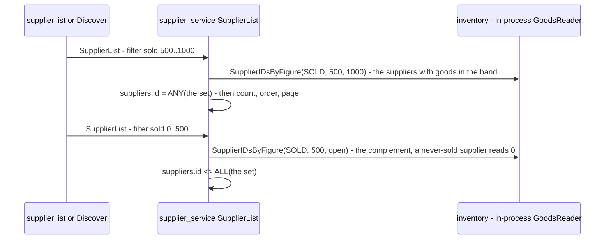

Inventory can list only suppliers WITH goods, so a band from 0 is asked as its complement. An empty set from above 0 is no
supplier. Inventory not answering is `Internal`, never an empty list. Tests: `supplier_list_test.go`
(`ABandFindsASupplierBeyondTheFirstPage`, `BandsAreLowerInclusiveUpperExclusive`, `ABandIsValidated`).

## The Gudang filter — SupplierList's `warehouse_id`

[the-warehouse-filters-before-the-team](../../technical/frontend/suppliers_decision.md#the-warehouse-filters-before-the-team),
[the-warehouse-filter-narrows-only-the-rows](../../technical/frontend/suppliers_decision.md#the-warehouse-filter-narrows-only-the-rows)
(built 2026-11-14). The supplier list and Discover › Suppliers keep the suppliers whose goods were received at the picked
warehouse — EXACTLY the suppliers whose page lists it among **Gudang terkait** (`InventoryService.SupplierGoods` by
WAREHOUSE). Asked of inventory BEFORE the count and the page, in-process, as the range pills are; only the rows narrow —
Terjual, Siap and the bands stay the supplier's whole, over every warehouse.

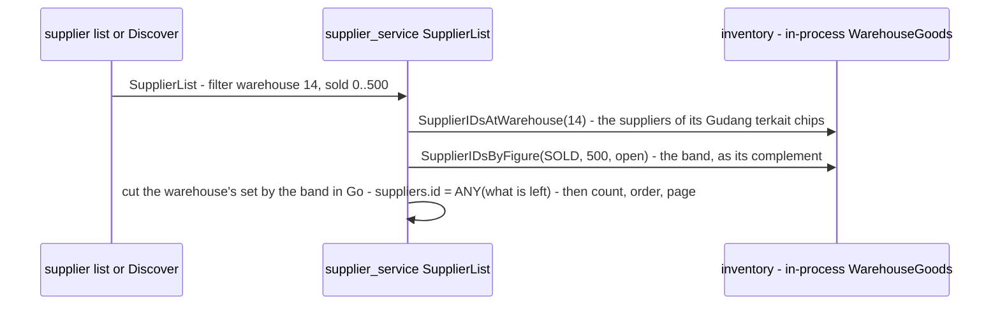

| | |
| --- | --- |
| received at W | a batch carrying the supplier, in W, that **holds units now**, OR was **minted by a `restock`** transaction (emptied since or not), OR has an **`order` row** on `batch_logs` (even one a cancel netted to 0) — the three aggregates whose rows make a `SupplierGoods` WAREHOUSE row, so the filter and the chips never disagree (`inventory_v1/supplier_ids_at_warehouse.go`) |
| whose supplier | the batch's own `supplier_id` — copied from the restock **line** at accept ([a-batch-keeps-its-supplier](../../business/inventory/context_decision.md#a-batch-keeps-its-supplier)), from the source batch by a transfer — never the restock-level supplier; batches from nobody (0) left out |
| transfers | count when the transferred batch still holds units or was sold from — as the chips list it (*0 restocks*); one moved on unsold, or written down to 0 without a sale, made no chip and makes no match |
| every team | every team's batches ([every-selling-team-sees-every-teams-figures](../../business/supplier/context_decision.md#every-selling-team-sees-every-teams-figures)); OWN keeps the caller's own suppliers by its own predicate, Discover every team's, `owner_team_id` and `q` AND with it |
| with a band | the warehouse's set is cut by each band IN GO (a band from 0 as its complement) and bound as ONE `= ANY(bigint[])`; once nobody is left, the band is not asked. No warehouse = the range pills as before |
| who | a warehouse role may name only its own building — `PermissionDenied` otherwise: `use_scope` checks `team_id` alone, and the chips are the selling side's (`SupplierGoods` refuses a warehouse) |
| unanswered | `Internal`, never an empty list — inventory down, or a `GoodsReader` with no `WarehouseGoods` |
| the seam | `supplier_v1.WarehouseGoods` (`SupplierIDsAtWarehouse`), asked of the SAME `GoodsReader` by type assertion and answered by `cmd/app_development/supplier_goods_reader.go` from `inventory_v1.SupplierIDsAtWarehouse(ctx, db, w)` — a plain function over inventory's tables. Kept off `GoodsReader` so the operations tool's reader (`tools/san` `refoldGoods`, which never lists suppliers) needs no new method |
| tests | `supplier_list_test.go` (`TheWarehouseKeepsTheSuppliersReceivedThere` — at W1 only, at both, at none, two teams, OWN vs Discover, with `owner_team_id` and `q`; `TheWarehouseAndABandAreCutTogether` — the whole figure, a band from 0, no band asked once empty; `TheWarehouseNarrowsBeforeThePage` — 30 of 60, page 2 by name; `TheWarehouseUnansweredIsAnError`; `AWarehouseFiltersOnlyByItself`) · inventory `supplier_ids_at_warehouse_test.go` (each way a warehouse holds goods, equal to the chips) · `cmd/app_development/supplier_goods_reader_test.go` (`TheWarehouseFilterReadsTheBatches`, real batches through the real seam) |

**Performance** (`cmd/app_development/supplier_list_warehouse_perf_test.go`, `-tags perfaudit`, the real wiring: 2 000
suppliers over 10 teams, 100 000 batches over 8 warehouses — the big one ≈ 30 000 batches holding every supplier, a small
one ≈ 10 000 from 600 —, 300 000 `order` rows; medians of 5 after a warm-up). No warehouse picked: unchanged (1–2 ms, 3
statements). With one, ONE more statement before the count:

| case | answer | wall |
| --- | --- | --- |
| the seam, big warehouse | 2 000 ids | 32 ms (≈ 8 ms of it JIT) |
| the seam, small warehouse | 600 ids | 19 ms |
| the seam, a warehouse with no goods | 0 ids | 9 ms |
| Discover, big warehouse · page 50 by name | 20 of 2 000 | 35 · 36 ms |
| own list, big · small warehouse + `q` | 20 of 200 · 20 of 60 | 43 · 22 ms |
| Discover, big warehouse + Siap < 50 | 20 of 43 | 56 ms |
| Discover, big warehouse + Terjual 500–1.000 | 0 | 137 ms — the band's own read (≈ 100 ms here, 0.6–0.9 s at 1 M order rows) |
| Discover, a warehouse with no goods + Terjual band | 0 | 12 ms — the band is never asked |

The 2 000-id array is ≈ 10 KB (control `SELECT length($1)` 0.6 ms — under this host's ≈ 25 KB loopback stall). The restock
test is a scalar subquery (a primary-key lookup per batch the shelf test did not keep): written as `EXISTS`, the planner
hashed every restock transaction of every warehouse first (39 / 23 ms vs 31 / 10 ms). **Index probe, not added:**
`(warehouse_id, supplier_id) INCLUDE (stock_count, transaction_id) WHERE supplier_id > 0` gave nothing to this shape; only
a per-supplier rewrite on top of it reached 14 ms at the big warehouse (51 ms without the index) — ≈ 18 ms for a
migration on `batches`, below the bar of [a-pure-index-is-added-without-asking](../../technical/architecture/context_decision.md#a-pure-index-is-added-without-asking);
the candidate if warehouses grow.

## The Gudang terkait chip — the Toko and Produk tabs under a warehouse

[a-supplier-page-is-scoped-by-its-warehouses](../../technical/frontend/suppliers_decision.md#a-supplier-page-is-scoped-by-its-warehouses)
(built 2026-11-14 for the Toko and Produk tabs). The supplier detail's and the Discover detail's **Gudang terkait** chip —
in the URL as `?warehouse=` — narrows both tabs to what that warehouse received, with that warehouse's figures, and their
Export follows; the summary under the chips already followed it. **Statistik follows it too** since its two day reports
carry the warehouse ([§ The warehouse](#the-warehouse--both-reports-under-a-chip), built 2026-11-14) — no ⚠ mark is left
on either page.

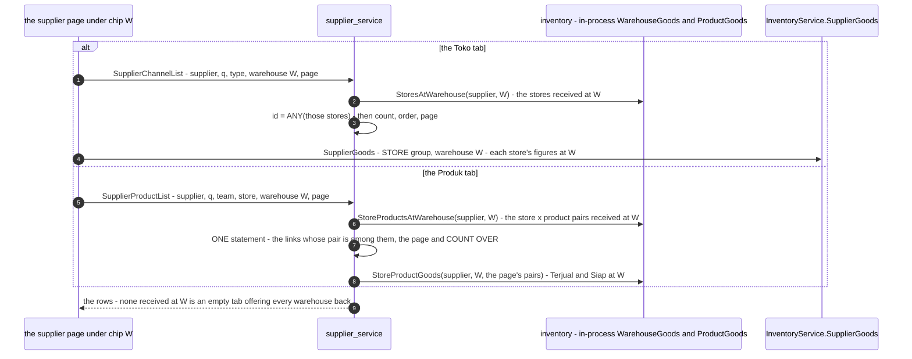

| | |
| --- | --- |
| received at W | the **Gudang terkait set's own test** — the one the chips and the list's Gudang filter use (`receivedHere` in `inventory_v1/supplier_ids_at_warehouse.go`): a batch of the supplier in W that **holds units now**, OR was **minted by a `restock`**, OR has an **`order` row**. The batch's own (line) supplier and store, every team's goods, a transfer-in counted where it went |
| Toko | the supplier's live stores with such a batch in W (`inventory_v1.SupplierStoresAtWarehouse`) — a supplier has few stores, so one small `id = ANY(bigint[])` before the count and the page (`channelSet`). Each store's Terjual and Siap: `SupplierGoods` by STORE with the new `warehouse_id` (every aggregate narrowed to W's batches) |
| Produk | the links whose (store, product) — store 0 for a line naming the supplier alone — has such a batch in W (`inventory_v1.SupplierStoreProductsAtWarehouse`), bound as two id arrays read side by side (`(COALESCE(l.channel_id, 0), l.product_id) IN (SELECT … FROM unnest(…, …))`) inside `productSet` — so the search's candidates, the count and the page are all the chip's. The figures: `SupplierStoreProductGoods` with W. *Terakhir dibeli* stays the link's own — the link remembers its last restock, wherever it went |
| exports | `SupplierChannelExport` and `SupplierProductExport` take the same filter (`warehouse_id` on `SupplierChannelListFilter` / `SupplierProductListFilter`) and write the tab under the chip, with W's figures |
| who | every selling team reads the same rows ([another-team-sees-everything-of-a-supplier](../../business/supplier/context_decision.md#another-team-sees-everything-of-a-supplier)). `SupplierChannelList`'s policy lets a warehouse read a store list, and `use_scope` checks `team_id` alone, so a warehouse role naming another building is `PermissionDenied` — where a supplier's goods went is the selling side's to read (`SupplierGoods` refuses a warehouse) |
| unanswered | `Internal`, never an unnarrowed or empty tab — inventory down, or a `GoodsReader` without `WarehouseGoods` |
| the screen | `?warehouse=` (`useUrlState`, `idCodec`) on both detail pages; ChannelBrowser / ProductBrowser take `warehouseId` (query keys, figures, Export, back to page 1 on a change); the chip alone leaving nothing reads *No supplier stores / products at this warehouse* with **All Warehouses** |

**Performance** (`cmd/app_development/supplier_warehouse_chip_perf_test.go`, `-tags perfaudit`, the real wiring on the
Produk tab's volume — 2 000 suppliers, **40 000 links**, **100 000 batches** over 8 warehouses, 300 000 order rows; the big
supplier 10 000 batches, 1 500 of them and 1 500 (store, product) pairs at its chip's warehouse; medians of 5 on clean
tables). The chip adds ONE statement (the set at W, ≈ 1–2.5 ms — a bitmap scan of `batches_supplier_idx`) and narrows
everything after it:

| case | answer | wall |
| --- | --- | --- |
| Toko · typical · no chip / chip | 2 of 2 | 1.1 / 1.6 ms |
| Toko · big supplier · chip | 8 of 8 | 2.3 ms |
| Toko figures (`SupplierGoods` STORE) · big · no chip / chip | 9 stores | 79 / **15 ms** — the chip reads one warehouse's order rows |
| Produk · typical · chip · page 1 × 20 | 6 of 6 | 3.5 ms |
| Produk · big · chip · page 1 × 20 · × 50 · page 30 × 20 | 20 · 50 · 20 of 1 500 | 8.4 · 10.9 · 9.5 ms (no chip: 13.0 ms) |
| Produk · big · chip · one store | 20 of 100 | 6.3 ms |
| Produk · big · chip · q=katun | 20 of 332 | 64 ms — ≈ 50 ms of it transport (below) |
| export Toko · big · chip | 8 rows | 19.5 ms |
| export Produk · typical · chip / big · chip | 6 / 1 500 rows | 4.9 / 142 ms (8 steps) |

The chip's page binds the pairs as two arrays (6.6 + 8.4 KB at the big supplier): a control binding them to `SELECT
length($1) + length($2)` costs 0.6 ms. With a search the page binds a third (the matched products, 2 KB) and that control
costs 50.6 ms — this host's Docker Desktop loopback stall on a ≈ 17 KB bind, not the read: the statement executes in 7.9 ms
(`EXPLAIN ANALYZE`), as P3's big-supplier search did. No index probed beyond the plan: the set at W reads 1 500 index
entries of `batches_supplier_idx` in ≈ 1 ms. No problem, so no audit file.

Tests: `supplier_channel_list_test.go` (`TheWarehouseChipKeepsItsStores` — chip W1 / W2 / none / a warehouse with none,
a store at both, two teams, narrowed before the page; `TheChipWithTheSearchAndTheType`; `TheChipsRefusals` — a warehouse
role on another building, inventory down, no inventory), `supplier_product_list_test.go` (`TheWarehouseChipKeepsItsRows` —
a store's product at both warehouses with each one's figures, a no-store link, team B's row, Terakhir dibeli kept, two
teams, paged; `TheChipWithTheTabsFilters` — store, no store, team, the search among the chip's products only;
`TheChipNeedsInventory`), `supplier_channel_export_test.go` / `supplier_product_export_test.go`
(`TheFileFollowsTheWarehouseChip` — the file is the tab under the chip, across steps, W's figures), inventory
`supplier_stores_at_warehouse_test.go` (each way a warehouse holds a store's goods — restock, emptied, transfer on the
shelf, moved on, sold from — equal to `SupplierGoods` STORE under W; the stall line is store 0), `supplier_goods_test.go`
(`OneWarehouseOnly`), `supplier_store_product_goods_test.go` (`UnderAChipOnlyThatWarehouse`),
`cmd/app_development/supplier_products_test.go` (`TheWarehouseChipNarrowsTheTabs` — real batches at two warehouses), the
stories (`Pages/Suppliers/SupplierDetail/Warehouses`, `…/DiscoverSupplierDetail/Tabs`, ChannelBrowser, ProductBrowser) and
e2e `the_supplier_goods.spec.ts` (B's chip hides what was received at A).

## The reads

ONE metric, `metrics/suppliers` — `SupplierMetric`, the six figures, the broken rate and Penjualan's `sales_count` /
`sales_value` (fields 8–9, sortable) — read through the analytic
pattern every service's figures share ([rpc_provide.md](../../business/analytic/rpc_provide.md),
[the-pattern-replaces-the-shipped-analytics](../../business/analytic/rpc_provide_decision.md#the-pattern-replaces-the-shipped-analytics));
it replaced `AnalyticTimeSearch`, `AnalyticProductSearch`, `AnalyticGroupSearch` and `AnalyticGroupMetric` on
2026-10-27. Every read is `listQuery` on the screen and reads the folded table only. **Every selling team reads every
team's figures** ([every-selling-team-sees-every-teams-figures](../../business/supplier/context_decision.md#every-selling-team-sees-every-teams-figures)) —
a `TeamFilter` narrows to one restocking team
([the-team-filter-picks-any-selling-team](../../business/supplier/context_decision.md#the-team-filter-picks-any-selling-team)).

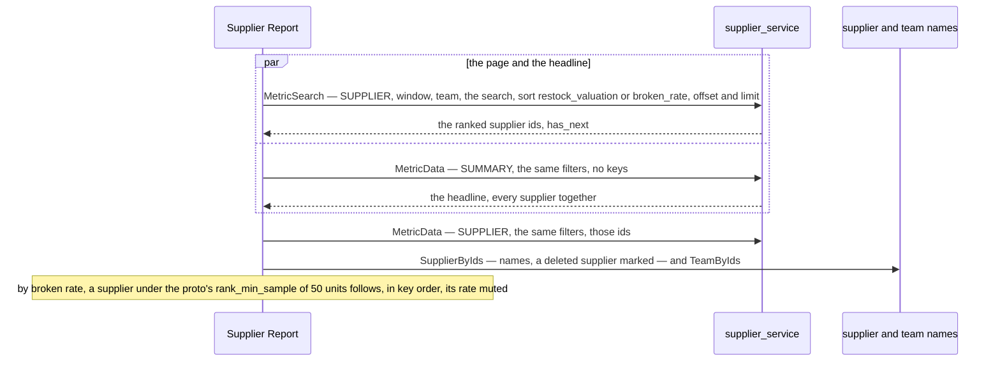

| read | groups | queries | note |
| --- | --- | --- | --- |
| `MetricSearch` | SUPPLIER, PRODUCT, DAILY … YEARLY — never SUMMARY | 1 — the scope grouped by the key, ordered, `limit + 1` | the sort is one `can_sort` field by its proto name; the key DESC breaks a tie; by `broken_rate`, units ≥ 50 ranked first ([rate-ranking-needs-50-units](../../business/supplier/context_decision.md#rate-ranking-needs-50-units)); no total, only `has_next` |
| `MetricData` | the same, and SUMMARY | 2 — the restock table's, Penjualan's | every asked key comes back, zero when quiet; a period keyed by its first day — a Monday, the 1st, 1 January; SUMMARY takes no keys |

| filter | narrows | screen |
| --- | --- | --- |
| `DateRangeFilter` — required | the accept's (or the sale's) Jakarta day, both ends inclusive, as literals in SQL (`window()`) | both |
| `TeamFilter` | whose restocks are counted — for Penjualan, whose goods were sold | both |
| `SupplierFilter` | one supplier | the Statistics tab |
| `WarehouseFilter` | the rows filed under one warehouse — a supplier page's Gudang terkait chip (`00006`, [§ The warehouse](#the-warehouse--both-reports-under-a-chip)); none = every warehouse | the Statistics tab |

Each read narrows BOTH tables — `supplier_product_daily_reports` and `supplier_sale_daily_reports`, keyed alike, the
warehouse included — by the same filters and sums them per key (over every warehouse when no chip narrows it): `MetricData` as two grouped statements added in Go, `MetricSearch` as one UNION ALL
of the two GROUPED reads. Never a UNION ALL of the raw rows under one aggregate: Postgres plans that as a Parallel Append,
and the workers' start-up alone took the 30-day headline from 9 to ≈ 40 ms. A supplier with sales and no restock in the
window is a key of the ranking too.

The Statistics tab lists its periods itself — a time group needs no search — so a quiet period is a row too, and
reads `MetricData` by DAILY / MONTHLY / YEARLY for the page's periods. Performance:
[MetricSearch.md](../../../audits/services/supplier_service/performances/MetricSearch.md),
[MetricData.md](../../../audits/services/supplier_service/performances/MetricData.md).

## The warehouse — both reports under a chip

[the-supplier-reports-carry-the-warehouse](../../technical/frontend/suppliers_decision.md#the-supplier-reports-carry-the-warehouse)
(built 2026-11-14, supplier_service `00006`). Both day reports and the sale parts are keyed by the WAREHOUSE, last: a
restock line's receiving warehouse, an order line's taking warehouse. Under a supplier page's Gudang terkait chip the
Statistik tab — headline, Per Periode, Per Produk and its Export — reads that warehouse's rows (`FILTER_TYPE_WAREHOUSE`
on `metrics/suppliers`); with no chip it reads the sum over every warehouse, which is what it read before. Values stay
at the line price, Penjualan included.

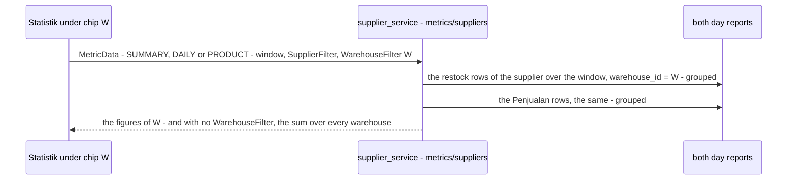

| | |
| --- | --- |
| events | none changed — the fields were there: `RestockAccepted.warehouse_id` (3), `RestockReceivedCountCorrected.warehouse_id` (3, the receiving warehouse), `OrderPlaced.warehouse_id` and `OrderCancelled.warehouse_id` (7). Inventory's in-process take (`inventory_v1.OrderTakeSuppliers`) now returns each part's warehouse (`batches.warehouse_id`) |
| the migration | adds the column at 0, drops the default (every write names a warehouse), rebuilds the keys — never truncates: the claims are pruned after 45 days and the parts need the take, so SQL cannot rebuild them ([database-schema.md](../../database-schema.md)) |
| the history | `san supplier backfill-warehouses [--dry-run]` — re-files each sale part from its take, re-folds every supplier day still holding a 0 row through `DayRefold`, and prints every supplier's totals BEFORE == AFTER ([san.md](../../tools/san.md#supplier-backfill-warehouses)). A row it cannot place stays at 0: counted with no chip, under no warehouse's chip |
| the fold's locks | unchanged — the warehouse is last in every key and one event names one warehouse; `SalePartWarehouses` takes the order's row lock, the one a placement and its cancel meet on ([lock-order.md](../../../audits/services/supplier_service/concurrency/lock-order.md)) |
| the screen | both detail pages pass `?warehouse=` to `SupplierStatistics` (`warehouseId`) — its reads, its query keys and its Export carry a `WarehouseFilter` after the window; a chip change sends the tables back to page 1 |
| tests | `analytic_warehouse_test.go` (`EachAcceptIsFiledUnderTheWarehouseItWasReceivedAt`, `ACorrectionIsFiledUnderItsOwnWarehouse`, `ASaleIsFiledUnderTheWarehouseItWasTakenFrom` — a cancel, a cancel first, a take naming none falls back to the order's —, `TheClaimKeepsTheWarehouse`, `DayRefold_Restock_RebuildsEveryWarehousesRows`, `WarehouseBackfill_RefilesEveryFigureAndKeepsEveryTotal`, `SalePartWarehouses_AFallbackKeepsThePartsFigures`) · `metric_warehouse_test.go` (`TheWarehouseChipNarrowsStatistik` — W1 / W2 / none = their sum, every group; `NoChipReadsTodaysFiguresByteForByte`; `SupplierFigureExport_FollowsTheWarehouseChip`) · `analytic_warehouse_race_test.go` (`-tags raceaudit`) · inventory `supplier_order_take_test.go` · `tools/san/supplier_warehouses_test.go` · stories (`Features/Suppliers/SupplierStatistics` — `AWarehouseChipNarrowsEveryFigure`, `NoChipIsTheSumOfTheWarehouses`, `TheExportCarriesTheChip`; `…/SupplierDetail/Warehouses` `AChipNarrowsStatistik`; `…/DiscoverSupplierDetail/Tabs` `TheChipNarrowsStatistik`) · e2e `the_supplier_goods.spec.ts` (Statistik under B's chip leaves out what was received at A) |

**Performance** (`-tags perfaudit`, `analytic_perf_test.go`: 522 000 restock rows and their mirror in Penjualan over 365
days, each under one of 3 warehouses; medians of 5). The chip is a filter on the supplier-day index's rows — no index of
its own, and none needed: it reads a third of the supplier's rows at the cost of reading them all.

| read | no chip | chip |
| --- | --- | --- |
| `MetricData` SUMMARY · top supplier · 366 d / 30 d | 20.8 ms / — | 21.2 / 4.2 ms |
| `MetricData` DAILY · top · 30 d × 10 / 366 d × 200 | 2.1 / 10.9 ms | 3.1 / 13.3 ms |
| `MetricData` PRODUCT · top · 366 d × 20 | 17.1 ms | 19.1 ms |
| `MetricSearch` PRODUCT · top · 366 d / 30 d · limit 20 | 17.7 / 2.9 ms | 15.5 / 2.6 ms |
| `MetricSearch` PRODUCT · median · 366 d · limit 20 | 0.9 ms | 0.85 ms |
| the fold (`FoldHandler`) · 1 / 20 / 100 lines | 2.2 / 3.4 / 8.8 ms, 6 statements — unchanged by the wider key | |

## The tabs as files — `SupplierChannelExport` and `SupplierFigureExport`

[each-supplier-tab-exports-its-own-table](../../technical/frontend/suppliers_decision.md#each-supplier-tab-exports-its-own-table),
on the order list's pattern ([one-export-is-the-list-as-a-file](../../technical/frontend/warehouse_order_list_decision.md#one-export-is-the-list-as-a-file)):
each tab's Export writes ITS table as narrowed — the tab's own filter, every page, its columns — as .xlsx, a server
stream of progress ending with an expiring link. One RPC per table: the Toko and the Produk tabs' on
`SupplierChannelService` (`SupplierChannelExport`, `SupplierProductExport` — since 2026-11-14), the Statistik tab's (the
view on screen) on `SupplierAnalyticService`. A `SUPPLIER` group is refused: the Supplier Report's file is its own
RPC ([§ below](#the-report-as-a-file--supplierreportexport)).

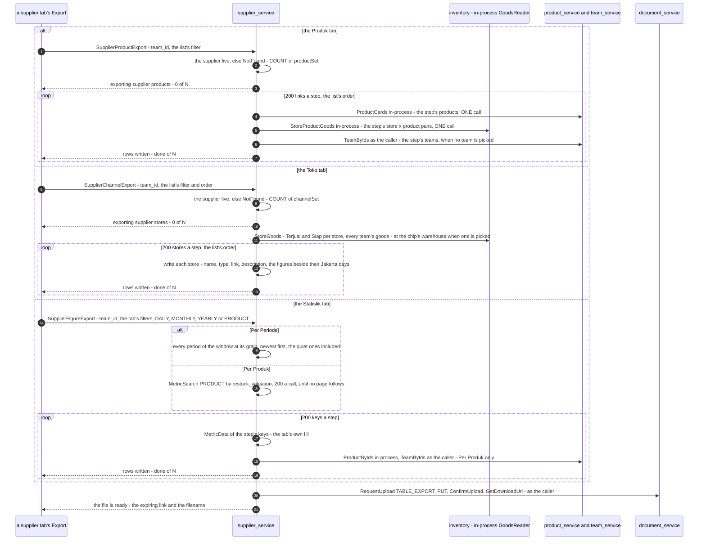

| | |
| --- | --- |
| the rows | **Produk**: `productSet` — the very set `SupplierProductList` pages, its order, every page, each step the list's own page (`productRows`). **Toko**: `channelSet` — the very set `SupplierChannelList` pages, its order, every page. **Statistik**: Per Periode, the tab's own spine of periods (`periodSpine` = the screen's `bucketSpine`, newest first), each filled by `MetricData`; Per Produk, every key `MetricSearch` ranks with the tab's sort |
| the columns | **Produk** (sheet *Produk*): Produk · SKU · Tim · Toko pemasok · Jenis toko · Terakhir dibeli · Pertama dibeli · Terjual · Pesanan terakhir · Siap — Tim goes when one team is picked, as on screen; a store-less row has empty store cells (the tab's —); **no price, no cost**. **Toko** (sheet *Toko*): Toko pemasok · Jenis toko · Tautan · Deskripsi · Terjual · Pesanan terakhir · Siap · Restok terakhir — the store's name and its badge in two cells, each figure beside the date under it on screen; the row's actions left out. **Statistik** (sheet *Per Periode* / *Per Produk*): Periode (`2026-10-07`, *Oktober 2026*, `2026` — [a-period-reads-as-its-grain](../../technical/frontend/suppliers_decision.md#a-period-reads-as-its-grain)) or Produk · SKU · Tim (only while no team is picked, as on screen), then Direstok, Penjualan, Hilang di pengiriman, Rusak di pengiriman — each its units and its Rp — and each loss's rate after it |
| the figures | money is the metric's exact double ([the-backend-never-rounds-money](../../business/order/context_decision.md#the-backend-never-rounds-money)); a rate is the exact share under a `0.0%` cell format, empty when nothing arrived; a store none of whose goods arrived has empty figure cells (the tab's dash); dates are Jakarta days |
| the scope | every selling team reads every supplier's stores and figures, as the tabs do; the policy is `SupplierGoods`' / `MetricData`'s readers — Root, the Administrator and the selling roles, never a warehouse role. Not `NO_SIDE_EFFECTS`: it stores a file, so a monitor and an agent are refused ([the-admin-team-monitors-read-only](../../business/user/context_decision.md#the-admin-team-monitors-read-only)); the screens hide Export from a monitored team |
| the Gudang terkait chip | narrows the Toko and Produk files as it narrows their tabs — the stores / rows received at that warehouse, with its figures ([§ The chip](#the-gudang-terkait-chip--the-toko-and-produk-tabs-under-a-warehouse)); and the Statistik file as it narrows Statistik — that warehouse's rows (`FILTER_TYPE_WAREHOUSE`, [§ The warehouse](#the-warehouse--both-reports-under-a-chip)) |
| the store | `ExportStore` (`export_store.go`), adapted at the composition root (`cmd/app_development/supplier_exports.go`): the file through document_service's upload as the caller — a private `table_export` (document `00010`) named `toko-pemasok-…` / `produk-pemasok-…` / `statistik-pemasok-per-periode-…` / `…-per-produk-…`; the products named in-process from product_service, the teams through TeamByIds as the caller. The xlsx writer and the progress stream are `backend/pkgs/san_export` |
| measured (`-tags perfaudit`) | **Produk**: typical 18 rows 5.2 ms / 5 queries; the big supplier's 4 000 rows 1.1 s / 64 (20 steps, the figures ≈ 46 ms a step) — a streamed file, its progress shown. **Toko**: 300 stores 13.6 ms / 4 queries, typical 3 stores 4.1 ms / 3. **Statistik**: the top supplier (11 661 rows) daily over a year 35 ms / 4 queries (two steps), monthly 32 ms / 2, Per Produk over a year 82 ms / 6 (max 147 ms), over 30 days 22 ms; the median supplier ≤ 18 ms — none heavy |

Tests: `supplier_product_export_test.go` (the file equals the list's rows across steps, in its order; the columns, Tim
gone with a team picked, empty store and figure cells; refusals), `supplier_channel_export_test.go` (the file equals the list's rows across five pages and two steps; the columns
and the figures with their Jakarta days; a deleted supplier NotFound, the policy), `supplier_figure_export_test.go`
(Per Periode = every day of a year, newest first, each row the tab's `MetricData`, money exact to its fraction; a month by
its name; Per Produk = the tab's ranking across pages, named; a team picked holds only its restocks; refusals),
`cmd/app_development/supplier_goods_reader_test.go` (`StoreGoods`), `document_v1` `TestUploadFlow_TableExportIsPrivate`.

## The report as a file — `SupplierReportExport`

Built 2026-11-07 ([a-report-export-is-the-whole-view-as-a-file](../../technical/frontend/context_decision.md#a-report-export-is-the-whole-view-as-a-file),
closing what [the-report-export-is-marked](../../technical/frontend/suppliers_decision.md#the-report-export-is-marked)
left open): the Supplier Report's Ekspor writes **the whole ranking as narrowed** — the report's window, whose
restocks, the settled search and its *Urutkan* — every page, each supplier with its figures, as .xlsx; the same stream
and store as the tabs' files.

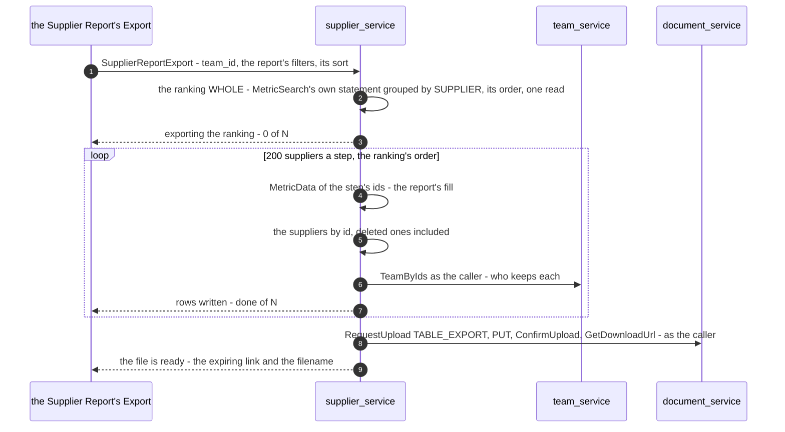

| | |
| --- | --- |
| the rows | every supplier the report ranks with these filters, in its order — by restocked value, or by broken rate with the 50-unit minimum ranking as on screen — read in ONE statement: `ranking()` in metric_search.go, the statement `MetricSearch` cuts its pages from. Each step of 200 filled by `MetricData` |
| the columns | sheet *Peringkat*: Peringkat (1-based across every page, as the screen counts) · Pemasok (`Pemasok #<id>` when unnamed) · Status (*Dihapus* for a deleted supplier, its figures kept — the badge) · Dikelola oleh (`Tim #<id>` when unnamed) · then the tabs' figure columns — Direstok, Penjualan, Hilang di pengiriman, Rusak di pengiriman, each units and Rp, each loss's rate after it |
| the figures | the metric's exact doubles; a rate the exact share under `0.0%`, empty when nothing arrived; Jakarta days |
| refused | a supplier filter (one supplier's figures are its Statistik tab's file), a sort of another metric or an unsortable field, no window — InvalidArgument; no store — Unimplemented |
| the scope | the ranking's readers — Root, the Administrator, the selling roles; every selling team reads every team's figures, as the report does. Not `NO_SIDE_EFFECTS`: a monitor and an agent are refused; the screen hides Export from a monitored team |
| the store | the tabs' `ExportStore` — file `laporan-pemasok-<yyyy-mm-dd-hhmmss>.xlsx`, a private `table_export` |
| measured (`-tags perfaudit`, 2 000 suppliers) | 30 days 187 ms / 31 queries; a year 1.1 s (by broken rate 1.3 s, one team 478 ms, a search 1.7 s) — 🔴 heavy: the fill re-reads the window per 200 suppliers ([SupplierReportExport.md](../../../audits/services/supplier_service/performances/SupplierReportExport.md), its open question: fill from the ranking statement's own sums) |

Tests: `supplier_report_export_test.go` — the file is the whole ranking across 214 suppliers (more than a step of 200,
eleven screen pages), each row the report's own `MetricSearch` + `MetricData`, Penjualan included, the deleted supplier
marked; narrowed by broken rate, a search and a team exactly as the report; refusals and the policy.

## AnalyticReplayCompute — never into the backfilled past

Settlement's replay, with one more refusal: figures folded by the backfill were never on the broker, so a replay must
start AFTER the live fold's first day.

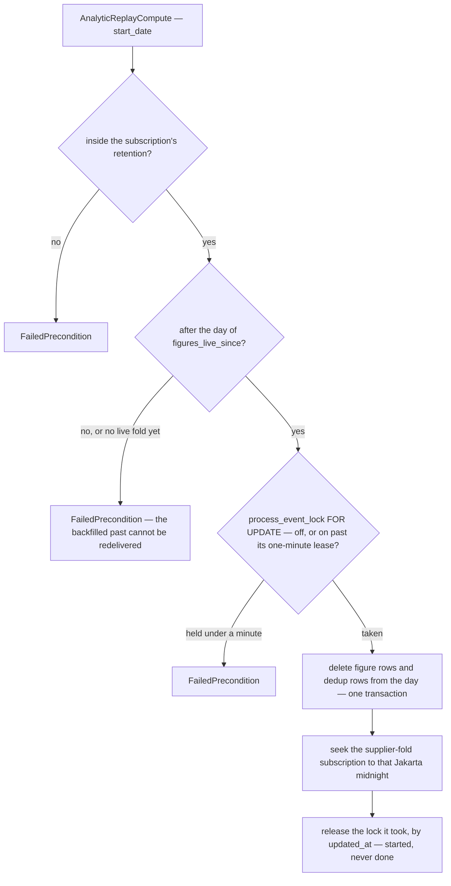

`AnalyticMaintenanceRun` prunes `supplier_event_logs` received more than 45 days ago — longer than the broker's 31-day
retention, so a redeliverable message always finds its claim. It takes no lock.

## The backfill — not an RPC

`san supplier backfill-figures` folds the restocks accepted before the event existed, once
([past-accepts-are-backfilled-once](../../business/supplier/context_decision.md#past-accepts-are-backfilled-once)).
See [san.md](../../tools/san.md#supplier-backfill-figures).

`san supplier backfill-links [--dry-run]` — REPEATABLE — rebuilds the links from every accepted restock through the
fold's own write (`LinkBackfill` → `upsertLinks`, 500 links per transaction, each accept's earliest and latest merged
first), then re-folds, through `DayRefold`, every supplier day the line-supplier switch changes: a restock whose lines
name a supplier while the restock as a whole named none — on its accept day and each day its received count was
corrected (`inventory_v1.RestockCountCorrectionDays`). `dev setup` runs it. See
[san.md](../../tools/san.md#supplier-backfill-links).

`san supplier backfill-warehouses [--dry-run]` — REPEATABLE — files the history folded before the reports carried the
warehouse (`00006` left it under 0): `SalePartWarehouses`, then `DayRefold` of every supplier day still holding a 0 row,
then `ReportTotals` BEFORE == AFTER per supplier. `dev setup` runs it. See
[san.md](../../tools/san.md#supplier-backfill-warehouses).

## The day re-folds — `DayRefold`, not an RPC

`san report refold --report supplier-restock-daily|supplier-sale-daily --supplier <id> --date <day>`
([docs/tools/san.md](../../tools/san.md#a-suppliers-figures--supplier-restock-daily--supplier-sale-daily), [a-wrong-day-is-refolded-from-the-log](../../business/settlement/context_decision.md#a-wrong-day-is-refolded-from-the-log)) — one
supplier's day of either report rebuilt from the fold's claims, plus the events nobody claimed, read through
`RefoldSource` from the services that own them: inventory's accepts (`inventory_v1.RestockAcceptedEventsOn`) and
received-count corrections (`inventory_v1.RestockCountCorrectionEventsOn`), selling's
orders (`selling_v1.OrderSaleEventsOn`) and, for a lost sale, inventory's take (`GoodsReader.OrderTakeSuppliers`). A lost
event over an hour old is claimed the fold's way, so its redelivery folds nothing; the report is then taken in SHARE ROW
EXCLUSIVE — the lock the fold's upsert waits on. The restock re-fold reads `process_event_lock` as the fold does, counts
only the lines crediting its supplier, links each lost accept it claims (after the report's lock — the fold's order), and
names the other suppliers' days such a claim leaves short (a restock mixing suppliers). A Penjualan claim names the other
suppliers' days (and a cancel's day) it leaves short. In-process (`supplier_v1/day_refold.go`,
`day_refold_sales.go`), no wire contract; sequence in san.md, locks in
[lock-order.md](../../../audits/services/supplier_service/concurrency/lock-order.md).
