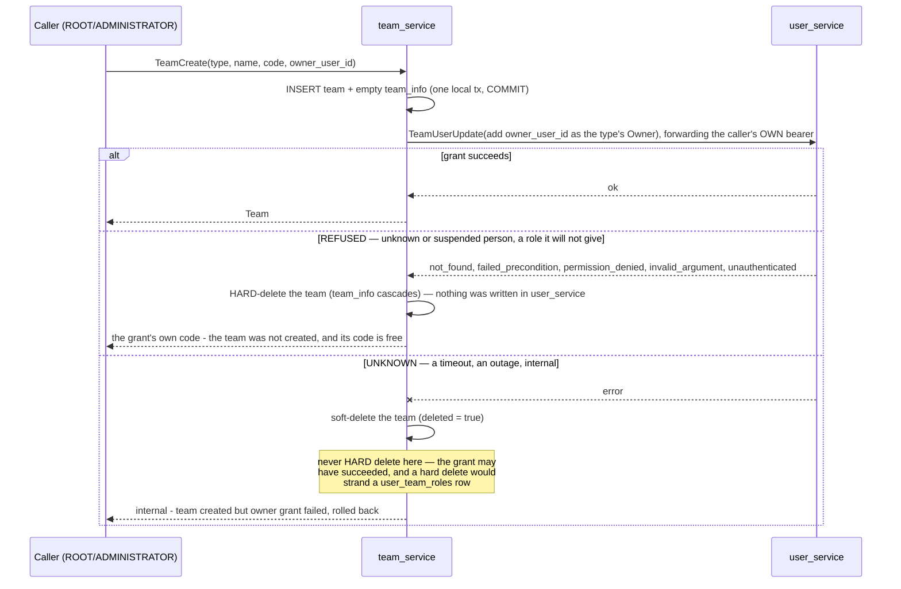
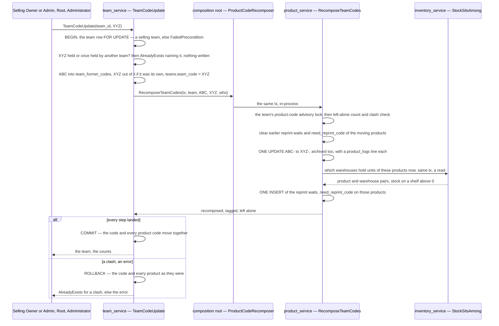
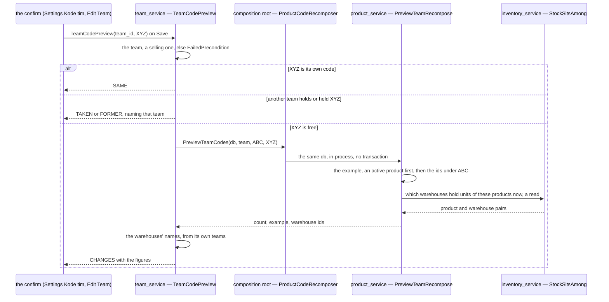

# team_service — complex RPC flows

Only RPCs with a non-trivial flow or a cross-service dependency are documented here (HARD RULE 3).
The plain reads/writes (`TeamList`, `TeamDetail`, `TeamByIds`, `TeamUpdate`, `TeamDelete`,
`TeamInfoUpdate`) are single-table and need no diagram.

## TeamCreate — a saga across two services

`TeamCreate` must do two things that live in **two different services' databases**: create the team
row (team_service) and grant the person the form NAMES (`owner_user_id`) the team type's Owner role
(user_service). The caller is **not** made a member — Root and the Administrator reach every team
([the-create-team-form-names-the-first-owner](../../business/user/context_decision.md#the-create-team-form-names-the-first-owner)).
There is no distributed transaction, so it runs as a saga with a compensating action — and the
compensation depends on whether the grant can have happened.

**Why these choices:**
- **Blocking RPC, not an event.** Only ROOT/ADMINISTRATOR create teams, it is rare, and the exposure window
  is one round-trip. A synchronous grant means the caller learns immediately whether the Owner was
  granted, and the compensation keeps the two stores consistent.
- **The caller's own bearer is forwarded** to `TeamUserUpdate`, never a service credential — so
  user_service applies the *caller's* permissions, not team_service's. A service calling another
  with its own privileges is a confused deputy.
- **A refusal hard-deletes, so the code stays free.** `team_code` is unique across deleted teams too, so a
  soft delete would burn it: the next Create with that code would be told it is taken, by a team nobody
  can see. Each refusal code is returned before user_service writes anything.
- **An unknown outcome soft-deletes.** If the grant call times out it may actually have succeeded;
  soft-delete leaves the team recoverable and never dangles a role pointing at a vanished team. The
  one state a human must look at — grant failed *and* compensation failed — is logged at
  `slog.Error`. That code stays taken.
- The owner role depends on team type: `warehouse` → `ROLE_WAREHOUSE_OWNER`, `admin` →
  `ROLE_ADMIN_OWNER`, `selling` → `ROLE_SELLING_OWNER` (see `ownerRoleFor` in `team_v1/mapper.go`). An
  admin team used to get the selling Owner, and with it every selling RPC inside itself
  ([the-admin-team-roles-are-added-first](../../business/user/context_decision.md#the-admin-team-roles-are-added-first)).
- Concurrency: no row lock; two creates with one code are settled by the unique index, and two refused
  creates leave no team — [the lock-order matrix](../../../audits/services/team_service/concurrency/lock-order.md).

Code: `backend/services/team_service/team_v1/team_create.go`.

A code another team **once held** is refused like a held one (`team_former_codes`, below): AlreadyExists with a
`TeamCodeTaken` detail naming that team.

## TeamCodeUpdate — one transaction across team_service and product_service (built 2026-11-27, backlog #149)

A SELLING team's code can be edited, and every product of the team takes the new one in the SAME transaction
([a-team-code-change-recomposes-its-product-codes](../../business/product/context_decision.md#a-team-code-change-recomposes-its-product-codes)):
`ABC-SHOE-42` → `XYZ-SHOE-42`, archived ones too. Its own RPC, not a `TeamUpdate` field: `TeamUpdate` admits warehouse
and admin roles, and only a selling team's code composes product codes.

| | |
| --- | --- |
| who (proto policy) | Root, Administrator, the team's Selling Owner and Selling Admin (`team_id` `use_scope`) |
| a warehouse, admin or root team | FailedPrecondition — no product is composed from its code |
| a blank code | InvalidArgument (trimmed first); the code it has → `changed` false, nothing written |
| a code another team holds, or ever held | AlreadyExists with `TeamCodeTaken { team_code, team_name, former }` — the screen says *SL-01 sudah ada — dipakai Toko Melati*. The team's OWN former code may be taken back |
| the answer | the team, `changed`, `products_recomposed`, `products_tagged` (stock on a shelf somewhere), `products_left_alone` + the first 20 `left_alone_codes` (rows not under `<old>-`) |

- **One transaction, not a saga**: the team row, the former code and every product code move together or not at all —
  a half-changed team would compose new products from one code while its old ones carry another. The services share
  the database in this build, so team_service hands its `*gorm.DB` transaction across the seam
  (`team_v1.ProductCodeRecomposer`, answered by `cmd/app_development/product_code_recomposer.go`; `nil` = refused,
  Internal, the code left as it is) — the liability_poster pattern. Inventory writes nothing.
- **Locks, in order**: the team row (`FOR UPDATE` — two changes of one team serialise), then product_service's team
  product-code advisory lock, then the products' rows. `ProductCreate` and a code correction take that advisory lock
  FIRST and read the team row without a lock, so they wait on the change, never the other way round
  ([the lock-order matrix](../../../audits/services/team_service/concurrency/lock-order.md)).
- **Former codes are kept**: `team_former_codes` (team `00011`) — *a team code once used is never given to another team*,
  so an old sticker can only mean this team's product. `TeamCreate` and `TeamCodeUpdate` both refuse a former code of
  another team; two changes onto one free code at once are settled by the unique index and answered AlreadyExists
  naming the winner.
- **Who caches the code**: nothing. product_service reads it through `TeamByIds` per create / correction, uncached
  (`product_team_codes.go`); user_service's team cache (`user_v1/team_resolver.go`, 1 minute) holds a team's name, type
  and picture, never its code.
- **Measured**: 🟡 heavy at volume — 5 000 products 0.9–1.2 s, 50 000 products 6.3–8.1 s, held under the team's locks
  ([TeamCodeUpdate audit](../../../audits/services/product_service/performances/TeamCodeUpdate.md)).

Code: `backend/services/team_service/team_v1/team_code_update.go`, `team_codes.go`.

## TeamCodePreview — what a TeamCodeUpdate would do, read before it is sent (built 2026-11-27, backlog #150)

The four-line confirm Settings' *Kode tim* card and root's Edit Team open before the write
([the-team-code-and-product-tags-prototype-is-accepted](../../business/product/context_decision.md#the-team-code-and-product-tags-prototype-is-accepted),
*the confirm* and *refused*) reads its figures here — when **Save** opens it, never on a page load. A `NO_SIDE_EFFECTS`
read with `TeamCodeUpdate`'s policy and scope (whoever may change the code may ask first; a monitor passes it as a read).
No transaction, no lock: a snapshot — another team may still take the code before Change Code, and then the write's
`TeamCodeTaken` detail says so.

| | |
| --- | --- |
| who (proto policy) | Root, Administrator, the team's Selling Owner and Selling Admin (`team_id` `use_scope`) — `TeamCodeUpdate`'s |
| a warehouse, admin or root team · an unknown or deleted team · a blank code | FailedPrecondition · NotFound · InvalidArgument — the write's answers |
| the team's own code | `verdict` SAME — the write would change nothing |
| a code another team holds now / held once | `verdict` TAKEN / FORMER with `holder_team_name` (the write's `holderOf`, one statement) — no figures |
| otherwise | `verdict` CHANGES · `products` (every product under `<code>-`, archived too — the write's rule) · `example_old_code` → `example_new_code` (an active product first) · `warehouse_names` (the warehouses holding units of them on a shelf now, sorted; a product on no shelf is counted and names none) |

- **The same seam as the write**: a sibling method on `team_v1.ProductCodeRecomposer` (`PreviewTeamCodes`, answered by
  `cmd/app_development/product_code_recomposer.go` → `product_v1.PreviewTeamRecompose`), the same product set
  (`starts_with(product_code, '<old>-')`) and the same shelves read (`StockSitsAmong`), so the confirm's count is the
  write's `products_recomposed` and its warehouses are the write's reprint waits — pinned by
  `cmd/app_development/product_code_preview_test.go`.
- **Measured**: 🟡 heavy by the audit's thresholds — 5 000 products 143–210 ms, 50 000 products 220–250 ms, 6 statements
  at every size ([TeamCodePreview audit](../../../audits/services/team_service/performances/TeamCodePreview.md)).

Code: `backend/services/team_service/team_v1/team_code_preview.go`, `product_service/product_v1/product_code_preview_team.go`.
