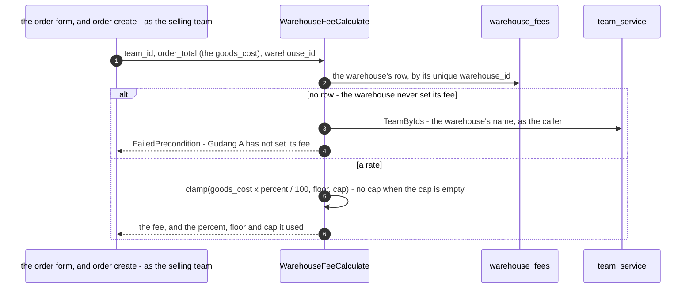

# warehouse_service — RPC flows

warehouse_service owns what a warehouse charges per order, and nothing else
([warehouse-prices-balance-records](../../business/teams/warehouse/context_decision.md#warehouse-prices-balance-records)): the
fee configuration and its calculation. It never posts, never records, and never knows an order exists.

## Pricing an order — `WarehouseFeeCalculate`

One warehouse per call ([the-fee-is-priced-one-warehouse-at-a-time](../../business/teams/warehouse/context_decision.md#the-fee-is-priced-one-warehouse-at-a-time)).
The ordering team is the permission scope only; the rate never depends on it
([one-rate-per-warehouse](../../business/teams/warehouse/context_decision.md#one-rate-per-warehouse)).

| | |
| --- | --- |
| the formula | `max(goods_cost × fee_percent / 100, min_fee)`, then `min(…, max_fee)` only when a cap is set ([an-empty-cap-means-no-cap](../../business/teams/warehouse/context_decision.md#an-empty-cap-means-no-cap)) |
| no rate | `FailedPrecondition`, naming the warehouse — never a number ([a-warehouse-with-no-rate-takes-no-orders](../../business/teams/warehouse/context_decision.md#a-warehouse-with-no-rate-takes-no-orders)). `0%` is a rate and prices to 0 (or the floor) |
| the name | team_service's `TeamByIds`, through a client forwarding the caller's token. If the name cannot be had, the refusal says `warehouse <id>` rather than failing |
| rounding | none: when a frozen figure is rounded is not decided ([rupiah-is-floating-point](../../business/order/context_decision.md#rupiah-is-floating-point)) |
| who calls it | the order form, while the order is typed, and **order create**, which freezes the answer as `orders.warehouse_fee` and passes a refusal through — step 3 of [the-flat-rate-is-dropped-last](../../business/teams/warehouse/context_decision.md#the-flat-rate-is-dropped-last), see [selling's flow](../selling_service/rpc.md). `OrderPlaced` carries the frozen answer and the ledger posts it (step 4) |
| where the rates came from | each warehouse's own `WarehouseFeeSet`. Before step 5 dropped the flat fee, step 2's carry-over (`san warehouse carry-over-fees`, removed with it) turned each warehouse's default flat fee into a rate — 0%, floor = cap = the fee ([docs/tools/san.md](../../tools/san.md#warehouse-carry-over-fees)). `san seed dev` gives Dev Warehouse the worked example when it has none |

`WarehouseFeeDetail` and `WarehouseFeeSet` are single-table reads and an upsert, and need no flow here.
