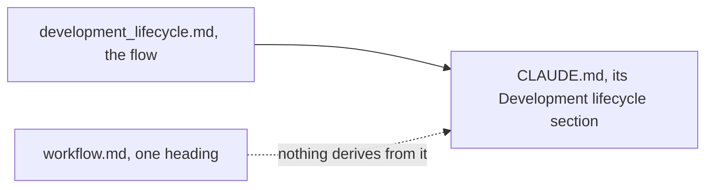

# Decisions — `workflow.md`

What the owner decided about [workflow.md](./workflow.md), recorded before it is acted on. **Append-only** — the
opposite lifecycle to [workflow_clarify.md](./workflow_clarify.md), which holds only what is still open.

| | |
| --- | --- |
| [the-workflow-lives-in-the-development-lifecycle](#the-workflow-lives-in-the-development-lifecycle) | the workflow is [development_lifecycle.md](../../development_lifecycle.md); `workflow.md` folds into nothing, and CLAUDE.md derives from the lifecycle |

---

## the-workflow-lives-in-the-development-lifecycle

> Owner, in chat (2026-11-02): *"i follow your recomendation"* — confirming the overtaken list, which named [Q1](./workflow_clarify.md#question), *fold into
> level.md, or keep separate?*, and [Q2](./workflow_clarify.md#question), *is CLAUDE.md the derived projection of this doc?*

**The verdict.** The development workflow lives in [development_lifecycle.md](../../development_lifecycle.md).
[workflow.md](./workflow.md) is one heading (2026-08-27), so there is nothing to fold into [level.md](./level.md) or out of
it. CLAUDE.md derives from the lifecycle — its *Development lifecycle* section says so — not from workflow.md.

| | |
| --- | --- |
| Q1, fold into level.md | nothing to fold — the stub stays yours |
| Q2, CLAUDE.md's source | development_lifecycle.md |
| Q3, how many build on `dev` | answered by [each-developer-works-on-their-own-branch](../../business/project/member_decision.md#each-developer-works-on-their-own-branch) |
| ✅ built | nothing to build |
