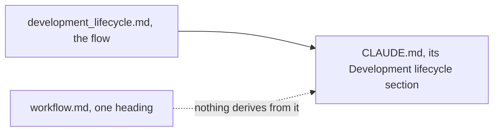
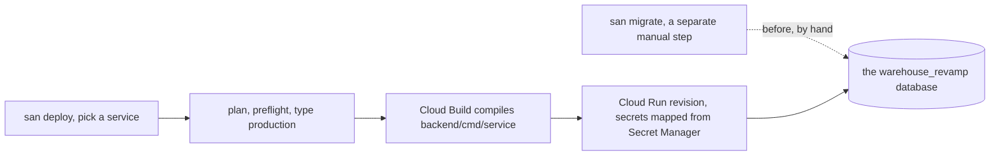

# Decisions — `workflow.md`

What the owner decided about [workflow.md](./workflow.md), recorded before it is acted on. **Append-only** — the
opposite lifecycle to [workflow_clarify.md](./workflow_clarify.md), which holds only what is still open.

| | |
| --- | --- |
| [the-workflow-lives-in-the-development-lifecycle](#the-workflow-lives-in-the-development-lifecycle) | the workflow is [development_lifecycle.md](../../development_lifecycle.md); `workflow.md` folds into nothing, and CLAUDE.md derives from the lifecycle |
| [san-deploy-ships-one-service-to-cloud-run](#san-deploy-ships-one-service-to-cloud-run) | `san deploy` picks one service and ships it to Cloud Run, built from source by Cloud Build; shipment_service first, from its own entry point; the DSN lives in Secret Manager; a deploy never migrates |

---

## the-workflow-lives-in-the-development-lifecycle

> Owner, in chat (2026-11-02): *"i follow your recomendation"* — confirming the overtaken list, which named [Q1](./workflow_clarify.md#question), *fold into
> level.md, or keep separate?*, and [Q2](./workflow_clarify.md#question), *is CLAUDE.md the derived projection of this doc?*

**The verdict.** The development workflow lives in [development_lifecycle.md](../../development_lifecycle.md).
[workflow.md](./workflow.md) is one heading (2026-08-27), so there is nothing to fold into [level.md](./level.md) or out of
it. CLAUDE.md derives from the lifecycle — its *Development lifecycle* section says so — not from workflow.md.

| | |
| --- | --- |
| Q1, fold into level.md | nothing to fold — the stub stays yours |
| Q2, CLAUDE.md's source | development_lifecycle.md |
| Q3, how many build on `dev` | answered by [each-developer-works-on-their-own-branch](../../business/project/member_decision.md#each-developer-works-on-their-own-branch) |
| ✅ built | nothing to build |

---

## san-deploy-ships-one-service-to-cloud-run

> Owner, in chat (2026-11-03): *"can we have `go run .\tools\san deploy` and choose service, for now the service can
> deploy is shipment service"* — then, of the options put to them: Cloud Run in the project and region of the active
> gcloud config · a new standalone entry point `backend/cmd/shipment_service` · `gcloud run deploy --source` (Cloud
> Build builds it, no local Docker) · a new `warehouse_revamp` database on an existing Cloud SQL instance, its DSN in
> Secret Manager · **no** migration inside the deploy — `san migrate` stays its own manual step.

**The verdict.** `deploy` is the tool requirement [level.md](./level.md) lists, and the deploy step
[G2](./workflow_clarify.md#what-is-genuinely-missing--not-covered-by-any-of-the-four) found missing.
`go run ./tools/san deploy` picks one service, shows the plan, checks it, asks for `production`, and runs
`gcloud run deploy --source .`: Cloud Build compiles that service's own entry point with buildpacks, Cloud Run serves
it. A service is deployable once it has an entry point of its own — today only shipment_service.

| | |
| --- | --- |
| where | Cloud Run, the project and region of the active gcloud config — or `--project` / `--region`. Never written in the repo: it is public |
| what runs | `backend/cmd/shipment_service`: shipment_service alone, behind the dev server's chain (protovalidate, the access interceptor) |
| build | `gcloud run deploy --source .` with buildpacks — `GOOGLE_BUILDABLE` the entry point, `GOOGLE_GO_VERSION` go.mod's line. `.gcloudignore` uploads only `go.mod`, `go.sum`, `backend/` — nothing the build does not read |
| database | a new `warehouse_revamp` database on an existing Cloud SQL instance; the DSN in Secret Manager (`revamp-database-url`), the JWT secret beside it (`revamp-jwt-secret`), mapped to env by `--set-secrets` |
| migrations | NOT in the deploy. `san migrate up --service shipment_service` (and user_service, whose roles the interceptor reads) by hand, first |
| the shared project | the Cloud Run service is `revamp-shipment-service`, labelled `app=warehouse-revamp`; a same-named service without that label is refused, never replaced |
| ✅ built | 2026-11-03 — [docs/tools/san.md#deploy](../../tools/san.md#deploy). Not yet run against the cloud |
