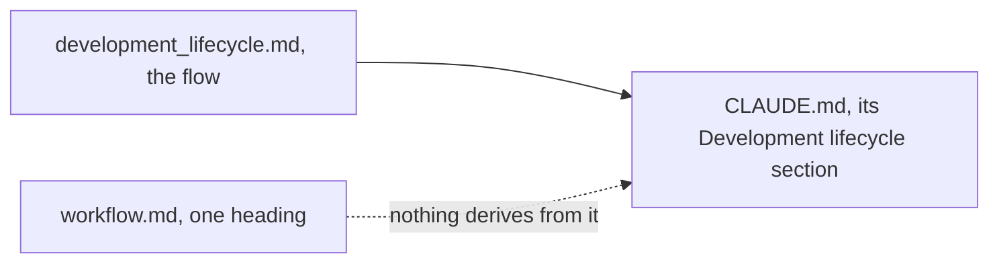
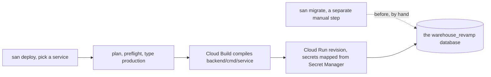

# Decisions — `workflow.md`

What the owner decided about [workflow.md](./workflow.md), recorded before it is acted on. **Append-only** — the
opposite lifecycle to [workflow_clarify.md](./workflow_clarify.md), which holds only what is still open.

| | |
| --- | --- |
| [the-workflow-lives-in-the-development-lifecycle](#the-workflow-lives-in-the-development-lifecycle) | the workflow is [development_lifecycle.md](../../development_lifecycle.md); `workflow.md` folds into nothing, and CLAUDE.md derives from the lifecycle |
| [san-deploy-ships-one-service-to-cloud-run](#san-deploy-ships-one-service-to-cloud-run) | `san deploy` picks one service and ships it to Cloud Run, built from source by Cloud Build; shipment_service first, from its own entry point; the DSN lives in Secret Manager; a deploy never migrates |
| [e2e-runs-locally-or-on-another-pc](#e2e-runs-locally-or-on-another-pc) | an e2e run happens on this machine or wholly on another PC over SSH, chosen in the gitignored `development.yaml` (`type: local` / `ssh`, `headless`) |

---

## the-workflow-lives-in-the-development-lifecycle

> Owner, in chat (2026-11-02): *"i follow your recomendation"* — confirming the overtaken list, which named [Q1](./workflow_clarify.md#question), *fold into
> level.md, or keep separate?*, and [Q2](./workflow_clarify.md#question), *is CLAUDE.md the derived projection of this doc?*

**The verdict.** The development workflow lives in [development_lifecycle.md](../../development_lifecycle.md).
[workflow.md](./workflow.md) is one heading (2026-08-27), so there is nothing to fold into [level.md](./level.md) or out of
it. CLAUDE.md derives from the lifecycle — its *Development lifecycle* section says so — not from workflow.md.



| | |
| --- | --- |
| Q1, fold into level.md | nothing to fold — the stub stays yours |
| Q2, CLAUDE.md's source | development_lifecycle.md |
| Q3, how many build on `dev` | answered by [each-developer-works-on-their-own-branch](../../business/project/member_decision.md#each-developer-works-on-their-own-branch) |
| ✅ built | nothing to build |

---

## san-deploy-ships-one-service-to-cloud-run

> Owner, in chat (2026-11-03): *"can we have `go run .\tools\san deploy` and choose service, for now the service can
> deploy is shipment service"* — then, of the options put to them: Cloud Run in the project and region of the active
> gcloud config · a new standalone entry point `backend/cmd/shipment_service` · `gcloud run deploy --source` (Cloud
> Build builds it, no local Docker) · a new `warehouse_revamp` database on an existing Cloud SQL instance, its DSN in
> Secret Manager · **no** migration inside the deploy — `san migrate` stays its own manual step.

**The verdict.** `deploy` is the tool requirement [level.md](./level.md) lists, and the deploy step
[G2](./workflow_clarify.md#what-is-genuinely-missing--not-covered-by-any-of-the-four) found missing.
`go run ./tools/san deploy` picks one service, shows the plan, checks it, asks for `production`, and runs
`gcloud run deploy --source .`: Cloud Build compiles that service's own entry point with buildpacks, Cloud Run serves
it. A service is deployable once it has an entry point of its own — today only shipment_service.



| | |
| --- | --- |
| where | Cloud Run, the project and region of the active gcloud config — or `--project` / `--region`. Never written in the repo: it is public |
| what runs | `backend/cmd/shipment_service`: shipment_service alone, behind the dev server's chain (protovalidate, the access interceptor) |
| build | `gcloud run deploy --source .` with buildpacks — `GOOGLE_BUILDABLE` the entry point, `GOOGLE_GO_VERSION` go.mod's line. `.gcloudignore` uploads only `go.mod`, `go.sum`, `backend/` — nothing the build does not read |
| database | a new `warehouse_revamp` database on an existing Cloud SQL instance; the DSN in Secret Manager (`revamp-database-url`), the JWT secret beside it (`revamp-jwt-secret`), mapped to env by `--set-secrets` |
| migrations | NOT in the deploy. `san migrate up --service shipment_service` (and user_service, whose roles the interceptor reads) by hand, first |
| the shared project | the Cloud Run service is `revamp-shipment-service`, labelled `app=warehouse-revamp`; a same-named service without that label is refused, never replaced |
| ✅ built | 2026-11-03 — [docs/tools/san.md#deploy](../../tools/san.md#deploy). Not yet run against the cloud |

## e2e-runs-locally-or-on-another-pc

> Owner (Heri), in `default`'s desktop chat (2026-11-27): *"i have new configuration called development.yaml"* — a gitignored file at the repo root:
>
> ```yaml
> e2e_test:
>   type: ssh # can be 'ssh' 'local'
>   headless: false
>   ssh: { host: 192.168.1.100, user: pdc, password: … }
> ```
>
> — then, asked what `type: ssh` should run there (A, recommended: the WHOLE run on that PC — server, database and browser — `san test` sending the commit and copying the report back; B: only the browser there, the server and database staying here; C: something else): *"we can run e2e test in local or in another pc"*. Read as **A**.

**The verdict.** An e2e run happens either **on this machine** (`type: local`, as today) or **wholly on another PC** (`type: ssh`) — its server, its database and its browsers there, so the run takes none of this machine's CPU. `development.yaml` at the repo root says which, and is never committed (`.gitignore`). `headless: false` opens the browsers on the screen of the machine that runs them.

| | |
| --- | --- |
| who reads it | `san test` — affected, smoke, full and accept runs alike, the tester's and a builder's |
| the other PC, today | `pdc@192.168.1.100` answers SSH; it takes a password and no key yet (`Permission denied (publickey,password)`). What it has installed (Go, Node, Docker, a checkout) not read yet |
| *(Not asked yet)* | how the commit reaches the other PC; how `san` logs in (the file's password, or a key); the tester's own checkout reading the file; what the other PC needs installed |

⛔ Not built — backlog #154.

🔄 *(2026-11-27)* **Settled in chat — `san` logs in with the file's password.** Owner: *"password is okay, i gitignored it"* — against my recommendation (A: an SSH key, `ssh-copy-id` once, the `password:` line removed; B: the password from `development.yaml`, read by `san` on every run; C: a key, its path in the file). So `san test` logs in to the other PC with `e2e_test.ssh.password` from `development.yaml`; the file stays gitignored, and no key is set up.

🔄 *(2026-11-27)* **Settled in chat — the commit travels over SSH, and the run is in Docker.** Owner: *"A, and can it when ssh run in docker ? in other pc the docker is installed"* — A, as recommended: `san test` sends the exact commit as a git bundle over the same SSH connection; the other PC keeps its own checkout and switches to that commit — nothing is pushed, and after the first run only what changed travels (B: the other PC pulls from GitHub, every snapshot pushed first; C: a shared network folder). And on the other PC the whole run happens **inside Docker**, which is installed there: one image carrying Go, Node and Playwright's browsers beside the Postgres, Redis and Pub/Sub containers it already uses, so that PC needs nothing else installed. ⚠ To scope when built: `san test` was built on Windows — 8 Windows-only spots in `tools/san/test_*.go` (`.exe`, `powershell`, `taskkill` …) need a Linux path inside the container. *(Asked next: what `headless: false` means in a container, which has no screen.)*

🔄 *(2026-11-27)* **Settled in chat — Docker Compose; the browsers show in Docker too.** Owner: *"with docker compose ? can in docker headless true ?"*, then, a moment later, *"sorry i mean headless false"* — to: a container has no screen, so what does `headless: false` do there? (A, my recommendation: always headless in Docker, `headless: false` for `type: local` only, a failed test's trace and video seen in the report; B: a virtual screen with noVNC, watched live from a browser; C: the other PC's real screen, Linux only). So on the other PC the run is **`docker compose`**: the repo's `docker-compose.yaml` (`postgres`, `redis`, `pubsub` under its profile) gains the e2e runner as one more service under its own profile, and `san test` starts them together there. And **`headless: false` holds in Docker too** — the browsers are shown, not A. *(Asked next: where they are watched — B or C.)*

🔄 *(2026-11-27)* **Settled in chat — the browsers show on the other PC's own screen.** Owner: *"no need pipe to my computer, just it showing in remote computer"* — C, against my recommendation (B: a virtual screen with noVNC, watched from this PC's browser). So with `headless: false` the runner container draws the browsers on the other PC's real display — nothing is streamed back to this machine. ⚠ That needs a display the container can reach: on a Linux desktop the X11 socket shared into the container (`DISPLAY`, `/tmp/.X11-unix`, `xhost +local:` once on that PC); on Windows, WSLg or an X server there. *(Asked next: the other PC's OS.)*

🔄 *(2026-11-27)* **Settled in chat — the other PC runs Linux.** Owner: *"my remote pc is running on linux"*. So the runner container shares that PC's X display (`DISPLAY`, `/tmp/.X11-unix` mounted; `xhost +local:` once in its desktop session) for `headless: false`. *(Not asked — the build's defaults: `san test` reads `development.yaml` at the root of the checkout it runs in, so the tester's own checkout `D:/pdcgo/warehouse_revamp_e2e` gets its own copy of the file; no file, or `type: local`, is today's run; the report and every failed test's trace and video are copied back to the same `e2e_report/` paths as a local run, so the tester reads them as it does today; one run at a time on the other PC.)*

🔄 *(2026-11-27)* **The owner edited `development.yaml` — a worker count per place.** *"check the config, i edited it"*: `e2e_test` now has `active: ssh` beside `type: ssh`, and one section per place — `ssh:` (`worker_test: 4`, with `host`, `user`, `password`) and `local:` (`worker_test: 1`). So a run on the other PC uses **4 workers** and a run on this machine **1** (his standing *one worker here, so my CPU isn't heavy*). ⚠ my reading — `worker_test` is `san test`'s `--workers N`: N whole Playwright runs at once, each with its own server and database; with `headless: false`, 4 sets of browsers on the other PC's screen. *(Asked: `type` and `active` both name `ssh` — which one picks the place.)*

🔄 *(2026-11-27)* **Settled in chat — `type` picks the place.** Owner: *"i remove active, type is enough"* — B (my recommendation was A, `active`). The file now reads `e2e_test.type` (`ssh` / `local`) — which names the section `san test` uses, `ssh:` or `local:`, each with its own `worker_test` — and `headless`; `active` is gone.

🔄 *(2026-11-27)* **Settled in chat — the other PC becomes the primary place for e2e.** Owner: *"if its okay, later all e2e test primarily use remote pc, include revamp tester bot too"*. Once the remote run is proven, **every e2e run uses the other PC first** — the `revamp_tester` bot's runs included (its checkout `D:/pdcgo/warehouse_revamp_e2e` gets its own `development.yaml` with `type: ssh`); `type: local` stays the fallback when that PC is off or unreachable. ⚠ my spec — two checkouts (a builder's and the tester's) then send runs to ONE PC, so the other PC runs one at a time behind a lock there, and a second run waits. *(Not asked yet — asked at the switch: whether the tester still asks before a full run once full runs no longer load this machine; whether a run falls back to local by itself when the PC is unreachable, or stops and says so.)*

🔄 *(2026-11-27, 18:0x)* **The other PC, read.** Ubuntu 26.04, 16 cores, 30 GB RAM, 851 GB free; git 2.53, Docker Compose v5.8.0, Docker running; GNOME on Wayland with Xwayland on `:0` (pdc logged in on seat0; its auth file `/run/user/1000/.mutter-Xwaylandauth.*`, renamed at every login), never sleeping on AC. ⚠ `pdc` is **not in the `docker` group** (`permission denied` on `/var/run/docker.sock`) — the one sudo step: `sudo usermod -aG docker pdc`, asked of the owner. For `headless: false` the runner mounts `/tmp/.X11-unix` and that auth file (`DISPLAY=:0`) — no `xhost` step after all.

🔄 *(2026-11-27)* The owner ran `sudo usermod -aG docker pdc`; a fresh SSH login reads `973(docker)` and reaches Docker 29.10.1. The PC reaches mcr.microsoft.com, proxy.golang.org and registry.npmjs.org (200 each), so the runner image builds there.

✅ **Built 2026-11-27 (backlog #154 — phase 1, and `affected --run` of phase 2; from `default`'s chat).** `development.yaml` is read by `tools/san/devconfig.go` (no file, or `type: local`: the run as always). With `type: ssh`, `san test smoke` and `san test affected --run` run wholly on the other PC (`tools/san/test_remote.go`, `test_remote_job.go`): the COMMIT (default HEAD, `--commit <rev>`) travels as a git bundle over the SSH login with the file's password — only what that PC lacks —, a job starts there detached and holds a lock for the whole run (one run at a time; a second waits and says so; a dead run's lock never blocks), fetches and checks out the commit by its SHA only (never a branch name a second sender could move), writes the report into its own `runs/<run id>/` folder, and the report comes back to `e2e_report/level2/` with `remote.json`. The runner is `docker-compose.yaml`'s `e2e-runner` under its own profile `e2e-remote` (`docker/e2e-runner/Dockerfile`: Playwright's image at the commit's version + Go). `headless: false` mounts that PC's desktop display and its cookie into the runner — no `xhost` change. First trial: `san test smoke` on HEAD `742e5e9a`, GREEN there — 11 passed in 1.0 min, the browsers on that PC's screen (the whole first run 15 min 48 s: images pulled, the runner built, `npm ci`, the Go modules). `full` and `accept-run` under `type: ssh` refuse for now (*set type: local*) — phase 2. Docs: [docs/tools/san.md](../../tools/san.md#test-on-another-pc).
