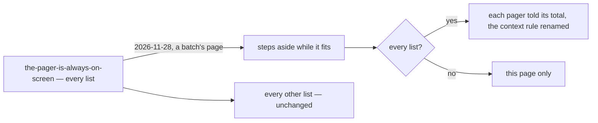

# Decisions — the batches

The owner's decisions about the **batch screens** — the list (`/inventories/batches`, `pages/batches`) and a batch's page
(`/inventories/batches/:batchId`, `pages/batch-detail`). **Append-only** (RULE 12): a reversed decision is renamed and its
references grepped.

The rules every screen follows are in [context_decision.md](context_decision.md). What a batch is, and how it is minted
and priced, is the business record: [batch.md](../../business/inventory/batch.md),
[batch_decision.md](../../business/inventory/batch_decision.md) and restock's
[one-batch-per-line](../../business/inventory/restock_decision.md#one-batch-per-line).

| decision | what it settles |
| --- | --- |
| [the-batches-follow-the-screen-rules](#the-batches-follow-the-screen-rules) | the batch list and a batch's page follow the rules every screen does — the card strip, the filter strip, a block per row on a phone, skeletons, hints, the growing pager, Mobile stories; a batch is named by its OWN number, the restock it came from under it — 🔄 a batch page's tabs REPLACED by [a-batch-page-is-one-page-of-sections](#a-batch-page-is-one-page-of-sections) |
| [a-batch-says-what-it-is](#a-batch-says-what-it-is) | both batch screens say what a batch is — a line under the list's title, and *Apa itu batch?* whose tooltip holds the answer with an example; hover opens it, and a click or a tap — 🔄 the list only since, [what-a-batch-is-said-on-the-list-only](#what-a-batch-is-said-on-the-list-only) |
| [sku-is-copyable](#sku-is-copyable) | a batch's SKU copies on a click — on the list's row and block, and under a batch's product — without opening the batch |
| [an-expiry-says-how-long-is-left](#an-expiry-says-how-long-is-left) | the batch list's *Kedaluwarsa* is the day alone at *Tiba*'s size, with how long is left under it — amber within 30 days, red once past |
| [a-batch-opens-where-it-came-from](#a-batch-opens-where-it-came-from) | a batch's source is a way there — *Restok #503* opens the restock, no resi; a return's *Retur* is marked until a batch knows its return — 🔄 on a batch's page it is Info's *Dari*, [a-batch-page-is-one-page-of-sections](#a-batch-page-is-one-page-of-sections) |
| [the-batch-list-filters-by-team](#the-batch-list-filters-by-team) | the batch list filters by whose goods — a search select over the selling teams, the pick its name alone; held in the URL and marked, it narrows nothing yet |
| [a-batch-page-is-one-page-of-sections](#a-batch-page-is-one-page-of-sections) | a batch's page is the rack page's shape — Ditaruh, Info, Riwayat under a nav, the heading that sticks with the product under the number, Info beside the rest on a wide screen; its two tabs are gone — 🔄 the order since Penempatan · Riwayat · Info, [info-batch-comes-last](#info-batch-comes-last) |
| [info-batch-comes-last](#info-batch-comes-last) | Info Batch is the lowest priority, so it is the last section — under Riwayat on a narrow screen, last in the nav |
| [tiba-keeps-its-date-in-info](#tiba-keeps-its-date-in-info) | the price stays the small line under each count; Tiba's arrival date leaves its card for Info's *Tiba pada* |
| [the-adjust-dialog-picks-with-chakra-controls](#the-adjust-dialog-picks-with-chakra-controls) | Koreksi's note is a two-row `Textarea`, and its reason a Chakra control — [chakra-first-whenever-it-has-the-component](context_decision.md#chakra-first-whenever-it-has-the-component) applied |
| [the-adjust-reason-is-a-radio-pill](#the-adjust-reason-is-a-radio-pill) | Koreksi's four reasons are radio pills, all on screen — the list is bounded by the code, so it stays few |
| [a-batch-is-picked-by-its-own-number](#a-batch-is-picked-by-its-own-number) | Koreksi's batch is a search select (`BatchSelect`) — each option the batch's own number and ready count, where it came from under it; typed by the batch's or the restock's number — 🔄 not on a batch's own page, which gives its batch, [the-batch-page-adjusts-its-own-batch](#the-batch-page-adjusts-its-own-batch) |
| [the-expiry-prototypes-are-accepted](#the-expiry-prototypes-are-accepted) | the expiry prototypes are accepted — the accept line's optional expiry date, the Batch list's Rak column, the product page's Kedaluwarsa column |
| [a-returns-batch-opens-its-order](#a-returns-batch-opens-its-order) | a batch a return made shows *Retur · order #<id>* and opens the order's warehouse page, `/warehouse-orders/:orderId` — the return half of a-batch-opens-where-it-came-from |
| [the-batch-product-is-one-full-card](#the-batch-product-is-one-full-card) | on a batch's page the product — picture, name, code, owner — is one card the width of the figures under it, not a loose line under the title |
| [what-a-batch-is-said-on-the-list-only](#what-a-batch-is-said-on-the-list-only) | *Apa itu batch?* is on the batch list only — a batch's own page carries none |
| [placement-is-one-word-its-meaning-a-line](#placement-is-one-word-its-meaning-a-line) | *Ditaruh Saat Diterima* is **Penempatan** — on the section and in the nav — and what it means is a line under the title; its rack search spans the section |
| [a-placement-names-its-rack](#a-placement-names-its-rack) | each rack in Penempatan is its code with its name under it, and the search finds it by either |
| [the-batch-info-reads-label-over-value](#the-batch-info-reads-label-over-value) | Info Batch is a quiet label over its value in bold, the facts parted by a thin line — the owner's drawing |
| [riwayat-reads-as-penempatan](#riwayat-reads-as-penempatan) | Riwayat is drawn as Penempatan is: a line under its title, its date filter the section's width, each rack its code with its name under it — 🔄 the width shared with Kegiatan since, [riwayat-filters-by-one-kind](#riwayat-filters-by-one-kind) |
| [a-movement-kind-is-a-badge](#a-movement-kind-is-a-badge) | Riwayat's *Kegiatan* is a badge in the kind's colour — in green, out orange, a move blue, a correction grey; an opt-in of the shared ledger |
| [last-count-is-a-badge](#last-count-is-a-badge) | Penempatan's *Opname terakhir* is a badge — the date in green within two weeks, in amber past them, *Belum pernah* in grey when never counted |
| [ready-leads-and-each-figure-says-what-it-counts](#ready-leads-and-each-figure-says-what-it-counts) | on a batch's page *Siap* is the first card of the lifecycle strip, and every card carries a note saying what its units are |
| [the-owner-weighs-the-same-as-its-product](#the-owner-weighs-the-same-as-its-product) | in the product card the owner is drawn at the product's size — its avatar and name as large, *Pemilik* under it, a thin line between the two; under the product on a phone |
| [the-expiry-left-is-a-badge](#the-expiry-left-is-a-badge) | Info's *Kedaluwarsa* is its day at the size of the facts above it, how long is left a badge beside it — amber within 30 days, red once past, grey beyond; the list keeps its coloured words |
| [the-batch-page-arrives-in-order](#the-batch-page-arrives-in-order) | a batch's page arrives one block after another, 50ms apart — the heading and the nav, the figures, Penempatan (Info beside it), Riwayat — each with the page's own `enter`; the root no longer rises as one |
| [the-batch-page-adjusts-its-own-batch](#the-batch-page-adjusts-its-own-batch) | a batch's *Koreksi* is **Sesuaikan**, and its dialog's Rusak and Hilang take that batch — not asked again |
| [the-adjust-dialog-leads-with-what-it-adjusts](#the-adjust-dialog-leads-with-what-it-adjusts) | Sesuaikan Stok opens on the product and its units here; from a batch's page, that batch and its units left under it, its racks the only ones offered, and a reason opens nothing in the form |
| [riwayat-filters-by-one-kind](#riwayat-filters-by-one-kind) | Riwayat filters by Kegiatan beside the date — ONE kind at a time, as the read takes it, picked from a search select of the kinds' badges; each filter with its ×; the date four parts of the row, Kegiatan three |
| [the-batch-page-hides-a-pager-that-fits](#the-batch-page-hides-a-pager-that-fits) | on a batch's page a pager steps aside on page 1 while the list fits the smallest page size (10), and its table ends with no line under the last row — this page only, for now |
| [the-adjust-preview-shows-its-working](#the-adjust-preview-shows-its-working) | the dialog's preview sits at the form's right as a receipt — the stock before, the reason and its units, the difference with a Berkurang / Bertambah / Tetap badge, the total; Ditemukan has one too, its approval line under it |

## the-batches-follow-the-screen-rules

> Owner, in chat (2026-11-07): *"inisiasi dan kasih keterangan batch itu apa"*.

```
the list                                                               a batch's page
Batch                                                                  ←  Batch #5031 [Restok] [Kedaluwarsa 27 Nov]   [✎ Koreksi]
Stok yang masuk bersamaan dengan harga yang sama — …                       [img] Beras Pandan Wangi 5kg  [Toko Melati]
ⓘ Apa itu batch?                                                       Dari Restok #503 · SCP… · Diterima oleh Budi
[Batch 6] [Nilai siap Rp …] [Kedaluwarsa ≤ 30 hari 2]                      ⓘ Apa itu batch?
[⌕ Cari …] [Semua kedaluwarsa ⌄ ×] [Tiba · semua tanggal]               [Tiba 10] [Rusak 2] [Hilang 1] [Terpakai 0] [Siap 7]
Batch           Produk          Tim         Tiba         Siap …         Ditaruh Saat Diterima │ Tempat  Ditaruh  Opname terakhir
#5031           Beras …         [TM] Melati 1 Nov 13:05     7           Riwayat               │ A-01-1        5  Belum pernah
Restok #503 · … SKU-BERAS-5K                                                                   │ B-02-1        2
                                            ‹ [1] ›                                                          ‹ [1] ›
```

**The list** (`pages/batches`)

| rule | applied |
| --- | --- |
| [the-desktop-shell-has-no-top-bar](context_decision.md#the-desktop-shell-has-no-top-bar) | the page names itself — *Batch*, a line under it on what a batch is ([a-batch-says-what-it-is](#a-batch-says-what-it-is)); no team badge |
| [a-list-summary-is-the-order-lists-card-strip](context_decision.md#a-list-summary-is-the-order-lists-card-strip) | the three Chakra `Stat`s are the card strip — *Batch* leads, *Nilai siap*, *Kedaluwarsa ≤ 30 hari* (amber above 0); over the whole filtered set |
| [a-phone-filters-from-a-sheet](context_decision.md#a-phone-filters-from-a-sheet) · [clear-filters-is-red-and-bold](context_decision.md#clear-filters-is-red-and-bold) · [every-filter-clears-from-its-own-x](context_decision.md#every-filter-clears-from-its-own-x) | `FilterBar`: the search (debounced) in the row; the expiry a Chakra `Select` with its × (it was a `NativeSelect` with an "all" option), the date range beside it; Hapus Filter; on a phone a sheet. Still in the URL |
| the batch's number | the row and the page are named by the batch's **own** number — `#5031`, the number in a label's QR — with *Restok #503 · resi* (or *Retur*) under it. They were named by the restock's number, so two batches of one restock read alike (*Batch #503*) |
| [one-context-per-column-and-never-three-lines](context_decision.md#one-context-per-column-and-never-three-lines) · [a-team-of-a-known-type-shows-no-badge](context_decision.md#a-team-of-a-known-type-shows-no-badge) | the product is its name and SKU under it; whose it is, `TeamItem size="xs"` — the small avatar and the name, no *Selling* badge (it was a name badge); *Habis* under a ready count of 0 |
| [a-table-date-is-short-and-every-time-is-wib](context_decision.md#a-table-date-is-short-and-every-time-is-wib) | *Tiba* is `1 Nov 13:05`; the expiry a day, `27 Nov` (new `formatUnixDateShort`), amber within 30 days — both were the browser's dates |
| [a-table-row-lights-up](context_decision.md#a-table-row-lights-up) · [a-phone-reads-each-line-as-a-block](context_decision.md#a-phone-reads-each-line-as-a-block) | rows light up; on a phone each batch is a block — number and date, the product, whose it is, *Siap 7 · Rp … × 7 … Rp …*, where it came from and its expiry |
| [an-empty-list-shows-a-hint](context_decision.md#an-empty-list-shows-a-hint) | no match: *Hapus Filter*; no batches: where they come from |
| [every-list-pages-with-the-growing-pager](context_decision.md#every-list-pages-with-the-growing-pager) · RULE 10 | `GrowingPager` with a per-page size; the query spreads `listQuery` and the rows sit in `RefreshOverlay` — it had neither |
| [motion-is-small-quick-and-shared](context_decision.md#motion-is-small-quick-and-shared) | the page rises in; a first load is a skeleton |
| a batch opened from the list | carries the list (`fromHere`), so its back returns with the filters |

**A batch's page** (`pages/batch-detail`)

| rule | applied |
| --- | --- |
| [the-phone-header-is-one-row](context_decision.md#the-phone-header-is-one-row) · [a-form-returns-where-it-was-opened](context_decision.md#a-form-returns-where-it-was-opened) | back, *Batch #5031*, its origin and *Kedaluwarsa* badges, and *Koreksi* in one row; back returns where the page was opened. Koreksi sat alone over the page |
| [an-action-button-carries-its-icon](context_decision.md#an-action-button-carries-its-icon) · [a-phone-header-action-is-an-icon](context_decision.md#a-phone-header-action-is-an-icon) | Koreksi with its ✎; on a phone its icon alone |
| under the title | the product as `ProductListItem` (its picture, name, SKU), whose it is — `TeamItem size="xs"` ([a-team-of-a-known-type-shows-no-badge](context_decision.md#a-team-of-a-known-type-shows-no-badge)), it was a name badge — then *Dari Restok #503* (a link, no resi: [a-batch-opens-where-it-came-from](#a-batch-opens-where-it-came-from)) · who received it — the two header columns were one big product heading and a second batch heading |
| [a-list-summary-is-the-order-lists-card-strip](context_decision.md#a-list-summary-is-the-order-lists-card-strip) | the lifecycle is the card strip — Tiba (its cost and date), Rusak, Hilang, Terpakai, **Siap** leading — each with its value under it |
| the tabs | down the left on a desktop (#198), across the top on a phone ([nothing-runs-past-a-phones-edge](context_decision.md#nothing-runs-past-a-phones-edge)); no card around them |
| Ditaruh Saat Diterima | the rack search is `FilterSearch` with its ×; rows light up; an empty tab is a hint; the last count's date is the app's |
| Riwayat | `MovementTable`'s reworked mode — a hint when empty, rows that light up, two lines a movement on a phone |
| [every-list-pages-with-the-growing-pager](context_decision.md#every-list-pages-with-the-growing-pager) · [motion-is-small-quick-and-shared](context_decision.md#motion-is-small-quick-and-shared) | both tabs page with `GrowingPager`; skeletons; the page rises in |

| | |
| --- | --- |
| Storybook | `.storybook/batchStub.ts` — new: BatchList, BatchDetail, BatchPlacementList, StockHistory and ProductPlaces for Gudang Pusat's six batches, consistent with restocks 503 and 507; reset in preview |
| pinned by | BatchList `Default`, `Mobile`, `What is a batch`, `Search`, `Expiring soon`, `Nothing matches`, `No batches yet`, `Opens its page`, `Selling team` · BatchDetail `Default`, `Mobile`, `What is a batch`, `History`, `A return`, `Opens its restock`, `Back to the list`, `Not found` — the two pages had no stories |

What it replaces: the batch screens' own layout — a team badge, three bare `Stat`s, a bare search and a native select, a
spinner, *Pagination*, a grey empty line, the browser's dates, rows named by their restock; on a batch's page Koreksi
alone over a two-column heading, plain `Stat`s, a carded tab box and striped tables.

## a-batch-says-what-it-is

> Owner, in chat (2026-11-07): *"inisiasi dan kasih keterangan batch itu apa"* — after asking *"batch itu apa?"* and *"1
> restok dihitung batch?"*; then *"penjelasan batch jangan collapse, tooltips?"*, and *"jangan hitam"*.

```
Batch
Stok yang masuk bersamaan dengan harga yang sama — satu per produk di tiap restok yang diterima.
ⓘ Apa itu batch?
  ┌─ tooltip ─────────────────────────────────────────────────────────────────────────────┐
│ Batch adalah stok yang masuk bersamaan dengan harga yang sama — satu produk, satu     │
│ pemilik, satu harga satuan.                                                           │
│ • Dibuat saat restok diterima — satu untuk tiap produk yang ada unit bagusnya. Retur, │
│   transfer masuk, dan opname juga membuat batch.                                      │
│ • Harga satuannya harga beli + ongkir dan ongkos COD kurir, dibagi rata ke semua unit.│
│ • Barang keluar diambil dari batch terlama dulu — membawa harga saat ia masuk.        │
│ • Batch mencatat nilai, bukan tempat — letak barang ada di Rak.                       │
│ [Restok #503 diterima] → [Beras · 7 pcs] [Teh · 20 pcs]  dua batch — …                │
└───────────────────────────────────────────────────────────────────────────────────────┘
```

| | |
| --- | --- |
| the line | under the list's title, always: what a batch is in one sentence |
| the answer | *Apa itu batch?* (a ? icon, the words dotted-underlined), on the list and on a batch's page — its **tooltip** holds the four points and an example drawn as the restock becomes its batches. Never a panel that pushes the page down |
| a phone | hover and focus open it, as every tooltip; a **click or a tap** opens and shuts it too — a phone has no hover |
| light, not black | owner: *"jangan hitam"* — the panel's own ground and ink (`bg.panel`, `fg`), a thin line and a shadow, as a popover is drawn; the default tooltip's near-black was a lot of dark for a paragraph. Other tooltips (a cut text's whole, a line's note) keep theirs |
| one component | `features/inventory/BatchExplainer` (two pages of one domain), its story `Features/Inventory/BatchExplainer` |
| what it states | the business record's rules — [one-batch-per-line](../../business/inventory/restock_decision.md#one-batch-per-line), [unit-price-is-line-price-plus-costs-per-unit](../../business/inventory/restock_decision.md#unit-price-is-line-price-plus-costs-per-unit), the batch ledger's oldest first, and that a batch is not a rack ([a-batch-shows-the-racks-it-was-put-on](../../business/inventory/batch_decision.md#a-batch-shows-the-racks-it-was-put-on)). It explains; it decides nothing |
| pinned by | BatchList `What is a batch` · BatchDetail `What is a batch` (hover) · `BatchExplainer / On hover`, `On a tap` |

What it replaces: a screen titled *Batch* with nothing saying what one is — and, the same day, the answer as a
collapsible panel under the title (*"jangan collapse"*).

## sku-is-copyable

> Owner, in chat (2026-11-07): *"sku copyable"*.

```
#5031            Beras Pandan Wangi 5kg        ← the row opens the batch
Restok #503 · …  SKU-BERAS-5K ⧉                ← the SKU copies, and opens nothing
```

| | |
| --- | --- |
| where | the list's row (under the product's name) and a phone's block — `CopyText`; a batch's page — `ProductListItem skuCopyable`, as the product list has it |
| a click | copies the SKU and reports ✓ or ⚠; it does not reach the row, so the batch does not open |
| pinned by | BatchList `SKU copies` · BatchDetail `Default` |

What it replaces: a SKU shown as plain text on the batch screens.

## an-expiry-says-how-long-is-left

> Owner, in chat (2026-11-09): *"ukuran kadaluarsa dan tiba kenapa beda? ada alasan?"* — there was none — then *"kalau
> melihat keputusan sebelumnya, kira-kira seperti apa?"*, and to the answer *"oke"*.

```
Tiba           Kedaluwarsa                      a phone's block
1 Nov 13:05    29 Nov                           Restok #503 · …     Kedaluwarsa 29 Nov · 20 hari lagi
               20 hari lagi     ← amber
28 Sep 13:17   6 Nov
               lewat 3 hari     ← red
6 Nov 13:17    —                ← no expiry
```

| | |
| --- | --- |
| the size | 12px, as *Tiba* beside it — it was the table's 14px, an oversight |
| the day | the day alone, no clock — a package's date has none ([a-day-without-a-time-is-shown-alone](context_decision.md#a-day-without-a-time-is-shown-alone)); the full date on its hover |
| how long is left | under the day, as the order list's ship-by deadline: *20 hari lagi*, *hari ini*, *lewat 3 hari*. Amber within 30 days (the server's soon window), red once past, quiet beyond. Jakarta calendar days (`daysUntilUnix`) |
| a phone | one line in the block's foot — *Kedaluwarsa 29 Nov · 20 hari lagi* |
| the component | `pages/batches/components/ExpiryCell` |
| the stub | 3981 (Gula) expired three days ago, and *Kedaluwarsa ≤ 30 hari* counts the past too, as the server's `expired_at <= cutoff` does |
| ⚠ not yet | nothing sets a batch's expiry yet — the accept takes none — so in the real app every batch has no expiry and the column is a dash. Raised in chat; not decided |
| pinned by | BatchList `Expiry` (the day, *20 days left* amber, *expired 3 days ago* red, a dash, 12px) · `Default` (3 expiring) |

What it replaces: the expiry as a 14px date beside a 12px *Tiba*, amber from 30 days out with nothing saying how near.

## a-batch-opens-where-it-came-from

> Owner, in chat (2026-11-09): *"batch restoknya tidak resi, tapi bisa redirect ke detailnya, retur juga"*.

```
before   #5031                          now   #5031
         Restok #503 · SCP5544332211          Restok #503        ← a link: /inventories/restock/503
         #9101                                #9101
         Retur                                Retur ⚠1           ← its return cannot be named yet
```

| | |
| --- | --- |
| a restock's batch | *Restok #503* (*Dari Restok #503* on a batch's page) is a link to the restock's page, carrying where it was opened so Back returns; a click on it does not open the batch the row stands for |
| no resi | the tracking number is the restock's — one click away on its page; on a batch's row it was a third fact in the cell. The list's search still finds a batch by it |
| a return's batch | *Retur* with ⚠ `returnLink`, kind `missing`: StockBatch's `delivery_id` is the restock's number (the read joins restocks only), so a batch a return made carries 0 and no return number — nothing to point `/inventories/returns/:id` at (`features/inventory/pending.ts`). The list's strip says so; a batch's page shows the strip only for a return |
| anything else | a batch with no restock number and no return (a transfer in, a count) shows a dash |
| one component | `features/inventory/BatchSource` — the list's row and block, and a batch's page; its story `Features/Inventory/BatchSource` |
| the stub | 9101, the return, carries `delivery_id` 0, as the server answers |
| pinned by | BatchList `Default` (no resi), `Opens its source` (to the restock, not the batch; the return's ⚠) · BatchDetail `Default`, `A return`, `Opens its restock` · `BatchSource / Opens the restock` |

What it replaces: *Restok #503 · resi* as plain text on the list, and on a batch's page the resi beside its restock link.

## the-batch-list-filters-by-team

> Owner, in chat (2026-11-09): *"filternya cuma ada itu saja?"* — offered Tim and Status, recommended both — then
> *"oke, kasih tim"*.

```
[⌕ Cari batch, resi, atau produk] [Semua tim ⌄] ⚠2 [Semua kedaluwarsa ⌄] [Tiba · semua tanggal]
                                   ↑ Toko Melati, the name alone — held, counted, cleared by Hapus Filter
```

| | |
| --- | --- |
| the control | `TeamSelect` over the **selling** teams, after the search — a search select, since there is no ceiling on how many teams a warehouse holds goods for; the pick is its name alone ([a-one-type-picker-shows-the-name-alone](context_decision.md#a-one-type-picker-shows-the-name-alone)) |
| the state | `?team=` in the URL, counted by the phone's Filter button, cleared by Hapus Filter and by its own × |
| ⚠ `teamFilter` | kind `dropped`, number 2: `BatchListFilter` has no owning team, so the pick is held and every batch still shows. The list's own `pages/batches/pending.ts` extends the batch screens' shared list, so a return's ⚠ keeps its 1 on both screens |
| not added | Status (Ada stok / Habis) — offered with it, not asked for |
| pinned by | BatchList `Team filter` (picked as *Toko Melati*, no *Selling*, the list unchanged, cleared), `Opens its source` (2 parts; the return still 1) |

What it replaces: a filter strip with no way to ask whose goods.

✅ **Built 2026-11-16** — the team filter narrows: `BatchListFilter.owner_team_id` keeps the batches that selling team owns (`batches.team_id`, written at mint — [a-batch-carries-its-owner](../../business/inventory/warehouse_transfer_decision.md#a-batch-carries-its-owner)), so the rows, the count and the card strip narrow together on the server (`inventory_v1/batch_list.go`); the page sends `?team=` as it (`useWarehouseBatches`), and its ⚠ `teamFilter` is gone (`pages/batches/pending.ts` keeps only the return's mark). Tests `batch_list_team_test.go` (each team's batches, every team's with none picked, a team with nothing here, paged, with the product filter) — mutation-checked; story BatchList `Team filter` (Toko Melati's batch alone, *Batch* 1, the ask carrying team 12, Hapus Filter back to 6). Perf `TestPerf_BatchList_OwnerTeam`: at 60 000 batches in one warehouse the filtered call is never slower than the unfiltered one (112 ms → 98 / 56 / 10 ms for a team holding half / a tenth / 60 of them); no index added — [rpc.md](../../services/inventory_service/rpc.md#batchlist--the-team-filter-2026-11-16).

## a-batch-page-is-one-page-of-sections

> Owner, in chat (2026-11-10): *"inisiasi bacth detail"* — after a rack's page became one page of sections, *"iya seperti
> usulmu, gunakan detail lain sebagai referensi"* ([a-rack-page-is-one-page-of-sections](racks_decision.md#a-rack-page-is-one-page-of-sections)).
> The batch's page was the last detail page on tabs.

```
before (tabs)                                      now — the rack page's shape
← Batch #5031 [Restok] [Kedaluwarsa…]  [✎ Koreksi]   ┌ Ditaruh ┐  ← Batch #5031 [Restok] [Kedaluwarsa 29 Nov]            [✎ Koreksi]
  [img] Beras …   [TM] Toko Melati                   │ Info    │     [img] Beras Pandan Wangi 5kg · SKU   [TM] Toko Melati
  Dari Restok #503 · Diterima oleh Budi              └ Riwayat ┘     ⓘ Apa itu batch?
  ⓘ Apa itu batch?                                                [Tiba 10] [Rusak 2] [Hilang 1] [Terpakai 0] [Siap 7]
[Tiba] [Rusak] [Hilang] [Terpakai] [Siap]                         ┌ Ditaruh Saat Diterima ───────────┐  ┌ Info Batch ──────────────┐
Ditaruh Saat Diterima │ one tab's content                         │ Tempat · Ditaruh · Opname        │  │ Dari          Restok #503│
Riwayat               │                                           ┌ Riwayat ── (Tiba · semua tanggal)┐  │ Diterima oleh Budi       │
                                                                                                         │ Harga satuan  Rp 48.000  │
                                                                                                         │ Kedaluwarsa   29 Nov · 20 hari lagi │
```

| | |
| --- | --- |
| the shape | ONE page of section cards (`Section`) with `SectionNav` on the left; a click jumps there; the section being read is lit (`useScrollSpy`). No tabs |
| the order | **Ditaruh Saat Diterima** · **Info Batch** · **Riwayat** — `pages/batch-detail/sections.ts`, the one list the nav and the page read |
| Ditaruh Saat Diterima | where the accept put the units — **fixed**, never where they sit now ([a-batch-shows-the-racks-it-was-put-on](../../business/inventory/batch_decision.md#a-batch-shows-the-racks-it-was-put-on)); only its *Opname terakhir* is today's. Kept a section of its own, not folded into Info, though Riwayat's first rows are the same put-away — owner: *"tidak perlu, riwayat itu beda konteks"* |
| the heading | back, *Batch #5031* with its origin and expiry badges, Koreksi held right (`BatchTitleRow`); under it the product with its picture and whose it is, then *Apa itu batch?* |
| Info | the batch's record, moved out of the heading's third line: **Dari** (*Restok #503*, still a way there — [a-batch-opens-where-it-came-from](#a-batch-opens-where-it-came-from)), **Diterima oleh**, **Harga satuan** (the frozen cost, the rack page's word for it — it was *Biaya / pcs (beku)*, never on screen), **Kedaluwarsa** (the day and how long is left, as the list says it — [an-expiry-says-how-long-is-left](#an-expiry-says-how-long-is-left); a dash when it has none — 🔄 how long is left a badge since, [the-expiry-left-is-a-badge](#the-expiry-left-is-a-badge)). Beside the rest from `xl`, in the nav's order below that |
| the sticky bar | the title row drawn again once the WHOLE heading has scrolled away — the number with the **product under it** (*Batch #5031* alone says nothing), back, Koreksi as its icon (`batch-detail-adjust-sticky`). It waits for the product line too, so the product is never on screen twice |
| the figures | the lifecycle strip stays under the heading, over the sections — the whole batch's |
| a phone | the section chips stick at the top in place of the nav; Koreksi its icon |
| kept | every read and its pager, the rack search and the date range in the URL, the panels' tables and test ids; panels `batch-<key>-panel` |
| moved | `ExpiryCell` to `features/inventory/` — two pages read it now; it takes a `fontSize` (12px in a table, a fact's size in Info) |
| retired | `BatchSource`'s `prefix` (*Dari Restok #503*) — Info's label says *Dari*; `batchDetail.fromRestock`, `batchDetail.receivedBy` |
| stories | 10 — one file still ([stories-are-grouped-by-the-part-of-the-screen](context_decision.md#stories-are-grouped-by-the-part-of-the-screen) starts at ~15) |
| pinned by | BatchDetail `One page of sections` (the order, no tablist, Info's four facts, the expiry amber, the nav jump) · `Title sticks` (the product under the number) · `Mobile` (the chips) · `Default`, `History` |

What it replaces: the two tabs — one on screen at a time — and the *the tabs* row of
[the-batches-follow-the-screen-rules](#the-batches-follow-the-screen-rules); the heading's *Dari Restok #503 · Diterima
oleh …* line, now Info's first two facts.

## the-adjust-dialog-picks-with-chakra-controls

> Owner, in chat (2026-11-10), on a batch's Koreksi: *"di koreksi, alasan selectnya cakra, catatan textarea"*. The rule
> was already the owner's — [chakra-first-whenever-it-has-the-component](context_decision.md#chakra-first-whenever-it-has-the-component),
> 2026-10-05 — and the dialog had broken it since.

```
before                                    now
Alasan  [Hitung ulang        ▾]  native   Alasan   ( ◉ Hitung ulang ) ( ○ Rusak ) ( ○ Hilang ) ( ○ Ditemukan )
Catatan [Contoh: …              ]         Catatan  [Contoh: …                  ]
                                                   [                           ]   ← two rows, its 200 count
```

| | |
| --- | --- |
| the reason | first a Chakra `Select` — then, the same day, radio pills: [the-adjust-reason-is-a-radio-pill](#the-adjust-reason-is-a-radio-pill) |
| the note | a two-row `Textarea` with its 200 count, as Temuan's and the rack's dialogs' |
| where | `features/inventory/AdjustStockDialog` — a batch's page and a warehouse product's page open the same dialog |
| the batch | under Damaged and Lost — a search select since, [a-batch-is-picked-by-its-own-number](#a-batch-is-picked-by-its-own-number) |
| pinned by | AdjustStockDialog `Reason and note` (a textarea) · e2e `found_requests.spec.ts` |

What it replaces: the native `<select>` of reasons and the one-line note.

## the-adjust-reason-is-a-radio-pill

> Owner, in chat (2026-11-10), on the Chakra Select just made: *"alasan apa mungkin akan banyak sekali di masa depan, aku
> ingin itu jadi pilihan radio kalau masih sedikit"*. It is few, and stays few.

```
Alasan *   ( ◉ Hitung ulang )  ( ○ Rusak )  ( ○ Hilang )  ( ○ Ditemukan )     ← wraps on a phone
```

| | |
| --- | --- |
| why it stays few | the list is `StockAdjustReason` (Recount, Damaged, Lost) and Found — each with its own ledger rule on the server (a whole-shelf count, a batch's write-off, a request that waits). A fifth reason is a proto and server change, never data that grows — bounded forever, not only today |
| the control | `RadioPills` ([a-dialog-choice-is-a-radio-pill](financial_accounts_decision.md#a-dialog-choice-is-a-radio-pill)) — every reason on screen, one click to change it, the chosen one rose; Recount as it opens. A list to open was a click to see four words |
| what follows a pick | unchanged — Damaged and Lost ask for their batch, Found shows its waiting line and starts the count at 1 |
| the rule it applies | [chakra-first-whenever-it-has-the-component](context_decision.md#chakra-first-whenever-it-has-the-component): one of a few choices is a radio; a `Select` is for a longer list, a `Combobox` for one that grows |
| pinned by | AdjustStockDialog `Reason and note` (four radios, Recount checked, no combobox, Lost then asks for its batch) · `FoundWaitsForApproval`, `DamagedStillNamesItsBatch` pick through it · e2e `found_requests.spec.ts` |

What it replaces: the Chakra `Select` of reasons made earlier the same day.

## a-batch-is-picked-by-its-own-number

> Owner, in chat (2026-11-10): *"batch selectnya"* — taking the offer to make Koreksi's batch picker, under Damaged and
> Lost, the search select a growing list is.

```
Batch *   [ Cari nomor batch atau restok        × ⌄ ]
          ┌──────────────────────────────────────────┐
          │ #5031                            Siap 7  │   ← the batch's OWN number — the one on the box's label
          │ Restok #503 · 1 Nov                      │   ← where it came from, when it arrived
          │ #5032                           Siap 17  │
          │ Restok #503 · 1 Nov                      │
          └──────────────────────────────────────────┘
picked    [ #5031 · 7 siap                      × ⌄ ]
```

| | |
| --- | --- |
| the control | `components/pickers/BatchSelect` — a Chakra `Combobox`: a product gains a batch with every restock, so it is typed into, never scrolled ([a picker over data that grows is a search select](../../../CLAUDE.md)) |
| what it offers | the product's batches in this warehouse that still hold stock (`useProductBatches`, loaded whole), filtered **in the field** — as `ShopSelect` |
| an option | the batch's **own number** and its ready count; under it *Restok #503* (or *Retur*) and the day it arrived. It was the **restock's** number — *#503 · 7 siap* — so two batches of one restock read alike, the mistake [the-batches-follow-the-screen-rules](#the-batches-follow-the-screen-rules) put right on the batch screens |
| a search | the batch's number or the restock's — *#5031*, *5031*, *503*; never the ready count |
| clearing | its × empties it to none (`0n`), and Adjust is off again |
| empty | *Tidak ada batch yang masih berstok* when the product has none; *Tidak ada batch yang cocok* when the search matches none |
| inside the dialog | never portalled — a portalled list would land outside the modal, inert |
| a prefilled value | remounts once when the batches land, so it is not drawn blank; an empty field keeps its mount, so nothing typed is lost |
| retired | `inventory.moveBatchOption` (the restock's number), `inventory.adjustBatchPlaceholder` (*Unit dari pengiriman mana…*) |
| pinned by | BatchSelect `Default` (own number, ready, restock under it), `Searches by number`, `Picks and clears`, `Nothing with stock` · AdjustStockDialog `DamagedStillNamesItsBatch` (Adjust off until a batch is picked) |

What it replaces: a `NativeSelect` of batches named by their restock's number.

---

## the-expiry-prototypes-are-accepted

> Owner (Heri), in chat (2026-11-15): *"A"*, as recommended — to the Storybook prototypes of
> [the-warehouse-types-the-expiry-at-the-accept](../../business/inventory/context_decision.md#the-warehouse-types-the-expiry-at-the-accept)
> and [the-expiry-report-is-the-batch-list](../../business/inventory/context_decision.md#the-expiry-report-is-the-batch-list)
> (screenshots: the accept line, its confirm dialog, the Batch list with *Rak*, the product page's Batch section, and the
> three screens BEFORE). The catch shown: on the product page at 1440 px with the sidebar open the Batch table no longer
> fits its card. A: accept all three, the product page's side cards go below when the page is narrow; B: accept as shown;
> C: the product page puts the expiry on the Tiba line instead.

**The verdict.** All three are **accepted as shown**:

| screen | what |
| --- | --- |
| the restock accept | each line's *Yang tiba* box: *Tanggal kedaluwarsa (opsional)*, a date with × to clear, read as the batch screens read it (*20 hari lagi*, amber within 30 days, *lewat 3 hari* red); the hint *Tanggal di kotak berbeda-beda? Pilih yang paling awal.*; the confirm dialog lists each line's date or — |
| the Batch list | a last column **Rak** — the racks the product sits on in that warehouse, the first two then *+n* (all on hover), — for an emptied batch; on a phone a line *Rak …* in each block; on every row, not only under *Kedaluwarsa ≤ 30 hari* |
| the product page's Batch section | a **Kedaluwarsa** column after Tiba, the batch list's own cell; on a phone, on the arrival line |

| | |
| --- | --- |
| a past date | allowed at the accept — it reads red, and Terima still accepts (the box says what it says) |
| nothing received | the field stays open when Diterima is 0 — the date then has no batch to land on and is not sent |
| the product page's width | fixed by [the-product-pages-side-cards-stack-when-narrow](./products_decision.md#the-product-pages-side-cards-stack-when-narrow) |
| the prototype switches | retired when wired — the screens read the live fields |

✅ Built 2026-11-15 — all three live, the two Storybook switches deleted (`pages/restock-accept/expiryPrototype.tsx`, `features/inventory/expiryReportPrototype.tsx`): the accept line's *Tanggal kedaluwarsa (opsional)* is the line draft's `expiresOn`, sent as `expires_on` (only for a line with good units), the confirm lists each line's date or —; the Batch list's *Rak* reads `StockBatch.rack_codes` (no ProductPlaces call); the product page's *Kedaluwarsa* reads `OwnerBatchList`. The prototype stories are live ones (`RestockAccept/Expiry` 9, `BatchList/Expiry report` 4, `ProductDetail/Expiry` 4). e2e `the_expiry_is_read_off_the_box.spec.ts`.

---

## a-returns-batch-opens-its-order

> Owner (Heri), in chat (2026-11-16): *"A"*, as recommended — after asking where [a-batch-opens-where-it-came-from](#a-batch-opens-where-it-came-from)'s *"retur juga"* came from (Frada's session, 2026-11-09, merged 2026-11-12) and re-asking it — to: what should a batch made by a return open? A: *Retur · order #<id>*, opening that order's warehouse page (`/warehouse-orders/:orderId`), where the return was accepted; B: the seller's order page (`/orders/:orderId`) — the warehouse holding the batch could not follow it; C: no link, parked as undefined.

**The verdict.** A batch a return minted shows **Retur · order #<id>** — on the list's row and block, and on a batch's page — and opens that order's warehouse page, `/warehouse-orders/:orderId`. It settles the return half of [a-batch-opens-where-it-came-from](#a-batch-opens-where-it-came-from), whose `/inventories/returns/:id` is a preview of a return record that [the-accept-is-the-status-return-completed](../../business/order/context_decision.md#the-accept-is-the-status-return-completed) ruled out. *(Not asked — the build's: how the batch finds its order, a read from the selling service.)* ⛔ Not built — backlog #62.

✅ **Built 2026-11-16** — a batch a return minted reads **Retur · order #<id>** on the Batch list's row and phone block and in a batch's Info (*Dari*), one component (`features/inventory/BatchSource`), a link to `/warehouse-orders/:orderId` carrying where it was opened (`fromHere`); a return no order names yet (its stock went in, the move has not landed) reads plain *Retur*. The order comes from the batch read — `StockBatch.return_order_id` (BatchList, BatchDetail), resolved through selling's `OrderIDsByReturnTransactions` in ONE in-process call per page (new partial index selling `00050`, 43 → 0.62 ms for a page of 200; BatchList +0.5–1 ms at 60 000 batches — [rpc.md](../../services/inventory_service/rpc.md#batchlist--batchdetail--a-returns-batch-names-its-order-2026-11-16)). The ⚠ `returnLink` mark is gone, with both batch screens' pending lists. Tests `batch_list_return_order_test.go`, `order_ids_by_return_test.go`, `cmd/app_development/return_orders_test.go` (through the real return accept) — mutation-checked; stories BatchSource `Opens the return's order`, `A return with no order yet`, BatchList `Opens a return's order`, BatchDetail `A return`, `Opens its return's order`.

## the-batch-product-is-one-full-card

> Owner, in chat (2026-11-27), on a batch's page: *"di batch detail tidak ada produknya?"* — it was there, a loose line
> under the title — then *"buat 1 kartu panjang penuh, ada info yang sudah tampil, untuk sekarang secara ux terasa
> kurang, terlalu banyak whitespace"*.

```
before                                                 now
←  Batch #5031 [Restok] [Kedaluwarsa]   [✎ Koreksi]    ←  Batch #5031 [Restok] [Kedaluwarsa]              [✎ Koreksi]
   [img] Beras Pandan 5kg  [TM] Toko Melati            ┌────────────────────────────────────────────────────────────┐
         SKU-BERAS-5K ⧉        (the rest empty)        │ [img]  Beras Pandan Wangi 5kg               Pemilik        │
   ⓘ Apa itu batch?                                    │        SKU-BERAS-5K ⧉                       [TM] Toko Melati│
[Tiba] [Rusak] [Hilang] [Terpakai] [Siap]              └────────────────────────────────────────────────────────────┘
                                                       [Tiba] [Rusak] [Hilang] [Terpakai] [Siap]
```

| | |
| --- | --- |
| the card | one `Card` the width of the figures' strip, between the title row and the figures — the facts already shown, no new ones: the product (`ProductListItem`, large from `md`, its code copying — [sku-is-copyable](#sku-is-copyable)) and, at its far edge, the owner with *Pemilik* under its name — at the product's size since [the-owner-weighs-the-same-as-its-product](#the-owner-weighs-the-same-as-its-product) |
| why | the product sat as a line indented under the title, the row's right half empty — the subject of the page read as a footnote |
| a phone | the same card; the product at its list size, Pemilik beside it while it fits, under it when not |
| the sticky bar | it still waits for the whole heading — the card included — so the product is never on screen twice |
| pinned by | BatchDetail `Product card` (its facts, as wide as the strip, no *What is a batch?*) · `Default` · `Title sticks` |

What it replaces: the product and its owner as a line under the title row, from
[a-batch-page-is-one-page-of-sections](#a-batch-page-is-one-page-of-sections).

## what-a-batch-is-said-on-the-list-only

> Owner, in chat (2026-11-27), while the product card was being built: *"apa itu batch tidak usah ada di detail"*.

| | |
| --- | --- |
| the rule | *Apa itu batch?* (`BatchExplainer`) is on the **batch list** only — where the word is met first; somebody on a batch's own page has already opened one |
| a batch's page | carries no explainer |
| pinned by | BatchList `What is a batch` · BatchDetail `Product card` (no `batch-explainer-toggle`) |

What it replaces: the batch-page half of [a-batch-says-what-it-is](#a-batch-says-what-it-is).
## the-owner-weighs-the-same-as-its-product

> Owner, in chat (2026-11-27), on the product card just built: *"secara besar tidak balance, pemilik terlihat kecil"*.

```
before                                                     now
│ [IMG]  Beras Pandan Wangi 5kg          Pemilik      │    │ [IMG]  Beras Pandan Wangi 5kg       │ [TM]  Toko Melati │
│ 64px   SKU-BERAS-5K ⧉                  [tm] Toko M… │    │ 64px   SKU-BERAS-5K ⧉               │ 64px  Pemilik     │
         (the product large, the owner 20px)                       (two halves, one size, a thin line between)

a phone   │ [img] Beras Pandan Wangi 5kg │
          │       SKU-BERAS-5K ⧉          │
          │ ───────────────────────────── │
          │ [TM]  Toko Melati             │
          │       Pemilik                 │
```

| | |
| --- | --- |
| the owner | `TeamItem` at the product's own size — new sizes `md` and `lg` that mirror `ProductListItem`'s: the same avatar (40px / 64px) and name, no type badge, and a `caption` under the name where the product has its code — here *Pemilik* |
| the card | the product and the owner side by side, a thin line between them, the owner's half at least 16rem; on a phone the owner under the product, the line above it |
| why | the product was drawn large (64px, 18px) and the owner at its smallest (20px, 14px) with a label over it — one half of the card read as the whole and the other as a footnote |
| one component | `components/entity/TeamItem` — `size="md"` or `"lg"`, and `caption`; its story `Components/Entity/TeamItem` *At a product's size* |
| pinned by | TeamItem *At a product's size* (64px and 40px, the caption, no badge) · BatchDetail `Product card` |

What it replaces: the owner as `TeamItem xs` under a *Pemilik* label, at the card's far edge.
## ready-leads-and-each-figure-says-what-it-counts

> Owner, in chat (2026-11-27): *"ready bagus di belakang atau paling depan?"* — recommended the front — then
> *"pindahkan, sama per stat itu kasih keterangan agar mudah dikenali, tidak judul saja"*; and the words, his own:
> *"Siap, stok di rak, bisa untuk transaksi / Tiba, stok yang diterima di batch ini / Rusak, stok yang mengalami
> kerusakan / hilang, stok yang tidak sampai atau hilang / terpakai, stok yang telah ditransaksikan (terjual, sampel,
> dll)"*.

```
before   [Tiba 10]  [Rusak 2]  [Hilang 1]  [Terpakai 0]  [Siap 7]          ← Siap last; a phone: alone on the 3rd row
now      [Siap 7]                 [Tiba 10]                [Rusak 2]              [Hilang 1]            [Terpakai 0]
          Rp 463.169               Rp 661.670 · 21 Nov      Rp 132.334             Rp 66.167             Rp 0
          Stok di rak, bisa        Stok yang diterima di    Stok yang mengalami    Stok yang tidak       Stok yang telah
          untuk transaksi          batch ini                kerusakan              sampai atau hilang    ditransaksikan
```

| | |
| --- | --- |
| the order | **Siap** first — what is left of the batch, the figure somebody on this page came for, and the lit card leading as on every strip ([a-summary-card-is-grey-with-a-thin-border](context_decision.md#a-summary-card-is-grey-with-a-thin-border)); then Tiba, Rusak, Hilang, Terpakai. The sum still holds: Tiba = Rusak + Hilang + Terpakai + Siap |
| the notes | each card's `note` says what its units are, in the owner's words — *Stok di rak, bisa untuk transaksi* · *Stok yang diterima di batch ini* · *Stok yang mengalami kerusakan* · *Stok yang tidak sampai atau hilang* · *Stok yang telah ditransaksikan* (`batchDetail.<figure>Note`; en *Stock on the shelf, available for transactions* …). Terpakai's *(terjual, sampel, dll)* was dropped the same day — owner: *"hapus terjual, sampel, dll"* |
| two lines | the note may take two lines here (`SummaryCard`'s new `noteLines={2}`; every other strip keeps one): at a fifth of the row one line cut *Hilang*'s and *Terpakai*'s. The whole note is its hover too |
| a phone | the notes are dropped, as every card's note is there ([a-phone-card-shows-no-note](context_decision.md#a-phone-card-shows-no-note)) — two cards share a row and a note is cut; Siap now opens the strip |
| pinned by | BatchDetail `Default` (the cards' order, the five notes) |

What it replaces: *Siap* as the strip's last card, and five cards with a label alone.
## placement-is-one-word-its-meaning-a-line

> Owner, in chat (2026-11-27): *"Ditaruh Saat Diterima, jadi Penempatan / kata ditaruh saat diterima bisa diperpanjang
> jadi sub judul / filter rak full"* — then *"filter rak full width bukan height juga"*.

```
before                                              now
┌ Ditaruh Saat Diterima ───────────┐                ┌ Penempatan ─────────────────────────────────────────┐
│ [⌕ Cari rak…      ]               │                │ Rak tempat batch ini ditaruh saat diterima.          │
│ Tempat   Ditaruh  Opname terakhir │                │ [⌕ Cari rak…                                       ] │
                                                    │ Tempat           Ditaruh  Opname terakhir            │
nav   Ditaruh Saat Diterima · Info Batch · Riwayat   nav   Penempatan · Info Batch · Riwayat
```

| | |
| --- | --- |
| the title | **Penempatan** (en *Placement*) — `batchDetail.tabPlacements`, the section's and the nav's |
| the line under it | *Rak tempat batch ini ditaruh saat diterima.* (en *The racks this batch was put on when it was accepted.*) — what the short title leaves out: it is where the batch was PUT, at the accept, not where it sits now ([a-batch-shows-the-racks-it-was-put-on](../../business/inventory/batch_decision.md#a-batch-shows-the-racks-it-was-put-on)) |
| one component | `Section`'s new `description` — a line under any section's title (`components/chrome/DetailSection`) |
| the search | the section's full width at a field's own height — `FilterSearch`'s new `full`: no row flex, no `sm` cap. Taken out of its `maxW="xs"` box first, the row's `flex: 1 1 14rem` in a column read its 14rem basis as a HEIGHT and stretched the box down |
| pinned by | BatchDetail `Placement` (the title, the line, the nav, the search's width and height) |

What it replaces: *Ditaruh Saat Diterima* as the title, and a search held to a fifth of the section.

## a-placement-names-its-rack

> Owner, in chat (2026-11-27), on Penempatan's rows: *"data rak tidak ada namanya?"*.

```
before        now
A-01-1        A-01-1
B-02-1        Aisle A bawah      ← the rack's name, under its code
              B-02-1
              Aisle B bawah
```

| | |
| --- | --- |
| a row | the rack's CODE, the name under it — one rack read twice, two lines ([one-context-per-column-and-never-three-lines](context_decision.md#one-context-per-column-and-never-three-lines)); a rack with no name, or the unplaced pile, its code alone |
| where the name comes from | `useRacks` — the warehouse's racks, code and name, the SAME `RackList` read and cache entry as `useRackCodes`, so no second request |
| the search | finds a rack by its code or its name |
| pinned by | BatchDetail `Placement` (*Aisle A bawah* under *A-01-1*; *aisle b* leaves B-02-1 alone) |

What it replaces: the code alone.
## last-count-is-a-badge

> Owner, in chat (2026-11-27), on Penempatan's *Opname terakhir*: *"Status opname menggunakan badge agar lebih mudah
> dipindai, dan yang sekarang terlalu panjang"*.

```
before                                   now
Opname terakhir                          Opname terakhir
24 Nov                                   [24 Nov]   green   — counted within two weeks
28 Okt        (amber text)               [28 Okt]   amber   — more than two weeks ago, due again
Belum pernah dihitung                    [Belum pernah]  grey  — never counted
```

| | |
| --- | --- |
| the badge | `pages/batch-detail/components/LastCountBadge` — a status, so its colour is its ROLE: `success`, `warning`, `gray`; the words the short date (`24 Nov`) or *Belum pernah* (en *Never*); the whole date its hover |
| overdue | more than 14 days since the last count — the rule the page had as amber text, and the warehouse product page's placement tab still has |
| shorter | *Belum pernah dihitung* is *Belum pernah* (`batchDetail.neverCounted`) — the column's heading already says what; first made *Belum*, then the owner: *"belum jadi belum pernah"* |
| the stub | `batchStub` gives A-01-1 a count 3 days ago and B-02-1 one 30 days ago; A-01-2 has none |
| ⚠ not yet | the warehouse product page's placement tab draws the same column as text, with its own copy of the 14-day rule — not asked. Moved to the badge, `LastCountBadge` would go to `features/inventory/` (two pages) |
| pinned by | BatchDetail `Placement` (A-01-1 fresh with the date and its hover, B-02-1 overdue) · `Never counted` (5032 on A-01-2: *Never*, grey) |

What it replaces: the last count as plain or amber text, and *Belum pernah dihitung*.
## riwayat-reads-as-penempatan

> Owner, in chat (2026-11-27), on a batch's Riwayat: *"riwayat kasih subjudul / kegiatan pakai badge / filter tanggal full
> width / tempatnya pakai nama"*.

```
before                                              now
┌ Riwayat ───────────────────────┐                  ┌ Riwayat ──────────────────────────────────────────────────┐
│ [▦ Semua tanggal ⌄]             │                  │ Setiap pergerakan stok batch ini, dari diterima sampai keluar.│
│ Waktu  Kegiatan  Tempat  …      │                  │ [▦ Semua tanggal                                          ⌄] │
│ 21 Nov Diterima  B-02-1  +2  7  │                  │ Waktu     Kegiatan     Tempat          Perubahan  Siap setelah│
                                                     │ 21 Nov    [Diterima]   B-02-1                +2            7 │
                                                     │                        Aisle B bawah                         │
```

| | |
| --- | --- |
| the line under the title | *Setiap pergerakan stok batch ini, dari diterima sampai keluar.* (en *Every movement of this batch's stock, from its arrival to its leaving.*) — `Section`'s `description`, as Penempatan's ([placement-is-one-word-its-meaning-a-line](#placement-is-one-word-its-meaning-a-line)) |
| the date filter | the section's full width — `DateRangePicker`'s new `full`; every other date filter keeps its own width |
| the rack | its code with its NAME under it — `MovementTable`'s new `rackName` (opt-in, with the `place` column), the same `useRacks` read as Penempatan ([a-placement-names-its-rack](#a-placement-names-its-rack)); on a phone's line, *B-02-1 · Aisle B bawah* |
| the kind | a badge — [a-movement-kind-is-a-badge](#a-movement-kind-is-a-badge) |
| pinned by | BatchDetail `History` (the line, the filter's width, the kinds as badges, *Aisle A bawah*) |

What it replaces: a ledger with no line saying what it holds, a date filter its own width, the rack's code alone.

## a-movement-kind-is-a-badge

> The same message — *"kegiatan pakai badge"*.

```
[Diterima] [Ditransfer masuk] [Dikembalikan]                 green    — units IN
[Diambil]  [Ditransfer keluar] [Sampel]                      orange   — units OUT
[Dipindahkan]                                                blue     — between racks, the count unchanged
[Dihitung] [Harga dikoreksi] [Jumlah terima dikoreksi]       grey     — a count or a price put right
```

| | |
| --- | --- |
| the badge | `MovementTable`'s new `kindBadge` — the kind's word in a subtle badge of its colour, on the table and on a phone's line |
| the colour | `kindPalette` in `features/inventory/movementKind.ts`, beside the words — one switch, so a kind added is not missed. A kind is a CATEGORY, not good or bad, so a HUE, never a status role; grouped by which way the units went, so a page reads at a glance |
| opt-in | only a batch's Riwayat asks for it; the rack's and the product's ledgers keep the plain word until asked — `MovementTable` is shared, and a change to it is a change to every ledger |
| pinned by | BatchDetail `History` (the kinds are badges) |

What it replaces: the kind as a plain word, on a batch's Riwayat.
## the-batch-info-reads-label-over-value

> Owner, in chat (2026-11-27), with a picture of the card: *"untuk info batchnya kurang lebih seperti ini designnya"* —
> each fact a plain grey label, its value under it in bold white, a thin rule between the facts.

```
before                           now
DARI           (12px bold)       Dari                (14px, muted)
Restok #503                      Restok #503         (bold)
DITERIMA OLEH                    ─────────────────
Budi Santoso                     Diterima oleh
HARGA SATUAN                     Budi Santoso (budi) (bold)
Rp 66.167                        ─────────────────
                                 Harga satuan
                                 Rp 66.167           (bold)
```

| | |
| --- | --- |
| a fact | `pages/batch-detail/components/InfoFact` — the label `sm` in `fg.muted`, plain; the value under it in bold; an absent value a dash |
| between facts | a thin rule — the list's `separator` (`StackSeparator`), 16px either side |
| kept | *Restok #503* stays a link in the main tone ([a-batch-opens-where-it-came-from](#a-batch-opens-where-it-came-from)), in bold now — the drawing showed it white, but a link drawn as plain text is a way there nobody finds; the corrected-from note under the price stays small and plain; the expiry keeps its *20 hari lagi* colour — 🔄 as a badge since, [the-expiry-left-is-a-badge](#the-expiry-left-is-a-badge) |
| scope | this card only — the shared `Fact` (a bold 12px label over a plain value) is every other detail page's, and stays |
| pinned by | BatchDetail `One page of sections` (Info's four labels and values) · `Default` |

What it replaces: Info's facts as `Fact` — a small bold label over a plain value, no rule between them.
## info-batch-comes-last

> Owner, in chat (2026-11-27): *"secara prioritas info batch paling rendah, jadi kalau di layar kecil dia paling bawah"*.

```
a narrow screen — before          now                        a wide screen — unchanged
Penempatan                        Penempatan                 ┌ Penempatan ┐  ┌ Info Batch ┐
Info Batch                        Riwayat                    ┌ Riwayat    ┐
Riwayat                           Info Batch   ← last
nav  Penempatan · Info · Riwayat  nav  Penempatan · Riwayat · Info
```

| | |
| --- | --- |
| the order | **Penempatan · Riwayat · Info Batch** — `pages/batch-detail/sections.ts`, the one list the nav and the narrow page read |
| a narrow screen | Info under Riwayat, the page's last card |
| a wide screen | unchanged: Info the card beside the rest, and scrolling lights only the main column's sections |
| pinned by | BatchDetail `One page of sections` (the nav's order) · `Mobile` (Info after Riwayat) |

What it replaces: the order *Ditaruh · Info · Riwayat* of [a-batch-page-is-one-page-of-sections](#a-batch-page-is-one-page-of-sections).
## tiba-keeps-its-date-in-info

> Owner, in chat (2026-11-27): *"untuk stat ada design lain? pricenya"* — offered the price labelled under the count (A),
> beside it (B), or the sum written out (C): *"A, B"*. Built as both — beside the count, labelled *Nilai* — then
> *"pricenya kurang bagus"*; offered lighter beside it, chosen, and then: *"di bawahnya aja, seperti sebelumnya, bedanya
> diterimanya tetap di info"*.

```
before                         tried, and left                      now
Tiba                           Tiba                  Nilai          Tiba
10                             10               Rp 661.670          10
Rp 661.670 · 21 Nov 16:44                                           Rp 661.670
                                                                    (21 Nov 16:44 is Info's Tiba pada)
```

| | |
| --- | --- |
| the price | the small grey line under each card's count, as it was — no label, not beside the count |
| Tiba's date | out of the card, into Info Batch as **Tiba pada** (en *Arrived at*) — `batchDetail.arrivedAt`, after *Diterima oleh*. The batch is minted at the accept, so its `created_at` IS the arrival |
| tried, and left | the price beside the count, bold and labelled *Nilai* on every card, then small and grey there: the label repeated five times and the price out-shouted the count. `SummaryCard` took no new prop for it in the end |
| pinned by | BatchDetail `Default` (the Rp under the count, Tiba's line the Rp alone, *Arrived at* in Info) |

What it replaces: Tiba's line *Rp 661.670 · 21 Nov 16:44* — two facts on one line.
## the-expiry-left-is-a-badge

> Owner, in chat (2026-11-27): *"kadaluarsa ukurannya sama dengan atasnya, hari tersisa buat jadi badge"*.

```
before                                   now
Kedaluwarsa                              Kedaluwarsa
17 Des · 20 hari lagi    (16px,          17 Des  ( 20 hari lagi )    the day 14px bold, as Rp 66.167 above;
                          amber words)                                how long is left a subtle badge
```

| | |
| --- | --- |
| the day | at the size of Info's other values — `ExpiryCell fontSize="inherit"`, so it reads `InfoFact`'s own size and bold instead of naming one that can drift from it |
| how long is left | a subtle `Badge`, its band's colour as a status ROLE — `error` once past, `warning` within 30 days, `gray` beyond; the same three bands as the words ([an-expiry-says-how-long-is-left](#an-expiry-says-how-long-is-left)) |
| between them | a gap, no dot — the badge's own edge parts the two |
| opt-in | `ExpiryCell`'s `leftAsBadge` (and `ExpiryLeft`'s `asBadge`); the batch list's column and block and the restock accept's expiry keep their coloured words until asked |
| pinned by | BatchDetail `One page of sections` (the expiry's size equals *Harga satuan*'s; how long is left a badge in the *soon* band) |

What it replaces: Info's *Kedaluwarsa* as *17 Des · 20 hari lagi* at 16px, how long is left in coloured words.
## the-batch-page-arrives-in-order

> Owner, in chat (2026-11-27): *"tambah animasi, dan ada saran micro-interaction?"* — the animation built; the
> micro-interactions offered in chat, not built.

```
before — the page rose as one         now — one block after another (opacity, sampled with motion on)
0ms    ░ everything                   0ms   heading ▒   figures ░   Penempatan ·   Info ·   Riwayat ·
180ms  █ everything                   60ms  heading █   figures ▒   Penempatan ░   Info ░   Riwayat ·
                                      250ms everything █
```

| | |
| --- | --- |
| the steps | 0 the heading (and the nav beside it) · 1 the figures · 2 Penempatan · 3 Riwayat. Info is step 2 where it sits beside Penempatan, and 4 where it is the last card ([info-batch-comes-last](#info-batch-comes-last)) |
| the motion | each block the page's own `enter` — a fade and an 8px rise, 180ms — started 50ms after the one above (`enterStep` in `lib/motion.ts`, `ENTER_STEP_MS`). `backwards` holds a block invisible until its step |
| the root | no `enter` of its own any more — a rise inside a rise reads as 16px ([motion-is-small-quick-and-shared](context_decision.md#motion-is-small-quick-and-shared)) |
| kept | played on mount only — a refetch keeps every block mounted and still; a device asking for less motion gets none; the sticky bar's fade and a nav jump's blink unchanged |
| scope | this page only. Another detail page keeps one `enter` on its root until it is asked for |
| pinned by | BatchDetail `One page of sections` (each block's delay, in order) |

What it replaces: the page's one `enter` on its root — everything rising at once.
## the-batch-page-adjusts-its-own-batch

> Owner, in chat (2026-11-27): *"koreksi jadi sesuaikan"* and *"kenapa di sesuaikan stok harus pilih batch lagi?"*.

```
before — opened from Batch #5031              now
[✎ Koreksi]                                   [✎ Sesuaikan]
Sesuaikan Stok · Rusak                        Sesuaikan Stok — the batch said at the top
Batch *  [ Cari nomor batch atau restok ⌄ ]   (the-adjust-dialog-leads-with-what-it-adjusts), Rusak opens nothing
```

| | |
| --- | --- |
| the word | the page's button is **Sesuaikan** (`batchDetail.adjust`; en *Adjust* already) — the product page's button and the dialog's own title, *Sesuaikan Stok*. *Koreksi Harga* and *Koreksi Jumlah Terima* are other actions and keep their names. Earlier entries here still call the button *Koreksi*; they mean this one |
| why it asked | the dialog is the product's (`AdjustStockDialog`, shared with the product's page), and the batch page opened it without saying which batch it was on |
| now | `fixedBatch` — the page's batch: Rusak and Hilang take it, and nothing opens to pick one. Where it is SAID is [the-adjust-dialog-leads-with-what-it-adjusts](#the-adjust-dialog-leads-with-what-it-adjusts) — first drawn under Rusak as the picker's option, still, the same day |
| unchanged | *Hitung ulang* is the whole shelf's count and names no batch; *Ditemukan* names none — its approval picks the batches. The product's page keeps the search select ([a-batch-is-picked-by-its-own-number](#a-batch-is-picked-by-its-own-number)) |
| fixed with it | the dialog's units at the top are the PRODUCT's. The batch page gave it the batch's Siap; it now sums where the product sits (the page's ProductPlaces). The Storybook stub's ProductPlaces held 0 on every rack; it now holds each batch's units left on the racks it was put on |
| pinned by | AdjustStockDialog `A batch page's own batch` (said, not asked, and sent) · BatchDetail `Racks read once` (the product's 7, Rusak opens nothing) |

What it replaces: *Koreksi* on a batch's page, and its dialog asking for the batch it was opened from.
## the-adjust-dialog-leads-with-what-it-adjusts

> Owner, in chat (2026-11-27), on Sesuaikan Stok: *"dari atas, kasih aja info produk, tersedia berapa unit keseluruhan;
> kalau di batch seperti sekarang, tampilkan batchnya dan tersisa berapa unit; racknya jangan tampil semua, sesuai dengan
> rack batchnya; alasan sudah tidak buka keterangan apapun, kecuali ditemukan; catatan tetap"*.

```
before                                              now — from Batch #5031
Beras Pandan Wangi 5kg (SKU-BERAS-5K) — 7 tersedia  ┌ [img] Beras Pandan Wangi 5kg            Tersedia ┐
di seluruh tempat di gudang ini                     │       SKU-BERAS-5K                        7 unit │
                                                    ├──────────────────────────────────────────────────┤
Tempat yang dihitung  [ every rack ⌄ ]              │ Batch #5031                             Tersisa │
Alasan  (Rusak) → opens  Batch * [ #5031 … ]        └ Restok #503                              7 unit ┘
                                                    Tempat yang dihitung  [ A-01-1 · B-02-1 only ⌄ ]
                                                    Alasan  (Rusak) → opens nothing; (Ditemukan) → its line
```

| | |
| --- | --- |
| the top | one bordered block: the product as every screen draws it (`ProductListItem` — its picture, name, code) with **Tersedia** *n unit* at its right — its units in this warehouse, every rack. From a batch's page a second row under a thin line: **Batch #5031**, where it came from under it, **Tersisa** *n unit* — its Siap |
| the racks | from a batch's page, only the racks it was put on — Penempatan's (`RackSelect` `onlyRackIds`, opt-in). The page reads them whole (`BatchPlacementList`, one page of 200) only while the dialog is open, and offers none until they arrive, never the whole warehouse meanwhile. A product's page offers every rack, as before |
| the reasons | from a batch's page a reason opens nothing in the form — *Ditemukan*'s line sits under the preview since ([the-adjust-preview-shows-its-working](#the-adjust-preview-shows-its-working)); on a product's page Rusak and Hilang still open the batch search select — there is no batch to take there |
| kept | the note, as it was; the field helpers; the buttons |
| retired | `inventory.adjustProductSummary` (the sentence the block replaces), `inventory.adjustBatchFixed` (the line under the still option, the same day) |
| pinned by | AdjustStockDialog `It leads with the product` · `A batch page's own batch` (the batch at the top, its racks only) · `A batch page's reasons open nothing but Found` · BatchDetail `Racks read once` (A-01-2 not offered) |

What it replaces: the one-line summary sentence, every rack of the warehouse from a batch's page, and the batch drawn under Rusak.
## the-adjust-preview-shows-its-working

> Owner, in chat (2026-11-27): *"yang butuh desain ulang adalah perhitungannya, jadi pratinjau stock sebelumnya,
> perhitungan, selisih dengan badge berkurang atau bertambah"* — then, seeing it (2026-11-28): *"pratinjau kasih di
> kanannya, ditemukan ada pratinjaunya, tidak perlu perhitungan kasih aja Hilang/rusak/dsb, lalu bawahnya selisih ada
> totalnya"*, and *"form kiri sedikit lebih kecilkan, lalu untuk keterangan ditemukan stok berubah ketika disetujui kasih
> di bawah pratinjau saja"*.

```
before                     now — a wide screen
                           ┌ product · Tersedia / batch · Tersisa ──────────────────────────┐
┌──────────────┐           Tempat yang dihitung [ ⌄ ]           ┌ Pratinjau ──────────────────┐
│ 5 → 3 (-2)   │           Alasan (Hitung ulang)(Rusak)…        │ Stok sebelumnya           5 │
└──────────────┘           Jumlah rusak [ − 2 + ]               │ Rusak                    −2 │  Hitung ulang 8 · Ditemukan +2
under the note,            Catatan [ … ]                        │ Selisih  [↓ Berkurang]   −2 │  [↑ Bertambah] · [= Tetap]
once it could be sent                                           │ Total                     3 │  Ditemukan: Total setelah disetujui
                                                                └─────────────────────────────┘
                                                                ⓘ Stok berubah setelah disetujui …   ← Ditemukan only
```

| | |
| --- | --- |
| where | at the form's RIGHT — one grid, the form `minmax(0, 1fr)` and the preview 20rem, so the form is a little narrower than the room and the reasons still sit in one row; the dialog `xl` for it. On a phone one column: the preview after the note, the dialog its own size. A JS breakpoint (`useIsMobile`), one set of nodes |
| the rows | **Stok sebelumnya** — the rack's count now; **the reason itself** — *Hitung ulang 8* (the figure counted), *Rusak −2*, *Hilang −2*, *Ditemukan +2* — no calculation written out; **Selisih** — the badge and the signed difference, a real minus sign; **Total** — what the rack holds after, the largest figure. A found's total is *Total setelah disetujui*: nothing moves until then |
| the badge | a STATUS, so a role: **Berkurang** `error` with ↓, **Bertambah** `success` with ↑, **Tetap** `gray` with = (`data-direction` down / up / same) |
| the box | titled *Pratinjau*, the rows parted by a thin line, figures right-aligned in tabular numbers. ALWAYS on screen — a dash until a rack and a figure are given — so the column beside the form is never empty; *Ditemukan* has one too |
| Ditemukan's line | *Stok berubah setelah disetujui …* ([a-found-waits-in-one-line](racks_decision.md#a-found-waits-in-one-line), its words unchanged) moved from under the reasons to UNDER THE PREVIEW — beside the total it qualifies. So a reason opens nothing in the form |
| retired | `inventory.adjustCalc`, `adjustCalcCounted`, `adjustCalc_damaged`, `adjustCalc_lost` (the written-out sum, the same day) |
| pinned by | AdjustStockDialog `The preview shows its working` (beside the form; dashes, then up, same, down; Damaged its units out; the totals) · `On a phone the preview is under the note` · `FoundWaitsForApproval` (Found's preview, its total once approved, its line under the preview) · BatchDetail `Racks read once` · WarehouseProduct (5, down 2) |

What it replaces: *5 → 3 (-2)* — the two figures and the difference in brackets, with no word for how it was reached.
## riwayat-filters-by-one-kind

> Owner, in chat (2026-11-28): *"apa riwayat punya filter lain?"*, *"di apinya ada filter apa saja selain tanggal?"* —
> StockHistory narrows by product, batch, date and ONE kind — then *"pakai kindnya"*. Seeing it: *"selectnya pakai badge
> seperti sebelumnya, ada search juga, lalu ada closeable, buat lebih kecil juga daripada tanggal, tanggal ada closeable
> juga"*, and *"kegiatan terlalu kecil"*.

```
before                                          now — a wide screen
[📅 Semua tanggal                          ⌄]   [📅 7 hari terakhir         × ⌄]  [Semua kegiatan       × ⌄]
                                                 ←──────── 4 parts ─────────→   ←───── 3 parts ─────→
                                                                                 (Diterima) (Ditransfer masuk) (Dikembalikan)
                                                                                 (Diambil) (Ditransfer keluar) (Sampel)
                                                                                 (Dipindahkan) (Dihitung) (Harga dikoreksi)
```

| | |
| --- | --- |
| the control | `features/inventory/MovementKindSelect` — a SEARCH select (Chakra `Combobox`): typing narrows the kinds by their words. Each option is the kind's BADGE, in the hue it has in the rows ([a-movement-kind-is-a-badge](#a-movement-kind-is-a-badge)) — in green, out orange, a move blue, a count or a price grey |
| ⚠ a search over nine | the rule makes a static, small set a plain list; the owner asked for the search, so this one is a combobox. Not a precedent for the other enums |
| every kind | the EMPTY field — its placeholder *Semua kegiatan*; no such option to pick. Its × empties it back (UNSPECIFIED, the none sentinel) |
| one kind | a single choice, never checkboxes: StockHistory's filter takes ONE `kind`, and a set the read cannot answer would be filtered by hand on one page only |
| the date's × | `DateRangePicker`'s new `clearable`: once a window is set, an × on the trigger — before the chevron, as a combobox's — back to every date in one click, fading in. Beside the trigger, never inside it. Opt-in; every other date filter keeps only the panel's *Hapus* |
| the read | server-side, as the date range — `useBatchHistory`'s `kind`, in its key; UNSPECIFIED is every kind. Back to page 1 on a change |
| the URL | `?kind=<n>`, as `?range=` (a-lists-filters-live-in-the-url) — only the kinds offered are read back |
| the width | one row, the section's width together ([riwayat-reads-as-penempatan](#riwayat-reads-as-penempatan)'s *full width*): the date four parts, Kegiatan three — narrower than the date, not the 14rem slot that was *too small*. On a phone one under the other, each full width — two rows, not the ragged strip [a-phone-filters-from-a-sheet](context_decision.md#a-phone-filters-from-a-sheet) is for |
| not offered | rack, the person, in or out — the read cannot narrow by them |
| pinned by | MovementKindSelect `Default` (empty reads all; every kind a badge) · `Searches` · `Picks one kind and clears` · BatchDetail `History` (the two side by side, Kegiatan the narrower; the date's ×; Picked empty, Received its two rows, the kind's ×) |

What it replaces: Riwayat's date range alone.
## the-batch-page-hides-a-pager-that-fits

> Owner, in chat (2026-11-28): *"sekarang untuk paginasi, sembunyikan kalau pagenya page 1 dan itemnya tidak lebih dari
> samadengan yang terkecil di perpage"* — *"di select perpage ya, contoh di penempatan paling kecil yang 10"* — and *"tabel
> yang tidak ada paginasi, border line paling bawah tidak perlu ada"*.

```
before                                    now — 5031: 2 racks, 2 movements, the smallest page size 10
│ A-01-1          5   (25 Nov)  │       │ A-01-1          5   (25 Nov)  │
│ B-02-1          2   (29 Okt)  │       │ B-02-1          2   (29 Okt)  │      ← no line under the last row
│───────────────────────────────│       │                               │
│   Per halaman [20 ⌄]  ‹ [1] › │       └───────────────────────────────┘      ← no pager
└───────────────────────────────┘
11 rows or more, or page 2 on: the pager as before, and the line under the last row with it
```

| | |
| --- | --- |
| when | page 1, and the list's TOTAL no more than the smallest per-page option (Penempatan's and Riwayat's: 10, of 10 · 20 · 50) — one page whatever size is picked, so neither the numbers nor the size picker can change what is shown |
| the pager | `GrowingPager`'s new `total`: told it, the pager draws nothing while it fits (`pagerStepsAside`). Opt-in — a pager not told its total is always on screen, every other screen's |
| the table | with no pager under it, NO LINE under its last row — the rule closed the rows off from the pager, and alone it is a stray line over the card's edge. `ENDS_BARE` on Penempatan's table; `MovementTable`'s `endsBare` (its last row, or a phone's last block). The lines between rows stay |
| an empty list | its hint, and no pager — *0 of 0* has nothing to page |
| pinned by | GrowingPager `Steps aside when it fits` (10, sizes 10–50) · `Stays past the smallest size` (11) · `OnePage` (not told: always on screen) · BatchDetail `One page of sections` (no pager on either section, the last rows bare, the rows above lined) |

What it replaces: on a batch's page, [the-pager-is-always-on-screen](context_decision.md#the-pager-is-always-on-screen) — *‹ [1] ›* with both arrows off, and the per-page picker, under a list of two.

# Contradiction

## the-pager-is-always-on-screen, on one page

- **The two statements.** [the-pager-is-always-on-screen](context_decision.md#the-pager-is-always-on-screen) (2026-10-02, *"paging selalu tampil"*, for every list): *"A list used to lose its pager when everything fitted, so a short list and a broken one looked alike."* [the-batch-page-hides-a-pager-that-fits](#the-batch-page-hides-a-pager-that-fits) (2026-11-28): hide it on page 1 when the list fits the smallest page size.
- **Which holds.** The newer, on a batch's page — the owner's word on the screen in hand. The older still holds everywhere else: nothing was said of any other list, and a rule for every screen is not widened from one.

**→ Recommend:** ask whether it is every list's rule now. If yes, every pager that knows its total is told it (`total`) and the context rule is renamed for its new verdict; if no, it stays this page's. The opt-in prop keeps either answer one line per screen.

