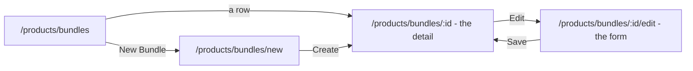

# Decisions — the bundle screens

The owner's decisions about **`/products/bundles`** and the bundle's own pages. **Append-only** (RULE 12): a reversed
decision is renamed and its references grepped.

The rules every screen follows are in [context_decision.md](context_decision.md); what a bundle IS — a picking recipe,
who may change it, what happens to a borrowed line — is in
[product_bundle_decision.md](../../business/product/product_bundle_decision.md).

| decision | what it decided |
| --- | --- |
| [a-bundle-has-a-detail-page-that-counts-what-stock-can-make](#a-bundle-has-a-detail-page-that-counts-what-stock-can-make) | a bundle opens on a detail page — its recipe, and how many bundles one warehouse's stock can make, with the product that runs out first; the form moves to `…/edit` |

---

## a-bundle-has-a-detail-page-that-counts-what-stock-can-make

> Owner, in chat (2026-10-22): *"dont forget bundle detail to"* — then *"yes A"* to the sketch with the recipe AND the
> stock, over the recipe alone. As recommended.

**The verdict.** A bundle has a detail page, as a product does. The row opens it; **Edit** opens the form. Beside the
recipe it answers the question a CS has before listing a package: *can we still fill it, and what runs out first?*



```
← Paket Hemat                                    [✎ Edit] [🗑 Delete]
  Created by Ani Rahayu · changed yesterday
  Beras dan gula untuk listing paket hemat di Shopee

  Warehouse [Gudang Pusat ⌄]          Can make: 6 bundles
  Product                   Per bundle   Ready   Enough for
  Beras Pandan Wangi 5kg        1          25       25
  Gula Pasir 1kg · Kenanga      2          12        6   ← runs out first
```

**The spec.**

| | |
| --- | --- |
| the warehouse | one at a time, a warehouse picker — stock is held per building. The first warehouse until another is picked |
| Ready | that warehouse's on-hand for the product — `StockAvailability`, the read a pick finds |
| Enough for | `floor(ready ÷ per bundle)` |
| Can make | the smallest *Enough for* over the usable lines; that line is marked as the one that runs out first |
| another team's product below its reserve | *Enough for* is **0**, saying so — the product's total across every warehouse is under its owner's reserve, so an order would be refused ([the-reserve-stops-other-teams-at-low-stock](../../business/product/context_decision.md#the-reserve-stops-other-teams-at-low-stock)) |
| a locked or archived line | no figures, the unavailable note; left out of *Can make*, because an order fills that slot with something else ([a-borrowed-product-never-blocks-its-owner](../../business/product/product_bundle_decision.md#a-borrowed-product-never-blocks-its-owner)) |
| Edit and Delete | beside the name, for whoever may change the bundle; on a phone in `⋯` ([the-phone-header-is-one-row](context_decision.md#the-phone-header-is-one-row)) |
| the reads | `BundleByIds`, `ProductByIds`, and one `StockAvailability` per warehouse for all the bundle's products — the total across warehouses is what the reserve is tested against |
