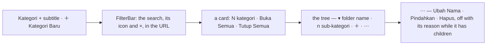

# Decisions — the categories page

The owner's decisions about **`/categories`** — the one global product taxonomy, curated by Root and the
Administrator. **Append-only** (RULE 12): a reversed decision is renamed and its references grepped.

The rules every screen follows are in [context_decision.md](context_decision.md). There is no business context for
categories of their own yet: the owner's product context names `categories` as a product attribute, and
[a-product-files-under-many-categories](../../business/product/context_decision.md#a-product-files-under-many-categories)
is the one decision that touches them.

| decision | what it decided |
| --- | --- |
| [the-category-page-is-a-tree](#the-category-page-is-a-tree) | the page is a tree that opens and closes — child counts, ＋ on a node, a search that keeps the path, Rename and Move apart, Delete off while a node has children — on the every-screen rules |
| [the-category-tree-reads-like-a-table](#the-category-tree-reads-like-a-table) | the tree is drawn as the app's tables are — a heading row, full-width rows a line apart at a table row's height, labelled actions, no card, no folder icons |
| [the-category-tree-arrives-shut](#the-category-tree-arrives-shut) | the tree opens on its top level only, and ONE button opens every branch or shuts them all |
| [the-product-count-is-a-marked-sample](#the-product-count-is-a-marked-sample) | a **Produk** column, its figures invented and marked ⚠ until something counts a category's products; the row's add action reads **＋ Sub-kategori**; a disabled ⋯ item does nothing |
| [a-branch-slides-open-and-shut](#a-branch-slides-open-and-shut) | a branch's children slide open and shut — height and fade in 180ms — and the chevron turns with them |

## the-category-page-is-a-tree

> Owner, in chat (2026-10-17): *"tampilan kategori yang sekarang masih terlalu simpel, ada ide?"* — offered a tree
> that opens and closes, child counts, ＋ per node, a search with the path, Delete off while there are sub-categories,
> Move as its own action, and the screen rules — then *"kita coba begitu"*.



| | before | now — and the rule |
| --- | --- | --- |
| the list | a table of names, indented by a dash | Chakra's **`TreeView`**: a branch opens and closes on a click, with its indent guides; the whole tree opens on arrival, as the table showed it all; **Buka Semua** / **Tutup Semua**. 🔄 Since then shut on arrival, one button for both ([the-category-tree-arrives-shut](#the-category-tree-arrives-shut)) ([chakra-first-whenever-it-has-the-component](context_decision.md#chakra-first-whenever-it-has-the-component)) |
| a node | the name | a chevron (a branch), a folder — open or shut — or a tag (a leaf), the name (bold at the top level), **n sub-kategori** beside it. 🔄 Since then no folder or tag, the count in its own column ([the-category-tree-reads-like-a-table](#the-category-tree-reads-like-a-table)) |
| adding | New Category, then find the parent in the picker | **＋ on a node** — *Sub-kategori Baru*, the parent already that node. New Category stays in the header, top-level unless a parent is picked |
| changing | one Edit form holding the name and the parent | **Ubah Nama** sends the name alone, **Pindahkan** the parent alone — CategoryUpdate's fields are optional, so each leaves the other as the server has it |
| moving | the picker without the node itself | the same — the node and its whole branch are left out, so a category cannot go under itself or its children |
| deleting | a trash icon; a node with children failed after the confirm | in the ⋯, **off while it has sub-categories**, with *Hapus sub-kategorinya dulu* under it; a leaf confirms first. A sub-category added elsewhere since the read still meets the server's refusal, as a toast |
| the search | none | the shared `FilterSearch`, `q` in the URL ([a-lists-filters-live-in-the-url](context_decision.md#a-lists-filters-live-in-the-url)): the matches and the path down to each, every branch on the way opened; *n cocok* in the card's head; no match is an `EmptyHint` with Clear. 🔄 The card and its count went ([the-category-tree-reads-like-a-table](#the-category-tree-reads-like-a-table)) |
| loading · empty | a spinner · a grey line | the list's shape · an `EmptyHint` with its own New Category ([an-empty-list-shows-a-hint](context_decision.md#an-empty-list-shows-a-hint)) |
| the header | the title alone, a bare New Category | title and subtitle as one block, ＋ Kategori Baru with its icon — the ＋ alone on a phone ([a-phone-header-action-is-an-icon](context_decision.md#a-phone-header-action-is-an-icon)) |
| the form | no placeholder; Create always on | *Contoh: Audio* ([every-form-field-shows-an-example](context_decision.md#every-form-field-shows-an-example)); Create waits for a name, Save for a change, Move for a new parent |

- **Every figure is read from the one full-tree read** the page already made — the counts, the search, the branches.
  No API change. What the contract cannot give yet is **the products in a node**: nothing filters products by
  category.
- **A cycle is surfaced, not lost.** The server refuses a category as its own parent but not a deeper loop, so the tree
  builder (`categoryTreeRoot`) puts anything it could not hang from a top at the top level, as `flattenTree` already
  did for an orphan.
- The test ids the e2e reach for are kept: `open-create-category`, `new-category-name`, `submit-create-category`, the
  form's `category-select`. The empty tree's New Category is `categories-empty-create`, so a fresh database never has
  two `open-create-category`s.
- Stories (`Pages/Categories/Categories`): the tree whole, branches and Expand/Collapse All, the search and its path, no
  match, the URL, New Category, ＋ under a node, a duplicate name, Rename, Move, the move picker's own branch, Delete off
  with children, Delete on a leaf, an empty tree, the phone. The stub is `.storybook/categoryStub.ts`.

## the-category-tree-reads-like-a-table

> Owner, in chat (2026-10-17), on the first tree: *"secara tema kurang sesuai"*.

```
Kategori                                                       [＋ Kategori Baru]
Pohon kategori produk — satu untuk semua tim.
[⌕ Cari kategori        ×]                            [⇕ Buka Semua] [⇳ Tutup Semua]
Nama                                        Sub-kategori                     Aksi
▾ Elektronik                                           1    [＋ Sub-kategori] [⋯]
   ▾ Audio                                             1    [＋ Sub-kategori] [⋯]
        Headphone                                      —    [＋ Sub-kategori] [⋯]
▾ Rumah Tangga                                         1    [＋ Sub-kategori] [⋯]
```

| | the first tree | now |
| --- | --- | --- |
| the rows | Chakra's file explorer: rounded pills ~32px tall floating on the page, a grey 2px focus ring, indent guides | the app's table rows: the full width, a line under each, 48px with an `xs` action in it, square, the hover turning in the hover beat, the rose focus ring — set once in `theme.ts`'s `treeView` recipe (`TREE_ROW`), so any tree after this one is drawn the same |
| around it | a card, its head holding the count and Buka/Tutup Semua | no card, as every list sits on the page; **Buka Semua · Tutup Semua** at the filter strip's end — their icons alone on a phone. 🔄 One button since ([the-category-tree-arrives-shut](#the-category-tree-arrives-shut)) |
| the columns | none | a **heading row** like a table's — *Nama · Sub-kategori · Aksi* — the rows' count and actions lined up under it; a phone has none, so its count says *n sub-kategori* |
| a node | chevron, folder or tag, name, *n sub-kategori* | chevron (a branch) or its room (a leaf), the name — bold at the top level — the count as a number, *—* for none |
| the actions | ＋ and ⋯, both bare icons | **＋ Sub-kategori**, a labelled outline button as a row's action is ([an-action-button-carries-its-icon](context_decision.md#an-action-button-carries-its-icon)), then ⋯ — the shops list's shape; on a phone ＋ is its icon |
| the count | in the card's head, *5 kategori* / *1 cocok* | gone with the card — the search's matches are on screen |

- Stories: `TheTreeReadsLikeATable` (the heading row, a row's height, line and square corners, the labelled action, no
  card); the phone story checks it has no heading and its count says what it is.

## the-category-tree-arrives-shut

> Owner, in chat (2026-10-17), with a screenshot of the Indonesian rows — *"bug"* — then *"default tutup semua"* and
> *"tutup buka semua jadi 1 tombol"*.

```
[⌕ Cari kategori        ×]                                   [⇕ Buka Semua]   ← anything shut
Nama                                    Sub-kategori                       Aksi
▸ Elektronik                                       1    [＋ Tambah Sub-kategori] [⋯]
▸ Rumah Tangga                                     1    [＋ Tambah Sub-kategori] [⋯]
                                                              … every branch open → [⇳ Tutup Semua]
```

| | |
| --- | --- |
| on arrival | **shut** — the top level only, A to Z. A click opens or shuts one branch |
| one button | **Buka Semua** while any branch is shut, **Tutup Semua** once every one is open — by the button or by hand. At the filter strip's end; its icon alone on a phone |
| a search | still opens every branch on the way to a match; clearing it returns the tree as it was left |
| the column bug | the actions column was 11rem and Indonesian's *Tambah Sub-kategori* is wider, so the button spilled out of it over the count. The column is **14rem** now, and a row's is a **minimum**, so a longer label widens its row rather than covering the count. 🔄 The label is *＋ Sub-kategori* since, and the column 11rem again — still a minimum ([the-product-count-is-a-marked-sample](#the-product-count-is-a-marked-sample)) |

- Stories: `TheTreeArrivesShut`, `OneButtonOpensAndShutsAll`, and `InIndonesian` — which measures each row's ＋ button
  against its count, and fails on the old 11rem column.

## the-product-count-is-a-marked-sample

> Owner, in chat (2026-10-17): *"tamb sub kategori tidak ada teks yang lebih singkat?"* — *＋ Sub-kategori* recommended
> — *"iya gitu aja, tambah jumlah produk dan kasih warning"*; then *"actionmu yang disabled masih trigger, hapus disabled
> masih bisa ku klik"*.

```
⚠ 1 bagian layar ini belum diimplementasi …                                       ← the summary strip
Nama                              Sub-kategori   Produk ⚠1                  Aksi
▸ Elektronik                                 1         102   [＋ Sub-kategori] [⋯]
▸ Rumah Tangga                               1           9   [＋ Sub-kategori] [⋯]
```

| | |
| --- | --- |
| the column | **Produk**, after *Sub-kategori*, its ⚠ number on the heading; on a phone the row's count line says *1 sub-kategori · 102 produk*, and the strip at the top carries the explanation |
| ⚠ the figures | **invented** (`sampleProductCount`, the same figure for the same category every render) and marked `sample` in `pages/categories/pending.ts` — nothing counts the products filed under a node: ProductList has no category filter, and a product under several nodes ([a-product-files-under-many-categories](../../business/product/context_decision.md#a-product-files-under-many-categories)) is decided but not built. Deleted the day the count exists |
| not settled | whether a branch's count includes its sub-categories' products. The sample is the node's own; the real one is the owner's call when the count is built |
| the add action | **＋ Sub-kategori** (EN *＋ Sub-category*) — the ＋ already says *add*. Its spoken name stays *Tambah sub-kategori di bawah …*. The actions column is 11rem again, still a minimum |
| a disabled ⋯ item | **does nothing.** Hapus, off while a node has sub-categories, still opened its confirm on a click: a disabled `Menu.Item` fires its DOM `onClick`, the menu only skips selecting it. The items act through the menu's `onSelect` now. The same hole was closed in `CompactActions` (shared), the account row's actions, the pick queue's Print and restock accept's Accept — and CLAUDE.md's row-actions rule says so |

- Stories: `TheProductCountIsASampleAndSaysSo`, `DeleteIsOffWhileItHasSubCategories` (now clicks the disabled item —
  fails on the old code), and on `Components/Chrome/CompactActions`, `ADisabledActionDoesNothing` (fails on the old
  code too).

## a-branch-slides-open-and-shut

> Owner, in chat (2026-10-17): *"animasi kurang, tidak smooth"* — a branch's children appeared and vanished at once;
> only the chevron turned.

| | |
| --- | --- |
| opening | the children's box grows from nothing to its height and fades in — 180ms, easing out (Chakra's \`animateContent\`, retimed in \`theme.ts\`'s \`treeView\` to the app's arriving beat, [motion-is-small-quick-and-shared](context_decision.md#motion-is-small-quick-and-shared)) |
| shutting | the box shrinks to nothing and fades out — 180ms, easing in; the children are hidden only once it ends (Zag's collapsible waits for it) |
| the chevron | turns in the same 180ms |
| a branch open on arrival | a search opens the path to a match without playing anything; shutting it still slides — checked in a browser with motion on, since the story runner asks for reduced motion and so plays none |
| less motion | where the device asks, nothing slides and nothing waits — the theme's global reduced-motion rule turns every animation off |

- Measured with motion on: opening 0 → 26 → 44 → 49px at 0 / 60 / 120 / 400ms; shutting 49 → 40 → 19 → 0px, the child
  row hidden at the end; the same for a branch a search had opened.
