# Decisions — the frontend, every screen

The owner's decisions about how ALL screens behave — the rules a new screen starts from. **Append-only** (RULE 12).
A decision about one screen goes in that screen's own file beside this one (`<page>_decision.md`), and links here
when it applies one of these.

| decision | what it decided | first applied |
| --- | --- | --- |
| [a-list-summary-is-the-order-lists-card-strip](#a-list-summary-is-the-order-lists-card-strip) | a list's figures are the order list's `SummaryStrip` of `SummaryCard`s | [settlement](order_settlement_decision.md#the-settlement-list-summary-is-the-order-lists-cards) |
| [a-date-range-filter-is-the-order-lists-picker](#a-date-range-filter-is-the-order-lists-picker) | a date filter is the order list's `DateRangePicker`, naming which date it filters | [settlement](order_settlement_decision.md#the-settlement-list-filters-what-the-contract-can) |
| [a-table-sorts-from-its-headings](#a-table-sorts-from-its-headings) | a sortable column sorts from its heading — largest first, then flips; two states | [settlement](order_settlement_decision.md#the-settlement-list-sorts-by-its-headings) |
| [the-pager-is-always-on-screen](#the-pager-is-always-on-screen) | the pager stays on screen on one page and on none, per page beside it | [settlement](order_settlement_decision.md#the-settlement-list-always-shows-its-pager) |
| [one-context-per-column-and-never-three-lines](#one-context-per-column-and-never-three-lines) | pairing is only for one fact read twice — it REPLACES the six-paired-cells decision | order screens |
| [the-phone-header-is-one-row](#the-phone-header-is-one-row) | on a phone the sticky block is the number, the stage and `⋯` — plus the section chips | order screens |
| [a-phone-reads-each-line-as-a-block](#a-phone-reads-each-line-as-a-block) | the item table becomes one block per line below `md` | order screens |
| [a-phone-filters-from-a-sheet](#a-phone-filters-from-a-sheet) | on a phone the search stays in the row; every other filter is in a bottom sheet behind a counted Filter button | order screens |
| [a-summary-card-is-at-most-a-fifth](#a-summary-card-is-at-most-a-fifth) | cards fill the row but never exceed 1/5 of it on a large screen — 1/4, 1/3, 1/2 as it narrows | order screens |
| [a-badge-stacks-under-its-text-when-the-table-is-cramped](#a-badge-stacks-under-its-text-when-the-table-is-cramped) | a badge column (an entry's source) sits under its text (the type) when the table would scroll, and on a phone; its own column when there is room | [settlement ledger](order_settlement_decision.md#the-ledger-reads-tanggal-and-its-balance-is-full-strength) |
| [a-summary-card-is-grey-with-a-thin-border](#a-summary-card-is-grey-with-a-thin-border) | every summary card sits on a grey ground with a thin line; one card per strip may lead, in pale blue | [settlement ledger](order_settlement_decision.md#the-ledger-margin-leads-and-says-where-it-comes-from) |
| [a-negative-amount-puts-its-minus-before-rp](#a-negative-amount-puts-its-minus-before-rp) | every negative amount reads **−Rp 10.000**, never *Rp -10.000*; a change or a running balance carries its + too | [settlement ledger](order_settlement_decision.md#the-ledger-reads-tanggal-and-its-balance-is-full-strength) |
| [a-chosen-option-is-in-the-main-tone](#a-chosen-option-is-in-the-main-tone) | a chosen radio and the calendar's chosen day are drawn in the main tone, rose — the form's button colour, never the default near-black | [settlement add entry](order_settlement_decision.md#the-add-entry-form-picks-with-chakra-controls) |
| [chakra-first-whenever-it-has-the-component](#chakra-first-whenever-it-has-the-component) | when Chakra has the component, the screen uses it — its full one, not a native element dressed up | [settlement add entry](order_settlement_decision.md#the-add-entry-form-picks-with-chakra-controls) |
| [a-money-field-shows-0-until-typed](#a-money-field-shows-0-until-typed) | every money field shows a **0** placeholder until something is typed — the placeholder, never the value | every `CurrencyInput` |
| [clear-filters-is-red-and-bold](#clear-filters-is-red-and-bold) | **Hapus filter** is red and bold — on every list, in the row and in the phone's sheet | [financial accounts](financial_accounts_decision.md#the-accounts-list-has-every-filter-the-contract-has) |
| [a-selected-tab-is-in-the-main-tone](#a-selected-tab-is-in-the-main-tone) | the picked tab's text and underline are rose, on every tab row | [financial accounts](financial_accounts_decision.md#the-accounts-type-is-a-tab-row) |
| [a-search-select-reopens-whole](#a-search-select-reopens-whole) | a search select searches only what is typed — opened again after a pick, it shows every option | every search select |
| [a-checked-box-is-in-the-main-tone](#a-checked-box-is-in-the-main-tone) | a ticked checkbox is rose, as a chosen radio is — on every screen | [financial accounts](financial_accounts_decision.md#a-dialog-choice-is-a-radio-pill) |
| [a-segmented-choice-is-in-the-main-tone](#a-segmented-choice-is-in-the-main-tone) | a segmented control is drawn like a field, the chosen segment pale rose with a rose label; the grain picker carries an icon per grain | [financial account report](financial_accounts_decision.md#the-report-is-five-cards-and-one-table) |
| [a-date-speaks-the-apps-language](#a-date-speaks-the-apps-language) | a formatted date and a relative time follow the language picked in the app, not the browser's — *kemarin*, *7 Okt 2026* | every screen through `lib/datetime` |
| [the-desktop-shell-has-no-top-bar](#the-desktop-shell-has-no-top-bar) | the desktop shell has no top bar — no breadcrumb, search or bell; the page starts at the top beside the sidebar | every desktop screen |
| [the-sidebar-is-in-sections](#the-sidebar-is-in-sections) | the desktop menu is in sections — Operasional, Keuangan, Tim; Kewajiban counts the payments awaiting confirmation; Profile is in the user card | every desktop screen |
| [a-submenu-item-has-no-icon](#a-submenu-item-has-no-icon) | ⚠ provisional — a sub-menu item has no icon; the group header and the top-level items keep theirs | the desktop sidebar |
| [the-sidebar-collapses-to-its-icons](#the-sidebar-collapses-to-its-icons) | the desktop sidebar collapses to its icons by « or Ctrl+B, remembered, never automatically; a group opens a flyout on click | the desktop sidebar |
| [the-workspace-opens-under-its-card](#the-workspace-opens-under-its-card) | the team switcher (the workspace) opens as a panel straight under its card — beside the avatar when collapsed; the phone keeps the dialog | the desktop sidebar |
| [the-workspace-searches-one-section](#the-workspace-searches-one-section) | the workspace panel has no search box over both lists — each section heading carries a search icon and searches that section alone; no *Bukan anggota* badge | the workspace panel |
| [the-workspace-search-goes-back-by-a-chevron](#the-workspace-search-goes-back-by-a-chevron) | the section search is an input with its search icon, left by a ‹ chevron on its left; the list rides the panel's right edge | the workspace panel |
| [the-workspace-search-follows-access](#the-workspace-search-follows-access) | a member has one list with the search at its top; the sections and their search icons are Root's and the Administrator's | the workspace panel |
| [the-workspace-search-opens-under-its-heading](#the-workspace-search-opens-under-its-heading) | each section's search opens under its heading, which stays; the icon becomes a ^ that shuts it — for a member and for Root alike | the workspace panel |
| [the-phone-has-no-bell](#the-phone-has-no-bell) | the phone top bar has no notifications bell | the phone shell |
| [the-phone-opens-its-panels-from-the-bottom](#the-phone-opens-its-panels-from-the-bottom) | on a phone the workspace and the More menu open as drawers from the bottom, never the whole screen | the phone shell |
| [the-more-sheet-starts-with-the-account](#the-more-sheet-starts-with-the-account) | the More sheet is headed by the signed-in account; the workspace is not in it | the phone shell |
| [the-phone-team-chip-is-the-whole-box](#the-phone-team-chip-is-the-whole-box) | the phone top bar is one team selector — avatar, team, screen and ⇅ — and a tap anywhere on it opens the workspace | the phone shell |
| [the-more-sheet-switches-theme-and-language](#the-more-sheet-switches-theme-and-language) | in the More sheet, Tema is a sun/moon switch and Bahasa an ID/EN switch | the phone shell |
| [the-switch-is-a-step-past-lg](#the-switch-is-a-step-past-lg) | a `lg` switch is 56×28 — a step past Chakra's 48×24; the More sheet's two switches | the phone shell |
| [the-account-menu-switches-theme-and-language](#the-account-menu-switches-theme-and-language) | the desktop account menu draws Tema and Bahasa as the phone's switches — ☀/☾ and ID/EN — each a row that toggles and keeps the menu open | the desktop sidebar |
| [the-workspace-is-the-tab-bars-centre](#the-workspace-is-the-tab-bars-centre) | on a phone the workspace is a round bubble raised out of the tab bar's centre, the team's name under it; the top bar names the screen only | the phone shell |
| [the-phone-workspace-keeps-its-size](#the-phone-workspace-keeps-its-size) | the phone's workspace drawer is always 75% of the screen, whatever a search leaves in it; a long team name is cut to one line | the phone shell |
| [every-list-pages-with-the-growing-pager](#every-list-pages-with-the-growing-pager) | every paged list uses `GrowingPager`; a screen still on `Pagination` moves when it is next touched | the supplier page's tabs |
| [a-table-row-lights-up](#a-table-row-lights-up) | every table row lights up under the pointer, every cell; a phone block only when it opens something | [the settlement ledger](order_settlement_decision.md#the-ledger-margin-leads-and-says-where-it-comes-from) |
| [every-form-field-shows-an-example](#every-form-field-shows-an-example) | every typed field in a form shows an example as its placeholder — *Contoh: …* | [the account dialogs](financial_accounts_decision.md#an-account-note-is-a-textarea) |
| [an-action-button-carries-its-icon](#an-action-button-carries-its-icon) | a page's and a row's action buttons carry a leading icon, as a menu item does | the order list's header actions |
| [a-breakdown-opens-from-rincian](#a-breakdown-opens-from-rincian) | a card with a breakdown opens it from **Rincian ›** at the end of its label — a dialog, a bottom sheet on a phone | [the settlement margin](order_settlement_decision.md#the-margin-breakdown-opens-from-rincian) |
| [every-page-has-a-mobile-story](#every-page-has-a-mobile-story) | every page's stories include one named **Mobile**, right after Default | the order screens |
| [a-page-story-has-its-shells-gutter](#a-page-story-has-its-shells-gutter) | a page story is framed by its shell's gutter — 12px on a phone, 20px from `md` — never Storybook's padding on top | every page story |
| [a-phone-pager-is-centred-without-a-page-size](#a-phone-pager-is-centred-without-a-page-size) | on a phone the pager's buttons are centred and it draws no per-page selector | `GrowingPager`, every list |
| [the-phone-shell-has-no-top-bar](#the-phone-shell-has-no-top-bar) | the phone shell has no top bar — the page starts at the top under its own title; the lit tab says where you are | the phone shell |
| [the-phone-page-clears-the-bubble](#the-phone-page-clears-the-bubble) | a phone page's end scrolls clear of the workspace bubble — the shell's bottom padding is the bubble's rise plus a gap | the phone shell |
| [a-page-picks-its-view-over-its-filters](#a-page-picks-its-view-over-its-filters) | a page with two ways to read its data puts them as line tabs **over** its filter strip — the view decides which filters there are | the supplier statistics, the account report |
| [settlement-is-one-sub-menu](#settlement-is-one-sub-menu) | the selling team's Penyelesaian, Laporan Penyelesaian and Impor Penyelesaian are one sub-menu — **Penyelesaian ▸ Daftar · Laporan · Impor**; a CS who only imports gets that one link flat | the sidebar |
| [the-accounts-hold-what-moves-them](#the-accounts-hold-what-moves-them) | **Akun Keuangan ▸ Daftar Akun · Laporan Akun · Biaya · Kewajiban** — the accounts and the two flows that move them, one group; a shut group carries its children's count | the sidebar |
| [orders-and-drafts-are-one-sub-menu](order_draft_decision.md#the-drafts-are-a-list-of-their-own) | **Pesanan ▸ Daftar · Draf** — the drafts, a list of their own now, sit in the Orders group; the phone's Orders tab lights on them too | the sidebar |
| [the-sidebar-stays-short](#the-sidebar-stays-short) | the sidebar must not grow long — related screens become one sub-menu, a child names only its screen, a section holds a few entries | the sidebar, every new screen |
| [the-more-sheet-is-a-menu-and-a-profile](#the-more-sheet-is-a-menu-and-a-profile) | the phone's menu sheet is two views switched at its foot — the **menu** with a search, and the **profile** with Edit Profil, Tema, Bahasa and Keluar; Profil is no longer a menu line | the phone shell |
| [an-empty-list-shows-a-hint](#an-empty-list-shows-a-hint) | an empty table or list shows `EmptyHint` — an icon, the title, a line on why or what next, and the action that fills it or clears the filter — not a bare grey line | every list |
| [every-filter-clears-from-its-own-x](#every-filter-clears-from-its-own-x) | a filter with a value carries an × that clears it — a select's at its end, a panel trigger's attached to it, the search's inside it beside its search icon — besides the strip's Hapus Filter | the supplier screens first; the search on every list |
| [the-quick-ranges-are-days-then-months-then-years](#the-quick-ranges-are-days-then-months-then-years) | a date range's quick picks are Today, 7 and 14 days, then 1, 3 and 6 months and 1 year — counted on the calendar; a dated screen opens on the last month | every `DateRangePicker` |
| [a-lists-filters-live-in-the-url](#a-lists-filters-live-in-the-url) | a list's filters, its sort and a tab that narrows it are kept in the URL — a refresh, Back, or a pasted link opens the same narrowed list | every list with filters |
| [a-phone-header-action-is-an-icon](#a-phone-header-action-is-an-icon) | on a phone a header's actions are their icons; past two they all fold into ⋯ — it REPLACES "every action into ⋯, even one" of [the-phone-header-is-one-row](#the-phone-header-is-one-row) | every phone header |
| [a-one-type-picker-shows-the-name-alone](#a-one-type-picker-shows-the-name-alone) | a team filter that offers ONE type (warehouses, selling teams) shows its pick as the name alone — no type badge | the supplier screens, the seller's orders |
| [a-filter-answers-as-it-changes](#a-filter-answers-as-it-changes) | an × and Hapus Filter fade in as they appear, the phone's Filter count pops when it changes, a chip's pick turns in 120ms — the results never fade | every `FilterBar` |
| [motion-is-small-quick-and-shared](#motion-is-small-quick-and-shared) | motion is pure CSS from the theme: a page rises and fades in, a swap fades in place, a first load is a skeleton, one tab underline slides, a hover answers in 120ms — and a refresh moves nothing | the supplier screens first |
| [a-counted-line-is-three-columns](#a-counted-line-is-three-columns) | a screen that counts line by line gives each line Accept Delivery's frame — what it is · what you type · what it means — in a fixed shape, under a sticky header | Accept Delivery, then the stock count's Count page |

## a-list-summary-is-the-order-lists-card-strip

> Owner, in chat (2026-10-02): *"aku ingin statistik designnya seperti di order list"*.

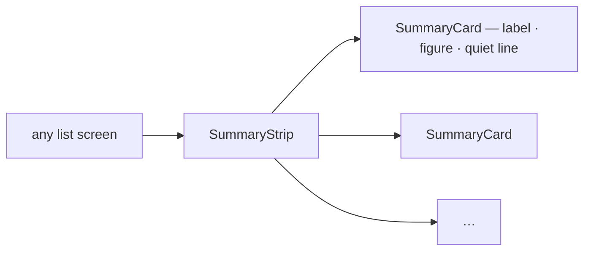

| | |
| --- | --- |
| component | `SummaryStrip` + `SummaryCard` (`features/orders/SummaryCard.tsx`) — never a screen's own stat box |
| a card | a label, ONE figure, one quiet line under it |
| width | the strip fills the row, no card wider than its share (1/5 on a large screen) |
| scope | the figures describe what the list's filters select — never just the page on screen |
| a figure that cannot be computed | not shown — a card is removed rather than filled from the page or left as a dash |

## a-date-range-filter-is-the-order-lists-picker

> Owner, in chat (2026-10-02): *"rentang tanggal gunakan seperti order list"*.

| | |
| --- | --- |
| component | `DateRangePicker` (quick ranges + a calendar), inside the shared `FilterBar` |
| which date | when the list's date is not the obvious one, the picker's field segment NAMES it (e.g. *Last moved*), so it is never read as the order date |
| on a phone | in the filter sheet, full width |
| any change | back to page 1 |

## a-table-sorts-from-its-headings

> Owner, in chat (2026-10-02): *"sort akan lebih baik jika bisa tiap heading"* — and *"cukup bolak-balik"*.

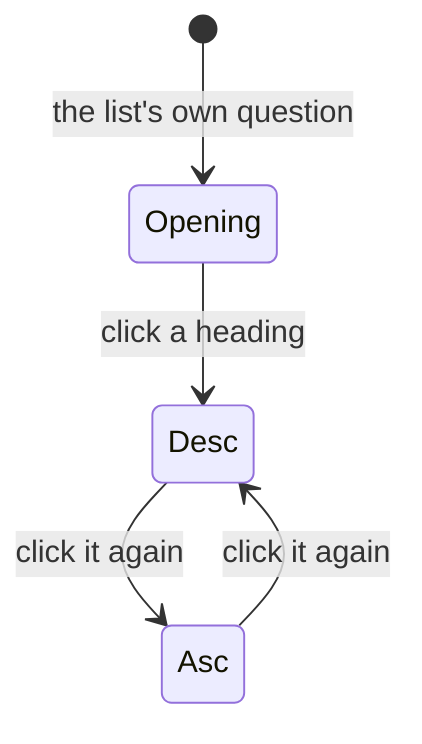

| | |
| --- | --- |
| a click | a new heading starts at **largest first**; the active heading flips — **two states**, never a third back to the default |
| shown | an arrow on the active heading, ⇅ on the others that sort |
| not sortable | a column whose order would mean nothing (a name the server does not hold) |
| who sorts | the server, over the whole set — a page is never re-sorted on the client |
| on a phone | no headings to tap, so the filter sheet carries a *Sort* control with each heading's two directions |

## the-pager-is-always-on-screen

> Owner, in chat (2026-10-02): *"tampilkan saja, selalu"* on the settlement list, then *"+paging selalu tampil"* —
> for every list.

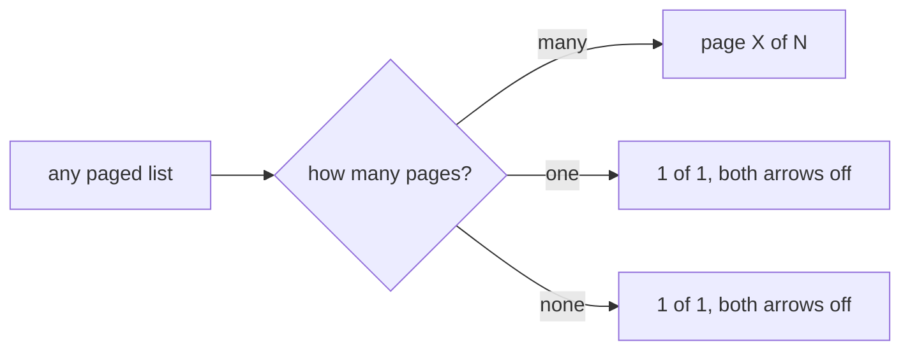

| | |
| --- | --- |
| control | the shared `Pagination` — it no longer hides itself; the opt-in `alwaysShow` it briefly had is gone |
| empty list | reads as one page, never *1 of 0* |
| per page | wherever a list offers sizes, the selector sits beside it on one page too |
| first load | a page may still hold the pager back while its first rows load — that is a spinner, not a list |

It widens [the-settlement-list-always-shows-its-pager](order_settlement_decision.md#the-settlement-list-always-shows-its-pager)
from one list to all of them. A list used to lose its pager when everything fitted, so a short list and a broken
one looked alike — and the per-page choice vanished exactly when somebody wanted fewer rows.

## one-context-per-column-and-never-three-lines

> Owner, in chat (2026-09-28): *"1 line lebih dari 2 baris"* · *"konteks berbeda di satukan (toko dan
> gudang), beli.margin tidak masalah"* · *"tanggal bedakan saja columnnya, status belum kamu bedakan
> jadi tidak lurus kebawah"*.

⚠ **This REPLACES `the-row-is-six-cells-not-twelve-columns`.** That decision paired twelve facts into
six cells and treated pairing as the way to fit a wide table. Two rules replace it:

| | |
| --- | --- |
| **1. No cell is more than two lines** | one row of the table is one row of reading |
| **2. One context per cell** | pairing is for ONE FACT READ TWICE, never for two questions |

**What was wrong with the old pairing** is not that it was dense — it is that it answered two questions
in one place. Toko and Gudang are not one fact; somebody scanning for *which warehouse* had to read past
a shop name to get there.

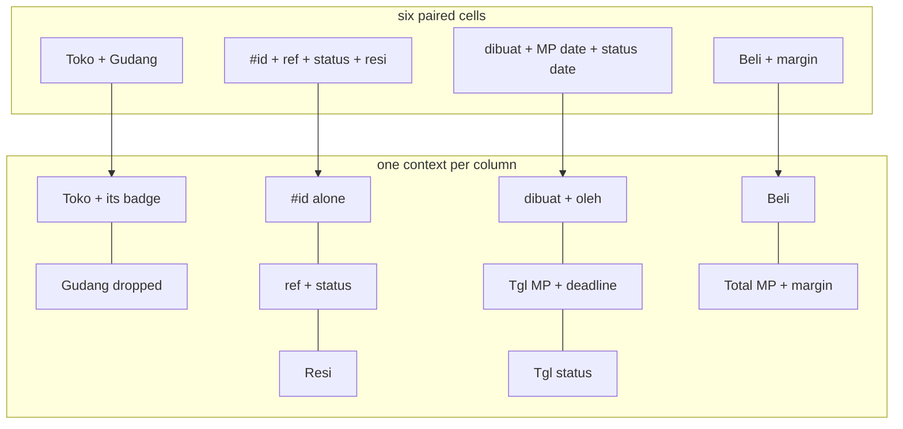

⚠ **THE RULE IS THE TEST, NOT THE PAIRS.** Which facts count as one took several rounds, and every
pairing below had to earn its second line by being the SAME fact read twice — the marketplace's name for
the order and where that order stands; the storefront's order time and the deadline it starts. A pair
that merely had room is what the rule rejects.

**The columns, in order** — nine, and only four carry a second line:

| | column | line 1 | line 2 |
| --- | --- | --- | --- |
| 1 | ID Order | the marketplace's reference, **copyable** | the status badge |
| 2 | Resi | the tracking number, **copyable** | |
| 3 | Toko *or* Tim | the shop's name | its marketplace badge |
| 4 | Dipesan | our date | `oleh <nama>` |
| 5 | Tgl MP | the storefront's order date | **the ship-by deadline** |
| 6 | Tgl `<status>` | **only while a status is filtered** | |
| 7 | Beli | total beli | |
| 8 | Total MP | what the platform paid | **the margin · %** |
| 9 | Aksi | the kebab | |

**What came OFF the row, and why.** Both answer *tell me about this order* rather than *which order do
I want* — which is the test a column has to pass:

| dropped | |
| --- | --- |
| **Penerima** (owner) | the search box already reaches the customer's name, so finding one never needed a column to look at |
| **Gudang** (owner) | a seller's orders nearly all ship from the same building, and the crew reading its own queue would see its own name twenty times |
| **`#id`** (owner) | nothing reads it. The marketplace reference is what a buyer, a shop and a courier all quote; our number survives as the row's link target and its testid, not as a column |

**Where each pair landed, and why it is ONE fact rather than two:**

| pair | why they belong together |
| --- | --- |
| ID Order / status | the marketplace's name for the order, and where that order has got to |
| Toko / marketplace badge | two storefronts often share a name — the pair IS the identifier |
| Tgl MP / deadline | **causal**: the ship-by window runs FROM the storefront's order time |
| Total MP / margin | the margin is `harga MP − total beli`, measured against the figure above it |
| Dipesan / `oleh` | one event: when we wrote it down, and who did |

⚠ **THE STATUS MOVED TWICE, and the second move is not a reversal of the first.** It began on the second
line of the `#id` cell, where the badges did not line up down the page. A column of its own fixed that;
under the marketplace reference it is line 2 on *every* row, so they line up there too — and it costs no
column.

⚠ **THE TWO COPYABLE FIELDS ARE THE TWO THAT LEAVE THE APP.** The marketplace reference is pasted into
the platform's dashboard and the resi into a courier's tracking page or a reply to a buyer. Our `#id` is
quoted across a room, not pasted, so it is not copyable. Both stop the row's navigate — without that,
copying a number would also leave the page and nobody would see it happen.

⚠ **THE DEADLINE SAT UNDER THE RESI FOR ONE ROUND, and moved because the premise was wrong.** The pairing
there assumed a resi appears only at handover, so the two would never coexist — but *"resi pasti ada"*
(owner): the marketplace prints the label at confirmation, which is exactly why the action table offers
*Edit Resi* on `created` and `process`. The resi answers *which parcel*, the deadline *when it has to go*.

⚠ **The price is a wider table, and that is accepted.** The page still never scrolls sideways — the table
scrolls inside its own box (measured at 400px). Five of the nine columns are a single line.

⚠ **One column appears and disappears**: the status date only exists under the tab that asks for it,
because a permanently blank column is one people learn to skip.

## the-phone-header-is-one-row

> Owner, in chat (2026-09-30): *"heading yang sticky top terlalu ramai"*.

Below `md` the sticky block is **one row** (back, the order number, the stage, `⋯`) and the section
chips under it. It was 153px and is now 109px.

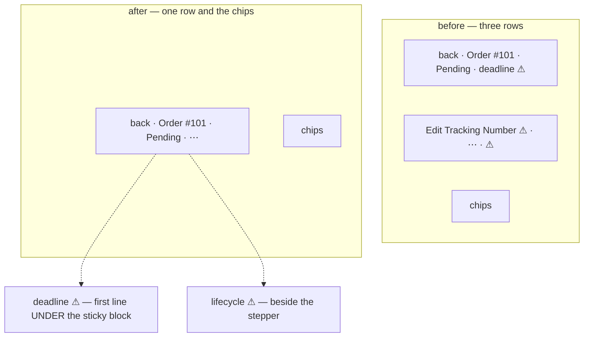

| moved | to | why |
| --- | --- | --- |
| every action | the `⋯` menu, even when it holds only one | a labelled button was what wrapped the header onto a second row. On a phone a menu costs a tap and a button costs the header's height |
| the deadline and its ⚠ | the first line under the header | still the first thing read, but it scrolls away |
| the lifecycle ⚠ | beside the stepper | the steps it is about: retur, selesai, lost |

The desktop header is unchanged.

## a-phone-reads-each-line-as-a-block

> Owner, in chat (2026-09-30): *"product itemsnya kepotong-potong karena terlalu sempit"*.

Below `md` the item table becomes **one block per line**: the marketplace's title, then our product,
then `harga beli × qty · team` on the left and the line total on the right. At 390px the five-column
table clamped both names to a word each, and qty and the line total sat off the edge. The ⚠ for the
picture and the marketplace title move to the section title, since there is no column header on a phone.

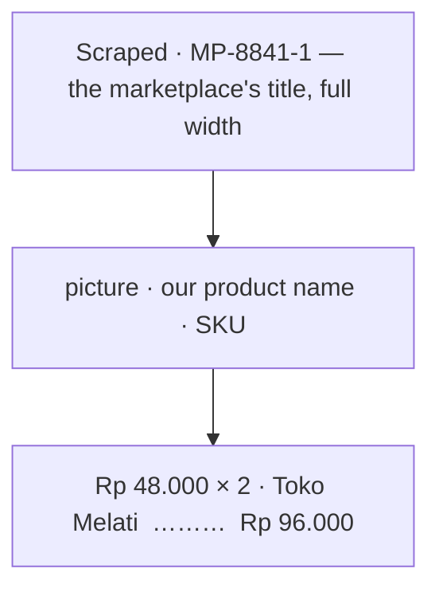

## a-phone-filters-from-a-sheet

> Owner, in chat (2026-09-30): *"bentuk filter di order list cukup berantakan pada tampilan mobile"*.

Below `md`, `FilterBar` draws one row — the search and a **Filter** button — and puts every other control in a
bottom sheet, each at the full width. Desktop is unchanged.

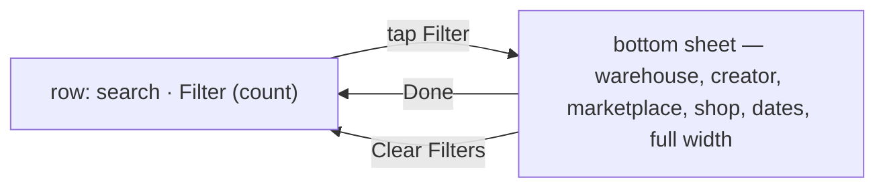

| | before | after |
| --- | --- | --- |
| phone | six controls in six ragged rows (15rem, 13rem, `auto`), ~280px before the tabs | one 36px row |
| Filter button | — | counts what is narrowing the list (search included) |
| Clear | inline, while filtering | in the sheet's footer, beside Done |
| applying | live | still live — Done only closes the sheet, it is not an Apply |

- The search stays out of the sheet because it is the one control used on every visit.
- `FilterBar` finds the search by type, so the order list writes one set of children for both layouts, and a
  `FilterField` becomes a full-width row inside the sheet (its control too — the date button has a minimum
  width of its own).
- A JS breakpoint, never CSS, so every control mounts once.
- The story runner's canvas is phone-width, so the list's filter stories open the sheet first.

## a-summary-card-is-at-most-a-fifth

> Owner, in chat (2026-09-30): *"jadi strech, gini aja, di layar 2k maksimal widthnya 1/5, dan untuk ukuran di
> bawahnya kamu sesuaikan"*.

`SummaryStrip` (in `features/orders/SummaryCard.tsx`) replaces the bare grid on all three strips — the order
list's piles, its measure cards, and the drafts page's cards.

| screen | widest a card may be |
| --- | --- |
| ≥ 1536px (`2xl`, including 2K) | 1/5 |
| ≥ 1024px (`lg`) | 1/4 |
| ≥ 768px (`md`) | 1/3 |
| phone | 1/2 |

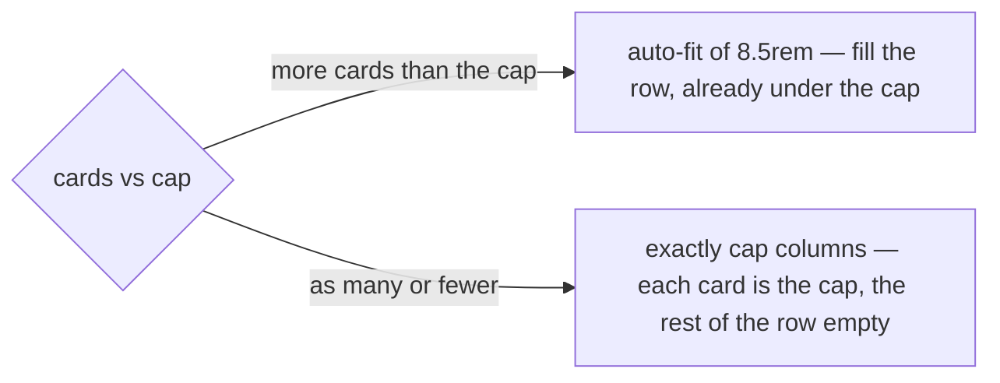

Measured at 2560px: three draft cards at 0.196 of the strip each, seven measure cards at 0.139, the piles
filling the row. At 1440px the draft cards are 1/4. The count decides the layout because CSS grid alone
cannot say *fill the row, but at most 1/5*: `auto-fit` stretched few cards, `auto-fill` shrank many.

## a-badge-stacks-under-its-text-when-the-table-is-cramped

> Owner, in chat (2026-10-03), on the settlement ledger's Type and Source: *"untuk kolom semacam ini rulenya: jika
> tabel terlalu banyak kolom sampai harus buat scroll, taruh badge contoh sumber, di bawah teks/element contoh jenis ·
> jika tabel renggang dan banyak space, pisah saja, tidak masalah · kalau di tampilan mobile gunakan yang atas bawah"*.

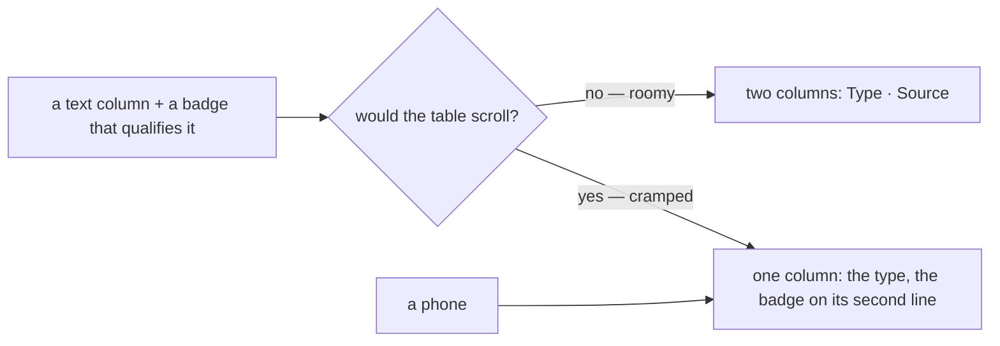

| | |
| --- | --- |
| applies to | a column whose value is qualified by a badge — an entry's type and its source is the first case |
| roomy | separate columns |
| cramped | the badge on the text's second line, and its column is gone — the cell stays at two lines ([one-context-per-column-and-never-three-lines](#one-context-per-column-and-never-three-lines)) |
| a phone | always the stacked form |
| how it is decided | measured, not guessed by screen width: watch the table's scroll container, stack the moment the roomy layout would overflow, unstack only once the container is as wide as the roomy layout needed — so the two cannot flicker at the edge. ⚠ No table uses it today: the ledger, its first user, moved its badge into Detail ([the-ledger-type-column-reads-sumber](order_settlement_decision.md#the-ledger-type-column-reads-sumber)) and its hook went with it |

⚠ Stacking removes ONE column. A table that still does not fit after it — a ledger on a 360px screen — is the
phone's block layout's job ([a-phone-reads-each-line-as-a-block](#a-phone-reads-each-line-as-a-block)), not this rule's.

## a-summary-card-is-grey-with-a-thin-border

> Owner, in chat (2026-10-03), on the ledger's cards: *"summary cards → background subtle / border tipis"*, and
> *"buat margin riil sedikit lebih menonjol"*, then *"true margin bisa full biru saja?"* and *"biru biasa aja, yang agak pudar"*.

| | |
| --- | --- |
| every card | `bg.muted` (a grey ground) and a 1px `border` — `bg.subtle` is white in this theme, the same as the page and the card around it, so a card used to read as an outline only |
| the lead card | `SummaryCard emphasis` — a full PALE BLUE fill (the `lead.*` tokens: Chakra's own blue, 50 / 200 / 700 — not a status, not an eighth tone) and its figure one size up. **One per strip**, or it leads nothing |
| a second quiet line | `note` — how a figure is made, under its line, in a quieter grey; only where it is not obvious |
| where | `SummaryCard` (`features/orders/SummaryCard.tsx`) — so every strip changes at once: the order list, the drafts, the settlement list, the ledger |

It amends the card's look in [a-list-summary-is-the-order-lists-card-strip](#a-list-summary-is-the-order-lists-card-strip);
the shape — a label, one figure, a quiet line — is unchanged.

## a-negative-amount-puts-its-minus-before-rp

> Owner, in chat (2026-10-05), on the ledger: *"saldo formatnya samakan dengan perubahan, di perubahan adalah -Rp … di
> saldo Rp -…, dan format ini berlaku untuk semuanya, buat jadi catatan"*.

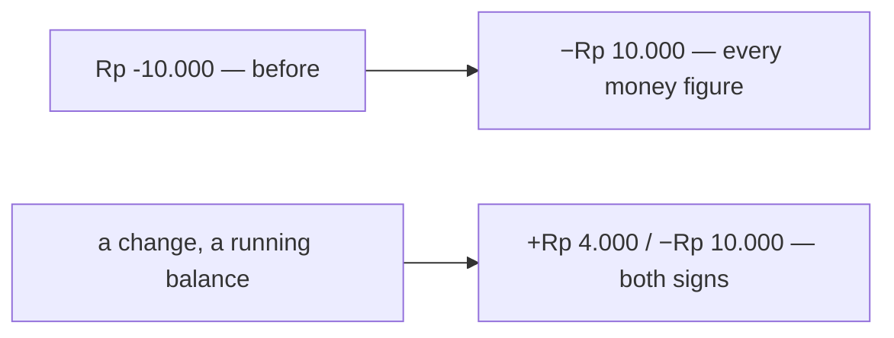

| | |
| --- | --- |
| any negative amount | **−Rp 10.000** — the minus BEFORE the currency, the typographic "−" |
| a change or a running balance | both signs: **+Rp 4.000**, **−Rp 10.000** — its direction is the point |
| any other positive amount | bare: **Rp 120.000** |
| where | `formatRupiah`, `formatRupiahNumber`, `formatRupiahCompact` and `formatSignedRupiah` (`frontend/src/lib/money.ts`) — every money figure goes through them, so the whole app changed at once |

The sign says which way the money went. Written after the currency it was the one character nobody read — and a
ledger showed its change as *−Rp 4.500* beside a balance of *Rp -30.500*, two formats for one kind of number.

## a-chosen-option-is-in-the-main-tone

> Owner, in chat (2026-10-05), on the add-entry dialog: *"select harus cakra, radio select juga, warnanya buat biru
> atau mungkin ada rekomendasi, karena warna utamaku rose, untuk theme tanggalnya juga sesuaikan warnanya"* — then,
> once the submit was rose beside an indigo pick: *"Arah warnanya merah saja kalau gitu, samakan"*.

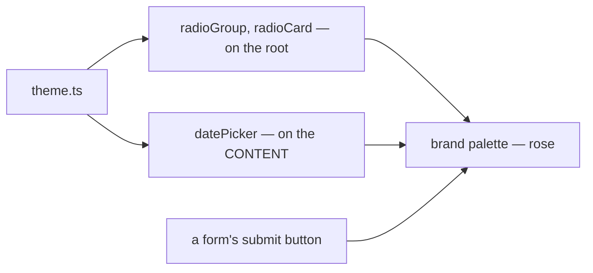

| | |
| --- | --- |
| a chosen radio · radio card | its mark and its card's line in **brand** (rose-600) — the colour of the form's submit beside it |
| the calendar | the chosen day filled in rose; today's underline and a hovered day in its pale steps |
| why | one accent per form: the action and the pick in the same colour. The default palette drew both near-black |
| tried first | indigo (`primary`), recommended to keep rose for actions — reversed the same day: a rose submit beside an indigo pick read as two accents |
| where | `theme.ts` only. ⚠ the calendar's palette is set on its **content**: it opens in a portal, outside the root, and a palette is inherited down the DOM |
| not yet | a checkbox and a switch still use the default palette — not asked |

## chakra-first-whenever-it-has-the-component

> Owner, in chat (2026-10-05), on the add-entry dialog: *"catatan textarea, komponen kalau ada kita akan pakai cakra,
> catat itu saja"*.

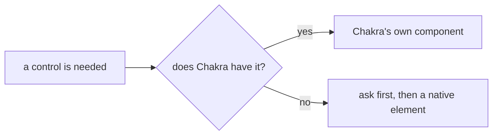

| the need | Chakra's component | not |
| --- | --- | --- |
| pick one of a list | `Select` (composable) — `Combobox` when the set grows | `NativeSelect`, `<select>` |
| one of two or three choices | `RadioCard` / `RadioGroup` | two buttons toggling solid and outline |
| a sentence of text | `Textarea` | a one-line `Input` |
| a date | `DatePicker` (ours, on Chakra's) | `<input type="date">` |

It sharpens what CLAUDE.md already says ("build UI from Chakra UI v3 components"): a Chakra component that only
wraps the native element — `NativeSelect` — does not count when Chakra has the full one.

## a-money-field-shows-0-until-typed

> Owner, in chat (2026-10-05), on the add-entry dialog's amount: *"input price ada placeholder 0 secara default"*.

```
Jumlah
[ Rp  0              ]   ← the placeholder, in the quiet ink — the value is still ""
[ Rp  45.000         ]   ← once typed
```

| | |
| --- | --- |
| where | `CurrencyInput`'s default `placeholder` — so every money field gets it, and a caller may still pass its own |
| the value | stays `""` until a digit is typed: an empty field is a person who has not answered, not a zero |
| was | an empty box on most forms; four forms typed `placeholder="0"` by hand, now removed as the default |

## clear-filters-is-red-and-bold

> Owner, in chat (2026-10-05), on the accounts list's filter strip: *"catatan, hapus filter merah bold"*.

```
[Cari …] [Semua jenis ⌄] [Semua toko ⌄] ☐ Hanya operasional   Hapus filter   ← red, bold
```

| | |
| --- | --- |
| the button | `FilterBar`'s Clear — `colorPalette="error"`, bold, still a ghost button |
| where | every list that uses `FilterBar` — the row on a desktop and the foot of the phone's sheet — set once in the component |
| when | unchanged: only while a filter is narrowing the list |
| why red | it throws away what somebody set, and on a list that looks emptier than expected it is the first thing to find |

## a-selected-tab-is-in-the-main-tone

> Owner, in chat (2026-10-05), on the accounts list's type tabs: *"warna tab warna utama"*.

*The tab's twin of [a-chosen-option-is-in-the-main-tone](#a-chosen-option-is-in-the-main-tone).*

```
[Semua 5]  [Rekening bank 2]  [Kas 1]
 ━━━━━━━━                              ← the picked tab: rose text, rose underline
```

| | |
| --- | --- |
| the picked tab | text `brand.fg`, underline `brand.solid` — rose |
| the others | unchanged — `fg.muted`, no underline |
| where | `theme.ts`, the `line` variant — every tab row in the app, the order list's status tabs and the vertical detail tabs included |
| the count badge | stays grey — the colour is set by token on the trigger, not as a palette the badge would inherit |

## a-search-select-reopens-whole

> Owner, in chat (2026-10-05), on `ShopSelect`: *"ada 1 permasalah, dimana saat sudah select data, ketika panel dibuka
> lagi, dia cuma ada 1 opsi"*.

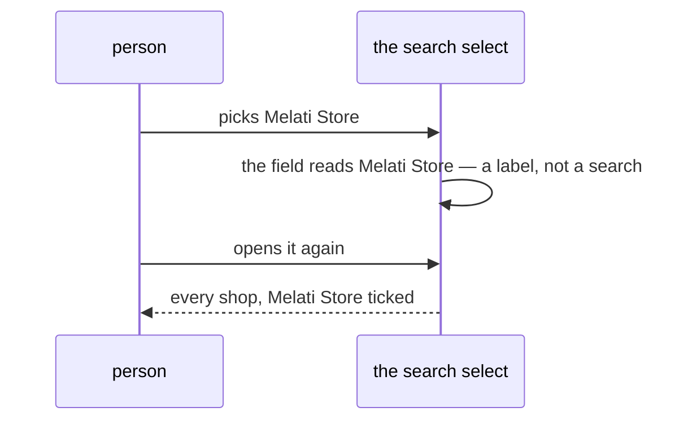

| | |
| --- | --- |
| what searches | a keystroke only — `reason === "input-change"` |
| what starts over | a pick, a blur, a clear, and opening the panel by a click or an arrow key |
| why the open half too | typing *Warehouse Admin* and picking *Warehouse Admin* leaves the field's text unchanged, so no pick-change ever fires — the typed search would stay |
| where | `searchOnlyWhatIsTyped(filter)` in `frontend/src/lib/comboboxSearch.ts`, spread on the `Combobox.Root` of every search select that filters in the browser: Shop, Supplier, Shipping, ShipmentChannel, Team, Role · AddressPicker already did it inline |
| not changed | the server-search ones (User, Product): their list IS the answer to what is typed, and a blank term asks for nothing |

## a-checked-box-is-in-the-main-tone

> Owner, in chat (2026-10-06): *"theme checkbox sesuaikan"*.

*The checkbox's twin of [a-chosen-option-is-in-the-main-tone](#a-chosen-option-is-in-the-main-tone).*

| | |
| --- | --- |
| the box | ticked: filled `brand.solid`, rose — was the default near-black beside rose radios |
| where | `theme.ts`, `checkbox` on its root — every checkbox in the app |

## a-segmented-choice-is-in-the-main-tone

> Owner, in chat (2026-10-07), on the account report: *"pill harian bulanan tahunan kurang bagus dan sesuai
> temaku, mungkin ditambah icon juga lebih bagus"*.

*The segmented control's twin of [a-chosen-option-is-in-the-main-tone](#a-chosen-option-is-in-the-main-tone) and
[a-selected-tab-is-in-the-main-tone](#a-selected-tab-is-in-the-main-tone).*

```
before   ░[ Harian ]░  Bulanan  ░  Tahunan ░     grey trough, a white raised chip, a size taller than a field
after    │[▣ Harian]  ▦ Bulanan │ ▤ Tahunan │      a field's box; the pick pale rose, its label rose
```

| | |
| --- | --- |
| the box | white, a thin `border`, 36px — the height of a field at `sm`, so it lines up with the filters beside it |
| the pick | filled `brand.subtle`, its label `brand.fg`; the others `fg.muted` — colour only, no bold, so the words do not shift as the pick moves |
| hover | rose too, the chosen segment included — never black (owner, same day: *"activenya saat hover bukan hitam"*) |
| the grain picker | an icon per grain — `Calendar1` a day, `CalendarDays` a month, `CalendarRange` a year — in `PeriodGrainPicker` |
| where | `theme.ts`, `segmentGroup` — every segmented control: the grain picker (account report, settlement report, daily statement), the phone menu's theme and language switches, the order draft's rows, the pick queue, the restock labels |

## a-date-speaks-the-apps-language

> Owner, in chat (2026-10-08), on an account's *Terakhir dicek*: *"yesterday tidak ikut i18n?"*.

| | |
| --- | --- |
| the bug | `lib/datetime`'s formatters passed `undefined` as the locale — the BROWSER's — so an English browser printed *yesterday* and *Oct 7, 2026* on a screen switched to Bahasa Indonesia |
| now | `formatUnixDate`, `formatUnixDateTime`, `formatRfc3339DateTime` and `formatUnixRelative` read i18next's current language on every call: *kemarin*, *7 Okt 2026* |
| pinned | the account page's `DatesFollowTheAppsLanguage` story, under the Indonesian locale |
| still open | seven pages keep a local copy of the date formatter with `undefined` (balance, batch-detail, batch-receipt, batches, restock-accept, restock-labels, warehouse-product) — the same bug, not touched yet |

## the-desktop-shell-has-no-top-bar

> Owner, in chat (2026-10-08): *"di app shell, kita tidak perlu heading yang ada breadcrumbnya"*.

```
before                                          now
┌──────────┬────────────────────────────────┐   ┌──────────┬────────────────────────────────┐
│ sidebar  │ Toko Melati › Orders  🔍  🔔    │   │ sidebar  │ the page, from the top          │
│          ├────────────────────────────────┤   │          │                                │
│          │ the page                        │   │          │                                │
└──────────┴────────────────────────────────┘   └──────────┴────────────────────────────────┘
```

| | |
| --- | --- |
| gone | the desktop top bar, whole: the breadcrumb (team › screen), the search box and the notifications bell — neither was wired to a service, and the bell carried a dot that announced nothing |
| why it is not missed | the team is the sidebar's switcher, the screen its lit item — the breadcrumb said both a second time |
| gone with it | the hamburger and the sidebar's off-canvas drawer and backdrop. The desktop shell mounts only at 768px and wider, where the hamburger was hidden — the drawer could not be opened |
| stays | the sidebar, the non-member strip ([a-non-member-root-acts-under-a-strip](../../business/user/context_decision.md#a-non-member-root-acts-under-a-strip)), the page canvas chosen by route |
| the phone | unchanged — its compact top bar (team chip, screen name, notifications) is not a breadcrumb |
| a page with no heading of its own | **Produk** (`products`) and **Restok** (`restock-selling`) leaned on the breadcrumb for their name, and now have none on a desktop — not changed here |

## the-sidebar-is-in-sections

> Owner, in chat (2026-10-08), after asking what a sidebar usually holds and seeing it drawn: *"oke, kita coba"*.

```
selling team                     warehouse team
▌Beranda                         ▌Beranda
OPERASIONAL                      OPERASIONAL
  Produk ›  Inventaris ›           Produk  Pesanan
  Pemasok ›  Toko  Pesanan         Inventaris ›        ← up from under the money
KEUANGAN                         KEUANGAN
  Biaya  Kewajiban (3)             Laporan  Kewajiban (1)
  Penyelesaian …  Akun Keuangan    Akun Keuangan
TIM                              TIM
  Pengguna  Pengaturan             Pengguna  Pengaturan
(A) ani ⇅ → Profil · Tema · Bahasa · Keluar
```

| | |
| --- | --- |
| the sections | Home first, no heading · **Operasional** — the team's work · **Keuangan** — its money · **Tim** — its people. A section with nothing in it for this team and role is not drawn, heading and all |
| the heading | small, bold, uppercase, `fg.subtle`, at the items' left edge — a label, never a control |
| where | `menuSectionsFor` in `nav.ts`; `menuFor` is the same sections as one list, for "where am I", the phone's sheet and the bottom bar |
| the count | **Kewajiban** carries the payments waiting for this team to confirm — `LiabilityPositionList`'s whole-set `awaiting_confirmation`, read on a one-row page. Never a 0. Asked again on every navigation, since the sidebar never remounts; a payment recorded, confirmed or rejected refreshes it too |
| Profile | out of the menu, into the user card's menu, above Tema — it is the person's page, not the team's. Still in `menuFor`, so `/profile` is matched and named |
| a warehouse | **Inventaris** moves up into Operasional, beside Pesanan — it sat below the money while the menu was one column |
| the phone | unchanged for now: the More sheet draws `menuFor` as before — its groups are already open, uppercase sections, so a second heading level is not added there |

## a-submenu-item-has-no-icon

> Owner, in chat (2026-10-08): *"submenu tidak perlu icon, ini keputusan sementara, mungkin bisa ditampilkan di sama
> depan"*. ⚠ **Provisional** — the owner's own word; read as: the icon belongs to the front level.

```
  ▣ Produk               ⌄     ← the group header keeps its icon
  │  Produk Saya               ← a child is its name alone, under the rail
  │  Temukan Produk
  ▣ Toko                       ← a top-level item keeps its icon
```

| | |
| --- | --- |
| a sub-menu item | no icon — its name under the group's rail, starting where the group's own name starts |
| the front level | unchanged: a top-level item and a group header each keep their icon |
| a collapsed sidebar | if one ever comes back, a child shows its icon there — with no names, it would be empty otherwise |
| the phone | unchanged for now — the More sheet's rows keep their icons |

## the-sidebar-collapses-to-its-icons

> Owner, in chat (2026-10-08), after the references and the drawing: *"tidak, kerjakan"* — build it, and **no**
> automatic collapse on a small laptop screen.

```
open, 258px                      collapsed, 64px            a group, clicked
┌──────────────────────────┐     ┌──────┐                   ┌──────┐ ┌────────────────┐
│ ⌂ PDC Warehouse       «  │     │  ⌂   │                   │ ▣·  ◄┼─┤ INVENTARIS     │
│ [GP Gudang Pusat     ⇅]  │     │  »   │                   └──────┘ │ Restok         │
│ ▌Beranda                 │     │ (GP) │                            │ Retur  Rak …   │
│ OPERASIONAL              │     │ [▣]  │                            └────────────────┘
│  ▣ Inventaris         ›  │     │ ──── │  ← a heading is a line
│ KEUANGAN                 │     │  ▣·  │  ← a group: icon and a dot
│  ▣ Kewajiban        (1)  │     │  ▣①  │  ← the count on the icon's corner
│ (A) ani               ⇅  │     │ (A)  │
└──────────────────────────┘     └──────┘
```

| | |
| --- | --- |
| the toggle | `«` at the right of the logo row; `»` under the mark when collapsed — one button, its name and **Ctrl+B** (⌘B) in its tooltip. Ctrl+B is ignored while typing in a field |
| remembered | in this browser (`wh-sidebar-collapsed`); **open by default**; never collapsed automatically, whatever the width |
| an item | its icon, centred; its name in a tooltip to the right and as the link's accessible name |
| a heading | a thin line |
| a group | its icon and a small dot; tinted while you are inside it. **A click** opens a flyout to its right — the group's name, then its children by name (no icons, [a-submenu-item-has-no-icon](#a-submenu-item-has-no-icon)). Never a hover. Escape, an outside click or going somewhere shuts it; a shut flyout is unmounted |
| the count | a small figure on Kewajiban's icon; the tooltip reads *Kewajiban · 1 menunggu konfirmasi Anda* |
| the team and the user | the team's avatar opens the same switcher; the user's avatar the same menu (to its right) |
| the page | gains the width — 258px → 64px |
| the phone | unchanged — it has its own shell |

**Supersedes** the *a collapsed sidebar* row of [a-submenu-item-has-no-icon](#a-submenu-item-has-no-icon): a child is
never drawn as an icon on the rail — it is reached through its group's flyout, by name.

## the-workspace-opens-under-its-card

> Owner, in chat (2026-10-08): *"pilih user atau disini aku istilahkan workspace, di panel aja langsung di
> bawahnya"* — the team switcher, which the owner calls the **workspace**.

```
open sidebar                         collapsed sidebar
┌──────────────────────────┐         ┌──────┐ ┌─────────────────────────┐
│ [GP Gudang Pusat      ⇅] │         │ (GP)◄┼─┤ [Cari tim             ] │
│ ┌──────────────────────┐ │         │      │ │ GP Gudang Pusat       ✓ │
│ │ [Cari tim          ] │ │  ← 6px  │      │ │ TM Toko Melati          │
│ │ GP Gudang Pusat    ✓ │ │    under└──────┘ └─────────────────────────┘
│ │ TM Toko Melati       │ │
│ └──────────────────────┘ │  ← the card's own width
```

| | |
| --- | --- |
| the open sidebar | a panel **straight under the card**, as wide as it — the card opening, not a window arriving; no backdrop |
| the collapsed sidebar | the same panel to the right of the team's avatar, beside the rail |
| its content | unchanged: the search, then the teams (and *All teams* for Root and the Administrator), the current one ✓ |
| closing | a pick (which reloads the app into that team, as before), Escape, or a click outside. The card reads as pressed while its panel hangs from it |
| the phone | unchanged — the centred dialog; a dropdown under the top bar's chip is a small target for a thumb |
| where | `TeamSwitcher`'s `panel`: `"below"`, `"right"`, or `"dialog"` (the default) |

## the-workspace-searches-one-section

> Owner, in chat (2026-10-09): *"tim saya aman, tidak ada perubahan · semua tim masih tampil berdasarkan access tadi ·
> bukan anggota badge tidak perlu · pencarian ditrigger lewat icon search … di paling kanan kasih icon itu, ketika klik
> nanti fokus ke tim saya atau semua tim, dan pencarian akan dilakukan disitu, alih-alih kita mencari keduanya
> langsung"*.

```
at rest                              searching All teams
Tim saya                 ⌕           [Cari di Semua tim          ×]
 RT Root                             TK Toko Kenanga          ← the server's answer for "ken"
Semua tim                ⌕           (Tim saya steps aside)
 GP Gudang Pusat
 TM Toko Melati          ✓
```

| | |
| --- | --- |
| My teams | unchanged — the memberships, the current one ✓ |
| All teams | unchanged — Root and the System Administrator only, every team they are not in |
| the badge | **gone** — no *Bukan anggota* on a row; the section says it, and the strip says it on every page |
| the search | **no box over both lists.** Each section's heading carries a search icon at its right; a click turns that heading into the field (*Cari di Tim saya* / *Cari di Semua tim*), the other section steps aside, and the typing narrows that section alone — My teams in the browser, All teams on the server |
| leaving it | the × beside the field, or Escape — which leaves the search first; a second Escape closes the panel |
| a member | sees the *Tim saya* heading and its icon too — it was headless, and the icon needs a heading to sit on |
| the phone | the same, inside its dialog |

**Supersedes** [the-switcher-offers-every-team](../../business/user/context_decision.md#the-switcher-offers-every-team)'s
presentation: the *not a member* mark on a row, and the one search over both sections.

## the-workspace-search-goes-back-by-a-chevron

> Owner, in chat (2026-10-09), on the first build: *"masih ada padding atau margin right kurang ke kanan · searchnya
> harusnya input dengan icon search seperti sebelumnya, alih-alih x kasih aja chevron di kiri"*.

```
Tim saya                 ⌕      ← the icon 21px from the panel's edge, as the label is 20px from the other
‹ [⌕ Cari di Tim saya      ]    ← back on the left; the field carries its search icon
```

| | |
| --- | --- |
| the field | an input with the **search icon inside it**, at its start, as the top search box had |
| leaving it | a **‹ chevron on the left** (*Kembali*) — the × at the right is gone. Escape still leaves the search first |
| the right edge | the list is pulled out through the panel's right padding (theme `scrollList`: the bar rides the panel's edge), so a heading's search icon and a row's ✓ sit ~21px from the edge — matching the 20px on the left. It was ~45px |

**Supersedes** the *leaving it* row of [the-workspace-searches-one-section](#the-workspace-searches-one-section).

## the-workspace-search-follows-access

> Owner, in chat (2026-10-09): *"kalau cuma ada tim saya, atas sendiri langsung aja pencarian … jadi berdasarkan
> access"*.

```
a member — one list                  Root / the System Administrator — two
[⌕ Cari tim               ]          Tim saya                 ⌕
 GP Gudang Pusat         ✓            RT Root
 TM Toko Melati                      Semua tim                ⌕
                                      GP Gudang Pusat
```

| | |
| --- | --- |
| a member | **one list, no heading**: the search field (*Cari tim*, its search icon inside) straight at the top, always there, and it stays put while the list scrolls. Escape closes the panel |
| Root and the System Administrator | unchanged — [the-workspace-searches-one-section](#the-workspace-searches-one-section): each heading its search icon, one section searched at a time, left by the ‹ ([the-workspace-search-goes-back-by-a-chevron](#the-workspace-search-goes-back-by-a-chevron)) |
| decided by | the same access that decides *Semua tim*: ROOT or ADMINISTRATOR held in the root team |

**Supersedes** the *a member* row of [the-workspace-searches-one-section](#the-workspace-searches-one-section) — a member
no longer gets the *Tim saya* heading.

## the-workspace-search-opens-under-its-heading

> Owner, in chat (2026-10-09), with two screenshots of a sidebar's *Top repositories* — its heading with a search icon,
> and the same heading with a ^ and a search field under it: *"atau gini aja sih"*.

```
at rest                          a section searched
Tim saya                 ⌕       Tim saya                 ^    ← the heading stays; the icon shuts the search
 GP Gudang Pusat         ✓       [⌕ Cari di Tim saya       ]   ← the field opens UNDER the heading
 TM Toko Melati                   TM Toko Melati
```

| | |
| --- | --- |
| the heading | **stays** while its section is searched; its icon turns from the search icon into **^** (*Tutup pencarian*), which shuts the search and clears it |
| the field | opens **under** the heading — an input with its search icon inside, *Cari di Tim saya* / *Cari di Semua tim* |
| one at a time | while a section is searched, the other steps aside (Root and the Administrator) |
| a member | the same pattern: one section, *Tim saya*, its heading and its icon — the always-open field at the top is gone |
| Escape | leaves the search first; a second Escape closes the panel |

**Supersedes** [the-workspace-search-goes-back-by-a-chevron](#the-workspace-search-goes-back-by-a-chevron) (the ‹ on the
left — the heading no longer gives way to the field) and the *a member* row of
[the-workspace-search-follows-access](#the-workspace-search-follows-access) (a member searches from the heading too;
access still decides how many sections there are).

## the-phone-has-no-bell

> Owner, in chat (2026-10-09), opening the phone's turn: *"notifikasi tidak ada"*.

```
before                              now
┌──────────────────────────────┐    ┌──────────────────────────────┐
│ (TM) Toko Melati         🔔• │    │ (TM) Toko Melati              │
│      Beranda                 │    │      Beranda                  │
└──────────────────────────────┘    └──────────────────────────────┘
```

| | |
| --- | --- |
| gone | the phone top bar's bell and its dot — nothing sends a notification, and a dot that never clears tells the person something false. The desktop lost its bell with its top bar ([the-desktop-shell-has-no-top-bar](#the-desktop-shell-has-no-top-bar)) |
| the top bar | the team chip, then the team and the screen, stacked |

## the-phone-opens-its-panels-from-the-bottom

> Owner, in chat (2026-10-09): *"pilih workspace dan menu lainnya pakai drawer dari bawah"*.

```
┌──────────────────────────────┐
│ (GP) Gudang Pusat             │
│      Beranda                  │
│ ░░░░░░░░ the page, dimmed ░░░ │
╭──────────────────────────────╮  ← rounded at the top, never the whole screen
│ Ganti Tim                  × │
│ Tim saya                   ⌕ │
│  GP Gudang Pusat           ✓ │
│  TM Toko Melati              │
╰──────────────────────────────╯
```

| | |
| --- | --- |
| the workspace | the top bar's team chip opens it in a **drawer from the bottom** — `TeamSwitcher`'s `panel="drawer"`, its phone variant (it was a centred dialog). Its content is the desktop panel's: the sections, each searched from its heading |
| the More menu | the same kind of drawer — it was the whole screen; now the page stays visible above it, up to 90% of the height |
| both | rounded at the top, closed by ×, a tap on the dimmed page, or Escape |

## the-more-sheet-starts-with-the-account

> Owner, in chat (2026-10-09): *"menu lainnya jangan ada pilih workspace, paling atas nama akunnya"*.

```
╭──────────────────────────────╮
│ (A) ani                    × │  ← the account heads the sheet
│     Warehouse Admin          │
│ ▌Beranda                     │
│  …the menu…                  │
├──────────────────────────────┤
│ Tema    [Terang|Gelap]       │
│ Bahasa  [ID|EN]              │
│ [Keluar]                     │
╰──────────────────────────────╯
```

| | |
| --- | --- |
| the header | the signed-in person — avatar, name, and their role in this team |
| the workspace | **not in this sheet** — the top bar's team chip is the one place a phone switches team |
| the foot | Tema, Bahasa, Keluar — the name moved up from here |

## the-phone-team-chip-is-the-whole-box

> Owner, in chat (2026-10-09): *"yang select tim, pakai selector saja, semua box jadi trigger bukan hanya gambar"*.

```
before — only the picture opened it      now — one selector, all of it opens it
┌────┐ Toko Melati                       ┌──────────────────────────────────┐
│(TM)│ Beranda                           │ (TM) Toko Melati               ⇅ │
└────┘                                   │      Beranda                     │
                                         └──────────────────────────────────┘
```

| | |
| --- | --- |
| the control | the phone top bar is **one selector** across the bar: the team's avatar, the team's name, the screen's name under it, and ⇅ — drawn as the sidebar's card is (thin border, the field's hover) |
| a tap | anywhere on it opens the workspace drawer ([the-phone-opens-its-panels-from-the-bottom](#the-phone-opens-its-panels-from-the-bottom)) — the picture alone was a small target |
| the order | unchanged — the team, then the screen, stacked |
| where | `TeamSwitcher`'s `screen` prop: the screen's name in place of the team type line |

## the-more-sheet-switches-theme-and-language

> Owner, in chat (2026-10-09): *"di tema klik lainnya, buat jadi switch icon matahari bulan, untuk bahasa switch ID dan
> EN"*.

```
light, Indonesian                 dark, English
Tema     [(☀)      ]              Theme     [      (☾)]   ← rose track when on
Bahasa   [(ID)     ]              Language  [      (EN)]
[        Keluar        ]          [       Sign Out      ]
```

| | |
| --- | --- |
| Tema | a **switch** — off is light, on is dark; the thumb carries ☀ or ☾ (lucide `Sun` / `Moon`) |
| Bahasa | a **switch** — off is Indonesian, on is English; the thumb carries **ID** or **EN** |
| the look | Chakra `Switch`, `lg` for a thumb, the track rose when on ([a-checked-box-is-in-the-main-tone](#a-checked-box-is-in-the-main-tone)) |
| ⚠ the thumb's marks | fixed tones — `gray.600` off, `brand.solid` on — because the thumb is white in both modes, and a mode-following tone turns pale on it in the dark |
| was | two segmented controls: *Terang · Gelap*, *Bahasa Indonesia · English* |
| the desktop | unchanged — Tema and Bahasa stay radio groups in the user card's menu |

## the-switch-is-a-step-past-lg

> Owner, in chat (2026-10-09), on the More sheet's two switches: *"switch tema dan bahasa kurang besar dikit"*.

```
before  [(☀)    ]  48×24        now  [ (☀)      ]  56×28
```

| | |
| --- | --- |
| the size | `lg` is **56×28** — set once, in theme.ts's `switch` recipe; Chakra's own `lg` is 48×24 |
| who it reaches | only the More sheet's Tema and Bahasa — no other switch in the app is `lg` |
| the thumb's marks | ☀ / ☾ at 16px, ID / EN at `xs` — grown with the thumb |

## the-account-menu-switches-theme-and-language

> Owner, in chat (2026-10-09), after the phone's switches: *"di desktop sekalian kasih icon saja sama huruf ID EN"*.

```
before                            now
Tema                              ◐ Tema       [(☀)    ]   ← a row; its switch shows the state
 ○ Terang  ● Gelap                ⟨A⟩ Bahasa   [(ID)   ]
Bahasa
 ● Bahasa Indonesia  ○ English
```

| | |
| --- | --- |
| the rows | **Tema** and **Bahasa**, each a menu item with a leading icon (`SunMoon`, `Languages`) and, at its right, the phone sheet's switch — ☀ or ☾, ID or EN ([the-more-sheet-switches-theme-and-language](#the-more-sheet-switches-theme-and-language)) |
| a click | on the ROW — or Enter — toggles it; the switch is a picture of the state, taking no pointer and no focus of its own. The menu **stays open** to show the change |
| one component | `layouts/PreferenceSwitches.tsx` — `ThemeSwitch` and `LanguageSwitch`, `lg` on the phone, `md` here — so the two shells cannot draw them two ways |
| was | two radio groups, *Terang · Gelap* and *Bahasa Indonesia · English* |

## the-workspace-is-the-tab-bars-centre

> Owner, in chat (2026-10-09): *"di mobile, apa bisa yang select workspace itu di tengah menu, bulat besar dan sedikit
> offset ke atas"* — then *"ya begitu saja"* to the drawing, and *"heading timnya tidak butuh, kasih saja nama di bawah
> selectnya"*.

```
┌──────────────────────────────────┐
│ Beranda                          │  ← the top bar: the screen, and only that
│                                  │
│             (the page)           │
├────────────╮ ╭────╮ ╭────────────┤
│  ⌂     🛒  │ │ TM │ │  📦     ☰  │  ← the team's avatar, 56px, risen ~26px out of the bar
│ Beranda Pesanan ╰────╯ Produk Lainnya │
│            Toko Melati           │  ← its name where a tab carries its label
└──────────────────────────────────┘
```

| | |
| --- | --- |
| the bubble | the current team's avatar (its type's colour), round, 56px, ringed in the bar's colour, raised out of the middle of the tab bar — `TeamSwitcher`'s `bubble` |
| its name | under it, where a tab has its label, on the same line as theirs. Bubble and name are one button, named *Ganti Tim: Toko Melati* |
| the bar | five columns — Beranda, Pesanan, [the team], Produk, Lainnya — the bubble in the middle; it is not a tab, never lit. The bar stays a tab's height (the bubble is pulled up, not the bar pushed taller) |
| a tap | opens the workspace drawer from the bottom ([the-phone-opens-its-panels-from-the-bottom](#the-phone-opens-its-panels-from-the-bottom)) — still the ONE place a phone switches team; picking a team is a second, deliberate tap |
| the top bar | **the screen's name only** — no team name, no control |
| ⚠ the centre's cost | the middle of a tab bar is where a primary action usually lives — a Scan, for the warehouse crew. Taken by the workspace while no such action exists; reopen this when one does |

**Supersedes** [the-phone-team-chip-is-the-whole-box](#the-phone-team-chip-is-the-whole-box): the top bar is no longer the
selector.

## the-phone-workspace-keeps-its-size

> Owner, in chat (2026-10-09), asking for a long-name story: *"sama untuk ukuran ganti timnya kamu fixkan, soalnya
> kalau tiba-tiba berubah menyusahkan"* — then *"yang di menu mobile"*: the phone's, not the desktop's.

```
opened                         searched "zzz" — the same height
╭──────────────────────────╮   ╭──────────────────────────╮
│ Ganti Tim              × │   │ Ganti Tim              × │
│ Tim saya               ⌕ │   │ Tim saya               ^ │
│  GU Gudang Pusat Dist…  ✓│   │ [⌕ zzz                 ] │
│  TM Toko Melati          │   │ Tidak ada tim.           │
│  …                       │   │                          │
│                          │   │                          │  ← nothing shrinks under the thumb
╰──────────────────────────╯   ╰──────────────────────────╯
```

| | |
| --- | --- |
| the phone's drawer | **75% of the screen's height, always** — whatever it holds; the list fills it and scrolls inside it |
| why | a search narrowing the list, or a section stepping aside, made the drawer shrink and jump under the thumb |
| the desktop panel | unchanged — it follows its content, up to 400px |
| a long team name | one line, cut with … — under the tab bar's bubble (in a tab's width) and in the switcher's rows; the full name is the bubble's accessible name. Storybook: *Layouts/Mobile/AppShell › A Long Team Name* |

## every-list-pages-with-the-growing-pager

> Owner, in chat (2026-10-10), on the supplier page: *"paginasi belum diganti semua tab, kita ke depannya pakai
> paginasi seperti keputusan sebelumnya"*.

```
before — Pagination                      now — GrowingPager
Per halaman [10⌄]   ‹  1 of 3  ›         Per halaman [10⌄]   [‹] [1] [2] [3] [›]
                                           ↑ every page opened is one click away
```

| | |
| --- | --- |
| the control | **`GrowingPager`** for every paged list — the pages opened so far as numbers, the current one in the main tone, › opening the next ([the-accounts-pager-grows-with-the-pages-opened](financial_accounts_decision.md#the-accounts-pager-grows-with-the-pages-opened)) |
| a new filter, sort, tab or page size | starts the trail over (`resetKey`) |
| per page | kept as the list had it — 10 / 20 / 50 where it offered sizes, none where it did not |
| still on screen | on one page and on none, `‹ [1] ›` — [the-pager-is-always-on-screen](#the-pager-is-always-on-screen) holds, with this control |
| the rest of the app | a screen still on `Pagination` **moves when it is next worked on** — not in a sweep of its own |
| first applied | the supplier page's three tabs: Toko, Produk, and both of Statistik's tables (also Discover's detail, which shares them) |

**Supersedes** the line in [the-accounts-pager-grows-with-the-pages-opened](financial_accounts_decision.md#the-accounts-pager-grows-with-the-pages-opened)
that kept every other list on `Pagination` *"until the owner decides"* — this is the decision. The control named in
[the-pager-is-always-on-screen](#the-pager-is-always-on-screen) (`Pagination`) reads as `GrowingPager` from here.

## a-table-row-lights-up

> Owner, in chat (2026-10-10), asked which earlier decisions were never recorded as rules for every screen, and picked
> this one: *"aturan umum"*. Said six times, screen by screen — the ledger (*"table hover → background"*, 2026-10-03),
> the account report (*"tabel report kasih hover per row"*, 2026-10-07), the statement (*"hoverable juga"*, 2026-10-08),
> the supplier list (*"hoverable"*, 2026-10-09), the supplier figures and its two tabs (2026-10-10).

```
Periode      Direstok   Hilang   …        ← resting
2026-10-08   40         1        …        ← under the pointer: every cell in bg.muted, edge to edge
```

| | |
| --- | --- |
| a desktop row | lights up under the pointer — **every cell** in `bg.muted`, set on the cells (`"& > td"`), so a held (sticky) cell turns with the rest |
| a phone block | the same tone under a pointer and **while pressed** — but only when the block **opens something**; a block that opens nothing does not light up |
| a story | drives it with `data-hover`, which Chakra's `_hover` honours — a synthetic pointer sets no CSS `:hover` |
| the screens | the rule for every new table. A screen already built moves when it is next worked on, as [every-list-pages-with-the-growing-pager](#every-list-pages-with-the-growing-pager) |
| was | recorded screen by screen — [the ledger](order_settlement_decision.md#the-ledger-margin-leads-and-says-where-it-comes-from), [the statement](financial_accounts_decision.md#a-statement-row-lights-up), [the supplier list](suppliers_decision.md#a-supplier-row-lights-up), [the figures](suppliers_decision.md#a-figures-row-lights-up), [the supplier tabs](suppliers_decision.md#a-supplier-tab-row-lights-up) — so a new screen never read it, and it had to be asked for again on each one |

## every-form-field-shows-an-example

> Owner, in chat (2026-10-10), picked as a rule for every screen: *"aturan umum"*. First said on the account dialogs —
> *"sebisa mungkin form ada placeholdernya"* (2026-10-06) — then again for the add-supplier form (*"kasih placeholder
> untuk tambah pemasok"*, 2026-10-09) and the add-store form (*"tambah toko kasih placeholder"*, 2026-10-10).

```
Nama *      [Contoh: PT Sumber Makmur          ]
Kontak      [Contoh: 0812-3456-7890            ]
Tautan      [Contoh: https://shopee.co.id/…    ]
Deskripsi   [Contoh: grosir kain dan benang, …  ]
Jumlah      [Rp  0                              ]   ← a money field keeps its 0
Jenis       [Pilih jenis toko                 ⌄]   ← a picker says what to pick
```

| | |
| --- | --- |
| a typed field | **an example** as its placeholder — *Contoh: …* (en *e.g. …*), sentence case, a realistic value of the thing asked for |
| a money field | keeps its **0** ([a-money-field-shows-0-until-typed](#a-money-field-shows-0-until-typed)) |
| a picker | keeps saying what to pick — *Pilih …* (en *Select …*) |
| editing | shows none — a filled field hides its placeholder |
| was | recorded on [the account dialogs](financial_accounts_decision.md#an-account-note-is-a-textarea), [the add-supplier form](suppliers_decision.md#the-add-supplier-form-shows-examples) and [the add-store form](suppliers_decision.md#the-add-store-form-shows-examples) — each asked for separately |

## an-action-button-carries-its-icon

> Owner, in chat (2026-10-10), picked as a rule for every screen: *"aturan umum"*. Said for the order list's header
> actions (*"3 aksi temasuk di atas kasih icon"*, 2026-09-23) and the supplier list (*"tambah pemasok ada iconnya"*,
> 2026-10-09).

```
Pemasok [Toko Melati]                        [＋ Tambah Pemasok]
PT Sumber Makmur   …   [✎ Ubah] [🗑 Hapus]
Pesanan            [⤓ Ekspor] [⤒ Impor] [＋ Buat Pesanan]
```

| | |
| --- | --- |
| which buttons | an action **at the top of a page** (add, export, import, a report) and an action **on a row** — each carries a leading lucide icon through `<Icon>`, as a menu item already does (CLAUDE.md) |
| the icon | the action's own — ＋ to add, ✎ to edit, 🗑 to delete, ⤓ to export; `boxSize="4"` |
| not covered | a dialog's footer (*Batal*, *Simpan*, *Tambah*) — not asked; it stays text |
| was | recorded on [the supplier list](suppliers_decision.md#a-supplier-action-is-labelled) alone |

## a-breakdown-opens-from-rincian

> Owner, in chat (2026-10-10), picked as a rule for every screen: *"aturan umum"*. Chosen for the settlement margin —
> *"Text Link At the End"* (2026-10-05) — and asked for again on the account report's cards (*"triggernya tulisan
> details di atas"*, 2026-10-07).

```
┌ Margin riil              Rincian › ┐      ← the only pressable thing on the card
│ Rp 96.000                          │
│ 18,2% dari harga jual              │
└────────────────────────────────────┘
          ↓ click
dialog on a desktop · bottom sheet on a phone — how the figure adds up
```

| | |
| --- | --- |
| the trigger | the text **Rincian ›** (en *Details ›*) at the **end of the card's label row** |
| the card | stays not a control — only the word is pressed (`SummaryCard`: *a card is not a control*) |
| what opens | how the figure adds up — a dialog on a desktop, a bottom sheet on a phone |
| was | recorded on [the settlement margin](order_settlement_decision.md#the-margin-breakdown-opens-from-rincian) and inside [the account report](financial_accounts_decision.md#the-report-is-five-cards-and-one-table) |

## every-page-has-a-mobile-story

> Owner, in chat (2026-10-10), picked as a rule for every screen: *"aturan umum"*. Said for the order screens (*"halaman
> order kasih story bentuk mobile … terapkan ke halaman order lain"*, 2026-09-21) and the account screens (*"on a phon
> ganti mobile saja, di bawah default pas"*, 2026-10-07). Never recorded until now.

```
Pages/Suppliers/SupplierDetail
  Default
  Mobile          ← always the second story
  …the states and the rules
```

| | |
| --- | --- |
| the story | every `Pages/*` stories file has one named **Mobile** — `globals: { viewport: { value: "mobile2" } }` — the page as a phone shows it |
| its place | **right after Default**, so the two shells of one screen sit side by side in the sidebar |
| its name | *Mobile*, never *On a Phone* |
| today | 17 of the 35 page story files have none — they gain one when the screen is next worked on |

## a-page-story-has-its-shells-gutter

> Owner, in chat (2026-10-10), reviewing Discover's Mobile story: *"1 hal yang kusadari di mobile, padding xnya
> kebesaran"* — then *"padding semuanya kayaknya"*.

```
before — a phone story                      now                         the app (MobileLayout)
|←16→|←20→| Temukan Pemasok                 |←12→| Temukan Pemasok       |←12→| Temukan Pemasok
  Storybook  the desktop's                    the phone shell's
  "padded"   page gutter                      card gutter
```

| | |
| --- | --- |
| a page story | framed by **its shell's gutter**, on every side — `card` (12px) on a phone viewport, as `MobileLayout`'s `<main>`; `page` (20px) from `md` up, as `DesktopLayout`'s. Applied once, in `.storybook/preview.tsx` |
| Storybook's `layout: "padded"` | **never** on a page story — it added 16px on top; removed from the 14 page story files that had it |
| why | the phone stories showed 36px a side where the app has 12 — the review screen lied about the screen it reviews |
| a component story | unchanged — flush against the canvas |

## a-phone-pager-is-centred-without-a-page-size

> Owner, in chat (2026-10-10), asked how a pager usually looks on a phone — to *Muat lebih banyak*, endless scroll or
> Prev/Next: *"tetap seperti yang sekarang saja, tapi tengah, tetapi masalah di perpage dia memenuhi space"*.

```
before — a phone                                 now — a phone
Per halaman [10 ⌄]    ‹ [1] 2 ›                         ‹ [1] 2 ›
(the selector and its label filled the row)        (centred, no selector)
```

| | |
| --- | --- |
| the pager | the same `GrowingPager` — the pages opened so far, the current one in rose ([every-list-pages-with-the-growing-pager](#every-list-pages-with-the-growing-pager)) |
| on a phone | its buttons **centred**; **no per-page selector** — the list keeps its page size |
| a desktop | unchanged — the selector on the left of the buttons, the row on the right |
| amends | *per page: the selector sits beside it* in [the-pager-is-always-on-screen](#the-pager-is-always-on-screen) — not on a phone. The pager itself is still always on screen |
| not chosen | *Muat lebih banyak*, endless scroll, Prev/Next — offered, kept as it is |

## the-phone-shell-has-no-top-bar

> Owner, in chat (2026-10-13), looking at the phone AppShell's example page — the shell's bar *"Pemasok Saya"* right over
> the page's own title *"Pemasok"*: *"mobile tidak ada headernya"* — *"heading appshellnya"*.

```
before                                   now
┌ Pemasok Saya ───────────────┐          ┌────────────────────────────┐
│ Pemasok [Toko Melati]        │          │ Pemasok [Toko Melati]       │   ← the page's own title, at the top
│ Pemasok yang dikelola tim …  │          │ Pemasok yang dikelola tim … │
│ …                            │          │ …                           │
│ ⌂  🛒  (TM)  📦  ☰           │          │ ⌂  🛒  (TM)  📦  ☰ (lit)     │   ← where you are
```

| | |
| --- | --- |
| the shell | **no top bar** — the page from the top of the screen, then the tab bar; the non-member strip stays when it applies |
| where you are | the page's own title, and the lit tab (*Lainnya* for a screen in the More menu) — as the desktop has the page's title and the lit sidebar item ([the-desktop-shell-has-no-top-bar](#the-desktop-shell-has-no-top-bar)) |
| was | a bar naming the screen and only that ([the-workspace-is-the-tab-bars-centre](#the-workspace-is-the-tab-bars-centre) had moved the team out of it) — it said the page's title twice, one above the other |
| a detail page | keeps its own one-row sticky header ([the-phone-header-is-one-row](#the-phone-header-is-one-row)) — that is the page's, not the shell's |
| supersedes | the top bar in [the-phone-has-no-bell](#the-phone-has-no-bell) and [the-workspace-is-the-tab-bars-centre](#the-workspace-is-the-tab-bars-centre) — there is no bar left to carry a bell or a screen name |

## the-phone-page-clears-the-bubble

> Owner, in chat (2026-10-13): *"mobile app, paginasinya ketutupan"*.

```
before — scrolled to the end                 now
│  …last supplier…          │                │  …last supplier…          │
│      ‹ [1] 2 ›            │                │      ‹ [1] 2 ›            │
│ ⌂   🛒  (TM)   📦   ☰      │  ← touching    │                           │  ← 48px under the page
                                             │ ⌂   🛒  (TM)   📦   ☰      │
```

| | |
| --- | --- |
| the cause | the workspace bubble rises **28px** out of the tab bar ([the-workspace-is-the-tab-bars-centre](#the-workspace-is-the-tab-bars-centre)), over the end of the page's scroll region — and a page's last thing is often centred under it: the pager ([a-phone-pager-is-centred-without-a-page-size](#a-phone-pager-is-centred-without-a-page-size)) |
| the fix | the phone shell's `<main>` keeps `card` on three sides and **`12` (48px) at the bottom** — the rise plus a gap — so a page's end always scrolls clear |
| where | `MobileLayout` — every phone page at once; no page pads its own bottom for it |

## a-page-picks-its-view-over-its-filters

> Owner, in chat — on the supplier statistics: *"tipe dari waktu ke waktu dan per produk di atas filter"*
> ([the-view-is-picked-over-the-filters](suppliers_decision.md#the-view-is-picked-over-the-filters)); and again on the
> account report (2026-10-14): *"di atas filter ada tab, periode dan rincian"*
> ([the-report-is-two-views-periode-and-rincian](financial_accounts_decision.md#the-report-is-two-views-periode-and-rincian)).
> Said on a second screen, so it is a rule for every screen.

```
Title
Periode · Rincian                    ← the views: line tabs, the chosen one in the main tone
[filter] [filter] [filter]           ← the strip — what it holds depends on the view
cards …                              ← what both views share
the chosen view's table(s)
```

| | |
| --- | --- |
| where | the views are **line tabs over the filter strip**, under the title (and its not-implemented strip) — never a switch beside a table further down |
| why | the view decides which filters there are (a grain belongs to a series, not to a breakdown), so it is picked before them |
| the strip | a filter that means nothing in a view is not in that view's strip, and does not count toward *Hapus Filter* there |
| shared | what both views read — the cards — sits over both, between the strip and the view |
| mounting | only the open view is mounted (`lazyMount`, `unmountOnExit`) — its tables and its pager, never both |

## settlement-is-one-sub-menu

> Owner, in chat (2026-10-14): *"sekarang ke sidebar, aku ingin menu keuangan lebih simpel, ada ide?"* — on the proposal
> of one Penyelesaian sub-menu: *"penyelesaian oke gitu"*.

```
before (a selling team's manager)       now
Keuangan                                Keuangan
  Biaya                                   Biaya
  Kewajiban                               Kewajiban
  Penyelesaian                            Penyelesaian ▸  Daftar
  Laporan Penyelesaian                                    Laporan
  Impor Penyelesaian                                      Impor
  Akun Keuangan                           Akun Keuangan
```

| | |
| --- | --- |
| the group | **Penyelesaian ▸ Daftar · Laporan · Impor** — the payouts, their report and their imports are one subject, what the marketplace paid; as three siblings they said *Penyelesaian* three times. Under the heading a child names only its screen |
| the shape | the Products and Suppliers sub-menus' — nothing new to learn |
| a group of one | a CS, who may only import, gets **Impor Penyelesaian** flat, its full name — a heading over a single link is a click for nothing |
| the routes | unchanged — only the menu moved, as Suppliers' did; the bottom bar never offered these |
| a warehouse | unchanged — its money section (Laporan, Kewajiban, Akun Keuangan) was already short |
| not taken | *Akun Keuangan ▸ Akun · Laporan Akun* — it would make the account report findable from the menu, at a click more to the accounts; left until the report is opened often |

## the-accounts-hold-what-moves-them

> Owner, in chat (2026-10-15), asking whether Biaya, Kewajiban and Akun Keuangan are related — told an expense is paid
> from an account and a team payment moves money between two: *"ketiganya jadi 1 menu dan submenu apa bisa?"* — on the
> proposal: *"pakai usulanmu, kedepannya kita ingin menu di samping tidak kepanjangan"*.

```
a selling team's manager                      a warehouse's manager
Keuangan                                      Keuangan
  Akun Keuangan ▸  Daftar Akun                  Akun Keuangan ▸  Daftar Akun
                   Laporan Akun                                  Laporan Akun
                   Biaya                                         Kewajiban
                   Kewajiban (1)                Laporan
  Penyelesaian ▸   Daftar · Laporan · Impor
```

| | |
| --- | --- |
| the group | **Akun Keuangan ▸ Daftar Akun · Laporan Akun · Biaya · Kewajiban** — an account is where the money sits; an expense is paid from one and a team payment moves money between two, so the flows sit under it ([an-expense-must-name-the-account-that-paid](../../business/financial_account/context_decision.md#an-expense-must-name-the-account-that-paid), [a-team-payment-posts-on-accept](../../business/financial_account/context_decision.md#a-team-payment-posts-on-accept)) |
| Laporan Akun | in the menu for the first time — it was reached only from inside the accounts page |
| the gates | unchanged — every member sees the accounts and their report; Biaya a selling team's manager's; Kewajiban both team types' managers'. A member's group is Daftar Akun and Laporan Akun |
| the order | the accounts group leads the section — where the money is, before the flows; then Penyelesaian (a selling team) or the daily Laporan (a warehouse) |
| settlement | **stays its own group** ([settlement-is-one-sub-menu](#settlement-is-one-sub-menu)) — its withdrawals reach an account, but its job, matching what a marketplace paid per order, is another; together it would be seven children of two jobs |
| the count | Kewajiban's count ([the-sidebar-is-in-sections](#the-sidebar-is-in-sections)) **rides the group while it is shut** — beside the group's name, or on its icon when the sidebar is collapsed; open, Kewajiban carries it itself |
| the routes | unchanged |
| supersedes | the flat money items of [the-sidebar-is-in-sections](#the-sidebar-is-in-sections) (*Biaya · Kewajiban · … · Akun Keuangan*), and the *not taken* row of [settlement-is-one-sub-menu](#settlement-is-one-sub-menu) |
| the names | *Kewajiban* kept for now; *Utang Piutang* (both directions, both team types) was offered and not yet chosen |

## the-sidebar-stays-short

> Owner, in chat (2026-10-15): *"kedepannya kita ingin menu di samping tidak kepanjangan"*.

| | |
| --- | --- |
| the rule | the sidebar must not grow long. A screen added to it joins a group before it adds a top-level line |
| a group | screens of **one subject** become one sub-menu (Produk, Pemasok, Penyelesaian, Akun Keuangan) — never two unrelated jobs under one heading just to save a line |
| a child | names only **its screen** under the group's name — *Daftar · Laporan · Impor*, not *Laporan Penyelesaian* |
| a group of one | for a role that can open one child only, the link stands flat under its full name — a heading over a single link is a click for nothing |
| what waits | a count on a child rides its group while the group is shut |
| a new screen | before adding a menu line, say which group it joins; a new top-level line needs a reason |

## the-more-sheet-is-a-menu-and-a-profile

> Owner, in chat (2026-10-15): *"tema, bahasa, dan keluar taruh di profile, jadi profile tidak masuk ke menu, menu ada
> search di bawah, untuk mempermudah mencari menu, di sebelah search ada pengubah tampilan, tampilannya menu, kalau di
> klik akan jadi detail profile dan preferensi seperti tema dan bahasa, searchnya jadi button buka lagi menu, jika di
> klik kembali ke menu dan ada searchnya"* — on the drawing of it: *"benar, kurang lebih seperti itu, di profile juga ada
> button edit profil, itu yang akan jadi pengganti menu profil tadi"*.

```
the menu (it opens here)                the profile
┌──────────────────────────────┐        ┌──────────────────────────────┐
│ Menu                       ✕ │        │ Profil                     ✕ │
│ Beranda                      │        │ (A) ani                      │
│ OPERASIONAL …                │        │     Pemilik · Toko Melati    │
│ KEUANGAN …                   │        │ [✎ Edit Profil]              │
│ TIM …                        │        │ Tema    [☀ | ☾]              │
│                              │        │ Bahasa  [ID | EN]            │
│                              │        │ [⎋ Keluar]                   │
├──────────────────────────────┤        ├──────────────────────────────┤
│ [⌕ Cari menu        ]  (👤)  │  ⇄     │ [☰ Buka Menu        ]  (👤)  │  ← the switch lit
└──────────────────────────────┘        └──────────────────────────────┘
```

| | |
| --- | --- |
| two views | the sheet is the **menu** or the **profile**, switched by one button at its foot, beside the search. It opens on the menu every time, its search empty |
| the header | the view's name (*Menu* / *Profil*) and ✕ — the person is the profile view's subject now, no longer the header |
| the search | at the foot, where the thumb is. It narrows the menu to the screens whose name **or whose group's name** matches — a child is only *Daftar* or *Laporan*, so a result carries its group (*Laporan · Penyelesaian*) and the group's name finds all of it. Nothing matching says so |
| the profile | the person, their role and team here; **Edit Profil** (the door to the profile page); **Tema** and **Bahasa** as the two switches; **Keluar** |
| Profil | **no longer a line of the menu** — Edit Profil replaces it. The route stays; "where am I" still knows it |
| on the profile | the search becomes **Buka Menu**, back to the menu with its search; the switch stays where it was, lit (pressed), and goes back too |
| the workspace | not in the sheet — the bottom bar's bubble is where a phone switches team |
| supersedes | [the-more-sheet-starts-with-the-account](#the-more-sheet-starts-with-the-account) (the account as the header) and the footer of switches under the menu; the switches themselves ([the-more-sheet-switches-theme-and-language](#the-more-sheet-switches-theme-and-language)) stand, in the profile view |
| a desktop | unchanged — the user card's menu |

## an-empty-list-shows-a-hint

> Owner, in chat (2026-10-15): *"aku ingin table atau list yang kosong ada empty hint atau semacam itu, karena yang
> sekarang terlalu polos, terapkan ke yang sudah kuubah saja, kalau bisa semua tanpa effort ya boleh semua, kalau tidak
> ke yang sudah saja"*.

```
nothing yet                                    nothing matches
┌ ─ ─ ─ ─ ─ ─ ─ ─ ─ ─ ─ ─ ─ ─ ─ ─ ┐            ┌ ─ ─ ─ ─ ─ ─ ─ ─ ─ ─ ─ ─ ─ ─ ─ ─ ┐
         ( 🏪 )                                         ( 🔍✕ )
   Belum ada toko pemasok.                         Tidak ada pemasok yang cocok.
   Tambahkan toko tempat pemasok ini …              Coba kata lain, atau hapus filternya.
        [+ Tambah Toko]                                  [Hapus Filter]
└ ─ ─ ─ ─ ─ ─ ─ ─ ─ ─ ─ ─ ─ ─ ─ ─ ┘            └ ─ ─ ─ ─ ─ ─ ─ ─ ─ ─ ─ ─ ─ ─ ─ ─ ┘
```

| | |
| --- | --- |
| the component | `EmptyHint` (`components/feedback/`, Chakra's EmptyState) in a dashed box where the rows would be: an icon, a title, a line, an optional action. `sm` inside a card or a tab |
| nothing yet | the subject's icon; the line says why it is empty or how it fills; the action that fills it where the page has one (*Tambah Pemasok*, *Tambah Toko*) |
| nothing matches | a search-off icon; *Coba kata lain, atau hapus filternya.*; **Hapus Filter** where the list owns its filters — the strip's Clear and the hint's are one function |
| an empty window | a figure's table over a period says *Coba rentang tanggal lain.* |
| the title | keeps the sentence the screen said before, and the test id stays on it — a test reading the old line still reads it |
| applied to | the screens the owner has reworked: the supplier list, Discover, the supplier page's Toko · Produk · Statistik, the Supplier Report; the accounts list, an account's statement, the account report's Periode and Rincian; Kewajiban's list and ledger; the seller's and the warehouse's orders; the drafts; the settlement report |
| not yet | about forty other lists still say a bare grey line — **each takes the hint the day its screen is next reworked**; doing them all now was not effortless (each needs its own icon and line, in two languages) |

## every-filter-clears-from-its-own-x

> Owner, in chat (2026-10-15): *"panel ada closablenya untuk filter, misal marketplace terjual dan siap"* — then
> *"search juga ada icon searchnya, ada clearablenya"*.

```
[⌕ sumber  ×] [Gudang Pusat  × ⌄] [Shopee  × ⌄] [Terjual: 500–1.000 ⌄][×] [Siap ⌄]   Hapus filter
                          └ one filter back to "all" ┘                            └ every filter ┘
```

| | |
| --- | --- |
| what | a filter holding a value carries an **×** that sets it back to "all" — one filter, without opening it |
| a select | the × at its end, before the chevron — Zag hides it while nothing is picked. A search select already had one; `MarketplaceSelect` takes `clearable`, which emits `UNSPECIFIED` (never nothing, #131) |
| a panel trigger | an × **attached** to the trigger's end (`SupplierRangeFilter`) — a sibling, never a button inside the trigger |
| the search | a search icon at its start, always; an × at its end once something is typed, which empties it and keeps the focus in the box. `FilterSearch` is shared, so **every list's search** has it now |
| Hapus Filter | stays — it clears every filter at once ([clear-filters-is-red-and-bold](#clear-filters-is-red-and-bold)) |
| a phone | the Filter sheet's pills already have *Semua*; the selects keep their × |
| applied to | the supplier list, Discover, the supplier page's Toko and Produk tabs; the seller's orders' marketplace filter. The search on Kewajiban's list and the warehouse's orders was a bare input — it is the shared `FilterSearch` now. A form's required select leaves `clearable` off |
| not yet | the other screens' filters (the order lists, the pick queue) take it when next reworked |

## a-phone-header-action-is-an-icon

> Owner, in chat (2026-10-15): *"di mobile, action di atas itu sangat memakan tempat, yang kusarankan adalah munculkan icon
> saja sesuai actionnya dan jika lebih dari dua di situ pakai elipsis"*.

```
before (a phone)                          now
Akun Keuangan                             Akun Keuangan  [Tim]               [⋯]   three → all behind ⋯
Akun bank, e-wallet, dan kas …            Akun bank, e-wallet, dan kas …
[▥ Laporan] [▤ Arsip] [＋ Akun Baru]  ← a row of their own

Laporan Akun                              Laporan Akun                  [⬇]⚠1      one or two → their icons
[⬇ Ekspor ⚠1]                         ← a row of its own
```

| | |
| --- | --- |
| one or two actions | each its **icon**, on the title's row — named by its label (spoken, and shown on a long press). The committing one in the brand fill, a destructive one red; a ⚠ mark beside its icon |
| three or more | **all** of them behind one `⋯`, each line its icon and its name — never two icons and a menu of one |
| the component | `CompactActions` (`components/chrome/`), with its story. Each action keeps the desktop button's test id |
| a desktop | unchanged — the labelled buttons |
| applied to | the accounts list (three → ⋯; the archive's back → icon), the account report (Ekspor), the supplier list (Tambah Pemasok — the dialog's own trigger, `compact`), a supplier's page (Ubah · Hapus), the Supplier Report (Ekspor — was a ⋯ of one line), the seller's orders (three → ⋯), the warehouse's orders and the drafts (Pesanan Baru, Hapus terpilih), a draft (Hapus), a pair's page (Bayar), an order's page (its actions — icons up to two, then ⋯) |
| unchanged | an account's page — its menu holds more than two, so it stays ⋯ |
| left as it is | the settlement list's *Laporan Penyelesaian*, on a row of its own over the title — the rule is about a header's actions, and that one was never in the header (owner: *"kalau dari awal tidak di judul, tidak masalah tidak diubah"*) |

**What it replaced** (HARD RULE 11 — recorded, not only fixed): [the-phone-header-is-one-row](#the-phone-header-is-one-row)
said *every action → the ⋯ menu, even when it holds only one*. A single action behind ⋯ is a tap for nothing, and the
icon fits the same row. Stale sites, each brought in line: that row's own table (kept — the entry is append-only, this
section supersedes it), the CLAUDE.md phone-header bullet, `OrderActionBar`'s `LIMIT_COMPACT = 0`, and the
Supplier Report's ⋯ of one line ([the-report-export-folds-on-a-phone](suppliers_decision.md#the-report-export-folds-on-a-phone),
which still reads *"actions fold into ⋯, even a single one"*).

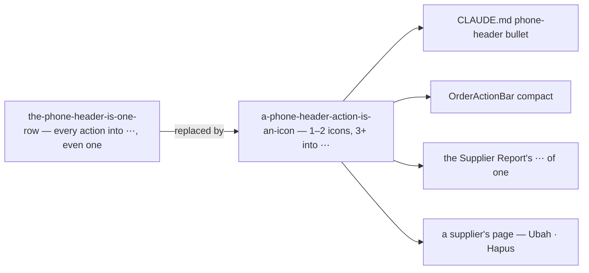

## a-one-type-picker-shows-the-name-alone

> Owner, in chat (2026-10-15): *"select gudang tidak perlu badge di select activenya"*
> ([the-warehouse-filter-shows-its-name-alone](suppliers_decision.md#the-warehouse-filter-shows-its-name-alone)); then, asked
> whether Discover's team filter should follow, *"oke"* — and *"terapkan ke halaman yang sudah pernah kuedit"*.

```
offers every type                 offers one type
[Toko Melati [Penjual]  × ⌄]      [Gudang Pusat  × ⌄]      the badge only repeats what the field is for
```

| | |
| --- | --- |
| the rule | a `TeamSelect` **filter** given a `teamType` shows its pick as the name alone — `showType={false}` |
| unchanged | a picker over every type keeps `name [Type]`; the options keep their `TeamItem` rows |
| applied to | the supplier list's and Discover's warehouse filter, Discover's team filter, the seller's orders' warehouse filter |
| not decided | a **form's** one-type picker — Buat Pesanan's warehouse — still shows the badge; asked, not changed |

## a-filter-answers-as-it-changes

> Owner, in chat (2026-10-15): *"ada saran untuk animasi di filter?"* — the three proposed, then *"oke lakukan"*.

```
first filter set               the phone's sheet, a pick           a chip picked
[⌕ sumber ×]  Hapus filter     [⚲ Filter (2)] → [⚲ Filter (3)]     (Semua) (Shopee)
          ↑ fades in, 120ms                  ↑ pops: 0.6 → 1.15 → 1      ↑ its colour turns in 120ms
```

| | |
| --- | --- |
| an × appears | a select's, a combobox's, the search's, a range trigger's — **fade in**, `animationStyle="appear"` (120ms). The select and combobox × are set once in the theme |
| Hapus Filter appears | fades in, in the row and in the phone's sheet |
| the phone's Filter count | **pops** when the number changes — `animationStyle="pop"`, keyed on the count — so a pick inside the sheet is felt on the button under it |
| a chip's pick | its colour turns in the hover beat (120ms), not Chakra's 200ms |
| ✗ the results | do **not** fade when a filter changes: the search refilters each time typing settles, so the list would blink all day — `RefreshOverlay` already says it is refreshing ([motion-is-small-quick-and-shared](#motion-is-small-quick-and-shared)) |
| ✗ panels and sheets | unchanged — Chakra's own scale-fade and slide |
| where | `FilterBar`, `FilterSearch`, `FilterChips`, `SupplierRangeFilter`, the theme's select and combobox — so every list that uses them |

## motion-is-small-quick-and-shared

> Owner, in chat (2026-10-15): *"dan animasi juga atau transisi, sekarang terlihat flat, ada ide?"* — then *"misal di
> supplier dulu ini, apa saja yang bisa dilakukan?"*, *"aku pakai saranmu saja tadi"*, and on *"pure CSS"*: *"oke baik"*.

```
first load            arrives                 a tab picked              a refresh
▆▆▆▆▆▆▆   ▆▆  ▆▆      ░ page  ↑ 8px, 180ms    Toko  Produk  Statistik    nothing moves —
▆▆▆▆▆     ▆▆  ▆▆  →   ▒ fades in              ───── ═════→              the rows stay mounted
▆▆▆▆▆▆▆▆  ▆▆  ▆▆      █                       content fades in place     under RefreshOverlay
```

| | |
| --- | --- |
| how | pure CSS through Chakra — keyframes, `animationStyle`, transitions. No animation library |
| the two beats | `durations.hover` **120ms** (a hover, a press) · `durations.enter` **180ms** (something arriving) — in `theme.ts` and nowhere else. Two smaller styles came later for the filters, `appear` and `pop` ([a-filter-answers-as-it-changes](#a-filter-answers-as-it-changes)) |
| `enter` | a PAGE arriving: a fade and an 8px rise — `animationStyle="enter"` on the page's root |
| `swap` | one thing REPLACED in the same place: a fade alone, so the spot does not hop — a tab's content, Discover's cards ⇄ table, the warehouse summary under a picked chip, the report's rows in a new order. Keyed on what the person changed; the report's on the order the rows ON SCREEN are in, so it plays when they land, not on the click |
| a tab's content | `swap`, not `enter` — on first paint the page is already rising, and a rise inside a rise reads as 16px |
| first load | `ListSkeleton` (`components/feedback/`) — bars in the shape of the rows, `heading` for a detail page whose record has not arrived — then the rows fade in. Never a spinner on an empty page |
| tabs | ONE underline that slides: a `<Tabs.Indicator />` last in a `line` tab list. The picked tab then draws no underline of its own. A row without one is drawn as before |
| a table row | its light (a-table-row-lights-up) turns in the hover beat — set once on the table's cell in `theme.ts`, so **every** table has it |
| a block that opens | `PRESSABLE` (`lib/motion.ts`): lights up, and gives a little under a thumb. A card in a grid: `LIFTS` — rises 2px with a shadow, settles under the press |
| an empty hint | fades in where the rows were (an-empty-list-shows-a-hint) |
| dialogs, popovers, sheets | Chakra's own scale-fade and slide — unchanged |
| ⚠ never on a refresh | every read refetches (HARD RULE 10); an animation plays when an element MOUNTS, and a refetch keeps it mounted |
| reduced motion | a device that asks gets no animation and instant transitions; the story tests run that way, since a computed style mid-transition is neither value. Motion is reviewed by eye in Storybook |
| applied to | the supplier list, Discover, the supplier page and Discover's supplier page with their Toko · Produk · Statistik tabs, the Supplier Report. The row light and the tab transition are theme-wide |
| then (owner: *"terapkan ke halaman yang sudah pernah kuedit"*) | the accounts list (its type tabs and phone blocks), an account's page, the account report (Periode · Rincian); Kewajiban's list and a pair's page (its six tabs, the terms panel); the seller's and the warehouse's orders (the stage tabs), Buat Pesanan, an order's page (its vertical tabs, the settlement tab); the drafts and a draft; the settlement list (its preview's tabs) and the settlement report (Per Toko ⇄ Per Pengguna fades when the regrouped rows land) |
| a tab that FILTERS | the order lists' stage tabs and the accounts' type tabs slide their underline, but the rows under them do **not** fade — a tab there narrows the list, and a filter's results never fade ([a-filter-answers-as-it-changes](#a-filter-answers-as-it-changes)). A tab that switches VIEW (Periode · Rincian, an order's Info · Timeline) fades its panel |
| a vertical tab row | the line slides down the list's end rule (an order's page, the settlement preview) |
| ⚠ a closing panel never animates | a fading tab panel is a Zag presence node, and presence keeps a closing node on screen until its animation ends — for the panel open on arrival it had seen no animation start, so the first time that tab was left the old panel stayed under the new one (owner, on the account report: *"tabel tidak hilang di awal-awal, baru hilang saat kedua kali"*). The tabs recipe sets `animation-name: none !important` on a closed panel, so it goes at once. `SwitchingViewLeavesOnlyTheNewOne` holds it; it was reproduced, and the fix proved, with motion on |
| not yet | every other screen takes `enter`, the skeleton and the sliding underline the day it is next reworked |

## the-quick-ranges-are-days-then-months-then-years

> Owner, in chat (2026-10-15): *"untuk presets range tanggal di atas 14 hari ada 1,2,3,6 bulan, 1,2,3 tahun"* — then, seeing
> it, *"2 bulan, 2 3 tahun hilang"* and *"default 1 bulan"*.

```
before                 now
Hari ini               Hari ini
7 hari terakhir        7 hari terakhir
14 hari terakhir       14 hari terakhir
30 hari terakhir   →   1 bulan terakhir · 3 bulan terakhir · 6 bulan terakhir
90 hari terakhir   →   1 tahun terakhir
```

| | |
| --- | --- |
| the list | Today, 7 days, 14 days, then **1, 3, 6 months**, then **1 year**. 30 and 90 days are gone — a month and three months stand for them. 2 months, 2 and 3 years were proposed and taken out again |
| the default | every dated screen opens on the **last month** (`LAST_MONTH`) — the account report, the settlement report, the Supplier Report, a supplier's Statistik, the daily statement. It was 30 days. The restock list keeps its 7 days |
| ⚠ stories | a month back is 28 to 31 days, so a story fixture never sits 28–30 days back — at 30 it would be inside the window in November and outside it in October. Inside every window: 27 days or less; outside every window: 32 or more |
| counted on the calendar | a month back is the same date a month back: on 15 Oct, *1 bulan terakhir* is 16 Sep – 15 Oct (inclusive of today, as *7 hari* is seven days). The 31st clamps to a shorter month's end — 31 Mar − 1 month starts on 1 Mar |
| a year | twelve months — so it is a calendar year back, leap day or not |
| still live | stored as the count (`{ months: 3 }`), never as dates, like the day presets: opened tomorrow it is still the last three months |
| the label | *N bulan terakhir* / *N tahun terakhir*; a twelve-month window reads as years |

## a-lists-filters-live-in-the-url

> Owner, in chat (2026-10-15): *"untuk halaman tabel dan list pakai filter, filternya disimpan ke querystring biar tidak hilang
> saat refresh"*.

```
/inventories/suppliers?q=sumber&type=1&range=3m
                       └ search ┘ └ Shopee ┘ └ last 3 months ┘
refresh → the same list · Back from a supplier → the same list · a pasted link → the same list
```

| | |
| --- | --- |
| in the URL | every filter, the sort, and a tab or segment that **narrows** the same list (a stage tab, a type tab, Per Toko ⇄ Per Pengguna) |
| not in the URL | the page number, the page size, a dialog, a selection, and a tab that switches to a **different view** (Periode · Rincian, a supplier page's Toko · Produk · Statistik) |
| a default | is left out — an untouched list has a bare URL, and a link without a key means the default |
| a date range | stays relative: `range=7d`, `range=3m`; an absolute one is `2026-10-01..2026-10-15`, all dates `all` |
| writing | `replace`, so Back leaves the list instead of stepping back through every letter typed; the writes of one click are one navigation (Clear Filters resets five at once) |
| reading | once, when the page opens; after that the state is the screen's own, mirrored to the URL — a search box driven by the URL would lag a keystroke behind |
| a hand-edited URL | a key it cannot read (an unknown marketplace, a bad date) falls back to the default |
| siblings on one page | prefix their keys — the supplier page's Toko tab `store.q`, Produk `product.q`, Statistik `stat.range` — so one tab never reads another's search |
| the hook | `useUrlState(key, default, codec)` in `lib/urlState.ts`, a drop-in for `useState`, with codecs for text, ids, enums, switches, sorts, lists and date ranges |
| tested | each list's `FiltersLiveInTheUrl` story opens it at a filtered URL and watches a change written back |
| ⚠ its own writes are not followed | a write returns as a REPLACE navigation, and the router can commit it a keystroke late; following it set the search box back and dropped letters (seen only when the story run was under load). The hook follows a URL changed from outside — Back, a link — and never its own echo |
| applied to | the suppliers, Discover, a supplier page's Toko · Produk · Statistik, the Supplier Report; the accounts list (its type tab and sort, beside `view=archived`), an account's statement, the account report; the seller's and the warehouse's orders (the stage tab was already `status`), the settlement list and report, the settlement imports, the daily statement; Kewajiban's list and a pair's date range; batches and a batch, stock, products, Discover products, racks, shops, shipment channels, the pick queue (its step tab), returns; restock and transfers (both sides), users, teams (the type tab), expenses |
| nothing to keep | the drafts and the balance sheet hold no filter of their own |

## a-counted-line-is-three-columns

> Owner, in chat (2026-10-14), previewing the stock count prototype: *"why count page so weird ? any recomendation ? like
> restock layout when accepting ?"* — then, to the sketch: *"yes like that"*.

```
sticky:  ←  Count #15 · A-01-1  [All racks]            1 of 3 counted  [Change Rack] [Add Found]
┌──────────────────────┬────────────────────────────┬────────────────────────────┐
│ [img] product name   │ ☑ Your Count    ↺ Recount  │ ⚖ The Difference        −2 │
│ SKU · team           │ Counted *  [− _ +] [Submit]│ Of the missing, broken [ ] │
│ ● state              │ Counted                 2  │ Lost 2 *  [why… e.g. …   ] │
│                      │ Expected      ⊘ hidden     │           [✓ Mark Counted] │
│                      │ Difference              —  │                            │
└──────────────────────┴────────────────────────────┴────────────────────────────┘
        below lg the three columns stack inside the card; on a phone the header's actions fold into ⋯
```

| | |
| --- | --- |
| the line | **three columns** — *what it is* (picture, name, SKU, team, state), *what you type* (the count, then the figures it gives), *what it means* (the difference and its reasons, on a grey ground). `minmax(0,3fr) 4fr 4fr` |
| the frame | **fixed** — a figure not known yet reads **—** (or *hidden*, for a book figure before a blind count), never a different card per state. A rack or a box is scanned down one column |
| the picture | always — someone at a shelf or a box recognises the picture before the SKU (`ProductListItem`) |
| the header | sticky: back, the title, where you are, the progress, the actions; one row with `⋯` on a phone ([the-phone-header-is-one-row](#the-phone-header-is-one-row)) |
| stacks | below `lg` on the Count page (its columns are light); Accept Delivery keeps `xl` — a placement picker needs the room |
| not a card in a card | the two typed columns are bordered boxes inside the line's card, as Accept Delivery's are — the one pattern the owner pointed at |
| was | the Count page stacked every field on the left, each card a different shape by state — *"so weird"* |

## Recorded elsewhere

The owner's earlier rules for every screen were written into [CLAUDE.md](../../../CLAUDE.md) as it grew, and are
not restated here: Title Case for titles and actions; a detail view is a page, not a dialog; destructive actions
confirm; three or more row actions fold into an overflow menu; a growing set is a search select; a date is
`DatePicker` and a quantity `QuantityInput`; never a card inside a card; a screen built ahead of its backend marks
its gaps, and only Storybook can hide the marks.
