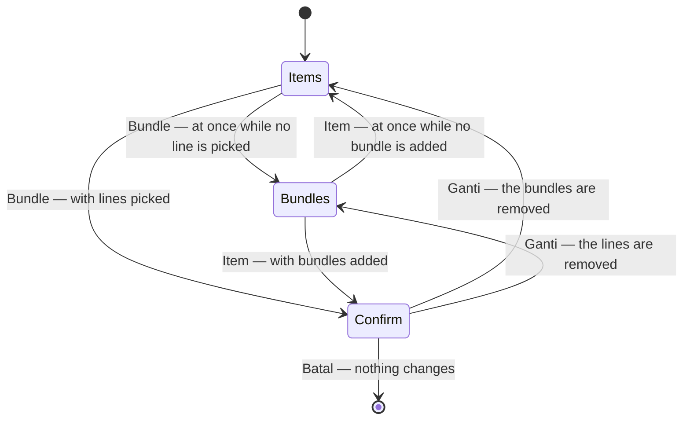

# Decisions — the order create screen

The owner's decisions about **creating an order** (`/orders/new`). **Append-only** (RULE 12): a reversed decision is renamed and its references grepped.

The rules every screen follows are in [context_decision.md](context_decision.md). These were recorded in
[technical/order/design_decision.md](../order/design_decision.md) first and moved here on 2026-10-02;
each old heading there now points here.

| decision | what it settles |
| --- | --- |
| [the-ongkir-is-the-warehouses-to-set](#the-ongkir-is-the-warehouses-to-set) | shipping is priced by the building that ships it, so it is absent from the create screen |
| [the-draft-opens-in-the-order-form](order_draft_decision.md#the-draft-opens-in-the-order-form) | `/orders/new?draft=ID` is a draft's page — this form seeded from it, its lines a text list above the products, Create deleting it |
| [bundles-are-added-like-items](#bundles-are-added-like-items) | bundles are added as items are — **Tambah Bundel** under the card's title opens a picker dialog of ticked rows — not a search box in the card's header |
| [an-order-holds-items-or-bundles](#an-order-holds-items-or-bundles) | an order is filled from its own items OR from bundles, never both — one radio pill picks the card, and leaving a card that holds something asks first |

## the-ongkir-is-the-warehouses-to-set

> Owner, same message: *"ongkir harusnya yang set adalah gudang, jadi di tampilan create tidak ada"*.

Shipping is priced by the building that ships it. Two consequences, both already visible:

1. **The order-create screen has no shipping field.** Its `shippingCost` pending entry was reasoned
   as *"nothing prices a shipment yet"*; the real reason is stronger — **it is not the seller's to
   price**, so the field would not belong there even once a courier catalogue exists.
2. **"Jadikan Dikirim" is the warehouse's action.** `OrderShip` takes the WAREHOUSE's team id and the
   handler finds the order by `(order_id, warehouse_id)`, so a seller pressing it calls on a team it
   is not a member of. Handing the parcel over and pricing its shipment are one side of the job.

## an-order-holds-items-or-bundles

> Owner, in chat (2026-10-22): *"order create items dan bundle cuma boleh pilih salah satu"*.



```
Isi pesanan
( ◉ Item )  ( ○ Bundle )
┌ Item ─────────────────────────────┐      only the chosen card shows
│ [📦 Tambah Baris]                  │
└───────────────────────────────────┘
```

| | |
| --- | --- |
| the choice | **Isi pesanan** — `RadioPills` *Item* · *Bundle* ([a-dialog-choice-is-a-radio-pill](financial_accounts_decision.md#a-dialog-choice-is-a-radio-pill)), right above the card; **Item** first — a draft seeds items, and most orders are typed line by line |
| the card | only the chosen one renders — the items card or the bundles card, never both |
| switching | from an empty card, at once; from a card that holds lines or bundles, a `ConfirmDialog` (*Ganti ke Bundle?* / *Ganti ke Item?*) naming how many will be removed; **Ganti** empties the card left behind, Batal keeps everything |
| what is sent | unchanged — a bundle's products were already the order's lines; now the lines come from one source only |
| was | the items card and the bundles card one under the other, an order filled from both |

- The story `AnOrderHoldsItemsOrBundles` pins it — the default, the immediate switch, the confirm, Cancel keeping the
  bundle, and the confirm emptying it; `ABundlesProductsAreOrderedLikeAnyOther` picks Bundle first.

## bundles-are-added-like-items

> Owner, in chat (2026-10-23): *"tambah bundle buat seperti item"*.

```
before                                            now
Bundel ⚠1                   [⌕ Cari bundel ▾]     Bundel ⚠1
Bundel menaruh produknya …                        Bundel menaruh produknya …
                                                  [📦 Tambah Bundel]  ─▶  ┌ Pilih Bundel ─────────────── × ┐
                                                                          │ [⌕ Cari bundel             ]   │
                                                                          │ ☐ Hampers Lebaran              │
                                                                          │   3 slot · Coffee, Tea, Sugar  │
                                                                          │ ☐ Paket Dapur                  │
                                                                          │   2 slot · Rice, Sugar         │
                                                                          │ Kosongkan      Batal Konfirmasi │
                                                                          └────────────────────────────────┘
```

| | |
| --- | --- |
| the card | the items card's shape — the title one step larger, its line, and on the right (under it, when narrow) **Tambah Bundel**; *Pilih gudang dulu* beside the button while it is disabled |
| the dialog | **Pilih Bundel** — a search that reads names AND slot labels, the bundles as ticked rows (name, slot count and labels), the list the only scroller, its bar on the dialog's edge; *Kosongkan* on the left, *Batal* · *Konfirmasi* on the right, Konfirmasi waiting for a tick |
| the ticks | which bundles to add NOW — a bundle can sit on one order twice, so a tick never mirrors a row below, and every open starts with none |
| the component | `features/orders/form/BundlePicker.tsx`; the card's old search box (`BundleSearch`) is gone |
| spelling | the pill and the switch's dialog now read **Bundel**, as the card always has ([an-order-holds-items-or-bundles](#an-order-holds-items-or-bundles) first wrote *Bundle*) |
| was | a combobox in the card's header — one bundle per pick, and while it waited it looked like a filter |

- The story `BundlesAreAddedLikeItems` pins it — the button, Konfirmasi waiting, the slot-label search, two at once; the
  bundle stories add through the dialog.
