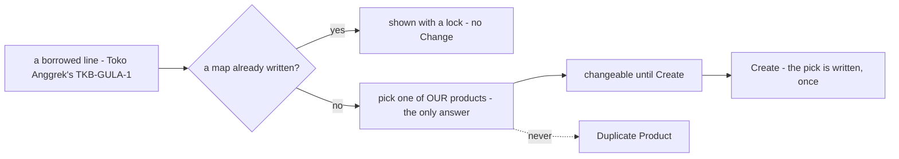
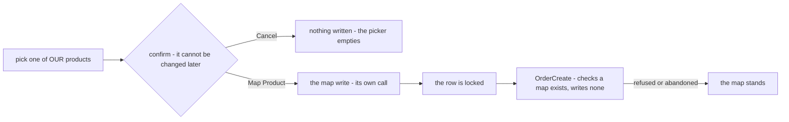
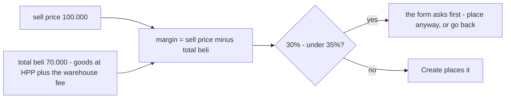
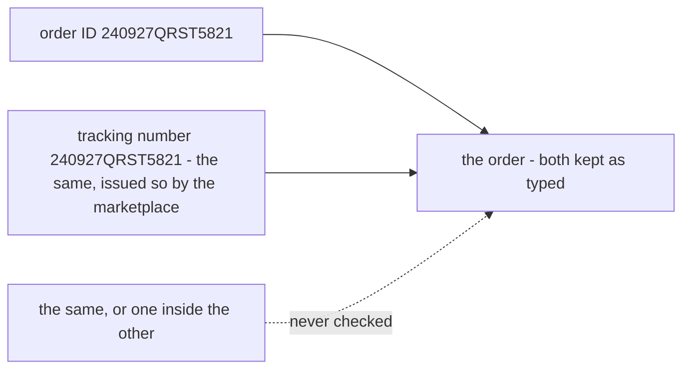
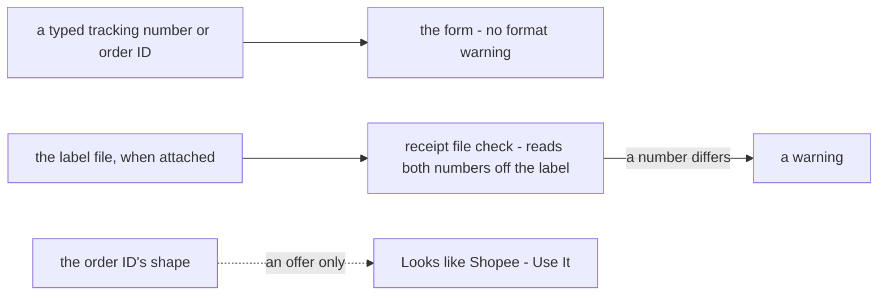
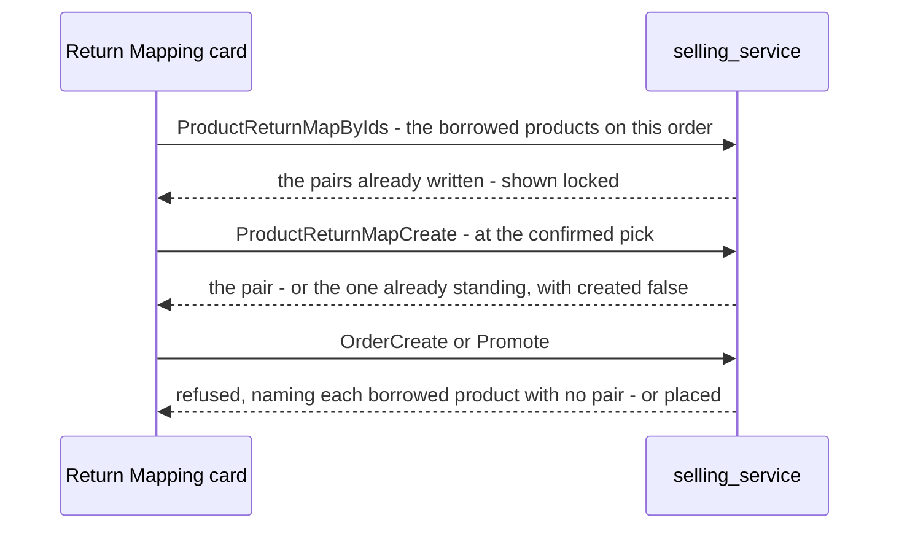
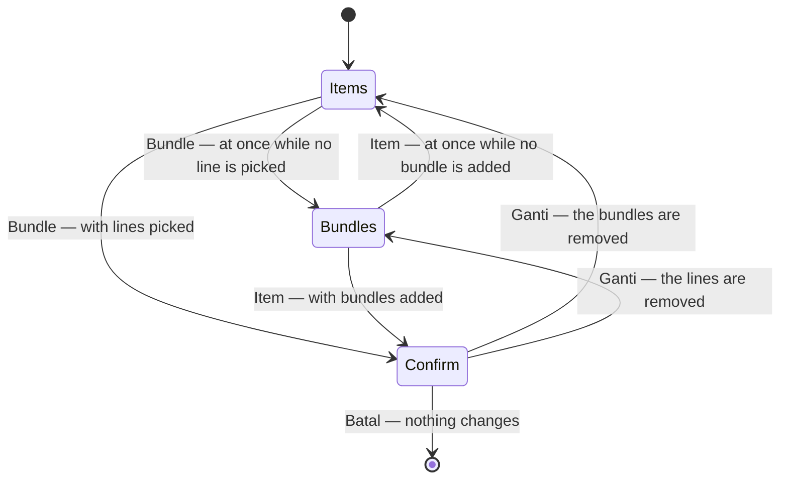

# Decisions — the order create screen

The owner's decisions about **creating an order** (`/orders/new`). **Append-only** (RULE 12): a reversed decision is renamed and its references grepped.

The rules every screen follows are in [context_decision.md](context_decision.md). These were recorded in
[technical/order/design_decision.md](../order/design_decision.md) first and moved here on 2026-10-02;
each old heading there now points here.

| decision | what it settles |
| --- | --- |
| [the-ongkir-is-the-warehouses-to-set](#the-ongkir-is-the-warehouses-to-set) | shipping is priced by the building that ships it, so it is absent from the create screen |
| [a-borrowed-product-is-mapped-on-the-order-form](#a-borrowed-product-is-mapped-on-the-order-form) | the Return Mapping card is where a borrowed product is mapped — to one of our own, and a written pair is locked |
| [the-map-is-written-when-it-is-picked](#the-map-is-written-when-it-is-picked) | the map is its own write, at the confirmed pick — separate from `OrderCreate`, and it stands if the order does not |
| [the-margin-floor-is-35-percent-for-every-team](#the-margin-floor-is-35-percent-for-every-team) | under 35% margin the form asks before placing — one fixed number for every team, a warning |
| [the-order-id-may-be-the-tracking-number](#the-order-id-may-be-the-tracking-number) | the order ID and the tracking number are never compared — equal is allowed |
| [the-form-does-not-check-number-formats](#the-form-does-not-check-number-formats) | no courier or marketplace format warning; the attached label is the check |
| [the-return-map-is-selling-services-and-read-by-ids](#the-return-map-is-selling-services-and-read-by-ids) | `product_return_maps` in selling; a write at the pick, a read by ids, and both doors refuse an unmapped borrowed line |
| [the-draft-opens-in-the-order-form](order_draft_decision.md#the-draft-opens-in-the-order-form) | `/orders/new?draft=ID` is a draft's page — this form seeded from it, its lines a text list above the products, Create deleting it |
| [bundles-are-added-like-items](#bundles-are-added-like-items) | bundles are added as items are — **Tambah Bundel** under the card's title opens a picker dialog of ticked rows — not a search box in the card's header |
| [an-order-holds-items-or-bundles](#an-order-holds-items-or-bundles) | an order is filled from its own items OR from bundles, never both — one radio pill picks the card, and leaving a card that holds something asks first |

## the-ongkir-is-the-warehouses-to-set

> Owner, same message: *"ongkir harusnya yang set adalah gudang, jadi di tampilan create tidak ada"*.

Shipping is priced by the building that ships it. Two consequences, both already visible:

1. **The order-create screen has no shipping field.** Its `shippingCost` pending entry was reasoned
   as *"nothing prices a shipment yet"*; the real reason is stronger — **it is not the seller's to
   price**, so the field would not belong there even once a courier catalogue exists.
2. **"Jadikan Dikirim" is the warehouse's action.** `OrderShip` takes the WAREHOUSE's team id and the
   handler finds the order by `(order_id, warehouse_id)`, so a seller pressing it calls on a team it
   is not a member of. Handing the parcel over and pricing its shipment are one side of the job.

## a-borrowed-product-is-mapped-on-the-order-form

🔄 *(2026-10-22, later)* Two rows of the spec below are superseded by
[the-map-is-written-when-it-is-picked](#the-map-is-written-when-it-is-picked): a pick is written the moment it is
confirmed, so it is **not** changeable until the order is placed, and *where the write happens* is decided.

> Owner, in chat (2026-10-22): **"yes"** — to *"Is this order-form card where a borrowed product gets mapped? I'd say yes —
> … The card would then only let you pick one of your own products: no Duplicate button, and a remembered pair shown
> locked rather than changeable."* As recommended. Answers *where it is mapped*, left open by
> [a-borrowed-line-needs-its-map-at-create](../../business/order/context_decision.md#a-borrowed-line-needs-its-map-at-create).

**The verdict.** The **Return Mapping card** on the order form is where a borrowed product gets its return map. The person
already has the product on screen at the moment the create would be refused, so the map is made there — not on a separate
screen, and not as an action on the refusal.



**The spec.**

| | |
| --- | --- |
| where | the Return Mapping card — on `/orders/new`, and on the draft page that wears the same form ([the-draft-page-wears-the-order-form](order_draft_decision.md#the-draft-page-wears-the-order-form)) |
| the answer | one of the ordering team's **own** products; the picker searches only this team's catalogue |
| no Duplicate Product | nothing is cloned ([a-return-never-clones-a-product](../../business/order/context_decision.md#a-return-never-clones-a-product)) |
| a pair already written | pre-filled, with a lock, and **no Change** ([a-return-map-is-written-once](../../business/order/context_decision.md#a-return-map-is-written-once)) |
| a pick made on this order | changeable until the order is placed, and written when it is |
| a row left unanswered | blocks Create (Promote, on the draft page) — on the row, in the card's count, and under the disabled button |
| ⚠ not decided | where the write happens — inside `OrderCreate`, or its own call before it. The `returnMap` mark stays until it is |

**What changed in the build.** The card had been built against two decisions: a **Duplicate Product** button that copied
the other team's product, and a **Change** on a remembered pair. Both are gone, and the mock link (`mockData.ts`) no
longer forgets a pair or overwrites one. Pinned by `Features/Orders/ReturnMappingCard`.

⚠ *(corrected the same day)* The *unanswered row blocks Create* row above was **not** true when it was written: the form
only warned, with *"it is not saved with the order yet"*. Create and Promote are now held while a borrowed product is
unmapped, and the line under the button says so.

## the-map-is-written-when-it-is-picked

> Owner, in chat (2026-10-22): *"separate from order create, when still in form, mapped on that time its okay"* — to
> *"When is the map actually saved? I'd do it inside `OrderCreate` … The alternative is a separate call before Create,
> which would save a permanent pair even when that order then fails or is abandoned."* **Against the recommendation.**

**The verdict.** The return map is written by **its own call, separate from `OrderCreate`**, at the moment the person maps
the product on the form. A pair written for an order that is then refused or abandoned **stands** — accepted, since it is
the answer the next order with that product needs anyway.



**The spec.**

| | |
| --- | --- |
| the write | its own call, never part of `OrderCreate` — ⚠ its RPC is not designed yet |
| when | the moment the pick is confirmed, while the form is still open |
| it asks first | a `ConfirmDialog` — *"Map for Returns"* / **Map Product**. Not the owner's words: CLAUDE.md's rule that anything not trivially reversible confirms, applied because a map cannot be re-pointed ([a-return-map-is-written-once](../../business/order/context_decision.md#a-return-map-is-written-once)). Not red — nothing is lost, it is only final |
| after it | **every** mapped row is locked, not only a remembered one — the Change button is gone |
| `OrderCreate` | only checks a map exists for each borrowed line ([a-borrowed-line-needs-its-map-at-create](../../business/order/context_decision.md#a-borrowed-line-needs-its-map-at-create)) |
| an order refused or abandoned | the map stands |
| the draft page | the same card and the same write. A product mapped earlier arrives locked there too |
| two people, one product, the same second | the unique source ([the-map-is-unique-on-its-source](../../business/order/context_decision.md#the-map-is-unique-on-its-source)) refuses the second write — ⚠ the card should then show the pair that stands. A consequence, not separately decided |

**What changed in the build.** The card writes the pair (to the mock link in `mockData.ts`) when the confirm is pressed,
and the page only shows it. The order-create page no longer writes anything on place.

## the-margin-floor-is-35-percent-for-every-team

> Owner, in chat (2026-10-23): *"its fixed for every team"* — to *"is the 35% minimum margin one fixed number for every
> team, or a per-team setting? I'd make it a per-team setting that starts at 35%, kept as a warning."* **Against the
> recommendation** on the setting. The warning part was not contested and is unchanged.

**The verdict.** An order whose estimated margin is under **35% of the sell price** is questioned before it is placed —
one number, the same for every team, set in code. It **warns**: the person may place it anyway.



**The spec.**

| | |
| --- | --- |
| the floor | 35%, one constant (`MINIMUM_MARGIN_PCT` in `features/orders/form/checks.ts`) — the margin panel reads the same one |
| the base | the sell price — a margin, not a markup ([the-margin-is-mp-minus-total-beli](order_list_decision.md#the-margin-is-mp-minus-total-beli)) |
| below it | a warning in the checks dialog; the person may place the order anyway |
| no sell price | not a thin order — Create already refuses it ([platform-total-is-required-at-finalize](../../business/order/context_decision.md#platform-total-is-required-at-finalize)) |
| per team | no — changing it is a code change |
| ✅ built *(2026-10-23)* | it already behaved this way. The duplicated constant is now one, and the `profit` mark is gone — the formula, the sell price and the floor are all settled |

## the-order-id-may-be-the-tracking-number

> Owner, in chat (2026-10-23): *"make it free, same is allowed, because some platform marketplace make order id as
> tracking number too"* — to *"should the server refuse an order whose order ID and tracking number are the same, and
> should 'one contains the other' refuse or warn?"* Neither: the comparison goes.

**The verdict.** The marketplace's order ID and the courier's tracking number are **not compared at all**. They may be
equal, and one may contain the other. Some marketplaces issue the order ID as the tracking number, so a rule against it
refused real orders.



**The spec.**

| | |
| --- | --- |
| the form | no check — not an error, not a warning |
| the server | no check, on either door |
| a short pickup code inside a long order ID | fine — that was the other real order the old rule refused |
| ✅ built *(2026-10-23)* | `checkRefsAreDistinct` and its two messages removed; the `refsDistinct` mark is gone. No check on the form is an error now — all of them warn |

## the-form-does-not-check-number-formats

> Owner, in chat (2026-10-23): **"c its okay"** — to *"the courier and marketplace format rules: A, one table in the
> form, J&T fixed; B, one table in the label reader; or C, drop the format checks?"* **Against the recommendation** (A).

**The verdict.** The order form does not check whether a tracking number looks like its courier's, or an order ID like
its marketplace's. The table was written from numbers we had seen and was already wrong (real J&T labels read `JY…` and
`JX…`, the rule said `JP…`). When the label file is attached, the receipt file check reads both numbers off it, which is
a better test than a pattern.



**The spec.**

| | |
| --- | --- |
| courier format | not checked |
| marketplace format | not checked |
| what is given up | the catch for a wrong courier picked while no label is attached |
| kept | the **Looks like … · Use It** offer under the marketplace, from a 3-row table of order-ID shapes. It never warns and only fills the field when the person presses it |
| the label reader | unaffected — it reads labels, it never judged a typed number |
| ✅ built *(2026-10-23)* | the courier table, both format checks, their inline warnings and messages are removed, and the `formatRules` mark is gone |

## the-return-map-is-selling-services-and-read-by-ids

> Owner, in chat (2026-10-23): *"okay, continue"* — to *"do you accept this contract?"* for the return map's server side.
> `design_accept` for it; the backend pass may start. Designs what
> [the-map-is-written-when-it-is-picked](#the-map-is-written-when-it-is-picked) left as *"its RPC is not designed yet"*.

**The verdict.** The return map lives in **selling_service**, beside `team_return_configurations`, as the owner's
[order_return.md](../../business/order/order_return.md) §Table Must Have item 2 draws it. One call writes a pair at the
confirmed pick, one reads pairs by the borrowed products' ids, and both doors of order creation refuse a borrowed line
with no pair.



**The contract — ✅ accepted.**

| | |
| --- | --- |
| the table | `product_return_maps` — `id`, `team_id`, `shared_product_id`, `own_product_id`, `created_at`, `updated_at`; unique `(team_id, shared_product_id)`. Nothing updates a row, so `updated_at` mirrors `created_at` ([a-return-map-is-written-once](../../business/order/context_decision.md#a-return-map-is-written-once)) |
| `ProductReturnMapCreate` | the team (scope), the borrowed product, our product. Refused when the "borrowed" product is the team's own, or "our" product is another team's. When the pair already exists it is not overwritten: the standing pair comes back with `created = false`, so the card shows it locked |
| `ProductReturnMapByIds` | `ByIds` shape: the team (scope), 1–100 borrowed product ids → each one's `own_product_id`. Not paged — bounded by the ids |
| order creation | `OrderCreate` and Promote refuse a borrowed line with no pair, naming each such product ([a-borrowed-line-needs-its-map-at-create](../../business/order/context_decision.md#a-borrowed-line-needs-its-map-at-create)) |
| policy | Root, Administrator, Selling Owner, Selling Admin, Selling CS — the roles that create orders |
| names | not stored with the pair — the screen names our product from the product read it already makes |
| ✅ built *(2026-10-23)* | selling `00024` `product_return_maps`; `ProductReturnMapCreate` and `ProductReturnMapByIds` on `TeamReturnConfigurationService` ([rpc.md](../../services/selling_service/rpc.md#a-borrowed-products-return-map--productreturnmapcreate-and-productreturnmapbyids)); `placeOrder` refuses an unmapped borrowed line on both doors, naming each by SKU — and refuses when the owners cannot be looked up ([a-failed-owner-lookup-refuses-the-create](../../business/order/context_decision.md#a-failed-owner-lookup-refuses-the-create)). The card writes through the RPC and shows a pair that already stood with *"Someone mapped it first"*; both pages pre-fill from the read; `mockData.ts` and the `returnMap` mark are gone |

---

## an-order-holds-items-or-bundles

> Owner, in chat (2026-10-22): *"order create items dan bundle cuma boleh pilih salah satu"*.



```
Isi pesanan
( ◉ Item )  ( ○ Bundle )
┌ Item ─────────────────────────────┐      only the chosen card shows
│ [📦 Tambah Baris]                  │
└───────────────────────────────────┘
```

| | |
| --- | --- |
| the choice | **Isi pesanan** — `RadioPills` *Item* · *Bundle* ([a-dialog-choice-is-a-radio-pill](financial_accounts_decision.md#a-dialog-choice-is-a-radio-pill)), right above the card; **Item** first — a draft seeds items, and most orders are typed line by line |
| the card | only the chosen one renders — the items card or the bundles card, never both |
| switching | from an empty card, at once; from a card that holds lines or bundles, a `ConfirmDialog` (*Ganti ke Bundle?* / *Ganti ke Item?*) naming how many will be removed; **Ganti** empties the card left behind, Batal keeps everything |
| what is sent | unchanged — a bundle's products were already the order's lines; now the lines come from one source only |
| was | the items card and the bundles card one under the other, an order filled from both |

- The story `AnOrderHoldsItemsOrBundles` pins it — the default, the immediate switch, the confirm, Cancel keeping the
  bundle, and the confirm emptying it; `ABundlesProductsAreOrderedLikeAnyOther` picks Bundle first.

## bundles-are-added-like-items

> Owner, in chat (2026-10-23): *"tambah bundle buat seperti item"*.

```
before                                            now
Bundel ⚠1                   [⌕ Cari bundel ▾]     Bundel ⚠1
Bundel menaruh produknya …                        Bundel menaruh produknya …
                                                  [📦 Tambah Bundel]  ─▶  ┌ Pilih Bundel ─────────────── × ┐
                                                                          │ [⌕ Cari bundel             ]   │
                                                                          │ ☐ Hampers Lebaran              │
                                                                          │   3 slot · Coffee, Tea, Sugar  │
                                                                          │ ☐ Paket Dapur                  │
                                                                          │   2 slot · Rice, Sugar         │
                                                                          │ Kosongkan      Batal Konfirmasi │
                                                                          └────────────────────────────────┘
```

| | |
| --- | --- |
| the card | the items card's shape — the title one step larger, its line, and on the right (under it, when narrow) **Tambah Bundel**; *Pilih gudang dulu* beside the button while it is disabled |
| the dialog | **Pilih Bundel** — a search that reads names AND slot labels, the bundles as ticked rows (name, slot count and labels), the list the only scroller, its bar on the dialog's edge; *Kosongkan* on the left, *Batal* · *Konfirmasi* on the right, Konfirmasi waiting for a tick |
| the ticks | which bundles to add NOW — a bundle can sit on one order twice, so a tick never mirrors a row below, and every open starts with none |
| the component | `features/orders/form/BundlePicker.tsx`; the card's old search box (`BundleSearch`) is gone |
| spelling | the pill and the switch's dialog now read **Bundel**, as the card always has ([an-order-holds-items-or-bundles](#an-order-holds-items-or-bundles) first wrote *Bundle*) |
| was | a combobox in the card's header — one bundle per pick, and while it waited it looked like a filter |

- The story `BundlesAreAddedLikeItems` pins it — the button, Konfirmasi waiting, the slot-label search, two at once; the
  bundle stories add through the dialog.
