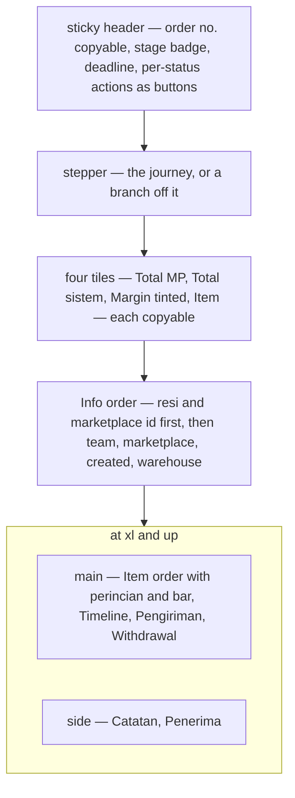
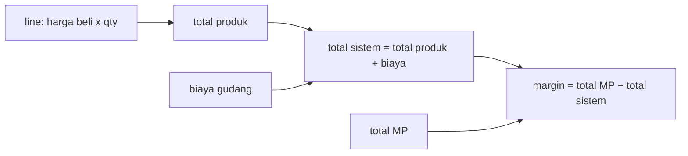
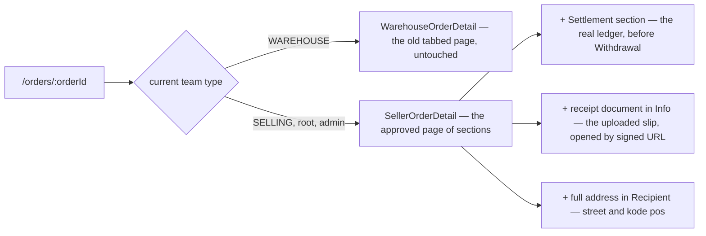
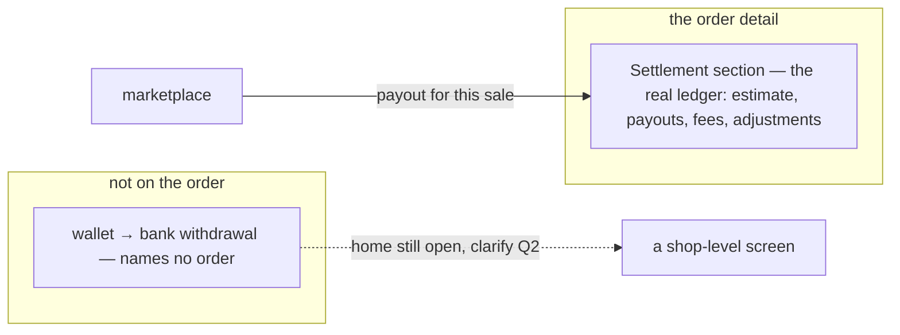
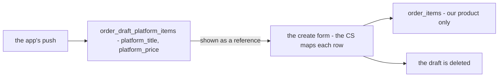
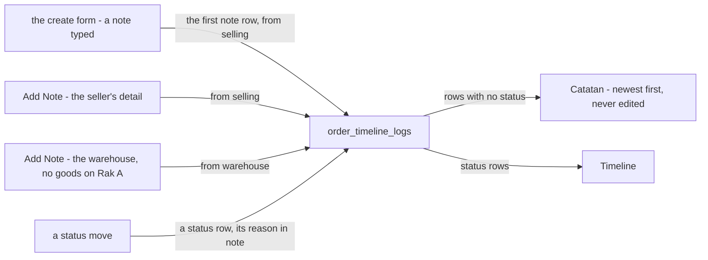
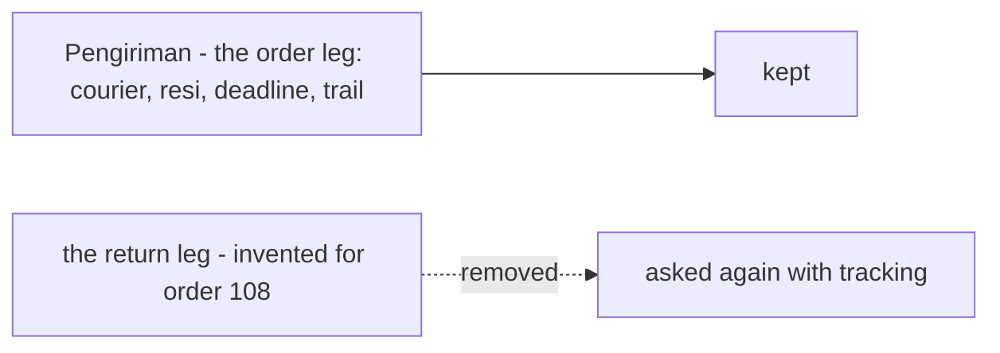
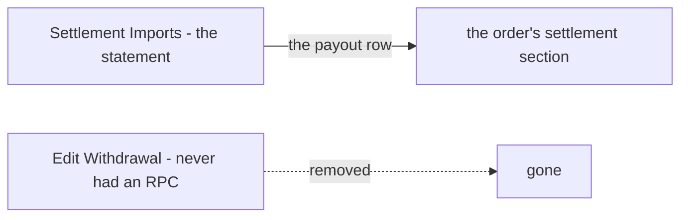
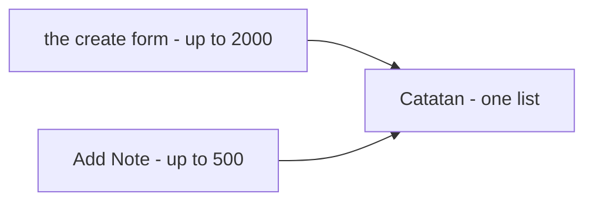

# Decisions — the order detail

The owner's decisions about the selling team's **order detail** (`/orders/:orderId`). **Append-only** (RULE 12): a reversed decision is renamed and its references grepped.

The rules every screen follows are in [context_decision.md](context_decision.md). These were recorded in
[technical/order/design_decision.md](../order/design_decision.md) first and moved here on 2026-10-02;
each old heading there now points here.

| decision | what it settles |
| --- | --- |
| [the-order-detail-is-one-page-of-sections](#the-order-detail-is-one-page-of-sections) | the detail is one page of sections with a scrolling left nav — not three tabs |
| [the-order-detail-lines-are-priced-at-harga-beli](#the-order-detail-lines-are-priced-at-harga-beli) | the item table shows what we PAID, so the perincian adds up to the list's figures |
| [the-detail-margin-is-mp-minus-system](#the-detail-margin-is-mp-minus-system) | margin = total MP − total sistem, the list's formula read from the detail |
| [the-detail-preview-became-the-order-detail](#the-detail-preview-became-the-order-detail) | a seller's `/orders/:id` IS the approved page now — and it keeps the two wired features the preview lacked |
| [settlement-replaces-withdrawal-on-the-order](#settlement-replaces-withdrawal-on-the-order) | the order's money-back section IS the settlement ledger; withdrawals stay a shop-level question |
| [an-order-line-keeps-no-platform-title](#an-order-line-keeps-no-platform-title) | the marketplace's product title is a reference while the draft is finished, and is not kept on the order line |
| [a-note-is-a-timeline-row](#a-note-is-a-timeline-row) | an order's note is an `order_timeline_logs` row with no status — written by either side, never edited or deleted; `orders.note` goes |
| [the-return-leg-waits-for-tracking](#the-return-leg-waits-for-tracking) | no return shipment record now; the invented return leg leaves the detail, and the return resi is asked again with tracking |
| [no-withdrawal-is-typed-on-an-order](#no-withdrawal-is-typed-on-an-order) | *Edit Withdrawal* and the `withdrawal` mark go — settlement imports the payout, a typed figure would be a second record |
| [the-two-note-limits-stay-different](#the-two-note-limits-stay-different) | the create form's note keeps 2000 characters, *Add Note* keeps 500 |

## the-order-detail-is-one-page-of-sections

> Owner, in chat (2026-09-29): *"oke detail aku setujui"* — approving the preview
> `Pages/Order/OrderDetailNextPage` after a round of changes.

The order detail is **one page of sections**, not the built page's three tabs, with a left navigation
that scrolls to each. The question it answers — *what happened with this order* — is usually answered by
two sections at once, and tabs put exactly those pairs on opposite sides of a click.

| part | the spec |
| --- | --- |
| **header** (sticky, one line) | `Pesanan #id` with the number copyable · stage badge · deadline badge · the list's per-status actions as **buttons**, folding into `⋯` only past three (never a `⋯` of one; destructive ones fold first) |
| **navigation** | left column on a desktop, chips inside the sticky block on a phone; short labels (`Withdrawal`), the card keeps its full title; the same icon on the card and the nav item; click scrolls the section just below the header; scrolling lights the section being read — in two columns, the main column only |
| **stepper** (not sticky) | Menunggu → Diproses → Dikirim → Selesai; an off-journey status is a branch in its own hue, cancel from Menunggu, the rest from Dikirim |
| **tiles** | Total MP · Total sistem · Margin (success/error by sign) · Item; each copies a plain number (`245000`, not `Rp 245.000`) |
| **Info order** | full width; the resi (courier + number) and the marketplace order id first and a size larger, both copyable; a return resi only when a return exists |
| **Catatan** | its own section: a list, newest first, of `system` and `user` notes; user notes editable, system notes never; `Order.note` is the first user note |
| 🔄 *(2026-10-26)* | **superseded** — a note is a timeline row, never edited: [a-note-is-a-timeline-row](#a-note-is-a-timeline-row) |
| **Item order** | per line: the marketplace's own title (as on the draft) above our product — image, name, SKU — then team, **harga beli**, qty, line total |
| 🔄 *(2026-10-22)* | the marketplace's title above our product is gone — [an-order-line-keeps-no-platform-title](#an-order-line-keeps-no-platform-title) |
| **perincian** | full-width panel: total produk + biaya = total sistem, total MP, margin — and a bar across harga MP split into produk · biaya · margin (a loss draws as a red overflow; no bar without both facts) |
| **Timeline** | status changes on a dotted rail, newest first — the same rail as the courier trail |
| **Pengiriman** | two legs of one shape, side by side: order (courier · resi · deadline · trail) and return (only when there is one) |
| 🔄 *(2026-10-26)* | the order leg only — [the-return-leg-waits-for-tracking](#the-return-leg-waits-for-tracking) |
| **Penerima** | name, address, and the phone as a copy button |
| **Withdrawal** | the owner's columns, invented rows — its home is still open (see the clarify file) |
| **WD summary** | under the withdrawal table: total WD · penyesuaian · bersih diterima · % of total MP — the per-order figures the old system reported, summed from the rows |
| **build marks** | every ⚠ sits BESIDE the label or title it belongs to, as on the order form and the list — never pushed to a card's far edge, where the withdrawal table's mark read as belonging to nothing. `EveryDeclaredGapIsMarkedOnScreen` fails if a declared gap has no badge on screen |
| ✅ built *(2026-10-26)* | **the line's picture**: one `useProductsByIds` read for the page's lines (`ProductByIds`, which does not filter by team, so a borrowed product resolves too) feeds `ProductListItem` its `default_image_url`; a product not yet loaded or not found keeps the placeholder. The `productImage` mark is gone. Pinned by the `ALineShowsItsProductPicture` and `ALineWithNoPictureKeepsThePlaceholder` stories |

⚠ **Still a preview.** It is not routed; `/orders/:id` opens `pages/order-detail` until it is applied, the
way the order list was. Every invented figure keeps its ⚠ mark.

## the-order-detail-lines-are-priced-at-harga-beli

> Settled by approving the preview, which prices the lines at harga beli; was open as *is the order
> detail's "harga" what we PAID or what we CHARGED?*

The item table's price column is **what we paid** (`OrderItem.unit_cost`), and the perincian under it
sums those. That is what makes the detail's percentage the SAME as the list's: the list's margin is
`harga MP − (cogs + biaya)`, so the detail's total sistem has to be `cogs + biaya`.

## the-detail-margin-is-mp-minus-system

> Settled by approving the preview; was open as *the subtraction is written the other way up — which is
> it?* The owner had written *"total sistem dikurangi lagi dengan total mp"*.

**`margin = total MP − total sistem`**, as a share of total MP — the list's formula
([the-margin-is-mp-minus-total-beli](order_list_decision.md#the-margin-is-mp-minus-total-beli)) read from the other end. The
written order was word order: taken literally it negates the margin and every healthy order reads as a
loss.

## the-detail-preview-became-the-order-detail

> Owner, in chat (2026-09-29): *"oh iya, terapkan dulu"* — apply the approved detail, as the list was
> applied in [the-preview-became-the-order-list](order_list_decision.md#the-preview-became-the-order-list).

`/orders/:orderId` opens the approved page of sections for every team that is not a warehouse. The
preview story is gone; its review stories now live in the page's own story file.

| | what | why |
| --- | --- | --- |
| warehouse | keeps the old tabbed detail | same argument as [the-two-ends-are-two-screens](warehouse_order_list_decision.md#the-two-ends-are-two-screens): the seller page shows harga beli and margin, which a building fulfilling many sellers has no business reading |
| settlement | carried over as a SECTION, placed before Withdrawal | it is wired (reads `OrderSettlement`, posts entries); the preview had only the invented withdrawal table, so applying it bare would have removed a working feature. Whether *withdrawal & penyesuaian* IS this ledger stays open in [design_clarify.md](../order/design_clarify.md) — now with both on screen |
| receipt document | carried over as a fact of Info | the uploaded PDF is real; only the resi CODE is sampled |
| address | full, never clamped | the preview's one-line region summary dropped the street — the one part a parcel cannot go without |
| not found / bad id | back button + message, as before | a dead end on a mistyped URL |

⚠ **The e2e now reads the seller page from the root seat**: the Pending stage (`data-stage="pending"`)
instead of the word "Placed", `order-action-cancel` instead of `order-cancel`, the `tile-mp` tile
instead of the old total line. The warehouse fulfilment test still reads the old page, tabs and all.

## settlement-replaces-withdrawal-on-the-order

> Owner, in chat (2026-09-30): *"untuk secara globalnya, wd mungkin diganti settlement"* — answering
> *is "withdrawal & penyesuaian" the settlement ledger?*

The order detail's money-back section is the **settlement ledger**. The invented withdrawal table, its
summary and its mock are gone. What arrives from the marketplace for this sale is a **payout** row in the
ledger, and a correction is a further row.

| | |
| --- | --- |
| on screen | the section keeps the ledger's summary and rows, with no card of its own inside the section card |
| still missing | nothing IMPORTS the marketplace's payouts yet, so a payout appears only when posted by hand. That is the `withdrawal` ⚠ on the section title, and Edit Withdrawal still has no RPC |
| not decided by this | where a wallet → bank withdrawal lives ([design_clarify.md](../order/design_clarify.md#question) Q2). It names no order, so it was never going to fit on one |

⚠ The owner said *mungkin*. Built as decided because the recommendation was the same, and it can be
reversed by bringing a section back. The ledger itself is unchanged.

---

## an-order-line-keeps-no-platform-title

> Owner, in chat (2026-10-22): *"for q10, no"* — to [technical order Q10](../order/design_clarify.md#question), *"does an
> order line keep the marketplace's product title?"*, after I read order context §Order Draft Behavior points 4 and 5 as
> already saying no. As recommended.

**The verdict.** The marketplace's product title (`order_draft_platform_items.platform_title`) is a **reference** the CS
reads while mapping a draft's rows to our products. It is not copied onto `order_items`, and it goes with the draft,
which is deleted when the order is created.

**The spec.**

| | |
| --- | --- |
| `order_items` | no platform title, no platform SKU — our product, as the owner's §Table That Must Have lists it |
| the order detail | shows our product's name on each line. The `externalName` mark and its invented titles go |
| a wrong mapping | is not checkable from the order once the draft is gone. Accepted with this decision |
| ✅ built *(2026-10-26)* | the `externalName` mark, its i18n entries, `mockExternalName` and `ScrapedName` are gone; each line shows our product only |

---

## a-note-is-a-timeline-row

> Owner, in chat (2026-10-26): *"yes"* — to *"1. Notes → A: a note is a row of `order_timeline_logs` … Do you accept all
> three?"*, answering [technical order Q12](../order/design_clarify.md#question). As recommended. It follows the owner's own
> [context.md §Table That Must Have](../../business/order/context.md#table-that-must-have) — `order_timeline_logs` carries
> `note`, `from` and `actor_id`, and `orders` has no note — over the approved preview's editable list.

**The verdict.** An order's note is one row of `order_timeline_logs` with **no status**: the text, the side it came from
(`warehouse` or `selling`), who wrote it and when. Either side adds one. A note is **never edited and never deleted** — a
correction is a new note, so an instruction somebody already acted on cannot change under them. The note typed on the
create form becomes the order's first note row, and `orders.note` is dropped.

**The spec.**

| | |
| --- | --- |
| a note | an `order_timeline_logs` row, `status` empty — `note`, `from`, `actor_id`, `created_at` |
| who writes | the order's selling team (`from = selling`) and its warehouse (`from = warehouse`) — the same two ends as a status move |
| edit, delete | neither. A correction is a new note |
| the create form's note | written as the first note row, `from = selling`, by the person who placed the order, in the order's own transaction |
| `orders.note` | moved into note rows by a migration, then dropped; `Order.note` leaves the contract |
| the detail | *Catatan* lists the note rows, newest first, each with its side, its writer and its time, and an *Add Note* box; the Timeline keeps the status rows |
| the contract | below — accepted 2026-10-26 |

**The contract — ✅ accepted** ([contract-accepted-with-the-screens](../../development_lifecycle_decision.md#contract-accepted-with-the-screens)).

> Owner, in chat (2026-10-26): *"continue"* — to *"do you accept the notes contract?"*, read as `design_accept` for this
> change, as *"ikay, continue"* was for the return map. The backend pass may start.

| | |
| --- | --- |
| the new write | `OrderNoteCreate(team_id, order_id, note)` on `OrderService` — `note` 1 to 500 characters, trimmed; answers the written `OrderTimelineLog` |
| policy | as `OrderStatusChange`: Root, Administrator, the selling owner, admin and CS, the warehouse owner, admin and staff |
| the side | `from = selling` when `team_id` is the order's team, `warehouse` when it is the order's warehouse; any other team reads `NotFound` |
| `OrderCreateRequest.note` | unchanged on the wire — it now writes the first note row instead of a column |
| `Order.note` (18) | removed and reserved; a reader takes the note rows from `OrderDetail`'s `timeline_logs` |
| ✅ built *(2026-10-26)* | **backend:** `OrderNoteCreate` (`selling_v1/order_note_create.go`) reads the order by id scoped to either end, takes the side from `callerSide` (a team that is both writes `selling`), and inserts one status-less row; Root on the root team is neither end and reads NotFound. `placeOrder` writes a non-blank note as a second row of the placement's own INSERT, at the order's `created_at`, so it reads straight after `pending`. Selling `00029` moved each trimmed non-blank `orders.note` into a note row (actor `created_by_user_id`) and dropped the column. Tests: `order_note_create_test.go` (5), `TestOrder_CreateWithNote`. Audits: 2 queries, ~0.6 ms at 50 000 orders; concurrency safe (one lock, 80/80 races clean) — no report. **frontend:** *Catatan* on both details lists the note rows newest first with side, writer and time, and an *Add Note* box (`useCreateOrderNote`, disabled while empty or saving); the box is not drawn for a viewer who is neither end (`noteWriter`). The Timeline and the warehouse's `TimelinePanel` keep status rows only; the pick page lists every note, read-only. `notesMock.ts`, `rowMock.ts` and the `notes` mark are gone. Pinned by nine order-detail stories |

---

## the-return-leg-waits-for-tracking

> Owner, in chat (2026-10-26): *"yes"* — to *"2. Return shipment → put it off together with tracking"*, answering
> [technical order Q11](../order/design_clarify.md#question). As recommended, and a change from my earlier *one shipment-leg shape used twice*: the owner's
> [order_return.md](../../business/order/order_return.md) closed the return flow with no return receipt — the warehouse
> finds the order and accepts it.

**The verdict.** There is no return shipment record now: no return courier, no return resi, no return trail. The detail's
*Pengiriman* shows the order's own leg only, and the invented return leg leaves it, with its mark. The return resi is
asked again when tracking is designed ([tracking-is-deferred](../../business/shipment/context_decision.md#tracking-is-deferred)),
because a return trail cannot exist before tracking does.

| | |
| --- | --- |
| on screen | the order leg only; the `returnShipment` mark and the invented leg go |
| not served yet | the owner's *"resi bisa 2 dan jejak pengiriman juga bisa 2"* — accepted with this decision |
| the return itself | unchanged: [order_return.md](../../business/order/order_return.md)'s flow |
| ✅ built *(2026-10-26)* | *Pengiriman* renders the order leg only; `mockReturnLeg`, the return resi in Info, the `returnShipment` mark and its copy are gone. Pinned by the `OnlyTheOrderLegIsShown` story |

---

## no-withdrawal-is-typed-on-an-order

> Owner, in chat (2026-10-26): *"yes"* — to *"3. Withdrawal → remove Edit Withdrawal, and the mark with it"*, answering
> [technical order Q20](../order/design_clarify.md#question). As recommended.

**The verdict.** Nobody types a withdrawal figure onto an order. The money back for a sale is settlement's payout row,
which Settlement Imports posts ([settlement-replaces-withdrawal-on-the-order](#settlement-replaces-withdrawal-on-the-order)),
and a wallet → bank withdrawal is a shop-level settlement row
([withdrawal-is-a-settlement-type](../../business/settlement/context_decision.md#withdrawal-is-a-settlement-type)). A typed
figure would be a second record of the same money. *Edit Withdrawal* leaves a completed order's actions, and the
`withdrawal` mark leaves the detail and the order list.

| | |
| --- | --- |
| removed | *Edit Withdrawal* (a completed order's action, list and detail) and the `withdrawal` pending entry on both screens |
| unchanged | the settlement section — the real ledger |
| still waiting | *Selesaikan Order* on a `return` once settlement shows a payout above zero ([finish-order-on-a-return-waits-for-the-withdrawal](order_list_decision.md#finish-order-on-a-return-waits-for-the-withdrawal)) — needs `return → completed` in the owner's status diagram, the owner's to draw |
| ✅ built *(2026-10-26)* | `EDIT_WITHDRAWAL` is gone from `rowActions.ts` (a completed order now has no actions), and the `withdrawal` entry and its copy from both pending lists |

---

## the-two-note-limits-stay-different

> Owner, in chat (2026-10-26): *"leave it"* — to *"how long can a note be? 2,000 for both, 500 for both, or leave them
> different?"*, against my *2,000 for both*.

**The verdict.** The two ways a note is written keep their own limits: the create form's note up to **2000** characters
(`OrderCreateRequest.note`), a note added later up to **500** (`OrderNoteCreate`). Both land as rows of the same list
([a-note-is-a-timeline-row](#a-note-is-a-timeline-row)), so the first note of an order may be the longest one.

| | |
| --- | --- |
| unchanged | both contracts as built — nothing to build |
| the box | *Add Note* counts to 500 and stops there; the create form keeps its own cap |
