# Decisions — the order list

The owner's decisions about the selling team's **order list** (`/orders`) — its row, its tabs and its summary. **Append-only** (RULE 12): a reversed decision is renamed and its references grepped.

The rules every screen follows are in [context_decision.md](context_decision.md). These were recorded in
[technical/order/design_decision.md](../order/design_decision.md) first and moved here on 2026-10-02;
each old heading there now points here.

| decision | what it settles |
| --- | --- |
| [status-colours-are-carried-over-verbatim](#status-colours-are-carried-over-verbatim) | every status keeps the hue it had, collisions included |
| [the-row-shows-total-beli-and-total-mp](#the-row-shows-total-beli-and-total-mp) | two totals: what it cost us, and what the platform paid — it REPLACES an-order-total-is-goods-plus-fulfilment |
| [the-margin-is-mp-minus-total-beli](#the-margin-is-mp-minus-total-beli) | margin and its percentage are both measured against the MARKETPLACE price |
| [every-date-gets-its-own-column](#every-date-gets-its-own-column) | three dates, three columns — it REPLACES two-dates-and-two-totals-with-ours-leading |
| [a-filtered-status-shows-its-own-date](#a-filtered-status-shows-its-own-date) | the third date appears only under the tab it answers |
| [harga-beli-team-and-gudang-are-on-the-row](#harga-beli-team-and-gudang-are-on-the-row) | all three earn a place, none of them a column of its own |
| [the-action-menu-is-a-table-keyed-by-status](#the-action-menu-is-a-table-keyed-by-status) | what you can do to an order, per state, in one place |
| [a-deadline-is-loud-or-it-is-nothing](#a-deadline-is-loud-or-it-is-nothing) | four urgency bands, and an overdue order tints its whole row |
| [the-preview-became-the-order-list](#the-preview-became-the-order-list) | a seller's `/orders` IS this screen now — the preview page is gone |
| [the-summary-follows-the-tab](#the-summary-follows-the-tab) | All Status shows the piles; a status tab shows its own figures as cards; the measure line is gone. The cards fill the row again |
| [root-reads-every-teams-orders](#root-reads-every-teams-orders) | a request scoped to the root team reads every team's orders: the list, its counts and order detail |
| [finish-order-on-a-return-waits-for-the-withdrawal](#finish-order-on-a-return-waits-for-the-withdrawal) | a `return` order's menu drops *Selesaikan Order* until settlement can show the withdrawal |
| [one-tab-per-status](#one-tab-per-status) | one tab per decided status plus All, in the status diagram's order; `return_completed` has its own |
| [shipping-is-cyan-and-picked-is-sky](#shipping-is-cyan-and-picked-is-sky) | picked joins processed in sky; shipping, the handover, gets its own cyan |
| [pink-follows-retur-diterima-to-return-completed](#pink-follows-retur-diterima-to-return-completed) | return completed is pink, *Retur Diterima*'s colour; return is red |
| [the-order-import-moves-statuses-only](#the-order-import-moves-statuses-only) | the order list's Import moves statuses only; payouts and withdrawals come from Settlement Imports |
| [the-seller-edits-the-resi-until-handover](#the-seller-edits-the-resi-until-handover) | Edit Resi is the seller's, on pending, processed and picked; it changes the number, the label file, or both; frozen from shipping |
| [the-seller-list-filters-by-warehouse](#the-seller-list-filters-by-warehouse) | one warehouse narrows the seller list and its tab counts; the warehouse's own list leaves it at any |
| [the-date-filter-switches-created-or-platform](#the-date-filter-switches-created-or-platform) | the date filter reads created or the platform date, created by default; the tab counts follow it |
| [the-urgency-bands-are-6-and-24-hours](#the-urgency-bands-are-6-and-24-hours) | urgent within 6 hours, today within 24 — fixed, the same for every channel |
| [the-order-list-filters-by-seven-dates](#the-order-list-filters-by-seven-dates) | the date filter can mean Dibuat, Tanggal order, or the first entry into Diproses, Sudah diambil, Sudah diserahkan, Selesai or Retur; all seven reach the server *(since 2026-10-30)* |
| [the-status-tabs-carry-no-counts](#the-status-tabs-carry-no-counts) | the order list's status tabs carry no counts — how many sit in each status is the statistics' to say |
| [the-statistics-are-shut-and-read-when-opened](#the-statistics-are-shut-and-read-when-opened) | the statistics open shut on every visit, are read only once opened and then follow the filters; open or shut is page state, never kept |
| [the-import-is-platform-then-shop-and-file-then-log](#the-import-is-platform-then-shop-and-file-then-log) | the Import dialog is three steps: the marketplace, then the shop and the file together, then the import's log |

## status-colours-are-carried-over-verbatim

> Owner, in chat (2026-09-24): the old system's thirteen statuses with their colours, then — on each
> of the three collisions raised — *keep it*.

**The verdict.** The eight statuses take the old system's hues, folded the same way the statuses
were. Nothing was re-picked.

| status | hue | from |
| --- | --- | --- |
| `pending` | **amber** | `created` — Menunggu Diproses |
| `processed` | **sky** | `process` — Diproses Gudang, the umbrella |
| `shipped` | **blue** | `courrier_shipped` — Dikirim |
| `completed` | **green** | `completed` — Selesai |
| `problem` | **purple** | `problem` — Bermasalah |
| `lost` | **purple** | `return_problem` — Lost |
| `return` | **pink** | `return_completed` — Retur Diterima. 🔄 *(2026-10-21)* pink moved with its meaning to `return_completed`, and `return` is red — [pink-follows-retur-diterima-to-return-completed](#pink-follows-retur-diterima-to-return-completed) |
| `cancel` | **rose** | `cancel` — Batal |

**Why verbatim.** People have been reading these colours for years. A fresh palette would spend that
recognition to buy consistency nobody asked for.

### The three collisions, raised and accepted

Recorded so they are not "fixed" later by somebody who sees them as mistakes:

| | accepted because |
| --- | --- |
| `problem` and `lost` are **the same purple** | both say *something is not right*; the label carries which. ⚠ Two badges side by side in a table are not distinguishable by colour alone |
| `cancel` is **rose — the app's own accent**, worn by every primary button | the tone is shared, the step is not: a badge sits at `rose.100`, a button at `rose.600`. ⚠ A Cancelled badge beside a primary button reads as one family |
| `processed` (sky) and `shipped` (blue) are **adjacent pale blues** | they ARE adjacent — in the warehouse, then on the road. The same reasoning `OrderStatusBadge` already uses for picking and packed sharing orange |

### What had to change in the theme to write this honestly

`amber`, `sky`, `indigo` and `rose` were reachable only through `warning`, `info`, `primary` and
`brand`. CLAUDE.md says a status is written as a **hue** (an order's lifecycle step is its own example
of categorical colour) and never as a **role** — but the only spelling available was the role, so
colouring a status amber meant writing `warning`, and the day the warning tone moved a status nobody
thought was a warning would have moved with it.

The four ramps are now registered under their own names in
[theme.ts](../../../frontend/src/theme.ts) as well. Same ramps, no new colours —
`colorPalette="amber"` is a statement about the hue and `colorPalette="warning"` one about the role,
and they can no longer be confused.

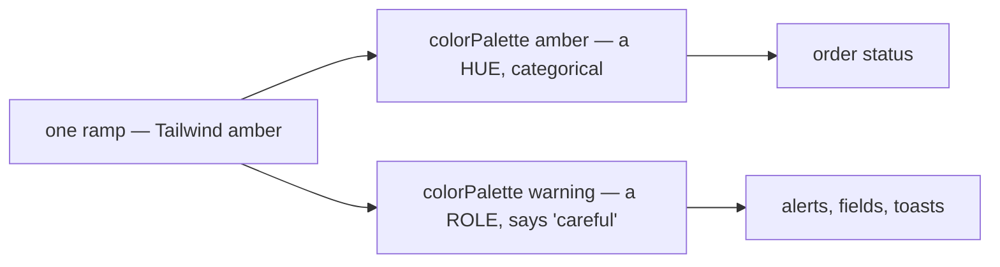

---

## the-row-shows-total-beli-and-total-mp

> Owner, in chat (2026-09-28): *"sistem lama total itu ada 2, total dari beli yang dimaksud adalah
> subtotal produk + biaya dan total dari mp"*.

⚠ **This REPLACES `an-order-total-is-goods-plus-fulfilment`.** That one read the earlier instruction
as *selling subtotal + fee* — a third figure that is neither of the owner's two totals, and the one a
margin cannot be taken from. There are **two** totals and they are opposite sides of the trade:

| | | in the contract |
| --- | --- | --- |
| **total beli** | `subtotal produk` (what the goods COST) `+ biaya` (the warehouse's fee) | `cogs` + a fee nothing carries |
| **total MP** | what the buyer paid the platform | `marketplace_total` |

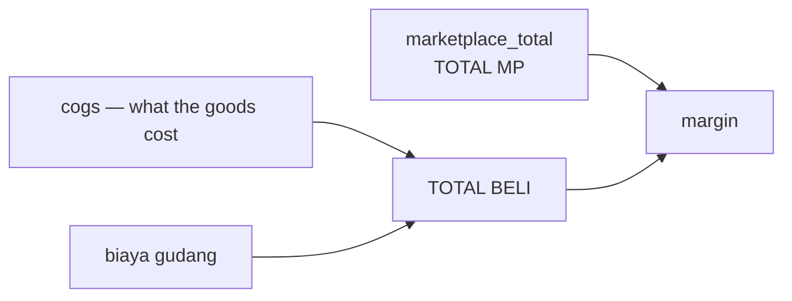

⚠ **`Order.total` is on neither side.** It is `subtotal + shipping_cost` — our own quote plus postage
— and the row never reads it. See [the contradiction](../order/design_clarify.md#contradiction) for the four
sites that decision touched.

⚠ **The `biaya` half is a SAMPLE.** Nothing carries a warehouse fee per order: it is a liability row
keyed by `source_id = order id`, and `LiabilityLogListFilter` takes a counterparty and nothing else
(balance Q9). The cost half is real `cogs`; the fee is invented and the column carries a mark.

⚠ **A `cogs` of 0 makes the whole cell refuse.** It is UNKNOWN, not free (`order.proto`), so total
beli is an em-dash rather than a fee-only figure that would read as a suspiciously cheap order.

✅ *Built 2026-10-22:* the `biaya` half is the order's own frozen `warehouse_fee` (selling `00019`, step 3 of
[the-flat-rate-is-dropped-last](../../business/teams/warehouse/context_decision.md#the-flat-rate-is-dropped-last)) — the
sample and its `totalFee` mark are gone. An order placed before fees were frozen has none, and the cell refuses for it
exactly as for an unknown cost. The liability-filter route above was not needed: the owner's `orders` table carries the fee.

## the-margin-is-mp-minus-total-beli

> Owner, same message: *"persentase adalah dari margin ke harga mp, margin adalah harga mp - total
> beli"*.

```
margin     = harga MP − total beli
persentase = margin ÷ harga MP
```

**Three things follow, and each is a trap if it is missed:**

| | |
| --- | --- |
| the revenue is the PLATFORM's figure, not ours | dividing by our `subtotal` would flatter every discounted order |
| the fee is INSIDE the cost | leaving it out overstates every order by the whole warehouse bill |
| the percentage is of the REVENUE | `margin ÷ beli` is a mark-up — a different number that reads the same |

⚠ **It needs TWO facts, so it has TWO ways to be unknown** — and that broke the summary strip the
first time it was rendered. An order missing either one is unmeasurable, and the two absences are
unrelated: fixture 107 has no cost, 108 has no marketplace figure.

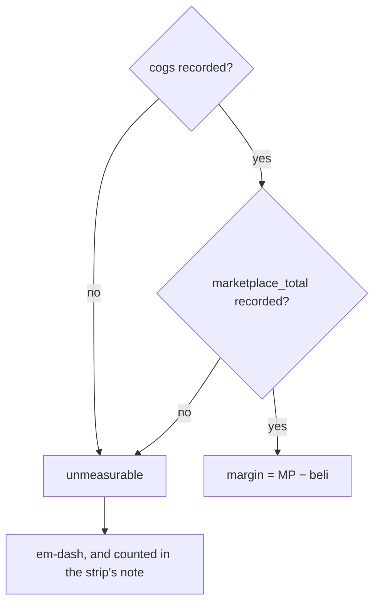

**What it changed, beyond the cell:**

| | |
| --- | --- |
| the strip's unknown marker | `cost_unknown` → **`margin_unknown`**: counting only the cost left the strip claiming **Rp 780.384** where the rows beneath summed to **Rp 599.980** |
| the census columns the strip needs | Σ `subtotal` → **Σ `marketplace_total`**, plus **Σ fees** |
| *nilai belanja* on the strip | now total beli (cost + fees), so the strip and the Beli column mean the same thing by the same word |

⚠ **It contradicts the proto's own margin** — `margin = total − cogs − shipping_cost`, which measures
our quote against our cost and never looks at what the platform paid. One formula lives in
`features/orders/margin.ts` and both the strip and the row read it, so they cannot disagree.

⚠ **The strip still lands ~11% above the sum of its rows, and that is now a documented limit rather
than a bug to tune.** The census gives the sample Σ `total` and a count, so an excluded order can only
be charged the pile's average size — and the excluded one here (#108) is the largest of the nine. Only
the server knows the size of what it left out, which is the argument for making these columns real.

✅ *Built 2026-10-22:* the columns are real. `OrderStatusCount` carries `mp_value` (Σ `marketplace_total`), `cogs` and
`fees` (Σ `warehouse_fee`) over the MEASURABLE orders only — a cost, a marketplace figure AND a frozen fee — and
`margin_unknown`, how many it left out. The ~11% gap is gone with `summaryMock.ts`, and so is the `summaryCost` mark.
⚠ A third way to be unmeasurable joined the two above: a fee never priced.

## every-date-gets-its-own-column

> Owner, in chat (2026-09-28): *"tanggal bedakan saja columnnya"*.

⚠ **This REPLACES `two-dates-and-two-totals-with-ours-leading`.** The dates and the totals were stacked
two-to-a-cell with ours leading; three dates in one cell was the three-line row the owner rejected, and
each date answers a different question anyway.

| column | what it answers | real? |
| --- | --- | --- |
| **Dibuat** | when WE wrote the row — `created_at_unix`, and `oleh <nama>` under it | the date yes, the author no |
| **Tgl MP** | when the buyer ordered on the storefront | no field at all |
| **Tgl `<status>`** | when it entered the status being filtered | `OrderEvent` has the shape, the list never sends it |

**`oleh` stays paired with the created date** because it is the same event: who wrote it down, and when.
That is one fact read twice, which is exactly what the pairing rule allows.

✅ *Built 2026-10-22:* all three are real — **Tgl MP** is `platform_created_at_unix`
([platform-created-at-is-required-at-finalize](../../business/order/context_decision.md#platform-created-at-is-required-at-finalize)),
with the ship-by deadline under it; **Tgl `<status>`** is `status_at_unix`. The `mpDate` mark is gone.

⚠ **THE TWO ABSENCES ARE DIFFERENT, and the row must not conflate them:**

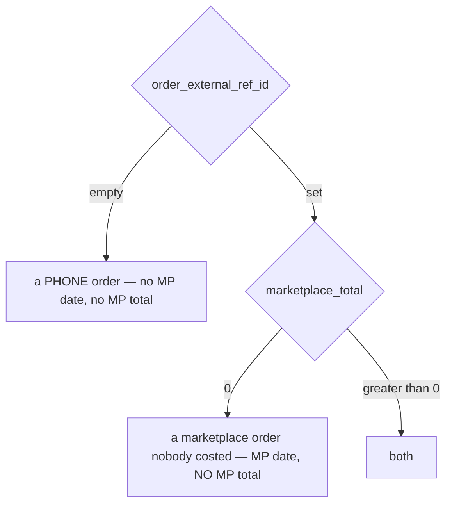

An empty reference means the order never came from a storefront; a `marketplace_total` of 0 means only
that nobody wrote down what the storefront took (`order.proto` — *0 = not recorded, not "sold for
nothing"*). Keying the DATE off the amount would hide a real order date on the strength of a missing
figure; fixture 108 is that case, kept deliberately.

## a-filtered-status-shows-its-own-date

> Owner: *"jika filter status aktif, akan ada tanggal sesuai perubannya kapan, misal saja dikirim
> selain 2 tanggal di atas ada juga tanggal dikirim"*.

A third line appears in the Dipesan cell **only while a status tab is selected**, reading
`<status> <date>`. "When did this ship" is a question you only ask while looking at shipped orders,
so carrying it on every tab would be a mostly-blank column.

⚠ **The shape exists and the list cannot read it.** `OrderEvent` is already `kind` + `at_unix`,
which is exactly this — but events are populated by `OrderDetail` only. The fix is not a new field,
it is the list carrying the one event the active filter asks about.

✅ *Built 2026-10-22:* `Order.status_at_unix` — when the order entered its CURRENT status, the newest
`order_timeline_logs` row moving it there, selected per page row (a correlated `MAX` on
`order_timeline_logs_order_idx`) and read off the timeline on a detail. Under a status tab every row is in that status,
so it answers the column; the `stageDate` mark is gone. 0 — shown as nothing — for an order whose move predates 00017,
which carried no history over.

## harga-beli-team-and-gudang-are-on-the-row

> Owner, in chat (2026-09-27): *"harga beli, team dan gudang? … 3nya diputuskan untuk ada"*.

All three are on the row, and none of them took a column of its own:

| fact | where it landed |
| --- | --- |
| harga beli | headline of the **Beli · Margin** cell — it IS total beli (cost + fees); the margin and the percent are its second line |
| team | the **first cell's headline** for any reader who is not a SELLING team — a warehouse, root or admin. Only a selling team owns shops, so only there does a shop name tell two rows apart |
| gudang | **its own column**, withheld when it is the reader's own building |

⚠ **A crew does not need its own name twenty times.** A warehouse's rows all ship from itself, so the
whole Gudang COLUMN is absent for that reader — the same rule that puts Tim in the Toko position
there.

⚠ **The row's owner and the shop FILTER are two questions, and they had one answer.** The filter is
offered to anyone but a warehouse (a deliberate earlier call); the COLUMN now follows "is this a
selling team", so root and admin get Team instead of a Shop column that would be blank on every row.

⚠ **"root bisa liat team" is NOT BUILDABLE TODAY.** `scopedOrders` is
`(team_id = ? OR warehouse_id = ?)` with no root bypass, so a reader in the root team matches neither
and sees an empty list — the column would be correct and the table empty. That is a server change,
not a column; it is open in the clarify file.

🔄 *(2026-10-19)* **Decided:** [root-reads-every-teams-orders](#root-reads-every-teams-orders). ✅ Built 2026-10-21.

## the-action-menu-is-a-table-keyed-by-status

> Owner, in chat (2026-09-28) — the per-status action list, given in the OLD status names.

The menu is a rendering of one table, so "what can I do to a returned order" is read rather than
traced through branches. Mapped onto the decided eight:

| stage | actions | built? |
| --- | --- | --- |
| pending | Batalkan Order · Edit Resi | cancel is real |
| processed | Edit Resi — **and at the handover step** — Jadikan Dikirim · Retur Barang · Selesaikan Order | ship is real, warehouse only |
| shipped | Retur Barang · Selesaikan Order | neither |
| completed | Edit Withdrawal | no |
| problem | Selesaikan Sengketa | no |
| return | Jadikan Lost · ~~Selesaikan Order (only when `wd_total` is above zero)~~ 🔄 *(2026-10-21)* dropped: [finish-order-on-a-return-waits-for-the-withdrawal](#finish-order-on-a-return-waits-for-the-withdrawal) | neither, and no `wd_total` |
| lost · cancel | — | the owner listed none, and both are ends |

**Two of the owner's rows fold into one stage**, and this is the only judgement call:

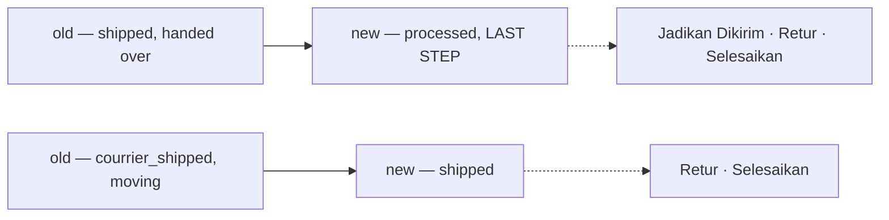

⚠ **The step it needs has no enum value**, so the gate falls back to `PACKED` — the last
representable step before handover. A packed order that has not yet been handed to the courier is
offered "Jadikan Dikirim" one step early until the enum lands. Same cause as the four dead tabs, so
it carries the same mark rather than a new one.

⚠ **Six of the nine items do nothing yet**, and each says so twice: the ⚠ on the item, and a toast
naming the reason when it is pressed. A menu item that silently does nothing reads as a broken app
rather than an unfinished one.

## a-deadline-is-loud-or-it-is-nothing

> Owner, in chat (2026-09-28): *"sama jika order punya deadline aku ingin dia mencolok"*.

A ship-by deadline is not a date to look up — it is the app telling somebody to act, so it is the one
thing on this table allowed to shout.

| band | when | how it reads |
| --- | --- | --- |
| **overdue** | past | SOLID error badge, **and the whole row is tinted** |
| **urgent** | within 6 hours | SOLID warning badge |
| **today** | within 24 hours | quiet warning badge |
| **later** | beyond that | plain text, in the gray of any other date |

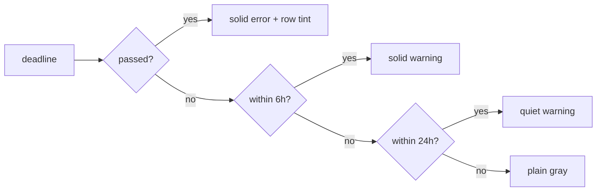

- **The row tint is the only whole-row colour on this table**, which is what keeps it meaning one
  specific thing. A badge in one column is visible; a tinted row is unmissable while scanning.
- **The colour is a ROLE, never a hue** — `error` / `warning`, so a palette change reaches it. This is
  also the one cell where those roles are earned: every other cell states a fact, this one raises an
  alarm.
- **It reads in hours under a day and days above it.** "4 hari lagi" is what somebody plans around;
  "97 jam lagi" is a number they would have to divide first.
- **A shipped, completed or cancelled order shows nothing.** The clock stops when the parcel leaves,
  and a column that stayed red on orders already out of the building is a column people learn to
  ignore.

⚠ **NOTHING CARRIES A DEADLINE.** Not `Order`, not `ShipmentChannel` (no lead time), and not
`OrderEvent`, which records what HAPPENED rather than what is due. The real thing this stands in for is
the marketplace's own ship-by clock, which is per storefront — so the field it needs is a deadline ON
the order, written when the order is imported.

⚠ **The two boundaries are a GUESS and should be the owner's** — 6 hours as "not for the next shift",
24 as "today's problem". They are named in one place (`deadlineMock`) so there is a single line to
change.

## the-preview-became-the-order-list

> Owner, in chat (2026-09-29): *"sudah bisa diterapkan ke order list aslinya"*.

The screen was built as `pages/orders-next/`, reachable only from Storybook, so it could be argued over
without touching the running app. It is now **`pages/orders/SellerOrders.tsx`**, on the `/orders` route
for a selling team, and the preview directory is deleted.

⚠ **A WAREHOUSE STILL GETS THE OLD LIST** — see [the-two-ends-are-two-screens](warehouse_order_list_decision.md#the-two-ends-are-two-screens).

| | |
| --- | --- |
| moved | the page as `SellerOrders.tsx` · `components/*` · `pending.ts` · `stages.ts` · `rowActions.ts` · the three mocks |
| kept | the old page as `WarehouseOrders.tsx`, with its `OrderStatRow` — untouched |
| new | `index.tsx`, a picker: team type chooses which |

⚠ **THE OLD SCREEN'S TESTS CAME ACROSS, NOT ITS CODE.** Twenty-five `play()` rules already described
what an order list must do — a warehouse sees another team's order, a tab narrows the table but never
the counts, an empty search says *nothing matched* rather than *no orders*, the drafts tab leaves. Those
are facts about the screen, not about its markup, so they were re-pointed at the new one rather than
rewritten. Eight failed on the move and each failure named a real change:

| failed because | now |
| --- | --- |
| `orders-stat-*` | the strip is `order-summary-row-<stage>` |
| `orders-tab-count-placed` · `orders-tab-packed` · `orders-tab-cancelled` | the owner's eight: `pending` · `processed` · `cancel` |
| `orders-clear-filters` | the shared FilterBar's own `orders-filters-clear` |
| clicking the customer's name to open a row | Penerima is off the row — it clicks the date cell |

⚠ **AND ONE FAILURE WAS NOT A RENAME.** *"The status tab narrows to one stage of the crew's work"*
asserted that choosing Diproses hides the pending orders. It does not, and cannot: the owner folded four
steps into one status while `OrderListFilter.status` takes exactly one enum value. That became
`DiprosesCountsButOnlyAStepCanNarrow` — **the `statusSet` mark written as an assertion**, so the day a
single `PROCESSED` value lands it fails and the step filter's reason for existing is re-read.

⚠ It was written on the warehouse's stories and MOVED to the seller's when the warehouse list reverted.
Worth saying plainly: restoring a file quietly takes its tests with it, and this one was the only thing
holding that gap down.

⚠ **THE PENDING MARKS CAME WITH IT.** Fourteen entries in `pages/orders/pending.ts`, on a screen people
now actually use — which is the point: the marks exist so a live screen can say what it cannot do yet
rather than quietly lying about it.

## the-summary-follows-the-tab

> Owner, in chat (2026-09-30): *"statistik untuk setiap status cuma ada di all status … ukuran statnya sebelumnya
> 9 bisa penuh 1 layar besar, sekarang kok jadi lebih kecil, kalau sudah masuk ke filter status kecuali draft,
> tampilkan statistiknya dengan nilai tx item dsb, jadi yang bawahnya bisa dihilangkan"*.

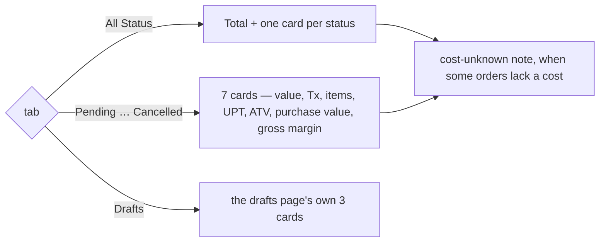

| | before | after |
| --- | --- | --- |
| All Status | 9 pile cards + a measure line for the total | 9 pile cards |
| a status tab | the same 9 pile cards + a measure line for that status | that status's 7 figures as cards |
| measure line | under the cards, always | **gone** — on a status tab its measures are the cards |
| grid | `auto-fill` (one round) — cards shrank on a large screen | `auto-fit` again — the cards fill the row |

- **It replaces** the rule the code carried as *"nothing appears or disappears when the tab changes"*. What made
  that rule matter — two different layouts — does not recur: both states draw the same `SummaryCard`.
- ⚠ **Reverses half of [the-draft-cards-are-the-order-list-cards](order_draft_decision.md#the-draft-cards-are-the-order-list-cards).**
  With `auto-fit` the drafts page's three cards fill the row, so a draft card is no longer the width of an order
  card. The shape is shared; the width follows how many cards share the row, on every tab alike.
- The cost-unknown note stays, under whichever strip is showing.

✅ *Built 2026-10-22:* every card's figure is the server's — `OrderStatusCount.item_count` (Σ line quantity over the
pile) gives the items and UPT, and the margin's inputs come from the same census. The `summaryItems` and
`summaryCost` marks are gone. ⚠ `item_count` is a correlated sum per order in scope and audits 🔴 at 50 000 orders
(190 ms) — [OrderStat.md](../../../audits/services/selling_service/performances/OrderStat.md); its fix is an open
question because it reopens [the-warehouse-row-fills-from-shop-and-user-by-ids](warehouse_order_list_decision.md#the-warehouse-row-fills-from-shop-and-user-by-ids).

---

## root-reads-every-teams-orders

> Owner, in chat (2026-10-19): *"yes, follow your recomendation"* — to
> [technical order Q6](../order/design_clarify.md#question), *"does a root or admin reader see every team's orders in the
> order list?"*. As recommended.

**The verdict.** A request scoped to the **root team** reads **every team's** orders, in the list, its counts and order
detail. Only ROOT and ADMIN hold that scope, so this is no new permission: it's the rule the settlement reports already use
([isRootScope](../../../backend/services/settlement_service/settlement_v1/analytic_shared.go)). Every other team is unchanged.

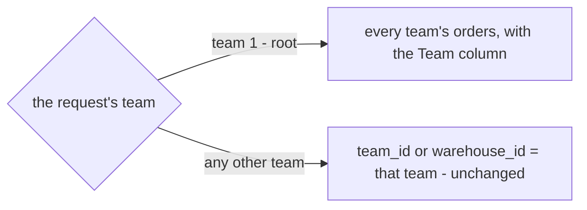

**The spec.**

| | |
| --- | --- |
| the rule | `team_id` = the root team means no team filter |
| where | `scopedOrders`, so the list and `OrderStat` stay one set of orders, and order detail's lookup |
| who | ROOT and ADMIN in the root team, the only ones the interceptor lets hold that scope |
| any other team | `(team_id = ? OR warehouse_id = ?)`, as today |
| the screen | the Team column ([harga-beli-team-and-gudang-are-on-the-row](#harga-beli-team-and-gudang-are-on-the-row)) gets its rows |
| ✅ built *(2026-10-21)* | `readsEveryTeam` in [order_list.go](../../../backend/services/selling_service/selling_v1/order_list.go), used by `scopedOrders` (list, stat, creator picker) and [order_detail.go](../../../backend/services/selling_service/selling_v1/order_detail.go). Pinned by `TestOrderList_TheRootTeamReadsEveryTeam` |

---

## finish-order-on-a-return-waits-for-the-withdrawal

> Owner, in chat (2026-10-21): *"okay, i follow your recomendation"* — to *"does the order list keep Selesaikan Order on an
> order in `return`?"*, the last row of
> [the-order-menu-and-the-status-move-disagree-after-the-handover](../../business/order/context_clarify.md#the-order-menu-and-the-status-move-disagree-after-the-handover).
> As recommended.

**The verdict.** A `return` order's menu **drops *Selesaikan Order***. It needed the withdrawal figure (`wd_total`), which
settlement doesn't have yet, and the status diagram has no `return → completed`. When settlement can show an order's
withdrawal, the edge and the item come back together.

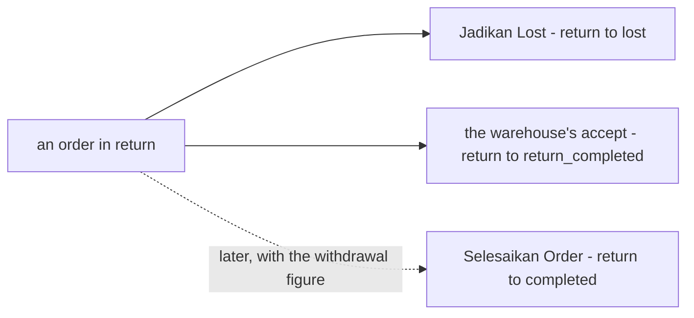

**The spec.**

| | |
| --- | --- |
| the `return` row of the menu | *Jadikan Lost* only |
| *Selesaikan Order* on `return` | removed |
| when it comes back | once settlement shows an order's withdrawal, with `return → completed` added to the status diagram in the same change |
| the other rows | unchanged ([the-action-menu-is-a-table-keyed-by-status](#the-action-menu-is-a-table-keyed-by-status)) |
| ✅ built *(2026-10-21)* | the `return` row of [rowActions.ts](../../../frontend/src/features/orders/rowActions.ts) is *Jadikan Lost* only |

---

## one-tab-per-status

> Owner, in chat (2026-10-21): *"yes, i follow your recomendation"* — to *"which tabs does the order list show, and does
> `return_completed` get its own?"*, the last point of
> [the-warehouse-steps-rule-met-the-return-status](../../business/order/context_clarify.md#the-warehouse-steps-rule-met-the-return-status).
> As recommended.

**The verdict.** The order list shows **one tab per status, plus *All***, in the status diagram's order
([the-status-move-is-the-only-journey](../../business/order/context_decision.md#the-status-move-is-the-only-journey)).
`return_completed` has its own tab beside `return`. Statuses are never grouped, because each is a different queue with a
different person acting on it.

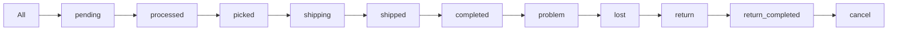

**The spec.**

| | |
| --- | --- |
| the tabs | All · pending · processed · picked · shipping · shipped · completed · problem · lost · return · return_completed · cancel |
| *All* | shows every pile at once ([the-summary-follows-the-tab](#the-summary-follows-the-tab)) |
| a phone | the tab row scrolls sideways |
| the warehouse's own list | keeps its own tabs ([the-warehouse-tabs-are-the-processed-steps](warehouse_order_list_decision.md#the-warehouse-tabs-are-the-processed-steps)) |
| ✅ built *(2026-10-21)* | the proto `OrderStatus` carries the eleven (00015 migrated every order), [statusTabs.ts](../../../frontend/src/features/orders/statusTabs.ts) and `StageTabs` draw one tab each in one row that scrolls sideways, and the step filter under Diproses is gone |

---

## shipping-is-cyan-and-picked-is-sky

> Owner, in chat (2026-10-21): *"i follow your recomendation"* — to *"what colour are picked, shipping and return completed?"*,
> the three statuses [status-colours-are-carried-over-verbatim](#status-colours-are-carried-over-verbatim) never coloured. As
> recommended, which changed my own build: it had put shipping in sky too.

**The verdict.** **Picked** is **sky**, with processed: both are the order inside the building. **Shipping** is **cyan**, its own
hue: the goods have been handed to the courier and left. Return completed is settled by
[pink-follows-retur-diterima-to-return-completed](#pink-follows-retur-diterima-to-return-completed).

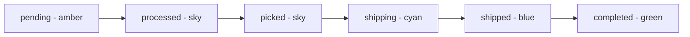

**The spec.**

| | |
| --- | --- |
| picked | `sky`, the same as processed. The label tells the two apart |
| shipping | `cyan`. In the *All* list, *has it left us?* is what the crew scans for, so it must not look like an order still on the shelf |
| the order of hues | sky → cyan → blue runs in journey order: in the building, handed over, on the road |
| where | the one map `ORDER_STATUSES` in [OrderStatusBadge.tsx](../../../frontend/src/components/badges/OrderStatusBadge.tsx). The tabs, the stepper and the timeline all read it |
| ✅ built *(2026-10-21)* | shipping moved from sky to cyan. Storybook: *Components/Badges/OrderStatusBadge → All Statuses* |

---

## pink-follows-retur-diterima-to-return-completed

> Owner, in chat (2026-10-21): *"yes a"* — to *"pink is your colour for Retur Diterima. Should it stay on return, or move to
> return completed, which is what Retur Diterima now means?"*, option A. As recommended. Raised because the build had already
> made this move **without asking**, and my first question reported return as the owner's red when the record says pink.

**The verdict.** **Return completed** is **pink**, *Retur Diterima*'s colour, carried over verbatim to the status that now means
it ([the-accept-is-the-status-return-completed](../../business/order/context_decision.md#the-accept-is-the-status-return-completed)).
**Return** (claimed, the parcel on its way back, nothing settled) is **red**.

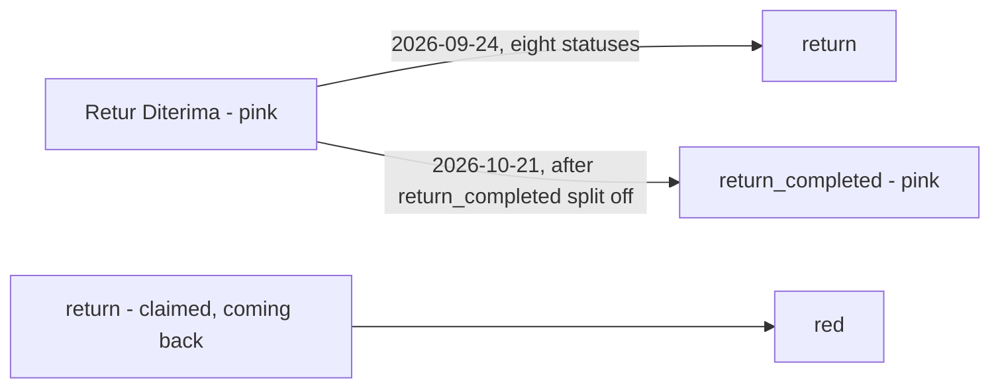

**The spec.**

| | |
| --- | --- |
| return completed | `pink`. Its timeline row is pink too, as an ending |
| return | `red` |
| the near pair | return's red sits next to cancel's rose: the same kind of accepted near-neighbours as processed's sky and shipped's blue. The label carries which |
| what it amends | the `return` row of [status-colours-are-carried-over-verbatim](#status-colours-are-carried-over-verbatim). The rule there still holds: pink went where its meaning went |
| ✅ built *(2026-10-21)* | already so in [OrderStatusBadge.tsx](../../../frontend/src/components/badges/OrderStatusBadge.tsx); its comment no longer calls it a proposal |

---

## the-order-import-moves-statuses-only

> Owner, in chat (2026-10-21): *"okay, i follow your recomendation"* — to *"the order list's Import promises to move each order
> to the marketplace's status AND to record the payout against the order. The payout is what Settlement Imports already does.
> Keep the payout promise?"*. As recommended: drop it.

**The verdict.** The order list's **Import** reads the marketplace's **order export** and moves statuses — nothing else. Money
always comes from the marketplace's **statement**, through **Settlement Imports**: each order's payout and fees onto its
settlement, each wallet → bank withdrawal onto the shop
([withdrawal-is-a-settlement-type](../../business/settlement/context_decision.md#withdrawal-is-a-settlement-type)). One file,
one job, and no payout can be posted from two screens.

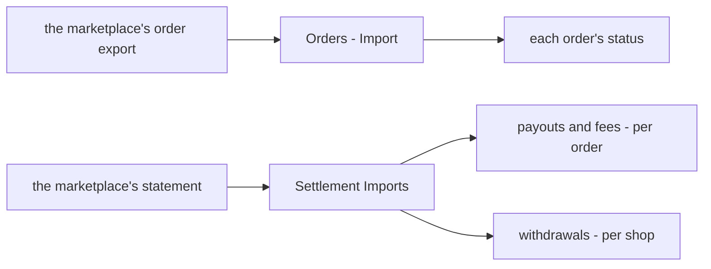

**The spec.**

| | |
| --- | --- |
| the dialog | keeps *"each order it names is moved to the status the marketplace reports"*. The payout line is gone, and in its place: *payouts and withdrawals are not read from this file — import the statement on Settlement Imports* |
| why not both | the importer refuses a repeated row only by the row's key from the statement. A payout read from a different file would carry a different key and be posted twice |
| the `withdrawal` pending entry | **stays** — it no longer explains the dialog, but it still explains a completed order's **Edit Withdrawal**: settlement records withdrawals per shop, so an order still has no withdrawal figure ([finish-order-on-a-return-waits-for-the-withdrawal](#finish-order-on-a-return-waits-for-the-withdrawal) waits on the same figure). The strip stays at 12 |
| 🔄 *(2026-10-26)* | the `withdrawal` entry and *Edit Withdrawal* go — [no-withdrawal-is-typed-on-an-order](order_detail_decision.md#no-withdrawal-is-typed-on-an-order) |
| the status half | still not built, and which marketplace status maps to which of ours is not decided |
| 🔄 *(2026-10-29)* | the mapping is decided: only customer service's moves after handover, the rest listed with its reason — [the-import-moves-only-after-handover](../order/design_decision.md#the-import-moves-only-after-handover). Still not built |
| 🔄 ✅ *(2026-10-30)* | the status half is built for Shopee and TikTok — [the-order-import-is-one-rpc-per-platform](../order/design_decision.md#the-order-import-is-one-rpc-per-platform) |
| ✅ built *(2026-10-21)* | the dialog line in [ImportOrdersDialog.tsx](../../../frontend/src/pages/orders/components/ImportOrdersDialog.tsx). The stale reasons found with it — the list's Export and Withdrawal, the order detail's Withdrawal — now say what is true |

---

## the-seller-edits-the-resi-until-handover

> Owner, in chat (2026-10-22): *"choose first option, but we can edit receipt text or receipt file only"* — to
> [technical order Q5](../order/design_clarify.md#question), *"who may change an order's tracking number after it is
> placed?"*, against my option *"seller, until handover — the number and the label file replaced together"*. Taken, with
> one change: the two are edited **independently**.

**The verdict.** *Edit Resi* is the **selling team's** action, offered while the parcel is still in the building —
`pending`, `processed`, `picked`. It changes the tracking number (`receipt_code`), the label file (`receipt`), or both, and
nothing else on the order. From `shipping` on it is gone: the courier has scanned that number, so a different one is a
different parcel, not an edit.

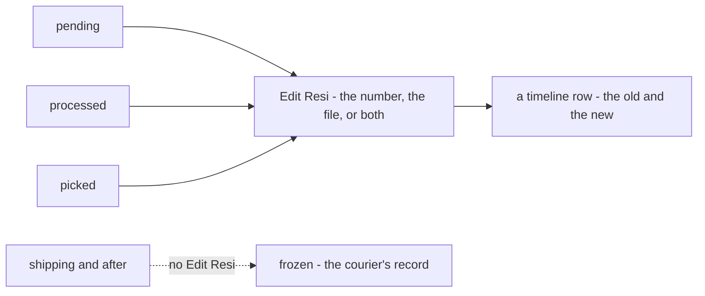

**The spec.**

| | |
| --- | --- |
| who | the order's selling team. The warehouse does not edit it — the marketplace issues the number on the seller's label |
| when | `pending`, `processed`, `picked`. The server refuses from `shipping` on, and on `cancel` |
| what | `receipt_code`, `receipt`, or both — each optional, each on its own. No other field rides on this edit |
| the record | each edit writes an `order_timeline_logs` row with the status unchanged and a note naming the old and the new value |
| the menu | [the-action-menu-is-a-table-keyed-by-status](#the-action-menu-is-a-table-keyed-by-status)'s Edit Resi rows, plus `picked`, which that table predates |
| ⚠ not decided here | a number changed without its file (or the reverse) can leave the two disagreeing, and a label scan matches on the number ([a-label-scan-reads-the-ref-or-the-receipt](../../business/inventory/order_decision.md#a-label-scan-reads-the-ref-or-the-receipt)). Whether the edit warns when they differ is open |
| not built | `receipt_code` is written at create only (selling `00018`, uncommitted) |
| ✅ built *(2026-10-29)* | `OrderReceiptUpdate` ([order_receipt_update.go](../../../backend/services/selling_service/selling_v1/order_receipt_update.go)): `team_id` is the selling team (the warehouse reads NotFound), `optional receipt_code` and `receipt` each changed on its own, at least one required. The order is read `FOR UPDATE`, so an edit racing the handover either lands first or is refused — proved by `TestInterleave_OrderReceiptUpdate_WaitsForTheHandover`. A request naming only what is already there writes nothing. The dialog is [EditReceiptDialog.tsx](../../../frontend/src/features/orders/EditReceiptDialog.tsx), opened from the list's kebab and the detail's buttons through `useOrderActions`, and it sends only what changed |
| ⚠ my reading, not asked | **the record is a NOTE row** (no status, from `selling`), reading `Resi: JNE-OLD → JNE-NEW · Label: old.pdf → new.pdf`, `—` for an empty side. *"The status unchanged"* was not taken as a row INTO the current status: that would reset the list's status date (`Order.status_at_unix`) on every edit. The note text is the server's, in neither language's sentence form, because a note row is shown as written |
| 🔄 *(2026-10-29)* | [rowActions.ts](../../../frontend/src/features/orders/rowActions.ts) offered Edit Resi to **either** end; it is now the selling team's only, as **who** above says. No warning is shown when the number and the file disagree, which stays open as written above |

---

## the-seller-list-filters-by-warehouse

> Owner, in chat (2026-10-22): *"Keep as built"* — to *"the seller's order list gets a Warehouse filter (one warehouse,
> and the tab counts follow it). Keep it as built?"*. As recommended. It was built before it was asked; this records it.

**The verdict.** A selling team can narrow its order list to the orders leaving **one warehouse** — *"what is waiting at
Gudang Pusat"*. The tab counts follow the same filter, so the tabs total what the table shows.

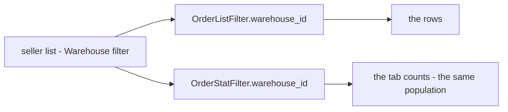

**The spec.**

| | |
| --- | --- |
| the field | `warehouse_id` on `OrderListFilter` and `OrderStatFilter` — the order's own `warehouse_id`. `0` = any |
| the warehouse's own list | leaves it at `0`: its scope already narrows the list to the orders it ships, and naming another warehouse matches nothing |
| the mark | `warehouseFilter` on [pages/orders/pending.ts](../../../frontend/src/pages/orders/pending.ts) goes when the screen reads it |

---

## the-date-filter-switches-created-or-platform

> Owner, in chat (2026-10-22): *"Switch, default created"* — to *"which date does the order list's date filter use, now
> that every order has both?"*. As recommended. Follows
> [platform-created-at-is-required-at-finalize](../../business/order/context_decision.md#platform-created-at-is-required-at-finalize).

**The verdict.** The order list's date filter has a switch: **created** (when we wrote the row) or **platform date**
(when the buyer ordered on the storefront). It starts on **created**. *"What came in today"* and *"the buyers' Saturday
orders"* are both answerable, and they are different questions.

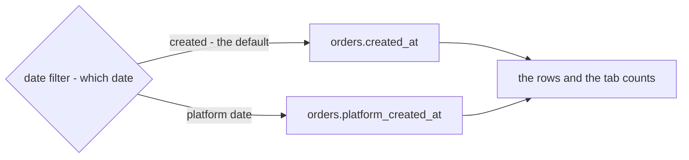

**The spec.**

| | |
| --- | --- |
| the switch | beside the date range: *Dibuat* · *Tgl MP*. Default *Dibuat* |
| the counts | `OrderStatFilter` takes the same choice, so the tabs total what the table shows |
| the contract | the filter's from/to range plus which date it reads — the created range that exists today, generalised |
| every order has both | `platform_created_at` is required at finalize, so filtering on it hides no order |
| ✅ built *(2026-10-22)* | `OrderDateField date_field` on `OrderListFilter` (12) and `OrderStatFilter` (11): `UNSPECIFIED`/`CREATED` read `created_at`, `PLATFORM_CREATED` reads `platform_created_at`, applied in `scopedOrders` so the rows and the tab counts read the same date. The seller list's DateRangePicker carries the *Dibuat · Tgl MP* segment, *Dibuat* by default; Clear puts it back. ⚠ An order placed before `00020` has no platform date and never matches a Tgl MP window |

---

## the-urgency-bands-are-6-and-24-hours

> Owner, in chat (2026-10-22): *"Fixed 6h and 24h"* — to [technical order Q9](../order/design_clarify.md#question),
> *"where do the deadline's urgency boundaries come from?"*, against my earlier *from the channel*. As re-recommended.

**The verdict.** The two boundaries of [a-deadline-is-loud-or-it-is-nothing](#a-deadline-is-loud-or-it-is-nothing) are
**fixed**: urgent within **6 hours** (before the next shift), today within **24 hours**. Urgency is how long the warehouse
has left, not which courier carries it — an instant order due in 3 hours is urgent, and reads so.

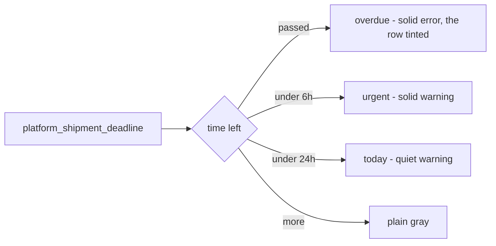

**The spec.**

| | |
| --- | --- |
| the constants | 6 h and 24 h, named once in the frontend — no setting, no per-channel field |
| the deadline | `platform_shipment_deadline` ([the-shipment-deadline-is-the-platforms-and-optional](../../business/order/context_decision.md#the-shipment-deadline-is-the-platforms-and-optional)); empty = no band |
| ⚠ supersedes | the guess note under [a-deadline-is-loud-or-it-is-nothing](#a-deadline-is-loud-or-it-is-nothing) — the values are now the owner's |
| ✅ built *(2026-10-22)* | `URGENT_WITHIN_HOURS = 6` and `TODAY_WITHIN_HOURS = 24` in [features/orders/deadline.ts](../../../frontend/src/features/orders/deadline.ts), which replaced `deadlineMock.ts`; the badge reads the order's own `platform_shipment_deadline_unix` through `orderDeadline`. The `deadline` marks are gone from the order list, the warehouse list and the order detail |

---

## the-order-list-filters-by-seven-dates

> Owner, in chat (2026-10-23): *"di order list, filter tanggal bisa saja by tipe tanggal dari timeline"*, then, of the dates
> an order has: *"created_at, order date seperti di form bisa dan per status"* — and *"oke, begitu saja"* to a short status
> list, dated by the first entry into each, picked inside the range panel
> ([a-date-type-is-picked-inside-the-range-panel](context_decision.md#a-date-type-is-picked-inside-the-range-panel)).

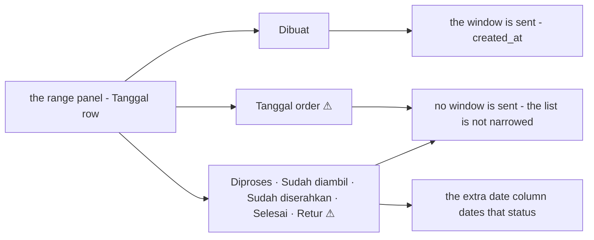

| | |
| --- | --- |
| the types | **Dibuat** (`created_at`), **Tanggal order** (the date the form asks for), and the first entry into **Diproses, Sudah diambil, Sudah diserahkan, Selesai, Retur** — the statuses a person asks *when* about. Menunggu, Dikirim, Bermasalah, Hilang, Retur diterima and Batal are left out: seven pills already wrap twice |
| a status's date | the FIRST time the order entered it — an order bounced back into Diproses keeps the day it was first processed |
| what reaches the server | **Dibuat only.** `OrderListFilter` dates `created_at` and nothing else, so any other type sends **no window** — the list is honestly unnarrowed rather than narrowed by the wrong date while the trigger names the right one |
| the ⚠ | one pending entry, `dateType` (dropped), on all six pills: the order date needs a field (`mpDate`), the status dates need the filter to read the timeline (`stageDate`) |
| the date column | a status type gets the *Tgl {status}* column (sampled, `stageDate`), as a status tab already did; with Dibuat or Tanggal order — both columns already — it follows the tab |
| the URL | `?date=<type>`, default `created` ([a-lists-filters-live-in-the-url](context_decision.md#a-lists-filters-live-in-the-url)); Hapus Filter puts it back to Dibuat. A type with no window is not counted as a filter — it narrows nothing |
| ✅ built *(2026-10-23)* | [SellerOrders.tsx](../../../frontend/src/pages/orders/SellerOrders.tsx), the story `AStatusDateIsOfferedButNarrowsNothingYet` |
| 🔄 ⚠ stale *(found 2026-10-30)* | *"what reaches the server: Dibuat only"* was already wrong when written: Tanggal order had reached it since the day before ([the-date-filter-switches-created-or-platform](#the-date-filter-switches-created-or-platform)), and the code sent both. A row written against the code of an earlier day, not today's |
| 🔄 ✅ built *(2026-10-30)* | **all seven reach the server.** `OrderDateField` gained `ENTERED_PROCESSED`, `_PICKED`, `_SHIPPING`, `_COMPLETED`, `_RETURN`. `scopedOrders` narrows by the first `order_timeline_logs` row into the status, so the list, its statistics and the export read the same set. Each row carries `date_entered_at_unix`, the date the column shows, whether or not the order is still in that status. The `dateType` pending entry and its ⚠ are gone; the story is now `AStatusDateNarrowsByItsFirstEntry`. ⚠ The window reads every team's timeline until an index on `(status, created_at)` exists — proposed, not added ([OrderList audit, finding 5](../../../audits/services/selling_service/performances/OrderList.md#5-a-status-date-window-seq-scans-the-timeline-)) |

## the-status-tabs-carry-no-counts

> Owner, in chat (2026-10-23), on the order list: *"tabs gaada angkanya"*.

```
before   Semua Status 9 · Menunggu 2 · Diproses 3 · …      a census read on every visit, for twelve badges
after    Semua Status · Menunggu · Diproses · …            the tab picks a status, and only that
```

| | |
| --- | --- |
| the tabs | the label alone — no count badge on any of the twelve |
| how many per status | the statistics' piles, once opened ([the-statistics-are-shut-and-read-when-opened](#the-statistics-are-shut-and-read-when-opened)) |
| why | the counts were the one reason the census was read on every visit and every filter change; without them the page costs the list alone |
| the warehouse's list | keeps its counted tabs ([warehouse_order_list_decision.md](warehouse_order_list_decision.md)) — said of the seller's list only |
| ✅ built *(2026-10-23)* | `StageTabs` takes no `count`; the e2e read the counts off the opened strip |

## the-statistics-are-shut-and-read-when-opened

> Owner, in chat (2026-10-23), on the order list: *"statistic collapsed default, tidak panggil api dari awal, saat masuk ke
> page dan baru panggil api dan reaktif saat dibuka, tidak simpan statenya, state cuma di halaman"*.

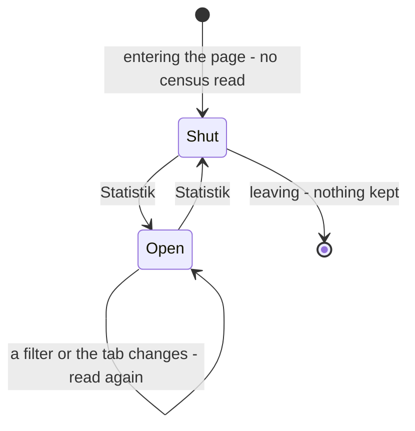

| | |
| --- | --- |
| the control | a **Statistik** button with its chart icon and a chevron, under the status tabs; the strip opens below it |
| entering the page | shut, and **OrderStat is not asked** — only the list is read |
| opened | the census is read (a skeleton of cards until it lands) and then follows the filter bar and the tab, as the list does |
| shut again | the strip unmounts and the read stops |
| where open/shut lives | **page state only** — not the URL, not storage; every visit opens shut, a refresh included |
| the ⚠ marks | the strip's two (`summaryCost`, `summaryItems`) show only while it is open; the folded summary at the top still lists them |
| ✅ built *(2026-10-23)* | [SellerOrders.tsx](../../../frontend/src/pages/orders/SellerOrders.tsx) (`useOrderStat` gained `enabled`), the story `TheStatisticsAreShutAndUnreadUntilOpened` counts the census calls |

## the-import-is-platform-then-shop-and-file-then-log

> Owner, in chat (2026-10-30): *"step 1 choose platform, step 2. ShopSelect and file, step 3. log result"* — to *"should
> the dialog's first step be the shop rather than the marketplace?"*, asked because the import matches a row on shop + ref
> ([the-import-moves-only-after-handover](../order/design_decision.md#the-import-moves-only-after-handover)) and the
> dialog never asked for a shop. Not as recommended: the marketplace stays first, and the shop joins the file.

**The verdict.** Three steps. The **marketplace** says which sheet this is, the **shop and the file** together say whose
orders it names, and the **log** says what the import did with each row.

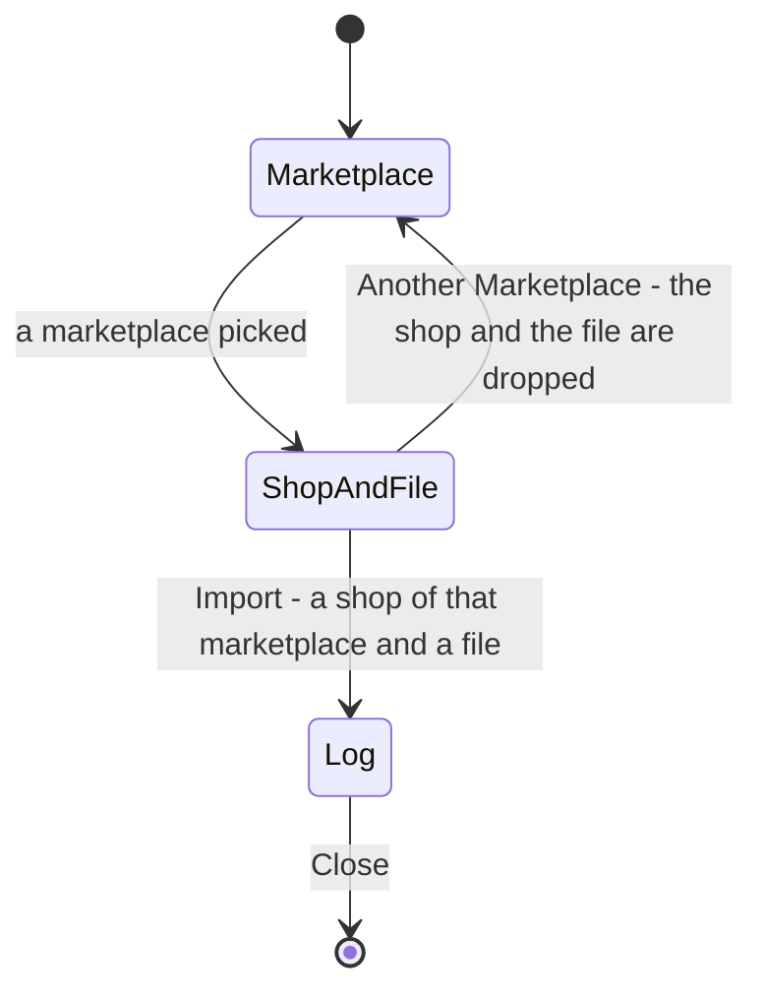

| | |
| --- | --- |
| step 1 | the marketplace grid, every marketplace offered, as before |
| step 2 | `ShopSelect` narrowed to the picked marketplace, above the file's drop zone. **Import** waits for both |
| step 3 | the log: a bar while the rows are read, the three counts (moved, already there, not applied), the first not-applied rows with their reasons, and every line behind *Show Log* — the settlement import's progress view, said for orders |
| going back | *Another Marketplace* drops the shop with the file: a shop of the old marketplace is not a shop of the new one |
| ⚠ until the import is built | *my reading, not asked:* **Import** opens step 3 on one error line — nothing was read — and never on a sample result, because a log that says *moved 41* after a click reads as done. The designed log is reviewed in the story `Pages/Orders/OrderImportLog` |
| ✅ built *(2026-10-30)* | [ImportOrdersDialog.tsx](../../../frontend/src/pages/orders/components/ImportOrdersDialog.tsx), [OrderImportLog.tsx](../../../frontend/src/pages/orders/components/OrderImportLog.tsx), and a story for each |
| 🔄 *(2026-10-30, the same day)* | the ⚠ row above is spent: Import now runs the real stream ([the-order-import-is-one-rpc-per-platform](../order/design_decision.md#the-order-import-is-one-rpc-per-platform)). Shopee and TikTok are read; a marketplace with no reader says *not yet* at step 2, in place of the shop and the file. Closing the dialog mid-import stops the log, not the import |
