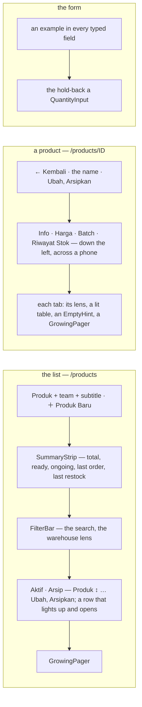
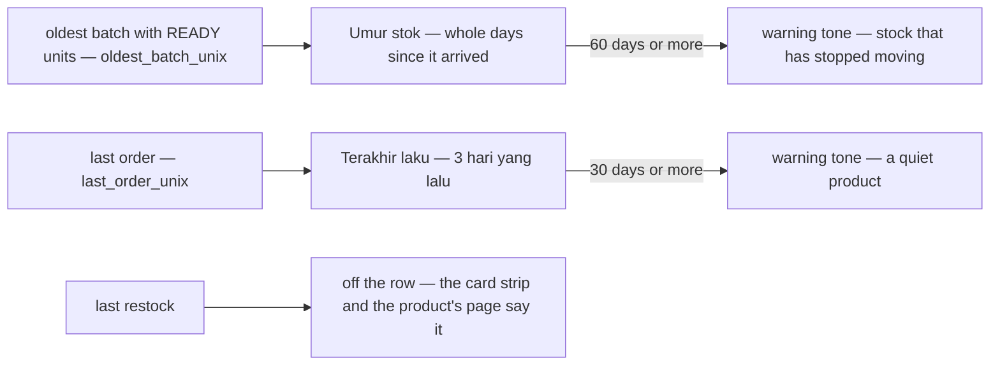
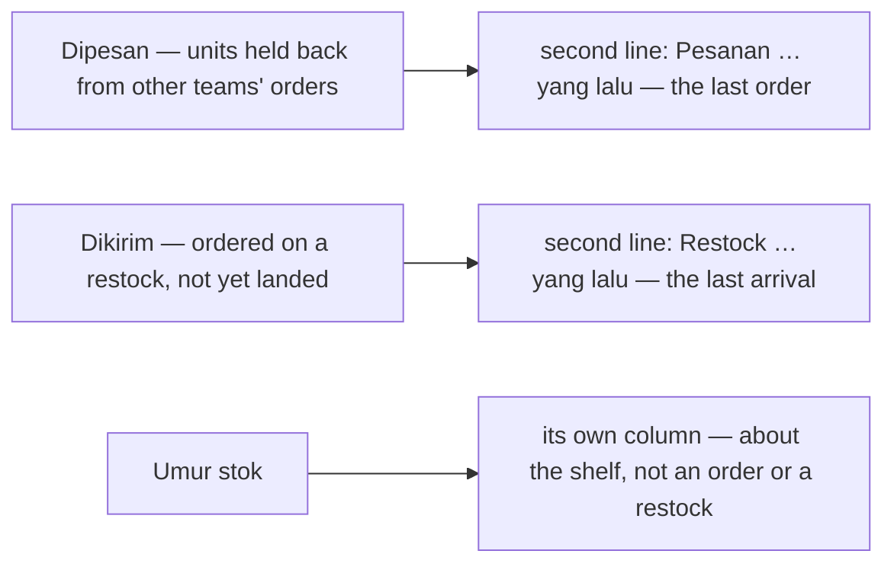
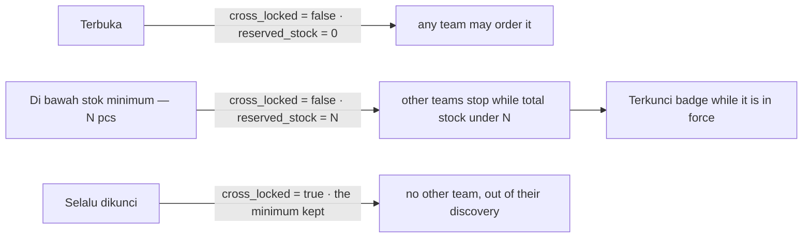
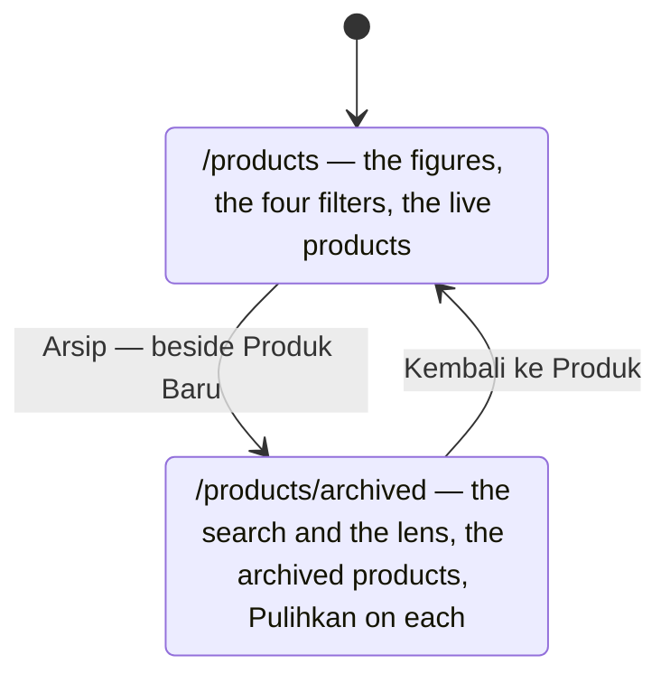

# Decisions — the product screens

The owner's decisions about **`/products`** (a selling team's catalogue), **`/products/:id`** (one product) and
**`/products/new`**, **`/products/:id/edit`** (its form). **Append-only** (RULE 12): a reversed decision is renamed and
its references grepped.

The rules every screen follows are in [context_decision.md](context_decision.md).

| decision | what it decided |
| --- | --- |
| [the-product-screens-follow-the-screen-rules](#the-product-screens-follow-the-screen-rules) | the list, a product's page and its form are rebuilt on the every-screen rules — a title, the card strip, the filter strip, a sortable heading, labelled row actions, a block per product on a phone; the tabs lie across a phone; every field shows an example and the hold-back is a `QuantityInput` |
| [the-dates-read-as-ages](#the-dates-read-as-ages) | the list's three date columns become two ages — **Umur stok** in days, **Terakhir laku** in words — old stock and a quiet product in the warning tone; Restock terakhir leaves the row |
| [each-date-rides-under-its-stock](#each-date-rides-under-its-stock) | the last order is the second line of **Dipesan**, the last restock the second line of **Dikirim**; only Umur stok keeps a column — it REPLACES the Terakhir laku column and brings the last restock back |
| [ongoing-reads-dikirim-on-the-product-screens](#ongoing-reads-dikirim-on-the-product-screens) | on the product screens, stock ordered on a restock and not yet landed reads **Dikirim** in Indonesian, not *Masuk* |
| [a-row-date-reads-as-a-date](#a-row-date-reads-as-a-date) | the two dates under Dipesan and Dikirim read as dates — *Pesanan 29 Sep 2026* — never *3 hari yang lalu*; only Umur stok stays in days |
| [the-markup-sits-beside-the-cost](#the-markup-sits-beside-the-cost) | **Cross** sits right after **Rentang HPP** — on the row and in the phone block — the cost and what another team pays over it, read together |
| [the-archive-is-a-page-of-its-own](#the-archive-is-a-page-of-its-own) | the archived products are a page of their own — `/products/archived`, opened from **Arsip** beside Produk Baru — not a tab under the list |
| [the-sku-copies-from-the-row](#the-sku-copies-from-the-row) | the list's SKU copies on a click, without opening the row |
| [lock-and-stock-age-filter-ahead-of-the-contract](#lock-and-stock-age-filter-ahead-of-the-contract) | the list filters by **lock** and by **stock age** — each held in the URL and marked ⚠, not sent until ProductListFilter can carry them |
| [a-second-line-names-itself-in-a-tooltip](#a-second-line-names-itself-in-a-tooltip) | the second lines under Rentang HPP, Siap and Dikirim are their value alone — the cross price, the last order's date, the last restock's date — and say what they are in a tooltip |
| [the-cross-price-rides-under-the-cost](#the-cross-price-rides-under-the-cost) | the cross price is the second line of **Rentang HPP**, said *Cross Rp …*; the Cross column is the markup alone — it REPLACES where the-cross-price-rides-under-the-markup put the price |
| [the-cross-price-rides-under-the-markup](#the-cross-price-rides-under-the-markup) | **Cross** comes before **Rentang HPP**, and under the markup sits what another team pays — the cost range with the markup on both ends; Kunci follows the cost — it REPLACES the order of the-markup-sits-beside-the-cost |
| [a-cost-range-reads-as-a-range](#a-cost-range-reads-as-a-range) | **Rentang HPP** writes both ends on one line with a dash — *Rp 45.700 – Rp 47.200* — and a product from one delivery shows one price |
| [a-phone-edits-the-lock-in-a-modal](#a-phone-edits-the-lock-in-a-modal) | on a phone the lock sits in the block's foot on Ubah's left, and opens **Ubah Kunci** as a modal, not a popover |
| [the-lock-ways-are-radio-pills](#the-lock-ways-are-radio-pills) | the lock's three ways are picked as **radio pills**, not a segmented switch; the middle way reads **Stok minimum** |
| [one-lock-three-ways](#one-lock-three-ways) | the lock is ONE setting — **Terbuka**, **Di bawah stok minimum** (N pcs), **Selalu dikunci** — a **Kunci** column beside Cross, edited from a popover, a Terkunci badge while a minimum is in force; Dipesan and the Terkunci switch are gone, the last order moves under Siap |

## the-product-screens-follow-the-screen-rules

> Owner, in chat (2026-10-22): *"sekarang kita ke product, coba terapkan keputusan sebelumnya"* — after the three screens
> got their first stories (`Pages/Products/Products`, `ProductDetail`, `ProductEdit`) and showed the old shape.



| | before | now — and the rule |
| --- | --- | --- |
| the list's header | no title (*"the shell's breadcrumb already reads it"* — there is no breadcrumb any more) and New Product with no icon | **Produk**, the team and a subtitle as one block; ＋ Produk Baru — its ＋ alone on a phone ([the-desktop-shell-has-no-top-bar](context_decision.md#the-desktop-shell-has-no-top-bar), [an-action-button-carries-its-icon](context_decision.md#an-action-button-carries-its-icon), [a-phone-header-action-is-an-icon](context_decision.md#a-phone-header-action-is-an-icon)); a warehouse reads its own subtitle and no action |
| the figures | Chakra `Stat`s over a rule | the order list's card strip — five grey cards, none past a fifth of the row ([a-list-summary-is-the-order-lists-card-strip](context_decision.md#a-list-summary-is-the-order-lists-card-strip), [a-summary-card-is-at-most-a-fifth](context_decision.md#a-summary-card-is-at-most-a-fifth)); the warehouse lens still names itself on the stock cards |
| the filters | a bare input and a team picker in a row | the shared `FilterBar` — the search with its icon and ×, the warehouse lens with its own ×, Hapus Filter; on a phone the search and a Filter sheet ([a-phone-filters-from-a-sheet](context_decision.md#a-phone-filters-from-a-sheet), [every-filter-clears-from-its-own-x](context_decision.md#every-filter-clears-from-its-own-x)); the lens shows the warehouse's name alone ([a-one-type-picker-shows-the-name-alone](context_decision.md#a-one-type-picker-shows-the-name-alone)); the search waits for the typing to settle |
| the order | none | **Produk** sorts from its heading by name, A to Z first — the column `ProductList` orders by that the row shows first; newest first when none is picked ([a-table-sorts-from-its-headings](context_decision.md#a-table-sorts-from-its-headings)); in the URL with the rest ([a-lists-filters-live-in-the-url](context_decision.md#a-lists-filters-live-in-the-url)) |
| a row | ✎ and 🗃 icons; a row that did not light up | **Ubah**, **Arsipkan** (and **Pulihkan** on Arsip), labelled with their icons; every cell lights up under the pointer ([a-table-row-lights-up](context_decision.md#a-table-row-lights-up)) |
| a phone | eleven columns, squeezed | a block per product: the product at full width, its figures two to a line — each its name over its value — then the lock and the actions at its foot ([a-phone-reads-each-line-as-a-block](context_decision.md#a-phone-reads-each-line-as-a-block)); an archived block does not press, since it opens nothing |
| loading · empty | a spinner · a grey line | the list's shape, then the rows fading in · an `EmptyHint` — *Belum ada produk.* with ＋ Produk Baru, *Produk tidak ditemukan.* with Hapus Filter, the archive's own line ([motion-is-small-quick-and-shared](context_decision.md#motion-is-small-quick-and-shared), [an-empty-list-shows-a-hint](context_decision.md#an-empty-list-shows-a-hint)) |
| the pager | `Pagination` | `GrowingPager`, on the list and on the three tabs ([every-list-pages-with-the-growing-pager](context_decision.md#every-list-pages-with-the-growing-pager)); a new search, lens or sort starts again at page one |
| a product's header | Edit and Archive labelled on a phone too, wrapping | one row on a phone — the name cut to fit, the actions their icons ([the-phone-header-is-one-row](context_decision.md#the-phone-header-is-one-row)) |
| a product's tabs | four down the left, at every width | down the left on a desktop, **across the top on a phone** — a 12rem column of tabs left the record a strip; one underline slides to the picked tab |
| the tabs' tables | resting rows, a grey line in an empty table, `Pagination` | rows that light up, an `EmptyHint` (`sm`) that says why — or, through a lens, *Coba gudang lain* — and a `GrowingPager`; the Batch tab a block per delivery on a phone (`#7003 · Gudang Pusat`, the day, `24 pcs × Rp 46.500 … Rp 1.116.000`) |
| the form | no placeholders; the hold-back a typed box | an example in every typed field — *Contoh: SKU-KOPI-250*, *Contoh: Kopi Arabika 250g* — the two figures keeping their **0** ([every-form-field-shows-an-example](context_decision.md#every-form-field-shows-an-example)); the hold-back a `QuantityInput`, − and + either side (CLAUDE.md: *a quantity is `QuantityInput`*) |

- **`MovementTable` takes the hint and the lit rows by opting in** — an `emptyIcon` (and `emptyDescription`). Stock
  history passes one; the rack, batch and warehouse-product ledgers do not yet, and keep their grey line until their
  screens are reworked, as [an-empty-list-shows-a-hint](context_decision.md#an-empty-list-shows-a-hint) says.
- **`QuantityInput` gained a `placeholder`**, so a form's quantity can show its 0 like a money field.
- The test ids the e2e reach for are kept: `product-row-<sku>`, `open-product-<sku>`, `edit-<sku>`, `delete-<sku>`,
  `restore-<sku>`, `locked-<sku>`, `products-table`, `products-empty`, `product-search`, `open-create-product`, every
  `product-edit-*`. The e2e's list wait accepts the empty hint, since an empty catalogue draws no table. A summary
  card's figure is read at `<card>-value` (`products-total-value`).
- The stories pin each rule: `Pages/Products/Products` (20) — the title, the card strip, the sort, the lit row, the
  empty search and its Clear; `ProductDetail` (16) — the lit delivery row, the three empty tabs of a product with
  nothing on a shelf; `ProductEdit` (16) — the examples, the hold-back's − and +.

## the-dates-read-as-ages

> Owner, in chat (2026-10-22), after asking what *Batch terlama* is: *"pertanggalan itu memenuhi tabel, tapi harusnya
> berguna kalau ditampilkan"*.

```
before   Batch terlama   Pesanan terakhir   Restock terakhir        three dates, each to be turned into "how long ago"
         8 Sep 2026      29 Sep 2026        7 Okt 2026
now      Umur stok       Terakhir laku                              two ages, read straight off
         44 hari         23 hari yang lalu
         63 hari ⚠       41 hari yang lalu ⚠                        past the line: the warning tone, bold
```



| | |
| --- | --- |
| **Umur stok** | how long the oldest units still on a shelf have sat — the batch FIFO draws next — in whole days (*44 hari*); the day it arrived on its title; **—** with nothing on a shelf; scoped by the warehouse lens, as before |
| **Terakhir laku** | how long since it last sold, said as a person says it (*3 hari yang lalu*); the date on its title; **Belum pernah** when it never has |
| the warning tone | old stock from **60 days**, a quiet product from **30 days** — `warning.fg`, bold, and the reason on the title. ⚠ Both lines are my proposal, named constants (`STALE_STOCK_DAYS`, `QUIET_SALE_DAYS`) so the owner can move them |
| **Restock terakhir** | off the row: the card strip says it for the catalogue, the product's page for the product, and **Masuk** already says whether more is coming |
| a phone | the block's two facts are the same two ages |
| was | three absolute dates — *Batch terlama*, *Pesanan terakhir*, *Restock terakhir* — side by side, the widest part of the row and the slowest to read |

- The story `TheDatesReadAsAges` pins only what holds on any later day — an age only grows: the old columns are gone,
  an age reads in days, and SKU-ANG-020 (its oldest units in since 20 Aug) is past the 60 days.

## each-date-rides-under-its-stock

> Owner, in chat (2026-10-22), on the list with its two ages: *"last order di bawah dipesan dan last restock di bawah
> ongoing"*.

```
Siap            Dipesan                  Dikirim                     Umur stok
79 pcs          4 pcs                    12 pcs                      44 hari
Rp 3.667.000    Belum ada pesanan        Restock 15 hari yang lalu
43 pcs          0 pcs                    0 pcs                       45 hari
Rp 2.013.273    Pesanan 23 hari yang lalu  Restock 20 hari yang lalu
```



| | |
| --- | --- |
| **Dipesan** | the units held back, and under them **when it was last ordered** — *Pesanan 3 hari yang lalu*, or *Belum ada pesanan*; past 30 days the line is in the warning tone, the date on its title |
| **Dikirim** | the units on their way, and under them **when stock last arrived** — *Restock 15 hari yang lalu*, or *Belum pernah restock*; the date on its title |
| Dikirim's worth | moved to the figure's title — a third line would break [one-context-per-column-and-never-three-lines](context_decision.md#one-context-per-column-and-never-three-lines), and the card strip carries the catalogue's |
| **Umur stok** | unchanged — its own column, in days, the warning tone from 60 ([the-dates-read-as-ages](#the-dates-read-as-ages)) |
| a phone | the block's Dipesan and Dikirim facts carry the same second lines; the separate last-sold fact is gone |

**What it replaces** (HARD RULE 11 — recorded, not only fixed): [the-dates-read-as-ages](#the-dates-read-as-ages) said
*"Terakhir laku"* is its own column and *"Restock terakhir leaves the row"*. Both are superseded here — the last order
is Dipesan's second line, and the last restock is back as Dikirim's. That entry is append-only and stays as written;
its table's *Terakhir laku* and *Restock terakhir* rows are stale, and its *"Masuk already says whether more is
coming"* now reads Dikirim ([ongoing-reads-dikirim-on-the-product-screens](#ongoing-reads-dikirim-on-the-product-screens)).
The story `TheDatesReadAsAges` became `TheDatesRideUnderTheirStock`.

## ongoing-reads-dikirim-on-the-product-screens

> Owner, in chat (2026-10-22): *"ongoing bukan masuk di sini, tapi dikirim"*.

On the product screens — the list's column, its phone block and the card strip — stock ordered on a restock and not
yet accepted onto a rack reads **Dikirim** in Indonesian; the subtitle says *yang sedang dikirim*. English stays
**Ongoing**.

| | |
| --- | --- |
| the keys | `products.table.ongoing` and `products.stat.ongoing` (id) — *Masuk* → *Dikirim*; `products.lead` (id) — *yang sedang masuk* → *yang sedang dikirim* |
| elsewhere | unchanged — every other screen's *Masuk* (the restock screens, the inventory badge *Masuk {{n}}*) stays until the owner says otherwise |
| was | *Masuk*, chosen on 2026-09-23 over the owner's own example *Dikirim*, on the worry that *dikirim* beside a stock figure reads as goods leaving — the app ships orders out all day. On this screen the owner prefers *Dikirim* |

## a-row-date-reads-as-a-date

> Owner, in chat (2026-10-22): *"pakai tanggal aja, jangan beberapa hari lalu dsb, umur stok tetap hari"*.

```
Dipesan                  Dikirim                  Umur stok
4 pcs                    12 pcs                   44 hari        ← the age stays in days
Belum ada pesanan        Restock 7 Okt 2026
0 pcs                    0 pcs                    45 hari
Pesanan 29 Sep 2026      Restock 2 Okt 2026       ← a date, never "23 hari yang lalu"
```

| | |
| --- | --- |
| the two lines | *Pesanan 29 Sep 2026* under Dipesan, *Restock 2 Okt 2026* under Dikirim — `formatUnixDate`, in the app's language ([a-date-speaks-the-apps-language](context_decision.md#a-date-speaks-the-apps-language)); *Belum ada pesanan* / *Belum pernah restock* when it never happened |
| the warning tone | kept on the order line from 30 days without an order — the reason on its title |
| **Umur stok** | unchanged — in days, *44 hari* ([the-dates-read-as-ages](#the-dates-read-as-ages)) |

**What it replaces** (HARD RULE 11): [each-date-rides-under-its-stock](#each-date-rides-under-its-stock) wrote the two
lines as ages — *"Pesanan 3 hari yang lalu"*, *"Restock 15 hari yang lalu"*, its example and its table — and
[the-dates-read-as-ages](#the-dates-read-as-ages) said *Terakhir laku* reads *"in words"*. Both are append-only and stay
as written; those examples are stale. Where they still hold: a date sits under its stock, and the stock's age is in
days.

## the-markup-sits-beside-the-cost

> Owner, in chat (2026-10-22): *"markup taruh sebelah hpp"*.

```
Produk ↕          Rentang HPP   Cross   Siap   Dipesan   Dikirim   Umur stok   Terkunci   Aksi
Minyak … Satuan   Rp 45.700     12.5%   79 pcs  4 pcs     12 pcs    44 hari     ◯          Ubah · Arsipkan
                  Rp 47.200
```

| | |
| --- | --- |
| the row | **Cross** right after **Rentang HPP** — the markup is added to that cost, so the two make the cross price and are read together; Terkunci stays by the actions, where it is edited |
| a phone | Rentang HPP and Cross share a line of the block, then Umur stok |
| was | Cross after the stock and its age, beside Terkunci |

## one-lock-three-ways

> Owner, in chat (2026-10-22): *"produk terkunci ada 2 opsi, kunci secara default dan kunci ketika stok mendekati
> settingan min stock, ada ide"* — then, to the proposal of one setting with three ways, *"coba"*.



```
Produk ↕          Rentang HPP   Cross   Kunci              Siap                  Dikirim               Umur stok
Minyak … Satuan   Rp 45.700     12.5%   [↘ Min 4 pcs]      79 pcs                12 pcs                44 hari
                  Rp 47.200                                Belum ada pesanan     Restock 7 Okt 2026
Minyak … Karton   Rp 46.611     0%      [🔓 Terbuka]       43 pcs                0 pcs                 45 hari
                                        [↘ Min 50 pcs] Terkunci  ← 43 is under 50: closed to other teams now

[↘ Min 4 pcs] ─▶ Ubah Kunci
                 [🔓 Terbuka | ↘ Di bawah stok minimum | 🔒 Selalu dikunci]      ← stacked on a phone
                 Stok minimum  [− 4 +] pcs
                 Tim lain berhenti bisa memesannya selama total stok di semua gudang di bawah angka ini — …
                                                                         [Batal] [Simpan]
```

| | |
| --- | --- |
| the setting | ONE lock, three ways, on the two fields a product already has — `cross_locked` and `reserved_stock`; **no contract changed**. The minimum is the reserve of [the-reserve-stops-other-teams-at-low-stock](../../business/product/context_decision.md#the-reserve-stops-other-teams-at-low-stock): total stock in every warehouse ≥ N lets another team order, and the owner's own orders are never stopped |
| Terbuka | clears the minimum — one left behind would still close the product at low stock |
| Selalu dikunci | keeps the minimum, so coming back to *Di bawah stok minimum* finds the number it had |
| a minimum | a whole number of **at least 1** — 0 would be Terbuka under another name; Save waits for it |
| the row | a **Kunci** column right after **Cross** — the terms another team sells under, read together ([the-markup-sits-beside-the-cost](#the-markup-sits-beside-the-cost)); the setting with its icon (*Terbuka*, *Min 4 pcs*, *Selalu dikunci*), a button opening **Ubah Kunci** in a popover — `SegmentGroup` in the main tone ([a-segmented-choice-is-in-the-main-tone](context_decision.md#a-segmented-choice-is-in-the-main-tone)), the minimum as a `QuantityInput` only for its way, a line saying what each way means |
| in force now | a **Terkunci** badge (warning) while the total ready stock is under the minimum, the figures on its title. ⚠ Not drawn while a warehouse lens is on: the rule reads every warehouse, and the row then holds one building's — the setting still shows |
| who may change it | the owner, on a live product; an archived product, or a warehouse holding another team's goods, only reads it |
| the product's page | the same control on Info (beside the markup, which no longer carries a *Locked* badge) and on the Price tab, in place of the switch |
| the form | one **Kunci** field — the same editor — in place of *Stok cadangan* and the *Terkunci* switch; a new product starts **Terbuka** |
| Dipesan | **gone**. It showed `reserved_stock` and read *"Dipesan"* — what is ordered — while it was the minimum; its text called it units *"held back from selling, available = on hand − reserved"*, which contradicted the business decision. The minimum now lives in the lock, where it means what it does |
| the last order | moves under **Siap** — a sale is drawn from exactly that stock, as Dikirim's restock date is what arrives into it; Siap's worth rides on the figure's title (inline on a phone, where nothing hovers) |
| the component | [`features/products/ProductLock.tsx`](../../../frontend/src/features/products/ProductLock.tsx) — `ProductLockControl`, `LockModeField`, the mapping — with its story `Features/Products/ProductLock`; the write is `useSetProductLock` (one `ProductUpdate` with the two fields) |

**What it replaces** (HARD RULE 11): [each-date-rides-under-its-stock](#each-date-rides-under-its-stock) put the last order
under **Dipesan** — that column is gone, and the line is Siap's now; its examples still show it under Dipesan and are
stale. [the-product-screens-follow-the-screen-rules](#the-product-screens-follow-the-screen-rules) kept the **Terkunci**
switch in the row and the hold-back as a `QuantityInput` field in the form; both became the lock. The stories
`LockingIsEditedInTheRow` and `TheHoldBackSteps` became `TheLockIsEditedInTheRow` and `TheMinimumSteps`.

- Unchanged: Discover's product page — another team's view — still reads `reserved_stock` under its old label.

## the-lock-ways-are-radio-pills

> Owner, in chat (2026-10-22), on the Ubah Kunci popover: *"buat pill tipe ubah kuncinya, di bawah stok minimum jadi
> stok minimum"*.

```
Ubah Kunci
( ○ Terbuka )  ( ◉ Stok minimum )  ( ○ Selalu dikunci )      ← wrap onto a second line on a phone
[− 4 +] pcs                                                   ← the pill names it; the box has no label of its own
Tim lain berhenti bisa memesannya selama total stok di semua gudang di bawah angka ini — …
```

| | |
| --- | --- |
| the control | `RadioPills` (`components/inputs/`) — the form's either/or everywhere ([a-dialog-choice-is-a-radio-pill](financial_accounts_decision.md#a-dialog-choice-is-a-radio-pill)): rounded pills, each its radio mark, the chosen one rose. A pick is an answer to a field, not a view switch — which is what a segment reads as |
| the middle way | **Stok minimum** (en *Minimum stock*) — was *Di bawah stok minimum* |
| the minimum's box | no label above it — the chosen pill already says *Stok minimum*; it keeps its spoken name |
| a phone | the pills wrap; the stacked segments are gone |
| where | the popover on the list and the product's page, and the product form's Kunci field — one editor, `LockModeField` |

**What it replaces** (HARD RULE 11): [one-lock-three-ways](#one-lock-three-ways) drew the ways as a `SegmentGroup`
(*"segmented control in the main tone"*), stacked on a phone, and named the middle one *Di bawah stok minimum* — its
sketch and table are stale on those points.

## a-phone-edits-the-lock-in-a-modal

> Owner, in chat (2026-10-22): *"di mobile kunci di kiri edit dan jadi modal"*.

```
┌ Minyak Goreng Sawit 2L — Satuan ─────────────────────┐        ┌ Ubah Kunci ─────────────────── × ┐
│ Siap 79 pcs · Rp 3.667.000   …                        │        │ ( ○ Terbuka ) ( ◉ Stok minimum )  │
│ Cross 12.5%            Umur stok 44 hari              │  tap   │ ( ○ Selalu dikunci )              │
│              [↘ Min 4 pcs] [✎ Ubah] [🗃 Arsipkan]  ───┼──────▶ │ [− 4 +] pcs                       │
└───────────────────────────────────────────────────────┘        │ Tim lain berhenti bisa …          │
                                                                  │              [Batal] [Simpan]     │
                                                                  └───────────────────────────────────┘
```

| | |
| --- | --- |
| where it sits | a phone block's **foot**, on **Ubah**'s left — the lock is something you change, like the two actions beside it; it left the block's facts |
| how it opens | a **modal** — `Dialog`, its title *Ubah Kunci*, its ×, the same pills, minimum and line, Batal and Simpan — where a popover anchored to a block's foot had no room to sit |
| a desktop | unchanged — the popover beside the row |
| the product's page | the same — a modal on a phone, a popover from `md` — since it is one control (`ProductLockControl`, chosen by the breakpoint; a story pins it with `presentation`) |
| was | a fact of the block, *Kunci* over its button, opening the popover |

## a-cost-range-reads-as-a-range

> Owner, in chat (2026-10-22), looking at the list's stories: *"di story kasih contoh range price, semuanya cuma 1
> price?"*.

```
before                 now
Rentang HPP            Rentang HPP
Rp 45.700              Rp 45.700 – Rp 47.200     ← a range: both ends, the dash between
Rp 47.200  (muted)     Rp 10.255                 ← one delivery, one price
                       —                         ← nothing on a shelf
```

| | |
| --- | --- |
| the cell | the cheapest and the dearest units on hand on **one line**, `–` between, both in full rupiah — as the phone block and the product's Price tab already wrote it; one price when every layer agrees; **—** with nothing on a shelf |
| was | the cheapest over the dearest, the second line small and muted — it read as a different figure, so every row looked like it had one price |
| the stories | the stub now has products that came in **one delivery** (SKU-ANG-006, -012, -018 …), so the list shows single prices beside the ranges; `TheCostRangeReadsAsARange` pins all three cases |

## the-cross-price-rides-under-the-markup

> Owner, in chat (2026-10-22): *"cross taruh di sebelum hpp, lalu harga cross taruh bawahnya"*.

```
Produk ↕          Cross                   Rentang HPP             Kunci          Siap …
Minyak … Satuan   12.5%                   Rp 45.700 – Rp 47.200   [↘ Min 4 pcs]  79 pcs
                  Rp 51.412 – Rp 53.100   ← what another team pays: the cost range, the markup on both ends
Gula Merah …      0%                      Rp 10.255               [🔓 Terbuka]
                  Rp 10.255               ← 0% charges nothing — the price is the cost
Tepung … Satuan   0%                      —
                  —                       ← nothing on a shelf, nothing to mark up
```

| | |
| --- | --- |
| the order | **Cross** right after the product, then **Rentang HPP**, then **Kunci** — the terms another team sells under come first |
| the cross cell | the markup badge, and under it the **cross price** — `cost + cost × bps / 10 000` on both ends of the cost range, rounded as the product's Price tab rounds it; one price when the range is one; **—** with nothing on a shelf. Its title names it (*Yang dibayar tim lain*) |
| a phone | the block's Cross fact carries the same price under the badge, before Rentang HPP |

**What it replaces** (HARD RULE 11): [the-markup-sits-beside-the-cost](#the-markup-sits-beside-the-cost) put Cross
**after** Rentang HPP, and [one-lock-three-ways](#one-lock-three-ways) put Kunci right after Cross — the cross price now
needs the markup first, and the lock follows the cost. Both entries are append-only; their sketches show the old order.
The story `TheMarkupSitsBesideTheCost` became `TheCrossPriceRidesUnderTheMarkup`.

## the-cross-price-rides-under-the-cost

> Owner, in chat (2026-10-22), on the cross price under the markup: *"harga crossnya di bawah hpp"*.

```
Cross    Rentang HPP                      Kunci
12.5%    Rp 45.700 – Rp 47.200            [↘ Min 4 pcs]
         Cross Rp 51.412 – Rp 53.100      ← what another team pays, under the cost it is made from
0%       Rp 10.255
         Cross Rp 10.255
0%       —                                ← nothing on a shelf: no cost, no cross price
```

| | |
| --- | --- |
| the cost cell | the cost range, and under it the **cross price** — the same range with the markup on both ends — introduced by the word **Cross**, so two stacked figures cannot read as one range again ([a-cost-range-reads-as-a-range](#a-cost-range-reads-as-a-range)); nothing on a shelf shows **—** and no second line |
| the Cross column | the markup badge alone, still before Rentang HPP |
| a phone | the Rentang HPP fact carries the same second line; the Cross fact is the badge |

**What it replaces** (HARD RULE 11): [the-cross-price-rides-under-the-markup](#the-cross-price-rides-under-the-markup)
put the price under the markup badge. The column order it set stands (Cross, Rentang HPP, Kunci); where the price sits
does not — its sketch is stale on that point. The story `TheCrossPriceRidesUnderTheMarkup` became
`TheCrossPriceRidesUnderTheCost`.

## a-second-line-names-itself-in-a-tooltip

> Owner, in chat (2026-10-22): *"keterangan cross, pesanan dan restock di bawah sebagai tooltip saja"*.

```
Rentang HPP               Siap            Dikirim
Rp 45.700 – Rp 47.200     79 pcs          12 pcs
Rp 51.412 – Rp 53.100     29 Sep 2026     7 Okt 2026        ← the value alone
   └ hover: Harga cross — yang dibayar tim lain
                             └ hover: Pesanan terakhir
                                             └ hover: Restock terakhir
```

| | |
| --- | --- |
| the lines | the cross price under the cost, the last order under Siap, the last restock under Dikirim — each its **value alone**; *Belum ada pesanan* / *Belum pernah restock* keep their words, which already say what they are |
| the name | a Chakra `Tooltip` on hover — *Harga cross — yang dibayar tim lain*, *Pesanan terakhir*, *Restock terakhir*; a quiet order line adds *Tidak laku 30 hari atau lebih* |
| spoken | the line's `aria-label` carries the name with the value, since a tooltip needs a hover a phone and a screen reader do not have |

**What it replaces** (HARD RULE 11): [the-cross-price-rides-under-the-cost](#the-cross-price-rides-under-the-cost) prefixed
the cross line with *"Cross"*, and [a-row-date-reads-as-a-date](#a-row-date-reads-as-a-date) wrote *"Pesanan 29 Sep
2026"*, *"Restock 2 Okt 2026"* — those words left the lines for the tooltip; the entries' sketches are stale on that
point.

## the-sku-copies-from-the-row

> Owner, in chat (2026-10-22): *"sku copyable"*.

| | |
| --- | --- |
| the SKU | a `CopyText` under the product's name — a click puts it on the clipboard, the icon says ✓ only when the browser took it; the click does not open the row |
| why | the SKU is carried into other systems — a marketplace listing, a supplier's sheet — and retyping a code is how the wrong product gets listed |
| the component | `ProductListItem` gained `skuCopyable`; without it the SKU stays plain text, so every other screen drawing a product is unchanged |

## lock-and-stock-age-filter-ahead-of-the-contract

> Owner, in chat (2026-10-22), after asking which filters the list has: *"kasih filter lock dan umur stok
> unimplemented"*.

```
[⌕ Cari SKU atau nama ×] [Semua gudang ▾] [Semua kunci ▾] ⚠1 [Semua umur stok ▾] ⚠2
  Kunci      Terbuka · Stok minimum · Selalu dikunci · Terkunci sekarang
  Umur stok  30 · 60 · 90 hari atau lebih
⚠ 2 bagian layar ini belum diimplementasi — Filter kunci, Filter umur stok
```

| | |
| --- | --- |
| the lock | the three ways of [one-lock-three-ways](#one-lock-three-ways), and **Terkunci sekarang** — a minimum in force |
| the stock's age | at least **30**, **60** or **90** days on a shelf — the warning tone starts at 60 ([the-dates-read-as-ages](#the-dates-read-as-ages)) |
| ahead of the contract | each held in the URL (`?lock=`, `?age=`) and marked ⚠ (`dropped`), its pick **thrown away**: `ProductListFilter` has only `q` and `status`, and a paged list cannot be narrowed on screen without missing the products on the other pages; the age lives in inventory_service, further off still |
| the control | a plain list with its own × (a static, small set — no search), in the filter strip and the phone's Filter sheet; Hapus Filter clears them with the rest |
| the strip | the screen's `NotImplementedSummary` names both at the top |

## the-archive-is-a-page-of-its-own

> Owner, in chat (2026-10-22): *"draft dibuat beda halaman, lalu masuk ke halamannya lewat button di atas"* — asked which
> one was meant, they picked **the product archive**.



| | |
| --- | --- |
| the way in | **Arsip** (EN *Archive*), an outline button in the list's header: *[🗃 Arsip] [＋ Produk Baru]* — their icons alone on a phone |
| the page | `/products/archived` — **Arsip Produk**, a subtitle saying what archiving means, *← Kembali ke Produk* above the title |
| on it | the search and the warehouse lens · the table, each row offering **Pulihkan**, its lock only read |
| not on it | the figures (they describe the live catalogue), the lock and stock-age filters (an archived product is out of every other team's reach), New Product |
| an archived product's page | its Back returns to the archive |
| was | two tabs, *Aktif* · *Arsip*, under the filter strip of one page |

**What it replaces** (HARD RULE 11): [the-product-screens-follow-the-screen-rules](#the-product-screens-follow-the-screen-rules)
kept the *Aktif · Arsip* tabs under the strip — they are gone; its sketch is stale on that point.
