# Decisions — the product screens

The owner's decisions about **`/products`** (a selling team's catalogue), **`/products/:id`** (one product) and
**`/products/new`**, **`/products/:id/edit`** (its form). **Append-only** (RULE 12): a reversed decision is renamed and
its references grepped.

The rules every screen follows are in [context_decision.md](context_decision.md).

| decision | what it decided |
| --- | --- |
| [the-product-screens-follow-the-screen-rules](#the-product-screens-follow-the-screen-rules) | the list, a product's page and its form are rebuilt on the every-screen rules — a title, the card strip, the filter strip, a sortable heading, labelled row actions, a block per product on a phone; the tabs lie across a phone; every field shows an example and the hold-back is a `QuantityInput` |
| [the-dates-read-as-ages](#the-dates-read-as-ages) | the list's three date columns become two ages — **Umur stok** in days, **Terakhir laku** in words — old stock and a quiet product in the warning tone; Restock terakhir leaves the row |
| [each-date-rides-under-its-stock](#each-date-rides-under-its-stock) | the last order is the second line of **Dipesan**, the last restock the second line of **Dikirim**; only Umur stok keeps a column — it REPLACES the Terakhir laku column and brings the last restock back |
| [ongoing-reads-dikirim-on-the-product-screens](#ongoing-reads-dikirim-on-the-product-screens) | on the product screens, stock ordered on a restock and not yet landed reads **Dikirim** in Indonesian, not *Masuk* |
| [a-row-date-reads-as-a-date](#a-row-date-reads-as-a-date) | the two dates under Dipesan and Dikirim read as dates — *Pesanan 29 Sep 2026* — never *3 hari yang lalu*; only Umur stok stays in days |
| [the-markup-sits-beside-the-cost](#the-markup-sits-beside-the-cost) | **Cross** sits right after **Rentang HPP** — on the row and in the phone block — the cost and what another team pays over it, read together |
| [the-archive-is-a-page-of-its-own](#the-archive-is-a-page-of-its-own) | the archived products are a page of their own — `/products/archived`, opened from **Arsip** beside Produk Baru — not a tab under the list |
| [the-sku-copies-from-the-row](#the-sku-copies-from-the-row) | the list's SKU copies on a click, without opening the row |
| [lock-and-stock-age-filter-ahead-of-the-contract](#lock-and-stock-age-filter-ahead-of-the-contract) | the list filters by **lock** and by **stock age** — each held in the URL and marked ⚠, not sent until ProductListFilter can carry them |
| [a-second-line-names-itself-in-a-tooltip](#a-second-line-names-itself-in-a-tooltip) | the second lines under Rentang HPP, Siap and Dikirim are their value alone — the cross price, the last order's date, the last restock's date — and say what they are in a tooltip |
| [the-cross-price-rides-under-the-cost](#the-cross-price-rides-under-the-cost) | the cross price is the second line of **Rentang HPP**, said *Cross Rp …*; the Cross column is the markup alone — it REPLACES where the-cross-price-rides-under-the-markup put the price |
| [the-cross-price-rides-under-the-markup](#the-cross-price-rides-under-the-markup) | **Cross** comes before **Rentang HPP**, and under the markup sits what another team pays — the cost range with the markup on both ends; Kunci follows the cost — it REPLACES the order of the-markup-sits-beside-the-cost |
| [a-cost-range-reads-as-a-range](#a-cost-range-reads-as-a-range) | **Rentang HPP** writes both ends on one line with a dash — *Rp 45.700 – Rp 47.200* — and a product from one delivery shows one price |
| [a-phone-edits-the-lock-in-a-modal](#a-phone-edits-the-lock-in-a-modal) | on a phone the lock sits in the block's foot on Ubah's left, and opens **Ubah Kunci** as a modal, not a popover |
| [the-lock-ways-are-radio-pills](#the-lock-ways-are-radio-pills) | the lock's three ways are picked as **radio pills**, not a segmented switch; the middle way reads **Stok minimum** |
| [one-lock-three-ways](#one-lock-three-ways) | the lock is ONE setting — **Terbuka**, **Di bawah stok minimum** (N pcs), **Selalu dikunci** — a **Kunci** column beside Cross, edited from a popover, a Terkunci badge while a minimum is in force; Dipesan and the Terkunci switch are gone, the last order moves under Siap |
| [a-taken-sku-is-said-under-the-sku](#a-taken-sku-is-said-under-the-sku) | the form shows its limits as counts (5/64), sends its text trimmed, and a SKU another live product holds is said under the SKU field, holding Save until it changes |
| [the-product-form-leaves-from-its-foot](#the-product-form-leaves-from-its-foot) | the form's foot carries **Kembali** with its arrow right beside **Buat** (a plus) or **Simpan** (a disk), at the right |
| [the-gallery-is-a-cover-and-four](#the-gallery-is-a-cover-and-four) | the form's gallery is five boxes — the cover big, four small under it; files are dropped anywhere on it or picked from an empty box; ★ makes a small one the cover |
| [the-form-returns-where-it-was-opened](#the-form-returns-where-it-was-opened) | Back and Save both return to the screen the form was opened from — the product's page, or the list as it was; anything else (a pasted link) to the list |
| [the-product-page-is-one-page-of-sections](#the-product-page-is-one-page-of-sections) | a product's page takes the order detail's shape — a sticky header, ONE warehouse lens, four figures, a nav beside one page of sections (Info, Harga, Batch, Riwayat stok; Penjualan Tim Lain and Aktivitas beside them) — the tabs are gone |
| [a-short-section-hides-its-pager](#a-short-section-hides-its-pager) | on the product's page, Harga Modal and Batch show no pager on page 1 when everything fits — an exception to the-pager-is-always-on-screen — ⚠ widened by [no-list-on-the-product-page-pages-when-it-fits](#no-list-on-the-product-page-pages-when-it-fits) |
| [the-warehouse-picker-splits-the-page](#the-warehouse-picker-splits-the-page) | the warehouse picker sits under the product-wide sections and splits the page: above it every warehouse (Info with the name and the total figures, Batch, Pemasok ⚠, the side cards, Produk Turunan ⚠), below it the chosen warehouse (its figures, Harga Modal, Keluar Masuk Harian ⚠, Riwayat Stok); only the name sticks |
| [the-title-row-is-the-sticky-bar](#the-title-row-is-the-sticky-bar) | the product's name is the title above the Info card — back as an icon beside it, the SKU under it, the actions on the right — and the sticky bar is that same row in small; Info holds the category and the four totals as one list, down, and the side cards sit beside it |
| [the-warehouse-zone-is-tabs](#the-warehouse-zone-is-tabs) | below the product-wide sections, ONE warehouse card: the picker in its header and four tabs — Overview (its figures as a stat group, then Pemasok), Harga Modal, Keluar Masuk Harian, Riwayat Stok — only the open one loads; Produk Turunan shows the count and three lines, the rest behind See All — ⚠ Pemasok moved to its own tab by [the-suppliers-are-a-tab-of-their-own](#the-suppliers-are-a-tab-of-their-own) |
| [the-stock-headline-stands-out](#the-stock-headline-stands-out) | Info leads with ONE large figure — *79 pcs siap* — and a status chip (Habis, Di bawah minimum, Mengendap, Aman), what is on its way and what the ready units cost under it; the list below it no longer repeats Siap and Dikirim |
| [the-stock-chip-says-how-much-is-left](#the-stock-chip-says-how-much-is-left) | the stock chip has three states — Habis (0), Hampir habis (under 5 pcs), Aman — the age and the lock leave it |
| [the-overview-reads-like-info](#the-overview-reads-like-info) | the warehouse Overview reads like Info — the large ready figure with its chip for that warehouse, then cost range and stock age as a list; Harga Modal drops its figures above the table; the derived-products dialog shows each product's picture |
| [the-overview-is-small-details](#the-overview-is-small-details) | the warehouse Overview is small details only — Siap, Dikirim, Rentang HPP, Umur stok as a list; the large figure and its chip are Info's alone; a derived product's line says just "N pcs", its meaning in a tooltip |
| [the-form-fills-the-canvas-in-three-cards](#the-form-fills-the-canvas-in-three-cards) | the form fills the canvas in three cards — **Gambar** in a fixed 22rem column, **Info Produk** (SKU, name, description, category), **Penjualan Tim Lain** (markup, lock) — all one height; the minimum's stepper turns red as one control |
| [no-list-on-the-product-page-pages-when-it-fits](#no-list-on-the-product-page-pages-when-it-fits) | every paged list on the product's page — Riwayat Stok now too — shows no pager on page 1 when everything fits; it WIDENS a-short-section-hides-its-pager |
| [the-suppliers-are-a-tab-of-their-own](#the-suppliers-are-a-tab-of-their-own) | Pemasok leaves the Overview for a warehouse tab of its own, after Harga Modal — Overview, Harga Modal, Pemasok ⚠, Keluar Masuk Harian ⚠, Riwayat Stok |

## the-product-screens-follow-the-screen-rules

> Owner, in chat (2026-10-22): *"sekarang kita ke product, coba terapkan keputusan sebelumnya"* — after the three screens
> got their first stories (`Pages/Products/Products`, `ProductDetail`, `ProductEdit`) and showed the old shape.

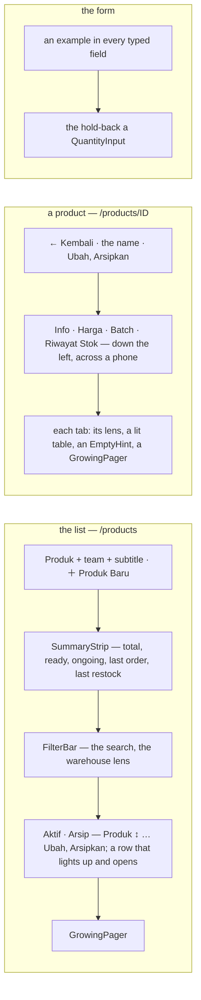

| | before | now — and the rule |
| --- | --- | --- |
| the list's header | no title (*"the shell's breadcrumb already reads it"* — there is no breadcrumb any more) and New Product with no icon | **Produk**, the team and a subtitle as one block; ＋ Produk Baru — its ＋ alone on a phone ([the-desktop-shell-has-no-top-bar](context_decision.md#the-desktop-shell-has-no-top-bar), [an-action-button-carries-its-icon](context_decision.md#an-action-button-carries-its-icon), [a-phone-header-action-is-an-icon](context_decision.md#a-phone-header-action-is-an-icon)); a warehouse reads its own subtitle and no action |
| the figures | Chakra `Stat`s over a rule | the order list's card strip — five grey cards, none past a fifth of the row ([a-list-summary-is-the-order-lists-card-strip](context_decision.md#a-list-summary-is-the-order-lists-card-strip), [a-summary-card-is-at-most-a-fifth](context_decision.md#a-summary-card-is-at-most-a-fifth)); the warehouse lens still names itself on the stock cards |
| the filters | a bare input and a team picker in a row | the shared `FilterBar` — the search with its icon and ×, the warehouse lens with its own ×, Hapus Filter; on a phone the search and a Filter sheet ([a-phone-filters-from-a-sheet](context_decision.md#a-phone-filters-from-a-sheet), [every-filter-clears-from-its-own-x](context_decision.md#every-filter-clears-from-its-own-x)); the lens shows the warehouse's name alone ([a-one-type-picker-shows-the-name-alone](context_decision.md#a-one-type-picker-shows-the-name-alone)); the search waits for the typing to settle |
| the order | none | **Produk** sorts from its heading by name, A to Z first — the column `ProductList` orders by that the row shows first; newest first when none is picked ([a-table-sorts-from-its-headings](context_decision.md#a-table-sorts-from-its-headings)); in the URL with the rest ([a-lists-filters-live-in-the-url](context_decision.md#a-lists-filters-live-in-the-url)) |
| a row | ✎ and 🗃 icons; a row that did not light up | **Ubah**, **Arsipkan** (and **Pulihkan** on Arsip), labelled with their icons; every cell lights up under the pointer ([a-table-row-lights-up](context_decision.md#a-table-row-lights-up)) |
| a phone | eleven columns, squeezed | a block per product: the product at full width, its figures two to a line — each its name over its value — then the lock and the actions at its foot ([a-phone-reads-each-line-as-a-block](context_decision.md#a-phone-reads-each-line-as-a-block)); an archived block does not press, since it opens nothing |
| loading · empty | a spinner · a grey line | the list's shape, then the rows fading in · an `EmptyHint` — *Belum ada produk.* with ＋ Produk Baru, *Produk tidak ditemukan.* with Hapus Filter, the archive's own line ([motion-is-small-quick-and-shared](context_decision.md#motion-is-small-quick-and-shared), [an-empty-list-shows-a-hint](context_decision.md#an-empty-list-shows-a-hint)) |
| the pager | `Pagination` | `GrowingPager`, on the list and on the three tabs ([every-list-pages-with-the-growing-pager](context_decision.md#every-list-pages-with-the-growing-pager)); a new search, lens or sort starts again at page one |
| a product's header | Edit and Archive labelled on a phone too, wrapping | one row on a phone — the name cut to fit, the actions their icons ([the-phone-header-is-one-row](context_decision.md#the-phone-header-is-one-row)) |
| a product's tabs | four down the left, at every width | down the left on a desktop, **across the top on a phone** — a 12rem column of tabs left the record a strip; one underline slides to the picked tab |
| the tabs' tables | resting rows, a grey line in an empty table, `Pagination` | rows that light up, an `EmptyHint` (`sm`) that says why — or, through a lens, *Coba gudang lain* — and a `GrowingPager`; the Batch tab a block per delivery on a phone (`#7003 · Gudang Pusat`, the day, `24 pcs × Rp 46.500 … Rp 1.116.000`) |
| the form | no placeholders; the hold-back a typed box | an example in every typed field — *Contoh: SKU-KOPI-250*, *Contoh: Kopi Arabika 250g* — the two figures keeping their **0** ([every-form-field-shows-an-example](context_decision.md#every-form-field-shows-an-example)); the hold-back a `QuantityInput`, − and + either side (CLAUDE.md: *a quantity is `QuantityInput`*) |

- **`MovementTable` takes the hint and the lit rows by opting in** — an `emptyIcon` (and `emptyDescription`). Stock
  history passes one; the rack, batch and warehouse-product ledgers do not yet, and keep their grey line until their
  screens are reworked, as [an-empty-list-shows-a-hint](context_decision.md#an-empty-list-shows-a-hint) says.
- **`QuantityInput` gained a `placeholder`**, so a form's quantity can show its 0 like a money field.
- The test ids the e2e reach for are kept: `product-row-<sku>`, `open-product-<sku>`, `edit-<sku>`, `delete-<sku>`,
  `restore-<sku>`, `locked-<sku>`, `products-table`, `products-empty`, `product-search`, `open-create-product`, every
  `product-edit-*`. The e2e's list wait accepts the empty hint, since an empty catalogue draws no table. A summary
  card's figure is read at `<card>-value` (`products-total-value`).
- The stories pin each rule: `Pages/Products/Products` (20) — the title, the card strip, the sort, the lit row, the
  empty search and its Clear; `ProductDetail` (16) — the lit delivery row, the three empty tabs of a product with
  nothing on a shelf; `ProductEdit` (16) — the examples, the hold-back's − and +.

## the-dates-read-as-ages

> Owner, in chat (2026-10-22), after asking what *Batch terlama* is: *"pertanggalan itu memenuhi tabel, tapi harusnya
> berguna kalau ditampilkan"*.

```
before   Batch terlama   Pesanan terakhir   Restock terakhir        three dates, each to be turned into "how long ago"
         8 Sep 2026      29 Sep 2026        7 Okt 2026
now      Umur stok       Terakhir laku                              two ages, read straight off
         44 hari         23 hari yang lalu
         63 hari ⚠       41 hari yang lalu ⚠                        past the line: the warning tone, bold
```

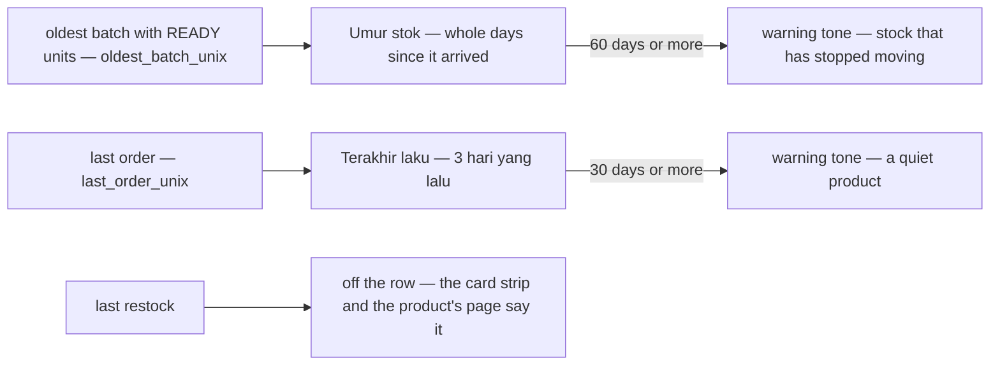

| | |
| --- | --- |
| **Umur stok** | how long the oldest units still on a shelf have sat — the batch FIFO draws next — in whole days (*44 hari*); the day it arrived on its title; **—** with nothing on a shelf; scoped by the warehouse lens, as before |
| **Terakhir laku** | how long since it last sold, said as a person says it (*3 hari yang lalu*); the date on its title; **Belum pernah** when it never has |
| the warning tone | old stock from **60 days**, a quiet product from **30 days** — `warning.fg`, bold, and the reason on the title. ⚠ Both lines are my proposal, named constants (`STALE_STOCK_DAYS`, `QUIET_SALE_DAYS`) so the owner can move them |
| **Restock terakhir** | off the row: the card strip says it for the catalogue, the product's page for the product, and **Masuk** already says whether more is coming |
| a phone | the block's two facts are the same two ages |
| was | three absolute dates — *Batch terlama*, *Pesanan terakhir*, *Restock terakhir* — side by side, the widest part of the row and the slowest to read |

- The story `TheDatesReadAsAges` pins only what holds on any later day — an age only grows: the old columns are gone,
  an age reads in days, and SKU-ANG-020 (its oldest units in since 20 Aug) is past the 60 days.

## each-date-rides-under-its-stock

> Owner, in chat (2026-10-22), on the list with its two ages: *"last order di bawah dipesan dan last restock di bawah
> ongoing"*.

```
Siap            Dipesan                  Dikirim                     Umur stok
79 pcs          4 pcs                    12 pcs                      44 hari
Rp 3.667.000    Belum ada pesanan        Restock 15 hari yang lalu
43 pcs          0 pcs                    0 pcs                       45 hari
Rp 2.013.273    Pesanan 23 hari yang lalu  Restock 20 hari yang lalu
```

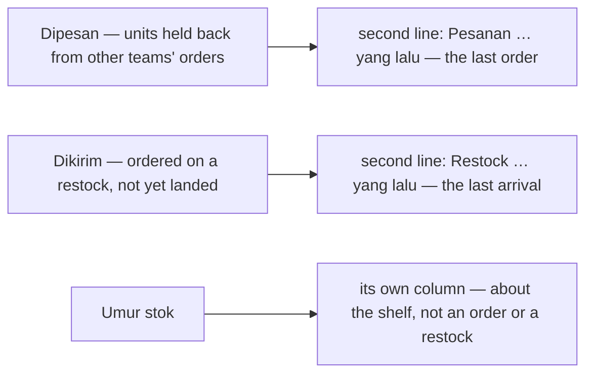

| | |
| --- | --- |
| **Dipesan** | the units held back, and under them **when it was last ordered** — *Pesanan 3 hari yang lalu*, or *Belum ada pesanan*; past 30 days the line is in the warning tone, the date on its title |
| **Dikirim** | the units on their way, and under them **when stock last arrived** — *Restock 15 hari yang lalu*, or *Belum pernah restock*; the date on its title |
| Dikirim's worth | moved to the figure's title — a third line would break [one-context-per-column-and-never-three-lines](context_decision.md#one-context-per-column-and-never-three-lines), and the card strip carries the catalogue's |
| **Umur stok** | unchanged — its own column, in days, the warning tone from 60 ([the-dates-read-as-ages](#the-dates-read-as-ages)) |
| a phone | the block's Dipesan and Dikirim facts carry the same second lines; the separate last-sold fact is gone |

**What it replaces** (HARD RULE 11 — recorded, not only fixed): [the-dates-read-as-ages](#the-dates-read-as-ages) said
*"Terakhir laku"* is its own column and *"Restock terakhir leaves the row"*. Both are superseded here — the last order
is Dipesan's second line, and the last restock is back as Dikirim's. That entry is append-only and stays as written;
its table's *Terakhir laku* and *Restock terakhir* rows are stale, and its *"Masuk already says whether more is
coming"* now reads Dikirim ([ongoing-reads-dikirim-on-the-product-screens](#ongoing-reads-dikirim-on-the-product-screens)).
The story `TheDatesReadAsAges` became `TheDatesRideUnderTheirStock`.

## ongoing-reads-dikirim-on-the-product-screens

> Owner, in chat (2026-10-22): *"ongoing bukan masuk di sini, tapi dikirim"*.

On the product screens — the list's column, its phone block and the card strip — stock ordered on a restock and not
yet accepted onto a rack reads **Dikirim** in Indonesian; the subtitle says *yang sedang dikirim*. English stays
**Ongoing**.

| | |
| --- | --- |
| the keys | `products.table.ongoing` and `products.stat.ongoing` (id) — *Masuk* → *Dikirim*; `products.lead` (id) — *yang sedang masuk* → *yang sedang dikirim* |
| elsewhere | unchanged — every other screen's *Masuk* (the restock screens, the inventory badge *Masuk {{n}}*) stays until the owner says otherwise |
| was | *Masuk*, chosen on 2026-09-23 over the owner's own example *Dikirim*, on the worry that *dikirim* beside a stock figure reads as goods leaving — the app ships orders out all day. On this screen the owner prefers *Dikirim* |

## a-row-date-reads-as-a-date

> Owner, in chat (2026-10-22): *"pakai tanggal aja, jangan beberapa hari lalu dsb, umur stok tetap hari"*.

```
Dipesan                  Dikirim                  Umur stok
4 pcs                    12 pcs                   44 hari        ← the age stays in days
Belum ada pesanan        Restock 7 Okt 2026
0 pcs                    0 pcs                    45 hari
Pesanan 29 Sep 2026      Restock 2 Okt 2026       ← a date, never "23 hari yang lalu"
```

| | |
| --- | --- |
| the two lines | *Pesanan 29 Sep 2026* under Dipesan, *Restock 2 Okt 2026* under Dikirim — `formatUnixDate`, in the app's language ([a-date-speaks-the-apps-language](context_decision.md#a-date-speaks-the-apps-language)); *Belum ada pesanan* / *Belum pernah restock* when it never happened |
| the warning tone | kept on the order line from 30 days without an order — the reason on its title |
| **Umur stok** | unchanged — in days, *44 hari* ([the-dates-read-as-ages](#the-dates-read-as-ages)) |

**What it replaces** (HARD RULE 11): [each-date-rides-under-its-stock](#each-date-rides-under-its-stock) wrote the two
lines as ages — *"Pesanan 3 hari yang lalu"*, *"Restock 15 hari yang lalu"*, its example and its table — and
[the-dates-read-as-ages](#the-dates-read-as-ages) said *Terakhir laku* reads *"in words"*. Both are append-only and stay
as written; those examples are stale. Where they still hold: a date sits under its stock, and the stock's age is in
days.

## the-markup-sits-beside-the-cost

> Owner, in chat (2026-10-22): *"markup taruh sebelah hpp"*.

```
Produk ↕          Rentang HPP   Cross   Siap   Dipesan   Dikirim   Umur stok   Terkunci   Aksi
Minyak … Satuan   Rp 45.700     12.5%   79 pcs  4 pcs     12 pcs    44 hari     ◯          Ubah · Arsipkan
                  Rp 47.200
```

| | |
| --- | --- |
| the row | **Cross** right after **Rentang HPP** — the markup is added to that cost, so the two make the cross price and are read together; Terkunci stays by the actions, where it is edited |
| a phone | Rentang HPP and Cross share a line of the block, then Umur stok |
| was | Cross after the stock and its age, beside Terkunci |

## one-lock-three-ways

> Owner, in chat (2026-10-22): *"produk terkunci ada 2 opsi, kunci secara default dan kunci ketika stok mendekati
> settingan min stock, ada ide"* — then, to the proposal of one setting with three ways, *"coba"*.

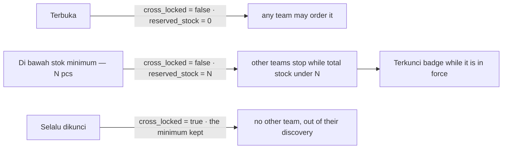

```
Produk ↕          Rentang HPP   Cross   Kunci              Siap                  Dikirim               Umur stok
Minyak … Satuan   Rp 45.700     12.5%   [↘ Min 4 pcs]      79 pcs                12 pcs                44 hari
                  Rp 47.200                                Belum ada pesanan     Restock 7 Okt 2026
Minyak … Karton   Rp 46.611     0%      [🔓 Terbuka]       43 pcs                0 pcs                 45 hari
                                        [↘ Min 50 pcs] Terkunci  ← 43 is under 50: closed to other teams now

[↘ Min 4 pcs] ─▶ Ubah Kunci
                 [🔓 Terbuka | ↘ Di bawah stok minimum | 🔒 Selalu dikunci]      ← stacked on a phone
                 Stok minimum  [− 4 +] pcs
                 Tim lain berhenti bisa memesannya selama total stok di semua gudang di bawah angka ini — …
                                                                         [Batal] [Simpan]
```

| | |
| --- | --- |
| the setting | ONE lock, three ways, on the two fields a product already has — `cross_locked` and `reserved_stock`; **no contract changed**. The minimum is the reserve of [the-reserve-stops-other-teams-at-low-stock](../../business/product/context_decision.md#the-reserve-stops-other-teams-at-low-stock): total stock in every warehouse ≥ N lets another team order, and the owner's own orders are never stopped |
| Terbuka | clears the minimum — one left behind would still close the product at low stock |
| Selalu dikunci | keeps the minimum, so coming back to *Di bawah stok minimum* finds the number it had |
| a minimum | a whole number of **at least 1** — 0 would be Terbuka under another name; Save waits for it |
| the row | a **Kunci** column right after **Cross** — the terms another team sells under, read together ([the-markup-sits-beside-the-cost](#the-markup-sits-beside-the-cost)); the setting with its icon (*Terbuka*, *Min 4 pcs*, *Selalu dikunci*), a button opening **Ubah Kunci** in a popover — `SegmentGroup` in the main tone ([a-segmented-choice-is-in-the-main-tone](context_decision.md#a-segmented-choice-is-in-the-main-tone)), the minimum as a `QuantityInput` only for its way, a line saying what each way means |
| in force now | a **Terkunci** badge (warning) while the total ready stock is under the minimum, the figures on its title. ⚠ Not drawn while a warehouse lens is on: the rule reads every warehouse, and the row then holds one building's — the setting still shows |
| who may change it | the owner, on a live product; an archived product, or a warehouse holding another team's goods, only reads it |
| the product's page | the same control on Info (beside the markup, which no longer carries a *Locked* badge) and on the Price tab, in place of the switch |
| the form | one **Kunci** field — the same editor — in place of *Stok cadangan* and the *Terkunci* switch; a new product starts **Terbuka** |
| Dipesan | **gone**. It showed `reserved_stock` and read *"Dipesan"* — what is ordered — while it was the minimum; its text called it units *"held back from selling, available = on hand − reserved"*, which contradicted the business decision. The minimum now lives in the lock, where it means what it does |
| the last order | moves under **Siap** — a sale is drawn from exactly that stock, as Dikirim's restock date is what arrives into it; Siap's worth rides on the figure's title (inline on a phone, where nothing hovers) |
| the component | [`features/products/ProductLock.tsx`](../../../frontend/src/features/products/ProductLock.tsx) — `ProductLockControl`, `LockModeField`, the mapping — with its story `Features/Products/ProductLock`; the write is `useSetProductLock` (one `ProductUpdate` with the two fields) |

**What it replaces** (HARD RULE 11): [each-date-rides-under-its-stock](#each-date-rides-under-its-stock) put the last order
under **Dipesan** — that column is gone, and the line is Siap's now; its examples still show it under Dipesan and are
stale. [the-product-screens-follow-the-screen-rules](#the-product-screens-follow-the-screen-rules) kept the **Terkunci**
switch in the row and the hold-back as a `QuantityInput` field in the form; both became the lock. The stories
`LockingIsEditedInTheRow` and `TheHoldBackSteps` became `TheLockIsEditedInTheRow` and `TheMinimumSteps`.

- Unchanged: Discover's product page — another team's view — still reads `reserved_stock` under its old label.

## the-lock-ways-are-radio-pills

> Owner, in chat (2026-10-22), on the Ubah Kunci popover: *"buat pill tipe ubah kuncinya, di bawah stok minimum jadi
> stok minimum"*.

```
Ubah Kunci
( ○ Terbuka )  ( ◉ Stok minimum )  ( ○ Selalu dikunci )      ← wrap onto a second line on a phone
[− 4 +] pcs                                                   ← the pill names it; the box has no label of its own
Tim lain berhenti bisa memesannya selama total stok di semua gudang di bawah angka ini — …
```

| | |
| --- | --- |
| the control | `RadioPills` (`components/inputs/`) — the form's either/or everywhere ([a-dialog-choice-is-a-radio-pill](financial_accounts_decision.md#a-dialog-choice-is-a-radio-pill)): rounded pills, each its radio mark, the chosen one rose. A pick is an answer to a field, not a view switch — which is what a segment reads as |
| the middle way | **Stok minimum** (en *Minimum stock*) — was *Di bawah stok minimum* |
| the minimum's box | no label above it — the chosen pill already says *Stok minimum*; it keeps its spoken name |
| a phone | the pills wrap; the stacked segments are gone |
| where | the popover on the list and the product's page, and the product form's Kunci field — one editor, `LockModeField` |

**What it replaces** (HARD RULE 11): [one-lock-three-ways](#one-lock-three-ways) drew the ways as a `SegmentGroup`
(*"segmented control in the main tone"*), stacked on a phone, and named the middle one *Di bawah stok minimum* — its
sketch and table are stale on those points.

## a-phone-edits-the-lock-in-a-modal

> Owner, in chat (2026-10-22): *"di mobile kunci di kiri edit dan jadi modal"*.

```
┌ Minyak Goreng Sawit 2L — Satuan ─────────────────────┐        ┌ Ubah Kunci ─────────────────── × ┐
│ Siap 79 pcs · Rp 3.667.000   …                        │        │ ( ○ Terbuka ) ( ◉ Stok minimum )  │
│ Cross 12.5%            Umur stok 44 hari              │  tap   │ ( ○ Selalu dikunci )              │
│              [↘ Min 4 pcs] [✎ Ubah] [🗃 Arsipkan]  ───┼──────▶ │ [− 4 +] pcs                       │
└───────────────────────────────────────────────────────┘        │ Tim lain berhenti bisa …          │
                                                                  │              [Batal] [Simpan]     │
                                                                  └───────────────────────────────────┘
```

| | |
| --- | --- |
| where it sits | a phone block's **foot**, on **Ubah**'s left — the lock is something you change, like the two actions beside it; it left the block's facts |
| how it opens | a **modal** — `Dialog`, its title *Ubah Kunci*, its ×, the same pills, minimum and line, Batal and Simpan — where a popover anchored to a block's foot had no room to sit |
| a desktop | unchanged — the popover beside the row |
| the product's page | the same — a modal on a phone, a popover from `md` — since it is one control (`ProductLockControl`, chosen by the breakpoint; a story pins it with `presentation`) |
| was | a fact of the block, *Kunci* over its button, opening the popover |

## a-cost-range-reads-as-a-range

> Owner, in chat (2026-10-22), looking at the list's stories: *"di story kasih contoh range price, semuanya cuma 1
> price?"*.

```
before                 now
Rentang HPP            Rentang HPP
Rp 45.700              Rp 45.700 – Rp 47.200     ← a range: both ends, the dash between
Rp 47.200  (muted)     Rp 10.255                 ← one delivery, one price
                       —                         ← nothing on a shelf
```

| | |
| --- | --- |
| the cell | the cheapest and the dearest units on hand on **one line**, `–` between, both in full rupiah — as the phone block and the product's Price tab already wrote it; one price when every layer agrees; **—** with nothing on a shelf |
| was | the cheapest over the dearest, the second line small and muted — it read as a different figure, so every row looked like it had one price |
| the stories | the stub now has products that came in **one delivery** (SKU-ANG-006, -012, -018 …), so the list shows single prices beside the ranges; `TheCostRangeReadsAsARange` pins all three cases |

## the-cross-price-rides-under-the-markup

> Owner, in chat (2026-10-22): *"cross taruh di sebelum hpp, lalu harga cross taruh bawahnya"*.

```
Produk ↕          Cross                   Rentang HPP             Kunci          Siap …
Minyak … Satuan   12.5%                   Rp 45.700 – Rp 47.200   [↘ Min 4 pcs]  79 pcs
                  Rp 51.412 – Rp 53.100   ← what another team pays: the cost range, the markup on both ends
Gula Merah …      0%                      Rp 10.255               [🔓 Terbuka]
                  Rp 10.255               ← 0% charges nothing — the price is the cost
Tepung … Satuan   0%                      —
                  —                       ← nothing on a shelf, nothing to mark up
```

| | |
| --- | --- |
| the order | **Cross** right after the product, then **Rentang HPP**, then **Kunci** — the terms another team sells under come first |
| the cross cell | the markup badge, and under it the **cross price** — `cost + cost × bps / 10 000` on both ends of the cost range, rounded as the product's Price tab rounds it; one price when the range is one; **—** with nothing on a shelf. Its title names it (*Yang dibayar tim lain*) |
| a phone | the block's Cross fact carries the same price under the badge, before Rentang HPP |

**What it replaces** (HARD RULE 11): [the-markup-sits-beside-the-cost](#the-markup-sits-beside-the-cost) put Cross
**after** Rentang HPP, and [one-lock-three-ways](#one-lock-three-ways) put Kunci right after Cross — the cross price now
needs the markup first, and the lock follows the cost. Both entries are append-only; their sketches show the old order.
The story `TheMarkupSitsBesideTheCost` became `TheCrossPriceRidesUnderTheMarkup`.

## the-cross-price-rides-under-the-cost

> Owner, in chat (2026-10-22), on the cross price under the markup: *"harga crossnya di bawah hpp"*.

```
Cross    Rentang HPP                      Kunci
12.5%    Rp 45.700 – Rp 47.200            [↘ Min 4 pcs]
         Cross Rp 51.412 – Rp 53.100      ← what another team pays, under the cost it is made from
0%       Rp 10.255
         Cross Rp 10.255
0%       —                                ← nothing on a shelf: no cost, no cross price
```

| | |
| --- | --- |
| the cost cell | the cost range, and under it the **cross price** — the same range with the markup on both ends — introduced by the word **Cross**, so two stacked figures cannot read as one range again ([a-cost-range-reads-as-a-range](#a-cost-range-reads-as-a-range)); nothing on a shelf shows **—** and no second line |
| the Cross column | the markup badge alone, still before Rentang HPP |
| a phone | the Rentang HPP fact carries the same second line; the Cross fact is the badge |

**What it replaces** (HARD RULE 11): [the-cross-price-rides-under-the-markup](#the-cross-price-rides-under-the-markup)
put the price under the markup badge. The column order it set stands (Cross, Rentang HPP, Kunci); where the price sits
does not — its sketch is stale on that point. The story `TheCrossPriceRidesUnderTheMarkup` became
`TheCrossPriceRidesUnderTheCost`.

## a-second-line-names-itself-in-a-tooltip

> Owner, in chat (2026-10-22): *"keterangan cross, pesanan dan restock di bawah sebagai tooltip saja"*.

```
Rentang HPP               Siap            Dikirim
Rp 45.700 – Rp 47.200     79 pcs          12 pcs
Rp 51.412 – Rp 53.100     29 Sep 2026     7 Okt 2026        ← the value alone
   └ hover: Harga cross — yang dibayar tim lain
                             └ hover: Pesanan terakhir
                                             └ hover: Restock terakhir
```

| | |
| --- | --- |
| the lines | the cross price under the cost, the last order under Siap, the last restock under Dikirim — each its **value alone**; *Belum ada pesanan* / *Belum pernah restock* keep their words, which already say what they are |
| the name | a Chakra `Tooltip` on hover — *Harga cross — yang dibayar tim lain*, *Pesanan terakhir*, *Restock terakhir*; a quiet order line adds *Tidak laku 30 hari atau lebih* |
| spoken | the line's `aria-label` carries the name with the value, since a tooltip needs a hover a phone and a screen reader do not have |

**What it replaces** (HARD RULE 11): [the-cross-price-rides-under-the-cost](#the-cross-price-rides-under-the-cost) prefixed
the cross line with *"Cross"*, and [a-row-date-reads-as-a-date](#a-row-date-reads-as-a-date) wrote *"Pesanan 29 Sep
2026"*, *"Restock 2 Okt 2026"* — those words left the lines for the tooltip; the entries' sketches are stale on that
point.

## the-sku-copies-from-the-row

> Owner, in chat (2026-10-22): *"sku copyable"*.

| | |
| --- | --- |
| the SKU | a `CopyText` under the product's name — a click puts it on the clipboard, the icon says ✓ only when the browser took it; the click does not open the row |
| why | the SKU is carried into other systems — a marketplace listing, a supplier's sheet — and retyping a code is how the wrong product gets listed |
| the component | `ProductListItem` gained `skuCopyable`; without it the SKU stays plain text, so every other screen drawing a product is unchanged |

## lock-and-stock-age-filter-ahead-of-the-contract

> Owner, in chat (2026-10-22), after asking which filters the list has: *"kasih filter lock dan umur stok
> unimplemented"*.

```
[⌕ Cari SKU atau nama ×] [Semua gudang ▾] [Semua kunci ▾] ⚠1 [Semua umur stok ▾] ⚠2
  Kunci      Terbuka · Stok minimum · Selalu dikunci · Terkunci sekarang
  Umur stok  30 · 60 · 90 hari atau lebih
⚠ 2 bagian layar ini belum diimplementasi — Filter kunci, Filter umur stok
```

| | |
| --- | --- |
| the lock | the three ways of [one-lock-three-ways](#one-lock-three-ways), and **Terkunci sekarang** — a minimum in force |
| the stock's age | at least **30**, **60** or **90** days on a shelf — the warning tone starts at 60 ([the-dates-read-as-ages](#the-dates-read-as-ages)) |
| ahead of the contract | each held in the URL (`?lock=`, `?age=`) and marked ⚠ (`dropped`), its pick **thrown away**: `ProductListFilter` has only `q` and `status`, and a paged list cannot be narrowed on screen without missing the products on the other pages; the age lives in inventory_service, further off still |
| the control | a plain list with its own × (a static, small set — no search), in the filter strip and the phone's Filter sheet; Hapus Filter clears them with the rest |
| the strip | the screen's `NotImplementedSummary` names both at the top |

## the-archive-is-a-page-of-its-own

> Owner, in chat (2026-10-22): *"draft dibuat beda halaman, lalu masuk ke halamannya lewat button di atas"* — asked which
> one was meant, they picked **the product archive**.

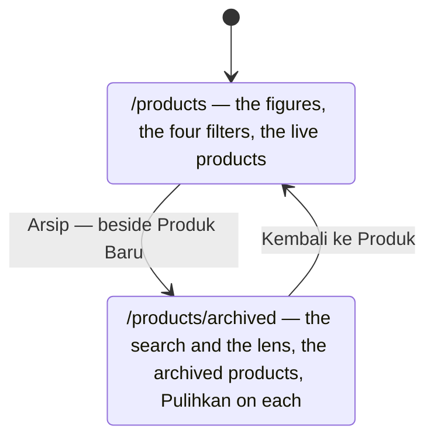

| | |
| --- | --- |
| the way in | **Arsip** (EN *Archive*), an outline button in the list's header: *[🗃 Arsip] [＋ Produk Baru]* — their icons alone on a phone |
| the page | `/products/archived` — **Arsip Produk**, a subtitle saying what archiving means, *← Kembali ke Produk* above the title |
| on it | the search and the warehouse lens · the table, each row offering **Pulihkan**, its lock only read |
| not on it | the figures (they describe the live catalogue), the lock and stock-age filters (an archived product is out of every other team's reach), New Product |
| an archived product's page | its Back returns to the archive |
| was | two tabs, *Aktif* · *Arsip*, under the filter strip of one page |

**What it replaces** (HARD RULE 11): [the-product-screens-follow-the-screen-rules](#the-product-screens-follow-the-screen-rules)
kept the *Aktif · Arsip* tabs under the strip — they are gone; its sketch is stale on that point.

## a-taken-sku-is-said-under-the-sku

> Owner, in chat (2026-10-23), on the product form, to the gaps I listed: *"oke, karena aku tahu ada batas di sini,
> inputnya harus kasih tahu batas juga misal 5/64"* ([a-limited-field-shows-its-count](context_decision.md#a-limited-field-shows-its-count)),
> and *"error sku kalau memang bisa oke, tapi gimana mekanismenya?"*.

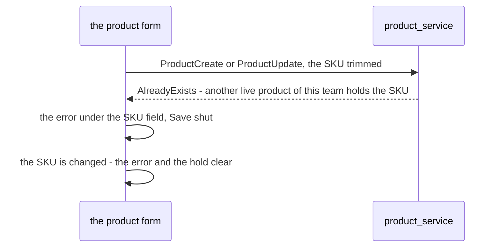

| | |
| --- | --- |
| the limits | SKU **64**, name **200**, description **1000** — a count under each, the box stopping there; the minimum's stepper stops at **1.000.000** and a larger one holds Save. All four mirrored from product.proto in `features/products/limits.ts` |
| trimmed | the SKU, the name and the description are sent without their outer spaces — the server stores what it is sent, so *"KOPI-01 "* would be a second SKU nobody can tell apart |
| the mechanism | the server already answers a taken SKU with its own code, **AlreadyExists** (`dbError` in product_service) — no API change. The form reads that code and puts the reason under the SKU; every other failure stays a sentence at the top |
| while it stands | the field is red and **Save is shut** for that SKU; typing another clears both, typing it back brings them back |
| an archived product's SKU | free to take — the rule is one SKU among the LIVE products of a team; restoring the old one is what collides |
| not chosen | checking while typing — a read per pause in typing, a race with the other half of a pair saving at the same second, and the save would still have to check |
| ✅ built *(2026-10-23)* | [product-edit/index.tsx](../../../frontend/src/pages/product-edit/index.tsx), the stories `EveryLimitIsShown`, `WhatIsSentIsTrimmed`, `ATakenSkuIsSaidUnderTheSku` |

## the-product-form-leaves-from-its-foot

> Owner, in chat (2026-10-23): *"di bawah ada tombol kembali, buat ada iconnya"* — then, seeing it on the left:
> *"kembali di sebelah buat, buat plus saja"*.

```
                                          [ ← Kembali ] [ + Buat ]       a new product
                                          [ ← Kembali ] [ 💾 Simpan ]    an edit
```

| | |
| --- | --- |
| Kembali | outlined, with its arrow, **right beside** the main button at the foot's right — goes where the top arrow goes: the screen the form was opened from ([the-form-returns-where-it-was-opened](#the-form-returns-where-it-was-opened)) |
| the main button | **Buat** with a **plus** on a new product; **Simpan** with a disk on an edit ([an-action-button-carries-its-icon](context_decision.md#an-action-button-carries-its-icon)) |
| the top arrow | stays — the foot is for somebody who scrolled to the end of the form |
| the page | fills the canvas ([the-form-fills-the-canvas-in-three-cards](#the-form-fills-the-canvas-in-three-cards)) — it was centred for a moment, then back at the left (*"ga jadi, kembalikan ke kiri"*), then widened to the full canvas |
| ✅ built *(2026-10-23)* | the stories `BackAtTheFootGoesWhereTheArrowGoes` and `CreateCarriesAPlus`; the stories are titled **Pages/Products/ProductForm** now (owner: *"di story jadi form aja namanya"*) |

## the-gallery-is-a-cover-and-four

> Owner, in chat (2026-10-23): *"untuk gambar aku ingin form drag drop juga, tampilkan 5 kotak, 1 kotak besar sebagai
> gambar utama, kotak kecil di bawahnya sesuaikan atau kasih aku gambaran dulu"* — then *"oke coba dulu"* to the sketch
> below and to ★ instead of a drag for the cover.

```
┌─────────────────────────────┐
│ Sampul                    ✕ │   the cover — always the first image, always the big box
│                             │
└─────────────────────────────┘
[ img ★ ✕ ] [ img ★ ✕ ] [ + ] [ + ]   the other four, one row, equal width
```

| | |
| --- | --- |
| the boxes | always five: the big one (square, the card's width) and four small ones in one row — on a phone too |
| one size | the gallery is the card's full width in every state — empty, uploading, filled — so no box changes size as a picture lands (owner: *"tengahkan, ukurannya tidak konsisten, saat kosong, loading upload dan setelahnya"*) |
| empty | the big box reads *"Seret gambar ke sini, atau klik untuk memilih"* with its icon; a small one is dashed with a + |
| a drop | anywhere on the gallery, several files at once — they fill the empty boxes in order; over five, the first that fit are kept and a toast says so. While a file is dragged over it, the gallery is outlined in the main tone |
| a click | an EMPTY box opens the file picker; a picture does not — its ★ and ✕ sit on it |
| uploading | each file spins in the box it will fill |
| the cover | **★ on a small box** moves it into the big one; the others keep their order, so the old cover becomes the first small box |
| not chosen | dragging a box onto the big one — a reorder by drag does not work under a finger, and the app has no drag-to-sort library; ★ works everywhere |
| removing | ✕ on any box; removing the cover makes the next one the cover, as before |
| ✅ built *(2026-10-23)* | [ProductImagesInput.tsx](../../../frontend/src/pages/product-edit/components/ProductImagesInput.tsx) on Chakra's FileUpload dropzone; the stories `AnEmptyGalleryAsksForADrop`, `DroppedFilesFillTheBoxes`, `AStarMakesTheCover`, `TheGalleryHoldsFive` |

## the-form-fills-the-canvas-in-three-cards

> Owner, in chat (2026-10-23), on the product form held to `5xl` at the left: *"kanan terlalu sepi, ada ide?"* — *"oke"*
> to three cards — then *"kurang, tidak penuh, info produk jadi yang paling panjang"*, *"gambar terlalu besar, sama input
> stok minimum itu"*, and *"deskripsi masuk info produk"* — then *"di layar lebih kecil, penjualan tim lain sejajar dengan
> info produk ada gap di kiri, di layar lebih besar, info produk kasih sedikit lebih besar daripada penjualan tim lain"*.

```
xl and up   [ Gambar 22rem ] [ Info Produk  1.25fr ] [ Penjualan Tim Lain 1fr ]    one row, one height
lg          [ Gambar 18rem ] [ Info Produk                               ]
                             [ Penjualan Tim Lain                        ]    under Info; the left is empty
below lg    Gambar · Info Produk · Penjualan Tim Lain, one column
```

| | |
| --- | --- |
| the width | the form **fills the canvas** — no `maxW`; the old `5xl` left the right of a wide screen empty |
| Gambar | a **fixed column** — 22rem from `xl`, 18rem at `lg` — so the cover is a picture to check, never a poster; where the card is the whole width (a tablet), the boxes stop at 20rem |
| Info Produk | SKU, name, description (4 rows), category — the record in reading order; the description stays here (*"deskripsi masuk info produk"*) after a round as a wide card of its own |
| Penjualan Tim Lain | the markup and the lock, under one title and a line on what they decide — *"Apakah tim lain boleh menjual produk ini di pesanan mereka, dan berapa yang mereka bayar di atas modal Anda."* |
| the proportions | from `xl`, Info Produk is **1.25×** Penjualan Tim Lain — it holds the longer text. At `lg`, Penjualan Tim Lain sits in Info's column under it, never under the picture; the space under the gallery stays empty |
| one height | the cards stretch to their row, so the row ends on one line |
| the minimum | an invalid minimum turns the **whole stepper** red — the − and + take the box's edge — instead of a red box inside a grey control; a rule of `QuantityInput` itself, so every stepper in a field gets it |
| ✅ built *(2026-10-23)* | [product-edit/index.tsx](../../../frontend/src/pages/product-edit/index.tsx), `QuantityInput`'s story `InvalidIsTheWholeControl` |

## the-form-returns-where-it-was-opened

> Owner, in chat (2026-10-23): *"kembali di button edit samakan dengan yang atas routenya"* — then, finding that every
> way out of an edit now led to the product's page: *"oh ternyata ke detail semua, kembalinya bisa ga baca route
> sebelumnya, kalau sebelumnya di detail maka ke situ, jika tidak ke list"*.

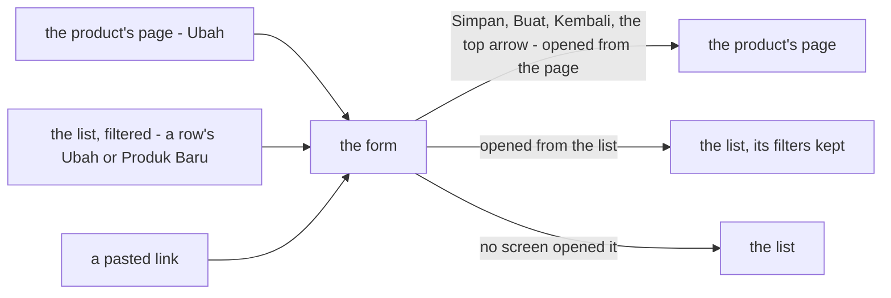

| | |
| --- | --- |
| the rule | every way out of the form — Simpan or Buat, the foot's Kembali, the top arrow — goes to **one** place: the screen it was opened from |
| from the product's page | back to that page, where the change is seen in place |
| from the list | back to the list **as it was** — its search and filters kept |
| otherwise | a pasted link, a refresh: to the list |
| how | the opening screen hands its own path in the navigation's state (`fromHere`, [lib/cameFrom.ts](../../../frontend/src/lib/cameFrom.ts)); the form reads it (`cameFrom`). Not the browser history — a step back after a save would land on the form's own past, and a pasted link has no past |
| superseded | the first answer, *an edit's Save goes to the product's page* — right only when the edit was opened there |
| ✅ built *(2026-10-23)* | the stories `BackFromAnEditReturnsToTheProduct`, `BackFromAnEditOpenedFromTheListReturnsToTheList`, `ASaveFromTheListReturnsToTheList`, `AnEditReachedByALinkReturnsToTheList` |

## the-product-page-is-one-page-of-sections

> Owner, in chat (2026-10-23): *"untuk detail kurang lebih aku ingin mirip dengan order detail"* — then *"coba"* to the
> sketch below and to one warehouse picker for the whole page.

```
┌ sticky ── ← Kembali ke Produk   Minyak Goreng Sawit 2L — Satuan  [Arsip]      [✎ Ubah] [Arsipkan] ┐
│           SKU-ANG-001 ⧉ · Rumah Tangga                                                            │
└───────────────────────────────────────────────────────────────────────────────────────────────────┘
Gudang [ Semua gudang ▾ ]
[ Siap 79 pcs ] [ Dikirim 12 pcs ] [ Rentang HPP Rp 45.700 – Rp 47.200 ] [ Umur stok 45 hari ]
┌ nav ─────┐ ┌ Info Produk ── pictures · SKU · category · description ───────────────────┐
│ Info     │ └────────────────────────────────────────────────────────────────────────────┘
│ Harga    │ ┌ Harga Modal ─────────────────────────┐ ┌ Penjualan Tim Lain ─┐
│ Batch    │ ├ Batch ───────────────────────────────┤ │ markup · kunci      │
│ Riwayat  │ ├ Riwayat Stok ────────────────────────┤ ├ Aktivitas ──────────┤
│ Tim lain │ └──────────────────────────────────────┘ │ order · restock     │
│ Aktivitas│                                           └─────────────────────┘
```

| | |
| --- | --- |
| the header | **sticky**, and the product itself: back, the name, the archived badge, the SKU to copy and the category under it, Ubah and Arsipkan (Pulihkan when archived). On a phone one row, the actions in ⋯, the section chips under it |
| one lens | ONE warehouse picker, above the figures, over the tiles and Harga, Batch and Riwayat stok — it was one per tab, and on one page four pickers could leave the tiles and a table answering about different buildings. The note says when the figures are one warehouse's. Info and Aktivitas's last sale are not lensed |
| the figures | four `SummaryCard`s — Siap, Dikirim, Rentang HPP (the cross price under it), Umur stok (warning tone from 60 days, as the list) — the same figures as the product's row |
| the sections | the shared `Section` and `SectionNav` (`Components/Chrome`) and `useScrollSpy` (`lib/`), promoted from the order detail for this: one page of cards, the nav lighting the one being read; Info full width; Harga, Batch, Riwayat in the main column, Penjualan Tim Lain and Aktivitas beside them from `xl`; one column in the nav's order below that |
| moved | the markup and the lock out of Info and Harga into Penjualan Tim Lain; the last order and restock out of Info into Aktivitas |
| no API change | every figure was already read |
| ✅ built *(2026-10-23)* | [product-detail/index.tsx](../../../frontend/src/pages/product-detail/index.tsx), the stories `EverySectionIsOnThePage`, `TheFiguresOnTop`, `OneLensOverEveryFigure` |

**What it replaces** (HARD RULE 11): [the-product-screens-follow-the-screen-rules](#the-product-screens-follow-the-screen-rules)
gave the page four tabs, down the left on a desktop and across the top on a phone — they are gone; its sketch is stale on
that point.

## a-short-section-hides-its-pager

> Owner, in chat (2026-10-24): *"harga modal dan batch tidak ada paginasi kalau jumlah datanya kurang dari limit, di
> halaman 1 ya"*.

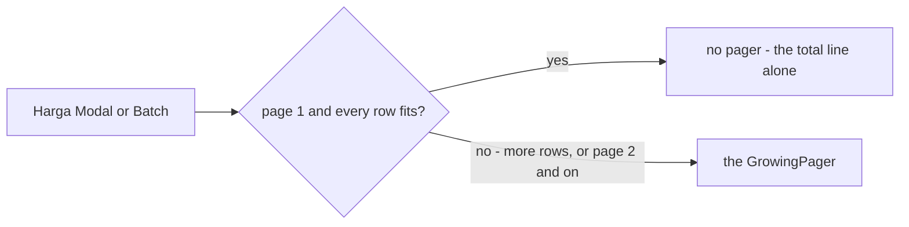

| | |
| --- | --- |
| where | the product's page, **Harga Modal** and **Batch** — sections inside a page, where a pager under three rows is furniture |
| the rule | on page 1, with no more rows than one page holds (20), the pager is not drawn; the total line stays |
| from page 2 | the pager always shows, so the way back is never lost |
| ✅ built *(2026-10-24)* | [PriceSection.tsx](../../../frontend/src/pages/product-detail/components/PriceSection.tsx), [BatchSection.tsx](../../../frontend/src/pages/product-detail/components/BatchSection.tsx); the stories `PriceListsTheLayers` and `OneLensOverEveryFigure` assert the pager is absent |

**What it narrows** (HARD RULE 11): [the-pager-is-always-on-screen](context_decision.md#the-pager-is-always-on-screen)
says every paged list keeps its pager on one page and on none. For these two sections that no longer holds; every other
list — Riwayat Stok on the same page included — still keeps it.

## the-warehouse-picker-splits-the-page

> Owner, in chat (2026-10-24): *"judul produk di produk info, di situ juga ada ready, ongoing, hpp dan umur stok, nama
> produk sticky, header kembali ke produk dan action tidak perlu sticky, filter gudang di bawah info produk, batch harusnya
> tidak masuk warehouse context … yang kurang adalah riwayat keluar masuk harian, suppliers list dan produk turunan
> (retur), kasih unimplemented"* — then *"harusnya ada overview di bawah pilih gudang, apinya seperti ready, ongoing, hpp
> di atas"* and *"karena batch datanya semua gudang, tidak perlu difilter"*.

```
← Kembali ke Produk                                        [✎ Ubah] [Arsipkan]     scrolls away
┌ nav ───────┐  ┌ Info Produk ─ [gambar] Minyak Goreng Sawit 2L — Satuan ─────────────────────┐
│ Info       │  │                SKU ⧉ · Kategori                                            │
│ Batch      │  │                Siap · Dikirim · Rentang HPP · Umur stok   ← TOTAL           │
│ Pemasok ⚠  │  │                Deskripsi                                                    │
│ Tim lain   │  └──────────────────────────────────────────────────────────────────────────────┘
│ Aktivitas  │  ┌ Batch (semua gudang) ──────────────┐ ┌ Penjualan Tim Lain ┐
│ Turunan ⚠  │  ├ Pemasok ⚠ ─────────────────────────┤ ├ Aktivitas ─────────┤
│ Per gudang │  └────────────────────────────────────┘ ├ Produk Turunan ⚠ ──┤
│ Harga      │  Per Gudang  [ Semua gudang ▾ ]
│ Harian ⚠   │  [ Siap ] [ Dikirim ] [ Rentang HPP ] [ Umur stok ]           ← that warehouse
│ Riwayat    │  ┌ Harga Modal ┐ ┌ Keluar Masuk Harian ⚠ ┐ ┌ Riwayat Stok ┐
```

| | |
| --- | --- |
| above the picker | the product across **every** warehouse — Info (the **name** as its headline, the SKU, the category, the four figures as **totals**, the description), Batch (every row names its warehouse; never filtered), Pemasok ⚠, and beside them Penjualan Tim Lain (the lock's badge on the total), Aktivitas, Produk Turunan ⚠ |
| the picker | **Per Gudang** — the warehouse picker and its **overview**: the same four figures as the summary cards, for the chosen warehouse (the same read as Info's totals, with the warehouse; one read while it is every warehouse) |
| below the picker | that warehouse — Harga Modal, Keluar Masuk Harian ⚠, Riwayat Stok |
| sticky | **only the name**, and only once Info's name has gone behind the bar — a bar drawn over the page, so its appearing moves nothing. Decided on every scroll from where the bar is drawn; an IntersectionObserver whose margin followed the bar's own height flipped it back and forth (owner: *"judul stickynya ngebug di bolak balik"*). Back and the actions sit at the top and scroll away. On a phone the section chips always stick, the name bar under them |
| in Info | the figures are plain figures, not summary cards — a card in a card ([never a card inside a card](../../../CLAUDE.md)) |
| ⚠ sections | Pemasok, Produk Turunan, Keluar Masuk Harian — each with its mark, listed in the page's `NotImplementedSummary` ([pages/product-detail/pending.ts](../../../frontend/src/pages/product-detail/pending.ts)). **Pemasok and Produk Turunan carry SAMPLE rows** (owner: *"pemasok dan turunan yang masih kosong tolong diisi"*): the suppliers as a table (deliveries, units, last cost, last delivery), the derived products **both ways** — *Turunan dari* (at most one) and *Turunannya* — because a return to another team links two products and the one on screen can be either end. Keluar Masuk Harian is still a sentence |
| ✅ built *(2026-10-24)* | the stories `TheFiguresTwice`, `ThePickerSplitsThePage`, `OnlyTheNameSticks`, `EveryGapIsMarked` |

**What it replaces** (HARD RULE 11): [the-product-page-is-one-page-of-sections](#the-product-page-is-one-page-of-sections) had
the whole header sticky, the picker above the figures and over every section (Batch included), and the figures only
once, lensed. Its sections and its nav stand; those three rows are stale.

## the-title-row-is-the-sticky-bar

> Owner, in chat (2026-10-24): *"judul di atas card info produk … yang data stat ready, ongoing jangan jadi 4, 1 1 ke
> bawah, info produk tidak penuh jadi penjualan tim lain ke bawah jadi disebelahnya"*, *"skunya di bawah nama produk,
> kategori samakan seperti siap, dikirim"*, *"di stickynya juga ada skuid"* — *"sku di sticky taruh bawahnya, bawah
> judul"* — and *"kembali dan actionnya juga, jadi default icon di sebelah judul, yang actionnya di nempel di kanan, di
> stickynya juga ada"*.

```
[←] Minyak Goreng Sawit 2L — Satuan  [Arsip]                         [✎ Ubah] [Arsipkan]
    SKU-ANG-001 ⧉
┌ Info Produk ────────────────────────────────────┐ ┌ Penjualan Tim Lain ┐
│ [gambar]  Kategori    Rumah Tangga › Dapur       │ ├ Aktivitas ─────────┤
│           Siap        79 pcs  Rp 3.667.000 · …   │ ├ Produk Turunan ⚠ ──┤
│           Dikirim     12 pcs  Rp 548.400 · …     │
│           Rentang HPP Rp 45.700 – Rp 47.200 …    │
│           Umur stok   45 hari  …                 │
│           Deskripsi                              │
└──────────────────────────────────────────────────┘
```

| | |
| --- | --- |
| the title row | above the Info card: **back as an icon** beside the name, the **SKU to copy under the name**, and the **actions held to the right** (Ubah, Arsipkan — Pulihkan when archived; ⋯ on a phone). There is no separate back-and-actions row any more |
| the sticky bar | **the same row, in small** — back, the name with the SKU under it, the actions — shown once the title has gone behind it. ⚠ Measured against where the bar STANDS once stuck (the scroller's top + the bar's height), not where it is drawn at that moment: at the top of the page the bar sits just above the title, and measured there it showed from the start (owner: *"stickymu bermasalah, muncul terus"*) |
| Info | the record as **one list, down** — Kategori first, read like the figures, then Siap, Dikirim, Rentang HPP, Umur stok as **totals** (a label, the figure, what it is worth beside it), then the description. Not four across |
| Info's width | in the main column, **not full width** — Penjualan Tim Lain, Aktivitas and Produk Turunan sit **beside** it from `xl`, Batch and Pemasok under it |
| first paint | the wide layout is read on the FIRST render (`useBreakpointValue(…, { ssr: false })`) — by default it answered the one-column layout first, so the picture painted large and then jumped (owner: *"ukuran gambarnya tidak konsisten, besar di awal"*). The order detail had the same jump and takes the same fix |
| ✅ built *(2026-10-24)* | the stories `TheProductsName`, `TheHeaderRowSticks` |

**What it replaces** (HARD RULE 11): [the-warehouse-picker-splits-the-page](#the-warehouse-picker-splits-the-page) put the
name inside Info with the figures four across, Info full width, and back and the actions in their own row that scrolled
away with only the name sticking. Its two zones stand; those rows are stale.

## the-warehouse-zone-is-tabs

> Owner, in chat (2026-10-24): *"keluar masuk harian kasih juga data dummynya, yang pergudang jadikan per tab biar ga load
> semuanya, yang statistik itu ganti design jadi overview dan tab pertama, supplier juga masuk ke tab itu, masalah di
> produk turunan, masalahnya dia bisa banyak design sekarang kalau kepanjangan membingungkan"*.

```
┌ Per Gudang ─────────────────────────────────────────────────────── [ Semua gudang ▾ ] ┐
│ Overview │ Harga Modal │ Keluar Masuk Harian ⚠ │ Riwayat Stok                            │
│ ─────────                                                                              │
│ Siap 79 pcs │ Dikirim 12 pcs │ Rentang HPP Rp 45.700 – 47.200 │ Umur stok 45 hari        │
│ Pemasok ⚠                                                                              │
│  CV Tani Jaya · 4 kiriman · 120 pcs · Rp 45.100 · 19 Okt 2026                          │
└────────────────────────────────────────────────────────────────────────────────────────┘
```

| | |
| --- | --- |
| the card | ONE card for the warehouse zone, below the product-wide sections: the warehouse picker in its header (under the title on a phone), the note when one warehouse is chosen, then the tabs |
| its width | **the main column**, as wide as Info and Batch, with the side cards beside them (owner: *"per gudang selebar batch dan info"*) |
| the tabs | **Overview** (first), **Harga Modal**, **Keluar Masuk Harian** ⚠, **Riwayat Stok** — `lazyMount` + `unmountOnExit`, so only the open tab is mounted and only its rows are read |
| Overview | the four figures redesigned as ONE group of Chakra `Stat`s divided by rules — not a strip of summary cards, and no box of its own inside the card — then **Pemasok** ⚠ (moved here from the product-wide zone) |
| Keluar Masuk Harian | SAMPLE rows now — the last fourteen days: date, in, out, on hand ([sampleMock.ts](../../../frontend/src/pages/product-detail/sampleMock.ts)); its ⚠ rides on the tab |
| Produk Turunan | it can be MANY, and a block per product made the side card long and confusing. Now: *Turunan dari* as one line; *Turunannya* with its **count** and the **first three as one line each** — team, SKU and the derived product's **READY STOCK**, **no date** (owner: *"Produk Turunan, tidak perlu dikasih tanggal"*, *"pcs stok readynya bukan diretur sejumlah"*); **Lihat Semua (N)** opens the whole list in a dialog, as a table: product and SKU, team, stock ready |
| Aktivitas | not a card any more — **the last order and the last restock are the last two rows of Info's list**, under the figures (owner: *"aktivitas masukkan ke info produk"*) |
| the nav | Info, Batch, Tim lain, Turunan, Per gudang — the tabs are not nav items |
| ✅ built *(2026-10-24)* | the stories `TheWarehouseTabsLoadOnlyWhenOpened`, `SamplesFillTheGaps`, `EveryGapIsMarked` |

**What it replaces** (HARD RULE 11): [the-warehouse-picker-splits-the-page](#the-warehouse-picker-splits-the-page) had the
picker and its overview as summary cards in the open, then Harga Modal, Keluar Masuk Harian and Riwayat Stok as cards
one after another, and Pemasok in the product-wide zone. The two zones stand; that arrangement is stale.

## the-stock-headline-stands-out

> Owner, in chat (2026-10-24): *"karena tidak ada yang menonjol selain gambar, aku ingin sesuatu yang menonjol, apa yang
> kamu sarankan"* — then *"yups"* to the proposal.

```
[gambar]   79 pcs siap   ● Aman
           +12 pcs dalam pengiriman · modal Rp 3.667.000
           ───────────────────────────────────────────────
           Kategori · Rentang HPP · Umur stok · Pesanan terakhir · Restock terakhir · Deskripsi
```

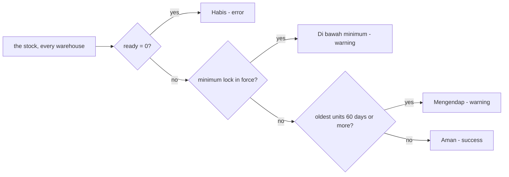

| | |
| --- | --- |
| the figure | **ready stock**, large, beside the picture — the answer to why somebody opens a product's page; across every warehouse, as the rest of Info |
| the chip | the FIRST rule that holds: nothing ready → **Habis**; the minimum lock in force (ready under `reserved_stock`, [one-lock-three-ways](#one-lock-three-ways)) → **Di bawah minimum**; the oldest units on a shelf for 60 days or more (the list's threshold) → **Mengendap**; else **Aman**. Each in its role's tone; the reason is on its title. No chip while the stock read is in flight |
| under it | *+N pcs dalam pengiriman · modal Rp …* — what is on its way and what the ready units cost |
| the list | Siap and Dikirim leave it — the highlight says them; Kategori, Rentang HPP, Umur stok, the last order and restock stay |
| no API change | every input was already read |
| ✅ built *(2026-10-24)* | [StockHighlight.tsx](../../../frontend/src/pages/product-detail/components/StockHighlight.tsx), the stories `TheStockHeadlineStandsOut`, `OutOfStockReadsRed` |

## the-stock-chip-says-how-much-is-left

> Owner, in chat (2026-10-24): *"stok bisa aman, habis dan hampir habis jika kurang dari berapa enaknya? order kebanyakan
> cuma 1-2"* — then *"oke di bawah 5"* to the proposal.

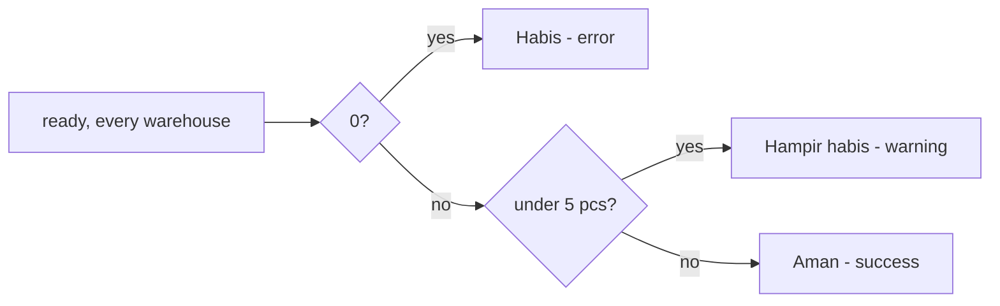

| | |
| --- | --- |
| the states | **Habis** (nothing ready), **Hampir habis** (fewer than **5 pcs** ready — two or three orders, which are mostly 1–2 units), **Aman** |
| the number | `LOW_STOCK_PCS = 5` in [features/products/stockAge.ts](../../../frontend/src/features/products/stockAge.ts), beside the stock-age threshold — the owner's to tune |
| not chosen | a threshold from the product's own sales (ready under seven days of them) — proposed, and the owner chose the fixed number |
| left the chip | **Mengendap** — the Umur stok row already turns to the warning tone from 60 days; **Di bawah minimum** — the lock's own control already badges a minimum in force. The chip answers one question: is there enough |
| ✅ built *(2026-10-24)* | the stories `TheStockChipRules` (0, 1, 4 and 5 pcs), `OutOfStockReadsRed`, `TheStockHeadlineStandsOut` |

**What it replaces** (HARD RULE 11): [the-stock-headline-stands-out](#the-stock-headline-stands-out)'s four-state chip and its
flowchart; the figure, the line under it and the list stand.

## the-overview-reads-like-info

> Owner, in chat (2026-10-24): *"produk turunan di modal ada gambarnya, yang pergudang overview siap dsb kaya kurang,
> harga modal pun yang di atas kayak kurang, atau gausah dikasih aja yang harga modal"*.

```
Overview │ Harga Modal │ Keluar Masuk Harian ⚠ │ Riwayat Stok
25 pcs siap   ● Aman                          ← this warehouse
+12 pcs dalam pengiriman · modal Rp 1.180.000
Rentang HPP   Rp 47.200   Cross Rp 53.100
Umur stok     54 hari     Unit tertua di rak tiba …
Pemasok ⚠ …
```

| | |
| --- | --- |
| Overview | the same **headline** as Info — the large ready figure and its status chip ([the-stock-chip-says-how-much-is-left](#the-stock-chip-says-how-much-is-left)) — for the **chosen warehouse**, then **Rentang HPP** and **Umur stok** as the same list Info uses, then Pemasok. It replaced a row of four equal stats that said nothing louder than the others |
| Harga Modal | **no figures above the table** — the cost range and the cross price were already said by Info and the Overview; the tab is the help line and the layers |
| Produk Turunan's dialog | each derived product with its **picture**, beside its name and SKU (the sample lends it the product's own) |
| shared | `FigureRows` is the one list both Info and the Overview draw; `StockHighlight` takes a test-id base so the two headlines on the page stay apart |
| ✅ built *(2026-10-24)* | the stories `TheFiguresTwice`, `ThePickerSplitsThePage`, `SamplesFillTheGaps` |

**What it replaces** (HARD RULE 11): [the-warehouse-zone-is-tabs](#the-warehouse-zone-is-tabs)'s Overview as a group of four
`Stat`s, and Harga Modal's two figures above its table. The tabs and the card stand.

## the-overview-is-small-details

> Owner, in chat (2026-10-26): *"cuma pcs aja di produk turunan, siapnya jadi tooltip aja"* and *"di overview tidak perlu
> ada aman, dan pcs siap yang besar, cuma detail kecil aja di sana"*.

| | |
| --- | --- |
| Overview | **small details only** — Siap, Dikirim, Rentang HPP, Umur stok for the chosen warehouse, as the list Info draws (`FigureRows`); **no large figure and no status chip** — those are Info's alone, so the page has one thing that stands out, not two |
| a derived product's line | just **"N pcs"** — the derived product's ready stock; what the number is (*Stok siap*) is its **tooltip**, and its spoken label |
| ✅ built *(2026-10-26)* | the stories `TheFiguresTwice`, `ThePickerSplitsThePage`, `SamplesFillTheGaps` |

**What it replaces** (HARD RULE 11): [the-overview-reads-like-info](#the-overview-reads-like-info)'s headline and chip in the
Overview, and the derived line's *"N pcs siap"*. Harga Modal without figures and the dialog's pictures stand.

## no-list-on-the-product-page-pages-when-it-fits

> Owner, in chat (2026-10-26): *"untuk halaman detail produk tidak perlu menampilkan paginasi kalau di halaman 1 total
> itemnya kurang dari limit, yang masih ada di riwayat stok"*.

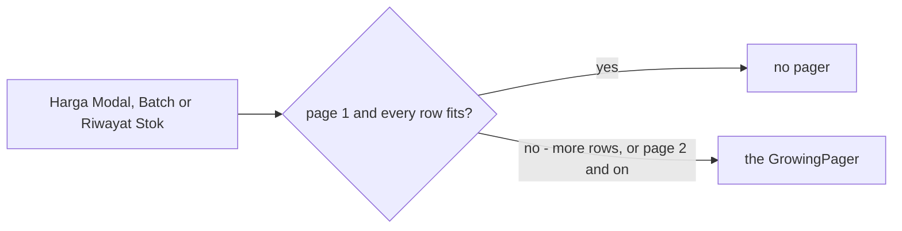

| | |
| --- | --- |
| where | **every** paged list on the product's page — Harga Modal, Batch and now **Riwayat Stok** |
| the rule | unchanged from [a-short-section-hides-its-pager](#a-short-section-hides-its-pager): on page 1, with no more rows than one page holds (20), the pager is not drawn; from page 2 it always shows |
| a new list on this page | follows it from the start — the page is one set of sections, and a pager under a short list is furniture in any of them |
| ✅ built *(2026-10-26)* | [HistorySection.tsx](../../../frontend/src/pages/product-detail/components/HistorySection.tsx); the story `StockHistoryListsEveryMovement` asserts the pager is absent |

**What it replaces** (HARD RULE 11): [a-short-section-hides-its-pager](#a-short-section-hides-its-pager)'s closing line,
*"Riwayat Stok on the same page included — still keeps it"*. Outside the product's page,
[the-pager-is-always-on-screen](context_decision.md#the-pager-is-always-on-screen) still holds.

## the-suppliers-are-a-tab-of-their-own

> Owner, in chat (2026-10-26): *"pemasok beda tab sama overview"*, then *"harga sebelum pemasok"*.

```
┌ Per Gudang ─────────────────────────────────────────────────────────────── [ Semua gudang ▾ ] ┐
│ Overview │ Harga Modal │ Pemasok ⚠ │ Keluar Masuk Harian ⚠ │ Riwayat Stok                        │
│ ─────────                                                                                      │
│ Siap 79 pcs · Dikirim 12 pcs · Rentang HPP · Umur stok        ← the Overview, alone            │
└────────────────────────────────────────────────────────────────────────────────────────────────┘
```

| | |
| --- | --- |
| the tabs | **Overview**, **Harga Modal**, **Pemasok** ⚠, **Keluar Masuk Harian** ⚠, **Riwayat Stok** — Harga Modal before Pemasok |
| Overview | the warehouse's four figures and nothing under them ([the-overview-is-small-details](#the-overview-is-small-details)) |
| Pemasok | the same sample table, in a panel of its own — no heading inside it, the tab names it; its ⚠ rides on the **tab**, as Keluar Masuk Harian's does |
| loading | like every tab, mounted only when opened (`lazyMount` + `unmountOnExit`) |
| ✅ built *(2026-10-26)* | [index.tsx](../../../frontend/src/pages/product-detail/index.tsx), [sections.ts](../../../frontend/src/pages/product-detail/sections.ts); the stories `EverySectionIsOnThePage` (the tab order), `EveryGapIsMarked` (the ⚠ on the tab), `SamplesFillTheGaps` (no supplier in Overview, the rows once the tab is opened) |

**What it replaces** (HARD RULE 11): [the-warehouse-zone-is-tabs](#the-warehouse-zone-is-tabs)'s *"Overview … then
Pemasok"* and [the-overview-reads-like-info](#the-overview-reads-like-info)'s *"then Pemasok"*. The card, the picker and
the other tabs stand.
