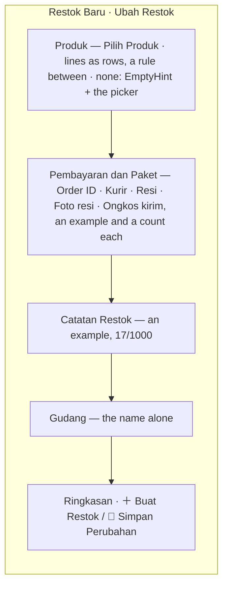

# Decisions — the restock screens

The owner's decisions about how the **restock screens** look and behave — first the selling team's list
(`/inventories/restock`, `pages/restock-selling`), then its detail and its form. **Append-only** (RULE 12): a reversed
decision is renamed and its references grepped.

The rules every screen follows are in [context_decision.md](context_decision.md). What a restock *is* — its statuses,
its money, who may do what — stays in [inventory/restock_decision.md](../../business/inventory/restock_decision.md).

| decision | what it decided |
| --- | --- |
| [the-restock-list-follows-the-screen-rules](#the-restock-list-follows-the-screen-rules) | the selling team's restock list takes every rule in `context_decision.md` before the owner's own pass — a title, the card strip, `FilterBar`, two-line cells, a block per restock on a phone, `EmptyHint`, `GrowingPager`. Its column order and its *Restok* column are REPLACED by [the-restock-list-leads-with-its-references](#the-restock-list-leads-with-its-references); its two in-flight cards by [the-restock-statistics-count-transactions-under-the-tabs](#the-restock-statistics-count-transactions-under-the-tabs) |
| [the-restock-list-leads-with-its-references](#the-restock-list-leads-with-its-references) | the columns run Referensi · Pemasok · Gudang · Produk · Total · Pengiriman · Status · Dibuat · Diterima · Aksi; the order number and the tracking number are copyable, cut at a width with a tooltip saying them whole |
| [the-restock-statistics-count-transactions-under-the-tabs](#the-restock-statistics-count-transactions-under-the-tabs) | the statistics sit under the status tabs, shut until opened — Semua Status: the total and a card per status, led by the transaction count; a status: Transaksi · Jumlah barang · Jumlah SKU · Nilai barang · Ongkir COD · Nilai transaksi, its Rincian › per paying account. Sample figures, marked. Its own row for the Statistik button is REPLACED by [the-statistics-button-ends-the-tab-row](#the-statistics-button-ends-the-tab-row) |
| [the-statistics-button-ends-the-tab-row](#the-statistics-button-ends-the-tab-row) | the Statistik button sits at the right end of the tab row on a desktop, and is an icon beside Filter on a phone — no row of its own. A rule for every list since: [a-statistics-button-ends-the-tab-row](context_decision.md#a-statistics-button-ends-the-tab-row) |
| [the-restock-list-exports-and-filters-by-courier](#the-restock-list-exports-and-filters-by-courier) | **Ekspor** beside *Restok Baru* and a **courier** filter after the warehouse — both on screen and marked `dropped`: the contract has neither yet |
| [a-restock-cancel-warns-it-will-be-checked](#a-restock-cancel-warns-it-will-be-checked) | the cancel dialog says, in a warning, that a cancellation is checked — on the list's ⋯ and on the detail's header alike |
| [a-phone-restock-is-four-lines](#a-phone-restock-is-four-lines) | on a phone a restock is four lines with room around them — the reference and the value lead, bold; the tracking number and the pieces; the supplier and the warehouse; the status and when — the store, the SKUs and the accepted date are the detail page's |
| [the-restock-detail-follows-the-screen-rules](#the-restock-detail-follows-the-screen-rules) | the selling detail takes every rule in `context_decision.md` before the owner's own pass — a phone header that stays, its actions as icons; product lines as blocks on a phone; rows that light up; two-line cells; copyable references; a Mobile story. Its tabs and its own phone header are REPLACED by [the-restock-detail-is-the-product-pages-shape](#the-restock-detail-is-the-product-pages-shape) |
| [the-restock-detail-is-the-product-pages-shape](#the-restock-detail-is-the-product-pages-shape) | the selling detail is ONE page of sections with the navigation on its left, as the product page — no tabs; its title is the order id with the tracking number under it, back is an icon, the restock's own number is not shown |
| [the-store-reference-is-the-order-id](#the-store-reference-is-the-order-id) | the store's reference on a restock is called **Order ID**, never *Faktur* — on the list, its phone block, the detail and the search |
| [the-title-is-the-reference-alone](#the-title-is-the-reference-alone) | the detail's title is the order id's VALUE alone, no label; the tracking number labelled under it; with no order id the tracking number leads alone |
| [payment-is-a-receipt-on-the-right](#payment-is-a-receipt-on-the-right) | Pembayaran is a small receipt — the account, then each line's figure held right, the total last — in a right column with Ongkir COD under it on a wide screen |
| [the-timeline-is-not-a-card-in-a-card](#the-timeline-is-not-a-card-in-a-card) | inside its section the timeline draws no card of its own |
| [the-notes-are-one-per-writer](#the-notes-are-one-per-writer) | the Catatan section holds one note per writer — the selling team's, with who and when, and the warehouse's (not stored yet, marked); the system's voice is the Riwayat, whose edit rows should say what changed (marked) |
| [the-list-opens-the-notes-in-a-dialog](#the-list-opens-the-notes-in-a-dialog) | every list row's ⋯ ends with **Catatan**, opening a dialog of both notes; the selling team's is edited there while the restock is on its way. Its open textarea is REPLACED by [the-note-is-edited-from-a-button](#the-note-is-edited-from-a-button) |
| [the-note-is-edited-from-a-button](#the-note-is-edited-from-a-button) | in the notes dialog the note is read first; **✎ Ubah** opens the edit in the dialog — never closing it — and a click outside does not throw the typing away |
| [the-product-lines-open-in-a-dialog](#the-product-lines-open-in-a-dialog) | a row's *SKU +N lainnya* opens the products in a **dialog** (`ProductLinesDialog`), a block per line on a phone — it was a popover |
| [the-open-points-are-settled](#the-open-points-are-settled) | the readings the owner had not answered, answered: the payments' Rincian stays, the four-line block stays restock's for now, the range opens on every date, the cancel warning is the restock's alone |
| [the-count-is-one-adjustment-column](#the-count-is-one-adjustment-column) | the products table's Datang · Baik · Rusak · Kurang are one column, **Penyesuaian** — *Sesuai*, or the good units with a badge per problem — its figures opening in a dialog |
| [the-note-is-edited-in-any-status](#the-note-is-edited-in-any-status) | Ubah is on the selling note in every status; past the restock's way the server does not keep it yet — the save says so, marked `dropped` |
| [the-timeline-names-its-people-small](#the-timeline-names-its-people-small) | a timeline step's person is a small avatar and the name alone (`UserItem` `size="xs"`); the products' total line reads *Stok aman untuk diterima gudang* |
| [the-timeline-is-centred-and-lines-up](#the-timeline-is-centred-and-lines-up) | a timeline step's icon sits at the middle of its step, its person column is one width on every step, and the line runs icon to icon |
| [a-phone-edits-the-note-in-a-sheet](#a-phone-edits-the-note-in-a-sheet) | on a phone the restock page's Ubah opens a bottom sheet; the list's dialog edits in place; Tutup hides while a note is typed |
| [the-label-photo-is-foto-resi](#the-label-photo-is-foto-resi) | `receipt_file` reads *Foto resi* in Indonesian, on every screen that shows it — the word people use for the printed label |
| [the-form-is-a-restock-not-a-request](#the-form-is-a-restock-not-a-request) | the form page is `restock-form` / `RestockFormPage`, its story *RestockForm*, and it is titled *Restok Baru* / *Ubah Restok* |
| [the-restock-form-follows-the-screen-rules](#the-restock-form-follows-the-screen-rules) | the form (create and edit) on the every-screen rules — Order ID, an example and a count in every typed field, Buat ＋ / Simpan 💾, lines as rows, an empty hint with the picker, Default and Mobile stories |
| [the-restock-form-is-three-columns](#the-restock-form-is-three-columns) | the form fills the canvas — three columns from `2xl` (the lines · the payment, the warehouse over the note · the money), the money column sticky; the product picker pages with `GrowingPager` |
| [one-supplier-for-all-in-two-steps](#one-supplier-for-all-in-two-steps) | a supplier for all products, not on screen until asked — **Samakan Supplier**, then a pick; every line follows it, a line may pick its own and come back with **Ikut Semua**; screen state only |
| [the-supplier-leads-the-produk-card](#the-supplier-leads-the-produk-card) | the supplier for all products is its own box at the TOP of the card — now **Produk dan Supplier** — on screen from the start with **Pilih Supplier**; it REPLACES the *not from the start* of [one-supplier-for-all-in-two-steps](#one-supplier-for-all-in-two-steps) |
| [the-card-is-supplier-then-produk](#the-card-is-supplier-then-produk) | the card is two titled parts — **Supplier** (a line that stays: optional, for all or per product; the choice in a field-like box), a rule, then **Produk** with Pilih Produk in its title; the supplier popup keeps its height |
| [the-note-sits-over-buat-restok](#the-note-sits-over-buat-restok) | the warehouse over the payment; the restock note in the money column, between the summary and **Buat Restok**; the column capped at the window; the supplier box one height, picked or not |
| [what-is-missing-is-one-line-over-buat](#what-is-missing-is-one-line-over-buat) | what still stands between the form and Buat Restok is ONE short line over the button — *Belum diisi: gudang · rekening · produk* — not a list under it |
| [the-checks-run-products-warehouse-account-resi](#the-checks-run-products-warehouse-account-resi) | the form checks the products (some, each with a **supplier**, real counts) → the warehouse → the paying account → the **resi**; the supplier and the resi become required on this form |
| [the-count-and-total-are-required](#the-count-and-total-are-required) | every product's count (at least 1) and total (above Rp 0) are required, marked `*`, checked after its supplier |
| [a-product-picks-its-supplier-from-the-same-box](#a-product-picks-its-supplier-from-the-same-box) | a product's *Dibeli dari* is the supplier part's box — `SupplierBox`, a field with *Belum dipilih* and **Pilih Supplier**, or the supplier with **Ganti** |
| [a-line-note-is-two-rows](#a-line-note-is-two-rows) | a product's note is a textarea, two rows to start |
| [an-empty-produk-is-the-full-size-hint](#an-empty-produk-is-the-full-size-hint) | with no product yet, the Produk part shows `EmptyHint` at its full size, not the small one |
| [the-summary-folds-its-products](#the-summary-folds-its-products) | Rincian's product list folds away under its heading — open to start |
| [the-summary-folds-without-a-scrollbar](#the-summary-folds-without-a-scrollbar) | no scrollbar flashes while Rincian's products fold or unfold; the list keeps its scrollbar gutter |
| [an-edit-opens-with-its-one-supplier](#an-edit-opens-with-its-one-supplier) | an edit whose open products all name one supplier and store opens with it on top — ONE product counts |
| [the-restock-form-returns-where-it-was-opened](#the-restock-form-returns-where-it-was-opened) | an edit's Simpan and Kembali go back to the list or the restock's page, whichever opened it; by a link, the list |
| [the-warehouse-restock-list-follows-the-screen-rules](#the-warehouse-restock-list-follows-the-screen-rules) | the warehouse's inbound list (`pages/restock-warehouse`) takes every rule in `context_decision.md` before the owner's own pass — the card strip, `FilterBar` with a search, short dates, a block per restock on a phone, the empty hints, `GrowingPager` |
| [the-inbound-row-says-who-and-when](#the-inbound-row-says-who-and-when) | the inbound row's *Dari* is the team with who raised it small under it; **Dibuat** and **Sampai** are columns of their own, Sampai naming who signed for the box; a product cell's *+N lainnya* starts at the text's left edge, on every list |
| [the-warehouse-sees-the-cod-it-paid](#the-warehouse-sees-the-cod-it-paid) | the warehouse's list shows no restock value — its one money card is the **COD it paid** couriers at the door this month, owed back by the selling teams; a sample until a read sums it |
| [the-inbound-status-sits-before-its-dates](#the-inbound-status-sits-before-its-dates) | the inbound table runs Restok · Dari · Produk · Pengiriman · **Status** · Dibuat · Sampai · Aksi — the status right before the dates, as on the selling list |
| [thonis-restock-is-weighed-one-feature-at-a-time](#thonis-restock-is-weighed-one-feature-at-a-time) | this branch does not follow `thoni`; that branch's restock design is a reference the owner weighs one feature at a time, later — and none of its features is marked pending meanwhile |
| [the-courier-is-required-on-the-form](#the-courier-is-required-on-the-form) | the courier is required on the restock form, checked after the Order ID and before the resi |
| [a-reference-in-use-stops-the-restock-form](#a-reference-in-use-stops-the-restock-form) | a resi or an Order ID already on another restock — not cancelled, not this one — is in **danger** under its field, with that restock's number and status, and holds Buat/Simpan back; checked over this team's restocks, marked `derived` |
| [the-cod-can-be-noted-when-the-box-arrives](#the-cod-can-be-noted-when-the-box-arrives) | the courier's charge can be noted at **Tandai Tiba** as well as at **Terima** — the same amount and note, optional at Tiba and final at Terima; at Tiba it is not kept yet (`dropped`) |
| [tiba-marks-and-terima-is-final](#tiba-marks-and-terima-is-final) | Tiba only marks, Terima is final, and Terima may come straight from Dalam Perjalanan. The words stay — Tandai Tiba → *Tiba*, Terima → *Diterima* — and the three places that blurred them are fixed |
| [a-broken-product-carries-a-photo](#a-broken-product-carries-a-photo) | at Terima a line with broken units takes one photo of them, under the broken note — optional, replaced or removed; on a phone the picker opens the camera. Not kept yet (`dropped`) |
| [the-detail-pages-show-the-broken-photo](#the-detail-pages-show-the-broken-photo) | both detail pages show the broken units' photo — in the selling page's Penyesuaian dialog, as a thumbnail on a phone's block and beside the warehouse page's broken count — a sample drawing for now (`sample`) |
| [a-broken-product-may-go-on-a-rack](#a-broken-product-may-go-on-a-rack) | at Terima a line's broken units are **thrown away** (the default) **or put on a rack**, which must then be chosen; the rack is not kept yet (`dropped`) |
| [the-courier-slip-has-an-optional-photo](#the-courier-slip-has-an-optional-photo) | the courier's charge takes an optional **photo of the slip** — at Tandai Tiba and at Terima; not kept yet (`dropped`) |
| [the-rest-of-thonis-restock-stays-ours](#the-rest-of-thonis-restock-stays-ours) | the rest of the `thoni` restock stays ours: the count at Terima, the total above 0, one line per product, returns apart — and its backend is not this screen work's to weigh |
| [the-detail-pages-show-the-slip-and-the-broken-rack](#the-detail-pages-show-the-slip-and-the-broken-rack) | the courier's slip photo shows under the charge on both detail pages, and the broken units' rack under the good units' places on the warehouse's — both samples (`sample`) |
| [terima-starts-from-the-charge-noted-at-tiba](#terima-starts-from-the-charge-noted-at-tiba) | Tiba and Terima can both change the charge; Terima opens with the one already on the restock, so a charge noted at Tiba is not typed again — empty today, marked `missing` |
| [the-warehouse-restock-detail-follows-the-screen-rules](#the-warehouse-restock-detail-follows-the-screen-rules) | the warehouse's restock page takes every screen rule and the selling page's shape — one page of sections under a nav, the tracking number as its title, the money on the right, the lines in two-line cells and blocks on a phone |
| [the-warehouse-reads-the-box-not-the-purchase](#the-warehouse-reads-the-box-not-the-purchase) | the warehouse's restock page shows the box, not the purchase: the product's picture, and no supplier, no goods' price, no line total and no Pembayaran |
| [the-warehouse-writes-its-own-note](#the-warehouse-writes-its-own-note) | on its own restock page the warehouse writes its note — Ubah, as the selling note's — and reads the selling team's; not kept yet (`dropped`) |
| [the-charge-is-asked-for-before-it-is-filled](#the-charge-is-asked-for-before-it-is-filled) | the courier's charge is asked first — *Ongkir COD dari kurir: (• Tidak ada) ( Ada )*, a radio pill; on *Ada* the amount and the note (a textarea) appear and are required. At Tandai Tiba and at Terima |
| [the-restock-page-leads-with-the-box](#the-restock-page-leads-with-the-box) | both restock pages lead with the box — Produk first, opened by five cards of what the box is — and the info on the right: Kiriman over the money (Pembayaran, Ongkir COD) |
| [the-warehouse-sees-the-ongkir-it-paid](#the-warehouse-sees-the-ongkir-it-paid) | on the warehouse's restock page the ongkir shown is the one **it paid** — the COD charge — a fact in Kiriman after the courier, not a section; the selling team's own ongkir is not shown |
| [a-door-photo-is-a-thumbnail-that-opens-whole](#a-door-photo-is-a-thumbnail-that-opens-whole) | a photo from the door is a small thumbnail everywhere it is read back — the selling page's Penyesuaian dialog too — and opens whole in a dialog of its own; never drawn wide and cut to fit |
| [the-restock-accept-follows-the-screen-rules](#the-restock-accept-follows-the-screen-rules) | Terima follows the screen rules: one ready line by its button, its icon on a phone's header row, every way out to where it was opened, a problem's note labelled with an example and its count, the app's dates, a skeleton, and its stories in folders |
| [the-accept-page-puts-the-box-left-and-the-info-right](#the-accept-page-puts-the-box-left-and-the-info-right) | Terima's lines are the main column and the restock's record with the courier's charge a 20rem column on the right from `xl`; narrower, the lines first; a line card arranges its three parts by its column's width; back is its icon alone |
| [the-accept-info-is-who-the-parcel-and-the-ongkir-it-paid](#the-accept-info-is-who-the-parcel-and-the-ongkir-it-paid) | Terima's info is two cards: who (restock, team, person — one line each, small pictures) and the parcel, which ends with the COD charge this warehouse pays; no goods, shipping or total |
| [the-accept-line-shows-no-price](#the-accept-line-shows-no-price) | a Terima line shows no price per piece and no HPP — only what a broken or missing unit was worth |
| [the-box-count-says-its-state-in-colour](#the-box-count-says-its-state-in-colour) | Terima's *n dari n pcs* is a badge in the tone of where the count stands — info while counting, success whole, warning short, error over |
| [a-problem-note-is-a-two-row-textarea](#a-problem-note-is-a-two-row-textarea) | a broken or missing unit's note is a two-row textarea, as the charge's note is |
| [one-rack-once-per-line](#one-rack-once-per-line) | a Terima line's placement rows never share a rack — each row's picker shows the racks the others hold, disabled, with no words beside them |
| [the-ordered-count-is-highlighted-in-pcs](#the-ordered-count-is-highlighted-in-pcs) | a Terima line's ordered count reads *Dipesan 12 pcs*, highlighted in the primary tone, found at a glance |
| [the-pcs-alone-is-highlighted](#the-pcs-alone-is-highlighted) | on Terima only the *n pcs* is highlighted — a small badge at the text's size, the words around it plain — on a line's *Dipesan* and in the header's *dari … di dalam paket* |
| [the-cod-paid-is-said-in-its-own-section](#the-cod-paid-is-said-in-its-own-section) | Paket carries no ongkir; Terima's courier-charge section says as text what the warehouse paid — *Dibayar gudang Rp 15.000 · Biaya COD · diganti oleh …* — and Ubah opens its form, Tiba's values in it |
| [the-line-reads-ordered-then-what-it-came-to](#the-line-reads-ordered-then-what-it-came-to) | a Terima line names no supplier; its good, broken and missing sit under *Dipesan* in the product's column, each in its tone |
| [the-broken-and-the-missing-are-blocks-of-their-own](#the-broken-and-the-missing-are-blocks-of-their-own) | on Terima the broken units' details and the missing units' note are each a block with an edge and a heading in its tone — never one running list |
| [putaway-waits-for-the-count](#putaway-waits-for-the-count) | Terima's put-away panel is off until Diterima is set; a good row then holds at most what Diterima leaves good |
| [the-broken-units-rack-is-a-marked-placement](#the-broken-units-rack-is-a-marked-placement) | broken units put on a rack get their rack as a row of the put-away panel, marked Rusak with their pcs; the Rusak block only chooses |
| [broken-waits-for-something-received](#broken-waits-for-something-received) | Terima's Rusak is off while Diterima is blank or 0, and empties when Diterima goes back to 0 |
| [terima-keeps-the-order-id](#terima-keeps-the-order-id) | Terima's Paket card keeps the store's reference, named *Order ID* — never *Invoice* |
| [the-ready-line-jumps-to-what-it-names](#the-ready-line-jumps-to-what-it-names) | each thing Terima's ready line names is a link — the page scrolls to that line or the charge, clear of the header, and it blinks |
| [the-confirm-says-the-count](#the-confirm-says-the-count) | Terima's confirm shows the box in figures — good, broken, missing in pcs and the COD charge — before its sentence |
| [the-restock-labels-follow-the-screen-rules](#the-restock-labels-follow-the-screen-rules) | Cetak Label follows the screen rules: back as an icon to where it was opened, icons on a phone's one-row header, the size as pills, the app's dates, a skeleton, an Alert and an EmptyHint, Default and Mobile stories |
| [the-label-is-set-up-in-mm](#the-label-is-set-up-in-mm) | a label run is set up in mm — the paper (35 × 15), rows × columns and gap on it (1 × 1, 0), padding (2 mm) all round or per side, SKU · placement · name · date each with its size, bold, centred, condensed, the QR's gap, the name's lines, a limit and a page; one paper a printed page |
| [the-label-settings-are-remembered](#the-label-settings-are-remembered) | the label settings save themselves to the device's local storage on every change; Kembalikan Default puts them back |
| [the-label-page-is-settings-and-a-preview](#the-label-page-is-settings-and-a-preview) | Cetak Label is the settings held in view beside a Pratinjau card — white stickers on a grey ground, three a row at up to 2× |
| [the-print-list-is-each-label-and-its-count](#the-print-list-is-each-label-and-its-count) | Cetak Label shows one paper in Pratinjau, then Yang Dicetak: each label once with its count to print, typed over — what prints is exactly those counts |
| [ctrl-p-prints-the-labels](#ctrl-p-prints-the-labels) | on Cetak Label, Ctrl+P / ⌘P is the page's own print — the same act as Cetak; with nothing to print it says so |
| [labels-print-from-arrived](#labels-print-from-arrived) | Cetak Label opens from Tiba too, beside Terima: one label per line, as many as ordered, no placement, the SKU alone in the QR — and the page says so |
| [labels-print-several-restocks](#labels-print-several-restocks) | Cetak Label prints several restocks in one run: a Restok card over the Pratinjau — each restock with its labels and ✕, and *Tambah Restok* (a search select of Tiba and Diterima) — and Yang Dicetak is grouped by restock |
| [print-is-the-labels-action](#print-is-the-labels-action) | the labels' action is *Cetak* — the verb alone, on the list's row, the restock's page and its sticky bar; the page it opens is still Cetak Label |
| [the-list-prints-the-ticked-restocks](#the-list-prints-the-ticked-restocks) | the warehouse list has a box before each row — enabled for Tiba and Diterima — and a page box in the head; while any is ticked the title's row offers *Cetak N Restok*, opening Cetak Label with all of them |
| [the-label-settings-scroll-inside-their-card](#the-label-settings-scroll-inside-their-card) | Cetak Label's settings are the whole left column, as Product Discover's filter panel is: it sticks and ends a gutter above the window's foot wherever it stands; the title stays and the groups scroll inside, the bar on the card's edge |
| [labels-a-restock-jumps-to-its-labels](#labels-a-restock-jumps-to-its-labels) | on Cetak Label, a restock in the Restok card takes you to its labels — Yang Dicetak scrolls to its group, which blinks where it lands |
| [the-labels-have-one-address](#the-labels-have-one-address) | Cetak Label has one address, `/inventories/restock/labels?ids=…`, for one restock or several; every way in opens it, and the old `/inventories/restock/:id/labels` redirects to `?ids=:id` |
| [cetak-is-the-one-print-button](#cetak-is-the-one-print-button) | Cetak Label has one print button, *Cetak* — no *Unduh PDF*: both opened the same print dialog, which is where a PDF is saved |
| [the-labels-mark-their-one-by-one-read](#the-labels-mark-their-one-by-one-read) | Cetak Label reads each restock on its own — a detail, and an accepted one's labels — and says so: an `interim` pending mark on the Restok card and in the strip under the title |
| [the-labels-stories-are-folders-by-part](#the-labels-stories-are-folders-by-part) | Cetak Label's 22 stories are folders by the part of the screen — Default and Mobile first, then Header, Restocks, Settings, States, ToPrint — as every big page's are |
| [there-is-no-struk](#there-is-no-struk) | there is no Struk — the goods-received receipt (#219) was built without a decision and is not needed: an accepted restock offers Cetak alone, and the receipt's address lands on the restock |
| [a-label-count-follows-its-label](#a-label-count-follows-its-label) | on Cetak Label a typed count belongs to the label it was typed for — the restock, product, batch and placement — never to the place it sat in the list |
| [at-most-fifty-restocks-a-print](#at-most-fifty-restocks-a-print) | at most 50 restocks a print — Cetak Label's address holds the first 50 and Tambah Restok stops there; the list's ticks stop there too, each saying why |
| [the-labels-address-probe-is-hidden](#the-labels-address-probe-is-hidden) | the address a Cetak Label story reads (`?ids=…`) is kept off the screen under review — in the DOM for the test, not shown |

## the-restock-list-follows-the-screen-rules

> Owner, in chat (2026-10-31): *"sekarang kita ke inventory restock selling, inisiasi dulu"* — start the screen from the
> rules every screen follows, before deciding anything about it.

```
Restok                                                              [+ Restok Baru]
[Masuk  81            ] [Nilai barang masuk  Rp 2.785.000]
[⌕ Cari restok, resi, faktur, atau SKU] [Semua gudang ⌄] [Siapa saja yang membuat ⌄] [… menerima ⌄] [Dibuat · Semua tanggal ⌄]  Hapus filter
Semua Status · Dalam Perjalanan · Tiba · Diterima · Hilang · Dibatalkan
Restok                     Pemasok                          Tujuan        Status       Diterima   Produk  Referensi  Pengiriman  Nilai  Aksi
#501                       PT Sumber Makmur +1 pemasok lain  Gudang Pusat  Dalam Perj.  —          …       …          JNE         …      ⋯
29 Okt 13:05 · oleh Rina   [Shopee] Sumber Makmur Official
                                                                         Per halaman [20 ⌄]  ‹ [1] ›

on a phone
Restok                                                              [+]
[Masuk 81] [Nilai barang masuk Rp 2.785.000]
[⌕ Cari restok …]  [Filter]
#501 [Dalam Perjalanan]                                             ⋯
29 Okt 13:05 · oleh Rina
PT Sumber Makmur +1 pemasok lain
[Shopee] Sumber Makmur Official
▣ Gudang Pusat
3 produk · 64 pcs                                       Rp 2.080.000
SKU-BERAS-5K +2 lainnya
```

| rule | applied |
| --- | --- |
| [the-desktop-shell-has-no-top-bar](context_decision.md#the-desktop-shell-has-no-top-bar) | the page names itself — **Restok**. It had no heading and leaned on the breadcrumb, which is gone. Still no team badge and no blurb under it: the owner had taken both off, and the switcher names the team |
| [an-action-button-carries-its-icon](context_decision.md#an-action-button-carries-its-icon) · [a-phone-header-action-is-an-icon](context_decision.md#a-phone-header-action-is-an-icon) | **＋ Restok Baru**; on a phone its ＋ alone, on the title's row |
| [a-list-summary-is-the-order-lists-card-strip](context_decision.md#a-list-summary-is-the-order-lists-card-strip) | *Masuk* and *Nilai barang masuk* are two `SummaryCard`s in a `SummaryStrip` — they were Chakra `Stat`s. Unchanged in meaning: in flight over the whole team, narrowed by the warehouse filter and nothing else |
| [a-phone-filters-from-a-sheet](context_decision.md#a-phone-filters-from-a-sheet) · [clear-filters-is-red-and-bold](context_decision.md#clear-filters-is-red-and-bold) · [every-filter-clears-from-its-own-x](context_decision.md#every-filter-clears-from-its-own-x) | the shared `FilterBar`: the search (debounced now, with its × and icon), the warehouse, who raised it, who accepted it, the date. **Hapus filter** puts all of them back, the date type included. The status tab is not a filter and stays |
| [a-one-type-picker-shows-the-name-alone](context_decision.md#a-one-type-picker-shows-the-name-alone) | the warehouse filter shows its pick as the name alone |
| [one-context-per-column-and-never-three-lines](context_decision.md#one-context-per-column-and-never-three-lines) | **Restok**: the number, then *when · by whom* on one line — the author had a third line. **Pemasok**: *+1 pemasok lain* sits after the supplier's name, not under the store. `LineSupplier` gained an `after` slot for it |
| [a-table-row-lights-up](context_decision.md#a-table-row-lights-up) | every cell in `bg.muted` under the pointer; a phone block lights up and gives under a thumb, since it opens the restock |
| [a-phone-reads-each-line-as-a-block](context_decision.md#a-phone-reads-each-line-as-a-block) | a restock is a block: the number, its status, the *missing* badge and its ⋯; when and by whom; the supplier and store; the warehouse; what is in it beside its value. The accepted date, the references and the courier are the detail page's |
| [an-empty-list-shows-a-hint](context_decision.md#an-empty-list-shows-a-hint) | nothing yet: the restock icon, a line on what a restock is, and **Restok Baru**; an empty status tab: which status has none; nothing matches: *Tidak ada restok yang cocok.* and **Hapus Filter** |
| [every-list-pages-with-the-growing-pager](context_decision.md#every-list-pages-with-the-growing-pager) · [the-pager-is-always-on-screen](context_decision.md#the-pager-is-always-on-screen) | `GrowingPager`, 10 / 20 / 50 a page; it starts over when the tab, a filter or the page size changes |
| [motion-is-small-quick-and-shared](context_decision.md#motion-is-small-quick-and-shared) | the page rises in; the first load is a `ListSkeleton`; the rows fade in once |
| [every-page-has-a-mobile-story](context_decision.md#every-page-has-a-mobile-story) · [a-page-story-has-its-shells-gutter](context_decision.md#a-page-story-has-its-shells-gutter) | a **Mobile** story right after Default; the stories lost Storybook's `padded` layout |
| not applied | [a-table-sorts-from-its-headings](context_decision.md#a-table-sorts-from-its-headings) — `RestockRequestListRequest` has no sort, so no heading sorts. ⚠ My reading, not asked: the date range stays on *Semua tanggal*. [the-quick-ranges-are-days-then-months-then-years](context_decision.md#the-quick-ranges-are-days-then-months-then-years) sets *1 bulan terakhir* for the dated reports, and a work list that opened on a window would hide an old restock still in flight |
| unchanged | the columns and their order, the five status tabs and *Semua Status*, the filters in the URL, the row's ⋯ by status, the value as goods plus shipping |
| the stub | Storybook's `OwnerStockStat` gave *Masuk 0* for every team but the figured one, beside a restock in flight. Another team's in-flight figures now come from its ongoing and arrived restocks (`restockInFlight`), so the cards agree with the rows |
| e2e | *Restock requests page renders for root* accepts the table or the empty hint — a fresh database shows the hint now |

## the-restock-list-leads-with-its-references

> Owner, in chat (2026-10-31): *"dimulai dari referensi di mana order id dan resinya copyable, untuk resi kemungkinan bisa
> sangat panjang, jadi harus ada pembatasan tapi juga harus ada cara lihat fullnya, dilanjutkan pemasok, gudang, produk,
> total, pengiriman, status, tgl dibuat, tgl diterima, dan aksi"*.

```
Referensi                    Pemasok    Gudang   Produk   Total   Pengiriman  Status    Dibuat         Diterima        Aksi
Faktur INV/2026/10/1001 ⧉    PT Sumber  Gudang   3 produk  Rp …   [JNE]       Dalam P.  29 Okt 13:05   —               ⋯
Resi   JNE-CGK-2026091… ⧉    [Shopee] … Pusat    SKU …                                  oleh Rina
           └ under the pointer: JNE-CGK-20260911-0000111122-REG
```

| | |
| --- | --- |
| the order | **Referensi · Pemasok · Gudang · Produk · Total · Pengiriman · Status · Dibuat · Diterima · Aksi**, the owner's |
| Referensi | the store's order number (*Faktur*, the restock's `invoice_ref_id`) over the tracking number (*Resi*), each labelled and each a `CopyText` — a click copies it and never opens the restock. A dash when the restock has neither |
| a long reference | cut at **10rem** with an ellipsis; a **tooltip** shows it whole under the pointer or the focus — only while it is cut. The copy is always the whole value. `CopyText` gained the `maxW` that does this, so any screen can cap a long value the same way. ⚠ My reading, not asked: the order number is capped like the tracking number, since both share the cell |
| Gudang | the column was *Tujuan*; it says *Gudang* now. Still the shared `TeamItem` |
| Total | the column was *Nilai*; still goods plus shipping ([the-couriers-charge-stays-out-of-total](../../business/inventory/restock_decision.md#the-couriers-charge-stays-out-of-total)) |
| Dibuat | a column of its own: the date, and *oleh …* under it — as *Diterima* has always been |
| the restock's own #id | ⚠ no longer on the row — the owner's list does not name it. The row opens the restock and the search finds a number. It was the *Restok* column's first line |
| what it replaces | the column order of [the-restock-list-follows-the-screen-rules](#the-restock-list-follows-the-screen-rules), and its *Restok* column (*#501* over *when · by whom*) |
| unchanged | the phone's block — it still leads with *#501* and its status, and carries no reference |
| the fixture | restock 504's tracking number runs long (`JNE-CGK-20260911-0000111122-REG`), so the cut shows in Storybook |

## the-restock-statistics-count-transactions-under-the-tabs

> Owner, in chat (2026-10-31): *"untuk statistiknya adalah di bawah tab status … untuk statistik di semua status adalah
> total dan per status, dimana data per cardnya adalah transaksi, compact jumlah stok dan compact nilai stoknya, untuk di
> tab status ada transaksi, jumlah barang, jumlah sku, nilai barang, ongkir cod, nilai transaksi"*; on the transfer /
> ShopeePay split of the old screen, *"sistem baru belum tau akan dibuat seperti apa, saranmu?"*. Then: *"jumlah transaksi
> yang penting"*, *"ongkir cod itu biaya kurir yang dibayar oleh gudang, jadi cuma 1 kartu"*, and on shutting it as the
> order list does, *"kita tutup saja"*.

```
Semua Status · Dalam Perjalanan · Tiba · Diterima · Hilang · Dibatalkan
[📊 Statistik ⌄]                                                       ← shut on every visit

Semua Status                                                                          ⚠ 1
[Total          ] [Dalam Perj.   ] [Tiba           ] [Diterima       ] [Hilang  ] [Dibatalkan]
 48 transaksi      4 transaksi      2 transaksi      39 transaksi
 1,2rb pcs · Rp 24,5jt  …

a status (Diterima)
[Transaksi] [Jumlah barang] [Jumlah SKU] [Nilai barang] [Ongkir COD          ] [Nilai transaksi   Rincian ›]
 39          702 pcs         110           Rp 13.338.000  Rp 104.000             Rp 14.196.000
                             produk yang   ...            dibayar gudang ke      barang + ongkir
                             berbeda                      kurir
                                                                                 └ per akun pembayar
                                                                                   BCA Operasional [BCA]  26 · Rp 9.464.000
                                                                                   ShopeePay Melati [ShopeePay] 13 · Rp 4.732.000
```

| | |
| --- | --- |
| where | under the status tabs, behind a **Statistik** button — the order list's, shut on every visit, page state only ([the-statistics-are-shut-and-read-when-opened](order_list_decision.md#the-statistics-are-shut-and-read-when-opened)). Opened, it follows the tab |
| Semua Status | the **total**, then one card per status with its badge. A card is led by its **transaction count**; the units and the value are under it, compact (*1,2rb pcs · Rp 24,5jt*) |
| a status | six cards, whole figures: **Transaksi**, **Jumlah barang** (pcs), **Jumlah SKU** (different products, not lines), **Nilai barang**, **Ongkir COD**, **Nilai transaksi** |
| Ongkir COD | ONE card: what the warehouse paid the courier at the door. It is outside Nilai transaksi ([the-couriers-charge-stays-out-of-total](../../business/inventory/restock_decision.md#the-couriers-charge-stays-out-of-total)), so its line says who paid it and Nilai transaksi's says *barang + ongkir* |
| transfer or ShopeePay | **Rincian ›** on Nilai transaksi ([a-breakdown-opens-from-rincian](context_decision.md#a-breakdown-opens-from-rincian)) opens the value **per paying account** — the account's name, its provider badge (a bank is a transfer, ShopeePay an e-wallet) and its transaction count. A dialog on a desktop, a bottom sheet on a phone. My recommendation, accepted without objection: every restock already names its paying account, so no new concept is needed |
| a card | controls nothing — the tab above chooses the status |
| ⚠ sample | nothing in the contract counts a team's restocks by status: every figure is a SAMPLE, steady per team, that does not follow the filters (`summarySample.ts`); the accounts in the breakdown are the team's real operational ones, the split over them invented. Two marks, `summary` and `payments` (`pages/restock-selling/pending.ts`) |
| what it replaces | the two in-flight cards of [the-restock-list-follows-the-screen-rules](#the-restock-list-follows-the-screen-rules) — *Masuk* and *Nilai barang masuk*, which were real (`OwnerStockStat`) and followed the warehouse filter alone. Their hook (`useRestockOngoing`) and the stub's in-flight figures went with them; *Dalam Perjalanan* and *Tiba* say the same, split |
| the tab | bold when picked — for every screen, [a-selected-tab-is-bold](context_decision.md#a-selected-tab-is-bold) |
| `formatCountCompact` | new in `lib/money.ts` — a count on the compact rupiah's scale (*1,2rb*), so units and value read alike |

## the-statistics-button-ends-the-tab-row

> Owner, in chat (2026-10-31): *"apa ada desain lain buka tutup statistik? kurasa banyak ruang kosong"* — offered the
> button at the end of the tab row (A), a one-line summary while shut (B) and the button in the header (C): *"A, tapi
> dimobile akan masalah"*.

```
before                                               now — a desktop
Semua Status · Dalam Perjalanan · …                  Semua Status · Dalam Perjalanan · …          [📊 Statistik ⌄]
[📊 Statistik ⌄]                    ← its own row    ────────────────────────────────────────────────────────────
[cards]                                              [cards]

now — a phone
[⌕ Cari restok, resi, …] [⚙ Filter] [📊]             ← the icon lights in the main tone while open
Semua Status · Dalam Perjalanan · Tiba · Dite→       ← the tabs scroll sideways, as before
[cards]
```

| | |
| --- | --- |
| a desktop | the button — icon, *Statistik*, chevron — at the **right end of the tab row**, level with the tabs. The row's grey rule runs under both; the picked tab's underline still lands on it |
| a phone | an **icon button beside Filter**, in the search row (`FilterBar`'s `actions`) — six tabs already scroll sideways there, and a button pinned to that row would cover them. While open it is drawn in the main tone. My answer to *"dimobile akan masalah"*, not asked back |
| unchanged | shut on every visit, page state only, nothing read until opened; the cards still open under the tab row |
| `aria-expanded` | on the button, both shapes — it opens a region |
| the order list | asked whether it follows: *"samakan"* — it does, and the button is a rule for every list now, [a-statistics-button-ends-the-tab-row](context_decision.md#a-statistics-button-ends-the-tab-row), drawn by the shared `StatsToggle` |

## the-restock-list-exports-and-filters-by-courier

> Owner, in chat (2026-10-31): *"restok ada filter pengiriman dan export"*.

```
Restok                                                  [⬇ Ekspor ⚠1] [+ Restok Baru]
[⌕ Cari …] [Semua gudang ⌄] [Semua kurir ⌄]⚠2 [Siapa saja yang membuat ⌄] [… menerima ⌄] [Dibuat · …]

on a phone
Restok                                                              [⬇] [+]
[⌕ Cari …] [⚙ Filter] [📊]           ← the courier is in the sheet, after the warehouse
```

| | |
| --- | --- |
| Ekspor | an outline button with its icon, left of *Restok Baru* — the order list's pair; on a phone both are their icons ([a-phone-header-action-is-an-icon](context_decision.md#a-phone-header-action-is-an-icon)). The list as a file, as the order list's ([one-export-is-the-list-as-a-file](warehouse_order_list_decision.md#one-export-is-the-list-as-a-file)) |
| the courier | `ShipmentChannelSelect` — the picker the restock form names a courier with, live couriers, cleared back to any — after the warehouse filter. Kept in the URL (`courier`), counted on the phone's Filter button, taken back by *Hapus filter* |
| ⚠ export | `dropped`: restock has no export RPC (the order list's is `OrderExport`, a server stream ending in a file link). The click says *Ekspor restok belum tersedia.* rather than doing nothing |
| ⚠ courier | `dropped`: `RestockRequestListFilter` has no shipment channel, so the pick is held and the rows do not move; *nothing matches* is not said for it |
| the marks | numbered by where they sit — Ekspor 1, the courier 2, then the statistics 3 and the payments 4 |

## a-restock-cancel-warns-it-will-be-checked

> Owner, in chat (2026-10-31): *"untuk cancel order kasih warning akan diperiksa katanya"*.

```
┌ Batalkan Restok #501 ─────────────────────────────── × ┐
│ Restok ini masih dalam perjalanan. Setelah dibatalkan, │
│ tidak bisa dibuka lagi.                                │
│ ┌──────────────────────────────────────────────────┐   │
│ │ ⚠ Pembatalan restok akan diperiksa.               │   │  ← warning tone, before the question
│ └──────────────────────────────────────────────────┘   │
│ Apakah uangnya kembali? *   ○ Ya …   ○ Tidak …         │
│                       [Simpan Restok] [Batalkan Restok] │
└─────────────────────────────────────────────────────────┘
```

| | |
| --- | --- |
| the warning | a Chakra `Alert` in the warning tone, at the top of the dialog's body — *Pembatalan restok akan diperiksa.* — before the money question and the confirm |
| where | `CancelRestockDialog` in `SellingRestockActions`, so the list's row menu and the selling detail's header both say it |
| what it does not say | who checks a cancellation, or how — nothing on this screen does that; the sentence only warns |
| pinned by | `CancelFromTheRowAsksAboutTheMoney` reads it |
| ⚠ my reading | *"cancel order"* read as the restock's **Batalkan** — this conversation is on the restock list. The sales order's cancel is unchanged |
| ⚠ marked *(2026-10-31)* | owner: *"taruh di unimplemented juga khusus ini"* — nothing checks a cancellation, so the warning carries a `missing` mark (`cancelReview`): the restock list numbers it 5, after its other four; the selling detail gained a pending list of this one entry, its strip shown only while the restock can still be cancelled. `SellingRestockActions` takes the mark as `cancelReviewMark`, so each screen numbers it in its own list |

## a-phone-restock-is-four-lines

> Owner, in chat (2026-11-02): *"restok mobile terlalu compact dan banyak kurang bagus, ada ide?"* — offered three lines led
> by the supplier, then: *"[referensi] perlu, karena itu adalah yang paling utama"*; and on using it for every list, *"untuk
> semua, tapi lihat di sini dulu mungkin aku berubah pikiran"*.

```
before — seven lines of one weight, tight          now — four lines, one leads
#501 [Dalam Perjalanan]                  ⋯         ┌──────────────────────────────────────────┐
29 Okt 14:43 · oleh Ani Rahayu                     │ Faktur INV/2026/10/1001 ⧉   Rp 2.080.000 │  ← bold
PT Sumber Makmur +1 pemasok lain                   │ Resi JNE0123456789 ⧉              64 pcs │
[Shopee] Sumber Makmur Official                    │ PT Sumber Makmur · Gudang Pusat          │
▣ Gudang Pusat                                     │ [Dalam Perjalanan] 29 Okt 14:43 · Ani  ⋯ │
3 produk · 64 pcs                                  └──────────────────────────────────────────┘
SKU-BERAS-5K +2 lainnya       Rp 2.080.000
```

| line | |
| --- | --- |
| 1 | **the reference leads** — the store's order number, labelled *Faktur*, bold and copyable — and the **value** on the right, bold. No invoice: the restock's own *#501* |
| 2 | *Resi* and the tracking number, copyable — both references cut at 9.5rem with the whole in a tooltip ([the-restock-list-leads-with-its-references](#the-restock-list-leads-with-its-references)); a dash when there is none — and the **pieces** on the right, under the value they make |
| 3 | the supplier (with *+N pemasok lain*) · the warehouse, quiet, one line, cut when long; *Belum terhubung ke pemasok* when the lines name none |
| 4 | the status, a *kurang N* beside it, when it was raised and by whom, and the ⋯ |
| room | 16px inside a block, 8px between lines, 12px between blocks — it was 12, 6 and 8 |
| gone from the block | the store, the SKU line, the warehouse icon, *oleh* — all the detail page's, a tap away |
| ⚠ every list | the owner means it for every phone list, **after looking at it here** — not applied elsewhere yet |

## the-restock-detail-follows-the-screen-rules

> Owner, in chat (2026-11-02): *"sekarang inisiasi restock selling detailnya"* — start the screen from the rules every
> screen follows, before deciding anything about it.

```
a phone                                          the Products tab, a phone
┌──────────────────────────────────────┐        ┌──────────────────────────────────────┐
│ ←  #501  [Dalam Perjalanan]       ⋯  │ sticky │ [img] Beras Pandan Wangi 5kg          │
└──────────────────────────────────────┘        │       SKU-BERAS-5K                    │
Info · Produk · Riwayat                          │ PT Sumber Makmur                      │
Pengiriman                                       │ [Tokopedia] Sumber Makmur Store       │
  Resi  JNE0123456789 ⧉                          │ 10 × Rp 65.000            Rp 650.000  │
Pembayaran                                       │ Datang 9 · Baik 7                     │
  Faktur INV/2026/09/0412 ⧉                      │ Rusak 2 · Rp 132.333 · Karung sobek   │
                                                 │ Hilang 1 · Rp 66.167                  │
                                                 └──────────────────────────────────────┘
```

| rule | applied |
| --- | --- |
| [the-phone-header-is-one-row](context_decision.md#the-phone-header-is-one-row) | the phone header — back, the number, the status, the actions — **stays** while the page scrolls, on an opaque ground. It was one row already, and scrolled away |
| [a-phone-header-action-is-an-icon](context_decision.md#a-phone-header-action-is-an-icon) | its actions are their icons, past two one ⋯ — ongoing's three fold, arrived's *Ubah Baris* is its pencil. It was a ⋯ for one action too. `SellingRestockActions` gained the `compact` variant, drawn by `CompactActions` |
| [a-phone-reads-each-line-as-a-block](context_decision.md#a-phone-reads-each-line-as-a-block) | on a phone each product line is a block: the product, where it was bought, *10 × Rp 65.000* beside the line's total, *Datang · Baik* once counted, each problem with its worth and note, the line's note in words. It was a nine-column table scrolling sideways |
| [one-context-per-column-and-never-three-lines](context_decision.md#one-context-per-column-and-never-three-lines) | the product cell is two lines — the line's note is an icon at its end, its words in its name and tooltip; a problem cell is two lines — the count, then its worth with the warehouse's note beside it, cut when long. Both were three |
| [a-table-row-lights-up](context_decision.md#a-table-row-lights-up) | a product row lights up under the pointer, every cell |
| references | the invoice and the tracking number are copyable — as on the list ([the-restock-list-leads-with-its-references](#the-restock-list-leads-with-its-references)) — cut to their column, whole in a tooltip |
| [motion-is-small-quick-and-shared](context_decision.md#motion-is-small-quick-and-shared) | the page rises in; a first load is the page's shape (`ListSkeleton`), not a spinner |
| [every-page-has-a-mobile-story](context_decision.md#every-page-has-a-mobile-story) · [a-page-story-has-its-shells-gutter](context_decision.md#a-page-story-has-its-shells-gutter) | a **Default** and a **Mobile** story first; the stories lost Storybook's `padded` layout |
| [nothing-runs-past-a-phones-edge](context_decision.md#nothing-runs-past-a-phones-edge) | the Mobile story and the product blocks are checked at 320px |
| the name | *Restok #501*, *Kembali ke Restok* — the list is *Restok* now ([the-restock-list-follows-the-screen-rules](#the-restock-list-follows-the-screen-rules)); it said *Permintaan Restok* |
| not applied | the order and product pages read as **sections under a nav** (`Section`, `SectionNav`); this page keeps its **vertical tabs** — that is a layout to choose, not a rule. Its desktop header does not stay: only the phone's is a rule |
| unchanged | the three tabs and what each holds, the actions by status, the courier's charge on its own card once accepted, the cancel warning and its mark |

## the-restock-detail-is-the-product-pages-shape

> Owner, in chat (2026-11-02), after [the-restock-detail-follows-the-screen-rules](#the-restock-detail-follows-the-screen-rules):
> *"kalau menggunakan yang sesuai dengan produk detail, untuk restok id tidak penting ditampilkan, kembali cuma icon saja,
> yang utama di restok adalah order id dan resi … halaman jadi 1 dan tidak dipisah berdasarkan tab, di kiri itu cuma jadi
> navigasi saja"*.

```
┌ ▸ Kiriman    ┐   ←  Order ID INV/2026/09/0412 ⧉  [Diterima] [kurang 1]      [✎ Ubah] …
│   Pembayaran │      Resi SCP5544332211 ⧉
│   Ongkir COD │   ┌ 🚚 Kiriman ───────────────────────────────────────────┐
│   Produk     │   │ Tujuan · Kurir · Foto label · Dibuat · Tiba           │
│   Catatan    │   ┌ 👛 Pembayaran ── Dibayar dari · Subtotal · Ongkir · Total
└   Riwayat    ┘   ┌ 🤝 Ongkir COD (once accepted) ┌ 📦 Produk ┌ 📝 Catatan ┌ 🕘 Riwayat
```

| | |
| --- | --- |
| one page | **every section on one page**, in order — Kiriman, Pembayaran, Ongkir COD (only once accepted), Produk, Catatan, Riwayat — each a `Section` card. It was three tabs: Info, Produk, Riwayat |
| the left | only the **navigation** (`SectionNav`): a click scrolls to the section and it blinks ([a-nav-jump-blinks-where-it-lands](context_decision.md#a-nav-jump-blinks-where-it-lands)); the one being read is lit (`useScrollSpy`). On a phone its chips stick at the top |
| the title | **the order id**, copyable, with **the tracking number under it**, copyable — as a product's name over its SKU (`RestockTitleRow`). With no order id the tracking number leads; with neither, *Restok #501* |
| the restock's number | not shown — it was the title, *Restok #501* |
| back | its **icon** alone — it was *← Kembali ke Restok* above the title |
| sticky | once the title scrolls away the same row sticks, small, its actions as icons (`ProductStickyStrip`, `useStickyTitle` — the product page's). The phone's own sticky header of [the-restock-detail-follows-the-screen-rules](#the-restock-detail-follows-the-screen-rules) went with the tabs |
| the facts | the order id and the tracking number are not repeated in the sections — the title holds them; the label's photo stays in Kiriman. The facts are the shared `Fact`. *Biaya kurir di pintu* is titled **Ongkir COD**, the owner's word for it ([the-restock-statistics-count-transactions-under-the-tabs](#the-restock-statistics-count-transactions-under-the-tabs)) |
| unchanged | the product lines (rows that light up, two-line cells, blocks on a phone), the actions by status, the cancel warning and its mark, the timeline |
| e2e | `restock.spec` opens a section from the nav (`section-nav-<key>`), not a tab |

## the-store-reference-is-the-order-id

> Owner, in chat (2026-11-02): *"aku tidak setuju istilah faktur karena tidak familiar di sini"* — and throughout, *"order id
> dan resi"*.

| | |
| --- | --- |
| the word | the store's reference on a restock (`invoice_ref_id`) is **Order ID**, in both languages — what a buyer reads off the marketplace. *Faktur* (en *Invoice*) is gone |
| where | the list's Referensi column and its phone block, the detail's title, the search's placeholder (*Cari restok, resi, order ID, atau SKU*) |
| what it replaces | the label *Faktur* in [the-restock-list-leads-with-its-references](#the-restock-list-leads-with-its-references) and [a-phone-restock-is-four-lines](#a-phone-restock-is-four-lines) |
| not yet | the restock **form** still asks *Nomor invoice atau pesanan* — its pass comes next |

## the-title-is-the-reference-alone

> Owner, in chat (2026-11-02): *"untuk judul ada order ID dan resinya keliatan jelek, karena order id opsional mungkin nanti
> bisa kosong? gimana?"* — answered with this, built for the owner to look at.

```
before                                              now
←  Order ID INV/2026/09/0412 ⧉  [Diterima]          ←  INV/2026/09/0412 ⧉  [Diterima]
   Resi SCP5544332211 ⧉                                Resi SCP5544332211 ⧉

no order id                                         ←  SCP5544332211 ⧉  [Diterima]      ← the tracking number, alone
```

| | |
| --- | --- |
| the title | the reference's **value alone**, large and copyable — no *Order ID* before it, as a product's name has no *Nama* |
| the line under it | *Resi* and the tracking number, labelled, small — only when the title is the order id |
| no order id | it is optional: the **tracking number** heads the row alone, in its monospace face, and there is no second line repeating it. Neither: *Restok #501* |
| what it replaces | the label before the title in [the-restock-detail-is-the-product-pages-shape](#the-restock-detail-is-the-product-pages-shape) |
| pinned by | `OnePageLedByTheOrderId`, `WithNoOrderIdTheTrackingNumberLeads` (the stub's `patchRestock` empties 501's order id) |

## payment-is-a-receipt-on-the-right

> Owner, in chat (2026-11-02): *"pembayaran terlalu kurang desainnya buat lebih kecil saja taruh kanan"*.

```
a wide screen (xl)
nav │ title                                            │
    │ ┌ Kiriman ───────────────────┐  ┌ Pembayaran ───────┐
    │ ┌ Produk ────────────────────┐  │ Dibayar dari       │
    │ ┌ Catatan ───────────────────┐  │ BCA Operasional    │
    │ ┌ Riwayat ───────────────────┐  │ ────────────────── │
    │                                 │ Barang  Rp 2.060.000│
    │                                 │ Ongkir     Rp 20.000│
    │                                 │ ────────────────── │
    │                                 │ Total   Rp 2.080.000│
    │                                 └────────────────────┘
    │                                 ┌ Ongkir COD (accepted)┐
```

| | |
| --- | --- |
| the card | small, a **receipt**: *Dibayar dari* and the account, a rule, each line with its label left and its figure held right, a rule, the **total** bold. It was a two-column grid of facts and right-aligned *Subtotal: Rp …* lines |
| where | a **20rem column on the right** from `xl`, as the product page's side cards — Pembayaran, and **Ongkir COD** under it once accepted (money beside money; my reading, not asked). Below `xl`, one column in the nav's order |
| the nav | scrolling lights only the main column while the money sits beside it; a click still jumps to Pembayaran |

## the-timeline-is-not-a-card-in-a-card

> Owner, in chat (2026-11-02): *"riwayat jangan card di dalam card, lebur cardnya"*.

| | |
| --- | --- |
| the rule | never a card inside a card — the timeline's section is the card; `RestockTimeline` takes `bare` and draws its steps alone, as `OrderLedgerPanel` does. The warehouse's detail still draws its own card |
| found with it | without its card to clip it, a step ran past a 320px screen — the person's column refused to shrink and the move did not wrap. Both give way now (`nothing-runs-past-a-phones-edge`) |

## the-notes-are-one-per-writer

> Owner, in chat (2026-11-02): *"bagaimana catatan bisa disimpan? cuma 1?"*, then, on the old screen's three — the
> restock's, the warehouse's and the system's — offered this: *"1. boleh"*; on when the warehouse writes, *"harusnya mulai
> dari tiba, tapi aku tidak punya hak untuk memutuskannya, untuk sekarang buat unimplemented saja"*.

```
┌ Catatan ─────────────────────────────────────────┐
│ [Penjual]  Ani Rahayu · 29 Okt 13:05 ⚠2           │   the selling team's — real; who and when derived
│ Urgent, untuk sale 10.10                          │
│ ───────────────────────────────────────────────── │
│ [Gudang] ⚠3                                       │   the warehouse's — no field yet
│ Belum ada catatan dari gudang.                    │
└───────────────────────────────────────────────────┘
┌ Riwayat ⚠4 ──────────────────────────────────────┐   the system's voice
│ Diubah · Ani · 30 Okt      ← should say what changed: "Beras 10 → 12 pcs"
└───────────────────────────────────────────────────┘
```

| | |
| --- | --- |
| one per writer | the **selling team's** note and the **warehouse's** note, each its own block under its team badge — one writer each, so neither replaces the other's |
| the system | **not a third note**: the Riwayat already says every move, who and when — a system note would say it twice. What it lacks is an edit's content: its row should say what changed |
| the selling note | real (`restocks.note`), with **who and when** beside it — ⚠ `derived`: nothing stores the note's own author or time, so it is the restock's last raise or edit, which may have changed only a line |
| the warehouse note | ⚠ `missing`: no field holds it — the block is shown with *Belum ada catatan dari gudang.* When it may be written is **not decided**: the owner leans to *from the box's arrival* (*Tandai Tiba*), and says the call is not theirs to make. Not raised as a business question here |
| the Riwayat | ⚠ `missing`: the server writes an edit's row as *edited* and nothing more. The bare word is no longer shown on the row (the title already says it); when the server says what changed, the row shows it as it does in Storybook's arrived edits |
| the strip | the page's not-implemented strip is now always shown — four parts: the cancel check, the note's author, the warehouse note, an edit's content |
| backend needed | a warehouse note on the restock with its author and time; the selling note's author and time; an edit's trail row naming what changed |

## the-list-opens-the-notes-in-a-dialog

> Owner, in chat (2026-11-02): *"di listnya aku ingin ada modal menampilkan catatannya atau dialog bukan modal di aksi,
> bisa edit juga"*.

```
row ⋯                          ┌ Catatan Restok ─────────────────────────── × ┐
  ✎ Ubah                       │ INV/2026/10/1001                              │
  ⊘ Batalkan                   │ [Penjual]  Ani Rahayu · 29 Okt 13:05 ⚠6       │
  ⊠ Tandai Hilang              │ ┌───────────────────────────────────────────┐ │
  📓 Catatan  ─────────────▶   │ │ Untuk promo 10.10                          │ │
                               │ └───────────────────────────────────────────┘ │
                               │                                       17/1000 │
                               │ ───────────────────────────────────────────── │
                               │ [Gudang] ⚠7  Belum ada catatan dari gudang.   │
                               │                       [Batal] [Simpan Catatan] │
                               └───────────────────────────────────────────────┘
```

| | |
| --- | --- |
| where | the list row's ⋯ — **Catatan**, last, with its icon, in **every status**; so every row has a ⋯ now (it was none on a record). The restock's page does not offer it: its Catatan section is the same notes |
| what opens | a **dialog** (`RestockNotesDialog`, `features/restock`): its title, the restock's reference under it, both notes one per writer ([the-notes-are-one-per-writer](#the-notes-are-one-per-writer)) — the blocks are `RestockNotes`' own, moved to `features/restock` since two screens show them |
| edit | the selling team's note is a textarea **while the restock is on its way** — an example in it (`every-form-field-shows-an-example`), *n/1000* under it (`a-limited-field-shows-its-count`), *Simpan Catatan* until nothing changed. Once arrived the head of a restock is closed, its note with it: read, with the reason under it |
| how it saves | it reads the stored restock (not the list's row) and sends it back **exactly as stored with only the note changed** — the update replaces every field and line, as the edit form sends a locked header. No money moves, so no money event |
| the warehouse's note | read only, marked — nothing stores it ([the-notes-are-one-per-writer](#the-notes-are-one-per-writer)) |
| the marks | the list's pending list gains the two note marks (6, 7), the dialog carrying them |
| what it replaces | *"a record has no menu at all"* — accepted, lost and cancelled rows have Catatan alone |

## the-note-is-edited-from-a-button

> Owner, in chat (2026-11-02): *"editnya dimana?"* — the textarea open from the start did not read as the edit; offered a
> button: *"editnya klik tombol aja dulu"*; then *"ubah tidak close modalnya"*.

```
[Penjual]  Ani Rahayu · 29 Okt 13:05 ⚠          [✎ Ubah]        ← only while the restock is on its way
Untuk promo 10.10
                                                  [Tutup]
        ↓ Ubah — in the same dialog
[Penjual]  Ani Rahayu · 29 Okt 13:05 ⚠
┌──────────────────────────────────────┐  ← the focus is in it
│ Untuk promo 10.10                    │
└──────────────────────────────────────┘
                                17/1000
                      [Batal] [Simpan Catatan]
```

| | |
| --- | --- |
| read first | the note is text, and **✎ Ubah** sits at the end of its head line — only while the restock is on its way; otherwise the reason it is closed is said instead |
| Ubah | opens the edit **in the dialog**: the textarea with *n/1000* under it, the foot *Batal · Simpan Catatan*. It never closes the dialog — the textarea is drawn and takes the focus in the same click, so the focus Ubah held is never left outside the dialog, which the dialog read as the reader leaving |
| while editing | a click outside the dialog does **not** close it — the typing is not thrown away; *Batal* leaves the edit (the note as it was), × closes |
| saving | **does not close the dialog** (owner: *"close saat save maksudku"* — the complaint was the save, not Ubah): it goes back to reading, the saved note in place, *Ubah* offered again; *Tutup* or × closes |
| pinned by | `NotesOpenFromTheRowAndSave` — the note read, Ubah, the dialog still open, the focus in the textarea, saved |
| on the page too | owner: *"edit di detailnya?"* — the restock page's Catatan section edits the same way: Ubah, in place, saved and read again. One component, `SellingNote` (`features/restock`), for the dialog and the section; *Batal · Simpan Catatan* sit under the textarea in both, and the dialog's foot is *Tutup* alone. The reason it is closed is said in the dialog only — on the page it would sit under every record. Pinned by `TheNoteIsEditedOnThePage`, `ARecordsNoteHasNoUbah` |

## the-product-lines-open-in-a-dialog

> Owner, in chat (2026-11-02): *"sama tooltipsnya produk dibuat jadi modal saja"*.

```
before                                       now
2 produk · 30 pcs                            2 produk · 30 pcs
SKU-BERAS-5K +1 lainnya ┐                    SKU-BERAS-5K +1 lainnya  ──click──▶  ┌ Produk ─────────────── × ┐
  ┌ popover on the row ─┘                                                        │ SKU · Nama · Jml · …     │
  │ SKU · Nama · Jml …  │                                                        │ Total produk  Rp …       │
  └─────────────────────┘                                                        └──────────────────────────┘
```

| | |
| --- | --- |
| the control | the shared component, renamed **`ProductLinesDialog`** (`components/products`): the *+N lainnya* text opens a **dialog** with the full list — SKU, name, quantity, unit price and line total, the goods total under it. It was a popover hanging off the row |
| a phone | each line a **block**: the name at full width, *SKU · 3 × Rp …* and the line total under it (`a-phone-reads-each-line-as-a-block`) |
| the total | under the last line with no rule of its own — a rule above it doubled the last line's (owner: *"modal produk double line"*) |
| the row | no click inside the dialog reaches the row under it — opening, reading or closing never opens the restock |
| ⚠ wider than restock | the component is shared, so **the warehouse's restock list and both transfer lists** open it as a dialog too — one control, one behaviour |

## the-open-points-are-settled

> Owner, in chat (2026-11-02), asked which questions were still unanswered, then: *"2. oke · 3. tidak dulu · 4. oke ·
> 5. benar"* (1 is [a-phone-card-shows-no-note](context_decision.md#a-phone-card-shows-no-note)).

| point | answer | so |
| --- | --- | --- |
| Rincian › on Nilai transaksi, per paying account ([the-restock-statistics-count-transactions-under-the-tabs](#the-restock-statistics-count-transactions-under-the-tabs)) | *oke* | stays — still sample figures, marked |
| the four-line phone block for every list ([a-phone-restock-is-four-lines](#a-phone-restock-is-four-lines)) | *tidak dulu* | the restock list's alone, for now |
| the list's date range opening on every date ([the-restock-list-follows-the-screen-rules](#the-restock-list-follows-the-screen-rules)) | *oke* | *Semua tanggal* — no longer only my reading |
| the cancel warning on the restock's Batalkan only ([a-restock-cancel-warns-it-will-be-checked](#a-restock-cancel-warns-it-will-be-checked)) | *benar* | the sales order's cancel is untouched |

## the-count-is-one-adjustment-column

> Owner, in chat (2026-11-02): *"di produk ada datang baik rusak dan kurang kepanjangan di tabel, lebih baik jadi penyesuaian
> lalu bisa didetailkan lagi pakai popup atau dialog atau tooltips"*.

```
before — nine columns
Produk · Pemasok · Dipesan · Datang · Baik · Rusak · Kurang · Harga satuan · Total baris

now — six
Produk · Pemasok · Dipesan · Penyesuaian                       · Harga satuan · Total baris
                             —                                  ← not counted yet, nothing to open
                             ✓ Sesuai                           ← as ordered
                             Baik 7 [Rusak 2] [Kurang 1]  ──click──▶  ┌ Penyesuaian ──────── × ┐
                                                                     │ Beras Pandan Wangi · SKU │
                                                                     │ Dipesan            10    │
                                                                     │ Datang              9    │
                                                                     │ Baik                7    │
                                                                     │ ──────────────────────── │
                                                                     │ Rusak               2    │
                                                                     │     senilai Rp 132.333   │
                                                                     │     Karung sobek         │
                                                                     │ Kurang              1    │
                                                                     │     senilai Rp 66.167    │
                                                                     └──────────────────────────┘
```

| | |
| --- | --- |
| the column | **Penyesuaian**, after *Dipesan* — four columns became one |
| the cell | not counted: *—* (*Belum dihitung* on hover), never the 0 the fields hold; as ordered: **✓ Sesuai** in the success tone; otherwise *Baik N* and a badge per problem — *Rusak* red, *Kurang* amber |
| the detail | a counted cell is a button opening a **dialog** — chosen of the owner's three (popup, dialog, tooltip) as the product lines open (the-product-lines-open-in-a-dialog): *Dipesan · Datang · Baik*, then each problem with its worth (the landed price, filled by the system) and the warehouse's note |
| a phone | unchanged — each line's block already reads its counts down the screen |
| tests | the stories and `restock.spec` open the dialog before reading the figures |

## the-note-is-edited-in-any-status

> Owner, in chat (2026-11-02): *"catatan bisa diedit kapanpun"*.

| | |
| --- | --- |
| Ubah | on the selling team's note in **every status** — the list's dialog and the restock page alike. What it replaces: *Ubah only while on its way* of [the-note-is-edited-from-a-button](#the-note-is-edited-from-a-button), and the dialog's *"Catatan hanya bisa diubah selama restok dalam perjalanan."* |
| on its way | saved, as before — the restock sent back whole with the note changed |
| past its way | ⚠ `dropped`: the server closes the head of a restock once the box has arrived, the note with it, and refuses any change there; accepted, lost and cancelled take no update at all. The save is not sent — a toast says *Catatan belum tersimpan …* and the note reads as it was. Ubah carries the mark (`lateNote`) on those statuses |
| backend needed | a note change the server takes in any status — a note-only write, or the update's arrived window and the closed statuses letting `note` through |

## the-timeline-names-its-people-small

> Owner, in chat (2026-11-02): *"riwayat usernya terlalu besar, gambar kecil dan nama saja"*; and *"Unit baik masuk stok jadi
> stok aman untuk diterima gudang"*.

| | |
| --- | --- |
| a step's person | a **small avatar and the name**, one line — `UserItem` gained `size="xs"` (no username, no role). It was the full item: a larger avatar, the name, the @username under it |
| the products' total line | *Stok aman untuk diterima gudang: 7 / 10* (en *Safe stock taken in by the warehouse*) — it read *Unit baik masuk stok* |

## the-timeline-is-centred-and-lines-up

> Owner, in chat (2026-11-02): *"riwayat iconnya kurang pas, lebih bagus di tengah, lalu untuk ukuran usernya lebih bagus
> kalau sama rata"*.

| | |
| --- | --- |
| a step's icon | **centred on its step's height** — the connector is a column that centres the indicator, less the content's bottom gap so the middle is the line's middle. It sat at the top of the step, level with the person's avatar and above the action text |
| a step's person | **one width down the trail** (`10rem` from `sm` up), the name clamped inside it — so the separator and the action start at the same x on every step. It was as wide as the name, and the action jumped with each person |
| on a phone | the person takes the full width above the action, and the vertical separator is dropped — side by side would leave the action a sliver of a 320px screen |
| the line | **runs icon to icon** (owner: *"garis riwayatnya masih belum ngikut"*) — each step draws two halves meeting at its icon's centre, up to the step before and down to the step after; the first has no upper half, the last no lower one. Chakra's own line spans a step top to bottom and is hidden on the last, which fits a top icon: under a centred one it stuck out above the first icon and stopped short of the last |
| ⚠ the last step's gap | Chakra zeroes it as a bare `0`, which `calc(50% + 0 / 2)` cannot add to a percentage — the last upper half came out invalid and collapsed. The timeline sets it to `0px` |
| pinned by | the story `TheTimelineLinesUp` — every step's person box is the same width, every icon's centre sits within 2px of its content's centre, and the line starts at the first icon's centre, ends at the last's, and has no break between |

## a-phone-edits-the-note-in-a-sheet

> Owner, in chat (2026-11-02): *"edit catatan di mobile tidak bagus"*.

| | |
| --- | --- |
| on the restock page, on a phone | **Ubah opens a bottom sheet** — *Ubah Catatan*, the textarea focused as it opens, the count, and Batal \| Simpan as two equal halves of the width. The page keeps reading the note under it; Simpan shuts the sheet and the saved note is read. It was edited in the page, where the textarea shared a phone's height with the sticky title, the section chips and the keyboard, and Batal / Simpan were two small buttons in a corner |
| in the list's Catatan dialog | **edited where it is**, on a phone too — the dialog is already its own surface, and a sheet stacked on it is one too many. On a phone Batal \| Simpan take the two halves |
| the dialog's Tutup | **hidden while the note is being typed** — Batal / Simpan are the dialog's actions then; Tutup under them was a second row of buttons and a second way out. × still closes |
| a tap outside | does not throw a typed note away — in the sheet as in the dialog; Batal or × do |
| on a desktop | unchanged — the edit in place, the buttons at the end |
| pinned by | `OnAPhoneTheNoteIsEditedInASheet`, `OnAPhoneBatalLeavesTheNote` (the restock page), `OnAPhoneTheDialogEditsInPlace`, and `NotesOpenFromTheRowAndSave` for Tutup (the list) |

## the-label-photo-is-foto-resi

> Owner, in chat (2026-11-02): *"foto label itu apa?"* — then, on my recommendation, *"foto resi jadi?"*.

| | |
| --- | --- |
| what it is | `receipt_file` — the photo of the courier's label on the parcel, the tracking number and its barcode on it (the contract: *"A photo of the label"*). Entered on the restock form under Resi, optional; the detail links out to it |
| the word | ***Foto resi*** in Indonesian — the printed label is what people here call *resi* (*cetak resi*), so it reads as the photo of the Resi right above it. It read *Foto label*, which nobody says |
| where | every screen that shows `receipt_file`, so one field never has two names: the restock form, both restock details, the warehouse transfer's ship step, and their pending marks. The order screen already said *Foto resi dari kurir* |
| English | unchanged — *Label photo*: English has no *resi*, and *label* is the word there |

## the-form-is-a-restock-not-a-request

> Owner, in chat (2026-11-02), on the stories: *"namanya bukan request form tapi form aja"*.

| | |
| --- | --- |
| the page | `pages/restock-form/`, `RestockFormPage` — it was `restock-request-form` / `RestockRequestFormPage`. The routes are unchanged (`/inventories/restock/new`, `…/:id/edit`) |
| the stories | *Pages / Inventory / Restock / **RestockForm*** — the 17 stories, create and edit, unchanged in content |
| the titles | ***Restok Baru*** / ***Ubah Restok*** (en *New Restock* / *Edit Restock*), and the no-team line *Pilih tim untuk membuat / mengubah restok* — they read *Permintaan Restok …*, while the list is titled *Restok* |
| not renamed | the contract's `RestockRequest` and its hooks (`useRestockRequest`, `useSaveRestockRequest`) — that is the API's name, not a screen's |

## the-restock-form-follows-the-screen-rules

> Owner, in chat (2026-11-02): *"inisiasi di restock form ini"* — apply the every-screen rules to the restock form.



| | before | now — and the rule |
| --- | --- | --- |
| the store's reference | *Nomor invoice atau pesanan* | **Order ID**, its help *Order ID dari toko tempat membeli* ([the-store-reference-is-the-order-id](#the-store-reference-is-the-order-id)) |
| the words | *Buat Permintaan*, *Permintaan restok dibuat*, *Kembali ke Permintaan Restok* | **Buat Restok**, *Restok dibuat / diperbarui*, *Kembali ke Restok* ([the-form-is-a-restock-not-a-request](#the-form-is-a-restock-not-a-request)) |
| typed fields | Order ID and Resi blank; the notes *Tambahkan catatan…*, *mis. stok lebih* | an example in each — *Contoh: INV/2026/10/1001*, *Contoh: JNE0123456789*, *Contoh: Untuk promo 10.10*, *Contoh: stok lebih* ([every-form-field-shows-an-example](context_decision.md#every-form-field-shows-an-example)); the money fields keep their 0 |
| limits | silent `maxLength`s | a count at each field's end — Order ID and Resi **x/100**, a line's note **x/200**, the restock's note **x/1000** ([a-limited-field-shows-its-count](context_decision.md#a-limited-field-shows-its-count)) |
| the main button | no icon | **＋ Buat Restok** on a new restock, **💾 Simpan Perubahan** on an edit, as the product form's; **⇄ Ganti** on a line's supplier ([an-action-button-carries-its-icon](context_decision.md#an-action-button-carries-its-icon)) |
| the lines | each a bordered box inside the Produk card | **rows of the card**, a rule between them — never a card inside a card (CLAUDE.md); their field labels on the theme's scale, not shrunk |
| no lines | a grey sentence under the card's button | an `EmptyHint` — *Belum ada produk*, *Pilih produk yang dibawa restok ini.*, and **Pilih Produk** as its action; the title's button returns once a product is picked ([an-empty-list-shows-a-hint](context_decision.md#an-empty-list-shows-a-hint)) |
| the warehouse | its name and a *Gudang* badge | **the name alone** — the picker offers warehouses only ([a-one-type-picker-shows-the-name-alone](context_decision.md#a-one-type-picker-shows-the-name-alone)) |
| loading · arrival | a spinner | the page's shape, and the page rising in ([motion-is-small-quick-and-shared](context_decision.md#motion-is-small-quick-and-shared)) |
| the stories | no Default, no phone, Storybook's padding | **Default** then **Mobile** (and *Mobile Edit*), framed by the shell's gutter ([every-page-has-a-mobile-story](context_decision.md#every-page-has-a-mobile-story), [a-page-story-has-its-shells-gutter](context_decision.md#a-page-story-has-its-shells-gutter)); nothing past a 360px edge ([nothing-runs-past-a-phones-edge](context_decision.md#nothing-runs-past-a-phones-edge)) |
| pinned by | | `Mobile`, `MobileEdit`, `EveryFieldShowsAnExampleAndItsCount`, `NoLinesIsAHintWithThePicker`, `CreateCarriesAPlus`, `SaveCarriesADisk`, `TheLinesAreRowsNotCards` |

Unchanged: the layout (the lines and the payment on the left, the warehouse, the summary and Save on the right), what
each status may change, the missing-parts list under Save. ⚠ On a phone the warehouse comes **last**, after every line,
though the picker shows stock at the picked warehouse — not moved here, since no rule covers it.

## the-restock-form-is-three-columns

> Owner, in chat (2026-11-03): *"paginasi di pilih produk"*, *"halaman tidak penuh, 3 kotak buat memenuhi halaman 2xl"*,
> *"gudang taruh saja di atas catatan restok"*, *"perincian sticky berarti"*.

```
2xl     [ Produk 2fr ] [ Pembayaran dan Paket · Gudang · Catatan Restok 1fr ] [ Rincian · Simpan 22rem, sticky ]
lg      [ Produk                                                 ] [ Rincian · Simpan 22rem, sticky ]
        [ Pembayaran dan Paket ] [ Gudang · Catatan Restok ]
below   Produk · [ Pembayaran dan Paket | Gudang · Catatan Restok ] · Rincian · Simpan — one column on a phone
```

| | |
| --- | --- |
| the width | the form **fills the canvas** — no `maxW`; held to `7xl` it left the right of a wide screen empty, as the product form's did ([the-form-fills-the-canvas-in-three-cards](products_decision.md#the-form-fills-the-canvas-in-three-cards)) |
| three columns | from `2xl`: the lines, then the payment with the warehouse and the note, then the money. At `lg` two — the lines with the payment and the note under them, the money beside. A JS breakpoint read on the first render, so no card exists twice and nothing jumps |
| the warehouse | **over the restock note**, in the payment's column — it was the first card of the money column |
| the money | the summary, Simpan and what is missing — a column of its own, **sticky** 20px from the top from `lg` up, so the total and Simpan stay beside the lines as they scroll. On a phone it ends the page and does not stick |
| a long restock | the summary's line list scrolls inside the card (`40vh`), so a sticky column never pushes Simpan past the window's foot |
| the picker's pager | `GrowingPager`, always on screen — one page reads ‹ [1] › ([every-list-pages-with-the-growing-pager](context_decision.md#every-list-pages-with-the-growing-pager), [the-pager-is-always-on-screen](context_decision.md#the-pager-is-always-on-screen)). It is in `ProductPickerShell`, so **every product picker** takes it — the own, own-stocked, all and all-stocked pickers alike |
| the stories | team 12 sells three products now (Beras, Tepung, Kecap), so a restock of several can be built — `SeveralProductsInOnePick` (owner: *"di halaman ini aku tidak bisa multi produk … maksudku di storynya"*); `ThePickerHasTheAppsPager` |

What it replaces: the *"Unchanged: the layout"* line of
[the-restock-form-follows-the-screen-rules](#the-restock-form-follows-the-screen-rules), and its ⚠ on the warehouse
coming last on a phone — the warehouse now comes before the note.

## one-supplier-for-all-in-two-steps

> Owner, in chat (2026-11-03): *"supplier bisa sama semua bisa pilih tiap produk, atau semua dengan opsi masih bisa
> dicustom beberapa, gimana?"* — and on the proposal: *"supplier semua produk tidak muncul sejak awal, kalau bisa 2
> langkah"*.

```
two open lines →  ① [Samakan Supplier]  →  ② the supplier popup, Connect
                                  ↓
┌ Produk ─────────────────────────────────────────── [Pilih Produk] ┐
│ Supplier semua produk  CV Cahaya Abadi · cahayaabadi.co.id  [Ganti] ✕ │
│ Beras   Dibeli dari  CV Cahaya Abadi [Ikut semua]   [Ganti]            │
│ Kecap   Dibeli dari  Toko Grosir Sinar              [Ganti] [Ikut Semua] │
└──────────────────────────────────────────────────────────────────┘
```

| | |
| --- | --- |
| not from the start | nothing is on screen until the card holds **two lines whose supplier can change** — one line has its own picker |
| two steps | **Samakan Supplier** opens the supplier popup; Connect makes the pick the supplier for all products — a row under the card's title, with Ganti and ✕ |
| the lines | set the first time, every open line takes it, marked *Ikut semua*; a product picked afterwards follows it too |
| a line of its own | Ganti on a line picks its own and drops the mark. Changing the supplier for all moves only the lines that follow it; **Ikut Semua** takes a line back |
| cleared | ✕ on the row — the lines that followed it are connected to nothing again, a line with its own keeps it, and Samakan Supplier comes back |
| an edit | open lines that all share one supplier open with it as the supplier for all, following it; lines that differ open without one |
| arrived | a stored line's supplier stays closed ([a-line-added-after-arrival-names-its-supplier](../../business/inventory/restock_decision.md#a-line-added-after-arrival-names-its-supplier)), so only lines added in this edit count and follow |
| the data | **none** — a screen convenience. Each line still saves its own supplier and store ([a-line-names-the-channel-it-was-bought-from](../../business/inventory/restock_decision.md#a-line-names-the-channel-it-was-bought-from)); no proto change |
| pinned by | `OneSupplierForAllInTwoSteps`, `ALineKeepsItsOwnSupplierUnderTheOneForAll`, `AnEditFromOneSupplierOpensWithIt`, `AnEditFromSeveralSuppliersOpensWithout` |

What it replaces: picking the same supplier line by line — one popup per product.

## the-supplier-leads-the-produk-card

> Owner, in chat (2026-11-03): *"supplier jadikan semacam div sendiri, 1 section pilih produk dan supplier, supplier di
> atas dan muncul dari awal, masalahnya karena produk belum pilih apa-apa ruang ke bawahnya sangat longgar"*.

```
┌ Produk dan Supplier ──────────────────────────────────────┐
│ ┌ Supplier semua produk ─────────────────────────────────┐ │   its own box, tinted, at the top
│ │ Belum dipilih. Produk ikut supplier ini — …  [Pilih Supplier] │ │   ← from the start
│ └────────────────────────────────────────────────────────┘ │
│   ⬚  Belum ada produk                                       │
│      [Pilih Produk]                                         │
└─────────────────────────────────────────────────────────────┘
        picked ↓
│ │ CV Cahaya Abadi · cahayaabadi.co.id        [Ganti] ✕ │ │
```

| | |
| --- | --- |
| one section | the card is **Produk dan Supplier** — what was bought and where, chosen in one place |
| the box | the supplier for all products is a box of its own (tinted, no border — not a card inside the card) at the **top**, over the products |
| from the start | on screen before any product — an empty card was a hint with a lot of loose space under it, and the supplier is a choice that can be made first |
| two steps | unchanged ([one-supplier-for-all-in-two-steps](#one-supplier-for-all-in-two-steps)) — **Pilih Supplier** opens the supplier popup, Connect sets it; then Ganti and ✕ |
| before any product | allowed — every product picked afterwards follows it |
| cleared | ✕ — the box goes back to *Belum dipilih* and Pilih Supplier |
| arrived | **no box** — the stored lines' suppliers are closed, and a line added while the box is at the door names its own on its row |
| pinned by | `OneSupplierForAllInTwoSteps` (on screen first, above the products), `ArrivedClosesTheHeaderAndKeepsTheLines` (no box) |

What it replaces: from [one-supplier-for-all-in-two-steps](#one-supplier-for-all-in-two-steps) — *not from the start*
(nothing until two lines), the **Samakan Supplier** button in the card's title, and *arrived* counting the added lines.
The rest of that entry holds: lines follow, a line may pick its own and come back with Ikut Semua, an edit from one
supplier opens with it, and nothing new is sent.

## the-card-is-supplier-then-produk

> Owner, in chat (2026-11-03): *"ingat, buat modal heightnya fix kalau bentuknya select, ini supplier tidak fix, tidak
> konsisten"*; *"lalu untuk pilih supplier sendiri kasih judul sub judul tidak hilang keterangan pilih untuk semua atau
> kustomisasi diproduk sendiri, opsional, aku cuma ingin select suppliernya lebih tinggi di section produk dan supplier,
> lalu ada batas yang jelas dengan produk"*; *"jadi pilih produknya juga di bawah pilih supplier"*.

```
┌───────────────────────────────────────────────────────────┐
│ Supplier                                                    │  a title
│ Opsional — pilih satu supplier untuk semua produk, atau     │  a line that STAYS, picked or not
│ atur di tiap produk.                                        │
│ ┌──────────────────────────────────────────────────────┐   │
│ │ Belum dipilih                        [Pilih Supplier] │   │  the choice, a field-like box
│ └──────────────────────────────────────────────────────┘   │
│ ─────────────────────────────────────────────────────────── │  the boundary
│ Produk                                     [Pilih Produk]   │  Pilih Produk under the supplier
│   ⬚ Belum ada produk                                        │
└───────────────────────────────────────────────────────────┘
```

| | |
| --- | --- |
| two parts, one card | the card has no title of its own: **Supplier** and **Produk** are its two titles, in that order |
| the supplier's line | *Opsional — pilih satu supplier untuk semua produk, atau atur di tiap produk.* — under its title, **picked or not**; it was a hint that vanished on the pick |
| the choice | a field-like box — outlined, as a select's trigger: *Belum dipilih* and **Pilih Supplier**, then the supplier and its store with Ganti and ✕ |
| the boundary | a rule between the supplier's part and the products' |
| Pilih Produk | in the **Produk** title, under the supplier — not in the card's corner. With no product yet, the empty hint carries it, as before |
| arrived | no supplier part, so no rule — the card is Produk alone ([the-supplier-leads-the-produk-card](#the-supplier-leads-the-produk-card)) |
| the popup | `SupplierChannelPicker` keeps one height, `min(88dvh, 48rem)`, and only its lists scroll — each column under a heading that stays on a desktop, one scroller on a phone; its suppliers page with one number. It is [a-picker-dialog-keeps-its-height](context_decision.md#a-picker-dialog-keeps-its-height) and [a-dialog-pager-is-one-number](context_decision.md#a-dialog-pager-is-one-number), which it had missed — it grew and shrank with each search and each supplier's stores |
| pinned by | `OneSupplierForAllInTwoSteps` (the order, the line that stays), `TheDialogKeepsItsHeight` (the supplier picker) |

What it replaces: in [the-supplier-leads-the-produk-card](#the-supplier-leads-the-produk-card) — the card's title
*Produk dan Supplier*, the tinted box, and Pilih Produk in the card's title row.

## the-note-sits-over-buat-restok

> Owner, in chat (2026-11-03): *"buat tingginya sama ketika select dan tidak suppliernya, gudang taruh di atas pembayaran
> dan paket, catatan taruh di atas buat restok"*.

```
2xl   [ Produk dan Supplier 2fr ] [ Gudang · Pembayaran dan Paket 1fr ] [ Rincian · Catatan Restok · Buat Restok 22rem, sticky ]
lg    [ Produk dan Supplier · Gudang · Pembayaran dan Paket        ] [ Rincian · Catatan Restok · Buat Restok 22rem, sticky ]
below   Produk dan Supplier · Gudang · Pembayaran dan Paket · Rincian · Catatan Restok · Buat Restok — one column
```

| | |
| --- | --- |
| the warehouse | **over Pembayaran dan Paket** — where the goods go, then how they were paid and sent. At `lg` and below the two stack under the products; they were side by side |
| the note | in the money column, **between Rincian and Buat Restok** — the last thing written before the restock is raised. Four rows, not eight |
| the sticky column | **capped at the window** (`100dvh` less the page gutter twice) while it sticks: with the note in it the column was 702px, past a 720px laptop window, and Buat Restok went under the fold. Under the cap the summary's **line list gives way** and scrolls (at least two lines' worth); the note and the button never shrink. Measured stuck at 1280×720: Buat Restok's foot 20px above the window's |
| the supplier box | **one height, picked or not** — `h="14"`, the height of a picked supplier's two lines (name, store); it never wraps, the name gives way and the buttons hold their place. A pick or a clear moves nothing under it |
| on a phone | one column, nothing sticks, nothing is capped — the line list never scrolls |
| pinned by | `TheNoteSitsOverBuatRestok` (the order), `OneSupplierForAllInTwoSteps` (the box's height before and after a pick, and the pick inside it) |

What it replaces: in [the-restock-form-is-three-columns](#the-restock-form-is-three-columns) — *the warehouse over the
restock note, in the payment's column*, and the summary's line list held at a fixed `40vh`.

## what-is-missing-is-one-line-over-buat

> Owner, in chat (2026-11-03): *"catatan di bawah buat tidak butuh, atau buat lebih bagus sebelum buat restok, tapi jangan
> makan tempat"*.

```
BEFORE                                   NOW
[ + Buat Restok ]  (off)                 ⓘ Belum diisi: gudang · rekening · produk
Masih dibutuhkan sebelum menyimpan:      [ + Buat Restok ]  (off)
· gudang
· rekening yang membayar
· minimal satu produk
```

| | |
| --- | --- |
| kept, not dropped | a disabled button says nothing about WHY, so the reason stays — the one of the owner's two choices that does not leave a dead button |
| where | **over** Buat Restok, close to it — read on the way to the button, not found after it |
| the shape | one line: an ⓘ, *Belum diisi:*, then each missing part as a word or two joined by · — *gudang*, *rekening*, *produk*, *jumlah tiap produk*, *catatan produk tambahan* |
| the space | 18px — one line in the 22rem column (measured at 1280, 1600 and on a 400px phone, the English wording the longer); it was a title and a line per part, five lines in a fresh form |
| gone | once nothing is missing, as before |
| pinned by | `WhatIsMissingIsOneLineOverBuat` (over the button, one line, nothing under it), `PayingAccountIsRequiredBeforeSubmit` |

What it replaces: the list under the button that [the-note-sits-over-buat-restok](#the-note-sits-over-buat-restok)
left in place, and its long wording (*rekening yang membayar*, *minimal satu produk*, …).

## the-checks-run-products-warehouse-account-resi

> Owner, in chat (2026-11-04): *"untuk urutan validasi restocknya mulai dari produk, gudang, rekening, resi"* — then
> *"maaf, di produk perlu cek semuanya punya supplier dulu"*.

```
1 produk     ⓘ Belum diisi: produk                 none picked
             ⓘ Belum diisi: supplier tiap produk   a product with no supplier
             ⓘ Belum diisi: jumlah tiap produk     a count under 1
             ⓘ Belum diisi: catatan produk tambahan  (arrived) an added product without its note
2 gudang     ⓘ Belum diisi: gudang
3 rekening   ⓘ Belum diisi: rekening
4 resi       ⓘ Belum diisi: resi
             ✓ Siap dibuat
```

| | |
| --- | --- |
| the order | `missingParts` returns the parts in this order, so the line by Buat Restok ([a-save-button-says-what-it-waits-for](context_decision.md#a-save-button-says-what-it-waits-for)) names the first one still open and the rest are behind +N |
| a supplier on every product | 🆕 **required** — every line whose supplier can still be given names one, through the supplier part or its own Ganti. Its *Dibeli dari* carries a red `*`; the supplier part's line now reads *Setiap produk perlu supplier — pilih satu untuk semua, atau atur di tiap produk.* |
| the resi | 🆕 **required** — the field carries its `*` |
| arrived | nothing that cannot be given is asked for: a stored line's supplier, the account and the resi are closed with the parcel, so they are skipped; an added line still needs its supplier and its note |
| the server | **does not enforce either** — it still takes a line with no supplier and a restock with no resi. The rule is this form's |
| pinned by | `TheChecksRunProductsWarehouseAccountResi` (each step, then the ready mark and the save — it replaces `PayingAccountIsRequiredBeforeSubmit`), `WhatIsMissingIsOneLineOverBuat` (*produk* first, +3), e2e *Restock create: tick two products…* (a supplier for all and a resi before the save) |

⚠ **Against the business record** — noted here, not argued in `docs/business/`:

| business decision | says | this form now |
| --- | --- | --- |
| [a-line-names-the-channel-it-was-bought-from](../../business/inventory/restock_decision.md#a-line-names-the-channel-it-was-bought-from), [a-line-may-name-a-supplier-without-a-channel](../../business/inventory/restock_decision.md#a-line-may-name-a-supplier-without-a-channel) | a line's supplier and store are **both optional** | the supplier is required (the store stays optional) |
| [a-restock-carries-its-tracking-number](../../business/inventory/restock_decision.md#a-restock-carries-its-tracking-number) | the marketplace issues the number **a day after the purchase**, so it can be added while the restock is on its way | the resi is required to **raise** the restock |

What it replaces: the old order (warehouse, account, products, counts, note); *Opsional* in the supplier part's line
([the-card-is-supplier-then-produk](#the-card-is-supplier-then-produk)).

## the-count-and-total-are-required

> Owner, in chat (2026-11-04): *"jumlah dan total produk juga wajib"*.

```
Jumlah *          Total *
[ − 10 + ]        [ Rp 650.000 ]
                  Rp 65.000 / pc
```

| | |
| --- | --- |
| the count | at least 1, as before — now marked `*` |
| the total | **above Rp 0** — a blank total read as Rp 0 and passed as a free sample; it no longer saves |
| the order | inside the products' checks: some products → a supplier on each → a count on each → a **total on each** → an added product's note, then the warehouse ([the-checks-run-products-warehouse-account-resi](#the-checks-run-products-warehouse-account-resi)). *Belum diisi: total tiap produk* |
| the server | takes a total of 0 — the rule is this form's |
| pinned by | `TheChecksRunProductsWarehouseAccountResi` (*total* after the supplier, the `*`), `ArrivedAddsALineOnlyWithANote` (an added product's total) |

⚠ A free sample — goods that cost nothing — can no longer be written on a restock line at Rp 0. Nothing in the business
record settles samples either way; noted here only so the next change knows the case exists.

## a-product-picks-its-supplier-from-the-same-box

> Owner, in chat (2026-11-04): *"hubungkan supplier per produk desainnya kurang"*.

```
BEFORE                                         NOW
Dibeli dari *                                  Dibeli dari *
Belum terhubung ke supplier                    ┌──────────────────────────────────────────┐
[⛓ Hubungkan Kanal Supplier]                   │ Belum dipilih           [⛓ Pilih Supplier] │
                                               └──────────────────────────────────────────┘
                                               ┌──────────────────────────────────────────┐
                                               │ PT Sumber Makmur  [Ikut semua]  [⇄ Ganti] ✕ │
                                               │ Shopee · Sumber Makmur Official            │
                                               └──────────────────────────────────────────┘
```

| | |
| --- | --- |
| one box | [`SupplierBox`](../../../frontend/src/pages/restock-form/components/SupplierBox.tsx) — the card's supplier part and every product's *Dibeli dari* draw the same field: outlined, `h="14"`, never wrapping |
| empty | *Belum dipilih* and **Pilih Supplier** — the supplier part's words, not *Hubungkan Kanal Supplier* |
| chosen | the supplier, its store under it, **Ganti**; then ✕ (no supplier for all) or **Ikut Semua** (a product with its own); *Ikut semua* beside the name of a product that follows |
| the label | *Dibeli dari* is a field label with its red `*`, as *Catatan baris* beside it |
| closed | a stored product while the box is at the door: the box shaded, no buttons, and an empty one says *Belum terhubung ke supplier* — it is not waiting for a choice |
| a page part | `pages/restock-form/components/` — one page uses it |
| pinned by | `ConnectingASupplierShowsItOnTheLine`, `ALineKeepsItsOwnSupplierUnderTheOneForAll` (*Belum dipilih* on an open product with none) |

What it replaces: the line's own block — the supplier's name as a sentence beside a *Hubungkan Kanal Supplier* button.

## a-line-note-is-two-rows

> Owner, in chat (2026-11-04): *"catatan produk jadi textarea tingginya default 2"*.

| | |
| --- | --- |
| the field | *Catatan baris* is a `Textarea`, `rows={2}` — a note on a product is a sentence, not a code |
| beside it | the two rows sit level with the product's supplier box ([a-product-picks-its-supplier-from-the-same-box](#a-product-picks-its-supplier-from-the-same-box)) |
| unchanged | its example, its 200 limit and count, its required mark on a product added after arrival |
| pinned by | `TheLinesAreRowsNotCards` (a `TEXTAREA`, `rows="2"`) |

## an-empty-produk-is-the-full-size-hint

> Owner, in chat (2026-11-04): *"card belum ada produk pilih produk sedikit lebih tinggi heightnya"*.

| | |
| --- | --- |
| the hint | `EmptyHint` at its default size, `md` — the bigger icon and title, more room around them, Pilih Produk in it |
| the height | 186px → 266px, at every width; no new prop on the shared component |
| pinned by | `NoLinesIsAHintWithThePicker` (taller than 240px) |

What it replaces: `size="sm"` on this hint, from [the-restock-form-follows-the-screen-rules](#the-restock-form-follows-the-screen-rules).

## the-summary-folds-its-products

> Owner, in chat (2026-11-04): *"rincian produk di kanan bisa di collapse"*.

```
OPEN                                    FOLDED
Produk ˄                         3      Produk ˅                         3
────────────────────────────────        ────────────────────────────────
Beras Pandan Wangi 5kg  Rp 650.000      Produk         Rp 2.060.000
10 × Rp 65.000 / pc                     Ongkos kirim       Rp 20.000
…                                       Total          Rp 2.080.000
────────────────────────────────
Produk         Rp 2.060.000
```

| | |
| --- | --- |
| the switch | the *Produk · 3* heading itself, with a chevron — Chakra's `Collapsible` |
| to start | **open** |
| folded | the card is the money alone — goods, shipping, total, the courier's note; the count stays on the heading |
| the sticky column | the fold carries the shrink chain on, so an open list still gives way under the window's cap ([the-note-sits-over-buat-restok](#the-note-sits-over-buat-restok)); measured at 1280×720 and 1600×900, Buat Restok stays in the window |
| pinned by | `TheSummaryFoldsItsProducts` |

## the-summary-folds-without-a-scrollbar

> Owner, in chat (2026-11-04): *"collapse muncul scrollbar dan mengganggu"*.

| | |
| --- | --- |
| what it was | the fold animates the list's box from its height to nothing (and back); the list, free to shrink inside it for the window's cap, was squeezed below its rows the whole way and drew a scrollbar for the ~200ms — measured at 1600, 1280 and 400px wide |
| now | the list **cannot scroll while it moves**: its overflow is hidden from the toggle until the animation ends, or 400ms at most — with reduced motion there is no animation, so no end to wait for |
| the gutter | the list is `layerStyle="scrollList"`: its scrollbar's room is kept, so the amounts never jump sideways when a bar comes or goes |
| still a bar | only open and at rest, in a column capped at a short window (1280×720: 93px of the list's 141px show) — the list scrolls there so Buat Restok stays in the window ([the-note-sits-over-buat-restok](#the-note-sits-over-buat-restok)); folding it takes the bar away |
| pinned by | `TheSummaryFoldsItsProducts` (overflow hidden as it unfolds, scrolling again after) |

## an-edit-opens-with-its-one-supplier

> Owner, in chat (2026-11-04): *"di edit supplier, default supplier kalau semua itemnya sama, itu yang dipakai, bisa?"*,
> then, on the dev app: *"aku lihat di dev belum begitu … maksudku untuk supplier paling atas sendiri"*.

| | |
| --- | --- |
| the rule | an edit opens with the **supplier part on top** set to the supplier and store every open product already names, each product marked *Ikut semua* |
| one product | **counts** — its supplier is all of them. The dev restock that showed the gap was one product with a supplier and a store, and it opened with *Belum dipilih* |
| not the same | any open product with another supplier, another store, or none: the part opens empty, each product keeps its own |
| arrived | no supplier part ([the-supplier-leads-the-produk-card](#the-supplier-leads-the-produk-card)) |
| pinned by | `AOneProductEditOpensWithItsSupplier`, `AnEditFromOneSupplierOpensWithIt`, `AnEditFromSeveralSuppliersOpensWithout` |

What it replaces: *"Null below two open lines"* in `sharedSupplier` — the edit row of
[one-supplier-for-all-in-two-steps](#one-supplier-for-all-in-two-steps), written when the part appeared only for two or
more products.

## the-restock-form-returns-where-it-was-opened

> Owner, in chat (2026-11-04): *"untuk navigasi edit bukan ke detail, tapi sesuai halaman sebelumnya, kalau detail ke
> detail, kalau list ke list"*.

| | |
| --- | --- |
| the rule | [a-form-returns-where-it-was-opened](context_decision.md#a-form-returns-where-it-was-opened), applied |
| opened from the list | Simpan and Kembali go back to the list, its filters kept |
| opened from the restock's page | back to that page |
| opened from a product's page (a new restock) | back to that page, as before |
| by a link, or the "cannot be edited" page | the list |

What it replaces: an edit always returning to the restock's page.

## the-warehouse-restock-list-follows-the-screen-rules

> Owner, in chat (2026-11-04): *"list restok warehouse inisiasi"* — start the warehouse's restock list from the rules
> every screen follows, before deciding anything about it.

```
Restok Masuk
Kiriman yang menuju gudang ini — tandai tiba saat paket datang, terima untuk menghitungnya ke rak.
[Restok masuk 3] [Produk 4] [Pcs 131] [Nilai antrean Rp 3.585.000] [Menunggu paling lama 4 hari]
[⌕ Cari restok, resi, order ID, atau SKU] [Dari semua tim ⌄] [Dibuat oleh ⌄│Siapa saja] [Dibuat · 7 hari terakhir]  Hapus filter
Semua Status · Dalam Perjalanan · Tiba · Diterima · Hilang · Dibatalkan
Restok          Dari          Status              Produk                   Pengiriman         Aksi
#501            Toko Melati   [Dalam Perjalanan]  3 produk · 64 pcs        [JNE]              [Tandai Tiba] [Terima]
2 Nov 14:47                                       SKU-BERAS-5K +2 lainnya  JNE0123456789 ⧉
                                                                           ‹ [1] ›
on a phone
[⌕ Cari …]  [Filter]
#501 [Dalam Perjalanan]                              2 Nov 14:47
Toko Melati
[JNE] JNE0123456789 ⧉
3 produk · 64 pcs  SKU-BERAS-5K +2 lainnya
                                       [Tandai Tiba] [Terima]
```

| rule | applied |
| --- | --- |
| [the-desktop-shell-has-no-top-bar](context_decision.md#the-desktop-shell-has-no-top-bar) | the page names itself — **Restok Masuk**, its line under it; still no team badge and no *New Restock* (a warehouse does not order for itself) |
| [a-list-summary-is-the-order-lists-card-strip](context_decision.md#a-list-summary-is-the-order-lists-card-strip) · [a-summary-card-is-grey-with-a-thin-border](context_decision.md#a-summary-card-is-grey-with-a-thin-border) · [a-phone-card-shows-no-note](context_decision.md#a-phone-card-shows-no-note) | the five Chakra `Stat`s are a `SummaryStrip`; **Restok masuk** leads, pale blue — the coarsest count, what a shift is planned by. *Menunggu paling lama* keeps its red at 3 days, and its date as data a phone keeps. Unchanged in meaning: the queue still to do, narrowed by *Dari* and nothing else |
| [a-phone-filters-from-a-sheet](context_decision.md#a-phone-filters-from-a-sheet) · [clear-filters-is-red-and-bold](context_decision.md#clear-filters-is-red-and-bold) · [every-filter-clears-from-its-own-x](context_decision.md#every-filter-clears-from-its-own-x) | the shared `FilterBar`: a **search** (new — the list RPC already takes `q`; debounced, kept in the URL), *Dari*, the person with its role, the date. **Hapus filter** puts them back — the range to its 7 days, the role to *Dibuat oleh*. The 7 days are where the screen starts, so they do not count as a filter |
| [a-one-type-picker-shows-the-name-alone](context_decision.md#a-one-type-picker-shows-the-name-alone) | *Dari* offers selling teams only, so its pick is the name alone |
| [a-table-date-is-short-and-every-time-is-wib](context_decision.md#a-table-date-is-short-and-every-time-is-wib) | the row's date is *2 Nov 14:47* — it was the day alone; several boxes arrive in one morning |
| [a-table-row-lights-up](context_decision.md#a-table-row-lights-up) | every cell in `bg.muted` under the pointer; a phone block lights and gives under a thumb |
| [a-phone-reads-each-line-as-a-block](context_decision.md#a-phone-reads-each-line-as-a-block) | a restock is a block: the number, its status, the *missing* badge and when; from whom; the courier and the tracking number; what is in it; **Tandai Tiba** and **Terima**, named, at its foot |
| [nothing-runs-past-a-phones-edge](context_decision.md#nothing-runs-past-a-phones-edge) | the six tabs scroll in their own row; the table scrolls in its own box |
| [an-empty-list-shows-a-hint](context_decision.md#an-empty-list-shows-a-hint) | nothing matches: *Tidak ada restok yang cocok.* and **Hapus Filter**; an empty tab: which status has none; nothing yet: where restocks come from — no action, a warehouse raises none |
| [every-list-pages-with-the-growing-pager](context_decision.md#every-list-pages-with-the-growing-pager) · [the-pager-is-always-on-screen](context_decision.md#the-pager-is-always-on-screen) | `GrowingPager`, 10 / 20 / 50 a page; it starts over when the tab, a filter or the page size changes |
| [motion-is-small-quick-and-shared](context_decision.md#motion-is-small-quick-and-shared) | the page rises in; the first load is a `ListSkeleton`; the rows fade in once |
| [every-page-has-a-mobile-story](context_decision.md#every-page-has-a-mobile-story) · [a-page-story-has-its-shells-gutter](context_decision.md#a-page-story-has-its-shells-gutter) | a **Mobile** story right after Default; the stories lost Storybook's `padded` layout |
| the tracking number | copyable (`CopyText`) — it is typed into the courier's tracking page; it was plain text |
| not applied | [a-table-sorts-from-its-headings](context_decision.md#a-table-sorts-from-its-headings) — `RestockRequestListRequest` has no sort. [a-statistics-button-ends-the-tab-row](context_decision.md#a-statistics-button-ends-the-tab-row) — this list's figures are not statistics under the tabs but the **queue's headline** (owner), always on screen; ⚠ my reading, not asked |
| unchanged | the columns and their order, the five status tabs and *Semua Status*, the filters in the URL, the 7-day window, the one person filter with its role, the row's named actions by status, money in the headline and never in the rows |
| pinned by | `Mobile`, `TheScreenRules`, `ARowLightsUp`, `NothingMatchesClearsTheFilters`, and the stories already there |

## the-inbound-row-says-who-and-when

> Owner, in chat (2026-11-04): *"tablenya dari itu team besar lalu usernya kecil di bawah, oiya produk more harusnya sama
> teks rata kiri, ada tanggal dibuat dan sampai"*.

```
Restok  Dari          Status        Produk                   Pengiriman        Dibuat        Sampai          Aksi
#502    Toko Melati   [Tiba]        2 produk · 17 pcs        [J&T]             31 Okt 15:10  3 Nov 15:10     [Terima]
        oleh Ani                    SKU-KOPI-250 +1 lainnya  JNT998877… ⧉                    oleh Budi
```

| | |
| --- | --- |
| Dari | the **team**, then **who raised it**, small and quiet under it — one context, two lines ([one-context-per-column-and-never-three-lines](context_decision.md#one-context-per-column-and-never-three-lines)) |
| Restok | the number alone — its date moved to Dibuat |
| Dibuat | when it was raised — short, with the time ([a-table-date-is-short-and-every-time-is-wib](context_decision.md#a-table-date-is-short-and-every-time-is-wib)); who raised it is already under the team |
| Sampai | when the box reached the door, and **who signed for it** small under it; a dash until it is at the door. The list query now resolves `arrived_by_user_id` with the other two people, in the same one read |
| the order | Restok · Dari · Status · Produk · Pengiriman · Dibuat · Sampai · Aksi — the two dates before the acts, as the selling list keeps its dates last |
| on a phone | the block's team line carries *· oleh Ani* after it, small; an arrived restock adds *Sampai 3 Nov 15:10* under it |
| *+N lainnya* | starts at the product line's left edge. It is `ProductLinesDialog`'s trigger, a button that stretched to the cell and centred its label — fixed in the component, so **every list** that shows a product cell (the selling and warehouse restocks, the orders) takes it |
| pinned by | `TheRowSaysWhoAndWhen`, `TheMoreProductsLineStartsAtTheLeft` |

What it replaces: the restock cell's date line, from
[the-warehouse-restock-list-follows-the-screen-rules](#the-warehouse-restock-list-follows-the-screen-rules).

## the-warehouse-sees-the-cod-it-paid

> Owner, in chat (2026-11-04): *"gudang tidak perlu tahu nilai restok, tapi nilai cod yang mereka bayarkan mungkin lebih
> baik"*.

```
BEFORE   [Restok masuk 3] [Produk 4] [Pcs 131] [Nilai antrean Rp 3.585.000] [Menunggu paling lama 4 hari]
NOW      [Restok masuk 3] [Produk 4] [Pcs 131] [Menunggu paling lama 4 hari] [Ongkir COD dibayar ⚠  Rp 65.000
                                                                               bulan ini · 3 restok
                                                                               ditagih kembali ke tim penjual]
```

| | |
| --- | --- |
| no restock value | the **Nilai antrean** card is gone — what the goods cost is the selling team's business. The rows already carried no price (`showPrices=false`), and the product dialog still prices nothing |
| the COD it paid | **Ongkir COD dibayar** — the courier's charge the warehouse handed over at the door (`warehouse_additional_cost`, entered at accept — [the-warehouse-cost-is-the-couriers-charge-at-the-door](../../business/inventory/restock_decision.md#the-warehouse-cost-is-the-couriers-charge-at-the-door)) on the restocks it accepted **this month**; the line says how many, the note that it is owed back by the selling teams |
| its place | **last** — the four before it are the queue still to do; this is money already paid, over a month |
| ⚠ a sample | nothing sums the charge: `RestockInboundPreview` counts the queue, the list pages its rows. The figure is invented, steady per warehouse (`codSample.ts`), and marked `sample` — the strip at the top and the ⚠ on the card (`pages/restock-warehouse/pending.ts`). **Backend needed:** the sum of `warehouse_additional_cost` and the count of restocks carrying one, for the restocks a warehouse accepted in a window |
| pinned by | `TheWarehouseSeesOnlyTheCodItPaid` |

What it replaces: *"MONEY IS IN THE HEADLINE, NOT IN THE ROWS"* (owner, 2026-07-30) — the queue's value as a card. The
warehouse now sees no restock money at all; `RestockInboundPreview.amount` is no longer read by this screen.

## the-inbound-status-sits-before-its-dates

> Owner, in chat (2026-11-04): *"status sebelum tanggal"*.

```
BEFORE   Restok · Dari · Status · Produk · Pengiriman · Dibuat · Sampai · Aksi
NOW      Restok · Dari · Produk · Pengiriman · Status · Dibuat · Sampai · Aksi
```

| | |
| --- | --- |
| the order | the status sits **right before the dates** — where the restock has got to, then when it got there. The selling list already runs *… Pengiriman · Status · Dibuat · Diterima · Aksi* ([the-restock-list-leads-with-its-references](#the-restock-list-leads-with-its-references)), so the two lists now read alike at their end |
| the cell | unchanged — the status badge with the *missing* badge under it |
| on a phone | unchanged — the block's first line is the number and its status |
| pinned by | `TheRowSaysWhoAndWhen` (the headings in order) |

What it replaces: the column order in [the-inbound-row-says-who-and-when](#the-inbound-row-says-who-and-when).

## thonis-restock-is-weighed-one-feature-at-a-time

> Owner, in chat (2026-11-04), after the two restock designs were compared: *"secara tampilan aku mau handle keduanya
> dengan pertimbanganku nanti, secara branch kita tidak ngikut thoni, secara fitur di thoni ada tapi sekarang belum akan
> dijadikan unimplemented, dimulai perlahan habis ini"*.

```
branch    this one — thoni is read, never merged or followed
screens   ours today  +  a thoni feature when the owner takes it, one at a time
marks     a feature nobody has taken is no ⚠
```

| | |
| --- | --- |
| the branch | the restock design on `thoni` (`docs/business/stock_thoni/` there) is a reference to read, not a branch to follow |
| the screens | the owner handles both designs, one feature at a time, later. Each feature taken becomes its own entry here |
| the marks | **none for now.** A pending mark says a decided screen is ahead of its backend; a feature not yet taken is not that |
| thoni's, not on our screens (2026-11-04) | the COD charge entered at **Tandai Tiba**, with a receipt photo · a broken unit **put on a rack**, with a photo · good + broken + lost **equal** to what was sent · the courier required · a tracking number refused while another running restock holds it |
| ours, not in thoni's | the lost status and the late box · the edit · the notes · Foto resi · the supplier's store |
| conflict with the business docs | `inventory/restock*` and `stock_thoni/*` are two proposals; this entry records no choice between them |

What it replaces: nothing — the first word on the `thoni` branch's restock.

## the-courier-is-required-on-the-form

> Owner, in chat (2026-11-04): *"oke, kurir kita wajib"* — the first feature taken under
> [thonis-restock-is-weighed-one-feature-at-a-time](#thonis-restock-is-weighed-one-feature-at-a-time).

```
Pembayaran dan Paket     Rekening * · Order ID · Kurir * · Nomor resi * · Foto resi · Ongkir
the check order          products → warehouse → account → Order ID → COURIER → resi
```

| | |
| --- | --- |
| the field | **Kurir** carries the red `*`; until one is picked the line by Buat says *Belum diisi: kurir* |
| its place in the checks | after the Order ID, before the resi — the payment card top to bottom |
| while arrived | closed with the parcel, so never asked for — as the account and the resi |
| ⚠ the server | still takes a restock with no courier: `shipment_id` carries no rule. The form is stricter, as it already is for the supplier and the resi |
| pinned by | `TheChecksRunProductsWarehouseAccountResi`, `WhatIsMissingIsOneLineOverBuat`; e2e *Restock create: tick two products* picks JNE |

What it replaces: the courier as an optional field, and the check order in
[the-checks-run-products-warehouse-account-resi](#the-checks-run-products-warehouse-account-resi).

## a-reference-in-use-stops-the-restock-form

> Owner, in chat (2026-11-04): *"ada checker yang belum ada sekarang untuk cek resi dan order id -> danger langsung di
> formnya"*, then *"hasil checkernya jadi validasi juga"*.

```
Nomor resi *  [ jnt9988776655            ]   ← red border
              Resi ini sudah dipakai restok #502  [Sampai]
ⓘ Belum diisi: resi yang belum dipakai restok lain        [ Simpan ]  ← off
```

| | |
| --- | --- |
| what is checked | the **resi** and the **Order ID**, each on its own, against every other restock of this team |
| what holds it | any status but **cancelled** — a cancelled parcel never came. The restock being edited is not its own duplicate |
| the match | exact, letter case and the spaces around it aside: `jnt9988776655` is `JNT9988776655` |
| how it asks | `RestockRequestList` with `filter.q` — its search already reaches the resi and the Order ID — then the exact match picked out of the hits (`useRestockRefInUse`). Asked once typing pauses (400 ms). No proto change |
| on screen | the field in **danger**: a red border and, under it, the holder's number and its status badge. Nothing while free or still being asked — a line that flickers per keystroke is noise |
| as validation | a held value is a missing part (*resi yang belum dipakai restok lain*, *Order ID yang belum dipakai restok lain*) — and so is one **still being checked** (*resi (sedang dicek)*): a check a quick click could outrun is not a check. A failed read says so under the field, in warning, and holds nothing |
| while arrived | not asked — the references are closed |
| ⚠ pending, `derived` | **1 · Cek Order ID** — checked on the screen only; the server does not refuse a repeated one, so two saves at the same moment both pass. **2 · Cek resi** — the same, and over this team's restocks only: a selling team cannot list another team's, so a resi on another team's restock is not caught. `restock-form/pending.ts` |
| pinned by | `AResiInUseIsDangerAndStopsSave`, `AnOrderIdInUseIsDangerToo`, `ACancelledRestockHoldsNothing`, `AnotherTeamsResiIsNotCaughtYet` (the gap), `OnlyTheReferenceChecksAreMarked` |

Conflict with the business docs: none written for restocks. `stock_thoni` refuses a resi on the **server**, across
teams, under a lock, and has no Order ID rule; this is the screen half of it, with an Order ID rule added.

What it replaces: `NothingIsMarkedNotImplemented` — the form carries two marks again.

## the-cod-can-be-noted-when-the-box-arrives

> Owner, in chat (2026-11-04): *"ongkir cod bisa keduanya, tiba itu untuk menandai, diterima itu final, status tidak perlu
> ke tiba dan langsung bisa final jika perlu"* — taken from the `thoni` branch's design
> ([thonis-restock-is-weighed-one-feature-at-a-time](#thonis-restock-is-weighed-one-feature-at-a-time)), where the charge is reported when the box arrives.

```
Dalam Perjalanan ──Tandai Tiba──▶ Tiba ──Terima──▶ Diterima (final)
      │             COD + note, optional         COD + note — final
      └────────────────── Terima straight away ──▶ COD + note here only
```

| | |
| --- | --- |
| at Tandai Tiba | the sign dialog carries the accept page's **Biaya kurir di pintu**: *Jumlah* and *Untuk apa*. Optional; once there is an amount the note is required and the sign waits for it, as at Terima. Its hint: it can still be entered or changed at Terima |
| at Terima | unchanged — the amount and the note, final with the count |
| one charge | still one amount and one note per restock ([the-courier-is-paid-once-per-restock](../../business/inventory/restock_decision.md#the-courier-is-paid-once-per-restock)): a figure given at Terima REPLACES the one noted at Tiba, never adds to it |
| one component | `CourierCharge` moved from the accept page to `features/restock/` — two places draw it now. Its story: `Features/Restock/CourierCharge` |
| ⚠ pending, `dropped` | `RestockRequestArrive` takes no charge, so what is typed at Tiba is thrown away. The page's mark sits by the charge's title in the dialog — the warehouse list's **2**, the warehouse detail's **1** (its first strip) — and after the sign a warning toast says *enter it again at Terima*. **Backend needed:** the charge and its note on Arrive, stored on the restock, and the accept page opening with them |
| no photo | the courier's slip is not photographed (the owner's *"foto"* was for broken products — next, on the accept page) |
| pinned by | `SignForBoxNotesTheCourierCharge`, `SignForBoxWithoutACharge`, `ANoteIsRequiredOnceThereIsAnAmount`, `TheSignDialogMarksItsCourierCharge` (list and detail) |

Conflict with the business docs: [the-warehouse-cost-is-the-couriers-charge-at-the-door](../../business/inventory/restock_decision.md#the-warehouse-cost-is-the-couriers-charge-at-the-door)
has it *entered at accept*. Noting it at Tiba too is this screen's; that rule's text stands until the owner changes it.

What it replaces: the charge entered at Terima only.

## tiba-marks-and-terima-is-final

> Owner, in chat (2026-11-04): *"tiba itu untuk menandai, diterima itu final, status tidak perlu ke tiba dan langsung bisa
> final jika perlu"*, then *"aku cuma tanya istilah yang tepat"* — and *"oke"*, *"terima tetap terima saja deh"*.

```
button          status       means
Tandai Tiba  →  Tiba         the box is at the door — not counted, stock unchanged, still open to change
Terima       →  Diterima     counted in, stock up — final
```

| | |
| --- | --- |
| the words | unchanged: *Tandai* already says it is a mark, *Diterima* that it is done. **Terima stays Terima** |
| skipping Tiba | Terima is offered from Dalam Perjalanan already ([accept-locks-the-restock](../../business/inventory/restock_decision.md#accept-locks-the-restock)) — nothing to change |
| fixed: the sign toast | *"Paket diterima — restok sudah tiba"* said **diterima** of the step that is not final → *"Restok ditandai tiba"* (en *Restock marked as arrived*) |
| fixed: the warehouse list's column | *Sampai*, beside a status called *Tiba* → **Tiba** (en *Arrived*, unchanged) |
| fixed: the sign dialog | it now says stock does not go up until Terima |
| pinned by | `SignForBoxNotesTheCourierCharge` (the message and the toast) |

What it replaces: the column's *Sampai* in [the-inbound-row-says-who-and-when](#the-inbound-row-says-who-and-when), and the
sign toast's wording.

## a-broken-product-carries-a-photo

> Owner, in chat (2026-11-04): *"foto oke"*, then *"foto maksudku untuk produk rusak"* — taken from the `thoni` branch's
> design ([thonis-restock-is-weighed-one-feature-at-a-time](#thonis-restock-is-weighed-one-feature-at-a-time)), where a broken row carries its photo.

```
Rusak                                  1   senilai Rp 12.500
[ Bungkus sobek                      ]
[▣] rusak.png  ✕   [📷 Ganti Foto]  ⚠1
```

| | |
| --- | --- |
| where | the accept page's line card, under the broken note — only once the line has a broken unit |
| how many | **one** per line, replaced rather than added to, as the restock's Foto resi is |
| required | no — optional, as the broken note is ([a-broken-reason-is-optional](../../business/inventory/restock_decision.md#a-broken-reason-is-optional)); it never holds Terima up |
| on a phone | the picker opens the camera (`capture="environment"`) — the person is standing over the box |
| on screen | a thumbnail of the picked file, its name, a remove button; the button reads *Tambah Foto*, then *Ganti Foto* |
| ⚠ pending, `dropped` | `RestockRequestReceivedLine` has no photo, so the file is shown and **never uploaded** — an upload nothing points at is a file nobody can find again. The accept page's first mark (its strip is new), beside each line's photo; after Terima a warning toast says the photos were not kept. **Backend needed:** a photo per broken row on the received line, stored with the row, and read back on both detail pages' broken rows |
| not here | the selling and warehouse detail pages show no photo — there is none to show until it is kept |
| pinned by | `ABrokenLineTakesAPhoto`, `AcceptingWithAPhotoSaysItWasNotKept` |

Conflict with the business docs: none — [a-broken-unit-is-thrown-away](../../business/inventory/context_decision.md#a-broken-unit-is-thrown-away) stands; the
photo is evidence of the unit, not a place for it. `stock_thoni` also puts a broken unit on a rack; that is not taken.

What it replaces: a broken row with a count and a note only.

## the-detail-pages-show-the-broken-photo

> Owner, in chat (2026-11-05): *"contoh di detail?"* — where the photo picked at Terima is read back.

```
selling, desktop   Penyesuaian dialog      Rusak 2 · senilai … · Karung sobek
                                           [ photo, the dialog's width ]   Foto barang rusak ⚠2
selling, phone     the line's block        Rusak 2 · … · Karung sobek
                                           [▣] ⚠2   → taps open it whole
warehouse          the Rusak cell          [▣] ⚠2  2   → opens it whole
```

| | |
| --- | --- |
| one component | `features/restock/BrokenPhotoView` — `full` (inside a dialog that is already the look-closer step) or `thumb` (a 40px square that opens a dialog). Both pages draw it the same way |
| only where it applies | a line with no broken unit shows nothing |
| the warehouse cell | the thumbnail sits BESIDE the count, so the cell grows no line |
| ⚠ pending, `sample` | nothing stores a photo, so every broken line shows the same inline drawing (`brokenPhotoSample.ts`, no file, no network). The selling detail's **2** — its marks after it move up one (the notes 3–5, the trail 6) — and the warehouse detail's **2**, after the charge noted at Tiba. Goes the day the received line carries a photo |
| pinned by | `TheBrokenRowShowsItsPhoto`, `OnAPhoneTheBrokenPhotoIsAThumbnail` (selling), `TheBrokenCountShowsItsPhoto` (warehouse) |

What it replaces: *"not here — the selling and warehouse detail pages show no photo"* in [a-broken-product-carries-a-photo](#a-broken-product-carries-a-photo).

## a-broken-product-may-go-on-a-rack

> Owner, in chat (2026-11-05): *"ditaruh rak itu opsional, jadi ada 2 pilihan"* — taken from the `thoni` branch's design
> ([thonis-restock-is-weighed-one-feature-at-a-time](#thonis-restock-is-weighed-one-feature-at-a-time)), where a broken row names its rack.

```
Rusak 2 · senilai Rp …
[ Bungkus sobek ]   [📷 Tambah Foto]
Barang rusak   (•) Dibuang   ( ) Ditaruh di rak ⚠3
                             └ [ Pilih rak … ]  ← required once chosen
```

| | |
| --- | --- |
| the choice | two radio pills (`RadioPills`) under the broken note and photo: **Dibuang**, the default, or **Ditaruh di rak** |
| the rack | chosen, a placement picker (the good units' own `PlacementSelect`) appears; until one is picked the line is not finished — *Pilih rak untuk barang rusak.* — and Terima waits |
| one rack | all of a line's broken units go to one rack |
| ⚠ pending, `dropped` | the received line places the good units only, so the broken units are recorded as thrown away whatever is chosen. The mark is on the rack choice, the accept page's **3**; Terima's toast lists it as not kept |
| pinned by | `BrokenUnitsCanGoOnARack` |

Conflict with the business docs: [a-broken-unit-is-thrown-away](../../business/inventory/context_decision.md#a-broken-unit-is-thrown-away) says no rack holds
a broken unit. This screen offers the rack as the second choice, as the owner asked; that rule's text stands until the
owner changes it.

What it replaces: *"`stock_thoni` also puts a broken unit on a rack; that is not taken"* in [a-broken-product-carries-a-photo](#a-broken-product-carries-a-photo).

## the-courier-slip-has-an-optional-photo

> Owner, in chat (2026-11-05): *"kurasa masuk akal kalau opsional"* — the `thoni` branch's photo of the courier's slip.

```
Biaya kurir di pintu
Jumlah [ Rp 15.000 ]   Untuk apa * [ biaya COD ]
Foto nota   [▣] nota.jpg ✕   [📷 Ganti Foto]   ⚠1 (at Terima)
```

| | |
| --- | --- |
| where | `CourierCharge`, under the amount and the note — so at **Tandai Tiba** and at **Terima** alike |
| required | no, at either act — the note still is, once there is an amount |
| the control | `features/restock/PhotoPick` — the broken photo's picker, moved out of the accept page so both use it: one photo, replaced or removed, the camera on a phone |
| ⚠ pending, `dropped` | not uploaded. At Tiba the whole charge is already not kept, so the dialog's one mark covers the photo too (its reason now says so); at Terima the charge is kept and the photo is not — the accept page's **1**. Terima's one toast lists what was not kept: *Belum tersimpan: foto nota, foto barang rusak, rak barang rusak.* |
| pinned by | `TheCouriersSlipTakesAPhoto`, `AcceptingSaysWhatWasNotKept`, `SignForBoxNotesTheCourierCharge` |

What it replaces: *"no photo — the courier's slip is not photographed"* in [the-cod-can-be-noted-when-the-box-arrives](#the-cod-can-be-noted-when-the-box-arrives).

## the-rest-of-thonis-restock-stays-ours

> Owner, in chat (2026-11-05), on the differences still open: *"1. kita"*, *"3. belum tahu kondisi lapangan, tidak pernah
> ada barang gratis kurasa kecuali pindah gudang"*, *"4. kita"*, *"5. kita"* — and *"catatan, backendnya bukan urusan
> kita"*.

| the `thoni` design | stays ours |
| --- | --- |
| good + broken + lost typed to equal what was sent | *datang* and *rusak* are typed; the rest is **kurang** by arithmetic ([a-short-unit-at-the-door-is-missing](../../business/inventory/restock_decision.md#a-short-unit-at-the-door-is-missing)) |
| a line's total may be 0 | above 0 — no free goods but a warehouse transfer, which is not a restock |
| one product on several lines, one per supplier | one line per product ([a-product-appears-once-per-restock](../../business/inventory/restock_decision.md#a-product-appears-once-per-restock)) |
| returns run through the restock list and its Terima | returns stay apart, in the order flow |
| (already) Terima only after Tiba; no lost status; no edit, notes, Foto resi or store | ours, as built — Terima from Dalam Perjalanan ([the-cod-can-be-noted-when-the-box-arrives](#the-cod-can-be-noted-when-the-box-arrives)) |

The `thoni` branch's **backend** — its storage, tables, events and locks — is not weighed in this screen work.

What it replaces: nothing — the open half of [thonis-restock-is-weighed-one-feature-at-a-time](#thonis-restock-is-weighed-one-feature-at-a-time), closed.

## the-detail-pages-show-the-slip-and-the-broken-rack

> Owner, in chat (2026-11-05), on how the door's new extras read back on the detail pages: *"1. tampilkan 2. tampilkan"*.

```
selling, Ongkir COD     Rp 5.000 · Ongkos bongkar di gudang · [▣] ⚠2 · owed to Gudang Pusat
warehouse, money card   Rp 5.000 · Ongkos bongkar di gudang · [▣] ⚠4 · owed by Toko Melati
warehouse, Tempat       A-01 (5), B-02 (2)
                        Rusak 2 → A-01  ⚠3
```

| | |
| --- | --- |
| the slip | a thumbnail under the charge's note, opening it whole — on both detail pages, wherever the charge is shown |
| the rack | on the **warehouse's** page only, in the Tempat cell under the good units' places: *Rusak 2 → A-01*. The selling page shows no places at all, so none here either |
| one component | `features/restock/PhotoView` (was `BrokenPhotoView`) — the broken photo and the slip alike, given their words |
| ⚠ pending, `sample` | nothing keeps either (`photoSamples.ts`): a restock with a charge shows the same slip drawing; a line with broken units shows its first place as their rack. The selling page's slip is its **2** (its marks after it move up one); the warehouse page's rack is its **3**, the slip its **4** |
| the rack's conflict | it shows a broken unit on a rack, against [a-broken-unit-is-thrown-away](../../business/inventory/context_decision.md#a-broken-unit-is-thrown-away) — `conflict: true`, said in the strip ([a-conflict-with-a-business-decision-is-said-in-its-mark](context_decision.md#a-conflict-with-a-business-decision-is-said-in-its-mark)) |
| pinned by | `TheSlipIsShownWithTheCharge` (both pages), `TheBrokenRackIsUnderThePlaces` |

What it replaces: the slip and the rack shown nowhere after Terima ([the-courier-slip-has-an-optional-photo](#the-courier-slip-has-an-optional-photo), [a-broken-product-may-go-on-a-rack](#a-broken-product-may-go-on-a-rack)).

## terima-starts-from-the-charge-noted-at-tiba

> Owner, in chat (2026-11-05): *"tiba dan diterima bisa mengubah ongkir, kalau sudah diset di tiba, diterima tidak perlu
> set lagi"*.

```
Tandai Tiba   Jumlah [ 15.000 ]  Untuk apa [ biaya COD ]      noted — not final
Terima        Jumlah [ 15.000 ]  Untuk apa [ biaya COD ]      opens with it, may change it — final
```

| | |
| --- | --- |
| both may change it | the charge and its note are typed at Tandai Tiba and again open at Terima ([the-cod-can-be-noted-when-the-box-arrives](#the-cod-can-be-noted-when-the-box-arrives)) |
| Terima opens with it | the accept page's charge and note start from the restock's own — read once per restock, so a refetch never overwrites what is being typed; the hint says *"Kalau sudah dicatat saat Tandai Tiba, sudah terisi di sini — ubah kalau berbeda."* |
| ⚠ pending, `missing` | Tandai Tiba keeps no charge yet, so today the charge opens empty and one noted at Tiba is typed again. The accept page's **1**, on the charge's title; its other marks move up one. The day Tiba keeps it, the page opens with it and the mark comes off |
| pinned by | `TheChargeOpensWithTheRestocks` (502 given a charge by hand) |

What it replaces: Terima always opening with an empty charge.

## the-warehouse-restock-detail-follows-the-screen-rules

> Owner, in chat (2026-11-05): *"inisiasi untuk detail restok warehouse"* — start the warehouse's restock page from the
> rules every screen follows.

```
┌ ▸ Kiriman    ┐   ←  JNE0123456789 ⧉  [Dalam Perjalanan]               [⊡ Tandai Tiba] [✓ Terima]
│   Pembayaran │   ┌ Kiriman ── Dari · Kurir · Foto label · Dibuat · Tiba ┐   ┌ Pembayaran ── Subtotal · Ongkir · Total ┐
│   Ongkir COD │   ┌ Produk ── the count, the places (two-line cells)     ┐   └ Ongkir COD (once accepted) · its slip    ┘
│   Produk     │   ┌ Catatan ── the selling team's, read · this warehouse's ┐
│   Catatan    │   ┌ Riwayat                                               ┐
└   Riwayat    ┘
```

| rule | applied |
| --- | --- |
| the selling page's shape | as [the-restock-detail-is-the-product-pages-shape](#the-restock-detail-is-the-product-pages-shape) — the two sides of one restock read alike: **one page of sections** (Kiriman, Pembayaran, Ongkir COD once accepted, Produk, Catatan, Riwayat) under a **nav** that scrolls and lights ([a-nav-jump-blinks-where-it-lands](context_decision.md#a-nav-jump-blinks-where-it-lands)); the money on the right where there is room ([payment-is-a-receipt-on-the-right](#payment-is-a-receipt-on-the-right)). It was a back button, a heading and five plain cards |
| the title | **the tracking number**, copyable — what finds the box at the door. **Never the order id**: it is the selling team's purchase term, as the account is (`RestockTitleRow withOrderId={false}`). It was *Restok #501* |
| back | its icon alone, in the title row — it was *← Kembali ke Restok* above it |
| sticky | [sticky-sticks-to-the-window](context_decision.md#sticky-sticks-to-the-window) · [a-sticky-bar-waits-for-the-whole-title-row](context_decision.md#a-sticky-bar-waits-for-the-whole-title-row) — the same row sticks, small, once the title scrolls away; on a phone the section chips stick at the top |
| [a-phone-header-action-is-an-icon](context_decision.md#a-phone-header-action-is-an-icon) | Tandai Tiba, Terima, Cetak Label, Struk are their icons on a phone and in the sticky bar — `WarehouseRestockActions` gained the `compact` variant (`CompactActions`) and `idSuffix`. It was a ⋯ for one or two |
| [one-context-per-column-and-never-three-lines](context_decision.md#one-context-per-column-and-never-three-lines) | the product cell is two lines, its note an icon (`LineNoteIcon`, shared now); a problem cell is the count, then *worth · note* on one line; the Tempat cell the good places, then the broken rack. Each was three |
| [a-table-row-lights-up](context_decision.md#a-table-row-lights-up) | a line lights up under the pointer, every cell |
| [a-phone-reads-each-line-as-a-block](context_decision.md#a-phone-reads-each-line-as-a-block) | on a phone each line is a block — the product, the supplier, *10 × Rp 65.000* beside its total, *Datang · Baik*, each problem with its worth and note, the places. It was a ten-column table scrolling sideways |
| the notes | the selling team's note **read, never changed** here (`RestockNotes readOnly`) — with who and when (⚠ derived) — and this warehouse's own block (⚠ missing): one per writer ([the-notes-are-one-per-writer](#the-notes-are-one-per-writer)). It was the note's text alone |
| [motion-is-small-quick-and-shared](context_decision.md#motion-is-small-quick-and-shared) | the page rises in; a first load is the page's shape (`ListSkeleton`), not a spinner |
| [every-page-has-a-mobile-story](context_decision.md#every-page-has-a-mobile-story) · [a-page-story-has-its-shells-gutter](context_decision.md#a-page-story-has-its-shells-gutter) · [nothing-runs-past-a-phones-edge](context_decision.md#nothing-runs-past-a-phones-edge) | a **Default** and a **Mobile** story lead; the stories lost Storybook's `padded` layout; the Mobile story checks the edge |
| shared now | `RestockTitleRow`, `sections.ts`, `RestockFacts` (`DeliveryFacts` takes its party — *Tujuan* or *Dari*; `PaymentFacts` its account only when given; `CourierChargeFacts` its *owed* line) moved from the selling page to `features/restock/` |
| ⚠ pending | seven, in the page's order: the charge at Tiba (dropped, against a business decision) · the slip (sample) · the broken photo (sample) · the broken rack (sample, against a business decision) · who wrote the selling note (derived) · this warehouse's note (missing) · what an edit changed (missing) |
| pinned by | `Default`, `Mobile`, and every story of the page's folders |

What it replaces: the warehouse page's own layout — *Restok #501* over five cards, a ten-column table on a phone.

## the-warehouse-reads-the-box-not-the-purchase

> Owner, in chat (2026-11-05), on the warehouse's restock page: *"di warehouse tidak perlu menampilkan pemasok"*, then
> *"harga barang dan totalnya juga tidak perlu, gambar perlu"*.

```
BEFORE  Produk · Pemasok · Dipesan · Datang · Baik · Rusak · Kurang · Tempat · Harga/pcs · Total     + Pembayaran
NOW     [▣] Produk · Dipesan · Datang · Baik · Rusak · Kurang · Tempat                               (no Pembayaran)
```

| | |
| --- | --- |
| the picture | each line leads with the product's picture (`ProductListItem`) — the crew matches a box by it before the SKU. Read with **this warehouse's** team, as the accept page reads its covers |
| no supplier | where it was bought is the selling team's purchase; nothing at the door turns on it. Gone from the table and from a phone's block |
| no price, no total | the goods' price per piece and the line's total are gone from the table; a phone's block says *Dipesan 10*, not *10 × Rp 65.000 … Rp 650.000* |
| no Pembayaran | its section (subtotal, shipping, total) is gone from the page and its nav — as the warehouse's list shows no restock value ([the-warehouse-sees-the-cod-it-paid](#the-warehouse-sees-the-cod-it-paid)). The warehouse's own money is the **Ongkir COD** it paid, on the right once accepted |
| kept | what a broken or missing unit was worth (*senilai Rp …*) beside its count |
| pinned by | `Default` (no Pembayaran, no supplier, no *Rp* in the lines), `Courier's charge owed back` |

What it replaces: the Pembayaran section, the supplier, *Harga/pcs* and *Total* in [the-warehouse-restock-detail-follows-the-screen-rules](#the-warehouse-restock-detail-follows-the-screen-rules); the story
*Deleted store named* on this page (a deleted supplier still shows on the selling team's page).

## the-warehouse-writes-its-own-note

> Owner, in chat (2026-11-05): *"bisa mengubah catatan waehouse"*.

```
[Penjual]  Ani Rahayu · 29 Okt 13:05 ⚠5            ← read, no Ubah
Untuk promo 10.10
──────────────────────────
[Gudang] ⚠6                          [✎ Ubah]     ← written here
Belum ada catatan dari gudang.
```

| | |
| --- | --- |
| each writer its own | on the warehouse's page Ubah sits on **the warehouse's** note, and the selling team's is read; on the selling team's page the reverse ([the-notes-are-one-per-writer](#the-notes-are-one-per-writer)) — `RestockNotes side="warehouse"` |
| the edit | the selling note's own — in place on a desktop, a sheet on a phone, the count, Batal | Simpan (`NoteEditor`, taken out of `SellingNote` so both use it) |
| ⚠ pending, `dropped` | nothing stores the warehouse's note: a save says *"Catatan gudang belum tersimpan"* and the block reads empty again. The page's **6**. On the selling team's page the block stays read and `missing` |
| pinned by | `TheWarehouseWritesItsOwnNote` |

What it replaces: the warehouse's note as a read-only, empty block on its own page.

## the-charge-is-asked-for-before-it-is-filled

> Owner, in chat (2026-11-05): *"tandai tiba kasih keterangan jelas kalau tidak wajib diisi, catatannya textarea"*, then
> *"gini aja, default formnya ongkir dsb itu disabled, baru enabled saat interaksi tertentu, saran?"* — *"oke"* to a tick
> that reveals the fields; then *"desain kurir meminta ongkir di tandai tiba aku belum suka, ada desain lain?"*, and the
> radio pill picked of three.

```
Ongkir COD dari kurir
(• Tidak ada) (  Ada  )                             the default — nothing to fill, nothing checked, nothing sent
(  Tidak ada) (• Ada  )
  Jumlah *     [ Rp 15.000 ]
  Untuk apa *  [ biaya COD …            ] 9/200    ← a textarea
  Foto nota (opsional)  [📷 Tambah Foto]
```

| | |
| --- | --- |
| the question | two **radio pills**, *Tidak ada* · *Ada*, under the section's title — *Ongkir COD dari kurir*, the owner's word — and its hint; *Tidak ada* by default. A radio pill because every choice in a dialog is one ([a-dialog-choice-is-a-radio-pill](financial_accounts_decision.md#a-dialog-choice-is-a-radio-pill)); that it is optional is said by the question itself, no *Tidak wajib* badge. A tick was tried first and turned down, as was a *+ Tambah* button and a folded section |
| hidden, not disabled | on *Tidak ada* the fields are not drawn: the sign dialog is narrow, and a disabled field still reads as something to fill |
| on *Ada* | the **amount and the note are required** — the person has said there was a charge. The act waits for both; the note's error shows once there is an amount, so a fresh *Ada* is not all red; Terima's line under its button says which is missing. The slip's photo stays *(opsional)* |
| the note | a **textarea**, two rows growing, with its count (*9/200* — `a-limited-field-shows-its-count`) |
| back to *Tidak ada* | the fields go and nothing is sent — what was typed is kept on screen, in case *Ada* comes back |
| at Terima | the same pills; they open on **Ada** when the restock already carries a charge ([terima-starts-from-the-charge-noted-at-tiba](#terima-starts-from-the-charge-noted-at-tiba)) |
| pinned by | `TheChargeIsAskedFirst` (`Features/Restock/CourierCharge`), `SignForBoxNotesTheCourierCharge`, `ACourierChargeNeedsANote`, `TheChargeOpensWithTheRestocks`; e2e *Accept: a delivery is counted…* picks *Ada* |

What it replaces: the amount and the note always open in [the-cod-can-be-noted-when-the-box-arrives](#the-cod-can-be-noted-when-the-box-arrives) and on the accept page, with the note a
one-line input.

## the-restock-page-leads-with-the-box

> Owner, in chat (2026-11-05), on the warehouse's restock page: *"karena ini gudang, produk taruh atas, lalu info ada di
> kanan"*, *"di produk kasih statistik"* — then *"kurasa selling juga sama, infonya di atas ongkir berarti"*.

```
┌ ▸ Produk     ┐   ←  title row
│   Kiriman    │   ┌ Produk ─────────────────────────────────────┐   ┌ Kiriman ──── Dari/Tujuan · Kurir · … ┐
│   Pembayaran │   │ [Produk 2] [Datang 29] [Baik 27] [Rusak 2] [Kurang 1] │   ┌ Pembayaran (selling only)            ┐
│   Ongkir COD │   │ the lines …                                  │   └ Ongkir COD (once accepted)           ┘
│   Catatan    │   ┌ Catatan ┐ ┌ Riwayat ┐
└   Riwayat    ┘
```

| | |
| --- | --- |
| the order | **Produk first**, then the info — Kiriman, Pembayaran (the selling team's page only, [the-warehouse-reads-the-box-not-the-purchase](#the-warehouse-reads-the-box-not-the-purchase)), Ongkir COD once accepted — then Catatan and Riwayat. The nav follows that order; the pending marks are numbered by it |
| where there is room (`xl`) | the main column holds Produk, Catatan, Riwayat; a 20rem column on the right holds the info, **Kiriman over the money**. Kiriman's facts take one a row there |
| one column | the nav's order, Produk first |
| the statistics | the Produk section opens with **five cards** (`BoxStats`, shared): *Produk* — how many, and the pieces ordered; *Datang* — of how many ordered; *Baik* — into stock; *Rusak*; *Kurang*. Before the count the four read "—", *belum dihitung*. They replace the *Baik dari dipesan* line under the table |
| no money in them | the cards count pieces only — the warehouse sees no restock value, and the selling page has its money in Pembayaran |
| the marks moved | the warehouse page: the charge at Tiba 1, the broken photo 2, the broken rack 3, the slip 4, then the notes and the trail; the selling page: the cancel check 1, the broken photo 2, the slip 3, then the notes and the trail |
| pinned by | `TheStatisticsLeadTheBox`, `TheStatisticsWaitForTheCount` and `Default` (Produk leads the nav) on the warehouse's page; the selling page's stories at their new marks |

What it replaces: Kiriman first and the money on the right in [the-restock-detail-is-the-product-pages-shape](#the-restock-detail-is-the-product-pages-shape) and [the-warehouse-restock-detail-follows-the-screen-rules](#the-warehouse-restock-detail-follows-the-screen-rules); the
*Baik dari dipesan* line under both pages' tables.

## the-warehouse-sees-the-ongkir-it-paid

> Owner, in chat (2026-11-05): *"di gudang nilai ongkir harusnya juga ditampilkan, di mana saranmu?"* — then, to Kiriman
> after the courier, *"okeee, tapi ongkirnya yang dibayar gudang, beda dengan yang dibayar seller, dibayar selling kita
> tidak perlu tahu"*.

```
┌ Kiriman ─────────────────────────────┐
│ Dari         Toko Melati              │
│ Kurir        [JNE]                    │
│ Ongkir COD   Rp 5.000                 │   ← what THIS warehouse paid at the door
│              Ongkos bongkar di gudang │
│              [▣] ⚠4                   │
│              ditagih ke Toko Melati   │
│ Foto label   Lihat foto ↗             │
│ Dibuat · Tiba                         │
└───────────────────────────────────────┘
```

| | |
| --- | --- |
| which ongkir | the warehouse's own: the **COD charge it paid the courier** (`warehouse_additional_cost`), with its note, its slip and who owes it back. **Not** the selling team's ongkir (`shipment_cost`) — that is its purchase, and nothing at the door turns on it ([the-warehouse-reads-the-box-not-the-purchase](#the-warehouse-reads-the-box-not-the-purchase)) |
| where | a **fact in Kiriman, after the courier** — the courier and what it was paid read together (`DeliveryFacts withCourierCharge`). The Ongkir COD **section** is gone from this page and its nav |
| before the count | the restock carries no charge until Terima (the one noted at Tiba is not kept — [the-cod-can-be-noted-when-the-box-arrives](#the-cod-can-be-noted-when-the-box-arrives)), so the fact reads "—" |
| the selling team's page | unchanged — its Ongkir COD stays a section on the right, under Pembayaran |
| pinned by | `TheCouriersChargeIsOwedBack` (inside Kiriman, no section, no selling ongkir), `BeforeTheCountTheOngkirIsADash` |

What it replaces: the warehouse page's Ongkir COD section on the right in [the-restock-page-leads-with-the-box](#the-restock-page-leads-with-the-box).

## a-door-photo-is-a-thumbnail-that-opens-whole

> Owner, in chat (2026-11-05): *"gambar rusak di selling perkecil saja, nanti bisa preview lagi, soalnya sepertinya yang
> sekarang kepotong"*.

```
BEFORE  Penyesuaian dialog   Rusak 2 · senilai … · Karung sobek
                             [ the photo, the dialog's width, cut to 14rem high ]

NOW                          Rusak 2 · senilai … · Karung sobek
                                                           [▣] ⚠2   → opens the photo whole
```

| | |
| --- | --- |
| everywhere | the broken photo and the courier's slip are the same 40px thumbnail in every place they are read back — the selling page's Penyesuaian dialog, a phone's block, the warehouse page's Rusak cell, the Ongkir COD fact |
| the preview | a click opens the photo **whole**, at the dialog's width with its own height — nothing cut. From the Penyesuaian dialog it opens over it, and Esc shuts the photo first |
| in the dialog | held right, with the row's figures and note |
| one shape | `PhotoView` lost its `full` variant and its caption — it only draws the thumbnail now |
| pinned by | `TheBrokenRowShowsItsPhoto` (the thumbnail at most 48px wide, opened whole, shut in order) |

What it replaces: the photo at the dialog's width in [the-detail-pages-show-the-broken-photo](#the-detail-pages-show-the-broken-photo).

## the-restock-accept-follows-the-screen-rules

> Owner, in chat (2026-11-05): *"sekarang inisiasi restock accept"* — start Terima from the rules every screen follows.

```
desktop   ←  Terima Kiriman  [Tiba]                      12 dari 17 pcs di dalam paket
                                          ⓘ Belum diisi: penempatan · Kopi Arabika 250g  +1 lainnya   [⊡ Terima Kiriman]
phone     ←  Terima Kiriman  [Tiba]                                                                   [⊡]
          12 dari 17 pcs di dalam paket
          ⓘ Belum diisi: jumlah diterima · Kopi Arabika 250g  +1 lainnya
```

| rule | applied |
| --- | --- |
| [a-save-button-says-what-it-waits-for](context_decision.md#a-save-button-says-what-it-waits-for) | the line by Terima is `ReadyLine` — the first thing missing, in the page's order: the charge's amount, its note, then each unfinished line by its product and its first blocker (*jumlah diterima*, *hitungan yang pas*, *rak barang rusak*, *penempatan*); the rest under *+n lainnya*; ✓ *Siap diterima*. It was *2 baris belum selesai*, then the charge's own sentences, one at a time |
| [a-phone-header-action-is-an-icon](context_decision.md#a-phone-header-action-is-an-icon) | on a phone Terima is its icon on the header's row (`CompactActions`), not a ⋯ holding one item |
| [an-action-button-carries-its-icon](context_decision.md#an-action-button-carries-its-icon) | Terima carries the icon of the act that opens it (`PackageCheck`, as in `WarehouseRestockActions`); *Semua Tiba* and *Buka Restok* carry theirs |
| [a-form-returns-where-it-was-opened](context_decision.md#a-form-returns-where-it-was-opened) | Back and Terima go where the page was opened — the list with its filters, or the restock's page (*"kalau detail ke detail, kalau list ke list"*, said on the restock form). `WarehouseRestockActions` records the opener. **Reached by a link, the restock's page**, not the list: it is what Terima was about, and it was where both went before |
| [every-form-field-shows-an-example](context_decision.md#every-form-field-shows-an-example) · [a-limited-field-shows-its-count](context_decision.md#a-limited-field-shows-its-count) | a problem's note is a labelled field — *Catatan barang rusak (opsional)* — with an example in it (*Contoh: karung sobek, isi tumpah*) and *0/200* under it; a textarea, as the charge's note is. Its label was its placeholder, gone once typed. The charge's example reads *Contoh: …* (it was *mis. …*) |
| counts keep their blank | *Diterima*, *Rusak* and a placement's quantity show no example: a blank count is **not counted yet**, never 0, and a number in the box would read as one |
| [a-date-speaks-the-apps-language](context_decision.md#a-date-speaks-the-apps-language) · [a-table-date-is-short-and-every-time-is-wib](context_decision.md#a-table-date-is-short-and-every-time-is-wib) | *Dibuat* and *Diterima di pintu* in the summary are `formatUnixDate` — the app's language, Jakarta time. They were the browser's |
| [motion-is-small-quick-and-shared](context_decision.md#motion-is-small-quick-and-shared) | the page rises in; a first load is the page's shape (`ListSkeleton`), not a spinner |
| [every-page-has-a-mobile-story](context_decision.md#every-page-has-a-mobile-story) · [nothing-runs-past-a-phones-edge](context_decision.md#nothing-runs-past-a-phones-edge) · [stories-are-grouped-by-the-part-of-the-screen](context_decision.md#stories-are-grouped-by-the-part-of-the-screen) | **Default** and **Mobile** lead; the rest are folders — Accept, Charge, Count, PutAway, States — each story a short name. The Mobile story checks Terima sits on the back arrow's row and the edge |
| kept as it was | the three columns ([a-counted-line-is-three-columns](context_decision.md#a-counted-line-is-three-columns) — this page is where that frame came from); the sticky header ([sticky-sticks-to-the-window](context_decision.md#sticky-sticks-to-the-window)); the summary's cap at the left ([a-narrowed-page-stays-at-the-left](context_decision.md#a-narrowed-page-stays-at-the-left)); the money field's 0 |
| ⚠ pending | unchanged — the charge from Tiba (missing), the slip (dropped), the broken photo (dropped), the broken rack (dropped, against a business decision) |
| pinned by | `Default`, `Mobile`, and every story of the page's folders — `What it waits for`, `From the list · back`, `From the list · Terima`, `Broken note` are new |

What it replaces: the header's *n baris belum selesai* line, the phone's ⋯ for one item, the problem notes' label as their
placeholder, the browser's dates, the spinner, and Back and Terima always landing on the restock's page.

## the-accept-page-puts-the-box-left-and-the-info-right

> Owner, in chat (2026-11-05): *"kemabli ke restok di accept icon saja, produk semua di kiri, info lain di kanan"*.

```
from xl   ←  Terima Kiriman [Tiba]                         12 dari 17 pcs · ⓘ Belum diisi: …   [⊡ Terima Kiriman]
          ┌ Kopi Arabika 250g ─────────────────────────────────┐   ┌ Restok · Tim · Orang ┐
          │ what it is │ what arrived │ where it goes          │   ┌ Paket                ┐
          └────────────────────────────────────────────────────┘   ┌ Nilai                ┐
          ┌ Beras Pandan Wangi 5kg ────────────────────────────┐   ┌ Ongkir COD dari kurir┐
          └────────────────────────────────────────────────────┘        20rem

a line card, by ITS column's width:
  ≥ 52rem   what it is │ what arrived │ where it goes            three, as before
  ≥ 34rem   what it is                                          the typed two side by side under it
            what arrived │ where it goes
  narrower  what it is / what arrived / where it goes           stacked — a phone
```

| | |
| --- | --- |
| the columns | every line in the **main column**; the restock's record (`AcceptSummary`, its three cards one under another) and the courier's charge, now in a card of its own, in a **20rem column on the right** — from `xl`, the warehouse restock page's breakpoint and width ([the-restock-page-leads-with-the-box](#the-restock-page-leads-with-the-box)). A JS branch, so no card exists twice |
| narrower | one column, **the lines first**, then the info — as the warehouse's page leads with the box on a phone. It was the info first, the lines under it |
| a line card | arranges [a-counted-line-is-three-columns](context_decision.md#a-counted-line-is-three-columns)'s three parts by the **width of the lines' column**, not the window's — beside the info column a card is ~650px wide on a 1280px screen with the sidebar, too narrow for three. Between 34rem and 52rem a middle arrangement: what it is on top, what arrived and where it goes side by side under it. The column is measured (`lib/useElementWidth`): the app's stylis passes no `@container` |
| back | **its icon alone** on every width — as on the restock's own page (`RestockTitleRow`); its words are its name and its hover. It was *← Kembali ke Restok* on a desktop |
| what Terima waits for | the ready line follows the new page order: each unfinished line first, then the charge |
| ⚠ pending | renumbered to the page's order: **1** the broken photo, **2** the broken rack, **3** the charge from Tiba, **4** the slip |
| pinned by | `Default` (back has no words; the lines come before the info, the charge in it). The wide columns and the three arrangements are read off screenshots — the story runner's canvas is phone-width |

What it replaces: Terima's info above its lines across the page's width, the courier's charge bare on the page, the line
card's three columns from the window's `xl`, and the labelled back button.

## the-accept-info-is-who-the-parcel-and-the-ongkir-it-paid

> Owner, in chat (2026-11-05), on Terima's info column: *"id restok, tim dan usernya simpel saja, gambarnya kecil"*, then
> *"nilai tidak perlu, kecuali ongkir yang dibayar gudang"*.

```
BEFORE  ┌ Restok                       ┐   ┌ Paket                ┐   ┌ Nilai                        ┐
        │ #502                         │   │ Resi · Kurir         │   │ Barang · Ongkir · Total      │
        │ Tim                          │   │ Order ID · Dibuat    │   │ Biaya kurir — utang penjual  │
        │ [TM] Toko Melati  [Selling]  │   │ Diterima di pintu    │   └──────────────────────────────┘
        │ Orang                        │   └──────────────────────┘
        │ [AR] Ani Rahayu  @ani        │
        └──────────────────────────────┘

NOW     ┌ Restok  #502              ┐   ┌ Paket                       ┐
        │ Tim     ▪ Toko Melati     │   │ Resi · Kurir · Order ID     │
        │ Orang   ● Ani Rahayu      │   │ Dibuat · Diterima di pintu  │
        └───────────────────────────┘   │ ─────────────────────────── │
                                        │ Ongkir COD dibayar gudang   │
                                        │ Rp 5.000                    │
                                        │ Diganti oleh Toko Melati    │
                                        └─────────────────────────────┘
```

| | |
| --- | --- |
| who | one line each — *Restok #502*, *Tim*, *Orang* — labels in a narrow column, values beside; the team and the person at the smallest avatar with their name alone: no type badge, no username. `TeamItem` gained `size="xs"`, as `UserItem` has (story `Small`) |
| no value | the goods, the shipping and the total are gone — the selling team's purchase, as on the warehouse's restock page ([the-warehouse-reads-the-box-not-the-purchase](#the-warehouse-reads-the-box-not-the-purchase)) |
| the ongkir it paid | the one figure of money left: **Ongkir COD dibayar gudang**, *Diganti oleh {team}*, at the foot of the parcel card — live, it follows the charge typed below; as the warehouse page's Kiriman carries it ([the-warehouse-sees-the-ongkir-it-paid](#the-warehouse-sees-the-ongkir-it-paid)) |
| kept | the parcel's facts, the Order ID among them, and the selling team's note |
| pinned by | `Default` (the team and the person by name, no badge, no username), `Ongkir it paid` (no total, the owed line following the charge) |

What it replaces: the Nilai card and the who card's large avatars in
[the-accept-page-puts-the-box-left-and-the-info-right](#the-accept-page-puts-the-box-left-and-the-info-right).

## the-accept-line-shows-no-price

> Owner, in chat (2026-11-05): *"harga per pcs tidak perlu, kita tidak wajib tahu harga"*.

```
BEFORE  Kopi Arabika 250g · CV Cahaya Abadi · Dipesan 12        NOW   Kopi Arabika 250g · CV Cahaya Abadi · Dipesan 12
        ───────────────
        Harga / pcs        Rp 33.333 / pcs
        Biaya / pcs (HPP)  Rp 34.216 / pcs
                                       …                               …
        Rusak   senilai Rp 34.216   1                                  Rusak   senilai Rp 34.216   1   ← kept
```

| | |
| --- | --- |
| gone | the line's price per piece and its HPP — the warehouse need not know what the selling team paid |
| kept | what a broken or missing unit was worth (*senilai …*), filled by the system from the landed price — as the warehouse's restock page keeps it. The courier's charge still moves it |
| pinned by | `Worth, at the landed price` (no price per piece), `Ongkir it paid` (the worth moves with the charge); the e2e reads the worth for the same |

What it replaces: the two prices per line asked for when the accept page was first built.

## the-box-count-says-its-state-in-colour

> Owner, in chat (2026-11-05): *"keterangan n dari n pcs di atas buat lebih kelihatan secara warna"*.

| the box | the badge |
| --- | --- |
| a line still uncounted | **info** — *0 dari 17 pcs di dalam paket* |
| every line counted, the box whole | **success** |
| every line counted, short | **warning** — the missing units |
| more than ordered | **error** — the selling team edits the line first |

A `Badge` with the box icon, beside Terima on a desktop and under the header on a phone; the ready line stays under it.
Pinned by `Default` (info), `Counts the box in` (warning, 16 of 17), `What it waits for` (success).

What it replaces: the count as plain text.

## a-problem-note-is-a-two-row-textarea

> Owner, in chat (2026-11-05): *"sama catatan pakai textarea"*.

A broken or missing unit's note is a **two-row** textarea that grows, as the courier's charge's note is — it was one row,
which read as an input. Pinned by `Broken note`.

What it replaces: the one-row textarea in [the-restock-accept-follows-the-screen-rules](#the-restock-accept-follows-the-screen-rules).

## one-rack-once-per-line

> Owner, in chat (2026-11-06): *"1 produk penempatan tidak boleh rak sama, disabled yang sudah dipilih"*, then — to a
> *sudah dipilih* beside the taken rack — *"rak sudah dipilih tidak perlu keterangan sudah di pilih, disabled saja"*.

```
Taruh ke penempatan
[ A-01-1 — Aisle A bawah   ⌄ ]  [−][ 6 ][+]
[ Pilih penempatan         ⌄ ]  [−][ 4 ][+]
  ┌──────────────────────────────┐
  │ A-01-1 — Aisle A bawah       │   ← disabled, greyed — no words beside it
  │ A-01-2 — Aisle A tengah      │
  │ B-02-1 — Aisle B bawah       │
  └──────────────────────────────┘
```

| | |
| --- | --- |
| the rule | within one line, a rack is named once: each placement row's picker shows the racks the line's OTHER rows hold **disabled** — greyed and unpickable, with no words beside it; listed, not hidden; freeing the other row frees it |
| a chip | a *Pernah ditaruh di sini* chip for a rack a row already holds is off — it must not make the duplicate the picker refuses |
| the picker | `RackSelect` gained `takenRackIds` (story `TakenRacksAreDisabled`); its own value is never taken from itself |
| kept | the line's `duplicate` check (`draft.ts`) — the accept handler refuses a rack twice too |
| the broken rack | covered too, since it became a row of the same panel ([the-broken-units-rack-is-a-marked-placement](#the-broken-units-rack-is-a-marked-placement)) — the broken units' rack and the good units' racks are disabled for each other |
| pinned by | `Every good unit placed, a rack once` |

What it replaces: a rack picked twice and then flagged *Penempatan dipakai dua kali*.

## the-ordered-count-is-highlighted-in-pcs

> Owner, in chat (2026-11-06): *"jumlah di produk kasih pcs, dan highlight biar langsung ketahuan"*.

```
BEFORE  Dipesan 12                      NOW  ┌─────────────────────┐
        Tim penjual: extra stock             │ Dipesan   12 pcs    │   primary.subtle, the number 20px bold
                                             └─────────────────────┘
                                             Tim penjual: extra stock
```

The number the box is checked against, in **pcs**, on a pale primary (indigo) ground with the figure large — found at a
glance down a long delivery. Pinned by `Default`.

What it replaces: *Dipesan 12* as a bold line.

## the-cod-paid-is-said-in-its-own-section

> Owner, in chat (2026-11-06), on Terima's courier charge: *"harusnya tidak perlu set lagi"*, *"kalau sudah paid, tidak
> perlu set lagi"*, then — after two tries — *"bukan, gini, di paket ongkir hilangkan, di section ongkir cod dari kurir kasih
> teks keterangan berapa yang dibayarkan, nanti ada interaksi untuk bisa mengubahnya"*.

```
Paket                                   ← no ongkir here any more
Resi · Kurir · Order ID · Dibuat · Diterima di pintu

Ongkir COD dari kurir ⚠3                                   [✎ Ubah]
Dibayar gudang  Rp 15.000                                  ← the text: what the warehouse paid
Biaya COD · diganti oleh Toko Melati

  — with none —  Tidak ada ongkir COD yang dibayar gudang.

after Ubah:   the charge's form — (Tidak ada) (Ada), Jumlah, Untuk apa, Foto nota — with what is there   [✓ Selesai]
```

| | |
| --- | --- |
| Paket | carries **no ongkir** — the *Ongkir COD dibayar gudang* fact at its foot is gone |
| the section | says, as **text**, what the warehouse paid: *Dibayar gudang* **Rp 15.000**, then *its note · diganti oleh {team}*; with none, *Tidak ada ongkir COD yang dibayar gudang.* — under the title and its mark, with no hint: the text says who paid and who owes it (owner: *"teksnya kepanjangan"*). The form's hint is one short sentence — *Diminta kurir saat paket diserahkan.* (`ChargeSection`, the page's own) |
| Ubah | the one interaction: it turns the text into the charge's form (`CourierCharge` — asked first, then filled) holding what is there, so a charge set at Tiba is never typed again ([terima-starts-from-the-charge-noted-at-tiba](#terima-starts-from-the-charge-noted-at-tiba)). **Selesai** folds it back, once Ada has an amount and its note (or Tidak ada); Terima sends what is in it either way |
| what Terima waits for | the box only while the text shows — a charge in the form still being filled is named in the ready line, as before |
| the stories | under *RestockAccept / Charge*: `Ongkir it paid` (none; Ubah, 5.000 and its note, Selesai — the text says it; the worth moves), `Opens with Tiba's charge` (the page as it opens — the text, no fields), `Tiba's charge, accepted` (counts the box, accepts — 15.000 and *Biaya COD* sent untouched), `Tiba's charge, changed` (Ubah opens Tiba's values; 20.000, Selesai). The e2e presses Ubah before Ada |
| ⚠ still | Tandai Tiba keeps no charge yet, so in the app the text opens on *Tidak ada* — the page's mark **3** (`codFromArrival`, missing) |

What it replaces: the same day's tries, none committed — a ✓ over the filled form, then the charge read behind an Ubah,
then an info box over the filled form; the *Ongkir COD dibayar gudang* fact in Paket of
[the-accept-info-is-who-the-parcel-and-the-ongkir-it-paid](#the-accept-info-is-who-the-parcel-and-the-ongkir-it-paid); the
charge's form always open on the page; and the form's hint sentence *"Kalau sudah dicatat saat Tandai Tiba, sudah terisi di
sini — ubah kalau berbeda"* of [terima-starts-from-the-charge-noted-at-tiba](#terima-starts-from-the-charge-noted-at-tiba).

## the-pcs-alone-is-highlighted

> Owner, in chat (2026-11-06): *"pcsnya kebesaran, highlightnya n pcs saja entah di produk dan di atas"*.

```
a line      BEFORE  ┌ Dipesan   12 pcs ┐          NOW  Dipesan [12 pcs]
                    └──────────────────┘ 20px
the header  BEFORE  [▣ 0 dari 17 pcs di dalam paket]         NOW  [0 dari 17 pcs] di dalam paket
```

| | |
| --- | --- |
| the mark | only the count in pcs is highlighted — a small subtle `Badge` at the text's size (`PcsMark`, the page's own) — and the words around it are plain text |
| a line | *Dipesan* in bold, then **[12 pcs]** in the primary tone. It was a 20px figure on a box of its own ([the-ordered-count-is-highlighted-in-pcs](#the-ordered-count-is-highlighted-in-pcs)) |
| the header | **[0 dari 17 pcs]** in the box's tone ([the-box-count-says-its-state-in-colour](#the-box-count-says-its-state-in-colour), unchanged), then *di dalam paket*. It was the whole sentence in a large badge with an icon |
| pinned by | `Default` (the line's pcs badge at most 14px, the header's pcs and its words), `Counts the box in` (16 dari 17 pcs) |

What it replaces: the 20px ordered figure on its box, and the header's whole sentence in a badge.

## the-line-reads-ordered-then-what-it-came-to

> Owner, in chat (2026-11-06), on a Terima line: *"supplier tidak perlu, keterangan baik, rusak, kurang taruh di bawah
> dipesan pcs produk"*.

```
BEFORE  [▣] Kopi Arabika 250g        │ Yang tiba                         NOW  [▣] Kopi Arabika 250g        │ Yang tiba
            SKU-KOPI-250             │ Diterima * [12]  Rusak [1]                  SKU-KOPI-250             │ Diterima * [11]  Rusak [1]
        CV Cahaya Abadi · Other      │ ───────────                              Dipesan [12 pcs]             │ ▌ Rusak [1 pcs] …
        Dipesan [12 pcs]             │ Baik — masuk stok     11                 Tim penjual: extra stock     │ ▌ Kurang [1 pcs] …
        Tim penjual: extra stock     │ Rusak  senilai …       1                 ───────────
                                     │ Kurang                 0                 Baik — masuk stok      10    ← success
                                                                                 Rusak  senilai …        1    ← error
                                                                                 Kurang senilai …        1    ← warning
```

| | |
| --- | --- |
| no supplier | where it was bought is gone from the line — the selling team's purchase, as on the warehouse's restock page ([the-warehouse-reads-the-box-not-the-purchase](#the-warehouse-reads-the-box-not-the-purchase)). The page no longer reads the suppliers at all |
| what it came to | *Baik — masuk stok*, *Rusak* and *Kurang* — worked out, never typed — sit in the **product's column, under *Dipesan* and the selling team's note**: what was ordered, then what the box came to. Each problem keeps what it was worth; each row takes its tone once it is above 0 (good success, broken error, missing warning) |
| the count column | holds only what is typed: *Diterima*, *Rusak*, and the two problem blocks ([the-broken-and-the-missing-are-blocks-of-their-own](#the-broken-and-the-missing-are-blocks-of-their-own)) |
| pinned by | `Default` (no supplier; the outcome under *Dipesan*, dashes before counting); the e2e checks no supplier on the line |

What it replaces: the supplier on a Terima line, and the worked-out figures at the foot of *Yang tiba*.

## the-broken-and-the-missing-are-blocks-of-their-own

> Owner, in chat (2026-11-06): *"pembagian rusak dan kurang perjelas, yang sekarang terasa menyatu"*.

```
Yang tiba
Diterima * [−][11][+]   Rusak [−][1][+]
┃ ⊠ Rusak [1 pcs]                          ← an error edge and heading
┃ Catatan barang rusak (opsional) [ … ]
┃ [📷 Tambah Foto] ⚠1
┃ Barang rusak (• Dibuang) ( Ditaruh di rak ⚠2 )

┃ ⊟ Kurang [1 pcs]                         ← a warning edge and heading
┃ Catatan barang kurang (opsional) [ … ]
```

| | |
| --- | --- |
| a block each | broken and missing are each a **bordered block** with a 3px edge and a heading in its tone — *Rusak* error, *Kurang* warning — its icon and its count in pcs (`PcsMark`). Under the heading, only what that problem asks: broken its note, photo and where the units go; missing its note |
| when | a block shows once its problem is there — broken above 0 and not above received; missing above 0 — as the fields under them did |
| why | the broken note, photo and rack choice ran straight into the missing row and its note in one list, so where one ended and the other began was not plain |
| pinned by | `Missing, worked out` (the missing block, in warning, with no broken block beside it); `Broken note`, `Broken photo`, `Broken onto a rack` work inside the broken block |

What it replaces: the broken and missing details as one running list under the worked-out figures.

## putaway-waits-for-the-count

> Owner, in chat (2026-11-06): *"disabled penempatan jika diterima belum di set, masimalnya ikut ke diterima"*.

```
before Diterima       Taruh ke penempatan              [Hitung dulu]
                      [ Pilih penempatan  ⌄ ]  [−][ 0 ][+] 🗑      ← all greyed, nothing pickable
                      [+ Pisah ke Penempatan Lain]

Diterima 12, Rusak 2  [ A-01-1             ⌄ ]  [−][ 10][+]       ← open; a row holds at most 10
```

| | |
| --- | --- |
| locked | until *Diterima* is set the put-away panel is **off** — its pickers, counts, *Pernah ditaruh di sini* chips, Split and the bin; the corner badge says *Hitung dulu*. There is nothing to place before the box is counted |
| the most | once counted, a good units' row holds **at most what Diterima leaves good** — Diterima − Rusak — and a larger number settles back to it as the box is left. Not Diterima itself: the broken units have their own row when they go onto a rack ([the-broken-units-rack-is-a-marked-placement](#the-broken-units-rack-is-a-marked-placement)) |
| pinned by | `Locked until counted` (off before, open after; 20 settles on 10) |

What it replaces: a put-away panel open before anything was counted, and a row's count with no ceiling.

## the-broken-units-rack-is-a-marked-placement

> Owner, in chat (2026-11-06): *"rusak kalau ditaruh di rak kasih ke penempatan dan tanda penempatan rusak"*.

```
Yang tiba                                    Taruh ke penempatan
┃ ⊠ Rusak [1 pcs]                            [ A-01-1             ⌄ ]  [−][ 11][+]
┃ …                                          [+ Pisah ke Penempatan Lain]
┃ Barang rusak (  Dibuang) (• Ditaruh di rak)  ─────────────────────────────
┃ Raknya dipilih di Taruh ke penempatan.     [⊠ Rusak] [1 pcs]  [ Pilih penempatan ⌄ ]
                                             ⚠ Pilih rak untuk barang rusak.
```

| | |
| --- | --- |
| where | *Ditaruh di rak* is still chosen in the Rusak block; the **rack** is picked in *Taruh ke penempatan*, as a row of its own under the good units' rows, **marked Rusak** (an error-tone tag) with all the broken units in pcs — not typed |
| the block | says where to pick it — *Raknya dipilih di Taruh ke penempatan.* |
| one rack once | the broken row's rack and the good rows' racks are disabled for each other ([one-rack-once-per-line](#one-rack-once-per-line)): a rack holds this product's good units or its broken ones, never both |
| required | until a rack is picked the row says *Pilih rak untuk barang rusak.*, the corner badge says *Pilih penempatan*, and the ready line names it — as before |
| ⚠ still | the rack is not kept ([a-broken-product-may-go-on-a-rack](#a-broken-product-may-go-on-a-rack)) — the mark **2** stays on *Ditaruh di rak* |
| pinned by | `Broken onto a rack` (the marked row, 1 pcs, A-01-1 off for it, then B-02-1) |

What it replaces: the broken units' rack picker inside the Rusak block in
[a-broken-product-may-go-on-a-rack](#a-broken-product-may-go-on-a-rack), and the *not covered* row of
[one-rack-once-per-line](#one-rack-once-per-line) — the broken rack now shares the line's one-rack rule.

## broken-waits-for-something-received

> Owner, in chat (2026-11-06): *"rusak disabled kalau diterima 0"*.

```
Diterima *  [−][  0 ][+]   Rusak  [−][  0 ][+]     ← blank or 0 received: Rusak greyed, nothing to type
Diterima *  [−][  3 ][+]   Rusak  [−][  1 ][+]     ← something received: Rusak opens
Diterima *  [−][  0 ][+]   Rusak  [−][  0 ][+]     ← back to 0: Rusak empties and shuts
```

| | |
| --- | --- |
| the rule | *Rusak* is off while *Diterima* is blank or 0 — broken units are among those in the box, so with nothing received nothing can be broken |
| back to 0 | when Diterima goes back to blank or 0, Rusak **empties** as it shuts — a number left in a field nobody can reach would hold the line up as *Rusak lebih dari Diterima* |
| pinned by | `Broken off at 0` |

What it replaces: a Rusak field open before anything was received.

## terima-keeps-the-order-id

> Owner, in chat (2026-11-06), asked whether Terima should drop the store's reference as the warehouse's restock page
> did, or keep it named *Order ID*: *"order id"*.

```
Paket
Nomor resi   JNT9988776655        Kurir     [J&T]
Order ID     INV/2026/10/0987     Dibuat    2 Nov 2026          ← was labelled "Invoice"
Diterima di pintu  5 Nov 2026
```

| | |
| --- | --- |
| kept | Terima's Paket card keeps the store's reference — unlike the warehouse's restock page, which shows none ([the-warehouse-reads-the-box-not-the-purchase](#the-warehouse-reads-the-box-not-the-purchase)). The owner's pick for the counting page |
| its name | **Order ID**, the word every restock page uses ([the-store-reference-is-the-order-id](#the-store-reference-is-the-order-id)) — never *Invoice*. The i18n key is `restock.accept.summary.orderId` |
| pinned by | `Default` (the value under *Order ID*; no *Invoice* in the info) |

What it replaces: the label *Invoice* on Terima, and the open question of whether Terima drops it.

## the-ready-line-jumps-to-what-it-names

> Owner, in chat (2026-11-06), to the suggestion that the ready line's *Belum diisi: …* be clickable on a long delivery:
> *"usulan 1 oke"*.

```
ⓘ Belum diisi: jumlah diterima · Kopi Arabika 250g  +1 lainnya        ← each name a dotted link
                └── click ──► the Kopi card scrolls under the sticky header, and blinks once
                                       +1 lainnya ► popover ► · jumlah diterima · Beras … ← a link too; the popover shuts
```

| | |
| --- | --- |
| the jump | every missing thing the ready line names is a **link**: a line's goes to its card, the courier's charge to its section. The page scrolls it into view **clear of the sticky header** (whose height it publishes as `--accept-header-h`) and the card **blinks** once, as a section nav's jump does ([a-nav-jump-blinks-where-it-lands](context_decision.md#a-nav-jump-blinks-where-it-lands)) |
| the popover | its entries are links too, and it shuts once one is picked |
| shared | `ReadyLine` gained `onSelect` (story `JumpsToWhatItNames`) — left out, its labels stay plain text, so the forms using it are unchanged. `lib/useScrollSpy` exports `jumpTo` and `FLASH_ON_LANDING`, the nav's own scroll-and-blink |
| pinned by | `Jumps to the line` (the rice, from the popover: it blinks, and lands clear of the header) |

What it replaces: a ready line whose names had to be found by scrolling.

## the-confirm-says-the-count

> Owner, in chat (2026-11-06), to the suggestion that Terima's confirm show the figures rather than a general sentence:
> *"2 oke"*.

```
Terima Kiriman Ini
Baik [15 pcs]   Rusak [1 pcs]   Kurang [1 pcs]          ← each in its tone above 0, grey at 0
Ongkir COD dibayar gudang  Rp 5.000                     ← or "Tidak ada ongkir COD yang dibayar gudang."
Barang baik masuk ke penempatan yang Anda pilih, … Ini tidak dapat dibatalkan.     ← the sentence, under them, quieter
                                                                   [Batal] [Terima]
```

| | |
| --- | --- |
| the figures | the whole box's good, broken and missing in pcs — the same tones as a line's own (success, error, warning; grey at 0) — then the COD charge the warehouse paid, or that there is none (`ConfirmSummary`, the page's own) |
| the sentence | what happens to them, under the figures and quieter: the last thing read before a count that cannot be undone is its numbers |
| pinned by | `Confirm says the count` (Baik 16, Rusak grey, Kurang 1, no charge; Escape leaves the page as it was) |

What it replaces: the confirm's general sentence alone.

## the-restock-labels-follow-the-screen-rules

> Owner, in chat (2026-11-06): *"inisiasi labels"* — start Cetak Label from the rules every screen follows.

```
desktop   ←  Label · Restok #503  [Diterima]           27 label · 2 produk   [🖨 Cetak]
phone     ←  Label · Restok #503  [Diterima]                                          [🖨]
          27 label · 2 produk
          satu per pcs
```

| rule | applied |
| --- | --- |
| back | its icon alone, in the title's row — it was *← Kembali ke Restok #503* above it; it returns where the page was opened ([a-form-returns-where-it-was-opened](context_decision.md#a-form-returns-where-it-was-opened)) — the list with its filters, or the restock's page; by a link, the restock's page. `WarehouseRestockActions` records the opener |
| the status | the restock's own `RestockStatusBadge`, not a page-made *Diterima* badge |
| [a-phone-header-action-is-an-icon](context_decision.md#a-phone-header-action-is-an-icon) · [the-phone-header-is-one-row](context_decision.md#the-phone-header-is-one-row) | on a phone Cetak is its icon on the title's row (`CompactActions`) — the one print button ([cetak-is-the-one-print-button](#cetak-is-the-one-print-button)); how many will print comes down under it |
| the settings | the browser's own size select and the four fixed sizes gave way to the settings in mm ([the-label-is-set-up-in-mm](#the-label-is-set-up-in-mm)) — every one a Chakra field labelled on the type scale ([chakra-first-whenever-it-has-the-component](context_decision.md#chakra-first-whenever-it-has-the-component)); they were small grey capitals |
| [a-date-speaks-the-apps-language](context_decision.md#a-date-speaks-the-apps-language) | the sticker's date, when it is on, is `formatUnixDate` — the app's language and Jakarta time; it was the browser's |
| [motion-is-small-quick-and-shared](context_decision.md#motion-is-small-quick-and-shared) | the page rises in; a first load is a skeleton, not a spinner |
| not printable | an info `Alert` with *Buka Restok*, as Terima says a restock it cannot take — it was a grey sentence; which statuses print is [labels-print-from-arrived](#labels-print-from-arrived) |
| [an-empty-list-shows-a-hint](context_decision.md#an-empty-list-shows-a-hint) | a run with nothing to label is an `EmptyHint` |
| [nothing-runs-past-a-phones-edge](context_decision.md#nothing-runs-past-a-phones-edge) | the preview scales each paper to the column, and a paper wider than a phone scrolls in its own box — a 300px label column ran past a 320px phone |
| [every-page-has-a-mobile-story](context_decision.md#every-page-has-a-mobile-story) · [a-page-story-has-its-shells-gutter](context_decision.md#a-page-story-has-its-shells-gutter) | **Default** and **Mobile** lead; the stories lost Storybook's `padded` layout; every story has a short name; `From the list · back` is new |
| kept | the QR (`sku/batch-id`); *Pcs / Rak* as a segmented control |
| pinned by | `Default`, `Mobile`, `Ongoing, no labels`, `From the list · back` |

What it replaces: the labels page's own layout — a labelled back over the title, the browser's select and date, a
spinner, plain sentences for the empty and not-accepted cases.

## the-label-is-set-up-in-mm

> Owner, in chat (2026-11-06): *"setting yang diperlukan adalah ukuran kertas ukuran dalam mm, default p x l, 35 x 25, 1
> keras bisa ada baris dan kolom dan gapnya, default 1 dan 1 dan 0, padding bisa all bisa custom atas bawah kanan kiri,
> label bold default dan bisa tidak, ada setting rata tengah tapi default tidak, ada setting ukuran font, ada setting gap
> qr dan teksnya, ada setting font condensed, teks yang ada adalah sku utamanya, penempatan, nama produk, tanggal print
> atau hari ini yang defaultnya tidak muncul, setting nama produk ellipsis berapa linenya juga untuk jaga-jaga nama
> panjang, ukuran teks semuanya bisa disesuaikan, lalu kasih setting limit dan halaman"*. Then, of the defaults:
> *"35x15mm defaultnya!!!"* and *"padding 2"*.

```
Pengaturan Label                                    [↺ Kembalikan Default]
Kertas    Lebar [35] mm   Tinggi [25] mm
          Baris [1]  Kolom [1]  Jarak [0] mm         ← one paper holds rows × columns of labels
Padding   (• Semua sisi) ( Per sisi )  [1] mm        ← or Atas · Kanan · Bawah · Kiri
Teks      ☑ SKU            [5.5] pt
          ☑ Penempatan     [7]   pt
          ☑ Nama produk    [5.5] pt   maks [2] baris
          ☐ Tanggal cetak  [5]   pt                  ← today, in the app's language
          ☑ Tebal  ☐ Rata tengah  ☐ Font condensed
          Jarak QR dan teks [1.5] mm
Cetak     Satu label per [Pcs | Rak]
          Limit [100]   Halaman [1] dari 1           ← the run: labels 1–100, then 101–200, …

┌ a paper, 35 × 15 mm ────────────┐
│ ▓▓▓▓▓  SKU-BERAS-5K             │   SKU · penempatan · nama (N baris) · tanggal
│ ▓QR▓▓  A-01-1                   │   each its own size; bold, centred, condensed as set
│ ▓▓▓▓▓  Beras Pandan Wangi 5kg   │
└─────────────────────────────────┘
```

| | |
| --- | --- |
| the paper | **width × height in mm, default 35 × 15**; one paper holds **rows × columns** of labels with a **gap** between them, **default 1 × 1, gap 0**. Each label's box is the paper less the gaps, shared out |
| padding | inside each label, **the same all round** (default **2 mm**) **or each side its own** — top, right, bottom, left |
| what is on it | the **main SKU**, the **placement**, the **product's name**, and **today's date — off by default**; each shown or not, **each its own size in pt** (defaults SKU 5.5, placement 7, name 5.5, date 5 — they fit a 12-character SKU and two lines of name on 35 × 15 with its 11 mm QR). The QR stays (`sku/batch-id`, one batch per line). Gone from the sticker: the restock's reference and date, the HPP, the *1/5* copy number |
| the name | cut after **N lines** (default **2**), so a long name never pushes the rest off |
| how it is set | **bold — on by default**; **centred — off by default**; **condensed font — off**; the **gap between the QR and the text** (default 1.5 mm) |
| the run | *Satu label per* Pcs or Rak, as before; a **limit** of labels per print (default **100**) and the **page** — which hundred — *dari N*; the header says *label 101–200 dari 245 · 100 kertas* |
| the print | every paper of the run, **one paper a page, the page exactly the paper's size** (`@page`), no margin — a run prints pages of the paper's size, checked in Chromium's PDF; the app is dropped whole |
| the preview | each paper at its true proportions, scaled to the column (up to 3×), a dashed edge for the paper; the first 12 papers of the run, *semua akan dicetak* under them |
| bounds | every number is held in a range — paper 10–300 mm, grid 1–20, padding and gaps 0–20 mm, text 3–36 pt, name 1–5 lines, limit 1–1000 — so a typo cannot make a 0 mm paper |
| pinned by | `Default`, `Paper size`, `Rows and columns`, `Padding`, `Text`, `Name lines`, `Limit and page`; the e2e prints 8 then 2 |

What it replaces: the four fixed sticker sizes, the *Ref & tanggal* and *HPP* ticks and the sticker's copy number.

## the-label-settings-are-remembered

> Owner, in chat (2026-11-06), after it was built unasked with the settings: *"35x25 mm, setting auto save di local
> storage"* — the settings save themselves on the device (the paper's default became 35 × 15 mm after, [the-label-is-set-up-in-mm](#the-label-is-set-up-in-mm)). A warehouse prints on
> the same stickers every day; some twenty settings typed again per run would be a tax.

| | |
| --- | --- |
| where | this device's **local storage** (`restock-labels.settings.v3`) — per device, not per account: the printer sits beside one machine |
| when | **on every change**, by itself — there is no Simpan |
| what | **only the settings changed from the defaults** — an untouched page stores nothing, so a setting nobody touched follows the defaults when they change; the run's page is never stored and starts at 1 on each visit. v1 and v2 stored every setting the moment the page opened, which is why a changed default (35 × 15, padding 2) did not reach a device that had opened it once — the key moved to v3 |
| reset | **Kembalikan Default** puts every setting back and forgets the stored ones |
| safe | storage that is missing or refuses leaves the page on the defaults; a stored value out of its bounds is held to them |
| pinned by | `Remembered` (an untouched page stores nothing; 60 mm typed is stored alone; Kembalikan Default back to 35 × 15) |

## the-label-page-is-settings-and-a-preview

> Owner, in chat (2026-11-06), on Cetak Label: *"untuk skunya kurang bagus dilihat dilayar"*, *"maksudnya qrcode
> kesuluruhan"*, then *"bukan, tapi tata letaknya di halaman, qrcode nya tidak masalah"* — the stickers are fine; the
> page they sit on is not.

```
BEFORE  ┌ settings ┐  ▓▓▓▓ SKU…  ┊ ▓▓▓▓ SKU…        ← papers at 3×, two a row, dashed edges touching,
        │ (scrolls │  ▓▓▓▓ A-01 ┊ ▓▓▓▓ A-01          loose on the page; the settings scrolled away
        │  away)   │  ┄┄┄┄┄┄┄┄┄┄┄┄┄┄┄┄┄┄┄┄┄┄
                       ▓▓▓▓ SKU…  ┊ ▓▓▓▓ SKU…

NOW     ┌ Pengaturan Label ┐  ┌ Pratinjau  kertas 35 × 15 mm · 1 × 1 label ──────────┐
        │ (held in view,   │  │ ⚠ 3 unit datang rusak atau kurang …                   │
        │  scrolls in its  │  │ ┌ grey ground ─────────────────────────────────────┐ │
        │  own box)        │  │ │ [▓▓ SKU-…]  [▓▓ SKU-…]  [▓▓ SKU-…]               │ │  ← white stickers, a soft
        │                  │  │ │ [▓▓ SKU-…]  [▓▓ SKU-…]  [▓▓ SKU-…]               │ │    shadow, three a row
        └──────────────────┘  │ └──────────────────────────────────────────────────┘ │
                              │ ⓘ Menampilkan 12 kertas pertama dari 27 …             │
                              └────────────────────────────────────────────────────────┘
```

| | |
| --- | --- |
| the preview | a **card of its own**, *Pratinjau* with the paper's size and grid beside it, what was left out under it; the papers on a **grey ground** as **white stickers** with a soft shadow — no dashed edges |
| the scale | as many papers to a row as fit at 1.6× or more, each then as large as the row allows up to **2×** — three 35 mm papers a row on a desktop; one, at the width, on a phone. It was 3×, two a row |
| the settings | **held in view** beside the preview on a desktop (sticky), scrolling in their own box when taller than the window; above the preview on a phone |
| unchanged | the stickers themselves, and what prints |
| pinned by | `Default` (the papers in the Pratinjau card, its size line) |

What it replaces: the preview at 3× loose on the page beside settings that scrolled away, in
[the-label-is-set-up-in-mm](#the-label-is-set-up-in-mm).

## the-print-list-is-each-label-and-its-count

> Owner, in chat (2026-11-06): *"kasih pratinjau di atas qrcodenya dan jumlahnya, bisa diedit jumlahnya, semua qrcode yang
> sekarang bukan pratinjau jadi yang di print"*.

```
┌ Pratinjau  kertas 35 × 15 mm · 1 × 1 label ─────────────────────┐
│        ┌──────────────────────────────┐                          │   ONE paper, the run's first, as it prints
│        │ ▓▓▓▓  SKU-BERAS-5K           │                          │
│        │ ▓QR▓  A-01-1                 │                          │
│        └──────────────────────────────┘                          │
└──────────────────────────────────────────────────────────────────┘
┌ Yang Dicetak  27 label dari 3 jenis ─────────────────────────────┐
│ ⚠ 3 unit datang rusak atau kurang …                              │
│ ┌ [sticker] ───────┐ ┌ [sticker] ───────┐ ┌ [sticker] ───────┐   │   each label ONCE
│ │ Beras Pandan …   │ │ Beras Pandan …   │ │ Teh Melati 100g  │   │
│ │ A-01-1 · 5 pcs di│ │ B-02-1 · 2 pcs di│ │ A-01-2 · 20 pcs  │   │
│ │ rak    [−][5][+] │ │ rak    [−][2][+] │ │ di rak [−][20][+]│   │   its count, typed over
│ └──────────────────┘ └──────────────────┘ └──────────────────┘   │
└──────────────────────────────────────────────────────────────────┘
```

| | |
| --- | --- |
| Pratinjau | on top: **one paper**, the run's first, filled as it will print, as large as the card holds (up to 3×) — to see the settings on a sticker, not to count |
| Yang Dicetak | under it: **every label of the restock once** — a product on a placement — its sticker, its name, *A-01-1 · 5 pcs di rak*, and **its count to print**, a `QuantityInput` typed over. *27 label dari 3 jenis* says the whole. A label at 0 is greyed and prints none |
| the count | starts from *Satu label per*: **Pcs** — the units on that placement; **Rak** — 1. Choosing it again starts every count over from it. Typed counts are this visit's, never stored |
| what prints | exactly the counts — each label that many times — then the limit and page cut the run, and the papers follow (`labels-print-root`) |
| replaces | the wall of every sticker of the run (27 for 503), which was both the preview and the list |
| pinned by | `Edit the count` (5 → 2 on the rice at A-01-1: 24 print; per placement, every count 1, 3 print), `Every label placed`; the e2e checks 2 kinds listed, 8 then 2 printed |

What it replaces: the preview of the first 12 papers of the run in
[the-label-page-is-settings-and-a-preview](#the-label-page-is-settings-and-a-preview).

## ctrl-p-prints-the-labels

> Owner, in chat (2026-11-06): *"detect ctrl+P jadi cetak kita"*.

```
Ctrl+P / ⌘P on Cetak Label  ──►  the page's own print — the same as [🖨 Cetak]
                                  ├ labels in the run   → the browser's print dialog, the run's papers only
                                  └ nothing in the run  → "Tidak ada label untuk dicetak — semua jumlahnya 0."
```

| | |
| --- | --- |
| the shortcut | on Cetak Label, **Ctrl+P — and ⌘P on a Mac — is the page's print**, the very act of *Cetak* ([cetak-is-the-one-print-button](#cetak-is-the-one-print-button)): the browser's own shortcut is stopped and the page's print runs instead |
| nothing to print | when the run has no papers — every count at 0 — it says *Tidak ada label untuk dicetak — semua jumlahnya 0.* and sends nothing, rather than a blank page |
| said | the Cetak button's hover reads *Cetak (Ctrl+P)* |
| only here | the listener lives with the page and leaves with it; elsewhere Ctrl+P is the browser's |
| pinned by | `Ctrl+P prints` (one print; with every count 0, the warning and no print) |

What it replaces: Ctrl+P as the browser's own print — which already printed the run through the page's print styles, but
skipped the page's print and would send a blank page with nothing to print.

## labels-print-from-arrived

> Owner, in chat (2026-11-06): *"halaman ini juga bisa diakses status tiba, tapi tanpa penempatan harusnya"*.

```
status        actions                labels
Dalam Jalan   Tandai Tiba · Terima   none — "Restok #501 belum bisa dilabeli"
Tiba          Terima · Cetak         one per LINE       · count = ordered   · no placement · QR = SKU
Diterima      Cetak · Struk          one per PLACEMENT  · count = put away  · its rack     · QR = SKU/batch
```

| | |
| --- | --- |
| the action | an arrived restock offers **Cetak** — the labels ([print-is-the-labels-action](#print-is-the-labels-action)) — beside Terima — on the list's row, the restock's page and its sticky bar (`warehouseActions(ARRIVED)` is `accept`, `labels`) |
| the labels | one per line of the restock, its count **what was ordered** (*Dipesan 12 pcs* under it, where an accepted label says its rack) — nothing is counted yet, so there is no other number to start from; the count is typed over as on any label ([the-print-list-is-each-label-and-its-count](#the-print-list-is-each-label-and-its-count)) |
| no placement | the sticker has no placement line — the box has not been put away; the rest of the sticker is unchanged |
| the QR | **the SKU alone** — there is no batch until Terima mints one ([one-batch-per-line](../../business/inventory/restock_decision.md#one-batch-per-line)); an accepted label stays `sku/batch` |
| said | an info line over Yang Dicetak: *Restok ini baru Tiba — label tanpa penempatan, dan jumlahnya dari yang dipesan. Setelah diterima, labelnya per penempatan.* |
| not printable | before Tiba, the Alert reads *Restok #{{id}} belum bisa dilabeli* — *Label bisa dicetak saat restok sudah Tiba atau Diterima.* (testid `labels-not-printable`) |
| pinned by | `Arrived, no placement` (17 labels of 2 kinds, no placement, *Ordered 12 pcs*) · `Ongoing, no labels` · the Actions and SignForBox stories of the list and the restock's page (502, and 501/504 after signing, now offer Cetak) |

What it replaces: labels only once Diterima — Tiba offered Terima alone, and the labels page turned an arrived restock
away.

## labels-print-several-restocks

> Owner, in chat (2026-11-06): *"nah sekarang kurang 1, yaitu halaman labels bisa print banyak restock sekaligus"*.

```
←  Label · 2 Restok                         44 label · 3 produk   [🖨 Cetak]

┌ Pengaturan Label ───┐   ┌ Restok · 2 ─────────────────────────────────────┐
│ …                   │   │ #503 [Diterima]  SCP5544332211        27 label ✕ │
│                     │   │ #502 [Tiba]      JNT9988776655        17 label ✕ │
│                     │   │ [ Tambah restok — no., resi, SKU            ⌄ ] │
│                     │   └─────────────────────────────────────────────────┘
│                     │   ┌ Pratinjau ──────────────────────────────────────┐
│                     │   │            one paper                            │
│                     │   └─────────────────────────────────────────────────┘
│                     │   ┌ Yang Dicetak · 44 label dari 5 jenis ───────────┐
│                     │   │ #503 [Diterima] 27 label                        │
│                     │   │   ⚠ 3 unit rusak atau kurang …                   │
│                     │   │   [label 5] [label 2] [label 20]                │
│                     │   │ #502 [Tiba] 17 label                            │
│                     │   │   ⓘ Restok ini baru Tiba …                      │
│                     │   │   [label 12] [label 5]                          │
└─────────────────────┘   └─────────────────────────────────────────────────┘
```

| | |
| --- | --- |
| the set | the page holds a LIST of restocks, opened with the one it came from; the run is every label of every restock, in the list's order, each with its own count |
| Restok card | heads the right column, over the Pratinjau — what is printed reads down one column: the restocks, the paper, the labels; first of all on a phone. The settings keep the left column to themselves ([the-label-settings-scroll-inside-their-card](#the-label-settings-scroll-inside-their-card)). A row per restock (its number, status, resi, how many of its labels print) and ✕ to take it off. The last one stays (✕ disabled): a print of nothing is not a page |
| Tambah Restok | a **search select** — a warehouse's restocks grow without end: opened, the newest **Tiba and Diterima** ones (the only ones with labels; ten of each, merged newest first); typed, the server's search over the number, resi, Order ID, a line's SKU or name. One already on the page is there **disabled**, with no word about it. A pick adds the restock and the box empties for the next |
| Yang Dicetak | one group per restock, under its number, status and label count; the *Tiba* note and the broken-or-missing line move into their restock's group. One restock alone has no group heading, as before |
| the title | one restock — *Label · Restok #503* and its status; several — *Label · 2 Restok*, the card naming each |
| a restock that cannot print | among several, its row says so (*belum bisa dilabeli*, or why it could not be read) and it adds no label; alone, the page's Alert as before ([labels-print-from-arrived](#labels-print-from-arrived)) |
| the address | `/inventories/restock/labels?ids=503,502` — one restock or several ([the-labels-have-one-address](#the-labels-have-one-address)); a restock on or off replaces it, the page still mounted, so the counts typed stay; a refresh prints the same set. Back still goes where the page was opened |
| pinned by | `Several restocks` (503 + 502: 44 labels, the groups and their notes; ✕ 502 → 503's page again, ✕ disabled) · `Add a restock` (507/503/502 offered, 503 disabled, 501/504/505/506 not; a pick keeps the typed count; *teh* narrows to 507 and 503) |

What it replaces: one restock a print — the page's address carried one id, and printing a day's deliveries meant
setting up and printing once for each.

## print-is-the-labels-action

> Owner, in chat (2026-11-06): *"cetak label di action, cetak saja"*.

```
Tiba       [Terima] [🖨 Cetak]
Diterima   [🖨 Cetak] [Struk]          ← was [🖨 Cetak Label]
```

| | |
| --- | --- |
| the action | the labels' action reads **Cetak** (`restock.labels.action`) — on the list's row, the restock's page, its sticky bar and a phone's icon label; its icon stays the printer |
| the page | still **Cetak Label** — its title says what it prints; the action beside Terima and Struk needs only the verb |
| pinned by | the warehouse detail's `Mobile` (the action's name is *Print*) |

What it replaces: *Cetak Label* as the action's name — including where
[a-phone-header-action-is-an-icon](context_decision.md#a-phone-header-action-is-an-icon)'s row here lists it.

## the-list-prints-the-ticked-restocks

> Owner, in chat (2026-11-06): *"listnya ada cekbox dan bisa cetak sekaligus yang dicheck"*.

```
Restok Masuk                                               [🖨 Cetak 2 Restok] [✕]
…
[▣]  Restok  Dari          Produk   Pengiriman   Status        …   Aksi
[ ]  #506    Toko Kenanga  …        …            [Dalam Jln.]      [Tandai Tiba] [Terima]   ← disabled box
[✓]  #502    Toko Melati   …        …            [Tiba]            [Terima] [Cetak]
[✓]  #503    Toko Melati   …        …            [Diterima]        [Cetak] [Struk]
```

| | |
| --- | --- |
| the box | before each row (on a phone, first on the block's first line) — **enabled when the restock has labels**, i.e. Cetak is one of its acts (Tiba, Diterima); the rest are there, disabled, with no word about it. Ticking does not open the restock |
| the head's box | ticks every restock on the page that has labels; all ticked — checked; some — a dash; disabled when the page has none |
| Cetak N Restok | in the title's row while any is ticked (*Cetak 2 Restok*, brand), with ✕ beside it to un-tick all; on a phone both are icons ([a-phone-header-action-is-an-icon](context_decision.md#a-phone-header-action-is-an-icon)). It opens Cetak Label with every ticked restock, in the order ticked ([labels-print-several-restocks](#labels-print-several-restocks)), and Back there returns to the list as it was |
| held as ids | the ticks outlast a page, a tab or a filter — a morning's deliveries are gathered from Tiba and Diterima alike, and the button's count says how many are held |
| pinned by | `Print / Tick and print` (502, 503, 507 tickable, the rest not; 503 then 502 → `?ids=503,502`) · `Print / Tick all on the page` (3, then a dash, then ✕) · `Print / Tick on a phone` · `Rows / Who and when` (the ticks' column leads) |

What it replaces: one restock a print from the list — each row's Cetak opened its own.

## the-label-settings-scroll-inside-their-card

> Owner, in chat (2026-11-06): *"scrollbarnya settingnya seperti di product discover, heightnya menyesuaikan"*; then
> *"scrollbar di label settingnya tidak enak"* — sharing the column with the Restok card, the settings had a window of
> ~430px for ~900px of groups.

```
┌ Pengaturan Label   ↺ ┐  ← stays          the column IS the settings card, as Product Discover's IS its
│ Kertas              ▐│                   filter panel: it sticks, and ends a gutter above the window's foot
│ …                   ▐│  ← the groups     wherever it stands — lower at rest, taller once it sticks;
│ Teks                ▐│     scroll; the   re-measured on scroll and resize (~600px of groups at 800px)
│ …                   ▐│     bar on the
└──────────────────────┘     card's edge
```

| | |
| --- | --- |
| the column | from `lg`, the **settings alone** stick beside the page and **end a gutter above the window's foot** — the same measure as Product Discover's filter panel, one shared hook (`lib/useFitToWindow`, FilterPanel moved onto it); the Restok card moved to the right column, over the Pratinjau ([labels-print-several-restocks](#labels-print-several-restocks)) |
| the settings card | its title and *Kembalikan Default* stay, and the **groups scroll inside it**, the bar riding the card's right edge (`scrollList`, pulled out through the card's padding) |
| the page's end | measured never from above the sticky gutter — at the page's end the column is pushed up, and measured from there it grew and lengthened the page (FilterPanel had the same) |
| narrower | below `lg` it all stacks — the Restok card, the settings, the Pratinjau, Yang Dicetak — and the settings are as tall as they are |

What it replaces: the whole column scrolling in a box capped at `100dvh − 2rem`, its bar beside the cards — which, at
rest under the title, still ran past the window's foot; and then the Restok card sharing the sticky column with the
settings.

## labels-a-restock-jumps-to-its-labels

> Owner, in chat (2026-11-06): *"restock navigasi ke labelnya"*.

```
┌ Restok · 2 ───────────────────────────────────┐
│ [#503 [Diterima] SCP5544332211     27 label] ✕ │
│ [#502 [Tiba]     JNT9988776655     17 label] ✕ │ ── click ──┐
└───────────────────────────────────────────────┘            │
┌ Yang Dicetak ─────────────────────────────────┐            │
│ #503 …                                        │            │
│ ░#502 [Tiba] 17 label░  ← scrolled to, blinks ◄────────────┘
│ ░[label 12] [label 5]░                        │
└───────────────────────────────────────────────┘
```

| | |
| --- | --- |
| the jump | a restock's row in the Restok card — its number, status, resi and label count — scrolls Yang Dicetak to that restock's group, which blinks once where it lands ([a-nav-jump-blinks-where-it-lands](context_decision.md#a-nav-jump-blinks-where-it-lands), `jumpTo`, as Terima's ready line jumps to its line) |
| the row | lights up under the pointer, and is a button by the keyboard (Enter, Space), named *Ke label restok #502* |
| ✕ | stands beside the jump, never inside it — a click on ✕ takes the restock off and goes nowhere |
| no labels | a restock still loading, one that cannot print, or one that could not be read has no group, and its row is not a jump |
| pinned by | `Restock jumps to its labels` (502's row → 502's group blinks, 503's does not; 503 by Enter) |

What it replaces: a Restok card that only listed the restocks — finding a restock's labels meant scrolling Yang Dicetak
for its heading.

## the-labels-have-one-address

> Owner, in chat (2026-11-06): *"kalau di restock/id/labels gimana idsnya, kok masih bisa select restock? kalau
> restock/labels?ids=id aman"* — then *"iya, pakai 1 alamat saja"*.

```
row's Cetak · detail's Cetak · sticky bar  ─┐
list's [Cetak N Restok]                     ├──►  /inventories/restock/labels?ids=503[,502…]
Tambah Restok / ✕ on the page               ─┘          ▲
/inventories/restock/503/labels (old link) ── redirect ─┘
```

| | |
| --- | --- |
| the address | **`/inventories/restock/labels?ids=…`** — one restock (`?ids=503`) or several (`?ids=503,502`); the page reads its list from it and nothing else |
| every way in | a restock's *Cetak* — on the list's row, the restock's page, its sticky bar — and the list's *Cetak N Restok* ([the-list-prints-the-ticked-restocks](#the-list-prints-the-ticked-restocks)) all build it with `labelsPath` (`features/restock/labelsPath.ts`) |
| the old address | `/inventories/restock/:id/labels` is a **loader redirect** to `?ids=:id`, as the moved picking and draft addresses are — a bookmark or a pasted link still lands, and no frame of a wrong page shows |
| why | the path named one restock while the page let more be added — and adding one moved the address to the other form, so a page had two addresses and its name said less than it held |
| pinned by | `Old address redirects` (→ `?ids=503`, 503's labels) · the warehouse detail's `Print opens the labels` (→ `?ids=503`) · the e2e accept flow (the old address lands on `?ids=`) |

What it replaces: two addresses for one page — `/:id/labels` for one restock, `/labels?ids=` once a second was added.

## cetak-is-the-one-print-button

> Owner, in chat (2026-11-06): *"unduh pdf dan cetak sama plek ketiplek, tidak perlu unduh pdf"*.

```
before   ←  Label · Restok #503  [Diterima]   27 label · 2 produk   [⬇ Unduh PDF] [🖨 Cetak]
now      ←  Label · Restok #503  [Diterima]   27 label · 2 produk   [🖨 Cetak]
phone    ←  Label · Restok #503  [Diterima]                         [🖨]
```

| | |
| --- | --- |
| one button | the title's row has **Cetak** alone — on a phone its icon alone (`CompactActions`). Ctrl+P is the same act ([ctrl-p-prints-the-labels](#ctrl-p-prints-the-labels)) |
| a PDF | is saved from the print dialog Cetak opens (its *Save as PDF* destination) — the papers at their true size, one a page; a second button that opened the very same dialog was two names for one act |
| pinned by | `Default` and `Mobile` (Cetak, and no *Unduh PDF*) |

What it replaces: *Unduh PDF* beside *Cetak*, both calling the same print.

## the-labels-mark-their-one-by-one-read

> Owner, in chat (2026-11-06): *"restock detail harusnya ada yang dipanggil ids"*, then *"kasih unimplemented"*.

```
per restock                                   5 restocks     50 restocks
  RestockRequestDetail          1             5              50
  RestockRequestLabels          1 if Diterima ≤ 5            ≤ 50
                                              ─────          ──────
                                              5–10 calls     50–100 calls      (a read by ids: 2)
```

| | |
| --- | --- |
| today | no read takes several restocks: `RestockRequestDetail` and `RestockRequestLabels` take one id each, and `RestockRequestList`'s filter has no ids (its `ids` is the answer's order). So `useLabelSets` asks per restock, through `useQueries`, each cached on its own |
| the mark | `restock.labels.pending.byIds`, kind **`interim`** ([an-interim-read-is-marked](context_decision.md#an-interim-read-is-marked)) — *Restok dibaca satu per satu*: ⚠ 1 beside the Restok card's title, and the strip under the page's title |
| when it lands | `labelSets.ts` is the one file that changes; the page reads the same `LabelSet`s |
| pinned by | `One-by-one read, marked` (the strip, *interim read*, and the card's ⚠ 1) |

What it replaces: a page reading one call per restock with nothing on it saying so.

## the-labels-stories-are-folders-by-part

> Owner, in chat (2026-11-06): *"story labelnya sesuaikan seperti lainnya"*.

```
RestockLabels
  Default
  Mobile
  ▸ Header     Ctrl+P prints · From the list · back
  ▸ Restocks   Several restocks · Add a restock · Restock jumps to its labels · One-by-one read, marked
  ▸ Settings   Paper size · Rows and columns · Padding · Text · Name lines · Limit and page · Remembered
  ▸ States     Ongoing, no labels · Arrived, no placement · Selling team cannot print · Old address redirects
  ▸ ToPrint    Every label placed · Edit the count · Broken and missing, no label
```

| | |
| --- | --- |
| the rule | [stories-are-grouped-by-the-part-of-the-screen](context_decision.md#stories-are-grouped-by-the-part-of-the-screen) — the page had 22 stories in one file |
| the files | `pages/restock-labels/index.stories.tsx` (Default, Mobile, and the list of parts), `stories/<Part>.stories.tsx`, and `stories/kit.tsx` — the routes, the meta bar its title, `sheet`, `printedPaperMm`, `printedLabels`, `typeMeasure` |
| unchanged | every story's name and play(); only the story ids follow the new titles |
| pinned by | the 22 stories, passing in their folders |

What it replaces: one `index.stories.tsx` holding every story of Cetak Label.

## there-is-no-struk

> Owner, in chat (2026-11-07): *"struk tidak ada keputusan untuk dibuat secara resmi, cuma bayanganmu saat melihat teks
> tersebut"*, then *"struk tidak dibutuhkan ternyata"*.

```
status     actions before          actions now
Tiba       Terima · Cetak          Terima · Cetak
Diterima   Cetak · Struk           Cetak

/inventories/restock/503/receipt  ── redirect ──►  /inventories/restock/503
```

| | |
| --- | --- |
| why | the Struk page (`pages/batch-receipt`, #219) was built from an issue's text, never decided; what it held — each line's count, broken, rack, who raised and who accepted — the warehouse's restock page already shows. Not needed |
| gone | the page, its action on the list's row, the restock's page and its sticky bar (`warehouseActions(ACCEPTED)` is `labels`), `useBatchReceipt`, and the `batchReceipt.*` and `restock.table.receipt` copy |
| the old address | `/inventories/restock/:id/receipt` is a **loader redirect** to the restock's page, as the moved picking and draft addresses are |
| not touched | inventory_service's `BatchReceipt` RPC — the screen no longer reads it |
| stale, recorded here | the entries that still name Struk as an action, written before this: [the-warehouse-restock-detail-follows-the-screen-rules](#the-warehouse-restock-detail-follows-the-screen-rules)'s phone-header row (*Tandai Tiba, Terima, Cetak Label, Struk*), [labels-print-from-arrived](#labels-print-from-arrived)'s table (*Diterima — Cetak · Struk*), [print-is-the-labels-action](#print-is-the-labels-action)'s picture and its *the page* row, and [the-list-prints-the-ticked-restocks](#the-list-prints-the-ticked-restocks)'s picture (*[Cetak] [Struk]*); and *batch-receipt* in the date-formatter list of [context_decision.md](context_decision.md). Read them with Struk gone |
| pinned by | the warehouse detail's `Accepted · labels` (Cetak alone) · the e2e accept flow (the receipt's address lands on the restock) |

What it replaces: the Struk action on an accepted restock and the page behind it.

## a-label-count-follows-its-label

> Owner, in chat (2026-11-07): *"oke, no. 1 semuanya"* — the proposals: a count keyed by what the label is, a limit of 50,
> the probe hidden.

```
502 at the door        coffee ·  ·  (no placement)   count typed 3     key 502:71:0:
502 counted in         coffee · batch 5021 · A-01-1  count 12          key 502:71:5021:A-01-1   ← a different label
                                                                        (by index it would have taken the 3)
```

| | |
| --- | --- |
| the key | the restock, the product, the batch and the placement (`labelKeyOf`) — an accepted restock's label is a batch on a placement (one batch per line, a placement named once a line); an arrived one's is a product of the restock (a product once per restock) |
| why | keyed by its index, a count moved to whatever label took that place — a line added to an arrived restock, or the restock counted in while the page was open and read again |
| two alike | which the rules never produce, keep apart by a suffix rather than share one count |
| pinned by | `ToPrint / Count follows its label` (502's coffee typed to 3; 502 counted in and read again; the coffee on A-01-1 starts at its own 12) |

What it replaces: a count keyed by the restock and the label's index ([labels-print-several-restocks](#labels-print-several-restocks)).

## at-most-fifty-restocks-a-print

> Owner, in chat (2026-11-07): *"oke, no. 1 semuanya"*.

```
Cetak Label   ?ids= with 52 restocks  →  the first 50 held      [ Tambah restok … ⌄ ] (off)
                                                                  Maksimal 50 restok sekali cetak — lepas satu untuk menambah.
the list      head ☑ page 1 → 20 · page 2 → 40 · page 3 → +10 = 50   every box not ticked: off
                                                                  Maksimal 50 restok sekali cetak — sisanya tidak bisa dicentang.
```

| | |
| --- | --- |
| why 50 | the list's largest page — one tick of its head fills it; each restock is its own read for now ([the-labels-mark-their-one-by-one-read](#the-labels-mark-their-one-by-one-read)), so 50 is up to 100 calls, and the address stays a sane length |
| one number | `LABELS_MAX_RESTOCKS` in `features/restock/labelsPath.ts`, read by the page and the list |
| Cetak Label | an address naming more holds the first 50; at 50 *Tambah Restok* is off, with the line under it |
| the list | a box past the limit does not tick; the head's box ticks the page up to what fits (a third page of 20 adds 10), and at the limit un-ticks the page's; every box not ticked is off, and a line under the title says why |
| pinned by | `Restocks / At most 50` (52 in the address, 50 held, Tambah off) · the list's `Print / At most 50` (50 more at the door: 20, 40, then 50; 507 and 503 off) |

What it replaces: no limit — the list could hand Cetak Label every restock it held.

## the-labels-address-probe-is-hidden

> Owner, in chat (2026-11-06): *"ada ids di bawah options?"* — then (2026-11-07) *"oke, no. 1 semuanya"*.

| | |
| --- | --- |
| the probe | `LocationProbe` (`.storybook/pageStory.tsx`) takes `hidden` — the address's query stays in the DOM for `toHaveTextContent`, screen-reader only, and off the screen under review. Cetak Label's stories pass it; the other stories' probes are unchanged |
| pinned by | every Cetak Label story that reads the address (`Several restocks`, `Add a restock`, `Old address redirects`) |

What it replaces: `?ids=503,502` printed under the page in those stories, reading as the page's own text.
