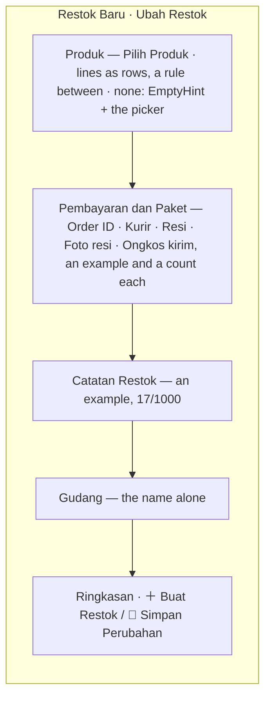

# Decisions — the restock screens

The owner's decisions about how the **restock screens** look and behave — first the selling team's list
(`/inventories/restock`, `pages/restock-selling`), then its detail and its form. **Append-only** (RULE 12): a reversed
decision is renamed and its references grepped.

The rules every screen follows are in [context_decision.md](context_decision.md). What a restock *is* — its statuses,
its money, who may do what — stays in [inventory/restock_decision.md](../../business/inventory/restock_decision.md).

| decision | what it decided |
| --- | --- |
| [the-restock-list-follows-the-screen-rules](#the-restock-list-follows-the-screen-rules) | the selling team's restock list takes every rule in `context_decision.md` before the owner's own pass — a title, the card strip, `FilterBar`, two-line cells, a block per restock on a phone, `EmptyHint`, `GrowingPager`. Its column order and its *Restok* column are REPLACED by [the-restock-list-leads-with-its-references](#the-restock-list-leads-with-its-references); its two in-flight cards by [the-restock-statistics-count-transactions-under-the-tabs](#the-restock-statistics-count-transactions-under-the-tabs) |
| [the-restock-list-leads-with-its-references](#the-restock-list-leads-with-its-references) | the columns run Referensi · Pemasok · Gudang · Produk · Total · Pengiriman · Status · Dibuat · Diterima · Aksi; the order number and the tracking number are copyable, cut at a width with a tooltip saying them whole |
| [the-restock-statistics-count-transactions-under-the-tabs](#the-restock-statistics-count-transactions-under-the-tabs) | the statistics sit under the status tabs, shut until opened — Semua Status: the total and a card per status, led by the transaction count; a status: Transaksi · Jumlah barang · Jumlah SKU · Nilai barang · Ongkir COD · Nilai transaksi, its Rincian › per paying account. Sample figures, marked. Its own row for the Statistik button is REPLACED by [the-statistics-button-ends-the-tab-row](#the-statistics-button-ends-the-tab-row) |
| [the-statistics-button-ends-the-tab-row](#the-statistics-button-ends-the-tab-row) | the Statistik button sits at the right end of the tab row on a desktop, and is an icon beside Filter on a phone — no row of its own. A rule for every list since: [a-statistics-button-ends-the-tab-row](context_decision.md#a-statistics-button-ends-the-tab-row) |
| [the-restock-list-exports-and-filters-by-courier](#the-restock-list-exports-and-filters-by-courier) | **Ekspor** beside *Restok Baru* and a **courier** filter after the warehouse — both on screen and marked `dropped`: the contract has neither yet |
| [a-restock-cancel-warns-it-will-be-checked](#a-restock-cancel-warns-it-will-be-checked) | the cancel dialog says, in a warning, that a cancellation is checked — on the list's ⋯ and on the detail's header alike |
| [a-phone-restock-is-four-lines](#a-phone-restock-is-four-lines) | on a phone a restock is four lines with room around them — the reference and the value lead, bold; the tracking number and the pieces; the supplier and the warehouse; the status and when — the store, the SKUs and the accepted date are the detail page's |
| [the-restock-detail-follows-the-screen-rules](#the-restock-detail-follows-the-screen-rules) | the selling detail takes every rule in `context_decision.md` before the owner's own pass — a phone header that stays, its actions as icons; product lines as blocks on a phone; rows that light up; two-line cells; copyable references; a Mobile story. Its tabs and its own phone header are REPLACED by [the-restock-detail-is-the-product-pages-shape](#the-restock-detail-is-the-product-pages-shape) |
| [the-restock-detail-is-the-product-pages-shape](#the-restock-detail-is-the-product-pages-shape) | the selling detail is ONE page of sections with the navigation on its left, as the product page — no tabs; its title is the order id with the tracking number under it, back is an icon, the restock's own number is not shown |
| [the-store-reference-is-the-order-id](#the-store-reference-is-the-order-id) | the store's reference on a restock is called **Order ID**, never *Faktur* — on the list, its phone block, the detail and the search |
| [the-title-is-the-reference-alone](#the-title-is-the-reference-alone) | the detail's title is the order id's VALUE alone, no label; the tracking number labelled under it; with no order id the tracking number leads alone |
| [payment-is-a-receipt-on-the-right](#payment-is-a-receipt-on-the-right) | Pembayaran is a small receipt — the account, then each line's figure held right, the total last — in a right column with Ongkir COD under it on a wide screen |
| [the-timeline-is-not-a-card-in-a-card](#the-timeline-is-not-a-card-in-a-card) | inside its section the timeline draws no card of its own |
| [the-notes-are-one-per-writer](#the-notes-are-one-per-writer) | the Catatan section holds one note per writer — the selling team's, with who and when, and the warehouse's (not stored yet, marked); the system's voice is the Riwayat, whose edit rows should say what changed (marked) |
| [the-list-opens-the-notes-in-a-dialog](#the-list-opens-the-notes-in-a-dialog) | every list row's ⋯ ends with **Catatan**, opening a dialog of both notes; the selling team's is edited there while the restock is on its way. Its open textarea is REPLACED by [the-note-is-edited-from-a-button](#the-note-is-edited-from-a-button) |
| [the-note-is-edited-from-a-button](#the-note-is-edited-from-a-button) | in the notes dialog the note is read first; **✎ Ubah** opens the edit in the dialog — never closing it — and a click outside does not throw the typing away |
| [the-product-lines-open-in-a-dialog](#the-product-lines-open-in-a-dialog) | a row's *SKU +N lainnya* opens the products in a **dialog** (`ProductLinesDialog`), a block per line on a phone — it was a popover |
| [the-open-points-are-settled](#the-open-points-are-settled) | the readings the owner had not answered, answered: the payments' Rincian stays, the four-line block stays restock's for now, the range opens on every date, the cancel warning is the restock's alone |
| [the-count-is-one-adjustment-column](#the-count-is-one-adjustment-column) | the products table's Datang · Baik · Rusak · Kurang are one column, **Penyesuaian** — *Sesuai*, or the good units with a badge per problem — its figures opening in a dialog |
| [the-note-is-edited-in-any-status](#the-note-is-edited-in-any-status) | Ubah is on the selling note in every status; past the restock's way the server does not keep it yet — the save says so, marked `dropped` |
| [the-timeline-names-its-people-small](#the-timeline-names-its-people-small) | a timeline step's person is a small avatar and the name alone (`UserItem` `size="xs"`); the products' total line reads *Stok aman untuk diterima gudang* |
| [the-timeline-is-centred-and-lines-up](#the-timeline-is-centred-and-lines-up) | a timeline step's icon sits at the middle of its step, its person column is one width on every step, and the line runs icon to icon |
| [a-phone-edits-the-note-in-a-sheet](#a-phone-edits-the-note-in-a-sheet) | on a phone the restock page's Ubah opens a bottom sheet; the list's dialog edits in place; Tutup hides while a note is typed |
| [the-label-photo-is-foto-resi](#the-label-photo-is-foto-resi) | `receipt_file` reads *Foto resi* in Indonesian, on every screen that shows it — the word people use for the printed label |
| [the-form-is-a-restock-not-a-request](#the-form-is-a-restock-not-a-request) | the form page is `restock-form` / `RestockFormPage`, its story *RestockForm*, and it is titled *Restok Baru* / *Ubah Restok* |
| [the-restock-form-follows-the-screen-rules](#the-restock-form-follows-the-screen-rules) | the form (create and edit) on the every-screen rules — Order ID, an example and a count in every typed field, Buat ＋ / Simpan 💾, lines as rows, an empty hint with the picker, Default and Mobile stories |
| [the-restock-form-is-three-columns](#the-restock-form-is-three-columns) | the form fills the canvas — three columns from `2xl` (the lines · the payment, the warehouse over the note · the money), the money column sticky; the product picker pages with `GrowingPager` |
| [one-supplier-for-all-in-two-steps](#one-supplier-for-all-in-two-steps) | a supplier for all products, not on screen until asked — **Samakan Supplier**, then a pick; every line follows it, a line may pick its own and come back with **Ikut Semua**; screen state only |
| [the-supplier-leads-the-produk-card](#the-supplier-leads-the-produk-card) | the supplier for all products is its own box at the TOP of the card — now **Produk dan Supplier** — on screen from the start with **Pilih Supplier**; it REPLACES the *not from the start* of [one-supplier-for-all-in-two-steps](#one-supplier-for-all-in-two-steps) |
| [the-card-is-supplier-then-produk](#the-card-is-supplier-then-produk) | the card is two titled parts — **Supplier** (a line that stays: optional, for all or per product; the choice in a field-like box), a rule, then **Produk** with Pilih Produk in its title; the supplier popup keeps its height |
| [the-note-sits-over-buat-restok](#the-note-sits-over-buat-restok) | the warehouse over the payment; the restock note in the money column, between the summary and **Buat Restok**; the column capped at the window; the supplier box one height, picked or not |
| [what-is-missing-is-one-line-over-buat](#what-is-missing-is-one-line-over-buat) | what still stands between the form and Buat Restok is ONE short line over the button — *Belum diisi: gudang · rekening · produk* — not a list under it |
| [the-checks-run-products-warehouse-account-resi](#the-checks-run-products-warehouse-account-resi) | the form checks the products (some, each with a **supplier**, real counts) → the warehouse → the paying account → the **resi**; the supplier and the resi become required on this form |
| [the-count-and-total-are-required](#the-count-and-total-are-required) | every product's count (at least 1) and total (above Rp 0) are required, marked `*`, checked after its supplier |
| [a-product-picks-its-supplier-from-the-same-box](#a-product-picks-its-supplier-from-the-same-box) | a product's *Dibeli dari* is the supplier part's box — `SupplierBox`, a field with *Belum dipilih* and **Pilih Supplier**, or the supplier with **Ganti** |
| [a-line-note-is-two-rows](#a-line-note-is-two-rows) | a product's note is a textarea, two rows to start |
| [an-empty-produk-is-the-full-size-hint](#an-empty-produk-is-the-full-size-hint) | with no product yet, the Produk part shows `EmptyHint` at its full size, not the small one |
| [the-summary-folds-its-products](#the-summary-folds-its-products) | Rincian's product list folds away under its heading — open to start |
| [the-summary-folds-without-a-scrollbar](#the-summary-folds-without-a-scrollbar) | no scrollbar flashes while Rincian's products fold or unfold; the list keeps its scrollbar gutter |
| [an-edit-opens-with-its-one-supplier](#an-edit-opens-with-its-one-supplier) | an edit whose open products all name one supplier and store opens with it on top — ONE product counts |
| [the-restock-form-returns-where-it-was-opened](#the-restock-form-returns-where-it-was-opened) | an edit's Simpan and Kembali go back to the list or the restock's page, whichever opened it; by a link, the list |

## the-restock-list-follows-the-screen-rules

> Owner, in chat (2026-10-31): *"sekarang kita ke inventory restock selling, inisiasi dulu"* — start the screen from the
> rules every screen follows, before deciding anything about it.

```
Restok                                                              [+ Restok Baru]
[Masuk  81            ] [Nilai barang masuk  Rp 2.785.000]
[⌕ Cari restok, resi, faktur, atau SKU] [Semua gudang ⌄] [Siapa saja yang membuat ⌄] [… menerima ⌄] [Dibuat · Semua tanggal ⌄]  Hapus filter
Semua Status · Dalam Perjalanan · Tiba · Diterima · Hilang · Dibatalkan
Restok                     Pemasok                          Tujuan        Status       Diterima   Produk  Referensi  Pengiriman  Nilai  Aksi
#501                       PT Sumber Makmur +1 pemasok lain  Gudang Pusat  Dalam Perj.  —          …       …          JNE         …      ⋯
29 Okt 13:05 · oleh Rina   [Shopee] Sumber Makmur Official
                                                                         Per halaman [20 ⌄]  ‹ [1] ›

on a phone
Restok                                                              [+]
[Masuk 81] [Nilai barang masuk Rp 2.785.000]
[⌕ Cari restok …]  [Filter]
#501 [Dalam Perjalanan]                                             ⋯
29 Okt 13:05 · oleh Rina
PT Sumber Makmur +1 pemasok lain
[Shopee] Sumber Makmur Official
▣ Gudang Pusat
3 produk · 64 pcs                                       Rp 2.080.000
SKU-BERAS-5K +2 lainnya
```

| rule | applied |
| --- | --- |
| [the-desktop-shell-has-no-top-bar](context_decision.md#the-desktop-shell-has-no-top-bar) | the page names itself — **Restok**. It had no heading and leaned on the breadcrumb, which is gone. Still no team badge and no blurb under it: the owner had taken both off, and the switcher names the team |
| [an-action-button-carries-its-icon](context_decision.md#an-action-button-carries-its-icon) · [a-phone-header-action-is-an-icon](context_decision.md#a-phone-header-action-is-an-icon) | **＋ Restok Baru**; on a phone its ＋ alone, on the title's row |
| [a-list-summary-is-the-order-lists-card-strip](context_decision.md#a-list-summary-is-the-order-lists-card-strip) | *Masuk* and *Nilai barang masuk* are two `SummaryCard`s in a `SummaryStrip` — they were Chakra `Stat`s. Unchanged in meaning: in flight over the whole team, narrowed by the warehouse filter and nothing else |
| [a-phone-filters-from-a-sheet](context_decision.md#a-phone-filters-from-a-sheet) · [clear-filters-is-red-and-bold](context_decision.md#clear-filters-is-red-and-bold) · [every-filter-clears-from-its-own-x](context_decision.md#every-filter-clears-from-its-own-x) | the shared `FilterBar`: the search (debounced now, with its × and icon), the warehouse, who raised it, who accepted it, the date. **Hapus filter** puts all of them back, the date type included. The status tab is not a filter and stays |
| [a-one-type-picker-shows-the-name-alone](context_decision.md#a-one-type-picker-shows-the-name-alone) | the warehouse filter shows its pick as the name alone |
| [one-context-per-column-and-never-three-lines](context_decision.md#one-context-per-column-and-never-three-lines) | **Restok**: the number, then *when · by whom* on one line — the author had a third line. **Pemasok**: *+1 pemasok lain* sits after the supplier's name, not under the store. `LineSupplier` gained an `after` slot for it |
| [a-table-row-lights-up](context_decision.md#a-table-row-lights-up) | every cell in `bg.muted` under the pointer; a phone block lights up and gives under a thumb, since it opens the restock |
| [a-phone-reads-each-line-as-a-block](context_decision.md#a-phone-reads-each-line-as-a-block) | a restock is a block: the number, its status, the *missing* badge and its ⋯; when and by whom; the supplier and store; the warehouse; what is in it beside its value. The accepted date, the references and the courier are the detail page's |
| [an-empty-list-shows-a-hint](context_decision.md#an-empty-list-shows-a-hint) | nothing yet: the restock icon, a line on what a restock is, and **Restok Baru**; an empty status tab: which status has none; nothing matches: *Tidak ada restok yang cocok.* and **Hapus Filter** |
| [every-list-pages-with-the-growing-pager](context_decision.md#every-list-pages-with-the-growing-pager) · [the-pager-is-always-on-screen](context_decision.md#the-pager-is-always-on-screen) | `GrowingPager`, 10 / 20 / 50 a page; it starts over when the tab, a filter or the page size changes |
| [motion-is-small-quick-and-shared](context_decision.md#motion-is-small-quick-and-shared) | the page rises in; the first load is a `ListSkeleton`; the rows fade in once |
| [every-page-has-a-mobile-story](context_decision.md#every-page-has-a-mobile-story) · [a-page-story-has-its-shells-gutter](context_decision.md#a-page-story-has-its-shells-gutter) | a **Mobile** story right after Default; the stories lost Storybook's `padded` layout |
| not applied | [a-table-sorts-from-its-headings](context_decision.md#a-table-sorts-from-its-headings) — `RestockRequestListRequest` has no sort, so no heading sorts. ⚠ My reading, not asked: the date range stays on *Semua tanggal*. [the-quick-ranges-are-days-then-months-then-years](context_decision.md#the-quick-ranges-are-days-then-months-then-years) sets *1 bulan terakhir* for the dated reports, and a work list that opened on a window would hide an old restock still in flight |
| unchanged | the columns and their order, the five status tabs and *Semua Status*, the filters in the URL, the row's ⋯ by status, the value as goods plus shipping |
| the stub | Storybook's `OwnerStockStat` gave *Masuk 0* for every team but the figured one, beside a restock in flight. Another team's in-flight figures now come from its ongoing and arrived restocks (`restockInFlight`), so the cards agree with the rows |
| e2e | *Restock requests page renders for root* accepts the table or the empty hint — a fresh database shows the hint now |

## the-restock-list-leads-with-its-references

> Owner, in chat (2026-10-31): *"dimulai dari referensi di mana order id dan resinya copyable, untuk resi kemungkinan bisa
> sangat panjang, jadi harus ada pembatasan tapi juga harus ada cara lihat fullnya, dilanjutkan pemasok, gudang, produk,
> total, pengiriman, status, tgl dibuat, tgl diterima, dan aksi"*.

```
Referensi                    Pemasok    Gudang   Produk   Total   Pengiriman  Status    Dibuat         Diterima        Aksi
Faktur INV/2026/10/1001 ⧉    PT Sumber  Gudang   3 produk  Rp …   [JNE]       Dalam P.  29 Okt 13:05   —               ⋯
Resi   JNE-CGK-2026091… ⧉    [Shopee] … Pusat    SKU …                                  oleh Rina
           └ under the pointer: JNE-CGK-20260911-0000111122-REG
```

| | |
| --- | --- |
| the order | **Referensi · Pemasok · Gudang · Produk · Total · Pengiriman · Status · Dibuat · Diterima · Aksi**, the owner's |
| Referensi | the store's order number (*Faktur*, the restock's `invoice_ref_id`) over the tracking number (*Resi*), each labelled and each a `CopyText` — a click copies it and never opens the restock. A dash when the restock has neither |
| a long reference | cut at **10rem** with an ellipsis; a **tooltip** shows it whole under the pointer or the focus — only while it is cut. The copy is always the whole value. `CopyText` gained the `maxW` that does this, so any screen can cap a long value the same way. ⚠ My reading, not asked: the order number is capped like the tracking number, since both share the cell |
| Gudang | the column was *Tujuan*; it says *Gudang* now. Still the shared `TeamItem` |
| Total | the column was *Nilai*; still goods plus shipping ([the-couriers-charge-stays-out-of-total](../../business/inventory/restock_decision.md#the-couriers-charge-stays-out-of-total)) |
| Dibuat | a column of its own: the date, and *oleh …* under it — as *Diterima* has always been |
| the restock's own #id | ⚠ no longer on the row — the owner's list does not name it. The row opens the restock and the search finds a number. It was the *Restok* column's first line |
| what it replaces | the column order of [the-restock-list-follows-the-screen-rules](#the-restock-list-follows-the-screen-rules), and its *Restok* column (*#501* over *when · by whom*) |
| unchanged | the phone's block — it still leads with *#501* and its status, and carries no reference |
| the fixture | restock 504's tracking number runs long (`JNE-CGK-20260911-0000111122-REG`), so the cut shows in Storybook |

## the-restock-statistics-count-transactions-under-the-tabs

> Owner, in chat (2026-10-31): *"untuk statistiknya adalah di bawah tab status … untuk statistik di semua status adalah
> total dan per status, dimana data per cardnya adalah transaksi, compact jumlah stok dan compact nilai stoknya, untuk di
> tab status ada transaksi, jumlah barang, jumlah sku, nilai barang, ongkir cod, nilai transaksi"*; on the transfer /
> ShopeePay split of the old screen, *"sistem baru belum tau akan dibuat seperti apa, saranmu?"*. Then: *"jumlah transaksi
> yang penting"*, *"ongkir cod itu biaya kurir yang dibayar oleh gudang, jadi cuma 1 kartu"*, and on shutting it as the
> order list does, *"kita tutup saja"*.

```
Semua Status · Dalam Perjalanan · Tiba · Diterima · Hilang · Dibatalkan
[📊 Statistik ⌄]                                                       ← shut on every visit

Semua Status                                                                          ⚠ 1
[Total          ] [Dalam Perj.   ] [Tiba           ] [Diterima       ] [Hilang  ] [Dibatalkan]
 48 transaksi      4 transaksi      2 transaksi      39 transaksi
 1,2rb pcs · Rp 24,5jt  …

a status (Diterima)
[Transaksi] [Jumlah barang] [Jumlah SKU] [Nilai barang] [Ongkir COD          ] [Nilai transaksi   Rincian ›]
 39          702 pcs         110           Rp 13.338.000  Rp 104.000             Rp 14.196.000
                             produk yang   ...            dibayar gudang ke      barang + ongkir
                             berbeda                      kurir
                                                                                 └ per akun pembayar
                                                                                   BCA Operasional [BCA]  26 · Rp 9.464.000
                                                                                   ShopeePay Melati [ShopeePay] 13 · Rp 4.732.000
```

| | |
| --- | --- |
| where | under the status tabs, behind a **Statistik** button — the order list's, shut on every visit, page state only ([the-statistics-are-shut-and-read-when-opened](order_list_decision.md#the-statistics-are-shut-and-read-when-opened)). Opened, it follows the tab |
| Semua Status | the **total**, then one card per status with its badge. A card is led by its **transaction count**; the units and the value are under it, compact (*1,2rb pcs · Rp 24,5jt*) |
| a status | six cards, whole figures: **Transaksi**, **Jumlah barang** (pcs), **Jumlah SKU** (different products, not lines), **Nilai barang**, **Ongkir COD**, **Nilai transaksi** |
| Ongkir COD | ONE card: what the warehouse paid the courier at the door. It is outside Nilai transaksi ([the-couriers-charge-stays-out-of-total](../../business/inventory/restock_decision.md#the-couriers-charge-stays-out-of-total)), so its line says who paid it and Nilai transaksi's says *barang + ongkir* |
| transfer or ShopeePay | **Rincian ›** on Nilai transaksi ([a-breakdown-opens-from-rincian](context_decision.md#a-breakdown-opens-from-rincian)) opens the value **per paying account** — the account's name, its provider badge (a bank is a transfer, ShopeePay an e-wallet) and its transaction count. A dialog on a desktop, a bottom sheet on a phone. My recommendation, accepted without objection: every restock already names its paying account, so no new concept is needed |
| a card | controls nothing — the tab above chooses the status |
| ⚠ sample | nothing in the contract counts a team's restocks by status: every figure is a SAMPLE, steady per team, that does not follow the filters (`summarySample.ts`); the accounts in the breakdown are the team's real operational ones, the split over them invented. Two marks, `summary` and `payments` (`pages/restock-selling/pending.ts`) |
| what it replaces | the two in-flight cards of [the-restock-list-follows-the-screen-rules](#the-restock-list-follows-the-screen-rules) — *Masuk* and *Nilai barang masuk*, which were real (`OwnerStockStat`) and followed the warehouse filter alone. Their hook (`useRestockOngoing`) and the stub's in-flight figures went with them; *Dalam Perjalanan* and *Tiba* say the same, split |
| the tab | bold when picked — for every screen, [a-selected-tab-is-bold](context_decision.md#a-selected-tab-is-bold) |
| `formatCountCompact` | new in `lib/money.ts` — a count on the compact rupiah's scale (*1,2rb*), so units and value read alike |

## the-statistics-button-ends-the-tab-row

> Owner, in chat (2026-10-31): *"apa ada desain lain buka tutup statistik? kurasa banyak ruang kosong"* — offered the
> button at the end of the tab row (A), a one-line summary while shut (B) and the button in the header (C): *"A, tapi
> dimobile akan masalah"*.

```
before                                               now — a desktop
Semua Status · Dalam Perjalanan · …                  Semua Status · Dalam Perjalanan · …          [📊 Statistik ⌄]
[📊 Statistik ⌄]                    ← its own row    ────────────────────────────────────────────────────────────
[cards]                                              [cards]

now — a phone
[⌕ Cari restok, resi, …] [⚙ Filter] [📊]             ← the icon lights in the main tone while open
Semua Status · Dalam Perjalanan · Tiba · Dite→       ← the tabs scroll sideways, as before
[cards]
```

| | |
| --- | --- |
| a desktop | the button — icon, *Statistik*, chevron — at the **right end of the tab row**, level with the tabs. The row's grey rule runs under both; the picked tab's underline still lands on it |
| a phone | an **icon button beside Filter**, in the search row (`FilterBar`'s `actions`) — six tabs already scroll sideways there, and a button pinned to that row would cover them. While open it is drawn in the main tone. My answer to *"dimobile akan masalah"*, not asked back |
| unchanged | shut on every visit, page state only, nothing read until opened; the cards still open under the tab row |
| `aria-expanded` | on the button, both shapes — it opens a region |
| the order list | asked whether it follows: *"samakan"* — it does, and the button is a rule for every list now, [a-statistics-button-ends-the-tab-row](context_decision.md#a-statistics-button-ends-the-tab-row), drawn by the shared `StatsToggle` |

## the-restock-list-exports-and-filters-by-courier

> Owner, in chat (2026-10-31): *"restok ada filter pengiriman dan export"*.

```
Restok                                                  [⬇ Ekspor ⚠1] [+ Restok Baru]
[⌕ Cari …] [Semua gudang ⌄] [Semua kurir ⌄]⚠2 [Siapa saja yang membuat ⌄] [… menerima ⌄] [Dibuat · …]

on a phone
Restok                                                              [⬇] [+]
[⌕ Cari …] [⚙ Filter] [📊]           ← the courier is in the sheet, after the warehouse
```

| | |
| --- | --- |
| Ekspor | an outline button with its icon, left of *Restok Baru* — the order list's pair; on a phone both are their icons ([a-phone-header-action-is-an-icon](context_decision.md#a-phone-header-action-is-an-icon)). The list as a file, as the order list's ([one-export-is-the-list-as-a-file](warehouse_order_list_decision.md#one-export-is-the-list-as-a-file)) |
| the courier | `ShipmentChannelSelect` — the picker the restock form names a courier with, live couriers, cleared back to any — after the warehouse filter. Kept in the URL (`courier`), counted on the phone's Filter button, taken back by *Hapus filter* |
| ⚠ export | `dropped`: restock has no export RPC (the order list's is `OrderExport`, a server stream ending in a file link). The click says *Ekspor restok belum tersedia.* rather than doing nothing |
| ⚠ courier | `dropped`: `RestockRequestListFilter` has no shipment channel, so the pick is held and the rows do not move; *nothing matches* is not said for it |
| the marks | numbered by where they sit — Ekspor 1, the courier 2, then the statistics 3 and the payments 4 |

## a-restock-cancel-warns-it-will-be-checked

> Owner, in chat (2026-10-31): *"untuk cancel order kasih warning akan diperiksa katanya"*.

```
┌ Batalkan Restok #501 ─────────────────────────────── × ┐
│ Restok ini masih dalam perjalanan. Setelah dibatalkan, │
│ tidak bisa dibuka lagi.                                │
│ ┌──────────────────────────────────────────────────┐   │
│ │ ⚠ Pembatalan restok akan diperiksa.               │   │  ← warning tone, before the question
│ └──────────────────────────────────────────────────┘   │
│ Apakah uangnya kembali? *   ○ Ya …   ○ Tidak …         │
│                       [Simpan Restok] [Batalkan Restok] │
└─────────────────────────────────────────────────────────┘
```

| | |
| --- | --- |
| the warning | a Chakra `Alert` in the warning tone, at the top of the dialog's body — *Pembatalan restok akan diperiksa.* — before the money question and the confirm |
| where | `CancelRestockDialog` in `SellingRestockActions`, so the list's row menu and the selling detail's header both say it |
| what it does not say | who checks a cancellation, or how — nothing on this screen does that; the sentence only warns |
| pinned by | `CancelFromTheRowAsksAboutTheMoney` reads it |
| ⚠ my reading | *"cancel order"* read as the restock's **Batalkan** — this conversation is on the restock list. The sales order's cancel is unchanged |
| ⚠ marked *(2026-10-31)* | owner: *"taruh di unimplemented juga khusus ini"* — nothing checks a cancellation, so the warning carries a `missing` mark (`cancelReview`): the restock list numbers it 5, after its other four; the selling detail gained a pending list of this one entry, its strip shown only while the restock can still be cancelled. `SellingRestockActions` takes the mark as `cancelReviewMark`, so each screen numbers it in its own list |

## a-phone-restock-is-four-lines

> Owner, in chat (2026-11-02): *"restok mobile terlalu compact dan banyak kurang bagus, ada ide?"* — offered three lines led
> by the supplier, then: *"[referensi] perlu, karena itu adalah yang paling utama"*; and on using it for every list, *"untuk
> semua, tapi lihat di sini dulu mungkin aku berubah pikiran"*.

```
before — seven lines of one weight, tight          now — four lines, one leads
#501 [Dalam Perjalanan]                  ⋯         ┌──────────────────────────────────────────┐
29 Okt 14:43 · oleh Ani Rahayu                     │ Faktur INV/2026/10/1001 ⧉   Rp 2.080.000 │  ← bold
PT Sumber Makmur +1 pemasok lain                   │ Resi JNE0123456789 ⧉              64 pcs │
[Shopee] Sumber Makmur Official                    │ PT Sumber Makmur · Gudang Pusat          │
▣ Gudang Pusat                                     │ [Dalam Perjalanan] 29 Okt 14:43 · Ani  ⋯ │
3 produk · 64 pcs                                  └──────────────────────────────────────────┘
SKU-BERAS-5K +2 lainnya       Rp 2.080.000
```

| line | |
| --- | --- |
| 1 | **the reference leads** — the store's order number, labelled *Faktur*, bold and copyable — and the **value** on the right, bold. No invoice: the restock's own *#501* |
| 2 | *Resi* and the tracking number, copyable — both references cut at 9.5rem with the whole in a tooltip ([the-restock-list-leads-with-its-references](#the-restock-list-leads-with-its-references)); a dash when there is none — and the **pieces** on the right, under the value they make |
| 3 | the supplier (with *+N pemasok lain*) · the warehouse, quiet, one line, cut when long; *Belum terhubung ke pemasok* when the lines name none |
| 4 | the status, a *kurang N* beside it, when it was raised and by whom, and the ⋯ |
| room | 16px inside a block, 8px between lines, 12px between blocks — it was 12, 6 and 8 |
| gone from the block | the store, the SKU line, the warehouse icon, *oleh* — all the detail page's, a tap away |
| ⚠ every list | the owner means it for every phone list, **after looking at it here** — not applied elsewhere yet |

## the-restock-detail-follows-the-screen-rules

> Owner, in chat (2026-11-02): *"sekarang inisiasi restock selling detailnya"* — start the screen from the rules every
> screen follows, before deciding anything about it.

```
a phone                                          the Products tab, a phone
┌──────────────────────────────────────┐        ┌──────────────────────────────────────┐
│ ←  #501  [Dalam Perjalanan]       ⋯  │ sticky │ [img] Beras Pandan Wangi 5kg          │
└──────────────────────────────────────┘        │       SKU-BERAS-5K                    │
Info · Produk · Riwayat                          │ PT Sumber Makmur                      │
Pengiriman                                       │ [Tokopedia] Sumber Makmur Store       │
  Resi  JNE0123456789 ⧉                          │ 10 × Rp 65.000            Rp 650.000  │
Pembayaran                                       │ Datang 9 · Baik 7                     │
  Faktur INV/2026/09/0412 ⧉                      │ Rusak 2 · Rp 132.333 · Karung sobek   │
                                                 │ Hilang 1 · Rp 66.167                  │
                                                 └──────────────────────────────────────┘
```

| rule | applied |
| --- | --- |
| [the-phone-header-is-one-row](context_decision.md#the-phone-header-is-one-row) | the phone header — back, the number, the status, the actions — **stays** while the page scrolls, on an opaque ground. It was one row already, and scrolled away |
| [a-phone-header-action-is-an-icon](context_decision.md#a-phone-header-action-is-an-icon) | its actions are their icons, past two one ⋯ — ongoing's three fold, arrived's *Ubah Baris* is its pencil. It was a ⋯ for one action too. `SellingRestockActions` gained the `compact` variant, drawn by `CompactActions` |
| [a-phone-reads-each-line-as-a-block](context_decision.md#a-phone-reads-each-line-as-a-block) | on a phone each product line is a block: the product, where it was bought, *10 × Rp 65.000* beside the line's total, *Datang · Baik* once counted, each problem with its worth and note, the line's note in words. It was a nine-column table scrolling sideways |
| [one-context-per-column-and-never-three-lines](context_decision.md#one-context-per-column-and-never-three-lines) | the product cell is two lines — the line's note is an icon at its end, its words in its name and tooltip; a problem cell is two lines — the count, then its worth with the warehouse's note beside it, cut when long. Both were three |
| [a-table-row-lights-up](context_decision.md#a-table-row-lights-up) | a product row lights up under the pointer, every cell |
| references | the invoice and the tracking number are copyable — as on the list ([the-restock-list-leads-with-its-references](#the-restock-list-leads-with-its-references)) — cut to their column, whole in a tooltip |
| [motion-is-small-quick-and-shared](context_decision.md#motion-is-small-quick-and-shared) | the page rises in; a first load is the page's shape (`ListSkeleton`), not a spinner |
| [every-page-has-a-mobile-story](context_decision.md#every-page-has-a-mobile-story) · [a-page-story-has-its-shells-gutter](context_decision.md#a-page-story-has-its-shells-gutter) | a **Default** and a **Mobile** story first; the stories lost Storybook's `padded` layout |
| [nothing-runs-past-a-phones-edge](context_decision.md#nothing-runs-past-a-phones-edge) | the Mobile story and the product blocks are checked at 320px |
| the name | *Restok #501*, *Kembali ke Restok* — the list is *Restok* now ([the-restock-list-follows-the-screen-rules](#the-restock-list-follows-the-screen-rules)); it said *Permintaan Restok* |
| not applied | the order and product pages read as **sections under a nav** (`Section`, `SectionNav`); this page keeps its **vertical tabs** — that is a layout to choose, not a rule. Its desktop header does not stay: only the phone's is a rule |
| unchanged | the three tabs and what each holds, the actions by status, the courier's charge on its own card once accepted, the cancel warning and its mark |

## the-restock-detail-is-the-product-pages-shape

> Owner, in chat (2026-11-02), after [the-restock-detail-follows-the-screen-rules](#the-restock-detail-follows-the-screen-rules):
> *"kalau menggunakan yang sesuai dengan produk detail, untuk restok id tidak penting ditampilkan, kembali cuma icon saja,
> yang utama di restok adalah order id dan resi … halaman jadi 1 dan tidak dipisah berdasarkan tab, di kiri itu cuma jadi
> navigasi saja"*.

```
┌ ▸ Kiriman    ┐   ←  Order ID INV/2026/09/0412 ⧉  [Diterima] [kurang 1]      [✎ Ubah] …
│   Pembayaran │      Resi SCP5544332211 ⧉
│   Ongkir COD │   ┌ 🚚 Kiriman ───────────────────────────────────────────┐
│   Produk     │   │ Tujuan · Kurir · Foto label · Dibuat · Tiba           │
│   Catatan    │   ┌ 👛 Pembayaran ── Dibayar dari · Subtotal · Ongkir · Total
└   Riwayat    ┘   ┌ 🤝 Ongkir COD (once accepted) ┌ 📦 Produk ┌ 📝 Catatan ┌ 🕘 Riwayat
```

| | |
| --- | --- |
| one page | **every section on one page**, in order — Kiriman, Pembayaran, Ongkir COD (only once accepted), Produk, Catatan, Riwayat — each a `Section` card. It was three tabs: Info, Produk, Riwayat |
| the left | only the **navigation** (`SectionNav`): a click scrolls to the section and it blinks ([a-nav-jump-blinks-where-it-lands](context_decision.md#a-nav-jump-blinks-where-it-lands)); the one being read is lit (`useScrollSpy`). On a phone its chips stick at the top |
| the title | **the order id**, copyable, with **the tracking number under it**, copyable — as a product's name over its SKU (`RestockTitleRow`). With no order id the tracking number leads; with neither, *Restok #501* |
| the restock's number | not shown — it was the title, *Restok #501* |
| back | its **icon** alone — it was *← Kembali ke Restok* above the title |
| sticky | once the title scrolls away the same row sticks, small, its actions as icons (`ProductStickyStrip`, `useStickyTitle` — the product page's). The phone's own sticky header of [the-restock-detail-follows-the-screen-rules](#the-restock-detail-follows-the-screen-rules) went with the tabs |
| the facts | the order id and the tracking number are not repeated in the sections — the title holds them; the label's photo stays in Kiriman. The facts are the shared `Fact`. *Biaya kurir di pintu* is titled **Ongkir COD**, the owner's word for it ([the-restock-statistics-count-transactions-under-the-tabs](#the-restock-statistics-count-transactions-under-the-tabs)) |
| unchanged | the product lines (rows that light up, two-line cells, blocks on a phone), the actions by status, the cancel warning and its mark, the timeline |
| e2e | `restock.spec` opens a section from the nav (`section-nav-<key>`), not a tab |

## the-store-reference-is-the-order-id

> Owner, in chat (2026-11-02): *"aku tidak setuju istilah faktur karena tidak familiar di sini"* — and throughout, *"order id
> dan resi"*.

| | |
| --- | --- |
| the word | the store's reference on a restock (`invoice_ref_id`) is **Order ID**, in both languages — what a buyer reads off the marketplace. *Faktur* (en *Invoice*) is gone |
| where | the list's Referensi column and its phone block, the detail's title, the search's placeholder (*Cari restok, resi, order ID, atau SKU*) |
| what it replaces | the label *Faktur* in [the-restock-list-leads-with-its-references](#the-restock-list-leads-with-its-references) and [a-phone-restock-is-four-lines](#a-phone-restock-is-four-lines) |
| not yet | the restock **form** still asks *Nomor invoice atau pesanan* — its pass comes next |

## the-title-is-the-reference-alone

> Owner, in chat (2026-11-02): *"untuk judul ada order ID dan resinya keliatan jelek, karena order id opsional mungkin nanti
> bisa kosong? gimana?"* — answered with this, built for the owner to look at.

```
before                                              now
←  Order ID INV/2026/09/0412 ⧉  [Diterima]          ←  INV/2026/09/0412 ⧉  [Diterima]
   Resi SCP5544332211 ⧉                                Resi SCP5544332211 ⧉

no order id                                         ←  SCP5544332211 ⧉  [Diterima]      ← the tracking number, alone
```

| | |
| --- | --- |
| the title | the reference's **value alone**, large and copyable — no *Order ID* before it, as a product's name has no *Nama* |
| the line under it | *Resi* and the tracking number, labelled, small — only when the title is the order id |
| no order id | it is optional: the **tracking number** heads the row alone, in its monospace face, and there is no second line repeating it. Neither: *Restok #501* |
| what it replaces | the label before the title in [the-restock-detail-is-the-product-pages-shape](#the-restock-detail-is-the-product-pages-shape) |
| pinned by | `OnePageLedByTheOrderId`, `WithNoOrderIdTheTrackingNumberLeads` (the stub's `patchRestock` empties 501's order id) |

## payment-is-a-receipt-on-the-right

> Owner, in chat (2026-11-02): *"pembayaran terlalu kurang desainnya buat lebih kecil saja taruh kanan"*.

```
a wide screen (xl)
nav │ title                                            │
    │ ┌ Kiriman ───────────────────┐  ┌ Pembayaran ───────┐
    │ ┌ Produk ────────────────────┐  │ Dibayar dari       │
    │ ┌ Catatan ───────────────────┐  │ BCA Operasional    │
    │ ┌ Riwayat ───────────────────┐  │ ────────────────── │
    │                                 │ Barang  Rp 2.060.000│
    │                                 │ Ongkir     Rp 20.000│
    │                                 │ ────────────────── │
    │                                 │ Total   Rp 2.080.000│
    │                                 └────────────────────┘
    │                                 ┌ Ongkir COD (accepted)┐
```

| | |
| --- | --- |
| the card | small, a **receipt**: *Dibayar dari* and the account, a rule, each line with its label left and its figure held right, a rule, the **total** bold. It was a two-column grid of facts and right-aligned *Subtotal: Rp …* lines |
| where | a **20rem column on the right** from `xl`, as the product page's side cards — Pembayaran, and **Ongkir COD** under it once accepted (money beside money; my reading, not asked). Below `xl`, one column in the nav's order |
| the nav | scrolling lights only the main column while the money sits beside it; a click still jumps to Pembayaran |

## the-timeline-is-not-a-card-in-a-card

> Owner, in chat (2026-11-02): *"riwayat jangan card di dalam card, lebur cardnya"*.

| | |
| --- | --- |
| the rule | never a card inside a card — the timeline's section is the card; `RestockTimeline` takes `bare` and draws its steps alone, as `OrderLedgerPanel` does. The warehouse's detail still draws its own card |
| found with it | without its card to clip it, a step ran past a 320px screen — the person's column refused to shrink and the move did not wrap. Both give way now (`nothing-runs-past-a-phones-edge`) |

## the-notes-are-one-per-writer

> Owner, in chat (2026-11-02): *"bagaimana catatan bisa disimpan? cuma 1?"*, then, on the old screen's three — the
> restock's, the warehouse's and the system's — offered this: *"1. boleh"*; on when the warehouse writes, *"harusnya mulai
> dari tiba, tapi aku tidak punya hak untuk memutuskannya, untuk sekarang buat unimplemented saja"*.

```
┌ Catatan ─────────────────────────────────────────┐
│ [Penjual]  Ani Rahayu · 29 Okt 13:05 ⚠2           │   the selling team's — real; who and when derived
│ Urgent, untuk sale 10.10                          │
│ ───────────────────────────────────────────────── │
│ [Gudang] ⚠3                                       │   the warehouse's — no field yet
│ Belum ada catatan dari gudang.                    │
└───────────────────────────────────────────────────┘
┌ Riwayat ⚠4 ──────────────────────────────────────┐   the system's voice
│ Diubah · Ani · 30 Okt      ← should say what changed: "Beras 10 → 12 pcs"
└───────────────────────────────────────────────────┘
```

| | |
| --- | --- |
| one per writer | the **selling team's** note and the **warehouse's** note, each its own block under its team badge — one writer each, so neither replaces the other's |
| the system | **not a third note**: the Riwayat already says every move, who and when — a system note would say it twice. What it lacks is an edit's content: its row should say what changed |
| the selling note | real (`restocks.note`), with **who and when** beside it — ⚠ `derived`: nothing stores the note's own author or time, so it is the restock's last raise or edit, which may have changed only a line |
| the warehouse note | ⚠ `missing`: no field holds it — the block is shown with *Belum ada catatan dari gudang.* When it may be written is **not decided**: the owner leans to *from the box's arrival* (*Tandai Tiba*), and says the call is not theirs to make. Not raised as a business question here |
| the Riwayat | ⚠ `missing`: the server writes an edit's row as *edited* and nothing more. The bare word is no longer shown on the row (the title already says it); when the server says what changed, the row shows it as it does in Storybook's arrived edits |
| the strip | the page's not-implemented strip is now always shown — four parts: the cancel check, the note's author, the warehouse note, an edit's content |
| backend needed | a warehouse note on the restock with its author and time; the selling note's author and time; an edit's trail row naming what changed |

## the-list-opens-the-notes-in-a-dialog

> Owner, in chat (2026-11-02): *"di listnya aku ingin ada modal menampilkan catatannya atau dialog bukan modal di aksi,
> bisa edit juga"*.

```
row ⋯                          ┌ Catatan Restok ─────────────────────────── × ┐
  ✎ Ubah                       │ INV/2026/10/1001                              │
  ⊘ Batalkan                   │ [Penjual]  Ani Rahayu · 29 Okt 13:05 ⚠6       │
  ⊠ Tandai Hilang              │ ┌───────────────────────────────────────────┐ │
  📓 Catatan  ─────────────▶   │ │ Untuk promo 10.10                          │ │
                               │ └───────────────────────────────────────────┘ │
                               │                                       17/1000 │
                               │ ───────────────────────────────────────────── │
                               │ [Gudang] ⚠7  Belum ada catatan dari gudang.   │
                               │                       [Batal] [Simpan Catatan] │
                               └───────────────────────────────────────────────┘
```

| | |
| --- | --- |
| where | the list row's ⋯ — **Catatan**, last, with its icon, in **every status**; so every row has a ⋯ now (it was none on a record). The restock's page does not offer it: its Catatan section is the same notes |
| what opens | a **dialog** (`RestockNotesDialog`, `features/restock`): its title, the restock's reference under it, both notes one per writer ([the-notes-are-one-per-writer](#the-notes-are-one-per-writer)) — the blocks are `RestockNotes`' own, moved to `features/restock` since two screens show them |
| edit | the selling team's note is a textarea **while the restock is on its way** — an example in it (`every-form-field-shows-an-example`), *n/1000* under it (`a-limited-field-shows-its-count`), *Simpan Catatan* until nothing changed. Once arrived the head of a restock is closed, its note with it: read, with the reason under it |
| how it saves | it reads the stored restock (not the list's row) and sends it back **exactly as stored with only the note changed** — the update replaces every field and line, as the edit form sends a locked header. No money moves, so no money event |
| the warehouse's note | read only, marked — nothing stores it ([the-notes-are-one-per-writer](#the-notes-are-one-per-writer)) |
| the marks | the list's pending list gains the two note marks (6, 7), the dialog carrying them |
| what it replaces | *"a record has no menu at all"* — accepted, lost and cancelled rows have Catatan alone |

## the-note-is-edited-from-a-button

> Owner, in chat (2026-11-02): *"editnya dimana?"* — the textarea open from the start did not read as the edit; offered a
> button: *"editnya klik tombol aja dulu"*; then *"ubah tidak close modalnya"*.

```
[Penjual]  Ani Rahayu · 29 Okt 13:05 ⚠          [✎ Ubah]        ← only while the restock is on its way
Untuk promo 10.10
                                                  [Tutup]
        ↓ Ubah — in the same dialog
[Penjual]  Ani Rahayu · 29 Okt 13:05 ⚠
┌──────────────────────────────────────┐  ← the focus is in it
│ Untuk promo 10.10                    │
└──────────────────────────────────────┘
                                17/1000
                      [Batal] [Simpan Catatan]
```

| | |
| --- | --- |
| read first | the note is text, and **✎ Ubah** sits at the end of its head line — only while the restock is on its way; otherwise the reason it is closed is said instead |
| Ubah | opens the edit **in the dialog**: the textarea with *n/1000* under it, the foot *Batal · Simpan Catatan*. It never closes the dialog — the textarea is drawn and takes the focus in the same click, so the focus Ubah held is never left outside the dialog, which the dialog read as the reader leaving |
| while editing | a click outside the dialog does **not** close it — the typing is not thrown away; *Batal* leaves the edit (the note as it was), × closes |
| saving | **does not close the dialog** (owner: *"close saat save maksudku"* — the complaint was the save, not Ubah): it goes back to reading, the saved note in place, *Ubah* offered again; *Tutup* or × closes |
| pinned by | `NotesOpenFromTheRowAndSave` — the note read, Ubah, the dialog still open, the focus in the textarea, saved |
| on the page too | owner: *"edit di detailnya?"* — the restock page's Catatan section edits the same way: Ubah, in place, saved and read again. One component, `SellingNote` (`features/restock`), for the dialog and the section; *Batal · Simpan Catatan* sit under the textarea in both, and the dialog's foot is *Tutup* alone. The reason it is closed is said in the dialog only — on the page it would sit under every record. Pinned by `TheNoteIsEditedOnThePage`, `ARecordsNoteHasNoUbah` |

## the-product-lines-open-in-a-dialog

> Owner, in chat (2026-11-02): *"sama tooltipsnya produk dibuat jadi modal saja"*.

```
before                                       now
2 produk · 30 pcs                            2 produk · 30 pcs
SKU-BERAS-5K +1 lainnya ┐                    SKU-BERAS-5K +1 lainnya  ──click──▶  ┌ Produk ─────────────── × ┐
  ┌ popover on the row ─┘                                                        │ SKU · Nama · Jml · …     │
  │ SKU · Nama · Jml …  │                                                        │ Total produk  Rp …       │
  └─────────────────────┘                                                        └──────────────────────────┘
```

| | |
| --- | --- |
| the control | the shared component, renamed **`ProductLinesDialog`** (`components/products`): the *+N lainnya* text opens a **dialog** with the full list — SKU, name, quantity, unit price and line total, the goods total under it. It was a popover hanging off the row |
| a phone | each line a **block**: the name at full width, *SKU · 3 × Rp …* and the line total under it (`a-phone-reads-each-line-as-a-block`) |
| the total | under the last line with no rule of its own — a rule above it doubled the last line's (owner: *"modal produk double line"*) |
| the row | no click inside the dialog reaches the row under it — opening, reading or closing never opens the restock |
| ⚠ wider than restock | the component is shared, so **the warehouse's restock list and both transfer lists** open it as a dialog too — one control, one behaviour |

## the-open-points-are-settled

> Owner, in chat (2026-11-02), asked which questions were still unanswered, then: *"2. oke · 3. tidak dulu · 4. oke ·
> 5. benar"* (1 is [a-phone-card-shows-no-note](context_decision.md#a-phone-card-shows-no-note)).

| point | answer | so |
| --- | --- | --- |
| Rincian › on Nilai transaksi, per paying account ([the-restock-statistics-count-transactions-under-the-tabs](#the-restock-statistics-count-transactions-under-the-tabs)) | *oke* | stays — still sample figures, marked |
| the four-line phone block for every list ([a-phone-restock-is-four-lines](#a-phone-restock-is-four-lines)) | *tidak dulu* | the restock list's alone, for now |
| the list's date range opening on every date ([the-restock-list-follows-the-screen-rules](#the-restock-list-follows-the-screen-rules)) | *oke* | *Semua tanggal* — no longer only my reading |
| the cancel warning on the restock's Batalkan only ([a-restock-cancel-warns-it-will-be-checked](#a-restock-cancel-warns-it-will-be-checked)) | *benar* | the sales order's cancel is untouched |

## the-count-is-one-adjustment-column

> Owner, in chat (2026-11-02): *"di produk ada datang baik rusak dan kurang kepanjangan di tabel, lebih baik jadi penyesuaian
> lalu bisa didetailkan lagi pakai popup atau dialog atau tooltips"*.

```
before — nine columns
Produk · Pemasok · Dipesan · Datang · Baik · Rusak · Kurang · Harga satuan · Total baris

now — six
Produk · Pemasok · Dipesan · Penyesuaian                       · Harga satuan · Total baris
                             —                                  ← not counted yet, nothing to open
                             ✓ Sesuai                           ← as ordered
                             Baik 7 [Rusak 2] [Kurang 1]  ──click──▶  ┌ Penyesuaian ──────── × ┐
                                                                     │ Beras Pandan Wangi · SKU │
                                                                     │ Dipesan            10    │
                                                                     │ Datang              9    │
                                                                     │ Baik                7    │
                                                                     │ ──────────────────────── │
                                                                     │ Rusak               2    │
                                                                     │     senilai Rp 132.333   │
                                                                     │     Karung sobek         │
                                                                     │ Kurang              1    │
                                                                     │     senilai Rp 66.167    │
                                                                     └──────────────────────────┘
```

| | |
| --- | --- |
| the column | **Penyesuaian**, after *Dipesan* — four columns became one |
| the cell | not counted: *—* (*Belum dihitung* on hover), never the 0 the fields hold; as ordered: **✓ Sesuai** in the success tone; otherwise *Baik N* and a badge per problem — *Rusak* red, *Kurang* amber |
| the detail | a counted cell is a button opening a **dialog** — chosen of the owner's three (popup, dialog, tooltip) as the product lines open (the-product-lines-open-in-a-dialog): *Dipesan · Datang · Baik*, then each problem with its worth (the landed price, filled by the system) and the warehouse's note |
| a phone | unchanged — each line's block already reads its counts down the screen |
| tests | the stories and `restock.spec` open the dialog before reading the figures |

## the-note-is-edited-in-any-status

> Owner, in chat (2026-11-02): *"catatan bisa diedit kapanpun"*.

| | |
| --- | --- |
| Ubah | on the selling team's note in **every status** — the list's dialog and the restock page alike. What it replaces: *Ubah only while on its way* of [the-note-is-edited-from-a-button](#the-note-is-edited-from-a-button), and the dialog's *"Catatan hanya bisa diubah selama restok dalam perjalanan."* |
| on its way | saved, as before — the restock sent back whole with the note changed |
| past its way | ⚠ `dropped`: the server closes the head of a restock once the box has arrived, the note with it, and refuses any change there; accepted, lost and cancelled take no update at all. The save is not sent — a toast says *Catatan belum tersimpan …* and the note reads as it was. Ubah carries the mark (`lateNote`) on those statuses |
| backend needed | a note change the server takes in any status — a note-only write, or the update's arrived window and the closed statuses letting `note` through |

## the-timeline-names-its-people-small

> Owner, in chat (2026-11-02): *"riwayat usernya terlalu besar, gambar kecil dan nama saja"*; and *"Unit baik masuk stok jadi
> stok aman untuk diterima gudang"*.

| | |
| --- | --- |
| a step's person | a **small avatar and the name**, one line — `UserItem` gained `size="xs"` (no username, no role). It was the full item: a larger avatar, the name, the @username under it |
| the products' total line | *Stok aman untuk diterima gudang: 7 / 10* (en *Safe stock taken in by the warehouse*) — it read *Unit baik masuk stok* |

## the-timeline-is-centred-and-lines-up

> Owner, in chat (2026-11-02): *"riwayat iconnya kurang pas, lebih bagus di tengah, lalu untuk ukuran usernya lebih bagus
> kalau sama rata"*.

| | |
| --- | --- |
| a step's icon | **centred on its step's height** — the connector is a column that centres the indicator, less the content's bottom gap so the middle is the line's middle. It sat at the top of the step, level with the person's avatar and above the action text |
| a step's person | **one width down the trail** (`10rem` from `sm` up), the name clamped inside it — so the separator and the action start at the same x on every step. It was as wide as the name, and the action jumped with each person |
| on a phone | the person takes the full width above the action, and the vertical separator is dropped — side by side would leave the action a sliver of a 320px screen |
| the line | **runs icon to icon** (owner: *"garis riwayatnya masih belum ngikut"*) — each step draws two halves meeting at its icon's centre, up to the step before and down to the step after; the first has no upper half, the last no lower one. Chakra's own line spans a step top to bottom and is hidden on the last, which fits a top icon: under a centred one it stuck out above the first icon and stopped short of the last |
| ⚠ the last step's gap | Chakra zeroes it as a bare `0`, which `calc(50% + 0 / 2)` cannot add to a percentage — the last upper half came out invalid and collapsed. The timeline sets it to `0px` |
| pinned by | the story `TheTimelineLinesUp` — every step's person box is the same width, every icon's centre sits within 2px of its content's centre, and the line starts at the first icon's centre, ends at the last's, and has no break between |

## a-phone-edits-the-note-in-a-sheet

> Owner, in chat (2026-11-02): *"edit catatan di mobile tidak bagus"*.

| | |
| --- | --- |
| on the restock page, on a phone | **Ubah opens a bottom sheet** — *Ubah Catatan*, the textarea focused as it opens, the count, and Batal \| Simpan as two equal halves of the width. The page keeps reading the note under it; Simpan shuts the sheet and the saved note is read. It was edited in the page, where the textarea shared a phone's height with the sticky title, the section chips and the keyboard, and Batal / Simpan were two small buttons in a corner |
| in the list's Catatan dialog | **edited where it is**, on a phone too — the dialog is already its own surface, and a sheet stacked on it is one too many. On a phone Batal \| Simpan take the two halves |
| the dialog's Tutup | **hidden while the note is being typed** — Batal / Simpan are the dialog's actions then; Tutup under them was a second row of buttons and a second way out. × still closes |
| a tap outside | does not throw a typed note away — in the sheet as in the dialog; Batal or × do |
| on a desktop | unchanged — the edit in place, the buttons at the end |
| pinned by | `OnAPhoneTheNoteIsEditedInASheet`, `OnAPhoneBatalLeavesTheNote` (the restock page), `OnAPhoneTheDialogEditsInPlace`, and `NotesOpenFromTheRowAndSave` for Tutup (the list) |

## the-label-photo-is-foto-resi

> Owner, in chat (2026-11-02): *"foto label itu apa?"* — then, on my recommendation, *"foto resi jadi?"*.

| | |
| --- | --- |
| what it is | `receipt_file` — the photo of the courier's label on the parcel, the tracking number and its barcode on it (the contract: *"A photo of the label"*). Entered on the restock form under Resi, optional; the detail links out to it |
| the word | ***Foto resi*** in Indonesian — the printed label is what people here call *resi* (*cetak resi*), so it reads as the photo of the Resi right above it. It read *Foto label*, which nobody says |
| where | every screen that shows `receipt_file`, so one field never has two names: the restock form, both restock details, the warehouse transfer's ship step, and their pending marks. The order screen already said *Foto resi dari kurir* |
| English | unchanged — *Label photo*: English has no *resi*, and *label* is the word there |

## the-form-is-a-restock-not-a-request

> Owner, in chat (2026-11-02), on the stories: *"namanya bukan request form tapi form aja"*.

| | |
| --- | --- |
| the page | `pages/restock-form/`, `RestockFormPage` — it was `restock-request-form` / `RestockRequestFormPage`. The routes are unchanged (`/inventories/restock/new`, `…/:id/edit`) |
| the stories | *Pages / Inventory / Restock / **RestockForm*** — the 17 stories, create and edit, unchanged in content |
| the titles | ***Restok Baru*** / ***Ubah Restok*** (en *New Restock* / *Edit Restock*), and the no-team line *Pilih tim untuk membuat / mengubah restok* — they read *Permintaan Restok …*, while the list is titled *Restok* |
| not renamed | the contract's `RestockRequest` and its hooks (`useRestockRequest`, `useSaveRestockRequest`) — that is the API's name, not a screen's |

## the-restock-form-follows-the-screen-rules

> Owner, in chat (2026-11-02): *"inisiasi di restock form ini"* — apply the every-screen rules to the restock form.



| | before | now — and the rule |
| --- | --- | --- |
| the store's reference | *Nomor invoice atau pesanan* | **Order ID**, its help *Order ID dari toko tempat membeli* ([the-store-reference-is-the-order-id](#the-store-reference-is-the-order-id)) |
| the words | *Buat Permintaan*, *Permintaan restok dibuat*, *Kembali ke Permintaan Restok* | **Buat Restok**, *Restok dibuat / diperbarui*, *Kembali ke Restok* ([the-form-is-a-restock-not-a-request](#the-form-is-a-restock-not-a-request)) |
| typed fields | Order ID and Resi blank; the notes *Tambahkan catatan…*, *mis. stok lebih* | an example in each — *Contoh: INV/2026/10/1001*, *Contoh: JNE0123456789*, *Contoh: Untuk promo 10.10*, *Contoh: stok lebih* ([every-form-field-shows-an-example](context_decision.md#every-form-field-shows-an-example)); the money fields keep their 0 |
| limits | silent `maxLength`s | a count at each field's end — Order ID and Resi **x/100**, a line's note **x/200**, the restock's note **x/1000** ([a-limited-field-shows-its-count](context_decision.md#a-limited-field-shows-its-count)) |
| the main button | no icon | **＋ Buat Restok** on a new restock, **💾 Simpan Perubahan** on an edit, as the product form's; **⇄ Ganti** on a line's supplier ([an-action-button-carries-its-icon](context_decision.md#an-action-button-carries-its-icon)) |
| the lines | each a bordered box inside the Produk card | **rows of the card**, a rule between them — never a card inside a card (CLAUDE.md); their field labels on the theme's scale, not shrunk |
| no lines | a grey sentence under the card's button | an `EmptyHint` — *Belum ada produk*, *Pilih produk yang dibawa restok ini.*, and **Pilih Produk** as its action; the title's button returns once a product is picked ([an-empty-list-shows-a-hint](context_decision.md#an-empty-list-shows-a-hint)) |
| the warehouse | its name and a *Gudang* badge | **the name alone** — the picker offers warehouses only ([a-one-type-picker-shows-the-name-alone](context_decision.md#a-one-type-picker-shows-the-name-alone)) |
| loading · arrival | a spinner | the page's shape, and the page rising in ([motion-is-small-quick-and-shared](context_decision.md#motion-is-small-quick-and-shared)) |
| the stories | no Default, no phone, Storybook's padding | **Default** then **Mobile** (and *Mobile Edit*), framed by the shell's gutter ([every-page-has-a-mobile-story](context_decision.md#every-page-has-a-mobile-story), [a-page-story-has-its-shells-gutter](context_decision.md#a-page-story-has-its-shells-gutter)); nothing past a 360px edge ([nothing-runs-past-a-phones-edge](context_decision.md#nothing-runs-past-a-phones-edge)) |
| pinned by | | `Mobile`, `MobileEdit`, `EveryFieldShowsAnExampleAndItsCount`, `NoLinesIsAHintWithThePicker`, `CreateCarriesAPlus`, `SaveCarriesADisk`, `TheLinesAreRowsNotCards` |

Unchanged: the layout (the lines and the payment on the left, the warehouse, the summary and Save on the right), what
each status may change, the missing-parts list under Save. ⚠ On a phone the warehouse comes **last**, after every line,
though the picker shows stock at the picked warehouse — not moved here, since no rule covers it.

## the-restock-form-is-three-columns

> Owner, in chat (2026-11-03): *"paginasi di pilih produk"*, *"halaman tidak penuh, 3 kotak buat memenuhi halaman 2xl"*,
> *"gudang taruh saja di atas catatan restok"*, *"perincian sticky berarti"*.

```
2xl     [ Produk 2fr ] [ Pembayaran dan Paket · Gudang · Catatan Restok 1fr ] [ Rincian · Simpan 22rem, sticky ]
lg      [ Produk                                                 ] [ Rincian · Simpan 22rem, sticky ]
        [ Pembayaran dan Paket ] [ Gudang · Catatan Restok ]
below   Produk · [ Pembayaran dan Paket | Gudang · Catatan Restok ] · Rincian · Simpan — one column on a phone
```

| | |
| --- | --- |
| the width | the form **fills the canvas** — no `maxW`; held to `7xl` it left the right of a wide screen empty, as the product form's did ([the-form-fills-the-canvas-in-three-cards](products_decision.md#the-form-fills-the-canvas-in-three-cards)) |
| three columns | from `2xl`: the lines, then the payment with the warehouse and the note, then the money. At `lg` two — the lines with the payment and the note under them, the money beside. A JS breakpoint read on the first render, so no card exists twice and nothing jumps |
| the warehouse | **over the restock note**, in the payment's column — it was the first card of the money column |
| the money | the summary, Simpan and what is missing — a column of its own, **sticky** 20px from the top from `lg` up, so the total and Simpan stay beside the lines as they scroll. On a phone it ends the page and does not stick |
| a long restock | the summary's line list scrolls inside the card (`40vh`), so a sticky column never pushes Simpan past the window's foot |
| the picker's pager | `GrowingPager`, always on screen — one page reads ‹ [1] › ([every-list-pages-with-the-growing-pager](context_decision.md#every-list-pages-with-the-growing-pager), [the-pager-is-always-on-screen](context_decision.md#the-pager-is-always-on-screen)). It is in `ProductPickerShell`, so **every product picker** takes it — the own, own-stocked, all and all-stocked pickers alike |
| the stories | team 12 sells three products now (Beras, Tepung, Kecap), so a restock of several can be built — `SeveralProductsInOnePick` (owner: *"di halaman ini aku tidak bisa multi produk … maksudku di storynya"*); `ThePickerHasTheAppsPager` |

What it replaces: the *"Unchanged: the layout"* line of
[the-restock-form-follows-the-screen-rules](#the-restock-form-follows-the-screen-rules), and its ⚠ on the warehouse
coming last on a phone — the warehouse now comes before the note.

## one-supplier-for-all-in-two-steps

> Owner, in chat (2026-11-03): *"supplier bisa sama semua bisa pilih tiap produk, atau semua dengan opsi masih bisa
> dicustom beberapa, gimana?"* — and on the proposal: *"supplier semua produk tidak muncul sejak awal, kalau bisa 2
> langkah"*.

```
two open lines →  ① [Samakan Supplier]  →  ② the supplier popup, Connect
                                  ↓
┌ Produk ─────────────────────────────────────────── [Pilih Produk] ┐
│ Supplier semua produk  CV Cahaya Abadi · cahayaabadi.co.id  [Ganti] ✕ │
│ Beras   Dibeli dari  CV Cahaya Abadi [Ikut semua]   [Ganti]            │
│ Kecap   Dibeli dari  Toko Grosir Sinar              [Ganti] [Ikut Semua] │
└──────────────────────────────────────────────────────────────────┘
```

| | |
| --- | --- |
| not from the start | nothing is on screen until the card holds **two lines whose supplier can change** — one line has its own picker |
| two steps | **Samakan Supplier** opens the supplier popup; Connect makes the pick the supplier for all products — a row under the card's title, with Ganti and ✕ |
| the lines | set the first time, every open line takes it, marked *Ikut semua*; a product picked afterwards follows it too |
| a line of its own | Ganti on a line picks its own and drops the mark. Changing the supplier for all moves only the lines that follow it; **Ikut Semua** takes a line back |
| cleared | ✕ on the row — the lines that followed it are connected to nothing again, a line with its own keeps it, and Samakan Supplier comes back |
| an edit | open lines that all share one supplier open with it as the supplier for all, following it; lines that differ open without one |
| arrived | a stored line's supplier stays closed ([a-line-added-after-arrival-names-its-supplier](../../business/inventory/restock_decision.md#a-line-added-after-arrival-names-its-supplier)), so only lines added in this edit count and follow |
| the data | **none** — a screen convenience. Each line still saves its own supplier and store ([a-line-names-the-channel-it-was-bought-from](../../business/inventory/restock_decision.md#a-line-names-the-channel-it-was-bought-from)); no proto change |
| pinned by | `OneSupplierForAllInTwoSteps`, `ALineKeepsItsOwnSupplierUnderTheOneForAll`, `AnEditFromOneSupplierOpensWithIt`, `AnEditFromSeveralSuppliersOpensWithout` |

What it replaces: picking the same supplier line by line — one popup per product.

## the-supplier-leads-the-produk-card

> Owner, in chat (2026-11-03): *"supplier jadikan semacam div sendiri, 1 section pilih produk dan supplier, supplier di
> atas dan muncul dari awal, masalahnya karena produk belum pilih apa-apa ruang ke bawahnya sangat longgar"*.

```
┌ Produk dan Supplier ──────────────────────────────────────┐
│ ┌ Supplier semua produk ─────────────────────────────────┐ │   its own box, tinted, at the top
│ │ Belum dipilih. Produk ikut supplier ini — …  [Pilih Supplier] │ │   ← from the start
│ └────────────────────────────────────────────────────────┘ │
│   ⬚  Belum ada produk                                       │
│      [Pilih Produk]                                         │
└─────────────────────────────────────────────────────────────┘
        picked ↓
│ │ CV Cahaya Abadi · cahayaabadi.co.id        [Ganti] ✕ │ │
```

| | |
| --- | --- |
| one section | the card is **Produk dan Supplier** — what was bought and where, chosen in one place |
| the box | the supplier for all products is a box of its own (tinted, no border — not a card inside the card) at the **top**, over the products |
| from the start | on screen before any product — an empty card was a hint with a lot of loose space under it, and the supplier is a choice that can be made first |
| two steps | unchanged ([one-supplier-for-all-in-two-steps](#one-supplier-for-all-in-two-steps)) — **Pilih Supplier** opens the supplier popup, Connect sets it; then Ganti and ✕ |
| before any product | allowed — every product picked afterwards follows it |
| cleared | ✕ — the box goes back to *Belum dipilih* and Pilih Supplier |
| arrived | **no box** — the stored lines' suppliers are closed, and a line added while the box is at the door names its own on its row |
| pinned by | `OneSupplierForAllInTwoSteps` (on screen first, above the products), `ArrivedClosesTheHeaderAndKeepsTheLines` (no box) |

What it replaces: from [one-supplier-for-all-in-two-steps](#one-supplier-for-all-in-two-steps) — *not from the start*
(nothing until two lines), the **Samakan Supplier** button in the card's title, and *arrived* counting the added lines.
The rest of that entry holds: lines follow, a line may pick its own and come back with Ikut Semua, an edit from one
supplier opens with it, and nothing new is sent.

## the-card-is-supplier-then-produk

> Owner, in chat (2026-11-03): *"ingat, buat modal heightnya fix kalau bentuknya select, ini supplier tidak fix, tidak
> konsisten"*; *"lalu untuk pilih supplier sendiri kasih judul sub judul tidak hilang keterangan pilih untuk semua atau
> kustomisasi diproduk sendiri, opsional, aku cuma ingin select suppliernya lebih tinggi di section produk dan supplier,
> lalu ada batas yang jelas dengan produk"*; *"jadi pilih produknya juga di bawah pilih supplier"*.

```
┌───────────────────────────────────────────────────────────┐
│ Supplier                                                    │  a title
│ Opsional — pilih satu supplier untuk semua produk, atau     │  a line that STAYS, picked or not
│ atur di tiap produk.                                        │
│ ┌──────────────────────────────────────────────────────┐   │
│ │ Belum dipilih                        [Pilih Supplier] │   │  the choice, a field-like box
│ └──────────────────────────────────────────────────────┘   │
│ ─────────────────────────────────────────────────────────── │  the boundary
│ Produk                                     [Pilih Produk]   │  Pilih Produk under the supplier
│   ⬚ Belum ada produk                                        │
└───────────────────────────────────────────────────────────┘
```

| | |
| --- | --- |
| two parts, one card | the card has no title of its own: **Supplier** and **Produk** are its two titles, in that order |
| the supplier's line | *Opsional — pilih satu supplier untuk semua produk, atau atur di tiap produk.* — under its title, **picked or not**; it was a hint that vanished on the pick |
| the choice | a field-like box — outlined, as a select's trigger: *Belum dipilih* and **Pilih Supplier**, then the supplier and its store with Ganti and ✕ |
| the boundary | a rule between the supplier's part and the products' |
| Pilih Produk | in the **Produk** title, under the supplier — not in the card's corner. With no product yet, the empty hint carries it, as before |
| arrived | no supplier part, so no rule — the card is Produk alone ([the-supplier-leads-the-produk-card](#the-supplier-leads-the-produk-card)) |
| the popup | `SupplierChannelPicker` keeps one height, `min(88dvh, 48rem)`, and only its lists scroll — each column under a heading that stays on a desktop, one scroller on a phone; its suppliers page with one number. It is [a-picker-dialog-keeps-its-height](context_decision.md#a-picker-dialog-keeps-its-height) and [a-dialog-pager-is-one-number](context_decision.md#a-dialog-pager-is-one-number), which it had missed — it grew and shrank with each search and each supplier's stores |
| pinned by | `OneSupplierForAllInTwoSteps` (the order, the line that stays), `TheDialogKeepsItsHeight` (the supplier picker) |

What it replaces: in [the-supplier-leads-the-produk-card](#the-supplier-leads-the-produk-card) — the card's title
*Produk dan Supplier*, the tinted box, and Pilih Produk in the card's title row.

## the-note-sits-over-buat-restok

> Owner, in chat (2026-11-03): *"buat tingginya sama ketika select dan tidak suppliernya, gudang taruh di atas pembayaran
> dan paket, catatan taruh di atas buat restok"*.

```
2xl   [ Produk dan Supplier 2fr ] [ Gudang · Pembayaran dan Paket 1fr ] [ Rincian · Catatan Restok · Buat Restok 22rem, sticky ]
lg    [ Produk dan Supplier · Gudang · Pembayaran dan Paket        ] [ Rincian · Catatan Restok · Buat Restok 22rem, sticky ]
below   Produk dan Supplier · Gudang · Pembayaran dan Paket · Rincian · Catatan Restok · Buat Restok — one column
```

| | |
| --- | --- |
| the warehouse | **over Pembayaran dan Paket** — where the goods go, then how they were paid and sent. At `lg` and below the two stack under the products; they were side by side |
| the note | in the money column, **between Rincian and Buat Restok** — the last thing written before the restock is raised. Four rows, not eight |
| the sticky column | **capped at the window** (`100dvh` less the page gutter twice) while it sticks: with the note in it the column was 702px, past a 720px laptop window, and Buat Restok went under the fold. Under the cap the summary's **line list gives way** and scrolls (at least two lines' worth); the note and the button never shrink. Measured stuck at 1280×720: Buat Restok's foot 20px above the window's |
| the supplier box | **one height, picked or not** — `h="14"`, the height of a picked supplier's two lines (name, store); it never wraps, the name gives way and the buttons hold their place. A pick or a clear moves nothing under it |
| on a phone | one column, nothing sticks, nothing is capped — the line list never scrolls |
| pinned by | `TheNoteSitsOverBuatRestok` (the order), `OneSupplierForAllInTwoSteps` (the box's height before and after a pick, and the pick inside it) |

What it replaces: in [the-restock-form-is-three-columns](#the-restock-form-is-three-columns) — *the warehouse over the
restock note, in the payment's column*, and the summary's line list held at a fixed `40vh`.

## what-is-missing-is-one-line-over-buat

> Owner, in chat (2026-11-03): *"catatan di bawah buat tidak butuh, atau buat lebih bagus sebelum buat restok, tapi jangan
> makan tempat"*.

```
BEFORE                                   NOW
[ + Buat Restok ]  (off)                 ⓘ Belum diisi: gudang · rekening · produk
Masih dibutuhkan sebelum menyimpan:      [ + Buat Restok ]  (off)
· gudang
· rekening yang membayar
· minimal satu produk
```

| | |
| --- | --- |
| kept, not dropped | a disabled button says nothing about WHY, so the reason stays — the one of the owner's two choices that does not leave a dead button |
| where | **over** Buat Restok, close to it — read on the way to the button, not found after it |
| the shape | one line: an ⓘ, *Belum diisi:*, then each missing part as a word or two joined by · — *gudang*, *rekening*, *produk*, *jumlah tiap produk*, *catatan produk tambahan* |
| the space | 18px — one line in the 22rem column (measured at 1280, 1600 and on a 400px phone, the English wording the longer); it was a title and a line per part, five lines in a fresh form |
| gone | once nothing is missing, as before |
| pinned by | `WhatIsMissingIsOneLineOverBuat` (over the button, one line, nothing under it), `PayingAccountIsRequiredBeforeSubmit` |

What it replaces: the list under the button that [the-note-sits-over-buat-restok](#the-note-sits-over-buat-restok)
left in place, and its long wording (*rekening yang membayar*, *minimal satu produk*, …).

## the-checks-run-products-warehouse-account-resi

> Owner, in chat (2026-11-04): *"untuk urutan validasi restocknya mulai dari produk, gudang, rekening, resi"* — then
> *"maaf, di produk perlu cek semuanya punya supplier dulu"*.

```
1 produk     ⓘ Belum diisi: produk                 none picked
             ⓘ Belum diisi: supplier tiap produk   a product with no supplier
             ⓘ Belum diisi: jumlah tiap produk     a count under 1
             ⓘ Belum diisi: catatan produk tambahan  (arrived) an added product without its note
2 gudang     ⓘ Belum diisi: gudang
3 rekening   ⓘ Belum diisi: rekening
4 resi       ⓘ Belum diisi: resi
             ✓ Siap dibuat
```

| | |
| --- | --- |
| the order | `missingParts` returns the parts in this order, so the line by Buat Restok ([a-save-button-says-what-it-waits-for](context_decision.md#a-save-button-says-what-it-waits-for)) names the first one still open and the rest are behind +N |
| a supplier on every product | 🆕 **required** — every line whose supplier can still be given names one, through the supplier part or its own Ganti. Its *Dibeli dari* carries a red `*`; the supplier part's line now reads *Setiap produk perlu supplier — pilih satu untuk semua, atau atur di tiap produk.* |
| the resi | 🆕 **required** — the field carries its `*` |
| arrived | nothing that cannot be given is asked for: a stored line's supplier, the account and the resi are closed with the parcel, so they are skipped; an added line still needs its supplier and its note |
| the server | **does not enforce either** — it still takes a line with no supplier and a restock with no resi. The rule is this form's |
| pinned by | `TheChecksRunProductsWarehouseAccountResi` (each step, then the ready mark and the save — it replaces `PayingAccountIsRequiredBeforeSubmit`), `WhatIsMissingIsOneLineOverBuat` (*produk* first, +3), e2e *Restock create: tick two products…* (a supplier for all and a resi before the save) |

⚠ **Against the business record** — noted here, not argued in `docs/business/`:

| business decision | says | this form now |
| --- | --- | --- |
| [a-line-names-the-channel-it-was-bought-from](../../business/inventory/restock_decision.md#a-line-names-the-channel-it-was-bought-from), [a-line-may-name-a-supplier-without-a-channel](../../business/inventory/restock_decision.md#a-line-may-name-a-supplier-without-a-channel) | a line's supplier and store are **both optional** | the supplier is required (the store stays optional) |
| [a-restock-carries-its-tracking-number](../../business/inventory/restock_decision.md#a-restock-carries-its-tracking-number) | the marketplace issues the number **a day after the purchase**, so it can be added while the restock is on its way | the resi is required to **raise** the restock |

What it replaces: the old order (warehouse, account, products, counts, note); *Opsional* in the supplier part's line
([the-card-is-supplier-then-produk](#the-card-is-supplier-then-produk)).

## the-count-and-total-are-required

> Owner, in chat (2026-11-04): *"jumlah dan total produk juga wajib"*.

```
Jumlah *          Total *
[ − 10 + ]        [ Rp 650.000 ]
                  Rp 65.000 / pc
```

| | |
| --- | --- |
| the count | at least 1, as before — now marked `*` |
| the total | **above Rp 0** — a blank total read as Rp 0 and passed as a free sample; it no longer saves |
| the order | inside the products' checks: some products → a supplier on each → a count on each → a **total on each** → an added product's note, then the warehouse ([the-checks-run-products-warehouse-account-resi](#the-checks-run-products-warehouse-account-resi)). *Belum diisi: total tiap produk* |
| the server | takes a total of 0 — the rule is this form's |
| pinned by | `TheChecksRunProductsWarehouseAccountResi` (*total* after the supplier, the `*`), `ArrivedAddsALineOnlyWithANote` (an added product's total) |

⚠ A free sample — goods that cost nothing — can no longer be written on a restock line at Rp 0. Nothing in the business
record settles samples either way; noted here only so the next change knows the case exists.

## a-product-picks-its-supplier-from-the-same-box

> Owner, in chat (2026-11-04): *"hubungkan supplier per produk desainnya kurang"*.

```
BEFORE                                         NOW
Dibeli dari *                                  Dibeli dari *
Belum terhubung ke supplier                    ┌──────────────────────────────────────────┐
[⛓ Hubungkan Kanal Supplier]                   │ Belum dipilih           [⛓ Pilih Supplier] │
                                               └──────────────────────────────────────────┘
                                               ┌──────────────────────────────────────────┐
                                               │ PT Sumber Makmur  [Ikut semua]  [⇄ Ganti] ✕ │
                                               │ Shopee · Sumber Makmur Official            │
                                               └──────────────────────────────────────────┘
```

| | |
| --- | --- |
| one box | [`SupplierBox`](../../../frontend/src/pages/restock-form/components/SupplierBox.tsx) — the card's supplier part and every product's *Dibeli dari* draw the same field: outlined, `h="14"`, never wrapping |
| empty | *Belum dipilih* and **Pilih Supplier** — the supplier part's words, not *Hubungkan Kanal Supplier* |
| chosen | the supplier, its store under it, **Ganti**; then ✕ (no supplier for all) or **Ikut Semua** (a product with its own); *Ikut semua* beside the name of a product that follows |
| the label | *Dibeli dari* is a field label with its red `*`, as *Catatan baris* beside it |
| closed | a stored product while the box is at the door: the box shaded, no buttons, and an empty one says *Belum terhubung ke supplier* — it is not waiting for a choice |
| a page part | `pages/restock-form/components/` — one page uses it |
| pinned by | `ConnectingASupplierShowsItOnTheLine`, `ALineKeepsItsOwnSupplierUnderTheOneForAll` (*Belum dipilih* on an open product with none) |

What it replaces: the line's own block — the supplier's name as a sentence beside a *Hubungkan Kanal Supplier* button.

## a-line-note-is-two-rows

> Owner, in chat (2026-11-04): *"catatan produk jadi textarea tingginya default 2"*.

| | |
| --- | --- |
| the field | *Catatan baris* is a `Textarea`, `rows={2}` — a note on a product is a sentence, not a code |
| beside it | the two rows sit level with the product's supplier box ([a-product-picks-its-supplier-from-the-same-box](#a-product-picks-its-supplier-from-the-same-box)) |
| unchanged | its example, its 200 limit and count, its required mark on a product added after arrival |
| pinned by | `TheLinesAreRowsNotCards` (a `TEXTAREA`, `rows="2"`) |

## an-empty-produk-is-the-full-size-hint

> Owner, in chat (2026-11-04): *"card belum ada produk pilih produk sedikit lebih tinggi heightnya"*.

| | |
| --- | --- |
| the hint | `EmptyHint` at its default size, `md` — the bigger icon and title, more room around them, Pilih Produk in it |
| the height | 186px → 266px, at every width; no new prop on the shared component |
| pinned by | `NoLinesIsAHintWithThePicker` (taller than 240px) |

What it replaces: `size="sm"` on this hint, from [the-restock-form-follows-the-screen-rules](#the-restock-form-follows-the-screen-rules).

## the-summary-folds-its-products

> Owner, in chat (2026-11-04): *"rincian produk di kanan bisa di collapse"*.

```
OPEN                                    FOLDED
Produk ˄                         3      Produk ˅                         3
────────────────────────────────        ────────────────────────────────
Beras Pandan Wangi 5kg  Rp 650.000      Produk         Rp 2.060.000
10 × Rp 65.000 / pc                     Ongkos kirim       Rp 20.000
…                                       Total          Rp 2.080.000
────────────────────────────────
Produk         Rp 2.060.000
```

| | |
| --- | --- |
| the switch | the *Produk · 3* heading itself, with a chevron — Chakra's `Collapsible` |
| to start | **open** |
| folded | the card is the money alone — goods, shipping, total, the courier's note; the count stays on the heading |
| the sticky column | the fold carries the shrink chain on, so an open list still gives way under the window's cap ([the-note-sits-over-buat-restok](#the-note-sits-over-buat-restok)); measured at 1280×720 and 1600×900, Buat Restok stays in the window |
| pinned by | `TheSummaryFoldsItsProducts` |

## the-summary-folds-without-a-scrollbar

> Owner, in chat (2026-11-04): *"collapse muncul scrollbar dan mengganggu"*.

| | |
| --- | --- |
| what it was | the fold animates the list's box from its height to nothing (and back); the list, free to shrink inside it for the window's cap, was squeezed below its rows the whole way and drew a scrollbar for the ~200ms — measured at 1600, 1280 and 400px wide |
| now | the list **cannot scroll while it moves**: its overflow is hidden from the toggle until the animation ends, or 400ms at most — with reduced motion there is no animation, so no end to wait for |
| the gutter | the list is `layerStyle="scrollList"`: its scrollbar's room is kept, so the amounts never jump sideways when a bar comes or goes |
| still a bar | only open and at rest, in a column capped at a short window (1280×720: 93px of the list's 141px show) — the list scrolls there so Buat Restok stays in the window ([the-note-sits-over-buat-restok](#the-note-sits-over-buat-restok)); folding it takes the bar away |
| pinned by | `TheSummaryFoldsItsProducts` (overflow hidden as it unfolds, scrolling again after) |

## an-edit-opens-with-its-one-supplier

> Owner, in chat (2026-11-04): *"di edit supplier, default supplier kalau semua itemnya sama, itu yang dipakai, bisa?"*,
> then, on the dev app: *"aku lihat di dev belum begitu … maksudku untuk supplier paling atas sendiri"*.

| | |
| --- | --- |
| the rule | an edit opens with the **supplier part on top** set to the supplier and store every open product already names, each product marked *Ikut semua* |
| one product | **counts** — its supplier is all of them. The dev restock that showed the gap was one product with a supplier and a store, and it opened with *Belum dipilih* |
| not the same | any open product with another supplier, another store, or none: the part opens empty, each product keeps its own |
| arrived | no supplier part ([the-supplier-leads-the-produk-card](#the-supplier-leads-the-produk-card)) |
| pinned by | `AOneProductEditOpensWithItsSupplier`, `AnEditFromOneSupplierOpensWithIt`, `AnEditFromSeveralSuppliersOpensWithout` |

What it replaces: *"Null below two open lines"* in `sharedSupplier` — the edit row of
[one-supplier-for-all-in-two-steps](#one-supplier-for-all-in-two-steps), written when the part appeared only for two or
more products.

## the-restock-form-returns-where-it-was-opened

> Owner, in chat (2026-11-04): *"untuk navigasi edit bukan ke detail, tapi sesuai halaman sebelumnya, kalau detail ke
> detail, kalau list ke list"*.

| | |
| --- | --- |
| the rule | [a-form-returns-where-it-was-opened](context_decision.md#a-form-returns-where-it-was-opened), applied |
| opened from the list | Simpan and Kembali go back to the list, its filters kept |
| opened from the restock's page | back to that page |
| opened from a product's page (a new restock) | back to that page, as before |
| by a link, or the "cannot be edited" page | the list |

What it replaces: an edit always returning to the restock's page.
