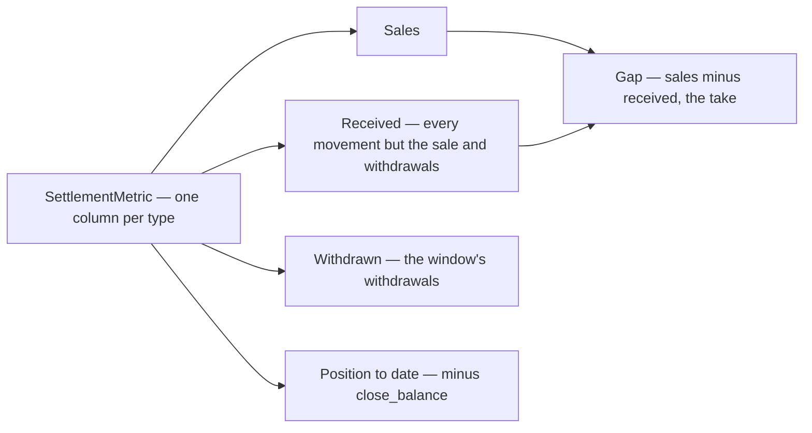

# Decisions — the settlement report

The owner's decisions about the **settlement report** (`/settlement/report`). **Append-only** (RULE 12): a reversed decision is renamed and its references grepped.

The rules every screen follows are in [context_decision.md](context_decision.md). These were recorded in
[settlement/context_decision.md](../../business/settlement/context_decision.md) first and moved here on 2026-10-02; each old heading there now points here.

| decision | what it settles |
| --- | --- |
| [the-report-headline-is-position-to-date](#the-report-headline-is-position-to-date) | the report's running figure is **Position to date**, and **Withdrawn** stands beside Received — *hidden cost* no longer names it |
| [the-shop-entries-page-is-accepted](#the-shop-entries-page-is-accepted) | Shop Entries — a shop's own settlement rows — is its own page in the Penyelesaian menu, opened from the report too | owner, as recommended | — |
| [a-shop-entry-reverses-inline](#a-shop-entry-reverses-inline) | a shop entry carries Reverse, behind a confirm, for the order ledger's reverse set | owner, as recommended | — |

## the-report-headline-is-position-to-date

> Chat *(owner, 2026-09-29)* — *"Rename + Withdrawn column"*, asked after
> [withdrawal-counts-in-the-position](../../business/settlement/context_decision.md#withdrawal-counts-in-the-position): the report's *Hidden cost to date* would
> read as roughly every sale from the first imported withdrawal.

**The verdict.** The report's running figure is labelled **Position to date** — what buyers paid, less everything the
platform moved, withdrawals included — and **Withdrawn** stands as its own figure beside *Received*. The window's
**Gap** still shows the platform's take. It is my recommendation.

### The spec

| figure | is |
| --- | --- |
| Sales | `−(initial_total + initial_total_cancel)` — unchanged |
| Received | every other type but `withdrawal` — `fund`, the fees, the adjustments, the reimbursements, `marketplace_program`, `other`, `system_adjustment` |
| Withdrawn 🆕 | `−withdrawal` — positive: money that went to the bank in the window |
| Gap · take rate | `sales − received` — unchanged |
| Position to date 🔄 | `−close_balance`, relabelled — was *Hidden cost to date*. Its hint: *what buyers paid, less everything the platform moved — withdrawals included* |

⚠ **It amends the label half of [hidden-cost-is-left-in-the-balance](../../business/settlement/context_decision.md#hidden-cost-is-left-in-the-balance)** — the
unitemised take is still in the balance, but the balance is no longer only that, so the screen stops calling it so.
[the-measure-is-sales-received-and-gap](../../business/settlement/context_decision.md#the-measure-is-sales-received-and-gap) stands: its three figures are
unchanged, and Withdrawn joins them.

---

## the-shop-entries-page-is-accepted

> In chat *(owner, 2026-11-07)* — *"A"*, as recommended, replying to the Storybook screenshots `settlement_direct/01…08` (`pages/settlement-shop-entries`, `features/settlement/shopEntriesPrototype.tsx`), asked with: where does it live — its own page in the menu and from the report, only from the report, or changes first?

**The verdict.** The prototype is the design for the rows addressed to a shop and no order ([an-entry-names-an-order-or-a-shop](../../business/settlement/context_decision.md#an-entry-names-an-order-or-a-shop)) — closing *"a wrong shop row — no screen — no RPC lists a shop's own rows yet"* of [an-upload-is-never-reverted](../../business/settlement/context_decision.md#an-upload-is-never-reverted):

| | |
| --- | --- |
| where | its own route `/settlement/shop-entries`, **Entri Toko**, the fourth child of the *Penyelesaian* group ([the-sidebar-stays-short](context_decision.md#the-sidebar-stays-short)); and a **By shop** row of the report opens it on that shop with the report's dates |
| totals | Entries · Received · Withdrawn — withdrawals beside Received, not in it ([the-report-headline-is-position-to-date](#the-report-headline-is-position-to-date)) |
| filters | shop (closed shops badged), kind (the 11 shop-addressed kinds — never the sale or its cancel), and the **learned** day (`posted_on`, Jakarta days) so the list adds up to the report; in the URL |
| a row | the learned day (the other day under it when they differ) · the shop + marketplace · the kind in business words with *Import* / *Manual* · the reference (*no order found*, *2 live orders: #…*) · the statement it came from, linked to its import, and who uploaded it — or *Posted by hand* and who · the signed amount |
| a phone | a block per row, filters in a sheet |
| who | the settlement read set ([the-write-set-is-cs-and-up](../../business/settlement/context_decision.md#the-write-set-is-cs-and-up)); the menu line follows the list's and report's |

What a person may **do** on a row is asked next. ⚠ Not built.

✅ Built 2026-11-07 — `SettlementService.ShopSettlementEntryList` (settlement 00011 partial index), the statement asked of the importer in-process (`StatementLinesBySettlementLogIds`, importer 00005), names by the user read; `/settlement/shop-entries`, **Entri Toko** after Impor for the list's and report's audience (`nav.ts`), and the report's By shop rows open it with the report's window. The prototype gate is gone; e2e `the_shop_entries.spec.ts`. See [development_state/settlement/context.md](../../development_state/settlement/context.md#2026-11-07--shop-entries-built-backlog-23-and-the-reports-jakarta-window-36).

---

## a-shop-entry-reverses-inline

> In chat *(owner, 2026-11-07)* — *"A"*, as recommended, to: what may a person do with a row of [the-shop-entries-page-is-accepted](#the-shop-entries-page-is-accepted) — Reverse, read only, or Reverse plus *Move to Order*?

**The verdict.** Each row carries **Reverse**, behind a `ConfirmDialog` naming the row and its amount, for the **same people who reverse on the order page** ([the-ledger-shows-no-note-and-reverses-inline](order_settlement_decision.md#the-ledger-shows-no-note-and-reverses-inline), [the-write-set-is-cs-and-up](../../business/settlement/context_decision.md#the-write-set-is-cs-and-up)). A reverse writes the opposite row on the same shop ([a-correction-is-a-new-row](../../business/settlement/context_decision.md#a-correction-is-a-new-row)) — nothing is edited or deleted; a row already reversed shows so and offers no second Reverse. **Not now:** *Move to Order* for a no-order or two-orders line — later, its own step. ⚠ Not built.

✅ Built 2026-11-07 — Reverse on every row for the write set (not the admin team's monitor), behind a `ConfirmDialog` naming the kind, shop, day and amount; it posts SettlementPost of the opposite row keyed `reverse-<id>` — the order ledger's own write. SettlementPost now refuses a reversal that is not the reversed row's type and opposite amount, and a second reversal of a row (read under the account's lock — `TestRace_SettlementPost_AShopEntryIsReversedOnce`); a reversed row reads **Reversed**, dimmed, with no second Reverse.
