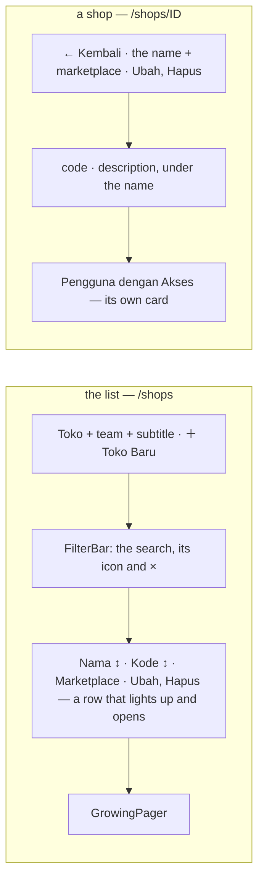
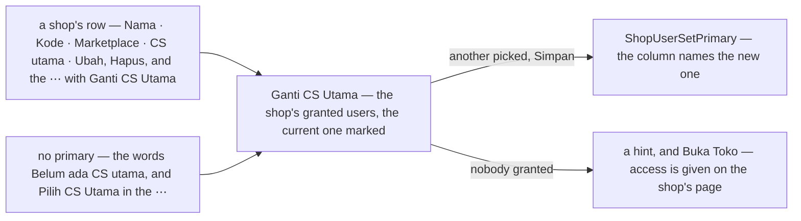
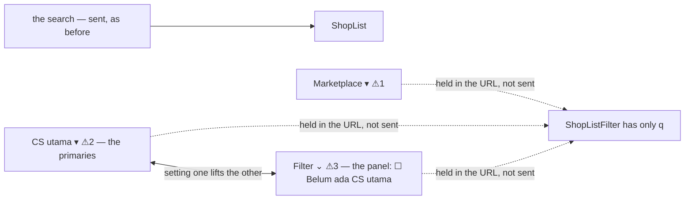

# Decisions — the shop screens

The owner's decisions about **`/shops`** (a selling team's marketplace storefronts) and **`/shops/:id`** (one shop and
who works on it). **Append-only** (RULE 12): a reversed decision is renamed and its references grepped.

The rules every screen follows are in [context_decision.md](context_decision.md).

| decision | what it decided |
| --- | --- |
| [the-shop-screens-follow-the-screen-rules](#the-shop-screens-follow-the-screen-rules) | the shops list and a shop's page are rebuilt on the every-screen rules — the supplier screens' shape; Delete joins Edit on the shop's page |
| [the-primary-cs-is-a-column-and-changes-from-the-actions](#the-primary-cs-is-a-column-and-changes-from-the-actions) | the list gives each shop's primary CS its own column — *Belum ada CS utama* in words when there is none — and **Ganti CS Utama** (or **Pilih CS Utama**) is in the row's ⋯, after Ubah and Hapus: a dialog of the shop's granted users |
| [the-shops-filter-by-marketplace-and-primary-cs-ahead-of-the-contract](#the-shops-filter-by-marketplace-and-primary-cs-ahead-of-the-contract) | the list filters by **marketplace**, by **CS utama** and by the tick **Belum ada CS utama** — each held in the URL and marked ⚠, not sent until ShopListFilter can carry them |

## the-shop-screens-follow-the-screen-rules

> Owner, in chat (2026-10-16): *"sekarang untuk toko normalisasi dengan keputusan tampilanku sebelumnya"* — after the
> screens got their first stories (`Pages/Shops/Shops`, `Pages/Shops/ShopDetail`) and showed the old shape.

| | before | now — and the rule |
| --- | --- | --- |
| the list's header | the title alone, New Shop with no icon | title, team and a subtitle as one block; ＋ Toko Baru — its ＋ alone on a phone ([a-phone-header-action-is-an-icon](context_decision.md#a-phone-header-action-is-an-icon), [an-action-button-carries-its-icon](context_decision.md#an-action-button-carries-its-icon)) |
| the search | a bare input | the shared `FilterBar` and `FilterSearch` — its icon, its ×, Hapus Filter ([a-phone-filters-from-a-sheet](context_decision.md#a-phone-filters-from-a-sheet), [every-filter-clears-from-its-own-x](context_decision.md#every-filter-clears-from-its-own-x)); still in the URL ([a-lists-filters-live-in-the-url](context_decision.md#a-lists-filters-live-in-the-url)) |
| the order | none | **Nama** and **Kode** sort from their headings — the two `ShopList` can order by, A to Z first; newest first when none is picked ([a-table-sorts-from-its-headings](context_decision.md#a-table-sorts-from-its-headings)); the sort is in the URL too |
| a row | only the name was a link; ✎ and 🗑 icons | the whole row opens the shop and lights up ([a-table-row-lights-up](context_decision.md#a-table-row-lights-up)); **Ubah** and **Hapus**, labelled with their icons |
| no primary CS | an orange badge | the same badge in the **warning** role — a status, never a hue. 🔄 Since then the words *Belum ada CS utama* in its own column, no badge ([the-primary-cs-is-a-column-and-changes-from-the-actions](#the-primary-cs-is-a-column-and-changes-from-the-actions)) |
| a phone | the desktop table, squeezed | a block per shop: the name, then the code and marketplace, Ubah and Hapus at its foot ([a-phone-reads-each-line-as-a-block](context_decision.md#a-phone-reads-each-line-as-a-block)) |
| loading · empty | a spinner · a grey line | the list's shape, then the rows fading in · an `EmptyHint` — add a shop, or clear the search ([motion-is-small-quick-and-shared](context_decision.md#motion-is-small-quick-and-shared), [an-empty-list-shows-a-hint](context_decision.md#an-empty-list-shows-a-hint)) |
| the pager | `Pagination` | `GrowingPager` ([every-list-pages-with-the-growing-pager](context_decision.md#every-list-pages-with-the-growing-pager)) |
| the form | no placeholders | an example in every typed field — *Contoh: Melati Official*, *Contoh: MEL-SHP* ([every-form-field-shows-an-example](context_decision.md#every-form-field-shows-an-example)); the description a three-row `Textarea` ([chakra-first-whenever-it-has-the-component](context_decision.md#chakra-first-whenever-it-has-the-component)) — missed in the first pass, the owner caught it |
| a shop's header | *Detail Toko* over a card of uppercase labels | the shop's **name** is the page's title, its marketplace beside it, Ubah · **Hapus** on the row (icons on a phone), its code and description on one line under it |
| Delete on the shop's page | absent | present, confirmed, back to the list — a phone's list block opens the page, so the page is where a phone deletes |
| who works on it | a section inside a card | its **own card**, titled and described ([never a card inside a card](../../../CLAUDE.md)); the no-primary warning an alert in the warning role; an empty list a hint; the first load its shape; a row that lights up; on a phone the picker and Tambah stack |

- The test ids the e2e reach for are kept: `shop-row-<code>`, `open-shop-<code>`, `edit-<code>`, `delete-<code>`,
  `shop-no-primary-<code>`, `shop-detail-name`, `shop-no-primary`, `shop-users-empty`. The e2e's list wait accepts the
  empty hint, since an empty list draws no table.
- The stories pin each rule: `Pages/Shops/Shops` (26 with the detail's) — the sort, the row, the phone blocks, the hint
  and its Clear, the URL; `Pages/Shops/ShopDetail` — the header, Delete, the primary CS, the first grant.

## the-primary-cs-is-a-column-and-changes-from-the-actions

> Owner, in chat (2026-10-16): *"kasih cs utamanya di bawah toko, dan ada aksi untuk mengubahnya"* — after reading the
> shop context and asking what the primary CS is for: the person an imported statement's rows with no order are
> counted for ([user-id-is-the-orders-creator-else-the-shops-primary-cs](../../business/settlement/settlement_importer_decision.md#user-id-is-the-orders-creator-else-the-shops-primary-cs)),
> and a shop with none cannot import ([a-shop-with-no-primary-cs-cannot-import](../../business/settlement/settlement_importer_decision.md#a-shop-with-no-primary-cs-cannot-import)).
> Then, on the first build: *"tidak perlu badge cuma teks untuk belum ada cs utama · atau jadi kolom saja karena masih
> luas juga, gantinya taruh di aksi"*, and then *"pilih cs di ellipsis"*.

| | |
| --- | --- |
| where | its **own column**, *CS utama*, after Marketplace — the table has the room. On a phone, a line of the shop's block under its code and marketplace — the **name alone**, *Ani Rahayu*, with no *CS utama ·* before it (owner: *"di mobile tidak perlu ada teks cs utama di sebelum cs"*) |
| the cell | the person's **name** (the username when there is no name). A shop with none: the words *Belum ada CS utama* in the **warning** role — text, not a badge |
| the action | **Ganti CS Utama** — **Pilih CS Utama** on a shop with none — a menu item with its icon in the row's **⋯**, which follows Ubah and Hapus. Those two stay labelled buttons on the row. On a phone the same three at the block's foot |
| the dialog | *Ganti CS Utama* or *Pilih CS Utama*, the shop's name under it, one line on what the choice is for, then the shop's **granted users** as radio cards (`UserItem`), the current one badged *Saat ini*. **Simpan** waits for a different pick |
| who can be picked | only the shop's granted users — [the-primary-cs-is-a-flag-on-a-grant](../../business/shop/context_decision.md#the-primary-cs-is-a-flag-on-a-grant): a primary is never someone without a grant, and `ShopUserSetPrimary` refuses one |
| nobody granted | no one to offer: an `EmptyHint` saying access is given on the shop's page, the first grant becoming the primary there, with **Buka Toko**; no Simpan |
| the reads | the page's primary CS ids named with one `UserByIDs` (`useActors`); the dialog reads `ShopUserList` + `UserByIDs` (`useShopUsers`). No API change |
| the write | `ShopUserSetPrimary`, invalidating `shops` — the list and the shop's page both re-read |
| tried first | the name's second line, *CS utama · Ani Rahayu* with a small **Ganti** beside it, and the warning badge there — reversed the same day for the column, the action among the row's, and words instead of the badge · then **Ganti CS** as a third labelled button before Ubah — moved into the ⋯ the same day |

- **A wrong sentence corrected on the way.** The shop page's *Pengguna dengan Akses* card said *"CS utama yang
  mengimpor laporannya"* — the primary CS is not who imports, but who the no-order rows are counted for. It now says
  so, in both languages.
- Not gated by role, like Ubah and Hapus on the same row: the server refuses a CS (`ShopUserSetPrimary` is owner, admin
  and up), and the list hides none of its actions by role yet.
- Stories: `AShopWithNoPrimaryCsSaysSo` (words, not a badge), `ThePrimaryCsHasItsOwnColumn`, `ChangeMovesThePrimaryCs`,
  `NobodyToChooseOpensTheShop`; the phone story checks the action is in the block.

## the-shops-filter-by-marketplace-and-primary-cs-ahead-of-the-contract

> Owner, in chat (2026-10-16), asked what the list can filter by — only the search — and what the contract lacks:
> *"oke tambahkan dengan warning, filter mp, cs utama sama belum ada cs bisa jadi satu?"*, *"oke kita buat begitu"* to
> one CS filter — then, on the build, *"bedakan belum ada csnya"*: *Belum ada CS utama* is a filter of its own, and
> *"pakai panel untuk checkbox"*: its tick sits in a Filter panel.

| | |
| --- | --- |
| the strip | the search, then **Marketplace**, **CS utama** and the **Filter** panel, each with its ⚠ number and its own ×; *Hapus filter* clears all four; on a phone the three move into the Filter sheet |
| marketplace | `MarketplaceSelect`, a plain list (static and small) — `market=` in the URL, the orders list's key |
| CS utama | `PersonFilterSelect`, the people only — `cs=<id>` in the URL |
| its people | the people who are a primary CS on one of this team's shops, A to Z — [a-who-filter-lists-the-people-on-its-rows](../../business/user/context_decision.md#a-who-filter-lists-the-people-on-its-rows): the list's own service answers (`useShopPrimaries` reads the team's shops, the shop picker's page of 100), never the team's member list. A user granted but nobody's primary is not offered |
| Belum ada CS utama | its own `Checkbox`, in a **Filter panel** (`ShopOptionsFilter`) — `nocs=1` in the URL. The shops that cannot import, asked for apart from any person |
| the panel | the accounts list's shape ([operational-and-archived-share-one-filter-panel](financial_accounts_decision.md#operational-and-archived-share-one-filter-panel)): *Filter* with its icon, counting the ticks that are on. While one is, the trigger is in the main tone and an **×** attached to it turns every tick off without opening it ([every-filter-clears-from-its-own-x](context_decision.md#every-filter-clears-from-its-own-x)); the ⚠ beside it. On a phone the tick stands in the Filter sheet as it is |
| the two together | they cannot both hold (a shop with no primary has no Ani), so **ticking it lifts the person, and picking a person lifts the tick** |
| ⚠ not sent | all three are `dropped` (`pages/shops/pending.ts`): the pick is kept, every shop is still listed. A paged list cannot be narrowed on screen without missing the other pages' shops. The summary strip at the top names them |
| what the contract needs | `ShopListFilter` — a `marketplace`, a `primary_user_id`, and a way to ask for the shops with none. The API is frozen, so it is not asked here |
| two marketplace pickers on one page | the filter's and the New Shop form's — the filter's trigger is `shops-marketplace-select` (a `testId` prop on `MarketplaceSelect`), so the form's `marketplace-select` and every e2e that reaches it are unchanged |
| tried first | *Belum ada CS utama* as the CS filter's first answer (`cs=0`), on the argument that "nobody" and "Ani" answer one question — built, and reversed the same day for a tick of its own · then that tick on the strip itself — moved into a Filter panel the same day |

- Stories: `TheNewFiltersAreHeldButNotSentYet`, `ThePrimaryFilterOffersThePrimaries`, `NoPrimaryCsIsATickInThePanel`,
  `TheNewFiltersComeBackFromTheUrl`.
- ⚠ It is the third copy of a filter panel — the accounts list's `AccountOptionsFilter` (which has no × yet) and the
  supplier figures' `SupplierRangeFilter` are the others. A shared one in `components/chrome/` is the next step when the
  owner wants it.
