# Decisions — the warehouse order list

The owner's decisions about the **warehouse's order list** — the other end of `/orders`, a preview hidden in Storybook (`Pages/Warehouse/PickQueueNextPage`) until it is routed. **Append-only** (RULE 12): a reversed decision is renamed and its references grepped.

The rules every screen follows are in [context_decision.md](context_decision.md). These were recorded in
[technical/order/design_decision.md](../order/design_decision.md) first and moved here on 2026-10-02;
each old heading there now points here.

| decision | what it settles |
| --- | --- |
| [the-two-ends-are-two-screens](#the-two-ends-are-two-screens) | the warehouse keeps its old list — almost nothing on the seller's row is a fact a picker acts on |
| [the-warehouse-row-is-the-old-systems-columns](#the-warehouse-row-is-the-old-systems-columns) | the warehouse list's row: created by, marketplace shop, AWB, qty, status, date, MP date — the deadline replaces the MP date's "ago" when there is one |
| [the-warehouse-tabs-are-the-processed-steps](#the-warehouse-tabs-are-the-processed-steps) | the warehouse's tabs are Perlu konfirmasi, the four steps of Diproses and Semua — not the order's statuses; a row's badge says its tab's word |
| [the-confirmed-step-reads-dikonfirmasi](#the-confirmed-step-reads-dikonfirmasi) | the CONFIRMED step is named "Dikonfirmasi", not "Perlu konfirmasi" |
| [the-warehouse-filters-by-team-marketplace-and-courier](#the-warehouse-filters-by-team-marketplace-and-courier) | search, date, seller team, marketplace, courier — and the shipment state only where parcels have been handed over |
| [a-warehouse-step-moves-by-the-old-systems-table](#a-warehouse-step-moves-by-the-old-systems-table) | the old system's transition table: skips forward allowed, back only to Dikonfirmasi and with a reason |
| [scanning-is-the-crews-hands](#scanning-is-the-crews-hands) | three scans — handover, find a parcel, validate the items — plus selection, bulk actions, labels and export |
| [the-bulk-actions-are-always-on-screen](#the-bulk-actions-are-always-on-screen) | the action bar shows from the start; tick-only actions are off until a tick, and Export takes the filtered list when nothing is ticked |
| [the-warehouse-row-fills-from-shop-and-user-by-ids](#the-warehouse-row-fills-from-shop-and-user-by-ids) | the row's shop and marketplace come from a new unscoped `ShopByIds`, its creator from `UserByIDs`, and `item_quantity` from the list |
| [the-filter-gains-seller-marketplace-and-courier](#the-filter-gains-seller-marketplace-and-courier) | `OrderListFilter` gains seller team, marketplace and courier; the shipment-state switch is dropped for the status tabs |
| [one-status-change-for-every-plain-move](#one-status-change-for-every-plain-move) | one `OrderStatusChange(order_ids, to, note)` for every plain move, many orders at once; cancel and return accept keep their own RPCs |
| [a-warehouse-prints-the-labels-of-orders-it-ships](#a-warehouse-prints-the-labels-of-orders-it-ships) | `OrderLabels(team_id, order_ids)` merges the labels of orders this warehouse ships into one PDF; access follows the order, nothing is shared |
| [a-batch-move-saves-in-one-transaction](#a-batch-move-saves-in-one-transaction) | a batch status move saves in one transaction of four statements; refusals stay per order, a database failure moves nothing |
| [one-export-is-the-list-as-a-file](#one-export-is-the-list-as-a-file) | one `OrderExport(team_id, filter)` for both lists: the list's rows, the reader's columns, .xlsx, streamed with progress |

## the-two-ends-are-two-screens

> Owner, in chat (2026-09-29): *"warehouse order list page kembalikan, aku belum mau menyentuh itu,
> konteksnya beda soalnya"*.

`/orders` is read from both ends (#151) and was one screen with a few columns swapped. It is now two,
chosen by team type in `pages/orders/index.tsx`.

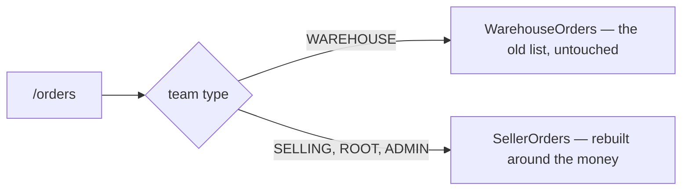

**And the context really is different**, which is why this is a split and not a flag:

| the seller's row | the warehouse's job |
| --- | --- |
| ID Order · Tgl MP · Total MP · Beli · Margin | what to pick, from which shelf, by when |
| what a shop is owed and what it earned | what a crew is holding |

⚠ **A WAREHOUSE SHOWING ANOTHER TEAM'S MARGIN IS SHOWING IT SOMEBODY ELSE'S BUSINESS.** The list already
spans sellers — a building sees orders from every team that ships through it — so the money columns are
not merely unhelpful there, they are a disclosure.

⚠ **IT IS A JS BRANCH, NOT CSS.** Same rule as the app shell (`layouts/Layout.tsx`): rendering both and
hiding one would mount two tables, two sets of queries and two of every `data-testid` the e2e reach for.

⚠ **THE TEAM TYPE, NOT A ROLE.** Who you are inside a team does not change which list this is — a
warehouse admin and a warehouse picker both read the building's queue. Root and admin fall through to
the seller's screen, which is where the Tim column lives.

⚠ **THE WAREHOUSE'S SCREEN IS NOT DESIGNED YET, only preserved.** It still carries the old stat row and
the old three columns; nothing on this page has been asked of it.

## the-warehouse-row-is-the-old-systems-columns

> Owner, in chat (2026-10-01): *"di sistem gudang lama header ada created by dengan user + team, toko mp + nama +
> orderid, awb isinya kurir + resi, buyer mungkin tidak perlu sekarang, qty, status, tanggal + ago, tanggal mp + ago"* —
> then *"dibuat tetap saja"*, shop, AWB and the rest as proposed, and the deadline *"jika ada"*.

The warehouse's order list (`/warehouse-orders`, the pick queue) carries the old system's row. Preview:
`Pages/Warehouse/PickQueueNextPage` (`pages/pick-queue-next/`), not routed yet. No money on the warehouse side.

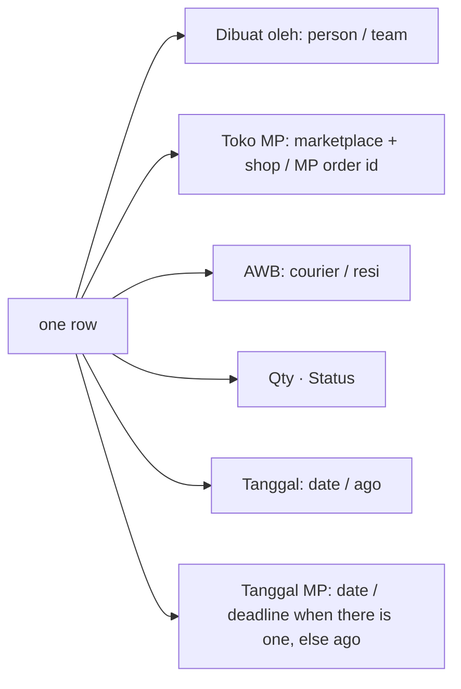

| column | line 1 / line 2 | real? |
| --- | --- | --- |
| Dibuat oleh | person / team (the owner's order) | team real · person ⚠ `creator` |
| Toko MP | `[marketplace]` shop / MP order id, copyable | order id real · shop ⚠ `shop` — `ShopList` is scoped to the seller |
| AWB | courier / resi, copyable | courier real · resi ⚠ `receiptCode` |
| Qty | units | ⚠ `quantity` — a list carries no items |
| Status | the step badge | real |
| Tanggal | date / "2 days ago" | real |
| Tanggal MP | date / the **deadline** when the order has one (until shipped), else "ago" | ⚠ `mpDate`, `deadline` |

- The deadline reads as on the seller's list: quiet beyond 24 hours, amber under 24, solid amber under 6, solid red
  when late — and a late order tints its whole row.
- Buyer is left out for now. Ordering is left as it is for now.
- The tabs stay the pick queue's steps and gain counts; search and a date range filter; on a phone each order is a
  block, every invented fact keeping its ⚠ there.

## the-warehouse-tabs-are-the-processed-steps

> Owner, in chat (2026-10-01): *"di gudang tidak pakai status order itu, tapi pakai steps di status processed"* —
> then: a **Perlu konfirmasi** tab in front for orders waiting on the warehouse, and a **Semua** tab at the end.

The warehouse does not read the order's statuses (Menunggu, Diproses, Dikirim, …) — those are the seller's and the
buyer's. Inside the building an order is one of the steps of `processed`
([the-warehouse-steps-are-not-order-statuses](../../business/order/context_decision.md#the-warehouse-steps-are-not-order-statuses)).

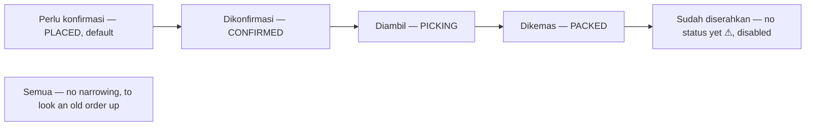

| | rule |
| --- | --- |
| the tabs | Perlu konfirmasi · Dikonfirmasi · Diambil · Dikemas · Sudah diserahkan · Semua |
| the four middle names | `PROCESSED_STEPS` — the same names as the seller's step filter under Diproses, so both ends say the same word for a step |
| Perlu konfirmasi | PLACED: the job the warehouse must accept first, so the screen opens on it |
| Sudah diserahkan | the warehouse's last step has no status in the contract — the tab is disabled and carries the ⚠, rather than narrowing nothing |
| Semua | not a status — every order, including shipped and cancelled, for looking one up |
| counts | each tab with a status carries its count; Semua counts every status |
| a row's status | the badge says the tab's word — "Perlu konfirmasi", not "Dibuat" — and an order the warehouse is done with keeps its order status's name (Dikirim, Batal). The colour stays the status's (`OrderStatusBadge` gained a `label`) |

- Replaces the pick queue's own tab names, and the last line of
  [the-warehouse-row-is-the-old-systems-columns](#the-warehouse-row-is-the-old-systems-columns), which said the
  tabs stay the pick queue's steps.
- Tried and reverted in the same pass: the seller's whole stage strip with the step filter under it. The owner's
  correction is that the warehouse does not use the order's statuses at all.

🔄 *(2026-10-21)* **The steps ARE statuses now** (00015): Perlu konfirmasi = pending, Dikonfirmasi = processed, Sudah
diambil = picked, Sudah diserahkan = shipping — every tab narrows and is counted. *Sedang diambil* and *Dikemas* went with
the statuses that held them ([one-status-change-for-every-plain-move](#one-status-change-for-every-plain-move)).

## the-confirmed-step-reads-dikonfirmasi

> Owner, in chat (2026-10-01): picked *"Ganti jadi 'Dikonfirmasi'"*.

The step for `CONFIRMED` was labelled **"Perlu konfirmasi"** ("To confirm") in the seller's step filter. A
CONFIRMED order has already been accepted by the warehouse; the order that needs confirming is PLACED. It reads
**"Dikonfirmasi"** (EN **"Confirmed"**) now — on the seller's step filter and on the warehouse's tab alike, since
both read `orders.step.confirm`.

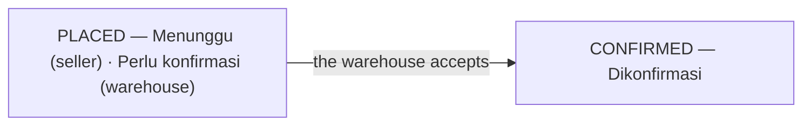

## the-warehouse-filters-by-team-marketplace-and-courier

> Owner, in chat (2026-10-01): *"filter yang ada adalah cari, filter type, status (bukan status order), status
> pengiriman (dalam perjalanan atau belum jalan), tanggal, team, marketplace dan jasa kirim"* — then *"oke"* to the
> recommendation below.

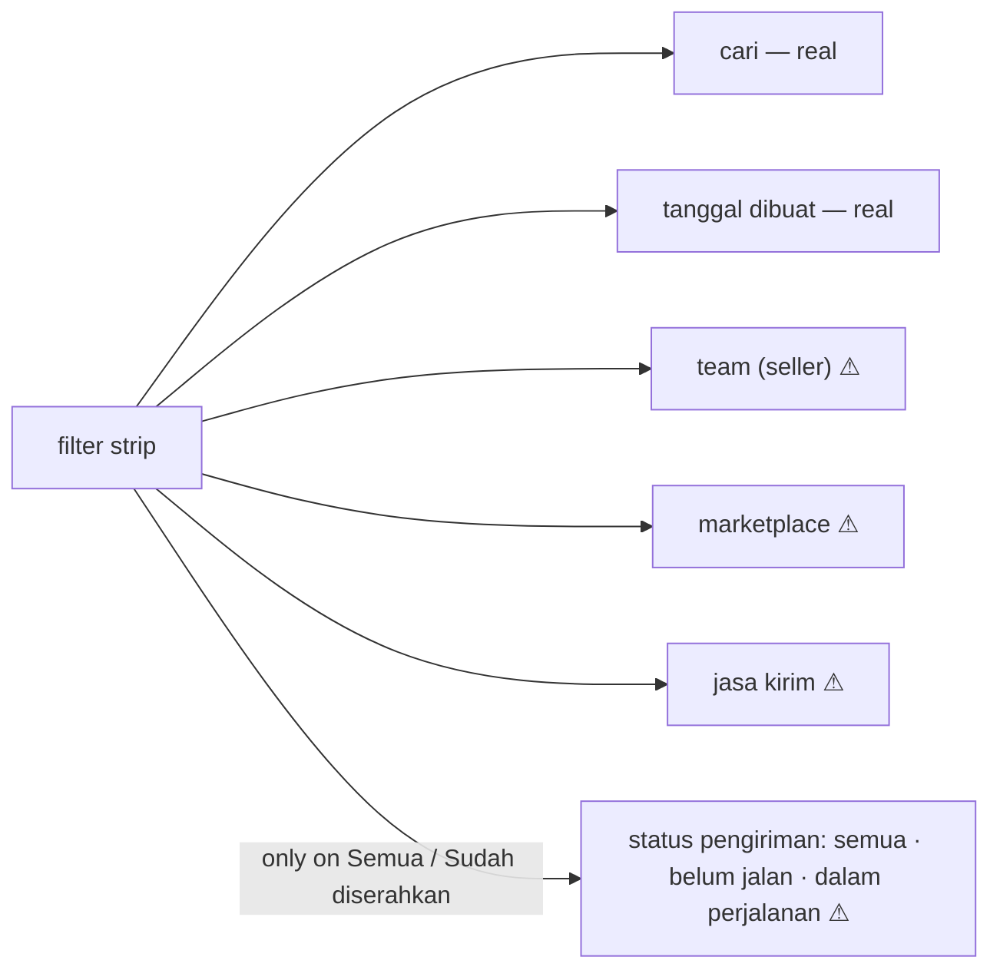

| filter | rule |
| --- | --- |
| cari | one box, looks everywhere — so no "filter type" choosing which field it searches. ⚠ It does not reach the MP order id or the resi yet ([design_clarify.md](../order/design_clarify.md#question)) |
| status | not built: the warehouse's steps are already the tabs ([the-warehouse-tabs-are-the-processed-steps](#the-warehouse-tabs-are-the-processed-steps)) |
| tanggal | the date the order was written down — the marketplace date has no field |
| team · marketplace · jasa kirim | search selects (team, courier) and the marketplace list, each with a ⚠: `OrderListFilter` has none of the three, so they narrow nothing yet (`dropped`). 🔄 *(2026-10-19)* **Decided:** all three join the filter ([the-filter-gains-seller-marketplace-and-courier](#the-filter-gains-seller-marketplace-and-courier)), not built |
| status pengiriman | a three-way switch shown only on the tabs a handed-over parcel can be listed under; leaving those tabs clears it. ⚠ It belongs to a shipment record that does not exist. 🔄 *(2026-10-19)* **Dropped:** the order status is that state now, and the status tabs filter it ([the-filter-gains-seller-marketplace-and-courier](#the-filter-gains-seller-marketplace-and-courier)) |

- On a phone everything but the search sits in the Filter sheet, as on the seller's list.
- **Assumed, not asked back:** "filter type" meant choosing the searched field, and "status (bukan status order)"
  meant the warehouse step. If either meant something else, it is a new filter, not a change to these.

## a-warehouse-step-moves-by-the-old-systems-table

> Owner, in chat (2026-10-01): the old system's table — *waiting: picking, picked, packing_completed · picking:
> picked, waiting, packing_completed · picked: packing_completed, waiting · packing_completed: completed, waiting ·
> completed: —* — then *"kalau belum ada bisa ditambahkan"* (the picked step) and *"warning cukup, tetapi pakai alasan
> terdengar masuk akal"* (moving back).

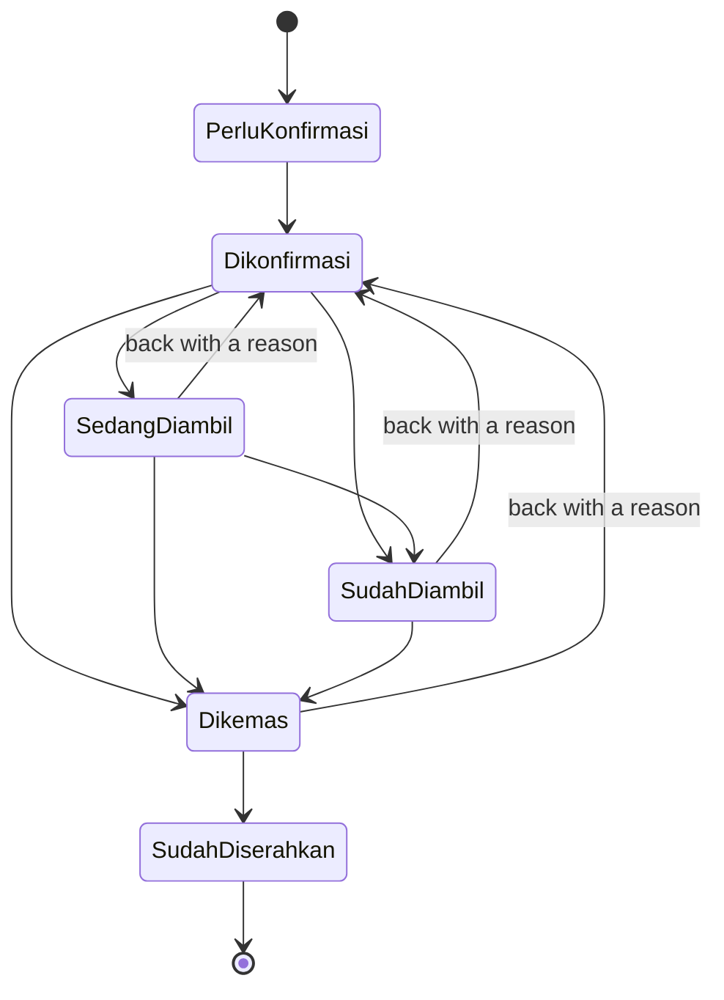

| old system | warehouse step | status in the build |
| --- | --- | --- |
| waiting | Dikonfirmasi | CONFIRMED |
| picking | Sedang diambil | PICKING |
| picked | **Sudah diambil** (new — [picked-is-a-warehouse-step](../../business/order/context_decision.md#picked-is-a-warehouse-step)) | none ⚠ |
| packing_completed | Dikemas | PACKED |
| completed | Sudah diserahkan | none — the build records it as SHIPPED |

- A skip forward is allowed (picked and packed in one go). Going back is only ever to Dikonfirmasi, behind a warning
  with a **required reason**; stock does not move, because the goods were counted out when the order was placed.
- The row menu and the bulk "Change Step" offer only allowed moves; the bulk one offers what EVERY selected order allows.
- ⚠ `stepMove`: the RPCs move one step forward each (confirm, pick, pack, ship). A skip, a move back or a move into
  Sudah diambil does nothing yet but say so. The table belongs on the server.
- The label "Diambil" became **"Sedang diambil"** and the new step is **"Sudah diambil"** — on the seller's step filter
  too, since both screens read `PROCESSED_STEPS`.

🔄 *(2026-10-21)* **Superseded in part by the owner's status diagram**
([the-status-move-is-the-only-journey](../../business/order/context_decision.md#the-status-move-is-the-only-journey)): the
moves are pending → processed → picked → shipping, a move back goes to **pending** (not Dikonfirmasi) with a note, and the
skips went with the folded steps. The menu reads [steps.ts](../../../frontend/src/pages/pick-queue-next/steps.ts); the
server's table is `orderMoves`.

## scanning-is-the-crews-hands

> Owner, in chat (2026-10-01): the old page's features — change step, a validation scan while picking, a handover
> scan (only `packing_completed` → `completed`, with a mass option), finding a parcel by scan with no API, printing
> labels in bulk, export — then: a handheld **scanner**; the handover needs no proof; and the find-parcel purpose:
> *"paket yang sudah dikemas biasanya langsung masuk karung … buka dialog ini untuk order yang dicari, lalu scan paket
> di tumpukan sampai ada yang berbunyi cocok"*.

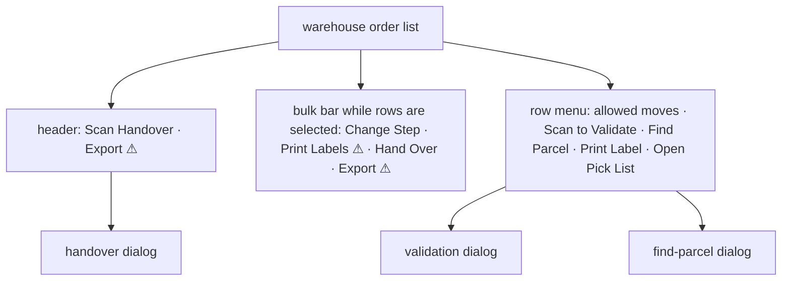

| scan | rules |
| --- | --- |
| **handover** | only a Dikemas parcel; another step is an error with the wrong sound; the same label twice is not added twice, only the fulfilled sound; *Ambil massal* off hands each good scan over at once, on collects them and one button — off while nothing is ready — hands them over; the end state is Sudah diserahkan; no manifest. ⚠ `resiLookup` (looks in the orders the screen loaded), `bulkHandover` (one call per parcel) |
| **find parcel** | opened for ONE order; every scan is compared with that order's resi, MP order id and id, on screen, with no API; a match is the fulfilled sound and a green answer, anything else the wrong sound |
| **validation** | for an order being picked: each item scan counts its line up to the ordered quantity; an unknown item or one too many is an error with the wrong sound; the step moves on only when every line is exact. ⚠ `barcode` — products have no barcode, so the SKU is matched |

- The scanner types the code and presses Enter; the field keeps focus and empties itself for the next one.
- Two sounds made by the browser — a short high "fulfilled" and a low "wrong" — failing silent where audio is unavailable.
- Labels: one prints through the receipt's signed URL; several at once need a merge (⚠ `printMerge`). 🔄 *(2026-10-19)* Both go through `OrderLabels` ([a-warehouse-prints-the-labels-of-orders-it-ships](#a-warehouse-prints-the-labels-of-orders-it-ships)): the signed-URL read is refused today, because the label is the seller's. Export ⚠ `exportFile`. 🔄 *(2026-10-19)* Export is [one-export-is-the-list-as-a-file](#one-export-is-the-list-as-a-file).
- Built in the preview `Pages/Warehouse/PickQueueNextPage`.

🔄 *(2026-10-16)* **Amended by [a-label-scan-reads-the-ref-or-the-receipt](../../business/inventory/order_decision.md#a-label-scan-reads-the-ref-or-the-receipt)**:
a scan of the label finds the order by `order_external_ref_id` **or** `receipt`. The handover's `resiLookup` looks by the
resi alone and must take the ref too. Find-parcel already compares with both. When a code matches several orders, all are shown and people decide:
[two-orders-on-one-label-are-shown-not-chosen](../../business/inventory/order_decision.md#two-orders-on-one-label-are-shown-not-chosen).

## the-bulk-actions-are-always-on-screen

> Owner, in chat (2026-10-01): *"aksi yang perlu centang apa tidak bisa muncul dari awal saja?"*

The warehouse list's action bar is on screen from the start, not only once a row is ticked.

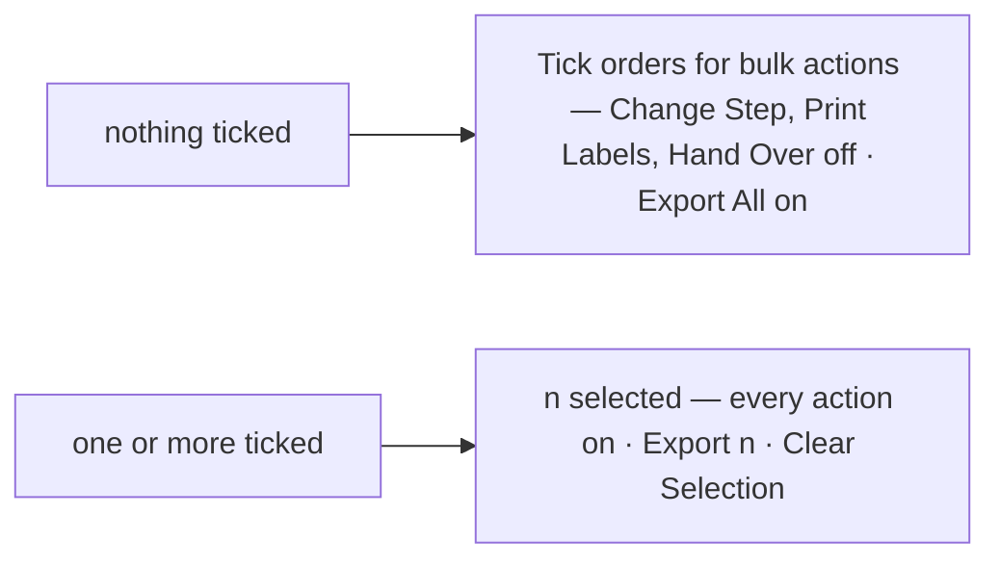

- An action that needs a selection is disabled, and the bar says why beside it rather than leaving a grey button
  to be guessed at.
- **Export never waits**: the selection when there is one, else every order the filters show. It moved off the
  header into the bar, so there is one Export, not two.
- Replaces the line in [scanning-is-the-crews-hands](#scanning-is-the-crews-hands) that had the bar appear only
  while rows are selected.

---

## the-warehouse-row-fills-from-shop-and-user-by-ids

> Owner, in chat (2026-10-19): *"we can have rpc that allow get basic info on shop data that can access all team, like
> GetShopByIds"*, then **"yes"** to recording it — on [technical order Q16](../order/design_clarify.md#question), *"how does
> a warehouse's order list show the seller's shop, marketplace and unit count?"*. The owner's proposal, replacing both of
> mine (copy onto the order, or join in the list query).

**The verdict.** The warehouse row ([the-warehouse-row-is-the-old-systems-columns](#the-warehouse-row-is-the-old-systems-columns))
is filled by two bulk lookups per page. **`ShopByIds`** gives the shop's name and marketplace, and **`UserByIDs`** gives
who created the order. The unit count is the one thing the list itself adds: `item_quantity`, the sum of the order's lines.
Nothing is copied onto the order, and it works wherever shops live.

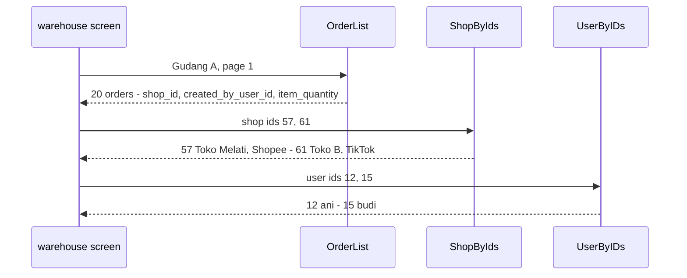

**The spec.**

| | |
| --- | --- |
| `ShopByIds` | new, on the shop RPCs. `allow_only_authenticated: true`, unscoped, the same as `TeamByIds` and `UserByIDs`: a cross-team bulk lookup |
| what it returns | basic fields only: id, name, marketplace, owning team. Never members, grants or settings. The guideline ByIds shape ([guidelines/](../../../guidelines/)) |
| the creator | `created_by_user_id` is already on `Order` → `UserByIDs` |
| `item_quantity` | new on the list row: the sum of the order's line quantities, computed by the list query. Orders and their lines live together |
| per page | one `OrderList`, one `ShopByIds`, one `UserByIDs`, never a call per row |
| a renamed shop | old orders show its current name |
| ✅ built *(2026-10-21)* | `ShopByIds` on ShopService — unscoped, basic fields, a deleted shop still named ([shop_by_ids.go](../../../backend/services/selling_service/selling_v1/shop_by_ids.go)); `Order.item_quantity`, a correlated sum per row (0.002 ms a row on `order_items_order_idx`). The warehouse list names each row's shop with one `ShopByIds` per page and counts its units from the row; its `shop` and `quantity` marks are gone |

---

## the-filter-gains-seller-marketplace-and-courier

> Owner, in chat (2026-10-19): *"yes, i follow your recomendation"* — on [technical order Q17](../order/design_clarify.md#question),
> *"what can a warehouse filter its order list by?"*. As recommended.

**The verdict.** `OrderListFilter` gains the three filters the warehouse strip offers
([the-warehouse-filters-by-team-marketplace-and-courier](#the-warehouse-filters-by-team-marketplace-and-courier)): **seller
team, marketplace, courier**. The separate shipment-state switch is dropped, because the order status is that state now
(`shipping`, `shipped`, `problem`, `return`, `lost`) and the status tabs already filter it. The search reaches the tracking
number once the order stores one.

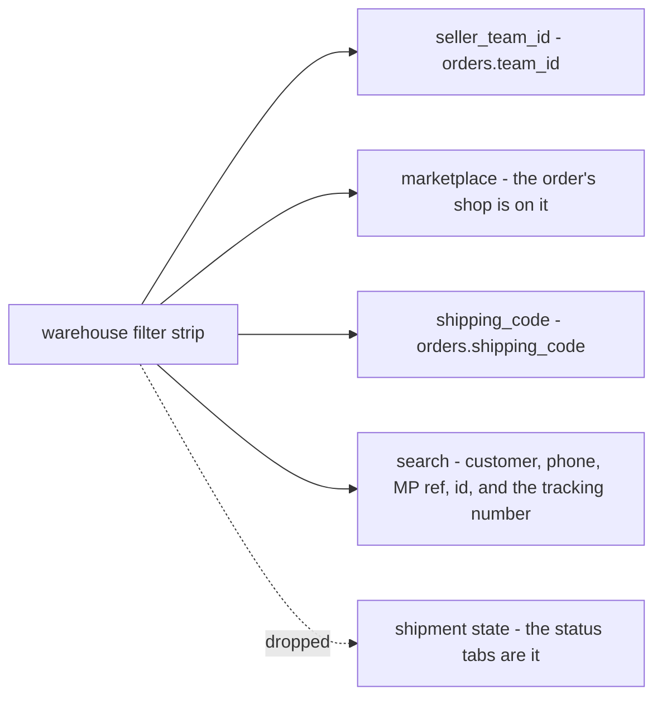

**The spec.**

| | |
| --- | --- |
| `seller_team_id` | new: the order's `team_id`. Named apart from the request's `team_id`, which is the warehouse's scope |
| `marketplace` | new: orders whose shop is on that marketplace, a subquery on shops in the same database. A shop's marketplace never changes ([a-shops-marketplace-and-team-are-fixed](../../business/shop/context_decision.md#a-shops-marketplace-and-team-are-fixed)) |
| `shipping_code` | new: the courier, already a column on the order |
| the shipment state | dropped. The order status carries it, and the status tabs filter it |
| the search | today: customer name, phone, MP order ref, order id. Plus the tracking number once `orders.receipt` is built ([a-label-scan-reads-the-ref-or-the-receipt](../../business/inventory/order_decision.md#a-label-scan-reads-the-ref-or-the-receipt)) |
| the stat | the same filter feeds `OrderStat` through `scopedOrders`, so the counts match the rows |
| ✅ built *(2026-10-21)* | `seller_team_id`, `marketplace`, `shipping_code` on `OrderListFilter` **and** `OrderStatFilter`, applied in `scopedOrders`. The warehouse list's three filters and the seller list's marketplace filter now narrow the rows; their marks are gone. The tracking-number search waits on `orders.receipt` |

---

## one-status-change-for-every-plain-move

> Owner, in chat (2026-10-19): *"yes, i follow your recomendation"* — on [technical order Q18](../order/design_clarify.md#question),
> *"one RPC for every move, or one per move?"*. As recommended.

**The verdict.** Every move in the status diagram that only changes the status goes through **one RPC,
`OrderStatusChange(order_ids, to, note)`**, for the warehouse, customer service and the selling team alike. The server holds
the table of who may make which move ([the-status-move-is-the-only-journey](../../business/order/context_decision.md#the-status-move-is-the-only-journey)).
It takes many orders, so a handover scan of 30 parcels is one call. The two moves that do more keep their own RPCs:
**cancel** and **return accept**.

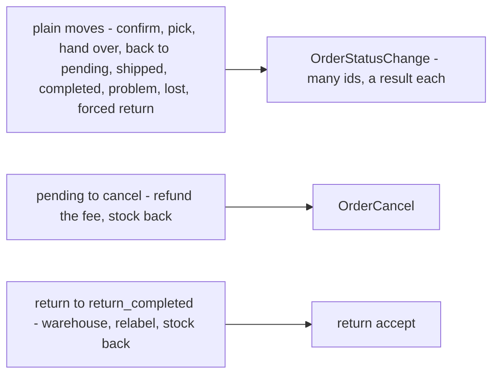

**The spec.**

| | |
| --- | --- |
| the RPC | `OrderStatusChange(team_id, order_ids, to, note)`. `team_id` is the caller's scope: the warehouse, or the selling team for its customer service |
| the table | from → to → who, on the server, taken from the status diagram. A move the caller's side may not make is refused |
| many orders | a result per order, moved or refused with the reason. One refusal never blocks the rest: 30 scanned, 28 moved, 2 *"not picked yet"* |
| a note | required for a move back (`processed → pending`, `picked → pending`). Written with the move to `order_timeline_logs` |
| its own RPCs | `OrderCancel` (refunds the warehouse fee, returns the stock) and the return accept (records the warehouse, relabels borrowed units, returns the stock) |
| folded in | `OrderPick` and `OrderShip` become `OrderStatusChange` calls |
| the handover | the bulk handover is this RPC with `to: shipping` |
| the save | 🔄 *(2026-10-21)* one transaction for the whole batch — [a-batch-move-saves-in-one-transaction](#a-batch-move-saves-in-one-transaction) |
| ✅ built *(2026-10-21)* | [order_status_change.go](../../../backend/services/selling_service/selling_v1/order_status_change.go), its table `orderMoves` in order_transition.go; `OrderConfirm`, `OrderPick`, `OrderPack` and `OrderShip` are removed. Pinned by `order_status_change_test.go`. The warehouse list, the pick page, the handover scan and the order menus call it, and a hand-back's note reaches the history |

---

## a-warehouse-prints-the-labels-of-orders-it-ships

> Owner, in chat (2026-10-19): *"yes, i follow your recomendation"* — on [technical order Q18](../order/design_clarify.md#question),
> *"how does the warehouse get the labels it prints, one or fifty at once?"*. As recommended.

**The verdict.** Reading a label follows the order: **a warehouse reads the labels of the orders it ships.** One RPC in
the order service, **`OrderLabels(team_id, order_ids)`**, checks that each order ships from the caller's warehouse, merges
their labels into **one PDF** and returns one download link. One label is the same call with one id. No label is
shared document by document.

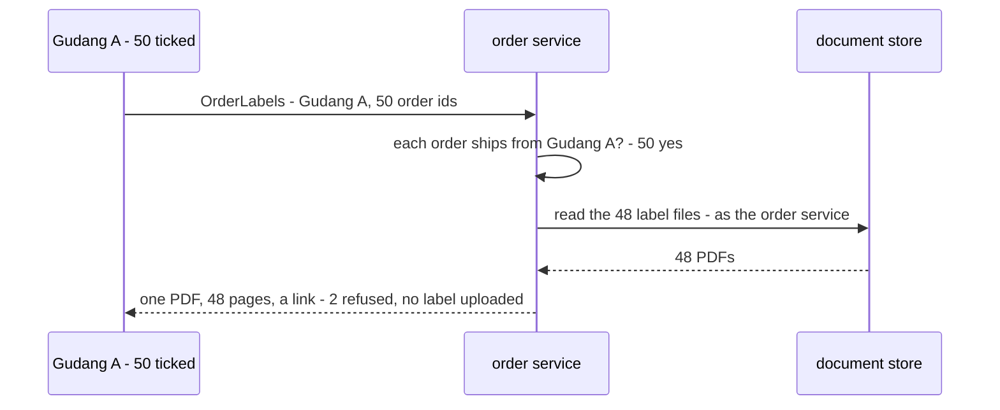

**The spec.**

| | |
| --- | --- |
| the RPC | `OrderLabels(team_id, order_ids)`, in the order service. `team_id` is the warehouse, the scope |
| the check | each order's `warehouse_id` is the caller's team. The order service checks this itself |
| reading the files | the order service reads them under its own service identity, after its check. The warehouse's team never meets the document's owner check |
| the answer | one merged PDF behind an expiring link, plus a result per order: included, or refused with the reason (*no label uploaded*, *the file can't be read*) |
| page order | the order of the ids sent, which is the list's order |
| a broken file | refused for that order, and the rest still merge. A hostile PDF must not crash the service |
| no sharing | no `document_shares` rows for labels, and nothing to re-share when customer service replaces one |
| ⛔ today | the warehouse screen reads a label with `GetDownloadUrl` under its own team, and the label belongs to the seller, so it comes back *not found*. Print Label fails on every order |

---

## one-export-is-the-list-as-a-file

> Owner, in chat (2026-10-19): *"yes, i follow your recomendation"* — on [technical order Q18](../order/design_clarify.md#question),
> *"what does Export produce, and is it one export for both lists?"*. As recommended.

**The verdict.** One **`OrderExport(team_id, filter)`** serves both the seller's list and the warehouse's. It takes the list's
own filter, so the file holds exactly the rows the list holds, every page of them. The columns are the reader's own row, and the
file is **.xlsx**. It runs as a server stream that reports progress and ends with a download link.

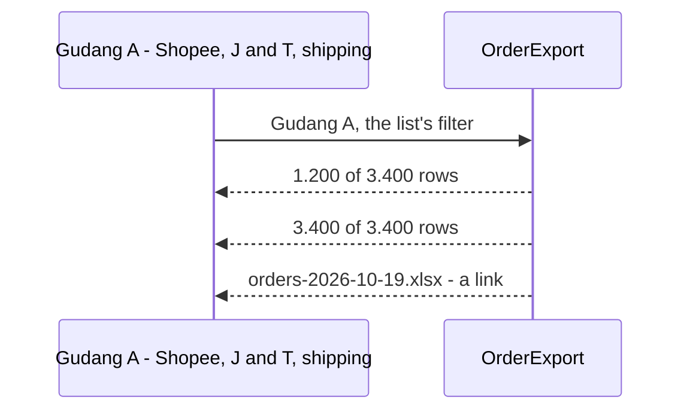

**The spec.**

| | |
| --- | --- |
| the RPC | `OrderExport(team_id, filter)`, a server stream ([code-implementation-guideline.md](../../../guidelines/code-implementation-guideline.md)): progress messages, then the link |
| the rows | the list's `OrderListFilter` through `scopedOrders`, the same set as the list and `OrderStat`, all pages |
| the columns | the reader's side, as on screen: a warehouse gets its row ([the-warehouse-row-is-the-old-systems-columns](#the-warehouse-row-is-the-old-systems-columns)), and a selling team gets its own |
| the file | .xlsx. Phone numbers and ids are written as text, so `0812…` keeps its 0 and a long marketplace id never becomes `5.78E+17` |
| one for both | the seller's Export and the warehouse's Export call the same RPC |
| the link | expiring, like any other document link |
| ✅ built *(2026-10-21)* | `OrderExport` ([order_export.go](../../../backend/services/selling_service/selling_v1/order_export.go)), a server stream of 200-row steps; the file is a private `order_export` document (document `00008`) stored as the caller. Both lists' Export buttons run it, with their progress on the button. Two things the spec did not say, built so: **only real data** — the tracking number, the marketplace date and the deadline are invented on screen behind a ⚠, which a spreadsheet cannot carry, so they join the file when their fields exist; and **`order_ids`**, so the warehouse bar exports the ticked rows ([the-bulk-actions-are-always-on-screen](#the-bulk-actions-are-always-on-screen)). Flow: [rpc.md](../../services/selling_service/rpc.md#the-list-as-a-file--orderexport) |

---

## a-batch-move-saves-in-one-transaction

> Owner, in chat (2026-10-21): *"okay, i follow you recomendation"* — to *"when a crew moves many orders at once, should
> each order save on its own, or all together?"*, raised by the performance audit
> ([OrderStatusChange.md](../../../audits/services/selling_service/performances/OrderStatusChange.md)). As recommended. A new
> question: [one-status-change-for-every-plain-move](#one-status-change-for-every-plain-move) settled what the person sees, not
> how the server saves it.

**The verdict.** `OrderStatusChange` saves the whole batch in **one transaction of four statements**, whatever its size. Each
order still gets its own result, and a refusal still touches only its own order, because it is decided from the locked row
before anything is written. Only a failure of the database itself fails the batch, and then nothing moves.

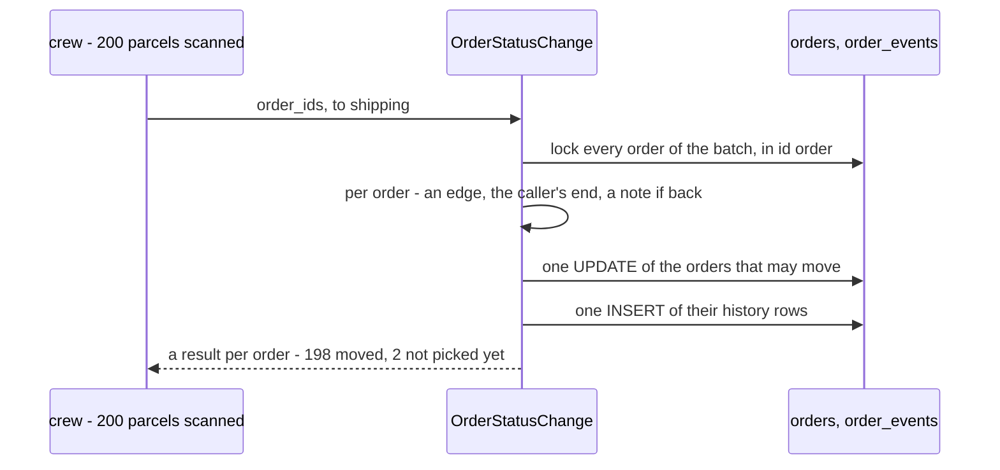

**The spec.**

| | |
| --- | --- |
| the statements | lock (`SELECT … WHERE id IN … ORDER BY id FOR UPDATE`) · one `UPDATE` · one multi-row history `INSERT` — four with the transaction, for 1 order or 200 |
| a refusal | per order, as before: decided in Go from the locked row, so 28 move and 2 are told why |
| a database failure | the batch rolls back. Every order answers *"could not be saved — try again"*, and the crew rescans |
| two crews, the same parcels | locked in **id order**, never scan order, so two batches queue instead of deadlocking. The second reads what the first wrote and is told *"already shipping"* |
| an id sent twice | refused by the proto; a direct caller's second copy reads *"already …"* |
| measured | 200 orders: 248 ms and 800 queries before, **11 ms and 4 queries** after. 20 orders: 22 ms → 2.4 ms |
| ✅ built *(2026-10-21)* | `moveOrders` in [order_status_change.go](../../../backend/services/selling_service/selling_v1/order_status_change.go) and `setOrdersStatus` in order_transition.go — every status write, cancel's included, goes through it. The race tests pass 80/80 at `-count=20` ([lock-order](../../../audits/services/selling_service/concurrency/lock-order.md)) |
