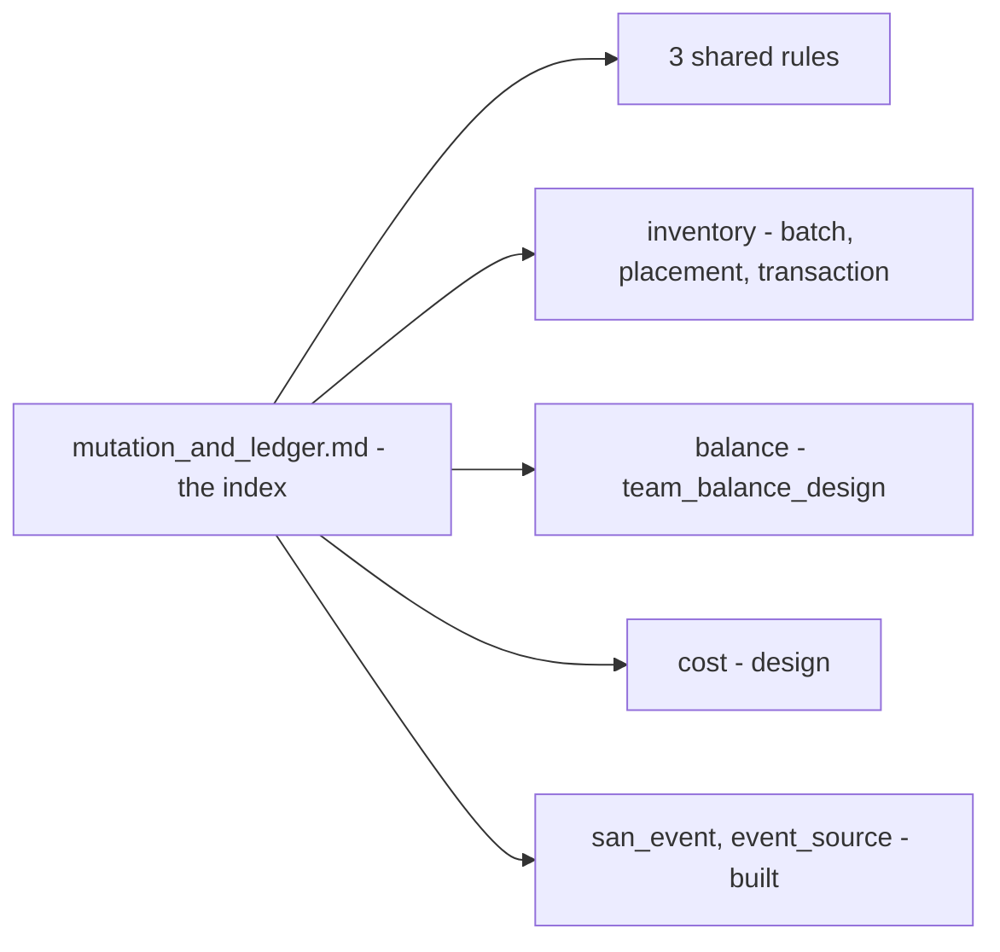

# Clarity — `mutation_and_ledger.md`

Critique, questions and warnings about [mutation_and_ledger.md](./mutation_and_ledger.md). That doc is
yours; this one is mine. Answered points are **deleted**, so this is always the current open set.
> ✅ **Answered in chat (2026-10-16, last):** Q1, option **a** — this doc shrinks to an index: the words, the three shared
> rules, where each ledger lives, one line on events ([the-template-is-an-index](./mutation_and_ledger_decision.md#the-template-is-an-index)).
> **No question is open here.** All four Contradictions sit in sections the cut removes, so they close when you make it.
> Critiques 2–4 stay: they apply to every ledger's implementation. Critique 6 moved to analytic.

> 🔄 **Re-examined 2026-10-16 — your read: *"seems stale, many things covered by san_event"*.** Agreed for the second
> half: the stat pipeline and the Idempotency Layer are built in `san_event` and `event_source`. The concept half is still
> yours, with its flow behind two decisions. [Proposed Design](#proposed-design--what-this-doc-keeps) goes section by
> section; [Q1](#question) is widened to the trim. Critique 5 deleted — the publish after commit is decided (no outbox).


> ✅ **Answered 2026-10-15 in chat, as recommended:** Q3 [ledger-logs-are-append-only](./mutation_and_ledger_decision.md#ledger-logs-are-append-only)
> and Q4 [the-caller-opens-the-transaction](./mutation_and_ledger_decision.md#the-caller-opens-the-transaction). Open: Q1. ⚠ Your §Flow Mutation and
> Ledger still draws the mutation opening the transaction.
>
> **Full re-examination.** Rewritten tight — the previous version had grown past the doc it tracks.
> Nothing still-open was dropped.
>
> ✅ **Answered 2026-10-10 and deleted:** Q2 and Critique 1, against my integer minor-units — float64 is the
> template's default, and the payment ledger inherits it
> ([every-ledger-keeps-money-as-float64](./mutation_and_ledger_decision.md#every-ledger-keeps-money-as-float64)).

---

# Contradiction

## ⛔ `# Statistic Design.` item 1 links to a file that no longer exists

*"we rely [event_library](../event/library.md) for processing event."* — `mutation_and_ledger.md:154`.

`docs/technical/event/library.md` was **deleted** on the owner's instruction
([the-library-doc-is-absorbed](../event_architecture/context_decision.md#the-library-doc-is-absorbed)),
and its content moves into
[`event_architecture/context.md`](../event_architecture/context.md). This doc's link is now dead, and
it is the only inbound one left in the tree.

**→ Recommend: repoint it to `../event_architecture/context.md`.** ⚠ Yours to change, not mine
(RULE 7b) — this is a report.

⚠ **And the thing it relies on is not written there yet.** The delete ran before the merge, so the
event-processing design it points at exists only in git (`git show
d54b182:docs/technical/event/library.md`). Until that content lands, *"we rely on event_library"*
names nothing a reader can open — which makes the contradiction below sharper, not milder.

## The doc says it relies on `event_library`, then re-specifies idempotency differently

`# Statistic Design.` item 1: *"we rely [event_library](../event_architecture/context.md) for processing event."*
Then `## Idempotency Layer.` and its two subsections specify their own — and it disagrees with the
library **and with the code already shipped in `pkgs/san_event`**:

| this doc | `event_library.md` / `san_event` |
| --- | --- |
| `sub->>idem: check duplication event` — a read, then insert | `Claim(ctx, tx, e)` — dedup **is** the insert, `ON CONFLICT`, rows-affected is the answer. A prior read is a check-then-act race, because redelivery happens while the first attempt is still running |
| `event_logs.message_id uint64` as the key | the broker's message id changes on republish, so it dedups nothing. Pub/Sub message ids are also **strings** |
| `Insert Fails → Nack Event` | a duplicate is `Duplicate` → **Ack** (`receive.go:38`). Only a transient error nacks. This doc contradicts *itself* here too — the flow above says `duplicate → ack` |
| `idem` inserts, **then** hands to `pipe` | `Claim` takes the caller's `tx` so the marker and the work commit together. Committing the marker first means a processing failure nacks, the redelivery sees a duplicate, acks, and **the work never runs** |

**→ Delete `## Idempotency Layer.`, `### Schema.` and `### Idempotency Flow.`** Item 1 already says where
this lives, and the library's version is both more correct and already built. That is ~44 lines out and
the contradiction goes with them.

⚠ This was the last section both docs described. Everything else that overlapped — the two subscriber
flows, the pipeline placeholders — has already been removed.

## The worked example still teaches the lifecycle stock rejected

`## Flow Mutation and Ledger.` names its actor **`Restock Create Mutation`** and has it writing the
ledger. [stock_design.md](../stock/design.md) has since put `StockMutation` in **Accept** and named that
participant `Restock Accept Mutation` — Create records an intention, Accept moves the count.

This is the doc every other service copies. **→ Rename it.** `## What is mutation ?` already lists both
`RestockCreateMutation` and `RestockAcceptMutation`, so only the diagram is wrong.

## The template lags its own first instance on three settled points

Stock has decided these by building them; the template still shows the older shape, so the next service
gets the older guidance:

| settled in `stock_design.md` | the template still says |
| --- | --- |
| one `change` / `after` pair **per measure** (four columns for two measures) | a single `change` / `after_balance`, no mention of measures |
| scope columns carry a **composite unique** (`places`, `product_placements`) | *"scope is unique"* as prose, with `any scope` and no constraint |
| reversal is an **append-only compensating entry** (`## Inventory Transaction Cancelation.`) | nothing — the log's mutability is undefined, and `## Ledger Log.`'s rule depends on it |

**→ Promote all three.** Each is a line, and each is the difference between the next service inheriting a
decision and re-deriving it.

---

# Proposed Design — what this doc keeps

*(2026-10-16)* Your two reads: *"seems stale, many things covered by san_event"* and *"any service have design like
mutation and ledger, but they are defined better"*. Both hold. Section by section:

| section | now described better by | → Recommend |
| --- | --- | --- |
| General Brief · What is mutation · Ledger · State · Scope · Ledger Log · `transaction` | each service's own ledger: inventory [batch.md](../../business/inventory/batch.md), [placement.md](../../business/inventory/placement.md), [transaction.md](../../business/inventory/transaction.md) · balance [team_balance_design.md](../balance/team_balance_design.md) · [cost](../cost/design.md) | keep the **vocabulary only**, four lines |
| Implementation Plan | the same instances | becomes the index of instances |
| Flow Mutation and Ledger · Entity Relationship Template | the instances' own flows and tables, which follow the decisions; this one does not (Critique 4, and the mutation opens the transaction) | delete |
| Statistic Design · General Flow | ✅ built — `event_source` (send, push, replay), `san_event` (decode, claim, ack); [no-outbox-the-publish-is-trusted](../event_architecture/context_decision.md#no-outbox-the-publish-is-trusted); the stat plan is [analytic](../../business/analytic/context.md)'s | delete, one pointer line |
| Idempotency Layer · Schema · Flow | ✅ built — `san_event.NewDedup(table)`, a table per service | delete, one rule line |

**Why not delete the doc outright:** three decisions here are **shared by every ledger** and cited from inventory,
balance, cost and the warehouse team docs. They need one home:
[every-ledger-keeps-money-as-float64](./mutation_and_ledger_decision.md#every-ledger-keeps-money-as-float64) ·
[the-caller-opens-the-transaction](./mutation_and_ledger_decision.md#the-caller-opens-the-transaction) ·
[ledger-logs-are-append-only](./mutation_and_ledger_decision.md#ledger-logs-are-append-only).

The doc as an index, about 25 lines:

```
# Mutation and Ledger.
## Words.        state · ledger log (append-only, balance after) · scope · transaction
## Every ledger. caller opens the tx · logs append-only · money float64, compared at 4 digits
## Where each one lives.  inventory (batch, placement, transaction) · balance · cost
## Events.       sent, received and processed once through san_event / event_source — a table per service
```



---

# Critique

| | Problem | → Recommend |
| --- | --- | --- |
| **2** | **Lock ordering is undefined → deadlock.** `mut` locks its business rows, then `lg` locks state rows, and the change list is applied in a `loop` in list order. Two mutations touching the same two scopes in opposite order deadlock — and this system's normal case is two people on one shelf. | **Sort the change list by scope key inside the write session.** Invisible to callers, impossible to get wrong at a call site, and it exists once. Then `audit-sql` on the first mutation that uses it. |
| **3** | **`lock states` and `update atomic balance + change` are redundant.** If the update is `UPDATE … SET balance = balance + ? RETURNING balance`, the row lock is implicit and the explicit lock does nothing. If the explicit lock is what protects it, "atomic" is doing nothing. | Drop the `lg->>st: lock states` step. `UPDATE … RETURNING` **is** the protocol, and a guard becomes `WHERE balance + ? >= 0` with zero-rows-affected as the rejection. |
| **4** | **Get-or-create races.** `alt Exist / else create` — two concurrent transactions both miss, both insert, one dies on the unique violation and takes the whole business transaction with it. The same check-then-act shape the event library rejects for dedup. | Collapse the `alt` **and** the `loop` into one statement: `INSERT … ON CONFLICT (scope…) DO UPDATE SET balance = ledger_state.balance + EXCLUDED.change RETURNING balance`. The race disappears rather than being handled. |
| **6** | ➡ *(2026-10-16)* **Moved to [analytic Critique 20](../../business/analytic/context_clarify.md#critique)** — its section, the stat pipeline, leaves this doc | — |

---

# Question

1. ✅ *(2026-10-16)* **Answered: a — shrink to an index, don't delete** — [the-template-is-an-index](./mutation_and_ledger_decision.md#the-template-is-an-index). The cut is yours to make.
3. ✅ *(2026-10-15)* **Answered: append-only** — [ledger-logs-are-append-only](./mutation_and_ledger_decision.md#ledger-logs-are-append-only).
4. ✅ *(2026-10-15)* **Answered: the caller** — [the-caller-opens-the-transaction](./mutation_and_ledger_decision.md#the-caller-opens-the-transaction).
   ⚠ Your §Flow Mutation and Ledger still draws the mutation opening it.

---

# Awaiting

Nothing — the doc has no empty headings left.

**Sibling docs:** [stock_design.md](../stock/design.md) and [event_architecture/context.md](../event_architecture/context.md) have their
own clarity files. A *stock* decision belongs in one, an *event delivery* decision in the other.

**Clean:** every mermaid diagram parses (`npm run lint:mermaid`).
