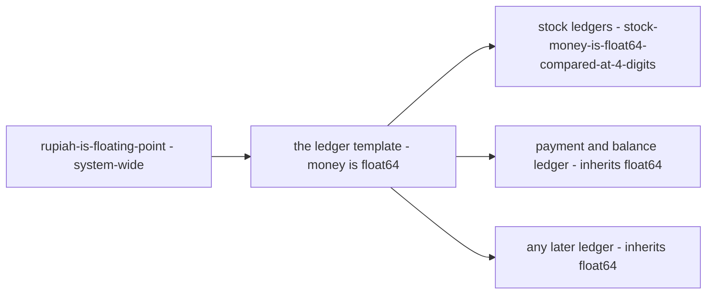

# Decisions — `technical/ledger/mutation_and_ledger.md`

What the owner settled, recorded before it is acted on. **Append-only** — a decision that is later reversed is renamed
and its references grepped (RULE 12), never quietly edited away. The open set is
[mutation_and_ledger_clarify.md](./mutation_and_ledger_clarify.md).

| decision | says | from |
| --- | --- | --- |
| [every-ledger-keeps-money-as-float64](#every-ledger-keeps-money-as-float64) | float64 is the template's default, not a stock exception — the payment and balance ledger inherits it | chat, 2026-10-10 — answers Q2 and Critique 1, **against** my integer minor-units |

---

## every-ledger-keeps-money-as-float64

> Owner, in chat *(2026-10-10)*: *"for 1, 2, 3 yes"*, where 1 was *"close template Q2 on rupiah-is-floating-point?"*.
> It answers [mutation_and_ledger_clarify Q2](./mutation_and_ledger_clarify.md#question) — *is `float64` a stock-local
> exception or the template's default?* — and with it Critique 1, which recommended integer minor-units for the payment
> ledger. **Against my recommendation**, and the same answer as
> [rupiah-is-floating-point](../../business/order/context_decision.md#rupiah-is-floating-point), which already covered the
> whole system.

**The verdict.** There is one money type in the system, and the template carries it. Stock does not need a division to
justify float: every ledger copied from this template keeps money as `float64`, the payment and balance ledger included.

**The spec.**

| | |
| --- | --- |
| money in a ledger state or log row | `float64` in Go · `double precision` in Postgres · `double` in proto |
| comparing two amounts | never `==`; the shared helper from [stock-money-is-float64-compared-at-4-digits](../stock/design_decision.md#stock-money-is-float64-compared-at-4-digits), at 4-digit precision, so every ledger compares the same way |
| quantities and counts | stay integers |

**What it does NOT settle** — the template's own text: [mutation_and_ledger.md](./mutation_and_ledger.md) does not yet
say float is its default, so the next ledger has to find this file to learn it.
