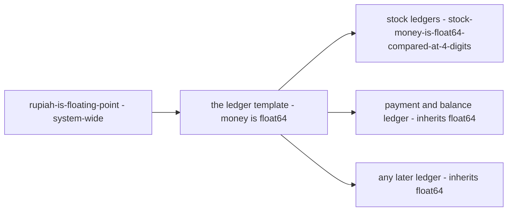
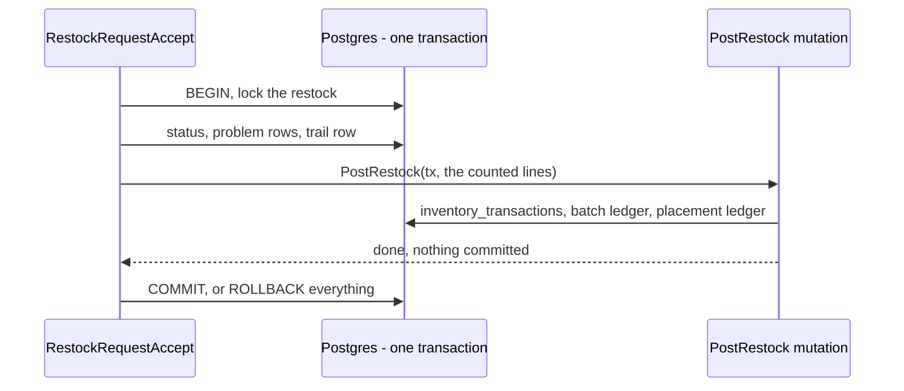
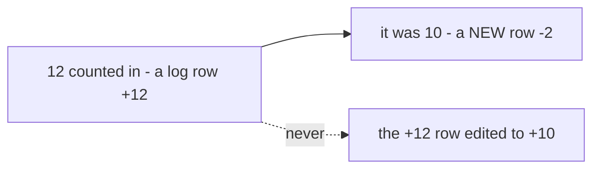

# Decisions — `technical/ledger/mutation_and_ledger.md`

What the owner settled, recorded before it is acted on. **Append-only** — a decision that is later reversed is renamed
and its references grepped (RULE 12), never quietly edited away. The open set is
[mutation_and_ledger_clarify.md](./mutation_and_ledger_clarify.md).

| decision | says | from |
| --- | --- | --- |
| [every-ledger-keeps-money-as-float64](#every-ledger-keeps-money-as-float64) | float64 is the template's default, not a stock exception — the payment and balance ledger inherits it | chat, 2026-10-10 — answers Q2 and Critique 1, **against** my integer minor-units |
| [the-caller-opens-the-transaction](#the-caller-opens-the-transaction) | the RPC opens the database transaction and hands it to the mutation; a mutation never opens or commits one | chat, 2026-10-15 — answers Q4, as recommended |
| [ledger-logs-are-append-only](#ledger-logs-are-append-only) | a ledger log row is never updated or deleted; a correction is a new row | chat, 2026-10-15 — answers Q3, as recommended |

---

## every-ledger-keeps-money-as-float64

> Owner, in chat *(2026-10-10)*: *"for 1, 2, 3 yes"*, where 1 was *"close template Q2 on rupiah-is-floating-point?"*.
> It answers [mutation_and_ledger_clarify Q2](./mutation_and_ledger_clarify.md#question) — *is `float64` a stock-local
> exception or the template's default?* — and with it Critique 1, which recommended integer minor-units for the payment
> ledger. **Against my recommendation**, and the same answer as
> [rupiah-is-floating-point](../../business/order/context_decision.md#rupiah-is-floating-point), which already covered the
> whole system.

**The verdict.** There is one money type in the system, and the template carries it. Stock does not need a division to
justify float: every ledger copied from this template keeps money as `float64`, the payment and balance ledger included.

**The spec.**

| | |
| --- | --- |
| money in a ledger state or log row | `float64` in Go · `double precision` in Postgres · `double` in proto |
| comparing two amounts | never `==`; the shared helper from [stock-money-is-float64-compared-at-4-digits](../stock/design_decision.md#stock-money-is-float64-compared-at-4-digits), at 4-digit precision, so every ledger compares the same way |
| quantities and counts | stay integers |

**What it does NOT settle** — the template's own text: [mutation_and_ledger.md](./mutation_and_ledger.md) does not yet
say float is its default, so the next ledger has to find this file to learn it.

## the-caller-opens-the-transaction

> Owner, in chat *(2026-10-15)*: *"for 1, 2, 3, 4 follow your recomendation"* — the first being
> [Q4](./mutation_and_ledger_clarify.md#question), *who opens the database transaction: the mutation, or its caller?*
> As recommended.

**The verdict.** The RPC opens the database transaction and passes it in; the mutation writes its ledgers inside it and
never opens, commits or rolls one back. So everything one operation writes — a restock's status, its problem rows, its
trail AND the batch and placement ledgers — commits together or not at all. This is how inventory's
[context.md](../../business/inventory/context.md) §How We Breakdown Complexity already draws it; this template's
§Flow Mutation and Ledger, which has the mutation open it, is the text that is behind.

**The spec.**

| | |
| --- | --- |
| who opens it | the RPC handler, `db.Transaction(func(tx) …)` |
| a mutation | takes the open `tx` as a parameter; calls neither `Transaction` nor `Commit` |
| a failure inside the mutation | returned to the handler, which rolls back everything the operation wrote |
| what it does NOT settle | the template's own §Flow Mutation and Ledger text — yours to bring in line |

## ledger-logs-are-append-only

> Owner, in chat *(2026-10-15)*: *"for 1, 2, 3, 4 follow your recomendation"* — the second being
> [Q3](./mutation_and_ledger_clarify.md#question), *is `ledger_logs` append-only?* As recommended.

**The verdict.** A ledger log row is never updated and never deleted. The template already makes the log the source of
truth (§Ledger Log), and a history that can be rewritten is not one. A mistake is corrected by a NEW row.

**The spec.**

| | |
| --- | --- |
| UPDATE or DELETE on a `*_logs` table | never, from any code path |
| `updated_at` on a log table | none — a column that can only ever equal `created_at` invites the edit it records |
| a correction | a new row with its own transaction and reason |
