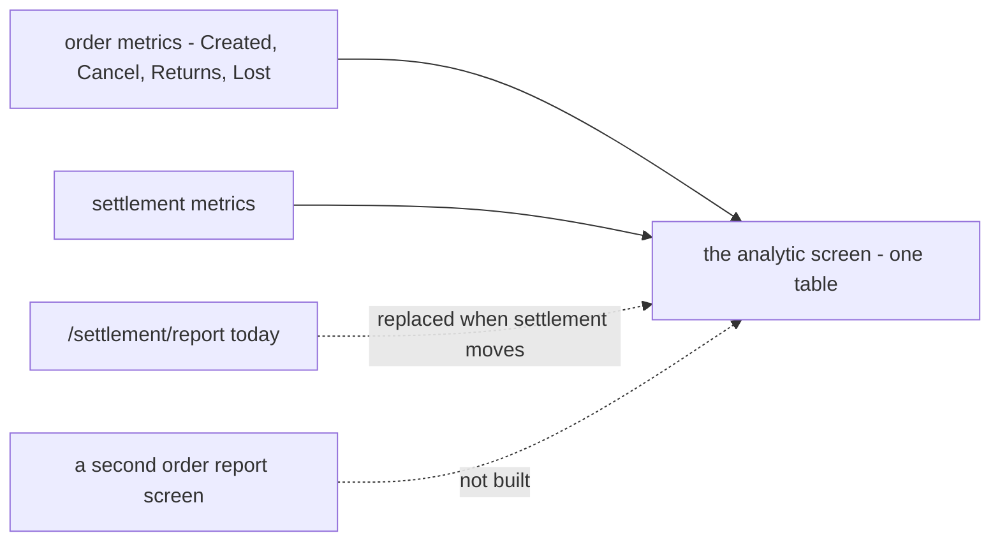
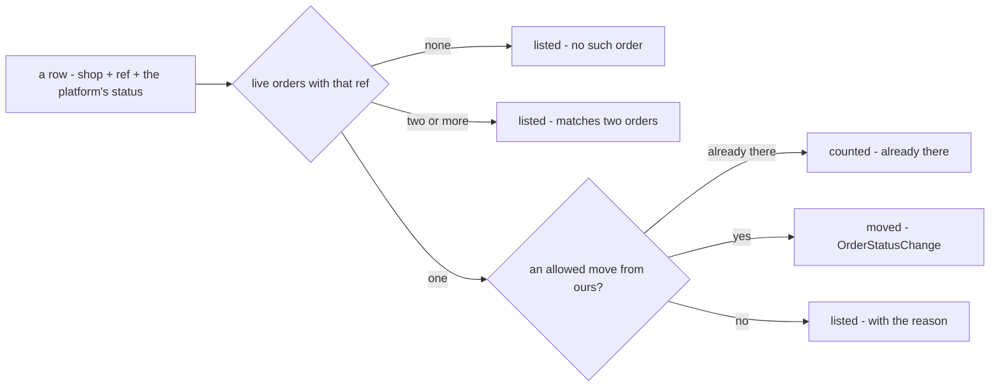
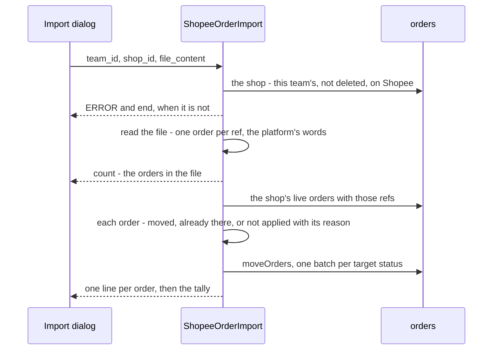
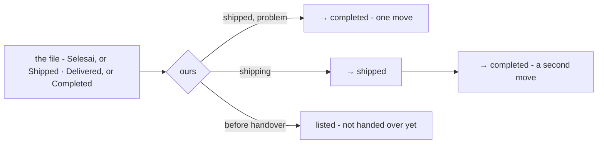
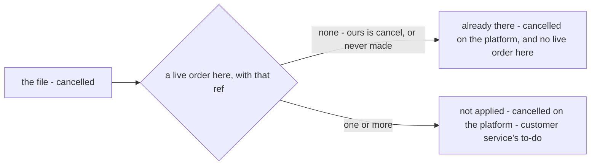

# Decisions — order `design.md`

> ➡ **Every decision in this file has moved to [docs/technical/frontend/](../frontend)** (owner,
> 2026-10-02): the rules every screen follows to `context_decision.md`, each screen's own to its `<page>_decision.md`.
> The headings below stay as pointers so old links still land.

> ⚠ **EVERY DECISION BELOW IS ABOUT THE SELLING TEAM'S ORDER LIST AND ORDER DETAIL.** The warehouse reads `/orders`
> from the other end and keeps the screen it had — see
> [the-two-ends-are-two-screens](#the-two-ends-are-two-screens). Nothing here has been applied to it,
> and the owner has not designed it yet.

| decision | what it settles |
| --- | --- |
| [status-colours-are-carried-over-verbatim](../frontend/order_list_decision.md#status-colours-are-carried-over-verbatim) | every status keeps the hue it had, collisions included |
| [one-context-per-column-and-never-three-lines](../frontend/context_decision.md#one-context-per-column-and-never-three-lines) | pairing is only for one fact read twice — it REPLACES the six-paired-cells decision |
| [the-row-shows-total-beli-and-total-mp](../frontend/order_list_decision.md#the-row-shows-total-beli-and-total-mp) | two totals: what it cost us, and what the platform paid — it REPLACES an-order-total-is-goods-plus-fulfilment |
| [the-margin-is-mp-minus-total-beli](../frontend/order_list_decision.md#the-margin-is-mp-minus-total-beli) | margin and its percentage are both measured against the MARKETPLACE price |
| [the-ongkir-is-the-warehouses-to-set](../frontend/order_create_decision.md#the-ongkir-is-the-warehouses-to-set) | shipping is priced by the building that ships it, so it is absent from the create screen |
| [every-date-gets-its-own-column](../frontend/order_list_decision.md#every-date-gets-its-own-column) | three dates, three columns — it REPLACES two-dates-and-two-totals-with-ours-leading |
| [a-filtered-status-shows-its-own-date](../frontend/order_list_decision.md#a-filtered-status-shows-its-own-date) | the third date appears only under the tab it answers |
| [harga-beli-team-and-gudang-are-on-the-row](../frontend/order_list_decision.md#harga-beli-team-and-gudang-are-on-the-row) | all three earn a place, none of them a column of its own |
| [the-action-menu-is-a-table-keyed-by-status](../frontend/order_list_decision.md#the-action-menu-is-a-table-keyed-by-status) | what you can do to an order, per state, in one place |
| [a-deadline-is-loud-or-it-is-nothing](../frontend/order_list_decision.md#a-deadline-is-loud-or-it-is-nothing) | four urgency bands, and an overdue order tints its whole row |
| [the-preview-became-the-order-list](../frontend/order_list_decision.md#the-preview-became-the-order-list) | a seller's `/orders` IS this screen now — the preview page is gone |
| [the-two-ends-are-two-screens](../frontend/warehouse_order_list_decision.md#the-two-ends-are-two-screens) | the warehouse keeps its old list — almost nothing on the seller's row is a fact a picker acts on |
| [the-order-detail-is-one-page-of-sections](../frontend/order_detail_decision.md#the-order-detail-is-one-page-of-sections) | the detail is one page of sections with a scrolling left nav — not three tabs |
| [the-order-detail-lines-are-priced-at-harga-beli](../frontend/order_detail_decision.md#the-order-detail-lines-are-priced-at-harga-beli) | the item table shows what we PAID, so the perincian adds up to the list's figures |
| [the-detail-margin-is-mp-minus-system](../frontend/order_detail_decision.md#the-detail-margin-is-mp-minus-system) | margin = total MP − total sistem, the list's formula read from the detail |
| [the-detail-preview-became-the-order-detail](../frontend/order_detail_decision.md#the-detail-preview-became-the-order-detail) | a seller's `/orders/:id` IS the approved page now — and it keeps the two wired features the preview lacked |
| [settlement-replaces-withdrawal-on-the-order](../frontend/order_detail_decision.md#settlement-replaces-withdrawal-on-the-order) | the order's money-back section IS the settlement ledger; withdrawals stay a shop-level question |
| [the-phone-header-is-one-row](../frontend/context_decision.md#the-phone-header-is-one-row) | on a phone the sticky block is the number, the stage and `⋯` — plus the section chips |
| [a-phone-reads-each-line-as-a-block](../frontend/context_decision.md#a-phone-reads-each-line-as-a-block) | the item table becomes one block per line below `md` |
| [the-draft-list-is-the-drafts-tab](../frontend/order_draft_decision.md#the-draft-list-is-the-drafts-tab) | `/order-drafts` wears the seller list's shell and row grammar, with only the columns a draft can fill — ⚠ its heading and its tab strip are replaced by [the-drafts-are-a-list-of-their-own](../frontend/order_draft_decision.md#the-drafts-are-a-list-of-their-own) |
| [the-drafts-are-a-list-of-their-own](../frontend/order_draft_decision.md#the-drafts-are-a-list-of-their-own) | the drafts are a list of their own — no tab on the order lists, Pesanan ▸ Daftar · Draf in the menu |
| [the-draft-summary-is-three-cards](../frontend/order_draft_decision.md#the-draft-summary-is-three-cards) | total and oldest are real; ready counts this page only, says so, and carries a ⚠ |
| [the-draft-cards-are-the-order-list-cards](../frontend/order_draft_decision.md#the-draft-cards-are-the-order-list-cards) | one `SummaryCard` and one grid for both tabs, so a card is the same shape and size on each |
| [the-summary-follows-the-tab](../frontend/order_list_decision.md#the-summary-follows-the-tab) | All Status shows the piles; a status tab shows its own figures as cards; the measure line is gone. The cards fill the row again |
| [a-summary-card-is-at-most-a-fifth](../frontend/context_decision.md#a-summary-card-is-at-most-a-fifth) | cards fill the row but never exceed 1/5 of it on a large screen — 1/4, 1/3, 1/2 as it narrows |
| [a-phone-filters-from-a-sheet](../frontend/context_decision.md#a-phone-filters-from-a-sheet) | on a phone the search stays in the row; every other filter is in a bottom sheet behind a counted Filter button |
| [the-draft-keeps-its-own-page](../frontend/order_draft_decision.md#the-draft-keeps-its-own-page) | `/order-drafts/:id` stays the separate draft page — opening the draft in the order form was tried and reverted — **reversed**, ⚠ replaced by [the-draft-opens-in-the-order-form](../frontend/order_draft_decision.md#the-draft-opens-in-the-order-form) |
| [the-draft-page-wears-the-order-form](../frontend/order_draft_decision.md#the-draft-page-wears-the-order-form) | the draft page uses the create form's cards and rail; save in any state, Promote as strict as Create — ⚠ replaced by [the-draft-opens-in-the-order-form](../frontend/order_draft_decision.md#the-draft-opens-in-the-order-form) |
| [a-draft-row-maps-to-a-product-a-bundle-or-a-split](../frontend/order_draft_decision.md#a-draft-row-maps-to-a-product-a-bundle-or-a-split) | each scraped row maps to one product, one bundle, or several products — a split suggests a bundle — ⚠ replaced by [the-draft-opens-in-the-order-form](../frontend/order_draft_decision.md#the-draft-opens-in-the-order-form) |
| [the-draft-sell-price-starts-from-the-rows](../frontend/order_draft_decision.md#the-draft-sell-price-starts-from-the-rows) | the sell price starts as Σ the rows' platform prices and can be typed over, down to 0 |
| [the-listing-is-information-the-mapping-sets-the-count](../frontend/order_draft_decision.md#the-listing-is-information-the-mapping-sets-the-count) | a row's scraped quantity and price are shown, not edited; the count is set on the mapping, and a different one is flagged — ⚠ replaced by [the-draft-opens-in-the-order-form](../frontend/order_draft_decision.md#the-draft-opens-in-the-order-form) |
| [the-draft-opens-in-the-order-form](../frontend/order_draft_decision.md#the-draft-opens-in-the-order-form) | a draft opens IN the order form, seeded; its scraped lines a text list above the products; Create deletes the draft |
| [the-draft-preview-became-the-draft-page](../frontend/order_draft_decision.md#the-draft-preview-became-the-draft-page) | `/order-drafts/:id` IS the draft page in the order form's clothes now — the built page is gone — ⚠ replaced by [the-draft-opens-in-the-order-form](../frontend/order_draft_decision.md#the-draft-opens-in-the-order-form) |
| [the-warehouse-row-is-the-old-systems-columns](../frontend/warehouse_order_list_decision.md#the-warehouse-row-is-the-old-systems-columns) | the warehouse list's row: created by, marketplace shop, AWB, qty, status, date, MP date — the deadline replaces the MP date's "ago" when there is one |
| [the-warehouse-tabs-are-the-processed-steps](../frontend/warehouse_order_list_decision.md#the-warehouse-tabs-are-the-processed-steps) | the warehouse's tabs are Perlu konfirmasi, the four steps of Diproses and Semua — not the order's statuses; a row's badge says its tab's word |
| [the-confirmed-step-reads-dikonfirmasi](../frontend/warehouse_order_list_decision.md#the-confirmed-step-reads-dikonfirmasi) | the CONFIRMED step is named "Dikonfirmasi", not "Perlu konfirmasi" |
| [the-warehouse-filters-by-team-marketplace-and-courier](../frontend/warehouse_order_list_decision.md#the-warehouse-filters-by-team-marketplace-and-courier) | search, date, seller team, marketplace, courier — and the shipment state only where parcels have been handed over |
| [a-warehouse-step-moves-by-the-old-systems-table](../frontend/warehouse_order_list_decision.md#a-warehouse-step-moves-by-the-old-systems-table) | the old system's transition table: skips forward allowed, back only to Dikonfirmasi and with a reason |
| [scanning-is-the-crews-hands](../frontend/warehouse_order_list_decision.md#scanning-is-the-crews-hands) | three scans — handover, find a parcel, validate the items — plus selection, bulk actions, labels and export |
| [the-bulk-actions-are-always-on-screen](../frontend/warehouse_order_list_decision.md#the-bulk-actions-are-always-on-screen) | the action bar shows from the start; tick-only actions are off until a tick, and Export takes the filtered list when nothing is ticked |
| [the-period-report-is-the-analytic-screen](#the-period-report-is-the-analytic-screen) | no order report screen and no extension of `/settlement/report`: the order figures are metrics on the one analytic screen |
| [the-import-moves-only-after-handover](#the-import-moves-only-after-handover) | the order Import makes only customer service's moves after handover; everything else is listed with its reason, never applied |
| [the-order-import-is-one-rpc-per-platform](#the-order-import-is-one-rpc-per-platform) | `ShopeeOrderImport` and `TiktokOrderImport` on selling's OrderService, each a stream of leveled log lines, shaped like the settlement import |
| [a-completed-shipping-order-passes-through-shipped](#a-completed-shipping-order-passes-through-shipped) | the platform says completed, ours is `shipping`: the import moves it to `shipped`, then to `completed` — two hand moves, two rows |
| [a-cancelled-order-with-nothing-live-is-already-there](#a-cancelled-order-with-nothing-live-is-already-there) | cancelled on the platform with no live order here is already there; with a live order it stays on the not-applied list |

---

## status-colours-are-carried-over-verbatim

➡ **Moved** to [frontend/order_list_decision.md](../frontend/order_list_decision.md#status-colours-are-carried-over-verbatim) — a screen decision (owner, 2026-10-02: screen decisions live in `docs/technical/frontend/`).

## one-context-per-column-and-never-three-lines

➡ **Moved** to [frontend/context_decision.md](../frontend/context_decision.md#one-context-per-column-and-never-three-lines) — a rule for every screen (owner, 2026-10-02: screen decisions live in `docs/technical/frontend/`).

## the-row-shows-total-beli-and-total-mp

➡ **Moved** to [frontend/order_list_decision.md](../frontend/order_list_decision.md#the-row-shows-total-beli-and-total-mp) — a screen decision (owner, 2026-10-02: screen decisions live in `docs/technical/frontend/`).

## the-margin-is-mp-minus-total-beli

➡ **Moved** to [frontend/order_list_decision.md](../frontend/order_list_decision.md#the-margin-is-mp-minus-total-beli) — a screen decision (owner, 2026-10-02: screen decisions live in `docs/technical/frontend/`).

## the-ongkir-is-the-warehouses-to-set

➡ **Moved** to [frontend/order_create_decision.md](../frontend/order_create_decision.md#the-ongkir-is-the-warehouses-to-set) — a screen decision (owner, 2026-10-02: screen decisions live in `docs/technical/frontend/`).

## every-date-gets-its-own-column

➡ **Moved** to [frontend/order_list_decision.md](../frontend/order_list_decision.md#every-date-gets-its-own-column) — a screen decision (owner, 2026-10-02: screen decisions live in `docs/technical/frontend/`).

## a-filtered-status-shows-its-own-date

➡ **Moved** to [frontend/order_list_decision.md](../frontend/order_list_decision.md#a-filtered-status-shows-its-own-date) — a screen decision (owner, 2026-10-02: screen decisions live in `docs/technical/frontend/`).

## harga-beli-team-and-gudang-are-on-the-row

➡ **Moved** to [frontend/order_list_decision.md](../frontend/order_list_decision.md#harga-beli-team-and-gudang-are-on-the-row) — a screen decision (owner, 2026-10-02: screen decisions live in `docs/technical/frontend/`).

## the-action-menu-is-a-table-keyed-by-status

➡ **Moved** to [frontend/order_list_decision.md](../frontend/order_list_decision.md#the-action-menu-is-a-table-keyed-by-status) — a screen decision (owner, 2026-10-02: screen decisions live in `docs/technical/frontend/`).

## a-deadline-is-loud-or-it-is-nothing

➡ **Moved** to [frontend/order_list_decision.md](../frontend/order_list_decision.md#a-deadline-is-loud-or-it-is-nothing) — a screen decision (owner, 2026-10-02: screen decisions live in `docs/technical/frontend/`).

## the-preview-became-the-order-list

➡ **Moved** to [frontend/order_list_decision.md](../frontend/order_list_decision.md#the-preview-became-the-order-list) — a screen decision (owner, 2026-10-02: screen decisions live in `docs/technical/frontend/`).

## the-two-ends-are-two-screens

➡ **Moved** to [frontend/warehouse_order_list_decision.md](../frontend/warehouse_order_list_decision.md#the-two-ends-are-two-screens) — a screen decision (owner, 2026-10-02: screen decisions live in `docs/technical/frontend/`).

## the-order-detail-is-one-page-of-sections

➡ **Moved** to [frontend/order_detail_decision.md](../frontend/order_detail_decision.md#the-order-detail-is-one-page-of-sections) — a screen decision (owner, 2026-10-02: screen decisions live in `docs/technical/frontend/`).

## the-order-detail-lines-are-priced-at-harga-beli

➡ **Moved** to [frontend/order_detail_decision.md](../frontend/order_detail_decision.md#the-order-detail-lines-are-priced-at-harga-beli) — a screen decision (owner, 2026-10-02: screen decisions live in `docs/technical/frontend/`).

## the-detail-margin-is-mp-minus-system

➡ **Moved** to [frontend/order_detail_decision.md](../frontend/order_detail_decision.md#the-detail-margin-is-mp-minus-system) — a screen decision (owner, 2026-10-02: screen decisions live in `docs/technical/frontend/`).

## the-detail-preview-became-the-order-detail

➡ **Moved** to [frontend/order_detail_decision.md](../frontend/order_detail_decision.md#the-detail-preview-became-the-order-detail) — a screen decision (owner, 2026-10-02: screen decisions live in `docs/technical/frontend/`).

## settlement-replaces-withdrawal-on-the-order

➡ **Moved** to [frontend/order_detail_decision.md](../frontend/order_detail_decision.md#settlement-replaces-withdrawal-on-the-order) — a screen decision (owner, 2026-10-02: screen decisions live in `docs/technical/frontend/`).

## the-phone-header-is-one-row

➡ **Moved** to [frontend/context_decision.md](../frontend/context_decision.md#the-phone-header-is-one-row) — a rule for every screen (owner, 2026-10-02: screen decisions live in `docs/technical/frontend/`).

## a-phone-reads-each-line-as-a-block

➡ **Moved** to [frontend/context_decision.md](../frontend/context_decision.md#a-phone-reads-each-line-as-a-block) — a rule for every screen (owner, 2026-10-02: screen decisions live in `docs/technical/frontend/`).

## the-draft-list-is-the-drafts-tab

➡ **Moved** to [frontend/order_draft_decision.md](../frontend/order_draft_decision.md#the-draft-list-is-the-drafts-tab) — a screen decision (owner, 2026-10-02: screen decisions live in `docs/technical/frontend/`).

## the-draft-summary-is-three-cards

➡ **Moved** to [frontend/order_draft_decision.md](../frontend/order_draft_decision.md#the-draft-summary-is-three-cards) — a screen decision (owner, 2026-10-02: screen decisions live in `docs/technical/frontend/`).

## the-draft-cards-are-the-order-list-cards

➡ **Moved** to [frontend/order_draft_decision.md](../frontend/order_draft_decision.md#the-draft-cards-are-the-order-list-cards) — a screen decision (owner, 2026-10-02: screen decisions live in `docs/technical/frontend/`).

## the-summary-follows-the-tab

➡ **Moved** to [frontend/order_list_decision.md](../frontend/order_list_decision.md#the-summary-follows-the-tab) — a screen decision (owner, 2026-10-02: screen decisions live in `docs/technical/frontend/`).

## a-summary-card-is-at-most-a-fifth

➡ **Moved** to [frontend/context_decision.md](../frontend/context_decision.md#a-summary-card-is-at-most-a-fifth) — a rule for every screen (owner, 2026-10-02: screen decisions live in `docs/technical/frontend/`).

## a-phone-filters-from-a-sheet

➡ **Moved** to [frontend/context_decision.md](../frontend/context_decision.md#a-phone-filters-from-a-sheet) — a rule for every screen (owner, 2026-10-02: screen decisions live in `docs/technical/frontend/`).

## the-draft-keeps-its-own-page

➡ **Moved** to [frontend/order_draft_decision.md](../frontend/order_draft_decision.md#the-draft-keeps-its-own-page) — a screen decision (owner, 2026-10-02: screen decisions live in `docs/technical/frontend/`).

## the-draft-page-wears-the-order-form

➡ **Moved** to [frontend/order_draft_decision.md](../frontend/order_draft_decision.md#the-draft-page-wears-the-order-form) — a screen decision (owner, 2026-10-02: screen decisions live in `docs/technical/frontend/`).

## a-draft-row-maps-to-a-product-a-bundle-or-a-split

➡ **Moved** to [frontend/order_draft_decision.md](../frontend/order_draft_decision.md#a-draft-row-maps-to-a-product-a-bundle-or-a-split) — a screen decision (owner, 2026-10-02: screen decisions live in `docs/technical/frontend/`).

## the-draft-sell-price-starts-from-the-rows

➡ **Moved** to [frontend/order_draft_decision.md](../frontend/order_draft_decision.md#the-draft-sell-price-starts-from-the-rows) — a screen decision (owner, 2026-10-02: screen decisions live in `docs/technical/frontend/`).

## the-listing-is-information-the-mapping-sets-the-count

➡ **Moved** to [frontend/order_draft_decision.md](../frontend/order_draft_decision.md#the-listing-is-information-the-mapping-sets-the-count) — a screen decision (owner, 2026-10-02: screen decisions live in `docs/technical/frontend/`).

## the-draft-preview-became-the-draft-page

➡ **Moved** to [frontend/order_draft_decision.md](../frontend/order_draft_decision.md#the-draft-preview-became-the-draft-page) — a screen decision (owner, 2026-10-02: screen decisions live in `docs/technical/frontend/`).

## the-warehouse-row-is-the-old-systems-columns

➡ **Moved** to [frontend/warehouse_order_list_decision.md](../frontend/warehouse_order_list_decision.md#the-warehouse-row-is-the-old-systems-columns) — a screen decision (owner, 2026-10-02: screen decisions live in `docs/technical/frontend/`).

## the-warehouse-tabs-are-the-processed-steps

➡ **Moved** to [frontend/warehouse_order_list_decision.md](../frontend/warehouse_order_list_decision.md#the-warehouse-tabs-are-the-processed-steps) — a screen decision (owner, 2026-10-02: screen decisions live in `docs/technical/frontend/`).

## the-confirmed-step-reads-dikonfirmasi

➡ **Moved** to [frontend/warehouse_order_list_decision.md](../frontend/warehouse_order_list_decision.md#the-confirmed-step-reads-dikonfirmasi) — a screen decision (owner, 2026-10-02: screen decisions live in `docs/technical/frontend/`).

## the-warehouse-filters-by-team-marketplace-and-courier

➡ **Moved** to [frontend/warehouse_order_list_decision.md](../frontend/warehouse_order_list_decision.md#the-warehouse-filters-by-team-marketplace-and-courier) — a screen decision (owner, 2026-10-02: screen decisions live in `docs/technical/frontend/`).

## a-warehouse-step-moves-by-the-old-systems-table

➡ **Moved** to [frontend/warehouse_order_list_decision.md](../frontend/warehouse_order_list_decision.md#a-warehouse-step-moves-by-the-old-systems-table) — a screen decision (owner, 2026-10-02: screen decisions live in `docs/technical/frontend/`).

## scanning-is-the-crews-hands

➡ **Moved** to [frontend/warehouse_order_list_decision.md](../frontend/warehouse_order_list_decision.md#scanning-is-the-crews-hands) — a screen decision (owner, 2026-10-02: screen decisions live in `docs/technical/frontend/`).

## the-bulk-actions-are-always-on-screen

➡ **Moved** to [frontend/warehouse_order_list_decision.md](../frontend/warehouse_order_list_decision.md#the-bulk-actions-are-always-on-screen) — a screen decision (owner, 2026-10-02: screen decisions live in `docs/technical/frontend/`).

## the-period-report-is-the-analytic-screen

> Owner, in chat (2026-10-29): *"yes"* — to [design_clarify.md](./design_clarify.md#question) question 1, *"does the
> per-period report extend `/settlement/report`, or become a second screen?"*, asked again as *"close it as overtaken by
> the analytic screen?"*. As recommended.

**The verdict.** Overtaken. There is no order report screen, and `/settlement/report` is not extended. The per-period
order figures are the order metrics
([order_statistic_metric_decision.md](../../business/order/order_statistic_metric_decision.md)), shown on the one
analytic screen beside settlement's. `/settlement/report` itself becomes that screen when settlement moves to the pattern
([the-pattern-replaces-the-shipped-analytics](../../business/analytic/rpc_provide_decision.md#the-pattern-replaces-the-shipped-analytics)).

**Why the original worry is gone.** The question feared two screens computing *"sales"* from two sources. On the analytic
screen both sources sit in one table, one row per shop, each in its own named column, so the difference is visible
rather than explained in a footnote.

**The spec.**

| | |
| --- | --- |
| an order report screen | none |
| `/settlement/report` | stays until settlement's reads move to `MetricSearch` / `MetricData`, then becomes the analytic screen |
| its 🔴 HEAVY audit | not fixed separately: the audited RPCs are the ones the pattern replaces |
| the order figures | the five order metrics, under *Order* in the metric picker |

## the-import-moves-only-after-handover

> Owner, in chat (2026-10-29): *"yes A"* — to [design_clarify.md](./design_clarify.md#question) question 19, *"what may
> the order Import move? A: only customer service's moves after handover, B: A plus cancelling a `pending` order, C:
> whatever the file says"*, after *"tell more"*. As recommended.

**The verdict.** The order Import may make only the moves customer service already makes by hand from the platform,
after handover, along §Status Move. Every other row is listed in the import's result with its reason and never applied.
The Import replaces customer service's clicking, not the warehouse's work and not the selling team's cancel.

**Why.** The file is a snapshot of the platform: it cannot see the warehouse, and it may be days old. Moves before
handover are the warehouse's. A cancel is the selling team's, and it is the one move that releases stock, reverses fees
and cancels a settlement at once ([only-the-selling-team-cancels](../../business/order/context_decision.md#only-the-selling-team-cancels)).
What is not applied becomes customer service's to-do list, and a parcel delivered before our handover scan shows up there
instead of being overwritten.

**The spec.**

| platform says | → ours | only when ours is |
| --- | --- | --- |
| awaiting, ready to ship | no move | (the warehouse's state) |
| in transit | `shipped` | `shipping` |
| delivered, completed | `completed` | `shipped`, `problem` |
| failed delivery, dispute | `problem` | `shipped` |
| return | `return` | `shipping`, `shipped`, `problem`, `completed` |
| cancelled | listed: *"cancelled on the platform"*. Customer service cancels a `pending` order by hand; a later one goes back through the warehouse first | |
| (anything) | never `cancel`, `return_completed`, `lost`, or a move before `shipping` | |

| | |
| --- | --- |
| matching | the file's shop + `order_external_ref_id`, among that shop's orders that are not `cancel`. One match is moved, two or more are listed, none is listed |
| already there | counted, nothing written, so importing the same file twice changes nothing |
| a file behind ours | listed (*"the file is behind ours"*), never moved backwards |
| how a move is made | ⚠ my reading, not asked: through the same `OrderStatusChange` a hand move uses ([one-status-change-for-every-plain-move](../frontend/warehouse_order_list_decision.md#one-status-change-for-every-plain-move)), so each move is a timeline row naming the person who imported, and feeds the order metrics like any status change |
| the result | three groups: moved, already there, not applied, each not-applied row with its reason |
| each marketplace's words | one table per marketplace, from its own export file, drafted for your review, not asked word by word |
| B later | allowing *cancelled → cancel* for a `pending` order with one live match is a small step, taken only if the not-applied list shows it is needed |
| built | not yet. The dialog's line *"each order it names is moved to the status the marketplace reports"* ([ImportOrdersDialog.tsx](../../../frontend/src/pages/orders/components/ImportOrdersDialog.tsx)) changes when the status half is built |
| 🔄 ✅ built *(2026-10-30)* | `ShopeeOrderImport` · `TiktokOrderImport` ([the-order-import-is-one-rpc-per-platform](#the-order-import-is-one-rpc-per-platform)); each move goes through `moveOrders` as the reading above said, with the note *"Shopee order import"*. ⚠ A platform `Selesai` on an order still `shipping` here is refused — the diagram has no shipping → completed — and a platform-cancelled order with no live order here is still listed. Both are raised in chat. The dialog's line stays: it is now true |
| 🔄 *(2026-10-30)* | the first ⚠ is answered: [a-completed-shipping-order-passes-through-shipped](#a-completed-shipping-order-passes-through-shipped) — `shipping` + completed on the platform is two moves, through `shipped`. The `delivered, completed` row of the table above now reads *shipping, shipped, problem* |
| 🔄 *(2026-10-30)* | the second ⚠ is answered: [a-cancelled-order-with-nothing-live-is-already-there](#a-cancelled-order-with-nothing-live-is-already-there) — the `cancelled` row is listed only while a live order holds the ref |

## the-order-import-is-one-rpc-per-platform

> Owner, in chat (2026-10-30): *"yes"* — to *"copy the settlement importer: `ShopeeOrderImport` and
> `TiktokOrderImport(team_id, shop_id, file_content)`, each streaming its log back, the server refusing a shop that is not
> on that platform, in `selling_service` — is that shape and placement OK?"*. As recommended. It reverses my earlier
> *one RPC for every platform*: the dialog picks the platform first
> ([the-import-is-platform-then-shop-and-file-then-log](../frontend/order_list_decision.md#the-import-is-platform-then-shop-and-file-then-log)),
> so the platform is already the caller's choice, as it is in the settlement import.

**The verdict.** One import per platform, on selling's `OrderService`, each a server stream of leveled log lines. The
samples it is built against are the mocks in [examples/order_samples/](../../../examples/order_samples/README.md), laid out
like `settlement_samples` (owner: *"file is same form like on examples\settlement_samples"*, *"you can create mock"*).

| | |
| --- | --- |
| the RPCs | `ShopeeOrderImport`, `TiktokOrderImport` — `team_id` (scope), `shop_id`, `file_content` up to 10 MB |
| who | the selling team's Owner, Admin and CS, with Root and Administrator — who may make customer service's moves by hand |
| the stream | `level`, `message`, `step`, `count`, and `tally` (moved, already there, not applied) on the last message |
| the shop | this team's, not deleted, and on the RPC's platform — otherwise one ERROR line ends the stream and nothing is read |
| the file | `.xlsx` or `.csv`; one order per ref, however many product rows it has; a file that is not this platform's order export is one ERROR line |
| each move | `moveOrders`, the code `OrderStatusChange` runs: locked, re-checked, one timeline row naming the importer, the event published |
| ⚠ my reading, not asked | the shop needs no per-user grant: a hand move needs none, and the import makes only hand moves |
| ⚠ my reading, not asked | where the readers live — `selling_service/order_import_readers/`, beside their only caller, so [excel_readers Q5](../packages/excel_readers/context_clarify.md) stays open |

## a-completed-shipping-order-passes-through-shipped

> Owner, in chat (2026-10-30): *"yes"* — to *"an order still `shipping` here that the file says is `Selesai` is refused:
> the status diagram has no shipping → completed, so customer service has to mark it shipped first. Platforms often go
> straight from Sedang Dikirim to Selesai between two imports. Let the import make both moves — shipping → shipped →
> completed — two timeline rows, both moves customer service already makes by hand?"*. As recommended.

**The verdict.** When the platform says completed and ours is still `shipping`, the import makes the two moves customer
service would have made by hand, in order: `shipping → shipped`, then `shipped → completed`. The status diagram is
unchanged: no `shipping → completed` edge is added, and a hand move still cannot skip.

| | |
| --- | --- |
| the only bridge | `shipping` → `completed` passes through `shipped`. Every other move the import makes is a single edge |
| the timeline | two rows, each with the import's note, the second after the first commits |
| the line | `shipping → shipped → completed` — one line for the order, counted once as moved |
| a move in between | each step is its own `moveOrders`, re-checked under the lock. If someone moves the order between the two steps, the second step is refused with its reason and the order is listed as not applied, saying which step it reached |
| supersedes | the `delivered, completed` row of [the-import-moves-only-after-handover](#the-import-moves-only-after-handover)'s table, for `shipping` only |

## a-cancelled-order-with-nothing-live-is-already-there

> Owner, in chat (2026-10-30): *"yes"* — to *"a platform-cancelled order with no live order here (we cancelled it too, or
> it was never made) is listed as not applied on every import — noise in customer service's to-do list. Count it as
> already there when nothing is live here, and keep listing it when a live order is?"*. As recommended.

**The verdict.** Cancelled on the platform is a to-do only while we still hold a live order for it. With none, there is
nothing to do, and the import counts it as already there.

| | |
| --- | --- |
| live | any status but `cancel` — the same matching every other row gets |
| no live order | counted as already there, an INFO line, so importing the same file again stays quiet |
| a live order | listed as before: customer service cancels a `pending` order by hand, and a later one goes back through the warehouse first |
| supersedes | the `cancelled` row of [the-import-moves-only-after-handover](#the-import-moves-only-after-handover)'s table, for the case with nothing live |
