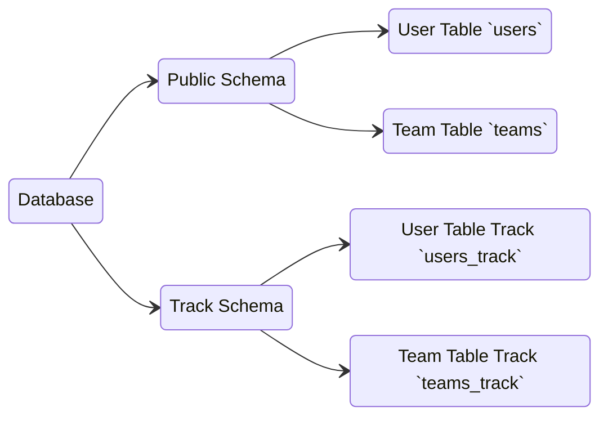

# Table Mirroring

## Responsibility.
1. Check Change row in database.
2. later we use for migration from old system (warehouse_infra) to new system (warehouse_revamp)

## Generals.
1. it support database that can have multiple schema like postgres.

## Core Concepts.
1. package create new schema for track `[schema that tracked]_track`, for example we track `public` schema, so we create new schema `public_track`.
2. in track schema we should have tables:
    - `configurations`
        - `id`
        - `name`, unique
        - `value`, string

    - `tracked_tables`

        that have field:
        - `id`
        - `table_name`, its unique

    - `[table_name]_track`
        - `id`, primary key, not autoincrement but use primary key source table primary key.
        - `last_hash`, hash of row source table
        - `last_change` datetime




### How We Track Tables.

1. query table and hash the row with `hashtext(t::text)`
2. join with tracked schema
3. get that row not recorded or get different hash.


## How Library Usage Overview.
```go

type ChangeType string

const (
    ChangeTypeNew       ChangeType = "new"
    ChangeTypeModified  ChangeType = "modified"
    ChangeTypeDeleted   ChangeType = "deleted"
)


type Change[T any] struct {
    ID              uint64
    Change          ChangeType
    
    CurrentHash     int 
    LastHash        int

    Data           T
}

func (c Change[T any]) Ack(db *gorm.DB) error {
    // save last hash to tracked or insert to tracked with c.id
}

func TrackTable[T any](
    ctx context.Context, 
    db *gorm.DB, 
    tablename string, 
    func(ctx context.Context, change Change[T]) error,
) error

// usage
type User struct {
    ID          uint64
    Name        string
    Username    string
}


err := TrackTable[*User](
    ctx,
    db,
    "users",
    func(ctx, change) error {
        // doing something

        return change.Ack(db)

    }
)


```
