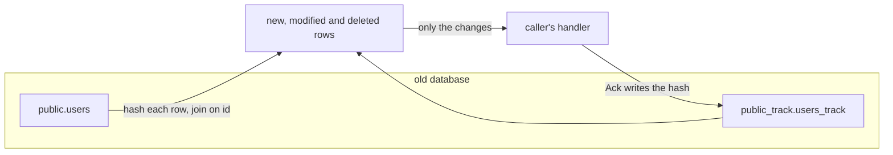
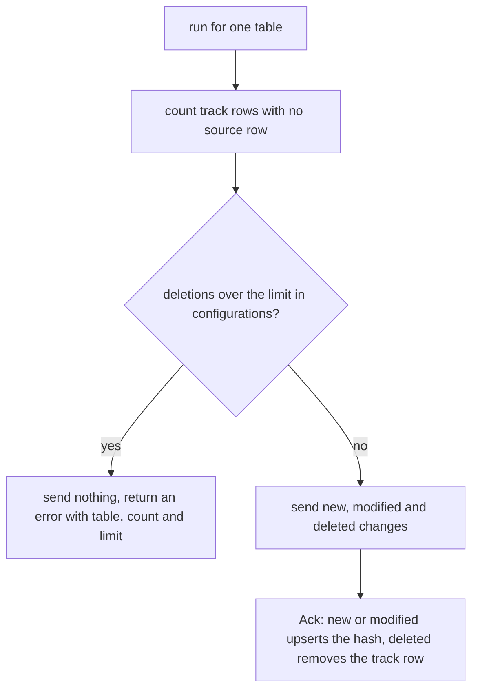

# Decisions — `table_mirroring/context.md`

What the owner decided about [context.md](./context.md), recorded before it was acted on.
**Append-only.** Each entry carries what it decided and why.

| Decision | |
| --- | --- |
| [the-track-schema-lives-in-the-old-database](#the-track-schema-lives-in-the-old-database) | `<schema>_track` is created inside the database being tracked, so the diff is one SQL join and only changed rows leave it |
| [the-mirror-runs-on-a-schedule](#the-mirror-runs-on-a-schedule) | the package is called again and again by a scheduled job, not once for a cut-over, so the cost of one run is paid every run |
| [the-caller-keeps-the-before](#the-caller-keeps-the-before) | the package hands over the row as it is NOW (`Data`); whoever needs the earlier version records it on their own side |
| [deletes-are-reported-and-a-mass-delete-stops-the-run](#deletes-are-reported-and-a-mass-delete-stops-the-run) | a row gone from the source is reported as `deleted` (ID only), and a run whose deletions pass a limit in `configurations` sends nothing and fails |
| [hashtext-stays-and-the-settings-are-pinned](#hashtext-stays-and-the-settings-are-pinned) | the row hash stays `hashtext(t::text)` (32-bit), and the scan pins the session settings that change how a row prints |
| [only-single-column-keys-are-supported](#only-single-column-keys-are-supported) | a table is tracked only if its primary key is one integer column (`ID uint64`); any other table is refused, join tables included |
| [the-delete-guard-is-ten-percent-over-fifty](#the-delete-guard-is-ten-percent-over-fifty) | the run stops only when its deletions are over 50 AND over `max_delete_percent` (default 10) of the table's tracked rows; a purge goes through by raising the value |
| [an-overlapping-run-skips-the-table](#an-overlapping-run-skips-the-table) | a per-table advisory lock; a run that finds it held scans nothing and returns `ErrStillRunning` |
| [the-package-creates-its-track-schema](#the-package-creates-its-track-schema) | the first `TrackTable` call creates `<schema>_track` and its tables itself — no separate setup step |

---

## the-track-schema-lives-in-the-old-database

> Owner (2026-11-04), asked as *"where does the track state live — A: in the old database, as drafted (only changed
> rows cross the network, needs permission to create a schema on production), or B: in the revamp database (old
> database stays read-only, every run streams every row's id and hash)?"* — **"for 1, old database"**, as recommended.

**The verdict.** The track schema (`public_track` for `public`) is created in the same database as the tables it
tracks, as `context.md` §Core Concepts draws it. Finding new and changed rows is one query that joins the source
table to its `_track` table, so only the rows that differ are sent to the caller.

| | |
| --- | --- |
| Where the track tables live | a `<schema>_track` schema in the tracked database |
| What leaves that database per run | only the changed rows |
| What is given up | the old database is no longer read-only to the package: it needs a role allowed to create one schema and write to it |

**What it does NOT settle.** Which database role creates and owns the track schema, and whether the package creates
it on first run or a one-off setup step does.

⛔ Not built. Nothing exists yet; there is no `backend/pkgs` package for table mirroring.

🔄 *(2026-11-04)* **Settled by [the-package-creates-its-track-schema](#the-package-creates-its-track-schema)**: the package creates the schema on its first call. Which role it connects with is still an operations step.

✅ **Built 2026-11-04.** In [backend/pkgs/san_table_mirroring](../../../../backend/pkgs/san_table_mirroring/). `changedQuery` hashes ONE page of source rows (the next 1.000 keys, an index range) and returns only the new and differing ones; each row looks its track row up by key in a correlated subquery. As a join the planner hashed the whole track table once per page (measured on 200.000 rows), so a run cost a pass per page. `TestPerf_TrackTable` (`-tags perfaudit`) refuses a seq scan in either page plan: 200.000 rows with nothing changed take 0.6 s.

---

## the-mirror-runs-on-a-schedule

> Owner (2026-11-04), asked as *"is this a one-time migration that runs until switch-over, or a long-running
> sync?"* — **"later we used this package in scheduled"**.

**The verdict.** The package is a building block for a job that runs on a schedule, again and again. It is not a
one-shot copy. Every run hashes every row of every tracked table, so what one run costs is paid on every run.

| | |
| --- | --- |
| How it is called | repeatedly, by a scheduled job |
| What this makes necessary | reading the table in pages (`id > last ORDER BY id LIMIT n`) instead of all at once; writing acks in batches; a per-table lock so two overlapping runs cannot process the same rows twice |

**What it does NOT settle.** The schedule interval, the page size, and what a run does when the previous run is
still going (skip, or wait).

⛔ Not built.

🔄 *(2026-11-04)* **Settled by [an-overlapping-run-skips-the-table](#an-overlapping-run-skips-the-table)**: a run that finds the previous one still going skips the table with `ErrStillRunning`. The interval stays the scheduler's choice; the page size is a build detail (1,000 rows).

✅ **Built 2026-11-04.** Pages of 1.000 keys behind a cursor; the overlap lock is [an-overlapping-run-skips-the-table](#an-overlapping-run-skips-the-table). Besides `Ack` (one round trip, ≈1 ms here) there is `AckAll(db, changes)`, which writes a batch in a few statements: 200.000 rows acked per 1.000 took 15 s. `TestPagesCoverEveryRowOnce`, `TestAckAllWritesWhatAckWould`, `TestPerf_TrackTable`.

---

## the-caller-keeps-the-before

> Owner (2026-11-04), asked as *"what is `Before` for — the track table stores only a hash, so either drop it or
> store a copy of every row"* — **"sorry, we cant get before data, let who using this package record before in
> their own."** The owner's own edit of `context.md` the same day replaced `Before` / `After` with one `Data T`
> and added `ChangeTypeDeleted`.

**The verdict.** The package never stores row contents, only each row's id, last hash and last change time.
`Change.Data` is the row as it is now. A caller that needs the previous version (to diff, or to audit) keeps its
own copy, for example the mirrored row it already wrote on the revamp side.

| | |
| --- | --- |
| What a change carries | `ID`, `Change`, `CurrentHash`, `LastHash`, `Data` (the row now) |
| What the track table stores | id, last hash, last change time — no row contents |
| What is given up | the package cannot say WHAT changed in a row, only THAT it changed |

**What it does NOT settle.** What `Data` holds for a `deleted` change. The row no longer exists in the source, so
there is nothing to read; the caller has only the `ID`.

⛔ Not built.

🔄 *(2026-11-04)* **Settled by [deletes-are-reported-and-a-mass-delete-stops-the-run](#deletes-are-reported-and-a-mass-delete-stops-the-run)**: a `deleted` change carries `ID` and `LastHash` only, and `Data` is the zero value of `T`. The caller finds the old row in its own copy by `ID`.

✅ **Built 2026-11-04.** `Change[T]{ID, Change, CurrentHash, LastHash, Data}` as in `context.md`; a deleted change carries the zero `T`. `TestAHardDeleteIsSentAsDeletedAndItsAckForgetsTheRow`.

---

## deletes-are-reported-and-a-mass-delete-stops-the-run

> Owner (2026-11-04), asked as *"deleted rows — A: report `deleted` (ID only), `Ack` removes the track row, and a run
> stops before sending anything if its deletions pass a limit stored in `configurations`; B: report `deleted` with no
> guard; C: no delete detection, only soft deletes reach the caller"* — **"yes A"**, as recommended. It builds on the
> owner's own edit of `context.md` the same day, which added `ChangeTypeDeleted`.

**The verdict.** A hard delete in the source (`DELETE FROM users WHERE id = 7`) leaves a track row with no source row.
Every run finds those with the reverse join and reports each one as `deleted`. A soft delete needs nothing new: the
row stays, its hash changes, and it arrives as `modified` with its `deleted_at` filled in.

Because the mirror runs on a schedule ([the-mirror-runs-on-a-schedule](#the-mirror-runs-on-a-schedule)), one run
can catch the source half-empty, for example while a table is being truncated and refilled or restored. Without a
guard, that run would report every row deleted, and a caller that mirrors deletes would empty its copy. So the run
counts its deletions BEFORE it hands over any change. Over the limit, it sends nothing at all (no `new`, no
`modified`, no `deleted`) and returns an error naming the table, the count and the limit.

| | |
| --- | --- |
| How a hard delete is found | `_track` rows whose id has no row in the source table (LEFT JOIN, source id IS NULL) |
| What a `deleted` change carries | `ID`, `LastHash`; `Data` is the zero value |
| What `Ack` does on `deleted` | removes the track row, so the same id coming back later arrives as `new` |
| The guard | checked before anything is sent; the limit lives in `configurations` (named in the discussion as `max_delete_percent`, e.g. 10) |
| Over the limit | nothing is sent for that table, the run returns an error |
| What is given up | a genuine large purge in the old system halts that table's mirror until someone lets it through |

**What it does NOT settle.**
- The default limit, and whether it is one value for every table or one per table (`configurations` is name → value).
- Small tables: on a 3-row table, 1 deletion is 33%. A floor (e.g. "never stop for fewer than N deletions") may be needed.
- How an operator lets a genuine purge through: raise the limit for one run, or a force flag on the call.
- Tables whose key is two columns (join tables, where GORM hard-deletes on `Replace` / `Delete`), which `ID uint64` cannot carry.

⛔ Not built.

🔄 *(2026-11-04)* **Settled by [the-delete-guard-is-ten-percent-over-fifty](#the-delete-guard-is-ten-percent-over-fifty)**: one `max_delete_percent` for every table (default 10), a floor of 50 deletions, and a purge goes through by raising the value. Two-column keys: settled by [only-single-column-keys-are-supported](#only-single-column-keys-are-supported) (refused).

✅ **Built 2026-11-04.** `guardDeletes` counts before anything is sent; `sendDeleted` pages over the track table and probes the source by key; `Ack` of a deleted change removes its track row. `TestAHardDeleteIsSentAsDeletedAndItsAckForgetsTheRow`, `TestAMassDeleteStopsTheRunBeforeAnythingIsSent` (the stopped run sends not even its new and modified rows).

---

## hashtext-stays-and-the-settings-are-pinned

> Owner (2026-11-04), asked as *"the hash — A: `md5(t::text)::uuid` with the session settings pinned; B: keep
> `hashtext` and pin the same settings (32-bit, so a real change is missed about once in 4 billion changes); C: as
> drafted, nothing pinned"* — **"B is okay, because is row context"**, against my recommendation (A).

**The owner's reason, and it holds.** A hash is only ever compared with the SAME row's previous hash, never with other
rows, so there is no birthday effect across a table. The risk is the per-change one: an edit that happens to keep
the same 32-bit value, about 1 in 4.3 billion edits.

**The verdict.** The row hash stays `hashtext(t::text)` as drafted in `context.md` §How We Track Tables, so
`last_hash` is a 4-byte `integer`. What changes is the session: a row's text form depends on connection settings
(checked on the local Postgres 17: one `timestamptz` row printed `2026-11-04 03:00:00+00` under `TimeZone=UTC` and
`2026-11-04 10:00:00+07` under `Asia/Jakarta`, with two different hashes). So the scan transaction pins them with
`SET LOCAL` before it hashes anything.

| | |
| --- | --- |
| Hash | `hashtext(t::text)`, `integer`; `last_hash integer` in every `_track` table |
| Pinned in the scan transaction | `TimeZone`, `DateStyle`, `IntervalStyle`, `extra_float_digits`, `bytea_output` (`SET LOCAL`, to fixed values) |
| What is given up | a changed row whose new hash equals its old one is never sent, with no sign it was missed (about 1 in 4.3 billion edits) |
| What resends a whole table once | changing one of the pinned values; a column added to or dropped from the source table; a Postgres major upgrade that changes `hashtext`'s output (it is undocumented, so no promise covers it). Each reports every row `modified` once — a resend, not a loss — and the delete guard does not stop it |

**What it does NOT settle.** The exact pinned values. Any fixed set works; they only have to stay the same for the
life of the track tables.

⛔ Not built.

🔄 *(2026-11-04)* **Pinned values, as a build detail**: `TimeZone=UTC`, `DateStyle=ISO, MDY`, `IntervalStyle=postgres`, `extra_float_digits=1`, `bytea_output=hex` — changing any later resends every table once.

✅ **Built 2026-11-04.** `pinnedSettings` (`set_config(…, true)` in the run's transaction). One addition beyond the five listed: `lc_monetary = 'C'`, because a `money` column prints its currency symbol from it. `TestTheHashDoesNotFollowTheSessionTimeZone` runs once in UTC and once in Asia/Jakarta; its control proves the unpinned hash differs, and with the pin removed the Jakarta run re-sent both rows.

---

## only-single-column-keys-are-supported

> Owner (2026-11-04), asked as *"tables whose key is not one `id` (e.g. a join table keyed on `user_id, team_id`) —
> A: single-column keys only, as drafted, others refused; B: the track table copies the source's key columns and
> `Change` carries `Key []any`; C: one text key for every table"* — **"leave it, so our package not supported that
> table"**, against my recommendation (B).

**The verdict.** The draft's shape stands: a `_track` table is keyed on the source's one `id`, and `Change.ID` is a
`uint64`. A table whose primary key is not a single integer column is not supported. `TrackTable` refuses it with an
error naming the table, before it creates or scans anything.

| | |
| --- | --- |
| Supported | a table whose primary key is ONE integer column |
| Refused, with an error naming the table | a two-or-more-column key (join tables such as `user_teams`), a single non-integer key (text, uuid), no primary key |
| What is given up | the package cannot mirror those tables. A join table's rows (memberships, roles) are invisible to it, and so are its hard deletes; changing one does not change the parent row's hash either |

**What it does NOT settle.** How the migration gets the refused tables, if it needs them. That is the caller's
concern, outside this package.

⛔ Not built.

✅ **Built 2026-11-04.** `resolveTable` refuses a two-column key, a text or uuid key, no key, and a schema or table name too long for its `_track` name (Postgres cuts at 63 bytes), all with `ErrUnsupportedTable` and before anything is created; a `T` with no field for the key column is refused too. `TestUnsupportedTablesAreRefusedBeforeAnythingIsCreated`.

---

## the-delete-guard-is-ten-percent-over-fifty

> Owner (2026-11-04), asked three small defaults at once — *"1. delete guard: one `max_delete_percent = 10` in
> `configurations`, never stop for 50 deletions or fewer, raise the value to let a purge through; 2. overlapping runs:
> per-table advisory lock, a run that finds it held skips the table with `ErrStillRunning`; 3. the package creates the
> track schema on its first run"* — **"ok"**, as recommended. This entry is item 1.

**The verdict.** The limit of [deletes-are-reported-and-a-mass-delete-stops-the-run](#deletes-are-reported-and-a-mass-delete-stops-the-run)
is one value for every table, `max_delete_percent` in `configurations`, read at the start of each run. A run stops
(sends nothing, returns an error naming table, count and limit) only when BOTH hold: more than 50 deletions, and more
than `max_delete_percent` of that table's tracked rows (counted before the run).

| | |
| --- | --- |
| Setting | `configurations` row `max_delete_percent`; 10 when the row is absent |
| Scope | one value for every tracked table |
| Floor | 50 deletions or fewer never stop a run, so a small table cannot trip it; fixed in the package |
| Example | 1,000 tracked rows: 80 deletions pass (8%); 120 stop it (12%). 200 tracked rows: 40 deletions pass (under the floor) |
| Letting a real purge through | raise `max_delete_percent`, run once, set it back |
| What is given up | between raising and resetting the value, every table runs unguarded |

⛔ Not built.

✅ **Built 2026-11-04.** `deleteFloor = 50`; `max_delete_percent` is seeded as `10` and read as 10 when absent. A build choice: a value that is not a number from 0 up is an ERROR, never the default, so a typo cannot switch the guard off. `*TooManyDeletesError{Table, Deletions, Tracked, LimitPercent, ConfigTable}` matches `ErrTooManyDeletes`. `TestTheGuardsFloorAndItsExactLimit` (30 of 40 passes; exactly 10% passes), `TestAMissingOrBadLimit`.

🔄 *(2026-11-05)* **Built detail changed:** the limit is now read and checked on EVERY run, not only when a run has more than 50 deletions. A typo then fails the next run of every table in that schema, instead of surfacing at the one mass delete it was meant to stop. `TestAMissingOrBadLimit` runs a table with no deletions under a bad value.

---

## an-overlapping-run-skips-the-table

> Owner (2026-11-04), asked three small defaults at once — *"1. delete guard: one `max_delete_percent = 10` in
> `configurations`, never stop for 50 deletions or fewer, raise the value to let a purge through; 2. overlapping runs:
> per-table advisory lock, a run that finds it held skips the table with `ErrStillRunning`; 3. the package creates the
> track schema on its first run"* — **"ok"**, as recommended. This entry is item 2.

**The verdict.** Because the mirror runs on a schedule ([the-mirror-runs-on-a-schedule](#the-mirror-runs-on-a-schedule)),
a slow run can still be going when the next one starts. Each run takes a Postgres advisory lock keyed on the tracked
table's schema and name. A run that finds it held does not scan, send or ack anything; it returns `ErrStillRunning`,
a distinct error the scheduler can log as a skip rather than a failure.

| | |
| --- | --- |
| Lock | Postgres advisory lock, one per tracked table (schema + name), tried without waiting |
| Lock held | nothing is scanned; `TrackTable` returns `ErrStillRunning` |
| Released | when the run ends, or when its connection drops, so a crashed run never blocks the next |
| What is given up | a table whose run always outlasts the interval is skipped every other time; the scheduler's log shows it |

⛔ Not built.

✅ **Built 2026-11-04.** `pg_try_advisory_xact_lock(hashtext('san_table_mirroring/run'), hashtext('<schema>.<table>'))` in the run's transaction, which only reads; `ErrStillRunning` is wrapped with the table name. `TestAnOverlappingRunSkipsTheTable`.

---

## the-package-creates-its-track-schema

> Owner (2026-11-04), asked three small defaults at once — *"1. delete guard: one `max_delete_percent = 10` in
> `configurations`, never stop for 50 deletions or fewer, raise the value to let a purge through; 2. overlapping runs:
> per-table advisory lock, a run that finds it held skips the table with `ErrStillRunning`; 3. the package creates the
> track schema on its first run"* — **"ok"**, as recommended. This entry is item 3.

**The verdict.** The first `TrackTable` call for a schema creates what [the-track-schema-lives-in-the-old-database](#the-track-schema-lives-in-the-old-database)
needs: `<schema>_track`, its `configurations` and `tracked_tables`, and the `<table>_track` table, all with
`IF NOT EXISTS`, and registers the table in `tracked_tables`. Later calls find them and go straight to the scan. A table
the package refuses ([only-single-column-keys-are-supported](#only-single-column-keys-are-supported)) is refused before
anything is created.

| | |
| --- | --- |
| Who creates the track schema | the package, on its first call |
| Separate setup step | none |
| What is given up | the database role the package connects with must be allowed to create a schema on the old database |

**What it does NOT settle.** Which role that is, and who grants it — an operations step on the old database.

⛔ Not built.

✅ **Built 2026-11-04.** `ensureTrack` runs in its own committed transaction (an `Ack` on another connection must see the tables), serialised by an advisory lock per track schema, and seeds `max_delete_percent`. `TestFirstRunSendsEveryRowNewThenNothing` checks all four tables.
