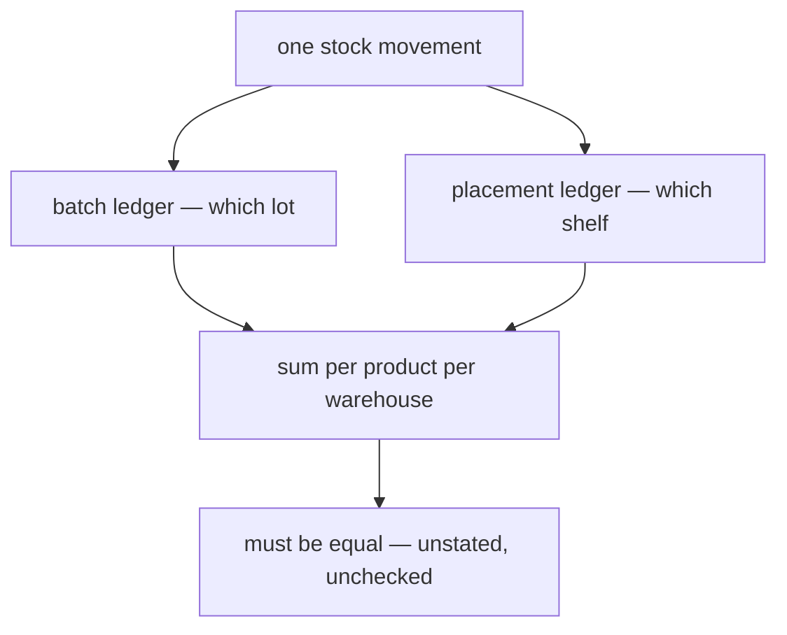

# Clarity — `stock_design.md`

Critique, questions and warnings about [stock_design.md](./design.md). That doc is yours; this one
is mine. Answered points are **deleted**, so this is always the current open set.

> ✅ *(2026-10-15)* **Q6 answered** — *"change api to float64/double too"*: [money-is-double-in-the-api-too](./design_decision.md#money-is-double-in-the-api-too).
> **No question is open here.**
>
> ✅ *(2026-10-15)* **Q5 answered** — *"we not on production yet, switch over is overkill"*: the ledgers replace today's
> tables outright ([no-switch-over-the-ledgers-replace-todays-tables](./design_decision.md#no-switch-over-the-ledgers-replace-todays-tables)).
> Q6 (money as `double`) stays: the new tables still need a type.
>
> ✅ *(2026-10-14)* **Q3 answered** by the owner's restock.md — the cost share is the whole restock's, by quantity
> ([unit-price-is-line-price-plus-costs-per-unit](../../business/inventory/restock_decision.md#unit-price-is-line-price-plus-costs-per-unit)).
>
> **Full re-examination.** This file had grown to 4× the doc it tracks by appending on every save —
> the thing `disscuss/` is supposed to avoid. Rewritten tight. Nothing dropped that is still open.
>
> 🔄 **Pruned 2026-10-12.** Q2 moved: it is [transaction Q4](../../business/inventory/transaction_clarify.md#question), asked
> twice. Two contradictions closed by the business docs: a cancellation **does** reuse its transaction
> ([an-undo-rolls-the-transaction-back-once](../../business/inventory/transaction_decision.md#an-undo-rolls-the-transaction-back-once)),
> and the type list now has `restock` and `move` ([a-move-has-its-own-type](../../business/inventory/transaction_decision.md#a-move-has-its-own-type)).
>
> ✅ **Answered 2026-10-10 and deleted:** Q4, against my `int64` — stock money is `float64`, compared at 4-digit precision
> ([stock-money-is-float64-compared-at-4-digits](./design_decision.md#stock-money-is-float64-compared-at-4-digits)). It also
> closes the first contradiction below.
>
> **Closed since last pass:** `inventory_transactions.status` exists · `warehouse_transfer_teams` is
> declared a query-side dictionary · deleted places mangle `code` so it can be reused · the Accept
> participant is now named `Restock Accept Mutation`.

---

# Contradiction

## `float64` is a worse answer to division, not a better one

✅ *(2026-10-10)* **Decided the other way — float stays**, as §General Brief says:
[stock-money-is-float64-compared-at-4-digits](./design_decision.md#stock-money-is-float64-compared-at-4-digits). My `int64`
argument is withdrawn. What I asked for if float stayed is now written down in the decision: amounts are compared at
4-digit precision through one helper, and the log reproduces money to that precision, so a smaller difference is not a bug.

## In-transit goods have nowhere to be

✅ *(2026-10-10)* **Decided in the business doc** —
[the-transfer-is-where-goods-in-transit-are](../../business/inventory/warehouse_transfer_decision.md#the-transfer-is-where-goods-in-transit-are).
The in-transit place below is withdrawn: a placement belongs to one warehouse, and the transfer record is where the units
are while they travel.

`warehouse_transfers` has dispatch and accept transactions, so goods are on a truck for hours or days.
Accept guideline 1 says *"there is no unplaced goods."*

| mid-transit, the ledger says | |
| --- | --- |
| decrement source at dispatch, increment destination at accept | stock exists **nowhere** for the whole journey |
| move nothing until accept | source shows goods that are not on its shelves |
| **an in-transit place** | ✅ every rule still holds |

**→ The third — and the `rack` → `places` rename already paid for it.** Not every location is a rack; a
truck is one more non-rack place. Dispatch and accept become two ordinary placement movements, both
logged.

## The two ledgers must agree and nothing says so

`sum(batches.stock_balance) == sum(product_placements.qty_balance)`, per product per warehouse. Two
mutations, two grains, no constraint. Any operation that writes one and forgets the other drifts
silently — no error, and reconcile has no rule to check.

**→ State it, write both in one transaction (Accept already opens one), and check it nightly.** Both
logs now carry `inventory_transaction_id`, so the per-event form is available:
`sum(qty_change) == sum(stock_change)` for each transaction.

## A cancellation reuses the original transaction

✅ *(2026-10-09)* **Decided the other way** in the business doc —
[an-undo-rolls-the-transaction-back-once](../../business/inventory/transaction_decision.md#an-undo-rolls-the-transaction-back-once):
an undo locks the same transaction, reverses it in both ledgers and sets `is_rollback`, once. My new `adjustment`
transaction with `reverses_id` is withdrawn. Its open half, a rollback that would take a batch below zero, is
[transaction Q4](../../business/inventory/transaction_clarify.md#question); reversing from the log rows rather than the
items is [transaction Q3](../../business/inventory/transaction_clarify.md#question).

## The transaction type list is missing two values

✅ *(2026-10-12)* **Closed by the business doc.** `restock` is in `tx_type` ([transaction.md](../../business/inventory/transaction.md)),
and `move` was added ([a-move-has-its-own-type](../../business/inventory/transaction_decision.md#a-move-has-its-own-type)).
What is still missing, `revaluation` and `opname`, is [transaction Q5](../../business/inventory/transaction_clarify.md#question).

## `orders` crosses a service boundary — and you already drew the fix

`ord |o--o| tx` is a real FK, but `order.go` lives in `selling_service/selling_service_models/` while
these tables live in `inventory_service/`. HARD RULE 3: *"a model belongs to exactly one service … that
is a contract question (an RPC)."*

**→ The placements ERD already shows the right pattern** — `tx[inventory_transactions]` drawn as a bare
entity with a note that it is defined elsewhere. Do that for `orders`, or if this row is inventory's own
record *about* an order (its columns suggest so), rename it — `orders` is selling's name for a different
thing.

## The template still says `Restock Create Mutation`

This doc now names its participant **`Restock Accept Mutation`** and puts `StockMutation` in Accept, not
Create. [mutation_and_ledger.md](../ledger/mutation_and_ledger.md) line 37 still teaches the opposite lifecycle,
and it is the doc every other service copies. **→ Rename it there.**

---

# Critique

| | Problem | → Recommend |
| --- | --- | --- |
| **2** | **The COGS formula has a 10× ambiguity and no rounding rule.** `(ShippingFee + WarehouseOpsFee) / ProductQtyCount` — if `ProductQtyCount` is *this line's* quantity, every product absorbs the whole freight and a 3-line restock books it three times. Both readings are grammatical. And the division does not terminate, so `unit_price × quantity` never sums back to what was paid. | Write it `TotalRestockQty` and say so in words — a wrong reading here is silent, the numbers just come out multiples too high. Round the **change**, never the unit cost, and give the remainder its own log row. |
| **2b** | **Apportioning freight by QUANTITY distorts cost.** 100 screws and 1 machine on one delivery each carry the same freight. Every downstream margin inherits it. | **By value** — `fee × (line total / goods total)`. Self-balancing, needs no weight data. If freight really tracks bulk, the honest basis is weight and that means a weight column. Whichever you pick *is* the definition of cost here. |
| **3** | **The publish fires after the transaction closes — in all THREE flows now.** Create, Accept, and Move all `Send Event` after `Close Transaction`, so it is the only step in the system that can succeed or vanish independently of the writes it describes. Crash in between and the stock moved while the stat never hears: no error, no retry, nothing detects it. Three sites means it is the shared write path's default, not an oversight in one diagram. | **Transactional outbox** — event row written inside the transaction, a relay publishes after commit. The transaction already exists in all three, so this is one insert. Fix it once in the shared path and every flow after inherits it. ⛔ **Decided the other way at the architecture level** — no outbox, the publish is trusted: [no-outbox-the-publish-is-trusted](../event_architecture/context_decision.md#no-outbox-the-publish-is-trusted). What a lost stock event costs is now this doc's to say. |
| **4** | **`places.is_deleted` can hide stock the ledger still counts.** Soft-delete a place holding 90 units and the shelf vanishes from every list while the 90 stays in the ledger — invisible, still in totals, unfindable by walking the warehouse. Mangling `code` on delete solves reuse, not this. | **Refuse the delete while any `product_placements` row under it is non-zero.** Goods must be moved off first, which is a real ledger movement and what should happen physically. |
| **5** | **`placement_logs` cannot say which product moved.** It has `placement_id` (→ `places`, per the edge) and no `product_id`, but state is keyed `(place, product)`. So a row reads "place 4, tx 91, −12" and cannot be joined to the state row it explains. | **Point it at the state row, as the batch side does** — `batch_logs.batch_id` → `batches`. Use `product_placement_id` → `product_placements`, edge `pst \|\|--o{ pllog`. Restores the product without a column and makes both ledgers structurally identical. |
| **6** | **`product_placements` does not declare its composite unique.** Item 4 says `(placement_id, product_id)` must be — `places` states its constraint inline, so this reads as an oversight. It is the ledger's `ON CONFLICT` target: without it two concurrent Accepts onto one shelf insert two rows and the balance splits in half, silently. | Declare it inline. This is the one constraint that cannot be added quietly later — once duplicates exist the migration that adds the index fails. |
| **7** | **No `warehouse_transfer_items`, so Accept has nothing to verify against.** The transfer says where from, where to and which teams — never *what*. A short delivery is not a discrepancy, it is whatever the receiver types. | `transfer_id`, `batch_id`, **`qty_dispatched` and `qty_accepted`**. The difference *is* the discrepancy, visible without a join, and `adjustment` / `lost` already exist to absorb it. |
| **8** | **`warehouse_transfers` details.** (a) **`dispath_…` is misspelled** — it becomes the struct field and the migration. (b) `accept_inventory_transaction_id` is non-nullable, but "dispatched, not yet arrived" is the normal state for the whole journey, so `0` stands in for "not yet". (c) `\|\|--\|{` says one-to-many where there are two distinct FKs. (d) `status` lists no values. | (a) `dispatch_…`. (b) `*uint`, null until received — that null **is** the in-transit state and is what an "awaiting receipt" screen filters on. (c) Two edges. (d) List them or use an enum. |
| **9** | **Both logs are unattributable.** No `actor_id` on `batch_logs` or `placement_logs`. With two people working one shelf, "which of us wrote this" is the first question a wrong count raises. | Add it to both. |
| **10** | **Three stored totals, no stated invariant** — `restock_items.total`, `restocks.total`, the two fees. Each is derivable from what is below it, so each can drift, and `restocks.total`'s scope is undefined (goods only, or goods + fees?). | Say what it includes, and assert the chain: `restocks.total` = `sum(items.total)` + fees = `sum(valuation_change)` across the batches minted. That catches #2 the day it happens. |
| **11** | **Smaller schema points.** (a) `batches` carries `warehouse_id` + `product_id`, the pair `warehouse_products` declares unique — two sources for one relationship. (b) `bclog }\|--\|\| bch` is correct but its label still reads `"many of many"`. (c) `batch_logs.updated_at` — `placement_logs` correctly omits it, so the two disagree about whether a log row is mutable. (d) ✅ *(2026-10-10)* `warehouse_transfer_teams` removed — one team per transfer ([warehouse_transfer.md](../../business/inventory/warehouse_transfer.md)). As first raised: `warehouse_transfer_teams` has no composite unique and no edge. | (a) `warehouse_product_id`. (b) `"has many"`. (c) Drop it — that column is the difference between an audit trail and a table. (d) Unique on `(transfer_id, owner_team_id)`, and say it is written in the same transaction as the contents: a scoping dictionary that drifts is an authorization bug, not a display one. |
| **12** | **Naming.** (a) `unit_price` is fixed at accept — its comment says so, but the comment stays in the doc while the name goes into the code, beside two columns that do move. (b) `place` is the verb this domain uses all day, and `places` is now a table. (c) `product_placements` / `placement_logs` do not pair the way `batches` / `batch_logs` do. | (a) `unit_cost_at_receipt`. (b) `locations` carries the same generality without colliding with the verb. (c) Pick one prefix. ⚠ The rename also reaches `RackSelect.tsx`, `features/racks/`, the `racks.select.unplaced` key and `rack.go` — a real cost to schedule, and a half-done rename leaves the UI saying "rack" while the ledger says "place". |
| **13** | **Loose ends.** (a) Neither flow draws an `alt` for commit vs rollback. (b) Create does not draw the `recost` insert, though `recost \|\|--\|\| re` makes it mandatory. (c) The `warehouse_products` upsert is fine outside the transaction, but must be `ON CONFLICT DO NOTHING` or two concurrent restocks for one product fail on the unique index. (d) `int` quantity needs its base unit stated — "3" of what. | Each is a line. (c) is the one that produces a user-visible error today. |
| **14** | **The per-measure rule lives in the instance, not the template.** You settled it here — one `change`/`after` pair per measure, twice over. [mutation_and_ledger.md](../ledger/mutation_and_ledger.md) still shows a single pair and never mentions measures, so the next service invents its own shape. | Promote it. |

---

# Question

1. ✅ *(2026-10-10)* **Decided, via [warehouse_transfer_clarify Q3](../../business/inventory/warehouse_transfer_clarify.md#question)** —
   [the-transfer-is-where-goods-in-transit-are](../../business/inventory/warehouse_transfer_decision.md#the-transfer-is-where-goods-in-transit-are). As first asked:
   *where do in-transit goods live?* My in-transit place is withdrawn.
2. ➡ *(2026-10-12)* **Moved** to [transaction Q4](../../business/inventory/transaction_clarify.md#question), which asks the
   same thing: a rollback that would take a batch below zero. Recommended there: refuse it.
3. ✅ *(2026-10-14)* **Answered: the whole restock, by quantity** — your restock.md §Calculating Price Unit When Restock
   Accepted, recorded as [unit-price-is-line-price-plus-costs-per-unit](../../business/inventory/restock_decision.md#unit-price-is-line-price-plus-costs-per-unit).
   It counts every unit ordered, broken and missing included: [all-qty-is-every-unit-ordered](../../business/inventory/restock_decision.md#all-qty-is-every-unit-ordered).
   As first asked: *`ProductQtyCount` — this line, or the whole restock? And by quantity or by value?*
5. ✅ *(2026-10-15)* **Answered: neither — they are replaced.** Nothing is in production, so no data is carried and no
   switch-over is staged: [no-switch-over-the-ledgers-replace-todays-tables](./design_decision.md#no-switch-over-the-ledgers-replace-todays-tables).
   As first asked: *how do today's `stock_*` tables give way to the decided ledgers — one cut-over, or side by side?*

6. ✅ *(2026-10-15)* **Answered: yes, the API too** — [money-is-double-in-the-api-too](./design_decision.md#money-is-double-in-the-api-too): `double` on the
   wire and in each feature's own tables, switched when the feature moves onto the ledgers.

---

# Awaiting

- **`## How We Moving Goods Between Placements.`** ✅ *(2026-10-12)* What it writes is decided in the business doc:
  [a-move-writes-two-rack-rows-and-no-batch-row](../../business/inventory/placement_decision.md#a-move-writes-two-rack-rows-and-no-batch-row),
  a row per rack touched when it splits. Still awaiting your text here. As first noted: the transaction is opened and closed with the work
  not yet between them, and `mut as Move Mutation` is declared but unused. One thing worth confirming
  when you fill it in, because it is the first operation that touches only **one** ledger: a move is
  **two placement entries under one transaction** (−20 at Place 1, +20 at Place 2) and **no batch entry
  at all** — the lot did not change, only where it sits. That is correct, and the cross-ledger invariant
  survives it: the placement side nets to zero, the batch side has no rows, and `0 == 0` holds. Worth
  saying explicitly in the doc, because "some transactions write only one ledger" is exactly the sort of
  exception that gets coded as a bug the first time someone asserts both must move.

- **`## Batch`** — still one line, saying what a batch is *for* but not what it *is*. Two things would
  close open points: whether a batch is per receipt or per product-per-supplier-per-cost (decides
  whether #2's rounding is one-time or recurring), and whether a batch can be **split or merged** — if
  yes, that is a ledger movement, not an edit.
- **`batch_logs.reason`** is new and unconstrained. If it is for adjustments, it may want the same enum
  treatment as `type`; if it is free text for a human, say so.
