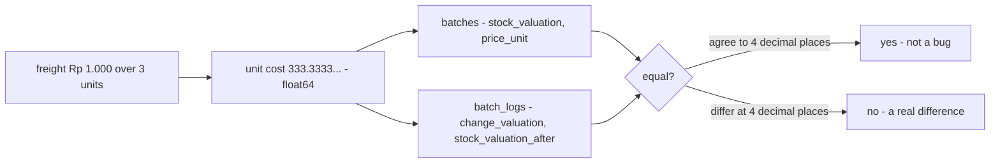
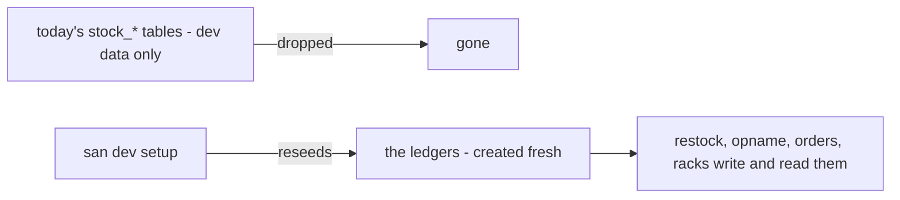
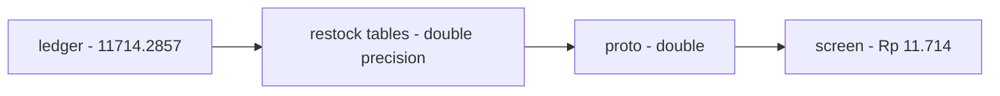

# Decisions — `technical/stock/design.md`

What the owner settled, recorded before it is acted on. **Append-only** — a decision that is later reversed is renamed
and its references grepped (RULE 12), never quietly edited away. The open set is [design_clarify.md](./design_clarify.md).

| decision | says | from |
| --- | --- | --- |
| [stock-money-is-float64-compared-at-4-digits](#stock-money-is-float64-compared-at-4-digits) | every money column in the stock ledgers is `float64`, and two amounts are compared at 4-digit precision | chat, 2026-10-10 — answers stock Q4, **against** my `int64` rupiah |
| [no-switch-over-the-ledgers-replace-todays-tables](#no-switch-over-the-ledgers-replace-todays-tables) | nothing is in production, so the ledgers replace today's stock tables outright — no data is carried, dev data is reseeded, and no all-at-once switch-over is staged | chat, 2026-10-15 — answers Q5 |
| [money-is-double-in-the-api-too](#money-is-double-in-the-api-too) | inventory's money is `double` on the wire and in its own tables as well as in the ledgers, each feature switching when it moves onto the ledgers | chat, 2026-10-15 — answers Q6 |

---

## stock-money-is-float64-compared-at-4-digits

> Owner, in chat *(2026-10-10)*: *"r1 is float"*, answering R1 of the ledger round, which was
> [design_clarify Q4](./design_clarify.md#question): *valuation type — `numeric` or integer rupiah?* **Against my
> recommendation** (`int64` rupiah). It keeps what [design.md](./design.md) §General Brief already says, and matches the
> system-wide [rupiah-is-floating-point](../../business/order/context_decision.md#rupiah-is-floating-point).

**The verdict.** Stock money is floating point, like every other rupiah amount in the system. A unit cost may be
fractional (Rp 1.000 of freight over 3 units is Rp 333,333… each), and that is stored as is. Because float is inexact,
two amounts are never compared with `==`. They are equal when they agree to 4 decimal places.

**The spec.**

| | |
| --- | --- |
| the type | `float64` in Go · `double precision` in Postgres · `double` in proto |
| which columns | every money column in the stock ledgers, as [batch.md](../../business/inventory/batch.md) names them: `batches.price_unit`, `stock_valuation`, `init_stock_valuation`; `batch_logs.change_valuation`, `stock_valuation_after`; `batch_price_logs.new_price_unit`, `delta_price_unit`; the restock's and the transfer's totals and costs |
| quantities | stay `int` — a unit is never fractional |
| comparing two amounts | at 4-digit precision ([design.md](./design.md) §General Brief 2), through **one shared helper**, never `==`, so the rule lives in one place |
| what the log guarantees | the log reproduces a batch's money **to 4-digit precision**. A reconcile compares at that precision, and a difference below it is not evidence of a bug |

**What it does NOT settle** — where a division's remainder goes when a batch empties (the take that empties it removes
all that is left): [context Q14c](../../business/inventory/context_clarify.md#question) · how freight is split across
lines: [Q3](./design_clarify.md#question) and [context Q1](../../business/inventory/context_clarify.md#question) ·
whether float is the ledger **template's** default too, for the payment ledger:
[mutation_and_ledger Q2](../ledger/mutation_and_ledger_clarify.md#question).

## no-switch-over-the-ledgers-replace-todays-tables

> Owner, in chat *(2026-10-15)*: *"we not on production yet, switch over is overkill"*, to my plan of a one-pass switch-over
> (carry each warehouse's stock into opening ledger rows, move every reader and writer at once, then drop the old tables).
> It answers [Q5](./design_clarify.md#question), which offered a cut-over or side by side, with neither.

**The verdict.** Nothing runs in production, so there is no stock to carry. The decided ledgers (`inventory_transactions`,
`batches` + `batch_logs`, `product_placements` + `product_placement_logs`) **replace** today's `stock_*` tables outright:
new migrations create them, the old tables are dropped, and the development database is reseeded by `san dev setup`. No
opening transactions, no cut-over plan, no side-by-side reads. A table rename in inventory (restock's tables taking the
owner's names) is just a migration, for the same reason.

**The spec.**

| | |
| --- | --- |
| data | not carried. A developer's database is reseeded, not migrated |
| the old tables | dropped by the migration that replaces them |
| readers and writers | each moved onto the ledgers when its feature is built on them |
| what it does NOT change | the ledgers' own rules, still open in [transaction_clarify](../../business/inventory/transaction_clarify.md#question), [context Q14](../../business/inventory/context_clarify.md#question) and [the template](../ledger/mutation_and_ledger_clarify.md#question) |

## money-is-double-in-the-api-too

> Owner, in chat *(2026-10-15)*: *"for 5 change api to float64/double too"*, to [Q6](./design_clarify.md#question) — *the
> ledgers keep money as `float64`; switch restock's API money to decimal when it moves onto the ledgers?*

**The verdict.** Inventory's money is `double` end to end: in the ledgers
([stock-money-is-float64-compared-at-4-digits](#stock-money-is-float64-compared-at-4-digits)), in each feature's own
tables, and on the wire. A landed price of 11.714,2857… reaches the screen as it is stored, and the screen rounds it for
display. Nothing converts at the ledger's edge, so nothing truncates there.

**The spec.**

| | |
| --- | --- |
| proto money fields | `int64` → `double`, feature by feature — restock first |
| the feature's own money columns | `BIGINT` → `DOUBLE PRECISION` in the same migration |
| when | in the commit that moves each feature onto the ledgers; restock's is next |
| arithmetic | no rounding down at each step any more; two amounts are compared at 4 digits, through the one shared helper |
| the screen | rounds for display only |
