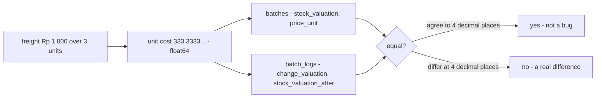
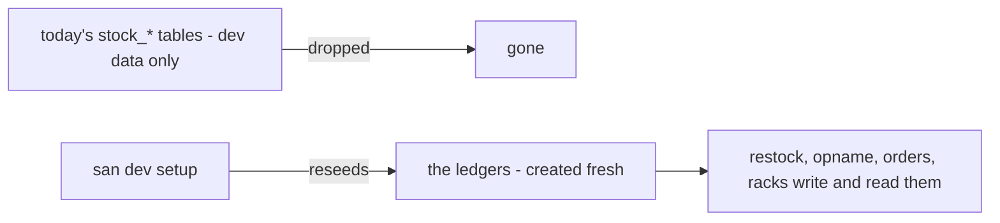
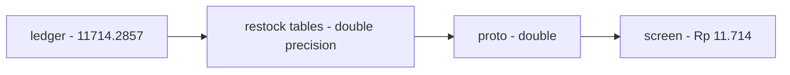
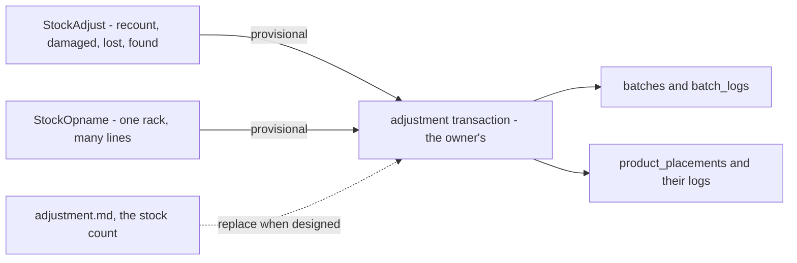
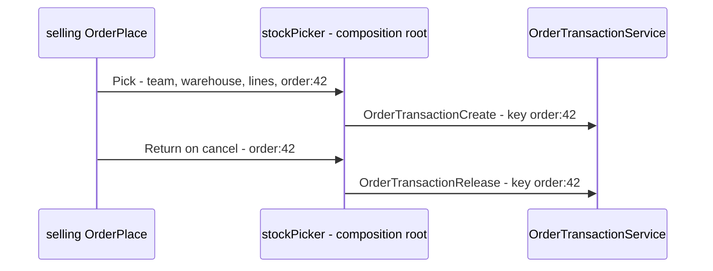
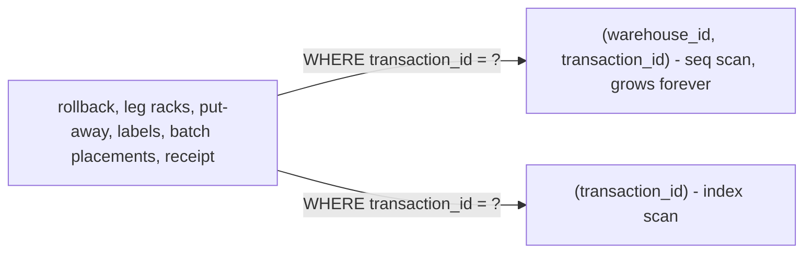
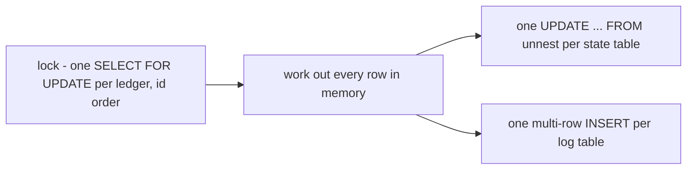

# Decisions — `technical/stock/design.md`

What the owner settled, recorded before it is acted on. **Append-only** — a decision that is later reversed is renamed
and its references grepped (RULE 12), never quietly edited away. The open set is [design_clarify.md](./design_clarify.md).

| decision | says | from |
| --- | --- | --- |
| [stock-money-is-float64-compared-at-4-digits](#stock-money-is-float64-compared-at-4-digits) | every money column in the stock ledgers is `float64`, and two amounts are compared at 4-digit precision | chat, 2026-10-10 — answers stock Q4, **against** my `int64` rupiah |
| [no-switch-over-the-ledgers-replace-todays-tables](#no-switch-over-the-ledgers-replace-todays-tables) | nothing is in production, so the ledgers replace today's stock tables outright — no data is carried, dev data is reseeded, and no all-at-once switch-over is staged | chat, 2026-10-15 — answers Q5 |
| [money-is-double-in-the-api-too](#money-is-double-in-the-api-too) | inventory's money is `double` on the wire and in its own tables as well as in the ledgers, each feature switching when it moves onto the ledgers | chat, 2026-10-15 — answers Q6 |
| [old-shelf-corrections-move-onto-the-ledgers-provisionally](#old-shelf-corrections-move-onto-the-ledgers-provisionally) | `StockAdjust` and the one-rack `StockOpname` survive the cut-over as provisional `adjustment` transactions, keeping today's reasons and money, until adjustment and the stock count are designed | chat, 2026-10-16 — **against** my *remove until designed* |
| [the-order-take-bridges-its-key-per-order](#the-order-take-bridges-its-key-per-order) | until the order form mints K, selling's take and cancel reach `OrderTransactionService` with the key `order:<order id>` | chat, 2026-10-16 — as recommended |
| [placement-logs-are-indexed-by-transaction](#placement-logs-are-indexed-by-transaction) | `product_placement_logs` is indexed by `transaction_id` alone, replacing the `(warehouse_id, transaction_id)` index | chat, 2026-10-17 — *"go ahead"*, as the audit recommended |
| [ledger-writes-are-set-based](#ledger-writes-are-set-based) | a ledger write costs the same statements for one line as for fifty: rows are worked out in memory on locked rows, then written once per table | chat, 2026-10-17 — *"go ahead"*, as the audit recommended |

---

## stock-money-is-float64-compared-at-4-digits

> Owner, in chat *(2026-10-10)*: *"r1 is float"*, answering R1 of the ledger round, which was
> [design_clarify Q4](./design_clarify.md#question): *valuation type — `numeric` or integer rupiah?* **Against my
> recommendation** (`int64` rupiah). It keeps what [design.md](./design.md) §General Brief already says, and matches the
> system-wide [rupiah-is-floating-point](../../business/order/context_decision.md#rupiah-is-floating-point).

**The verdict.** Stock money is floating point, like every other rupiah amount in the system. A unit cost may be
fractional (Rp 1.000 of freight over 3 units is Rp 333,333… each), and that is stored as is. Because float is inexact,
two amounts are never compared with `==`. They are equal when they agree to 4 decimal places.

**The spec.**

| | |
| --- | --- |
| the type | `float64` in Go · `double precision` in Postgres · `double` in proto |
| which columns | every money column in the stock ledgers, as [batch.md](../../business/inventory/batch.md) names them: `batches.price_unit`, `stock_valuation`, `init_stock_valuation`; `batch_logs.change_valuation`, `stock_valuation_after`; `batch_price_logs.new_price_unit`, `delta_price_unit`; the restock's and the transfer's totals and costs |
| quantities | stay `int` — a unit is never fractional |
| comparing two amounts | at 4-digit precision ([design.md](./design.md) §General Brief 2), through **one shared helper**, never `==`, so the rule lives in one place |
| what the log guarantees | the log reproduces a batch's money **to 4-digit precision**. A reconcile compares at that precision, and a difference below it is not evidence of a bug |

**What it does NOT settle** — where a division's remainder goes when a batch empties (the take that empties it removes
all that is left): [context Q14c](../../business/inventory/context_clarify.md#question) · how freight is split across
lines: [Q3](./design_clarify.md#question) and [context Q1](../../business/inventory/context_clarify.md#question) ·
whether float is the ledger **template's** default too, for the payment ledger:
[mutation_and_ledger Q2](../ledger/mutation_and_ledger_clarify.md#question).

## no-switch-over-the-ledgers-replace-todays-tables

> Owner, in chat *(2026-10-15)*: *"we not on production yet, switch over is overkill"*, to my plan of a one-pass switch-over
> (carry each warehouse's stock into opening ledger rows, move every reader and writer at once, then drop the old tables).
> It answers [Q5](./design_clarify.md#question), which offered a cut-over or side by side, with neither.

**The verdict.** Nothing runs in production, so there is no stock to carry. The decided ledgers (`inventory_transactions`,
`batches` + `batch_logs`, `product_placements` + `product_placement_logs`) **replace** today's `stock_*` tables outright:
new migrations create them, the old tables are dropped, and the development database is reseeded by `san dev setup`. No
opening transactions, no cut-over plan, no side-by-side reads. A table rename in inventory (restock's tables taking the
owner's names) is just a migration, for the same reason.

**The spec.**

| | |
| --- | --- |
| data | not carried. A developer's database is reseeded, not migrated |
| the old tables | dropped by the migration that replaces them |
| readers and writers | each moved onto the ledgers when its feature is built on them |
| what it does NOT change | the ledgers' own rules, still open in [transaction_clarify](../../business/inventory/transaction_clarify.md#question), [context Q14](../../business/inventory/context_clarify.md#question) and [the template](../ledger/mutation_and_ledger_clarify.md#question) |

## money-is-double-in-the-api-too

> Owner, in chat *(2026-10-15)*: *"for 5 change api to float64/double too"*, to [Q6](./design_clarify.md#question) — *the
> ledgers keep money as `float64`; switch restock's API money to decimal when it moves onto the ledgers?*

**The verdict.** Inventory's money is `double` end to end: in the ledgers
([stock-money-is-float64-compared-at-4-digits](#stock-money-is-float64-compared-at-4-digits)), in each feature's own
tables, and on the wire. A landed price of 11.714,2857… reaches the screen as it is stored, and the screen rounds it for
display. Nothing converts at the ledger's edge, so nothing truncates there.

**The spec.**

| | |
| --- | --- |
| proto money fields | `int64` → `double`, feature by feature — restock first |
| the feature's own money columns | `BIGINT` → `DOUBLE PRECISION` in the same migration |
| when | in the commit that moves each feature onto the ledgers; restock's is next |
| arithmetic | no rounding down at each step any more; two amounts are compared at 4 digits, through the one shared helper |
| the screen | rounds for display only |

## old-shelf-corrections-move-onto-the-ledgers-provisionally

> Owner, in chat *(2026-10-16)*: *"Port provisionally"*, asked what the cut-over does with `StockAdjust` and the one-rack
> `StockOpname` — the two writers with no decided replacement (adjustment.md is empty; the stock count awaits
> design_accept). **Against my recommendation** to remove both until they are designed.

**The verdict.** Both keep working through the cut-over. They are rewritten onto the ledgers as `adjustment`
transactions, keeping what each does today — the same reasons, the same money — on the new tables. The semantics are
**provisional**: every point the port had to choose is listed in
[adjustment_clarify.md](../../business/inventory/adjustment_clarify.md) for the owner to confirm or reverse, and the real
adjustment and the stock count replace them when designed.

**The spec** — the proposed semantics are in the clarify; what is fixed here is only this:

| | |
| --- | --- |
| tx type | `adjustment`, one per owning team per call |
| money | unchanged from today: a damaged or lost unit is written off to expense and owed to its owner; a found one gives the debt back; a recount by `StockAdjust` books nothing; a shortfall found by `StockOpname` is written off and owed |
| until | adjustment.md and the stock count are designed — then these two RPCs go |

## the-order-take-bridges-its-key-per-order

> Owner, in chat *(2026-10-16)*: *"Bridge key per order"*, as recommended — asked how selling's order take and cancel
> reach the ledgers before the order form mints a key per submit
> ([every-submit-mints-a-new-key](../../business/order/context_decision.md#every-submit-mints-a-new-key)).

**The verdict.** The composition root's stock picker stops calling `StockPick` / `StockReturn` and calls
`OrderTransactionCreate` / `OrderTransactionRelease`, with the key **`order:<order id>`** — the reference selling already
writes on every order's draw. One order takes once and is released by the same key. It is a bridge: when the order
form mints K per submit, K replaces it, and neither inventory nor the contract changes.

**The spec.**

| | |
| --- | --- |
| the key | `order:<order id>` — `selling_v1.stockRef`, unchanged |
| a take refused | Connect's code passes through: `FailedPrecondition` for stock, as `StockPick` refused it |
| a release of nothing | answers `released = false`, never an error — an order that never drew stock cancels cleanly |
| replaced by | the order form's per-submit key, when the order context is built |

## placement-logs-are-indexed-by-transaction

> Owner, in chat *(2026-10-17)*: *"go ahead"* — to the audit's open question
> ([OrderTransactionRelease](../../../audits/services/inventory_service/performances/OrderTransactionRelease.md#open-questions)):
> *replace `product_placement_logs_transaction_idx` with `(transaction_id)`?* As recommended.

**The verdict.** Every reader asks for a transaction's rack rows by `transaction_id` alone, and the index led with
`warehouse_id`, so each read scanned the whole log. A transaction id is unique system-wide, so the warehouse adds nothing.
One index of the same width replaces the other, as `batch_logs_transaction_idx` already is.

**The spec.**

| | |
| --- | --- |
| migration | `00031_placement_logs_by_transaction` — drop and recreate `product_placement_logs_transaction_idx` on `(transaction_id)`; down restores the old shape |
| readers | unchanged — none of the six names the warehouse; `StockPickLocations`, which joins by transaction, still uses it |
| production | inside goose's transaction `CONCURRENTLY` is unavailable; on a large live table this would be its own non-transactional migration |

## ledger-writes-are-set-based

> Owner, in chat *(2026-10-17)*: *"go ahead"* — to the audit's open question
> ([OrderTransactionCreate](../../../audits/services/inventory_service/performances/OrderTransactionCreate.md#open-questions)):
> *set-based ledger primitives, before go-live?* As recommended, after the ledger review.

**The verdict.** A ledger write costs the same round trips for one line as for fifty. The rules stay one row at a time:
oldest batch first, fewest rack first, the emptying take takes all. They run in memory on rows already locked, and each
table is then written once. Locks are still taken before anything is written, batches before racks, each in id order —
now in ONE statement per ledger, so two writers over the same stock queue in the same order whatever their lines.

**The spec.**

| primitive | statements | was |
| --- | --- | --- |
| `LockBatches` / `LockRacks` | 1 each, every line's rows, in id order | one read per line, the batches read twice |
| `TakeOldestFirst`, `TakeFewestFirst`, `RackWrites.Apply` | 0 — in memory on the locked rows | an `UPDATE` and a log `INSERT` per row |
| `BatchWrites.Flush`, `RackWrites.Flush` | 2 — one `UPDATE … FROM unnest(…)`, one multi-row log `INSERT` | — |
| `MintBatches` | 3 — batches `RETURNING id`, their logs, their prices | 3 per batch |
| `EnsureAndLockRacks`, `PutOnPlacements` | 2 / 4 — one insert-if-missing in (product, rack) order, one lock | 1 insert per row + 1 lock |
| a row changed twice in one call | stored once at its last state, logged twice, each log row with the state after its own change | — |
| proof | `Verify` and the race tests carry it, plus `TestLedgerWrites_TheStatementsDoNotGrowWithTheLines` and `TestOrderTransactionCreate_TheStatementsDoNotGrowWithTheLines`, which fail if a line adds a statement | — |
