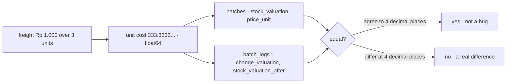

# Decisions — `technical/stock/design.md`

What the owner settled, recorded before it is acted on. **Append-only** — a decision that is later reversed is renamed
and its references grepped (RULE 12), never quietly edited away. The open set is [design_clarify.md](./design_clarify.md).

| decision | says | from |
| --- | --- | --- |
| [stock-money-is-float64-compared-at-4-digits](#stock-money-is-float64-compared-at-4-digits) | every money column in the stock ledgers is `float64`, and two amounts are compared at 4-digit precision | chat, 2026-10-10 — answers stock Q4, **against** my `int64` rupiah |

---

## stock-money-is-float64-compared-at-4-digits

> Owner, in chat *(2026-10-10)*: *"r1 is float"*, answering R1 of the ledger round, which was
> [design_clarify Q4](./design_clarify.md#question): *valuation type — `numeric` or integer rupiah?* **Against my
> recommendation** (`int64` rupiah). It keeps what [design.md](./design.md) §General Brief already says, and matches the
> system-wide [rupiah-is-floating-point](../../business/order/context_decision.md#rupiah-is-floating-point).

**The verdict.** Stock money is floating point, like every other rupiah amount in the system. A unit cost may be
fractional (Rp 1.000 of freight over 3 units is Rp 333,333… each), and that is stored as is. Because float is inexact,
two amounts are never compared with `==`. They are equal when they agree to 4 decimal places.

**The spec.**

| | |
| --- | --- |
| the type | `float64` in Go · `double precision` in Postgres · `double` in proto |
| which columns | every money column in the stock ledgers, as [batch.md](../../business/inventory/batch.md) names them: `batches.price_unit`, `stock_valuation`, `init_stock_valuation`; `batch_logs.change_valuation`, `stock_valuation_after`; `batch_price_logs.new_price_unit`, `delta_price_unit`; the restock's and the transfer's totals and costs |
| quantities | stay `int` — a unit is never fractional |
| comparing two amounts | at 4-digit precision ([design.md](./design.md) §General Brief 2), through **one shared helper**, never `==`, so the rule lives in one place |
| what the log guarantees | the log reproduces a batch's money **to 4-digit precision**. A reconcile compares at that precision, and a difference below it is not evidence of a bug |

**What it does NOT settle** — where a division's remainder goes when a batch empties (the take that empties it removes
all that is left): [context Q14c](../../business/inventory/context_clarify.md#question) · how freight is split across
lines: [Q3](./design_clarify.md#question) and [context Q1](../../business/inventory/context_clarify.md#question) ·
whether float is the ledger **template's** default too, for the payment ledger:
[mutation_and_ledger Q2](../ledger/mutation_and_ledger_clarify.md#question).
